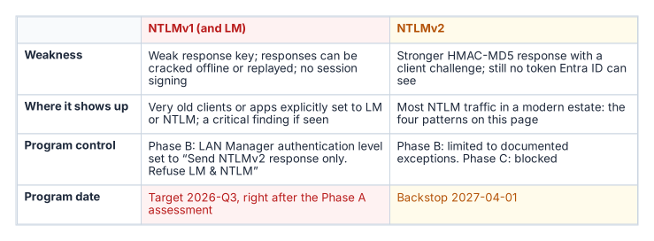
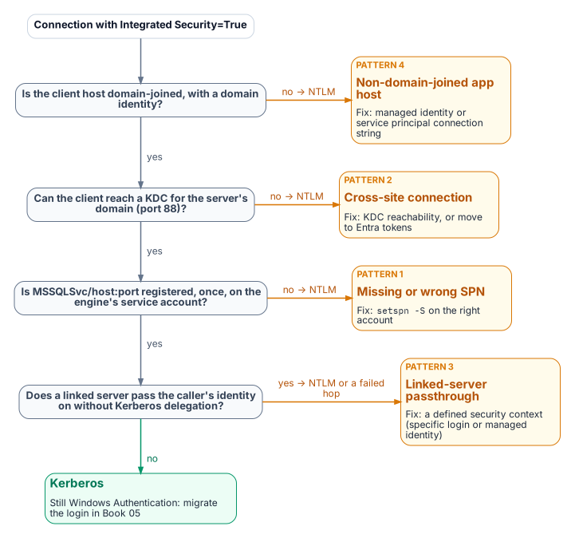

# Chapter 14 — NTLMv1, NTLMv2 and the Patterns That Generate NTLM

*NTLM is a protocol, not a setting, so removing it means naming every connection pattern that produces it.*

::: {.callout-note}
## In this chapter
Why NTLMv1 is blocked early in the program while NTLMv2 runs to the program's 2027-04-01 backstop, and how both dates relate to what Microsoft has actually announced. Then the four SQL Server connection patterns that generate NTLM: a missing SPN, an unreachable domain controller, linked-server passthrough, and application hosts that are no longer domain-joined.
:::

::: {.callout-tip}
## Where this part of the book starts
SQL Server is one of the most common sources of NTLM traffic in a large Windows estate, and the reasons are more varied than most database teams expect. Chapters 14 and 15 apply the Kerberos/NTLM-elimination program's three phases (assess, block where safe, eliminate) to the SQL Server workload, against the program's own network-level backstop of 2027-04-01. In the program's dependency chain this is step 8, enforcing protocol retirement. The working procedure is [Runbook R06](r06-ntlm-detection-and-remediation.md).
:::

{fig-alt="Phase A discovers and measures every NTLM source, phase B blocks LM and NTLMv1 where safe and fixes SPNs and linked servers, and phase C blocks NTLM estate-wide by the program backstop of 2027-04-01."}

No single switch or Group Policy change removes NTLM from SQL Server connections. Eliminating it means finding every connection pattern that generates it, and there are more than most database teams expect. Beyond the missing-SPN case from [Chapter 01](01-what-windows-authentication-actually-is.md) there are cross-site connections, linked-server passthrough, and hosts already moved to a non-domain-joined state, each with its own root cause and fix.

## Where Microsoft stands on NTLM

The program's dates are its own, so it helps to state Microsoft's first:

- **All versions of NTLM are deprecated.** In June 2024 Microsoft announced that LANMAN, NTLMv1 and NTLMv2 are no longer under active feature development. Its guidance is to replace calls to NTLM with calls to Negotiate, which tries Kerberos first.[^c14-deprecated]
- **NTLMv1 is removed** starting with Windows 11, version 24H2 and Windows Server 2025. NTLMv2 still works on Windows Server 2025 but will be removed in a future release.[^c14-deprecated][^c14-ws-removed]
- **NTLMv1-derived credentials for single sign-on are blocked by default** starting with the October 2026 security update (released October 13, 2026) on Windows 11, versions 24H2 through 26H2, and Windows Server 2025, on devices where Credential Guard is off. The change targets single sign-on paths such as MS-CHAPv2 Wi-Fi and VPN, not NTLMv1 network authentication in general, and a `BlockNtlmv1SSO` registry value can temporarily return a device to audit.[^c14-mc][^c14-kb]
- **Network NTLM is to be off by default** in the next major release of Windows Server and its client. Microsoft published a three-phase plan on January 29, 2026: enhanced NTLM auditing first, then new tooling such as IAKerb and local KDC in the second half of 2026, then NTLM disabled by default. Microsoft says the timelines are subject to change.[^c14-plan]

None of these is a deadline for SQL Server. The 2027-04-01 date belongs to the program.

## NTLMv1: blocked first, in Phase B

{fig-alt="NTLMv1 and LM have a program target of 2026-Q3, right after the Phase A assessment; NTLMv2 has a backstop of 2027-04-01."}

NTLMv1 and LM are the variants Microsoft says are vulnerable to widely published attacks for obtaining user passwords; its long-standing recommendation is to enforce NTLMv2 and reduce or eliminate NTLMv1 and LM.[^c14-ntlm2][^c14-advisory] A captured NTLMv1 exchange can be attacked offline, and the hash it proves can be replayed (pass-the-hash).

The program blocks NTLMv1 in its Phase B "block where safe" stage, by default as soon as the Phase A assessment completes (targeted 2026-Q3). It does this by setting **Network security: LAN Manager authentication level** to *Send NTLMv2 response only. Refuse LM & NTLM* (level 5). At that level clients send only NTLMv2, and domain controllers refuse LM and NTLMv1 responses but **still accept NTLMv2**.[^c14-ntlm2][^c14-csp] Level 5 is therefore the NTLMv1 block, not an NTLM block; refusing NTLM itself is the job of the *Restrict NTLM* policies in [Chapter 15](15-the-three-phases-of-ntlm-elimination.md).

The program's Group Policy is a different control from Microsoft's October 2026 change. Microsoft's change blocks NTLMv1-derived credentials from being used for single sign-on on devices without Credential Guard;[^c14-kb] the program's LAN Manager setting stops NTLMv1 responses from being sent or accepted on every host it reaches, including older systems Microsoft's change doesn't cover. On Windows 11, version 24H2 and Windows Server 2025, NTLMv1 is already removed,[^c14-deprecated] so the setting matters most on older hosts and clients still in the estate.

NTLMv1 found by the authentication audit or Phase A traffic analysis is a critical finding requiring immediate remediation, not a routine migration item. On a domain controller with logon success auditing on, Event ID 4624 records the NTLM version in its *Package Name (NTLM only)* field. Microsoft cautions that the field reports NTLM V1 for anonymous logons and for any session without NTLMv2 key material, so filter those out before raising a finding.[^c14-audit-v1]

## NTLMv2: the program's 2027-04-01 backstop

NTLMv2 is what most SQL Server NTLM traffic in a modern estate uses. Phase B restricts it to documented exception groups; Phase C disables it at the 2027-04-01 hard cutover, the program's own backstop. That is a program decision, not a Microsoft deadline: Microsoft's stated plan is to disable network NTLM by default, not remove it, in the next major Windows release, subject to change.[^c14-plan] SQL Server NTLMv2 connections must move before that date either to Kerberos, as an interim posture, or to Entra ID OAuth 2.0 authentication, the final destination.

Cloud Kerberos trust, which the Kerberos/NTLM-elimination program deploys for Windows Hello for Business, helps the interim posture on Entra-joined clients: the client gets a partial ticket-granting ticket from Entra ID and exchanges it with an on-premises domain controller for a full one, which it then uses for resources such as SQL Server.[^c14-entra-kerberos] It doesn't remove the domain controller from the path, which matters for Pattern Two below.

## Pattern One: missing or incorrect SPN

{fig-alt="Decision flow for an Integrated Security connection: a client that isn't domain-joined, can't reach a KDC, or finds no registered SPN falls back to NTLM; a duplicate or wrong-account SPN fails instead; a linked server passing the caller on without delegation leads to NTLM or a failed hop; each failure is labelled with its pattern and fix."}

::: {.callout-tip title="Established in Chapter 01"}
When no valid SPN is registered for the engine's service account, SSPI can't negotiate Kerberos and falls back to NTLM.
:::

This is the most common cause of NTLM fallback. The SPN takes the form `MSSQLSvc/<FQDN>:<port>` for TCP connections, or `MSSQLSvc/<FQDN>:<instancename>` for a named instance over other protocols, registered on the account the engine runs under. If the driver can't obtain a ticket for the SPN it builds, authentication uses NTLM.[^c14-spn] The fix is `setspn -S MSSQLSvc/<FQDN>:<port> <domain>\<account>`, which checks for duplicates before adding.[^c14-spn] The authentication audit captures SPN status per instance, and each gap can be fixed independently of the login migration.

Two neighbors of this pattern behave differently, and the difference matters for triage:

- **An SPN on the wrong account doesn't fall back. It fails.** Microsoft's table of authentication defaults is explicit: an SPN that maps to an incorrect account makes authentication fail, typically with *Cannot generate SSPI context*. A service-account change without an SPN move produces this, not silent NTLM.[^c14-spn][^c14-sspi]
- **A duplicate SPN also breaks Kerberos.** SPNs must be unique in the forest; when more than one account holds the requested SPN, the KDC returns `KDC_ERR_PRINCIPAL_NOT_UNIQUE`.[^c14-dup] Find duplicates with `setspn -Q <SPN>` (or `setspn -X` across trusted forests) and remove the extra registration.

Even with a correct SPN, Microsoft's defaults table shows that **local connections use NTLM** and only remote connections use Kerberos.[^c14-spn] An application on the same host as the instance is an NTLM source that SPN repair won't touch; it belongs with Pattern Four. Some older client components also force NTLM: the legacy SQLOLEDB provider and the legacy *SQL Server* ODBC driver that ship with Windows support only NTLM over named pipes. Microsoft's fix is TCP, or a current driver such as MSOLEDBSQL or ODBC Driver 17 or later.[^c14-consistent]

## Pattern Two: cross-site connections

Connections that cross AD sites, domains or forests can generate NTLM when Kerberos can't complete. To use Kerberos with SQL Server, the client and server must be in the same domain or in trusted domains, and the client must obtain a service ticket from a domain controller of the domain that holds the server's service account (any domain controller of that domain, not one in a particular site).[^c14-spn] Across forests that also needs a forest trust with name-suffix routing for the SPN; without a trust, neither Kerberos nor NTLM can authenticate an account from the other forest.

If the client can't reach or locate a domain controller for that domain (port 88 blocked, or DNS that doesn't resolve it), Negotiate falls back to NTLM where a trust lets the server validate the account, and the connection fails where it doesn't. This is common in large, distributed networks. Microsoft names valid DNS on client and server as the key factor in Kerberos success, and lists SQL Server aliases and HOSTS file entries as common causes of an unexpected SPN, and so of NTLM.[^c14-sspi][^c14-consistent]

Detect it in Phase A output by correlating source and destination sites. Cross-site NTLM usually means domain controller reachability or DNS from the source site, but a missing SPN or trust gap looks the same, so confirm with `klist` or the client's Kerberos events before changing firewall rules. The remediation is to restore Kerberos (domain controller reachability on UDP and TCP port 88 and working DNS from every client site, a correct SPN and, across forests, a trust) or to move the connection to Entra ID tokens, which need no domain controller at all. Cloud Kerberos trust isn't a fix for this pattern: the partial ticket Entra ID issues must still be exchanged with an on-premises domain controller, and the service ticket for the SQL Server SPN still comes from one.[^c14-entra-kerberos]

## Pattern Three: linked-server passthrough authentication

Linked-server definitions, which let one instance query another with `OPENQUERY` or four-part names, often use Windows passthrough (self-mapping, `@useself = 'TRUE'`, the *Be made using the login's current security context* option). The originating instance then tries to present the connecting client's Windows identity to the target instance: a second hop.

NTLM can't make that hop. Microsoft states that a double hop fails if NTLM credentials are used and needs Kerberos; the typical symptom is `Login failed for user 'NT AUTHORITY\ANONYMOUS LOGON'`.[^c14-consistent][^c14-18456] Passthrough needs Kerberos delegation: the client must reach the first instance with Kerberos, and the first instance's service account must be trusted for delegation to the target's SPN, preferably constrained or resource-based constrained delegation.[^c14-kcd] Unconstrained delegation is also blocked on any client where Credential Guard is on.[^c14-credguard] Don't make the hop work by trusting the first instance's host or service account for delegation to any service: that server then holds a reusable ticket for every user who connects, including administrators. The Start Kit's one-page summary lists the SQL Server instances whose host or service account has unconstrained delegation, and [Book 02, Chapter 08](../b02-identity/08-assessing-the-forest.md) covers the fix and the protections for privileged accounts. In practice the pattern shows up as NTLM on the client's first hop or as a failed second hop; it isn't a working NTLM path to keep.

Linked-server NTLM often looks like internal traffic and escapes standard connection audits. Find it through `sys.servers`, `sys.linked_logins` and inter-instance traffic analysis. Each passthrough definition is migrated during the restriction phase to a defined security context:

- a specific mapped login;
- on SQL Server 2022 and later with Entra authentication configured on both instances, an access token for an Entra application, which the source instance generates from the application's client secret (a documented exception under [Chapter 11](11-three-principal-types.md)'s credential rule);[^c14-linked][^c14-linked-token]
- on SQL Server 2025, a managed identity (`Authentication=ActiveDirectoryMSI` with the `MSOLEDBSQL` provider), with a login for the source server created on the target `FROM EXTERNAL PROVIDER`;[^c14-linked-mi] or
- where the caller's own identity must reach the target, Kerberos constrained delegation.

Avoid the password option for Entra linked servers: the Entra username-and-password flow is deprecated in Microsoft's SQL drivers and is incompatible with mandatory multifactor authentication.[^c14-sqlclient]

## Pattern Four: non-domain-joined application hosts

In the program's target architecture, Arc-enabled servers run without a domain join (see [Book 05, Chapter 09](../b05-devices/09-servers-under-azure-arc.md)). An application on an unjoined host has no Kerberos ticket-granting ticket, so a connection string still using Windows Integrated Security falls back to NTLM with local credentials, or fails outright: a new NTLM source the unjoin created. The pattern grows as server unjoin progresses, which is why connection strings should move to managed identity before or alongside application-host unjoin ([Chapter 19](19-connection-string-migration.md)). A host on managed identity generates no NTLM and satisfies both programs.

::: {.callout-note title="What this chapter establishes"}
1. NTLM is a protocol, not a setting; no single switch removes it from SQL Server connections. Microsoft has deprecated every version and removed NTLMv1 from current Windows, but the 2027-04-01 date is the program's.
2. NTLMv1 is blocked early with LAN Manager level 5, which still accepts NTLMv2; NTLMv2 is restricted to exception groups, then blocked at the program's 2027-04-01 cutover.
3. Four patterns generate NTLM at the SQL layer (missing SPNs, unreachable domain controllers, linked-server passthrough and non-domain-joined or same-host clients), and each must be found before it can be fixed. Duplicate or misplaced SPNs fail rather than fall back.
:::

::: {.callout-tip}
## Continue the book
[← Previous: Chapter 13 — Who Owns the Data Platform](13-who-owns-the-data-platform.md) · [Book index](index.md) · [Next: Chapter 15 — The Three Phases of NTLM Elimination for SQL Server →](15-the-three-phases-of-ntlm-elimination.md)
:::

[^c14-deprecated]: Microsoft Learn, "Deprecated features for Windows client," entry NTLM (deprecation announced June 2024; update November 2024: NTLMv1 removed starting in Windows 11, version 24H2 and Windows Server 2025), <https://learn.microsoft.com/windows/whats-new/deprecated-features> (accessed Oct 20, 2026).
[^c14-ws-removed]: Microsoft Learn, "Features removed or no longer developed in Windows Server," Windows Server 2025, entry NTLM, <https://learn.microsoft.com/windows-server/get-started/removed-deprecated-features-windows-server> (accessed Oct 20, 2026).
[^c14-mc]: Microsoft Learn, "Windows message center," entry "Take action: NTLMv1 hardening changes might affect network connections on devices without Credential Guard," October 14, 2026, <https://learn.microsoft.com/windows/release-health/windows-message-center> (accessed Oct 20, 2026).
[^c14-kb]: Microsoft Support, KB5066470, "Manage NTLMv1 changes and prevent network authentication issues in Windows" (applies to Windows 11 versions 24H2, 25H2, 26H1 and 26H2 and Windows Server 2025; `BlockNtlmv1SSO`; enforcement by default from the October 13, 2026 updates; applies only where Credential Guard is disabled; events 4024 and 4025), <https://support.microsoft.com/help/5066470> (accessed Oct 21, 2026).
[^c14-plan]: Microsoft Windows IT Pro Blog, "Advancing Windows security: Disabling NTLM by default," January 29, 2026, <https://techcommunity.microsoft.com/blog/windows-itpro-blog/advancing-windows-security-disabling-ntlm-by-default/4489526> (accessed Oct 20, 2026).
[^c14-ntlm2]: Microsoft Learn, "How to enable NTLM 2 authentication," section "More information" (LMCompatibilityLevel levels 0–5), <https://learn.microsoft.com/troubleshoot/windows-client/windows-security/enable-ntlm-2-authentication> (accessed Oct 20, 2026).
[^c14-advisory]: Microsoft, Security Advisory 973811, "Frequently asked questions," <https://learn.microsoft.com/security-updates/securityadvisories/2009/973811> (accessed Oct 20, 2026).
[^c14-csp]: Microsoft Learn, "Policy CSP - LocalPoliciesSecurityOptions," entry NetworkSecurity_LANManagerAuthenticationLevel, <https://learn.microsoft.com/windows/client-management/mdm/policy-csp-localpoliciessecurityoptions> (accessed Oct 20, 2026).
[^c14-audit-v1]: Microsoft Learn, "Audit use of NTLMv1 on a Windows Server-based domain controller," <https://learn.microsoft.com/troubleshoot/windows-server/windows-security/audit-domain-controller-ntlmv1> (accessed Oct 20, 2026).
[^c14-entra-kerberos]: Microsoft Learn, "Introduction to Microsoft Entra Kerberos," section "Authentication flow," <https://learn.microsoft.com/entra/identity/authentication/kerberos> (accessed Oct 20, 2026).
[^c14-spn]: Microsoft Learn, "Register a Service Principal Name for Kerberos connections," sections "The role of the SPN in authentication," "SPN formats," "Manual SPN registration" and "Authentication defaults," <https://learn.microsoft.com/sql/database-engine/configure-windows/register-a-service-principal-name-for-kerberos-connections> (accessed Oct 20, 2026).
[^c14-sspi]: Microsoft Learn, "'Cannot generate SSPI context' error when using Windows authentication to connect to SQL Server," sections "Frequently asked questions" and "Fix the error without Kerberos Configuration Manager," <https://learn.microsoft.com/troubleshoot/sql/database-engine/connect/cannot-generate-sspi-context-error> (accessed Oct 20, 2026).
[^c14-dup]: Microsoft Learn, "Kerberos generates KDC_ERR_S_PRINCIPAL_UNKNOWN or KDC_ERR_PRINCIPAL_NOT_UNIQUE error," <https://learn.microsoft.com/troubleshoot/windows-server/windows-security/kerberos-error-kdc-err-s-principal-unknown-or-not-unique> (accessed Oct 20, 2026).
[^c14-consistent]: Microsoft Learn, "Consistent authentication issues in SQL Server" (legacy providers and named pipes; HOSTS file and aliases; NTLM double hop), <https://learn.microsoft.com/troubleshoot/sql/database-engine/connect/consistent-authentication-connectivity-issues> (accessed Oct 20, 2026).
[^c14-18456]: Microsoft Learn, "MSSQLSERVER_18456," section "Login failed for user NT AUTHORITY\ANONYMOUS LOGON," <https://learn.microsoft.com/sql/relational-databases/errors-events/mssqlserver-18456-database-engine-error> (accessed Oct 20, 2026).
[^c14-kcd]: Microsoft Learn, "Kerberos Constrained Delegation Overview," <https://learn.microsoft.com/windows-server/security/kerberos/kerberos-constrained-delegation-overview> (accessed Oct 20, 2026).
[^c14-credguard]: Microsoft Learn, "How Credential Guard works," section "Credential Guard protection limits," <https://learn.microsoft.com/windows/security/identity-protection/credential-guard/how-it-works> (accessed Oct 20, 2026).
[^c14-linked]: Microsoft Learn, "Linked server for SQL Server with Microsoft Entra authentication," <https://learn.microsoft.com/sql/relational-databases/security/authentication-access/azure-ad-authentication-sql-server-linked-server> (accessed Oct 20, 2026).
[^c14-linked-mi]: Microsoft Learn, "Configure managed identity for linked servers" (SQL Server 2025), <https://learn.microsoft.com/sql/sql-server/azure-arc/managed-identity-support-linked-server> (accessed Oct 20, 2026).
[^c14-sqlclient]: Microsoft Learn, "Microsoft Entra authentication with Microsoft.Data.SqlClient," section "Replace deprecated password authentication," <https://learn.microsoft.com/sql/connect/ado-net/sql/azure-active-directory-authentication> (accessed Oct 20, 2026).
[^c14-linked-token]: Microsoft Learn, "Linked server for SQL Server with Microsoft Entra authentication," section "Linked server configuration using access token authentication" (provider string `AccessToken=%s`; the application "must have a secret assigned to it, which will be used by S1 to generate the access token"), <https://learn.microsoft.com/sql/relational-databases/security/authentication-access/azure-ad-authentication-sql-server-linked-server> (accessed Oct 21, 2026).
