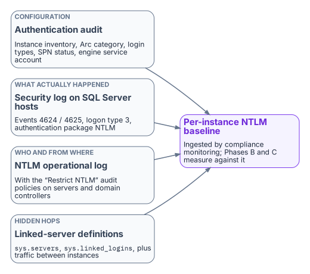
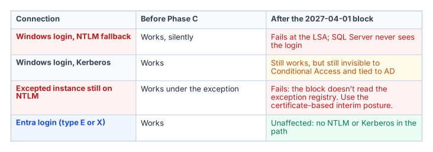

# Chapter 15 — The Three Phases of NTLM Elimination for SQL Server

*Discover, restrict, eliminate: the phase structure the Kerberos/NTLM-elimination program applies everywhere, applied to SQL Server workloads.*

::: {.callout-note}
## In this chapter
How the program's three phases apply to SQL Server. Phase A discovery uses the authentication audit alongside Windows NTLM logging. Phase B restriction converts NTLM connections to Kerberos and migrates the remaining patterns. Phase C elimination applies the domain-wide block on the program's 2027-04-01 backstop. An instance whose logins have moved to Entra ID isn't affected by that block, because it isn't using NTLM in the first place.
:::

The Kerberos/NTLM-elimination program structures NTLM elimination into three phases (discover, restrict, eliminate), and this chapter applies that structure to SQL Server workloads. The phases are sequential and the final one is a hard backstop: the program sets the domain-wide NTLM block to take effect no later than 2027-04-01. That date is the program's decision. Microsoft has deprecated NTLM and plans to disable network NTLM by default in the next major Windows release, but it hasn't set a removal date for NTLMv2 ([Chapter 14](14-ntlm-and-the-patterns-that-generate-it.md)).[^c15-ws-removed]

After that date, any SQL Server connection that needs NTLM fails inside the Windows security subsystem, where the Local Security Authority (LSA) enforces the policy. Windows Authentication in SQL Server is delegated to that subsystem, so the engine never receives an authenticated connection to evaluate.[^c15-auth-mode] SQL Server NTLM elimination therefore can't be decoupled from the broader program timeline. Every NTLM-generating connection pattern must be resolved before the elimination phase, not after.

## Phase A — discovery

{fig-alt="The authentication audit, the Security log on SQL Server hosts (events 4624 and 4625 with the NTLM package), the NTLM operational log and linked-server definitions combine into a per-instance NTLM baseline in compliance monitoring."}

Discovery is the program's first phase, and for SQL Server its primary instrument is the authentication audit ([Chapter 07](07-the-authentication-audit.md)). The Phase A output for SQL Server includes the full instance inventory with Arc-eligibility classifications, the login-type inventory, the SPN registration status for every instance, and the service-account identity for each engine process.

Windows logging supplements the audit by recording what actually happened on the wire. Four sources matter:

- **The Security log on SQL Server hosts.** Event ID 4624 (successful logon) and 4625 (failed logon) with logon type 3, the network logon type, and authentication package NTLM, filtered to SQL Server hosts. On domain controllers, 4624 also carries the NTLM version; ignore the NTLMv1 value on anonymous logons, which Microsoft says is reported for any session without NTLMv2 key material.[^c15-audit-v1]
- **Per-connection proof from the engine.** `sys.dm_exec_connections` returns `auth_scheme` (`NTLM`, `KERBEROS` or `SQL`) for each live connection, which ties a host-level event to a specific instance and login.[^c15-spn]
- **The *Restrict NTLM* audit policies.** *Network security: Restrict NTLM: Audit Incoming NTLM Traffic* on servers, *Audit NTLM authentication in this domain* on domain controllers, and *Outgoing NTLM traffic to remote servers* set to *Audit all* on clients log the requests a later deny setting would block, in the *Applications and Services Logs > Microsoft > Windows > NTLM > Operational* log.[^c15-csp] On domain controllers, event 8004 records the server each NTLM request was for.[^c15-mdi]
- **Enhanced NTLM logging.** Windows 11, version 24H2 and later and Windows Server 2025 add events in the same operational log that say who used NTLM, from where, and why Kerberos wasn't used (4020 to 4023 on clients and servers; 4030 to 4033 on domain controllers), with warning-level variants for downgrades such as NTLMv1. Windows Server 2022 and 2019 get the same logging with the October 13, 2026 updates or later.[^c15-enhanced]

The combination of the audit output and the event analysis produces a complete picture of NTLM-generating SQL Server connection patterns across the estate. The compliance-monitoring pipeline ingests that Phase A output as the baseline from which all later phases measure progress.

## Phase B — restriction

Restriction applies controls that reduce NTLM traffic without eliminating it, creating pressure on connection patterns to migrate while keeping operations running. The primary Phase B control for SQL Server is the NTLMv1 block (LAN Manager authentication level 5), combined with Kerberos remediation for the missing-SPN cases.[^c15-ntlm2][^c15-spn] Level 5 refuses LM and NTLMv1 on domain controllers but still accepts NTLMv2, so it doesn't restrict NTLMv2 by itself.[^c15-ntlm2]

The work in this phase, pattern by pattern:

- **Missing SPNs.** SPN registration is corrected for every instance with a missing SPN, converting those connections from NTLM to Kerberos. Duplicate and wrong-account SPNs, which fail rather than fall back, are cleaned up in the same pass.[^c15-spn]
- **Cross-site connections.** Fixed by restoring domain controller reachability (port 88 and DNS) and, across forests, a trust, or by moving the connection to Entra ID tokens. Cloud Kerberos trust, which the program also deploys, doesn't remove the need for domain controller reachability: its partial tickets are still exchanged with on-premises domain controllers.[^c15-entra-kerberos]
- **Linked servers.** Definitions using passthrough authentication move to defined security contexts.[^c15-linked]
- **Unjoined hosts.** Application connection strings on recently domain-unjoined hosts move to managed identity or service-principal authentication ([Chapter 19](19-connection-string-migration.md)).

NTLMv2 restriction uses the *Restrict NTLM* deny settings, staged from the Phase A audit settings: *Outgoing NTLM traffic to remote servers* on clients, *Incoming NTLM traffic* on servers and *NTLM authentication in this domain* on domain controllers. Only two roles have exception lists: *Add remote server exceptions for NTLM authentication* on the client and *Add server exceptions in this domain* on the domain controller. There's no exception list for the server role.[^c15-csp][^c15-policies] That is the same staging [Book 05, Chapter 05](../b05-devices/05-the-governed-manual-and-retrofit-paths.md) uses for servers generally. The SQL-specific part is the exception content: the excepted instances, fed from the Phase A baseline, go into the domain controller and client lists, and an instance that must keep accepting NTLM can't have *Incoming NTLM traffic* set to deny. If a missed dependency surfaces, relax the deny setting back to audit or add a scoped exception until the owner fixes it.

After Phase B, the only remaining NTLM-generating SQL Server connections should be those that need the enforcement phase's hard block to remove. These are typically applications that can't be modified before the program's 2027-04-01 block date, which become exception cases with formal exception documentation under the program.

## Phase C — elimination

{fig-alt="Under the Phase C block, Windows logins that fall back to NTLM fail at the LSA, Windows logins on Kerberos still work but stay invisible to Conditional Access, excepted instances still on NTLM fail, and Entra logins are unaffected."}

The elimination phase disables NTLM across the estate. Group Policy pushed domain-wide sets the *Restrict NTLM* policies to deny on every host, and any connection that can't negotiate an alternative protocol fails at the LSA. Windows 11, version 24H2 and later also offer NTLM blocking policies in the NTLM policy CSP, including one that blocks all outbound NTLM except listed targets.[^c15-ntlm-csp] For SQL Server, Phase C is only safe after the login migration in [Chapters 11–12](11-three-principal-types.md) is complete for every instance in the estate.

An instance whose connections use Entra ID OAuth 2.0 tokens generates no NTLM traffic. A Microsoft Entra login (type E or X) authenticates with a token issued by Entra ID, not through Kerberos or NTLM; the existing SQL and Windows authentication modes are a separate path.[^c15-entra-sql] An instance that has completed the login migration is therefore immune to Phase C: it wasn't generating NTLM before the block, and it isn't affected by the block after.

The sequencing imperative follows: complete the SQL Server login migration before Phase C is applied. The 2027-04-01 backstop is the Phase C date, and the login migration must be complete before it for every production instance.

::: {.callout-warning title="Unresolved: what happens to the long tail on 2027-04-01"}
**Known fact.** Microsoft's plan is to disable network NTLM by default in the next major Windows release, subject to change; 2027-04-01 is this program's date, not Microsoft's ([Chapter 14](14-ntlm-and-the-patterns-that-generate-it.md)).

**Dependency.** Pre-2022 instances, which can't use Entra authentication at all,[^c15-entra-sql] and deferred applications that can't reach Kerberos or Entra tokens by then rely on the certificate-based interim posture, which needs a replacement CA issuing before AD CS is retired ([Chapter 22](22-where-sql-server-touches-adcs.md)).

**Unresolved decision.** Whether the Phase C date holds for instances whose interim posture isn't in place, or whether they get dated exceptions with network-level isolation.

**Owner and artifact.** The Kerberos/NTLM-elimination program, recorded as an amendment to its enforcement-phase decision and reflected in the exception registry.
:::

::: {.callout-note title="What this chapter establishes"}
1. Discovery baselines every NTLM-generating pattern from the audit, `auth_scheme`, the Security log, and the NTLM operational log fed by the *Restrict NTLM* audit policies and enhanced NTLM logging.
2. Restriction blocks NTLMv1, repairs SPNs and Kerberos reachability, moves linked-server security contexts and connection strings, and stages the *Restrict NTLM* deny settings with audited exceptions.
3. Elimination applies the domain-wide block; instances already on Entra logins are unaffected because they don't use NTLM.
:::

::: {.callout-tip}
## Continue the book
[← Previous: Chapter 14 — NTLMv1, NTLMv2 and the Patterns That Generate NTLM](14-ntlm-and-the-patterns-that-generate-it.md) · [Book index](index.md) · [Next: Chapter 16 — Groups, Roles and How Membership Reaches the Engine →](16-groups-roles-and-membership.md)
:::

[^c15-ws-removed]: Microsoft Learn, "Features removed or no longer developed in Windows Server," Windows Server 2025, entry NTLM, <https://learn.microsoft.com/windows-server/get-started/removed-deprecated-features-windows-server> (accessed Oct 20, 2026).
[^c15-auth-mode]: Microsoft Learn, "Register a Service Principal Name for Kerberos connections," section "The role of the SPN in authentication" (Windows Authentication is NTLM or Kerberos, negotiated by the Windows security layer), <https://learn.microsoft.com/sql/database-engine/configure-windows/register-a-service-principal-name-for-kerberos-connections> (accessed Oct 20, 2026).
[^c15-audit-v1]: Microsoft Learn, "Audit use of NTLMv1 on a Windows Server-based domain controller," <https://learn.microsoft.com/troubleshoot/windows-server/windows-security/audit-domain-controller-ntlmv1> (accessed Oct 20, 2026).
[^c15-spn]: Microsoft Learn, "Register a Service Principal Name for Kerberos connections," sections "Authentication defaults" and `auth_scheme` query, <https://learn.microsoft.com/sql/database-engine/configure-windows/register-a-service-principal-name-for-kerberos-connections> (accessed Oct 20, 2026).
[^c15-csp]: Microsoft Learn, "Policy CSP - LocalPoliciesSecurityOptions," entries NetworkSecurity_RestrictNTLM_AuditIncomingNTLMTraffic, NetworkSecurity_RestrictNTLM_IncomingNTLMTraffic and NetworkSecurity_RestrictNTLM_OutgoingNTLMTrafficToRemoteServers, <https://learn.microsoft.com/windows/client-management/mdm/policy-csp-localpoliciessecurityoptions> (accessed Oct 20, 2026).
[^c15-mdi]: Microsoft Learn, "Configure Windows event auditing" (Microsoft Defender for Identity), section "Configure NTLM auditing" (event 8004 on domain controllers), <https://learn.microsoft.com/defender-for-identity/deploy/configure-windows-event-collection> (accessed Oct 20, 2026).
[^c15-enhanced]: Microsoft Support, "Overview of NTLM auditing enhancements in Windows 11, version 24H2, Windows Server 2019, and later versions," <https://support.microsoft.com/en-us/servicing/os/windows/2025/07/overview-of-ntlm-auditing-enhancements-in-windows-11-version-24h2-and-windows-server-2025> (accessed Oct 20, 2026).
[^c15-ntlm2]: Microsoft Learn, "How to enable NTLM 2 authentication," section "More information" (LMCompatibilityLevel levels 0–5), <https://learn.microsoft.com/troubleshoot/windows-client/windows-security/enable-ntlm-2-authentication> (accessed Oct 20, 2026).
[^c15-entra-kerberos]: Microsoft Learn, "Introduction to Microsoft Entra Kerberos," section "Authentication flow," <https://learn.microsoft.com/entra/identity/authentication/kerberos> (accessed Oct 20, 2026).
[^c15-linked]: Microsoft Learn, "Linked server for SQL Server with Microsoft Entra authentication," <https://learn.microsoft.com/sql/relational-databases/security/authentication-access/azure-ad-authentication-sql-server-linked-server> (accessed Oct 20, 2026).
[^c15-policies]: Microsoft Learn, "Status code 0x32 and you can't join a domain," section "More information" (the seven NTLM security policies; exception lists for the client and domain controller roles only), <https://learn.microsoft.com/troubleshoot/windows-server/active-directory/status-code-0x32-cannot-join-domain> (accessed Oct 20, 2026).
[^c15-ntlm-csp]: Microsoft Learn, "Policy CSP - NTLM," entry BlockAll (Windows 11, version 24H2 and later), <https://learn.microsoft.com/windows/client-management/mdm/policy-csp-ntlm> (accessed Oct 20, 2026).
[^c15-entra-sql]: Microsoft Learn, "Microsoft Entra authentication for SQL Server" (SQL Server 2022 and later; existing SQL and Windows authentication modes unchanged), <https://learn.microsoft.com/sql/relational-databases/security/authentication-access/azure-ad-authentication-sql-server-overview> (accessed Oct 20, 2026).
