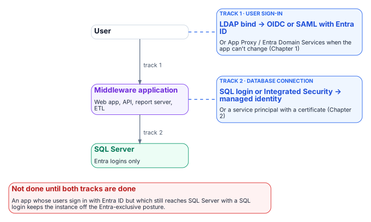
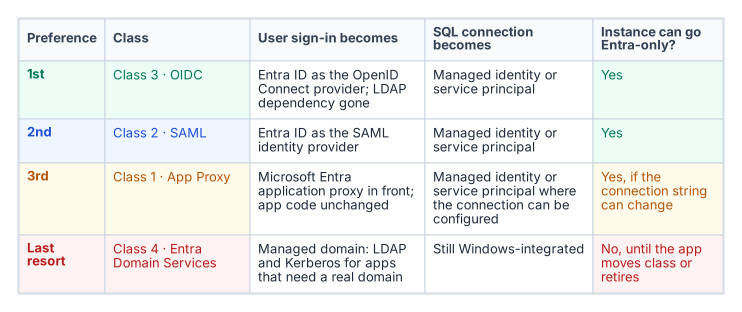
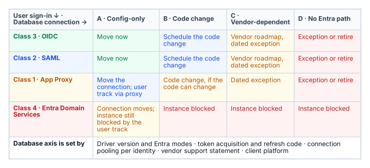

# Chapter 18 — The Four-Class Pattern Applied to SQL-Consuming Applications

*The application is the other half of the authentication chain, and it has its own AD dependency to remove.*

::: {.callout-note}
## In this chapter
Why SQL Server's authentication transformation is incomplete until the upstream applications that consume it are addressed. How the LDAP-dependent-application migration plan's four-class taxonomy sorts those applications by modernization capability. What each class means for both the user sign-in track and the SQL connection track. How the application-audit script produces the per-application classification data that drives the triage.
:::

::: {.callout-tip}
## Where this part of the book goes next
An upstream application that has moved its user sign-in to Entra ID but still uses a SQL Authentication service account to reach the database hasn't finished its transformation. Chapters 18 and 19 treat the application chain as one authentication path, not as independent layers: the four-class pattern for the application (this chapter) and the connection-string change that ends it ([Chapter 19](19-connection-string-migration.md)). In the program's dependency chain this is step 6, moving applications. The working procedure is [Runbook R08](r08-application-chain-and-connection-strings.md).
:::

{fig-alt="User to middleware application to SQL Server: track 1, user sign-in, moves from LDAP bind to OIDC or SAML with Entra ID; track 2, the database connection, moves from a SQL login or Integrated Security to a managed identity or service principal."}

SQL Server doesn't exist in isolation. In any estate of meaningful size it is the data layer downstream of a middleware tier: web application servers, API back ends, reporting services, ETL pipelines and legacy integration systems. Those applications carry their own authentication architecture, and in many agency environments that architecture includes LDAP binding: the application binds to Active Directory as a directory authority, queries group membership or user attributes, and treats AD as its authorization source.

The AD dependency that must be removed from SQL Server's authentication layer must also be removed from those upstream applications, and the removals must be coordinated. An application that has moved its user sign-in to Entra ID OpenID Connect but still uses a SQL Authentication service account to reach SQL Server hasn't completed its transformation. The application chain is one authentication path (user to application to database), not a set of independent layers.

{fig-alt="Table: Class 3 OIDC first, Class 2 SAML second, Class 1 App Proxy third and Class 4 Entra Domain Services as the last resort, with the user sign-in, SQL connection and Entra-exclusive outcome for each."}

The program's LDAP-dependent-application migration plan, accepted 2026-05-13, provides the four-class taxonomy for sorting upstream applications by modernization capability, in a strict preference order: Class 3 (OIDC) first, then Class 2 (SAML), then Class 1 (App Proxy), then Class 4 (Entra Domain Services) as the last resort. The class numbers are the plan's identifiers, not its ranking. The order matches Microsoft's own guidance, which recommends OpenID Connect for new application development and describes Domain Services as a transitional capability for workloads that can't use modern authentication.[^c18-oidc-rec][^c18-ds] The application-audit script (`Get-LDAPBindAccountInventory.ps1`) is the discovery instrument that produces the per-application classification data this chapter depends on.

## Two axes: user sign-in and the database connection

The four classes describe only one axis: how users authenticate to the application. The SQL connection is a second, independent axis, and an application's place on it is set by evidence, not by its class:

- **Driver version and Entra modes.** Does the application's database driver, at the version deployed, support the Entra authentication mode it needs? Each Microsoft driver family added Entra modes in specific releases ([Chapter 19](19-connection-string-migration.md)).[^c18-sqlclient]
- **Token acquisition and refresh.** Can it be configured to use a managed identity or service principal, or must its code acquire a token and refresh it before expiry?
- **Connection pooling.** Does pooling keep working when connections use per-identity tokens? In `Microsoft.Data.SqlClient`, for example, a token passed through the `AccessToken` property is part of the pool key, and the driver can't renew it.[^c18-sqlclient]
- **Vendor support.** For commercial software, does the vendor support Entra authentication to SQL Server, and in which release?
- **Client platform.** Does the operating system or runtime the application runs on offer an Entra-capable driver?

These answers place each application in one of four database-axis columns: **A**, configuration only (connection-string change); **B**, code change; **C**, vendor-dependent; **D**, no Entra path today. Reading the two axes together gives the outcome for the host instance:

{fig-alt="Matrix with user sign-in class as rows (OIDC, SAML, App Proxy, Entra Domain Services) and database-connection capability as columns (configuration only, code change, vendor-dependent, no Entra path). OIDC and SAML with configuration-only move now; code change is scheduled; vendor-dependent gets a dated exception; no Entra path means exception or retire. Entra Domain Services blocks the instance in every column."}

The application audit collects the user-axis data; the database-axis data comes from the driver inventory, the code owner and the vendor. Every cell outside A carries an owner, an effort band and a dated exception in the exception registry.

## Class 1 — App Proxy: can't be modernized directly

Class 1 applications can't change their authentication mechanism. They bind to LDAP for user authentication, and the dependency is architectural: embedded in unmaintainable code, supplied by a vendor with no modern option, or frozen by a certification that prevents code modification. For SQL Server, Class 1 applications typically connect with an AD service-account credential stored in a connection string or configuration file.

The Class 1 pattern has two independent tracks. The user track puts Microsoft Entra application proxy in front of the application. Application proxy publishes an on-premises web application through an external URL, preauthenticates users with Entra ID (so Conditional Access applies), and then signs in to the application on the user's behalf with one of its single sign-on methods: Kerberos constrained delegation for integrated Windows authentication, header-based, password-based or SAML.[^c18-appproxy][^c18-appproxy-sso] The application itself isn't modified, which is the point of the class, but its own AD dependency stays behind the proxy: Kerberos delegation needs connector servers joined to the application's domain or a trusting one,[^c18-kcd-sso] and an application that validates passwords by LDAP bind still does. Application proxy publishes web applications, web APIs, applications behind Remote Desktop Gateway and rich clients built on the Microsoft Authentication Library,[^c18-appproxy] so the program treats a thick-client LDAP application outside those categories as Class 4 or a retirement candidate, not Class 1.

The SQL connection track moves the application's database credential from a SQL Authentication service account or Integrated Security to a managed identity or service principal: a change in the connection string or configuration, not in code, and independent of the user track. Both tracks must complete before the application's part of the SQL Server transformation is done.

## Class 2 — SAML: federated identity but not OIDC

Class 2 applications support SAML federation but not OIDC. SAML 2.0 is a mature, XML-based federation standard that enterprises have used widely for more than a decade, and many enterprise applications supported it before they supported OIDC.[^c18-saml-oidc] For Class 2 applications, Entra ID becomes the SAML identity provider. The user's sign-in is modernized (they authenticate to Entra ID, Entra ID evaluates Conditional Access and issues a signed SAML assertion, and the application validates the assertion and grants access), but the protocol is SAML, not OIDC.[^c18-sso-model]

The SQL connection track for Class 2 follows the same pattern as Class 1: the connection string moves from SQL Authentication or Windows Integrated Security to managed identity or service-principal authentication. The two tracks are separate and can be sequenced independently. The plan places Class 2 second because SAML removes the LDAP dependency rather than proxying through it, but below OIDC because Microsoft provides no libraries for building SAML applications and recommends OIDC for new development.[^c18-oidc-rec]

## Class 3 — OIDC: the preferred destination

Class 3 is the preferred destination. An OIDC-capable application can move fully to Entra ID as its identity provider, removing the LDAP dependency. The application redirects the user to the Entra ID authorization endpoint, the user signs in with Entra credentials, Entra ID evaluates Conditional Access and issues an ID token (and, where the application calls APIs, an access token), and the application uses the claims in those tokens for identity and authorization.[^c18-sso-model][^c18-tokens] No LDAP bind occurs, and no AD query occurs.

The application's SQL Server connection also uses a managed identity or service principal, with no stored credential. The end-to-end chain is direct: the user signs in to Entra ID with OIDC, the application uses its managed identity to obtain a token for the SQL connection, SQL Server validates the Entra token (through the Entra configuration that Azure Arc sets up for the instance), and the connection is established.[^c18-entra-sql] There is no AD in this path, no LDAP, no NTLM or Kerberos, and no stored credential. This is the target architecture.

## Class 4 — Entra Domain Services: last resort

Class 4 applications can't be moved to any modern authentication protocol. They need real LDAP and Kerberos from a domain: not a proxy or a federation, but an AD-compatible domain with DNS SRV records, LDAP on port 389 and Kerberos on port 88. For these applications, Microsoft Entra Domain Services provides a managed domain (two Microsoft-managed domain controllers per replica set) that offers domain join, Group Policy, LDAP, and Kerberos and NTLM authentication, backed by a one-way synchronization of users, groups and credential hashes from Entra ID.[^c18-ds][^c18-ds-sync] The plan places Class 4 last because it preserves the AD dependency rather than removing it, and Microsoft itself positions Domain Services as transitional rather than as a replacement for cloud-native identity.[^c18-ds]

For SQL Server, Class 4 has a specific consequence. An instance hosting databases for a Class 4 application can't complete the full transformation until that application moves to a higher class or is retired. An instance that still accepts Windows Authentication logins because a Class 4 application can't use Entra ID authentication is blocked from the Entra-exclusive posture the transformation requires. Class 4 applications are inventoried against their SQL Server dependencies, and each instance with a Class 4 upstream application carries a documented exception with a sunset date. Domain Services' NTLM is still NTLM, so these connections also fall under the Phase C block in [Chapter 15](15-the-three-phases-of-ntlm-elimination.md) unless they negotiate Kerberos.

## The application-audit script as the classification tool

The application-audit script (`Get-LDAPBindAccountInventory.ps1`) produces the per-application classification data the four-class triage needs. For each application in its enumeration scope, the script captures the LDAP bind account (the AD service account used for directory queries) and the SQL Server connection target (the instance and database the application connects to).

It also captures the authentication mechanism for that SQL connection (Windows Integrated Security, SQL Authentication, or an already-migrated managed identity or service principal) and the signals that map to each class: SAML metadata URLs, OIDC discovery-endpoint registration, or vendor documentation indicating modernization capability. The output is a per-application record with a recommended class and the detection signals that support it.

That record is the input to the migration plan's triage and to the instance-level migration planning in [Chapters 11–12](11-three-principal-types.md). The two audit scripts must be correlated: the authentication audit ([Chapter 07](07-the-authentication-audit.md)) enumerates SQL Server instances, and the application audit enumerates the upstream applications. Only when both are joined does each instance show its full authentication chain: every application that depends on it, and the class each one falls into.

::: {.callout-note title="What this chapter establishes"}
1. The transformation is incomplete until each application chain (user to application to database) is addressed.
2. Each application is placed on two axes: how users authenticate to it, and how it authenticates to the database.
3. The application audit supplies the data for both axes, and an application stuck on Entra Domain Services keeps its host instance off the Entra-exclusive posture.
:::

::: {.callout-tip}
## Continue the book
[← Previous: Chapter 17 — Dynamic Membership, Delegation and Privileged Access](17-dynamic-membership-delegation-and-privilege.md) · [Book index](index.md) · [Next: Chapter 19 — Connection String Migration: The Last Mile →](19-connection-string-migration.md)
:::

[^c18-oidc-rec]: Microsoft Learn, "Authenticate applications and users with Microsoft Entra ID" (Microsoft provides no SAML development libraries and recommends OIDC for new application development), <https://learn.microsoft.com/entra/architecture/authenticate-applications-and-users> (accessed Oct 20, 2026).
[^c18-ds]: Microsoft Learn, "What is Microsoft Entra Domain Services?," <https://learn.microsoft.com/entra/identity/domain-services/overview> (accessed Oct 20, 2026).
[^c18-sqlclient]: Microsoft Learn, "Microsoft Entra authentication with Microsoft.Data.SqlClient," sections "Choose an authentication mode" and "Supply an access token directly," <https://learn.microsoft.com/sql/connect/ado-net/sql/azure-active-directory-authentication> (accessed Oct 20, 2026).
[^c18-appproxy]: Microsoft Learn, "Microsoft Entra application proxy," section "Overview of how application proxy works," <https://learn.microsoft.com/entra/identity/app-proxy/overview-what-is-app-proxy> (accessed Oct 20, 2026).
[^c18-appproxy-sso]: Microsoft Learn, "How to configure single sign-on to an application proxy application," <https://learn.microsoft.com/entra/identity/app-proxy/how-to-configure-sso> (accessed Oct 20, 2026).
[^c18-kcd-sso]: Microsoft Learn, "Kerberos Constrained Delegation for single sign-on (SSO) to your apps with application proxy," section "Prerequisites," <https://learn.microsoft.com/entra/identity/app-proxy/how-to-configure-sso-with-kcd> (accessed Oct 20, 2026).
[^c18-saml-oidc]: Microsoft Learn, "SAML versus OpenID Connect: Choose the right SSO protocol," <https://learn.microsoft.com/entra/identity/enterprise-apps/saml-vs-oidc-decision-guide> (accessed Oct 20, 2026).
[^c18-sso-model]: Microsoft Learn, "Understand Microsoft's SSO model," section "How Microsoft Entra handles authentication for SAML and OIDC," <https://learn.microsoft.com/entra/identity/enterprise-apps/understand-microsoft-sso-model> (accessed Oct 20, 2026).
[^c18-tokens]: Microsoft Learn, "Tokens and claims overview," <https://learn.microsoft.com/entra/identity-platform/security-tokens> (accessed Oct 20, 2026).
[^c18-entra-sql]: Microsoft Learn, "Microsoft Entra authentication for SQL Server," <https://learn.microsoft.com/sql/relational-databases/security/authentication-access/azure-ad-authentication-sql-server-overview> (accessed Oct 20, 2026).
[^c18-ds-sync]: Microsoft Learn, "How objects and credentials are synchronized in a Microsoft Entra Domain Services managed domain," <https://learn.microsoft.com/entra/identity/domain-services/synchronization> (accessed Oct 20, 2026).
