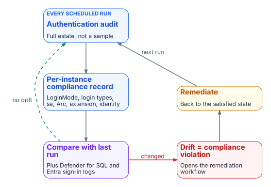

# Chapter 20 — The Closure Condition

*Transformations do not complete — they achieve a posture, and a posture is something you keep proving.*

::: {.callout-note}
## In this chapter
The five conditions that must hold at the same time for the SQL Server authentication transformation to be closed across the estate, why the continuous audit rather than a one-time scan is the verification instrument, how the per-instance compliance record captures the satisfying state, what drift detection looks for, and how behavioral telemetry (Defender for SQL threat alerts, Entra ID sign-in logs and host authentication logs) adds a layer on top of the structural monitoring.[^c20-defender][^c20-signins]
:::

::: {.callout-important}
## The transformed posture, Chapters 20–21
A transformation that achieves a completed state and then stops monitoring is a transformation that will regress. The transformed posture is not a permanent state achieved by a one-time action; it is an ongoing condition maintained by continuous monitoring, automated drift detection, and a governance process that treats regression as a compliance violation. This chapter defines the closure conditions and how they are monitored. [Chapter 21](21-what-done-looks-like.md) names the evidence that proves them and puts the program's 2027-04-01 NTLM backstop in context. The commands are in [Runbook R09](r09-continuous-monitoring-and-closure.md).
:::

{fig-alt="Every scheduled run audits the full estate, writes per-instance compliance records and compares them with the last run; any drift is a compliance violation that opens remediation and returns to the satisfied state."}

A transformation that achieves a completed state and then stops monitoring is a transformation that will regress. A SQL Server instance brought to the Entra-exclusive operational posture can be reconfigured to Mixed Mode by any administrator with sufficient permission; the change takes effect when the service restarts.[^c20-auth-mode] New SQL Authentication logins can be created. New Windows logins can be created if the instance remains domain-joined. The transformed posture is not a permanent state achieved through a one-time action. It is an ongoing condition maintained by continuous monitoring, automated drift detection, and a governance process that treats regression as a compliance violation rather than an operational preference.

## The five closure conditions

{fig-alt="Table of five conditions: no usable Windows logins, SQL authentication blocked and no usable SQL logins, Entra authentication observed working, a cloud identity for the engine, and MFA for every human, each with the evidence that shows it."}

The transformation inventory defines the SQL Server authentication transformation as complete when five conditions are satisfied at the same time across all production SQL Server instances in the estate. None of the five is a single engine setting, and the series calls the combined state the *Entra-exclusive operational posture*: an evidenced condition, not a mode. SQL Server has no setting that turns Windows authentication off. Entra authentication works alongside whichever authentication mode the instance uses, and even SQL Server 2025's Disable SQL Authentication setting leaves the instance accepting "Microsoft Entra authentication and Windows authentication."[^c20-disable-sql-auth] `LoginMode = 1` (Windows Authentication mode) therefore proves only that SQL logins are refused, not that Windows logins are gone.

The first condition is that no usable Windows-backed principal remains. A query of `sys.server_principals` shows zero type-U (Windows login) and type-G (Windows group) logins that are enabled and hold `CONNECT SQL`, other than the documented break-glass group recorded in the exception registry: a Windows group holding `sysadmin`, empty by default, for the case where Entra ID can't be reached ([Appendix B](appendix-b-ato-kit.md)).[^c20-principals]

The second condition is that SQL Authentication is eliminated. No SQL Authentication logins (type-S logins) exist on any production instance other than those carrying documented exception status, and the `sa` account is disabled and renamed on every instance. SQL logins are refused: `SERVERPROPERTY('IsIntegratedSecurityOnly') = 1` (Windows Authentication mode, `LoginMode = 1`), and on SQL Server 2025 also `SERVERPROPERTY('IsExternalAuthenticationOnly') = 1` once Disable SQL Authentication is on.[^c20-disable-sql-auth] Disabling SQL authentication blocks new SQL-authenticated sign-ins, including `sa`, but leaves the logins and their permissions defined and doesn't end sessions already connected, so the login census still matters.[^c20-disable-sql-auth] The operational verification is that evidence plus a `sys.server_principals` query for type-S logins, cross-referenced against the exception registry the program maintains.

The third condition is that Entra authentication is observed working and nothing else is: every usable login outside the exception registry is type E (a Microsoft Entra user or application) or type X (a Microsoft Entra group)[^c20-principals] and maps to a known user, application or group in the Entra inventory ([Chapter 17](17-dynamic-membership-delegation-and-privilege.md)), Entra sign-in logs show the expected principals obtaining tokens for SQL Server, SQL Server Audit records their logins on the instance, and `sys.dm_exec_connections.auth_scheme` shows no `NTLM` or `KERBEROS` connections over the validation period.[^c20-auth-scheme] Two details shape how that evidence is read. The token's audience, `https://database.windows.net/`, is the same for every SQL Server and Azure SQL resource,[^c20-entra-sql] so a sign-in log entry shows that a principal obtained a SQL token and under which Conditional Access result, not which instance it then connected to; the per-instance proof is the instance's own audit. And connections made on the host itself always report `NTLM`, because local connections use NTLM regardless of Kerberos configuration,[^c20-local-ntlm] so the audit must separate local administrative sessions from remote ones rather than read every `NTLM` row as a regression.

The fourth condition is that the engine has a cloud identity. The Arc Connected Machine agent is connected, the Azure extension for SQL Server is deployed, and Microsoft Entra authentication is configured on every production instance: with the managed identity on SQL Server 2025, or an app registration and a Key Vault certificate on SQL Server 2022.[^c20-arc-servers][^c20-arc-sql][^c20-mi-2025] Microsoft Entra authentication is available on SQL Server 2022 and later, not on earlier versions, and isn't supported on failover cluster instances,[^c20-arc-sql][^c20-mi-2025] so a production failover cluster instance can't meet this condition as built: it needs a re-architecture (for example, to an availability group) or a documented exception.

The fifth condition is that every human principal authenticates with MFA enforced by Conditional Access.[^c20-ca] This is verified through Entra ID sign-in logs and Conditional Access policy reports: every sign-in event for the SQL Server resource should show MFA satisfied and the Conditional Access grant controls met. Conditional Access applies to users, not to service principals and managed identities,[^c20-ca-sql] so application identities are governed by the controls of [Chapter 18](18-the-four-class-pattern-for-applications.md), not by this condition. Plan the phishing-resistant method with one limit in mind: Microsoft states that Entra authentication to SQL Server on Arc machines with the FIDO2 method isn't currently supported.[^c20-mi-2025]

## The closure record's field set

This table is the book's single list of what a closed instance's record shows. [Chapter 12](12-the-engine-authentication-decision.md)'s decision adopts it, and [Runbook R09](r09-continuous-monitoring-and-closure.md) projects each scheduled audit onto the same fields. A field marked *external join* is evidenced by telemetry the structural audit points at, not by the audit itself. "Usable" means enabled and holding `CONNECT SQL`.

| Condition | Field the record shows | Evidence |
|---|---|---|
| 1. No usable Windows-backed principal | Zero usable type-U and type-G logins, other than the documented break-glass group in the exception registry | Login census of `sys.server_principals` |
| 2. SQL Authentication eliminated | SQL logins refused: `SERVERPROPERTY('IsIntegratedSecurityOnly') = 1` (`LoginMode = 1`), and on SQL Server 2025 also `SERVERPROPERTY('IsExternalAuthenticationOnly') = 1` | `SERVERPROPERTY` |
| 2. SQL Authentication eliminated | Zero usable type-S logins outside the exception registry | Login census, cross-referenced to the exception registry |
| 2. SQL Authentication eliminated | `sa` disabled and renamed | Login census |
| 3. Entra authentication observed working | Every other usable login is type E or X and maps to a known user, application or group | Login census joined to the Entra inventory |
| 3. Entra authentication observed working | Zero remote `NTLM` or `KERBEROS` connections over the validation period | `sys.dm_exec_connections.auth_scheme` sampling, with local sessions separated |
| 3. Entra authentication observed working | The expected principals obtain SQL tokens and log in to the instance | Entra sign-in logs (external join) and the instance's SQL Server Audit |
| 4. A cloud identity for the engine | Arc Connected Machine agent connected | Arc agent status |
| 4. A cloud identity for the engine | Azure extension for SQL Server deployed | Extension state |
| 4. A cloud identity for the engine | Microsoft Entra authentication configured: the managed identity on SQL Server 2025, or an app registration and Key Vault certificate on SQL Server 2022 | Instance Entra configuration |
| 5. MFA for every human | MFA satisfied through Conditional Access for every human sign-in to the SQL Server resource over the validation period | Entra sign-in logs and Conditional Access reports (external join) |

## The continuous audit as the verification instrument

The authentication-audit script of [Chapter 07](07-the-authentication-audit.md), in continuous monitoring mode, running on a recurring schedule against the full estate rather than as a point-in-time scan, is the primary instrument for verifying that all five closure conditions remain satisfied over time. The per-instance compliance record, updated on each audit run, is the structured evidence artifact that captures the current state of each condition for each instance. It carries the field set above, which the SQL Server engine-authentication decision ([Chapter 12](12-the-engine-authentication-decision.md)) adopts; [Runbook R09](r09-continuous-monitoring-and-closure.md) shows how a scheduled run is projected onto it.

A per-instance compliance record that shows every field in the table satisfies the closure conditions for that instance: the structural fields from the audit itself, and the external-join fields from the Entra sign-in logs and Conditional Access reports. When all production instances carry satisfying compliance records, the SQL Server authentication transformation is verifiably closed for the estate. The continuous audit ensures closure is not a point-in-time claim. It is an ongoing verification.

## Drift detection

{fig-alt="Configuration drift from compliance monitoring and connection anomalies from Defender for SQL, Entra ID and host authentication logs both open the remediation workflow; an NTLM event means a regression, a scope gap or a new connection pattern."}

Drift detection in the compliance-monitoring pipeline identifies conditions that would constitute regression before they become compliance violations. A drift event for SQL Server authentication takes one of several forms. An instance whose `LoginMode` value changes from 1 to 2 (Windows Authentication mode to Mixed Mode) indicates that someone has enabled Mixed Mode without authorization. Because the mode change takes effect only at the next service restart,[^c20-auth-mode] compare the configured value with the running one, `SERVERPROPERTY('IsIntegratedSecurityOnly')`: a configured change not yet in effect is drift caught before it is live. A new type-S login appearing in `sys.server_principals` that was not present on the previous audit run indicates that a SQL Authentication login has been created.

A new type-U or type-G login appearing on an instance that was previously in the Entra-exclusive posture is the same class of regression for Windows-backed identity. And an Arc agent going offline, or the SQL extension becoming unavailable, would leave the instance's Entra identity unmanaged: on SQL Server 2022 the agent delivers the Entra certificate from Key Vault to the host,[^c20-appreg] and on SQL Server 2025 the managed identity is the Arc server's own.[^c20-mi-2025] Each drift event triggers the program's remediation workflow. The SQL Server engine-authentication decision records these same events (`LoginMode` reverting to Mixed Mode, a new type-S, type-U or type-G login appearing, the Arc agent going offline) as compliance violations, not advisory signals.

The 2027-04-01 NTLM backstop is the program's own date, set by its Kerberos/NTLM-elimination program for the enforcement phase; it is not a Microsoft or federal deadline ([Chapter 21](21-what-done-looks-like.md) sets out what external dates do fall in 2027). In the continuous-compliance monitoring context it is not a migration completion date. It is the date by which the records for all production instances must have been in the satisfied state continuously for a sufficient validation period. Migration activity should conclude well before the 2027-04-01 block date set by the elimination program's enforcement phase; the final months before it are the continuous-audit validation period, not the migration period.

## Behavioral telemetry: Defender for SQL, Entra ID and host logs

Behavioral telemetry complements the continuous-compliance monitoring. The compliance monitoring tracks the configuration state of each instance: is the `LoginMode` correct, are the login types correct. The behavioral layer watches the connections themselves, and it draws on three sources with distinct jobs.

- **Microsoft Defender for SQL servers on machines**, enabled through Defender for Cloud on the Arc-enabled host, raises threat alerts and runs vulnerability assessment.[^c20-defender] Its alerts include sign-ins from an unusual location, from a principal not seen in 60 days and from a suspicious IP, suspected brute-force attacks, and potential SQL injection.[^c20-defender-alerts] It is an alerting service, not an audit log of every authentication.
- **Entra ID sign-in logs** record every token Entra ID issues for SQL Server, with its risk and Conditional Access result.[^c20-signins]
- **The host** records the authentication protocol itself. Windows Security log logon events (4624 and 4625) name the authentication package and the NTLM version;[^c20-ntlm-audit] the NTLM operational log records NTLM audit and block events;[^c20-ntlm-policies] `sys.dm_exec_connections.auth_scheme` shows `NTLM` or `KERBEROS` for each live Windows connection;[^c20-auth-scheme] and SQL Server Audit records successful and failed logins.[^c20-sqlaudit]

The Azure Monitor agent forwards those Windows logs to a Log Analytics workspace through a data collection rule, with XPath filters that select the events, including SQL Server Audit written to the Security log.[^c20-ama] The alert queries run there.

In the transformed posture, the baseline is Entra-authenticated connections only. Every Entra-authenticated connection rests on a token that Entra ID issued, and each token issuance is recorded in the sign-in logs (a client can reuse a cached token across connections). An anomalous connection (from an unusual source IP, at an unusual time, with an elevated sign-in risk signal) is surfaced by Defender for SQL and by Entra ID Protection.[^c20-idp] Any NTLM- or Kerberos-authenticated remote connection to an instance, visible in `auth_scheme`, SQL Server Audit and the host's logon events, should be zero in the transformed posture and raises an immediate alert from Log Analytics.

An NTLM event means one of three things: an instance has regressed to Mixed Mode or acquired a new Windows login, which the compliance monitoring should already have detected; an instance was not included in the original audit scope, a discovery gap; or a novel connection pattern has appeared that the migration plan did not anticipate. All three require investigation. The combination of continuous-compliance structural monitoring and behavioral monitoring from these sources is the two-layer governance instrument that maintains the transformed posture continuously after the migration is complete.

## What this chapter establishes

1. Closure is the Entra-exclusive operational posture: five evidenced conditions holding at once on every production instance, recorded in the one field set this chapter defines.
2. The scheduled audit is the instrument, and the per-instance compliance record is the evidence; the per-instance proof of Entra sign-in comes from the instance's own audit, because the token audience is shared.
3. Drift detection catches regression, and behavioral telemetry adds a layer over the structural checks.
4. 2027-04-01 is the program's own backstop, and the months before it are for validation, not migration.

::: {.callout-tip}
## Continue the book
[← Previous: Chapter 19 — Connection String Migration: The Last Mile](19-connection-string-migration.md) · [Book index](index.md) · [Next: Chapter 21 — What Done Looks Like →](21-what-done-looks-like.md)
:::

[^c20-signins]: Microsoft Learn, "Sign-in logs in Microsoft Entra ID," <https://learn.microsoft.com/en-us/entra/identity/monitoring-health/concept-sign-ins> (accessed Oct 20, 2026).
[^c20-defender]: Microsoft Learn, "Microsoft Defender for SQL servers on machines overview" (vulnerability assessment; threat protection alerts; on-premises servers onboarded as Azure Arc machines), <https://learn.microsoft.com/en-us/azure/defender-for-cloud/defender-for-sql-on-machines-overview> (accessed Oct 20, 2026).
[^c20-defender-alerts]: Microsoft Learn, "Alerts for SQL Database and Azure Synapse Analytics" (the `SQL.VM_` alerts: GeoAnomaly, PrincipalAnomaly, SuspiciousIpAnomaly, BruteForce, PotentialSqlInjection), <https://learn.microsoft.com/en-us/azure/defender-for-cloud/alerts-sql-database-and-azure-synapse-analytics> (accessed Oct 20, 2026).
[^c20-auth-mode]: Microsoft Learn, "Change server authentication mode" (the change requires restarting SQL Server), <https://learn.microsoft.com/en-us/sql/database-engine/configure-windows/change-server-authentication-mode?view=sql-server-ver17> (accessed Oct 20, 2026).
[^c20-disable-sql-auth]: Microsoft Learn, "Disable SQL authentication for SQL Server enabled by Azure Arc" (SQL Server 2025 on Windows; "the instance only accepts Microsoft Entra authentication and Windows authentication"; existing logins and active sessions are kept; `IsExternalAuthenticationOnly`), <https://learn.microsoft.com/en-us/sql/sql-server/azure-arc/disable-sql-authentication?view=sql-server-ver17> (accessed Oct 20, 2026).
[^c20-principals]: Microsoft Learn, "sys.server_principals (Transact-SQL)" (types S, U, G, E, X, C, K), <https://learn.microsoft.com/en-us/sql/relational-databases/system-catalog-views/sys-server-principals-transact-sql?view=sql-server-ver17> (accessed Oct 20, 2026).
[^c20-auth-scheme]: Microsoft Learn, "sys.dm_exec_connections (Transact-SQL)," <https://learn.microsoft.com/en-us/sql/relational-databases/system-dynamic-management-objects/sys-dm-exec-connections-transact-sql?view=sql-server-ver17> (accessed Oct 20, 2026).
[^c20-entra-sql]: Microsoft Learn, "Microsoft Entra authentication for SQL Server" (the access token's scope or audience must be `https://database.windows.net/`; failover cluster instances don't support Microsoft Entra authentication), <https://learn.microsoft.com/en-us/sql/relational-databases/security/authentication-access/azure-ad-authentication-sql-server-overview?view=sql-server-ver17> (accessed Oct 20, 2026).
[^c20-local-ntlm]: Microsoft Learn, "How to determine if the authentication type is Kerberos" (run the check from a client; local connections report NTLM because of per-service SID hardening), <https://learn.microsoft.com/en-us/troubleshoot/sql/database-engine/connect/determine-the-authentication-type> (accessed Oct 20, 2026).
[^c20-arc-servers]: Microsoft Learn, "Azure Arc-enabled servers overview," <https://learn.microsoft.com/en-us/azure/azure-arc/servers/overview> (accessed Oct 20, 2026).
[^c20-arc-sql]: Microsoft Learn, "SQL Server enabled by Azure Arc" (overview; feature availability by version: Microsoft Entra authentication on SQL Server 2022 and 2025), <https://learn.microsoft.com/en-us/sql/sql-server/azure-arc/overview?view=sql-server-ver17> (accessed Oct 20, 2026).
[^c20-mi-2025]: Microsoft Learn, "Managed identity for SQL Server enabled by Azure Arc" (Limitations: failover cluster instances not supported; FIDO2 not currently supported; access to Azure public cloud required), <https://learn.microsoft.com/en-us/sql/sql-server/azure-arc/managed-identity?view=sql-server-ver17> (accessed Oct 20, 2026).
[^c20-appreg]: Microsoft Learn, "Tutorial: Set up Microsoft Entra authentication for SQL Server enabled by Azure Arc" (SQL Server 2022: the certificate is stored in Azure Key Vault and the Azure Arc agent downloads it to the host), <https://learn.microsoft.com/en-us/sql/sql-server/azure-arc/entra-authentication-setup-tutorial?view=sql-server-ver17> (accessed Oct 20, 2026).
[^c20-ca]: Microsoft Learn, "What is Conditional Access?," <https://learn.microsoft.com/en-us/entra/identity/conditional-access/overview> (accessed Oct 20, 2026).
[^c20-ca-sql]: Microsoft Learn, "Conditional access" for Azure SQL Database and Azure SQL Managed Instance (target resource is the *Azure SQL Database* application; policies apply only to users, not to service principals and managed identities), <https://learn.microsoft.com/en-us/azure/azure-sql/database/conditional-access-configure?view=azuresql> (accessed Oct 20, 2026).
[^c20-ntlm-audit]: Microsoft Learn, "Audit use of NTLMv1 on a Windows Server-based domain controller" (Event ID 4624 records the NTLM version), <https://learn.microsoft.com/en-us/troubleshoot/windows-server/windows-security/audit-domain-controller-ntlmv1> (accessed Oct 20, 2026).
[^c20-ntlm-policies]: Microsoft Learn, "Policy CSP - LocalPoliciesSecurityOptions" (Restrict NTLM settings; audit and block events are recorded in the Microsoft/Windows/NTLM Operational log), <https://learn.microsoft.com/en-us/windows/client-management/mdm/policy-csp-localpoliciessecurityoptions> (accessed Oct 20, 2026).
[^c20-sqlaudit]: Microsoft Learn, "SQL Server Audit (Database Engine)," <https://learn.microsoft.com/en-us/sql/relational-databases/security/auditing/sql-server-audit-database-engine?view=sql-server-ver17> (accessed Oct 20, 2026).
[^c20-ama]: Microsoft Learn, "Collect Windows events from virtual machine with Azure Monitor" (Windows Event Logs data source in a data collection rule; XPath filters; Security log events), <https://learn.microsoft.com/en-us/azure/azure-monitor/vm/data-collection-windows-events> (accessed Oct 20, 2026).
[^c20-idp]: Microsoft Learn, "What is Microsoft Entra ID Protection?," <https://learn.microsoft.com/en-us/entra/id-protection/overview-identity-protection> (accessed Oct 20, 2026).
