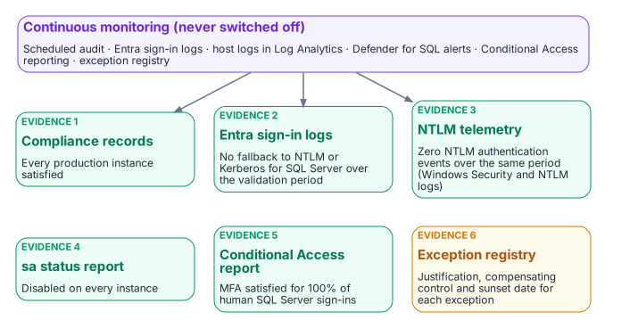
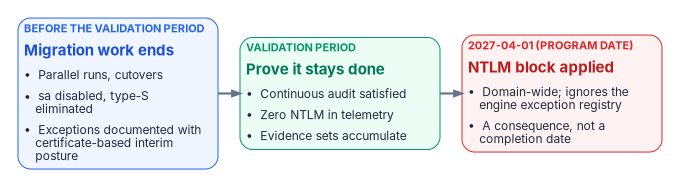

# Chapter 21 — What Done Looks Like

*The evidence is not a binder you assemble — it is the live output of the monitoring you never turn off.*

::: {.callout-note}
## In this chapter
The six evidence artifact sets that close the SQL Server authentication transformation, and why each is a live output of the continuous monitoring infrastructure rather than a point-in-time document. Then the correct reading of 2027-04-01: what is and isn't externally due in 2027, and why the program's own backstop is the date the block is applied, which means the migration must already be complete and the final months reserved for validation.
:::

The evidence artifacts required to close the SQL Server authentication transformation in the transformation inventory are not a collection of documents produced at a single point in time. They are the live outputs of the continuous monitoring infrastructure described in [Chapter 20](20-the-closure-condition.md). A closure claim is only as strong as the monitoring that keeps producing the evidence after the claim is made. This chapter names the artifacts, then places the program's 2027-04-01 NTLM backstop in its proper operational context.

## The evidence artifacts as live outputs

{fig-alt="Continuous monitoring produces six evidence sets: compliance records, Entra sign-in logs, NTLM telemetry, the sa status report, the Conditional Access report and the exception registry."}

The closure claim for the SQL Server authentication transformation must be supported by six artifact sets, and each is a continuously regenerated output rather than a static deliverable.

The first is the per-instance compliance record set: a record for every production SQL Server instance in the estate, each showing the Entra-exclusive operational posture: SQL authentication refused, zero usable SQL Authentication logins, zero active Windows-backed logins, the Arc agent enrolled and healthy, and the SQL extension deployed. The SQL Server engine-authentication decision ([Chapter 12](12-the-engine-authentication-decision.md)) defines the field set these records carry, and the continuous audit keeps them current rather than freezing them at the moment of the claim.

The second is the Entra ID sign-in log set for the SQL Server resource over a defined validation period preceding the closure claim: every expected human and application principal obtaining tokens, with the Conditional Access result of each sign-in.[^c21-signins] Sign-in logs record what Entra ID issued; they can't show a connection that bypassed Entra ID, and because every SQL Server shares the token audience `https://database.windows.net/`, they don't name the instance a token was then used against.[^c21-entra-sql] The third set fills that gap: the NTLM telemetry (the Windows Security and NTLM operational logs from SQL Server hosts, collected in Log Analytics) together with `auth_scheme` and SQL Server Audit, showing zero remote NTLM- and Kerberos-authenticated connections over that same validation period.[^c21-ntlm-policies][^c21-sqlaudit] It is the behavioral confirmation that complements the structural compliance view. These two artifacts together demonstrate that the transformed posture holds not only in configuration but in observed connection behavior.

The fourth is the `sa` account status report, showing the `sa` account disabled on all instances. The fifth is the Conditional Access policy compliance report, showing MFA enforcement satisfied for one hundred percent of SQL Server resource sign-ins by human principals over the validation period.[^c21-ca] The sixth is the exception registry, showing every currently excepted instance with documented justification, a sunset date, and its own compliance tracking record.

When all six artifact sets are satisfying at the same time, and the monitoring infrastructure confirms they have been satisfying for the validation period, the SQL Server authentication transformation is closed. That is what done looks like: not a checkbox, but a demonstrated, continuously verified, evidence-backed posture.

The same sets serve the agency's own authorization. An agency's on-premises SQL Server estate is part of the agency's system, authorized by the agency's authorizing official under the Risk Management Framework, not by FedRAMP, which covers the cloud services the design leverages.[^c21-rmf] Continuous monitoring is a control in its own right (CA-7), and these live evidence sets are the kind of output a system-level continuous monitoring strategy names.[^c21-ca7] [Appendix A](appendix-a-requirements-mapping.md) maps them to controls, and [Appendix B](appendix-b-ato-kit.md) collects the boundary facts an assessor will ask for.

## What is due in 2027, and what isn't

The series has called 2027-04-01 "the 2027 milestone." Before reading it, separate what the outside world requires from what the program decided.

- **No external NTLM deadline falls in 2027.** Microsoft deprecated all NTLM versions in June 2024 and removed NTLMv1 starting in Windows 11, version 24H2 and Windows Server 2025.[^c21-deprecated] Its January 2026 roadmap has three phases: enhanced NTLM auditing, available now; fixes for the common causes of NTLM fallback, due in the second half of 2026 for Windows Server 2025 and Windows 11, version 24H2 and later; and network NTLM disabled by default "in the next major Windows Server release and associated Windows client releases," with re-enablement through policy. Microsoft gives no calendar date for that last phase, and says the timelines "are subject to change."[^c21-ntlm-roadmap] Until then NTLM is deprecated, which means it remains available.[^c21-ntlm-roadmap]
- **No federal 2027 deadline drives this work.** OMB M-22-09 set its zero trust goals for the end of fiscal year 2024; its identity actions (centralized identity integrated into applications, phishing-resistant MFA enforced at the application layer, a device-level signal in authorization) are the destination this series builds, not a dated 2027 requirement.[^c21-m2209]
- **The 2027 dates that do touch a SQL Server estate are support dates.** Windows Server 2016 reaches the end of extended support on January 12, 2027.[^c21-ws2016] SQL Server 2014's third and final year of Extended Security Updates ends on July 12, 2027, and SQL Server 2017 reaches the end of support on October 12, 2027.[^c21-eos2027] An instance on any of these that is still in the estate past its date runs without security updates, which is a finding in its own right and a reason the retain, consolidate or retire decision of [Chapter 06](06-retain-consolidate-retire.md) comes first. SQL Server 2014 and 2017 also can't use Microsoft Entra authentication at all,[^c21-arc-sql] so they can reach the closed posture only by upgrade or retirement.

2027-04-01 is therefore a program decision: the Phase C date the Kerberos/NTLM-elimination program sets for disabling NTLM across the estate ([Chapter 15](15-the-three-phases-of-ntlm-elimination.md)), chosen to finish ahead of Microsoft's default change rather than wait for it. Everything that follows reads it as such.

## 2027-04-01: a consequence, not a completion date

{fig-alt="Timeline: migration work ends first, a validation period proves the posture holds, and on 2027-04-01 the program's domain-wide NTLM block arrives as a consequence."}

The 2027-04-01 NTLM backstop is the single most misread date in the program. It is widely treated as the date by which the migration must complete. It is not. It is the date on which the program's domain-wide NTLM block is applied. The block is enforced by Windows itself, through the Restrict NTLM policies on clients, servers and domain controllers.[^c21-restrict-ntlm] Those policies honor only their own exception lists: remote-server exceptions on the client and server exceptions on the domain controller.[^c21-restrict-ntlm] They don't distinguish a compliant SQL Server instance from one the program has excepted, and they don't read the engine-layer exception registry at all. Keeping NTLM alive for a server is a separate, deliberate entry in those Windows lists, not a consequence of an engine exception. The difference between "migration complete by 2027-04-01" and "migration must be complete before 2027-04-01, and 2027-04-01 is when the block is applied" is not a semantic distinction. It is the difference between a deadline and a consequence.

Read as a consequence, the date reorganizes the schedule. If 2027-04-01 is when connections that still depend on NTLM stop working, then the migration must have already concluded by then, with enough margin for the continuous audit to have confirmed the satisfying posture across a full validation period. Migration activity (the parallel run of [Runbook R05](r05-login-migration-and-parallel-run.md), the cutover, the `sa` disablement, the type-S elimination) should finish well before the date. The final months are reserved for validation, not for migration, because a posture confirmed only on the last day before the block is a posture nobody has had time to prove.

This reading also gives the exception long tail its proper weight. An instance that can't reach Kerberos or Entra OAuth before the block must carry a documented exception with Certificate-Based Authentication as the authorized interim posture ([Chapter 22](22-where-sql-server-touches-adcs.md)), and that exception's sunset date must be reconciled against the block rather than against any softer internal milestone. Because the certificate secures only the user's sign-in, an excepted connection survives the block only if it then negotiates Kerberos. The program has fixed the block date; the schedule must bend to it, not the other way around. When the migration is complete, the audit has validated the posture continuously, and the six artifact sets are live and satisfying, the 2027-04-01 block arrives as a non-event, which is exactly what done is supposed to feel like.

## What this chapter establishes

1. Six evidence sets close the transformation, and each is a live output of continuous monitoring.
2. They must hold across a defined validation period, not be assembled once.
3. Nothing external requires NTLM to be gone in 2027; 2027-04-01 is the program's own block date, and the 2027 dates that are external are SQL Server and Windows Server support dates.
4. Migration finishes before the block, so the block arrives as a non-event.

::: {.callout-tip}
## Continue the book
[← Previous: Chapter 20 — The Closure Condition](20-the-closure-condition.md) · [Book index](index.md) · [Next: Chapter 22 — Where SQL Server Touches AD CS →](22-where-sql-server-touches-adcs.md)
:::

[^c21-signins]: Microsoft Learn, "Sign-in logs in Microsoft Entra ID," <https://learn.microsoft.com/en-us/entra/identity/monitoring-health/concept-sign-ins> (accessed Oct 20, 2026).
[^c21-entra-sql]: Microsoft Learn, "Microsoft Entra authentication for SQL Server" (the access token's scope or audience must be `https://database.windows.net/`), <https://learn.microsoft.com/en-us/sql/relational-databases/security/authentication-access/azure-ad-authentication-sql-server-overview?view=sql-server-ver17> (accessed Oct 20, 2026).
[^c21-ntlm-policies]: Microsoft Learn, "Policy CSP - LocalPoliciesSecurityOptions" (Restrict NTLM audit and block events are recorded in the Microsoft/Windows/NTLM Operational log), <https://learn.microsoft.com/en-us/windows/client-management/mdm/policy-csp-localpoliciessecurityoptions> (accessed Oct 20, 2026).
[^c21-sqlaudit]: Microsoft Learn, "SQL Server Audit (Database Engine)," <https://learn.microsoft.com/en-us/sql/relational-databases/security/auditing/sql-server-audit-database-engine?view=sql-server-ver17> (accessed Oct 20, 2026).
[^c21-ca]: Microsoft Learn, "What is Conditional Access?," <https://learn.microsoft.com/en-us/entra/identity/conditional-access/overview> (accessed Oct 20, 2026).
[^c21-rmf]: NIST, SP 800-37 Rev. 2, *Risk Management Framework for Information Systems and Organizations: A System Life Cycle Approach for Security and Privacy*, December 2018, <https://csrc.nist.gov/pubs/sp/800/37/r2/final> (accessed Oct 20, 2026); NIST SP 800-53 Rev. 5, control CA-6 (Authorization: assign a senior official as the authorizing official for the system), <https://csrc.nist.gov/pubs/sp/800/53/r5/upd1/final> (accessed Oct 20, 2026).
[^c21-ca7]: NIST, SP 800-53 Rev. 5 (Release 5.2.0, August 27, 2025), control CA-7, Continuous Monitoring, <https://csrc.nist.gov/pubs/sp/800/53/r5/upd1/final> (accessed Oct 20, 2026).
[^c21-deprecated]: Microsoft Learn, "Deprecated features for Windows client" (NTLM, all versions, deprecated June 2024; NTLMv1 removed starting in Windows 11, version 24H2 and Windows Server 2025), <https://learn.microsoft.com/en-us/windows/whats-new/deprecated-features> (accessed Oct 20, 2026).
[^c21-ntlm-roadmap]: Microsoft, Windows IT Pro Blog, "Advancing Windows security: Disabling NTLM by default," January 29, 2026, <https://techcommunity.microsoft.com/blog/windows-itpro-blog/advancing-windows-security-disabling-ntlm-by-default/4489526> (accessed Oct 20, 2026).
[^c21-m2209]: Office of Management and Budget, M-22-09, *Moving the U.S. Government Toward Zero Trust Cybersecurity Principles*, January 26, 2022 (goals to be met by the end of FY 2024; identity actions 1–3), <https://bidenwhitehouse.archives.gov/wp-content/uploads/2022/01/M-22-09.pdf> (accessed Oct 20, 2026).
[^c21-ws2016]: Microsoft Learn, "Windows Server 2016" lifecycle (extended end date January 12, 2027, Pacific time), <https://learn.microsoft.com/en-us/lifecycle/products/windows-server-2016> (accessed Oct 20, 2026).
[^c21-eos2027]: Microsoft Learn, "Ending Support in 2027" (SQL Server 2014 Extended Security Updates Year 3, July 12, 2027; SQL Server 2017, October 12, 2027), <https://learn.microsoft.com/en-us/lifecycle/end-of-support/end-of-support-2027> (accessed Oct 20, 2026).
[^c21-arc-sql]: Microsoft Learn, "SQL Server enabled by Azure Arc" (feature availability by version: Microsoft Entra authentication on SQL Server 2022 and 2025 only), <https://learn.microsoft.com/en-us/sql/sql-server/azure-arc/overview?view=sql-server-ver17> (accessed Oct 20, 2026).
[^c21-restrict-ntlm]: Microsoft Learn, "Status code 0x32 and you can't join a domain" (the seven Restrict NTLM security policies; the two exception lists are for the client and the DC, with no exception list for the server role), <https://learn.microsoft.com/en-us/troubleshoot/windows-server/active-directory/status-code-0x32-cannot-join-domain> (accessed Oct 20, 2026).
