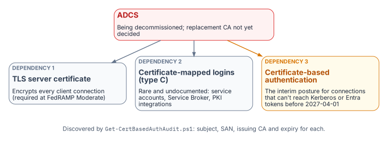
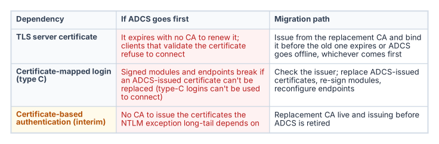
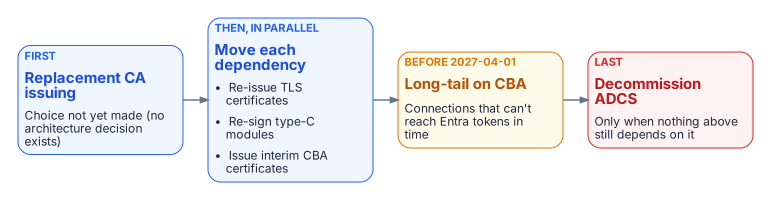

# Chapter 22 — Where SQL Server Touches AD CS

*The certificate dependencies a decommission plan cannot see, named before any decommission plan exists.*

::: {.callout-note}
## In this chapter
The three distinct SQL Server capabilities that can depend on certificates issued by Active Directory Certificate Services (AD CS): TLS encryption of client connections, certificate-mapped logins used for signing and endpoints, and certificate-based sign-in as the authorized NTLM-replacement interim posture. Why each one breaks if AD CS is decommissioned before it is migrated, what Microsoft Cloud PKI can and can't replace, and why this chapter documents a transformation for which no normative architecture decision has yet been authored.[^c22-tls]
:::

::: {.callout-warning}
## A "Not Yet Defined" gap: analytical, not normative
The transformation inventory classifies the move from AD CS to Microsoft Cloud PKI as **"Not Yet Defined."** Most SQL Server transformation documents ignore the certificate infrastructure, but this series can't be complete without it. This chapter identifies the dependencies, names the gap, and describes what the as-yet-unwritten AD CS migration architecture decision must address. `Get-CertBasedAuthAudit.ps1` is the discovery instrument ([Runbook R10](r10-certificate-discovery-for-adcs.md)). Don't cite this chapter as normative governance for AD CS migration decisions.
:::

{fig-alt="ADCS, being decommissioned, issues TLS server certificates, the certificates behind certificate-mapped type C logins, and the certificates for certificate-based authentication used as an interim posture."}

The transformation inventory identifies the Active Directory Certificate Services to Microsoft Cloud PKI transformation as "Not Yet Defined." As the series opening established, that label means the destination may be known but the normative canon governing how to reach it has not been authored.[^c22-cloudpki] For most of this series, the missing record has been the substrate architecture decision; for this chapter, the gap is more fundamental still. No architecture decision record governs the certificate authority transformation at all.

There is no architecture decision to point to. The transformation is identified as necessary in the transformation inventory and the discovery instrument exists, but the normative decision about the replacement CA, the enrollment mechanism, and the sequencing of the AD CS decommission has not been made. This chapter is therefore analytical and motivational rather than prescriptive. It documents why the certificate gap matters specifically for SQL Server, and it cites no normative AD CS migration architecture decision because none exists.

It matters specifically because SQL Server has certificate dependencies that are not visible to most of the teams that will plan the AD CS decommission. Three distinct capabilities can depend on AD CS-issued certificates: TLS encryption of client connections, certificate-mapped SQL Server logins (used for code signing and endpoints, not to connect), and certificate-based sign-in as the authorized NTLM replacement for connections that can't reach Kerberos or Entra OAuth before the program's backstop. `Get-CertBasedAuthAudit.ps1` is the instrument for discovering them.

{fig-alt="Table of the three ADCS dependencies, what breaks if ADCS is retired first, and the migration path for each."}

## SQL Server TLS certificates

The first and most commonly recognized SQL Server certificate dependency is the TLS certificate the engine presents for encryption of client connections. When SQL Server is configured to encrypt connections, it presents a server certificate to connecting clients as part of the TLS handshake.[^c22-tls] The transformation makes that certificate more important, not less. Connections authenticated by Microsoft Entra ID are always encrypted, so the Entra target of this series depends on a server certificate the client trusts; without one, Entra logins fail with an untrusted-chain error unless the client is told to trust the server certificate, which defeats the point.[^c22-appreg] For the agency's own system, encryption in transit is also a control, not a preference: SC-8 (Transmission Confidentiality and Integrity) and its enhancement SC-8(1) (Cryptographic Protection) are both in the SP 800-53 Rev. 5 Moderate baseline the agency's authorizing official assesses the system against.[^c22-sc8]

In many environments that certificate is issued by the organization's AD CS infrastructure. The administrator submitted a request to the AD CS certification authority, the CA issued a certificate carrying the SQL Server's host name in the Subject Alternative Name, and the certificate was installed in the computer's certificate store and bound through SQL Server Configuration Manager. Microsoft documents the requirements the certificate must meet: the Server Authentication enhanced key usage, a `KeySpec` of `AT_KEYEXCHANGE` (which means a legacy cryptographic service provider, not a key storage provider), and a Subject Alternative Name covering every name clients use, including availability group listener names. Microsoft also documents the AD CS enrollment route, with the warning that a template using a key storage provider produces a certificate SQL Server can't use.[^c22-certreq] The certificate has an expiration date.

When AD CS is decommissioned, that certificate will not be renewed automatically: there is no CA left to issue the renewal. SQL Server checks a certificate's validity only when it is configured, and keeps running if the certificate expires afterward; but clients that check validity on each connection, such as Power BI, raise an error when the instance presents an expired certificate, and Microsoft recommends against using one.[^c22-certreq] Clients configured to validate the server certificate, which is the correct security posture, are the ones that break. The encryption that SC-8 requires becomes the thing that breaks the connection.

The certificate-audit script captures the TLS certificate for every instance in scope: the subject, the SAN, the issuing CA, and the expiration date. Any instance whose TLS certificate is AD CS-issued is a dependency the migration plan must address. The replacement certificate must come from the new CA and must be installed and bound before the AD CS-issued certificate expires or before AD CS goes offline, whichever comes first.

Which new CA is an open question, and Microsoft Cloud PKI doesn't answer it for servers. Cloud PKI, licensed as an add-on to Intune Plan 1 or Plan 2, issues certificates only through SCEP to devices enrolled in Intune.[^c22-cloudpki] Intune's supported platforms don't include Windows Server,[^c22-intune-platforms] so a SQL Server host can't receive its TLS certificate from Cloud PKI directly. Cloud PKI can still anchor its issuing CA to an existing private root ("bring your own CA"),[^c22-cloudpki] which lets workstation and server certificates share a trust anchor, but the server-certificate issuer is a separate choice the unwritten decision has to make. The same applies to the government cloud question: Cloud PKI is available in GCC High but not in DoD environments.[^c22-cloudpki]

## Certificate-mapped SQL Server logins

The second dependency is less commonly known. SQL Server supports a login type, the type-C login, created from a certificate in `master` with `CREATE LOGIN [name] FROM CERTIFICATE [cert_name]`; type-K logins are the same arrangement with an asymmetric key.[^c22-principals] Neither is a way to connect: Microsoft documents that logins created from certificates or asymmetric keys "are used only for code signing" and "can't be used to connect to SQL Server."[^c22-create-login] They carry permissions for signed modules, and certificates of the same kind secure Service Broker and database mirroring endpoints.

Certificate-mapped logins are uncommon in standard deployments, but they appear in specific scenarios: module signing that grants a stored procedure permissions its caller lacks, and Service Broker or mirroring endpoint security. Each is the kind of arrangement that survives quietly across an estate for years without anyone documenting it.

Most such certificates are created inside SQL Server rather than issued by AD CS (`CREATE CERTIFICATE` can generate a self-signed certificate and its key),[^c22-create-cert] so the first question is the issuer. Where an AD CS-issued certificate backs a type-C login or an endpoint, replacing it means issuing a new certificate, re-signing the modules or reconfiguring the endpoints, and moving the login's permissions, before AD CS is retired. Type-C logins are not migrated to Entra logins, because nothing connects with them. The certificate-audit script captures every certificate-mapped login and the issuing CA of its associated certificate, providing the inventory the migration needs.

## Certificate-based sign-in as the NTLM interim posture

The third dependency is the most consequential for the NTLM elimination timeline. The Kerberos/NTLM-elimination program designates certificate-based authentication (CBA) as the authorized replacement for NTLM connections that can't be migrated to Kerberos or Entra ID OAuth 2.0 tokens within the required timeline. Here CBA means certificate-based sign-in by the user, with a smart card or PIV credential, rather than a password. SQL Server itself has no client-certificate login, so for a pre-2022 instance the certificate secures the user's sign-in to Active Directory, and the SQL Server connection that follows still authenticates with Windows authentication. It avoids NTLM only where that connection can use Kerberos.

For connections that can't reach Entra ID authentication before the program's 2027-04-01 NTLM backstop (Category 3 instances still on versions before SQL Server 2022, or applications still in the deferred class), CBA is the authorized interim posture. Certificate sign-in removes the password from the user's side, and the program accepts it as the interim posture provided the connection itself then negotiates Kerberos rather than NTLM, which still depends on the SPN and KDC fixes of [Chapters 14–15](14-ntlm-and-the-patterns-that-generate-it.md).[^c22-spn] It is the bridge that keeps an un-migratable connection compliant.

The problem is that certificate sign-in to Active Directory depends on a CA in two places, and AD CS usually sits in at least one of them.

- **The user's certificate.** For federal workforce users this is normally the PIV authentication certificate, issued through the agency's card management system by a CA operating under the Federal PKI Common Policy, not by the agency's own AD CS ([Book 03, Chapter 09](../b03-hr-identity/09-credentials-and-certificates.md)).[^c22-fips201] Whatever the issuer, Active Directory must list it in the forest's NTAuth store before it will accept the certificate for smart card logon.[^c22-sclogon] Where AD CS issues smart card or virtual smart card certificates to users who have no PIV card, those certificates are a direct AD CS dependency.
- **The domain controllers' certificates.** Each domain controller that authenticates smart card users must hold a domain controller certificate, and when a Microsoft Enterprise CA is installed in the forest, the domain controllers enroll for that certificate automatically.[^c22-sclogon] In most forests, that is where smart card logon quietly depends on AD CS even when every user certificate comes from the PIV issuer.

If the plan is to rely on certificate sign-in for connections that can't yet reach Entra authentication, and AD CS is being decommissioned, a replacement issuer for the domain controller certificates (and for any non-PIV user certificates) must already be in place and trusted in NTAuth before AD CS goes offline. The interim posture has its own certificate dependency, and that dependency points at the same authority the program intends to remove.

On the target path the picture is different. Microsoft Entra certificate-based authentication is a relying party, not a CA: it authenticates X.509 certificates against the organization's PKI, configured as trusted CAs in the tenant,[^c22-entra-cba] and for PIV holders that PKI is the Federal PKI issuer, not AD CS. It is one of the phishing-resistant methods by which users meet the MFA condition of [Chapter 20](20-the-closure-condition.md) once their connections use Entra tokens.

## The sequencing dependency

{fig-alt="First a replacement CA is issuing, then each dependency moves, the long tail stays on certificate-based authentication until 2027-04-01, and ADCS is decommissioned last."}

The three dependencies converge on a single sequencing question. TLS certificates must be re-issued before they expire; AD CS-issued certificates behind type-C logins and endpoints must be replaced and their modules re-signed; and CBA, the very mechanism the Kerberos/NTLM-elimination program relies on to cover connections that can't meet the backstop, must have its domain controller and user certificates issued by a CA that will still exist after AD CS is retired.

If the AD CS decommission timeline runs earlier than the replacement-CA and CBA-deployment timeline, the program loses the interim posture the Kerberos/NTLM-elimination program depends on at precisely the moment it is most needed: connections that could not migrate to Entra authentication in time would have no compliant fallback. The sequencing of the AD CS decommission against the 2027-04-01 NTLM backstop is therefore a critical dependency, and it is one the as-yet-unwritten AD CS migration architecture decision must explicitly address before any decommission date is set. The forest-wide view of the same problem, with the other services that ride on AD CS, is in [Book 02, Chapter 04](../b02-identity/04-the-hidden-migration-surface.md).

## What this chapter establishes

1. SQL Server can depend on AD CS in three places: the TLS server certificate, certificates behind type-C logins and endpoints, and the certificate-based interim posture, where the dependency is usually the domain controller certificates rather than the PIV card.
2. Microsoft Cloud PKI issues only to Intune-enrolled devices, which excludes Windows Server, so the server-certificate issuer is a separate decision.
3. `Get-CertBasedAuthAudit.ps1` discovers all three dependencies.
4. The sequencing of the AD CS decommission against the program's 2027-04-01 backstop is a dependency the as-yet-unwritten AD CS migration decision must resolve.

::: {.callout-tip}
## Continue the book
[← Previous: Chapter 21 — What Done Looks Like](21-what-done-looks-like.md) · [Book index](index.md) · [Next: Chapter 23 — Epilogue: The Platform Question →](23-epilogue-the-platform-question.md)
:::

[^c22-tls]: Microsoft Learn, "Encrypt connections to SQL Server by importing a certificate," <https://learn.microsoft.com/en-us/sql/database-engine/configure-windows/configure-sql-server-encryption?view=sql-server-ver17> (accessed Oct 20, 2026).
[^c22-appreg]: Microsoft Learn, "Tutorial: Set up Microsoft Entra authentication for SQL Server enabled by Azure Arc" ("Connections authenticated by Microsoft Entra ID are always encrypted"; untrusted-chain error without a trusted TLS certificate), <https://learn.microsoft.com/en-us/sql/sql-server/azure-arc/entra-authentication-setup-tutorial?view=sql-server-ver17> (accessed Oct 20, 2026).
[^c22-sc8]: NIST, SP 800-53 Rev. 5 (Release 5.2.0), controls SC-8 and SC-8(1), <https://csrc.nist.gov/pubs/sp/800/53/r5/upd1/final>, and SP 800-53B Moderate baseline as published in NIST's OSCAL content, <https://github.com/usnistgov/oscal-content/tree/main/nist.gov/SP800-53/rev5> (both accessed Oct 20, 2026).
[^c22-certreq]: Microsoft Learn, "Certificate Requirements for SQL Server" (requirements list; "Create a certificate using AD CS"; "Expired certificates"), <https://learn.microsoft.com/en-us/sql/database-engine/configure-windows/certificate-requirements?view=sql-server-ver17> (accessed Oct 20, 2026).
[^c22-cloudpki]: Microsoft Learn, "Microsoft Cloud PKI for Microsoft Intune" (licensing; available in GCC High, not DoD; devices must be enrolled in Intune and support the SCEP profile; bring your own CA), <https://learn.microsoft.com/en-us/intune/cloud-pki/> (accessed Oct 20, 2026).
[^c22-intune-platforms]: Microsoft Learn, "Supported operating systems and browsers in Intune," <https://learn.microsoft.com/en-us/intune/fundamentals/ref-supported-platforms> (accessed Oct 20, 2026).
[^c22-principals]: Microsoft Learn, "sys.server_principals (Transact-SQL)" (C = login mapped to a certificate; K = login mapped to an asymmetric key), <https://learn.microsoft.com/en-us/sql/relational-databases/system-catalog-views/sys-server-principals-transact-sql?view=sql-server-ver17> (accessed Oct 20, 2026).
[^c22-create-login]: Microsoft Learn, "CREATE LOGIN (Transact-SQL)," Remarks, <https://learn.microsoft.com/en-us/sql/t-sql/statements/create-login-transact-sql?view=sql-server-ver17> (accessed Oct 20, 2026).
[^c22-create-cert]: Microsoft Learn, "CREATE CERTIFICATE (Transact-SQL)," Remarks, <https://learn.microsoft.com/en-us/sql/t-sql/statements/create-certificate-transact-sql?view=sql-server-ver17> (accessed Oct 20, 2026).
[^c22-spn]: Microsoft Learn, "Register a Service Principal Name for Kerberos connections," <https://learn.microsoft.com/en-us/sql/database-engine/configure-windows/register-a-service-principal-name-for-kerberos-connections?view=sql-server-ver17> (accessed Oct 20, 2026).
[^c22-fips201]: NIST, FIPS 201-3, *Personal Identity Verification (PIV) of Federal Employees and Contractors*, January 2022, §5 (PKI architecture and certificates), <https://csrc.nist.gov/pubs/fips/201-3/final> (accessed Oct 20, 2026).
[^c22-sclogon]: Microsoft Learn, "Guidelines for enabling smart card logon with third-party certification authorities" (issuing CA must be in the NTAuth store; each domain controller needs a domain controller certificate; Enterprise CAs enroll domain controllers automatically), <https://learn.microsoft.com/en-us/troubleshoot/windows-server/certificates-and-public-key-infrastructure-pki/enabling-smart-card-logon-third-party-certification-authorities> (accessed Oct 20, 2026).
[^c22-entra-cba]: Microsoft Learn, "Overview of Microsoft Entra certificate-based authentication" (phishing-resistant authentication with X.509 certificates against your PKI; trusted CAs with HTTP CRL distribution points), <https://learn.microsoft.com/en-us/entra/identity/authentication/concept-certificate-based-authentication> (accessed Oct 20, 2026).
