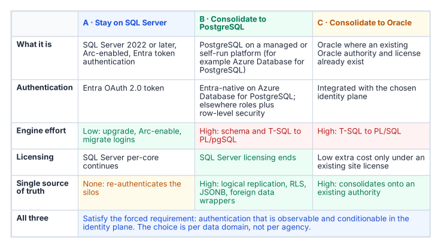
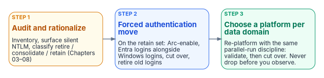

# Chapter 23 — Epilogue: The Platform Question

*The authentication move is forced; the platform choice isn't, so it comes afterward, one data domain at a time.*

::: {.callout-note}
## In this chapter
What to do with the rationalized estate once its authentication has moved to Microsoft Entra ID. The cost of fragmentation, the three candidate destinations for a retained data domain, the ten dimensions on which to score them, and why the platform decision follows the authentication move instead of preceding it.
:::

::: {.callout-note}
## An epilogue, not another migration step
Chapters 01–22 are the SQL Server identity transformation. This epilogue starts where they end: with a rationalized estate whose authentication has moved to Microsoft Entra ID. Nothing in Chapters 01–22 depends on it, and the [Data Platform project charter](../../projects/data-platform-charter.md) leaves full consolidation and platform replacement out of its initial phase.
:::

## The fragmentation cost

The authentication transformation produces a rationalized estate. The platform question asks what to do with that estate. Twenty years of accretion have produced overlapping instances, duplicated data domains, and no single authoritative source for any given subject. The goal is fewer authoritative platforms: one authoritative database per data domain.

## Three destinations

{fig-alt="Three candidate destinations — stay on SQL Server, re-platform to PostgreSQL, re-platform to Oracle — each evaluated on the same ten dimensions with evidence per data domain."}

Every retained data domain ends at one of three candidate destinations: stay on SQL Server, re-platform to PostgreSQL, or re-platform to Oracle. Each can satisfy the forced requirement, authentication that is observable and conditionable in the identity plane. SQL Server 2022 and later accept Microsoft Entra logins, as Chapters 09–12 describe.[^c23-sql-entra] Azure Database for PostgreSQL flexible server supports Microsoft Entra authentication with tokens, including group logins and managed identities.[^c23-pg-entra] Oracle documents configuring Oracle Database so that Microsoft Entra ID users connect with single sign-on.[^c23-oracle-entra] Each platform's own documentation, not this book, is the authority on how it does so, and the identity integration dimension below asks for that evidence per platform.

This epilogue doesn't rank the three. Which one fits depends on the data domain, so the decision is made with a framework rather than a verdict.

## Decision framework

Score each candidate destination for each data domain on the same dimensions, and record the evidence behind each score:

| Dimension | Evidence required per data domain |
| --- | --- |
| Migration effort | Schema and code inventory (procedures, functions, triggers, jobs), conversion estimate, test scope |
| Application compatibility | Driver and connection-string support for every consuming application; vendor support statements |
| Operational maturity | Monitoring, patching, backup and runbook coverage the operating team already has for the platform |
| HA/DR fit | Required RPO and RTO against the platform's supported HA and DR topologies |
| Identity integration | How the platform authenticates to the chosen identity plane, verified in its own documentation |
| Licensing exposure | Current and projected license cost from the agency's own agreements |
| Portability | Dependence on platform-specific features; exit path |
| Data-domain consolidation opportunity | Which duplicate copies of the domain the move would retire |
| Required skills | Staff skills today, and the training or hiring the move needs |
| Switching cost | Parallel-run duration, dual-running cost, contract terms |

Two data domains can reach different answers, and that is normal. The goal is fewer authoritative platforms, not a single vendor. In the program's ownership model the CIO and data leadership make this decision per domain, with application and data owners consulted ([Chapter 13](13-who-owns-the-data-platform.md)).

## Decision sequence

{fig-alt="Step 1 audit and rationalize, step 2 the forced authentication move on the retained set, step 3 choose a platform per data domain with the same parallel-run discipline."}

1. Audit and rationalize first (Chapters 03–08). Inventory every instance, surface silent NTLM fallback, and classify each instance retire, consolidate or retain.
2. Do the forced authentication move on the retained set (Chapters 09–12 and 14–15): Arc-enable, stand up Entra logins alongside Windows logins, cut over, retire the old logins.
3. Then make the platform choice per data domain. Re-platforming follows the same parallel-run discipline: establish the target, validate in parallel, cut over only after the validation window. Never drop before you observe.

The identity work isn't lost when a domain moves. Microsoft documents, for example, how Windows users and groups in a database restored to Azure SQL Managed Instance are remapped to Microsoft Entra logins with `ALTER USER … WITH LOGIN`.[^c23-mi-remap] The group design of Chapters 16–17 travels with the data, whatever platform the domain lands on.

::: {.callout-note title="What Chapter 23 establishes"}
1. The authentication transformation produces the inventory that scopes the platform decision.
2. The decision is made per data domain against a common set of dimensions and evidence, and two estates with two answers is normal.
3. The goal is fewer authoritative platforms, not a single vendor.
:::

In the book's reading order this epilogue comes after the closure condition and the certificate dependencies (Chapters 20–22). The runbooks that follow are the executable counterpart to Chapters 01–22, starting with [Runbook R01](r01-prerequisites.md).

::: {.callout-tip}
## Continue the book
[← Previous: Chapter 22 — Where SQL Server Touches AD CS](22-where-sql-server-touches-adcs.md) · [Book index](index.md) · [Next: Runbook R01 — Prerequisites & Using This Companion →](r01-prerequisites.md)
:::

[^c23-sql-entra]: Microsoft Learn, "Microsoft Entra authentication for SQL Server," <https://learn.microsoft.com/sql/relational-databases/security/authentication-access/azure-ad-authentication-sql-server-overview> (accessed Oct 20, 2026).
[^c23-pg-entra]: Microsoft Learn, "Microsoft Entra authentication in Azure Database for PostgreSQL flexible server," <https://learn.microsoft.com/azure/postgresql/security/security-entra-concepts> (accessed Oct 20, 2026).
[^c23-oracle-entra]: Oracle, *Oracle AI Database Security Guide*, "Authenticating and Authorizing Microsoft Azure Users for Oracle AI Databases," <https://docs.oracle.com/en/database/oracle/oracle-database/26/dbseg/authenticating-and-authorizing-microsoft-entra-id-ms-ei-users-oracle-databases-oracle-exadata-data.html> (accessed Oct 20, 2026).
[^c23-mi-remap]: Microsoft Learn, "Migrate SQL Server Windows users and groups to SQL Managed Instance using T-SQL," <https://learn.microsoft.com/azure/azure-sql/managed-instance/migrate-sql-server-users-to-instance-transact-sql-tsql-tutorial> (accessed Oct 20, 2026).
