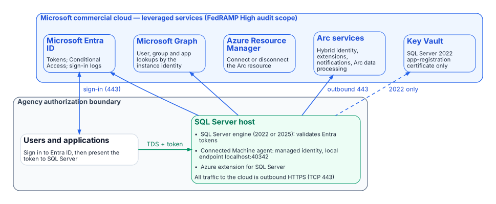

# Appendix B — Security-Approval (ATO) Kit

*The assessor's questions are predictable; answering them from Microsoft's own documentation, before they are asked, is most of the work of an authorization package.*

::: {.callout-note}
## In this appendix
What runs inside the agency boundary and what it reaches outside it, the outbound endpoints, the FedRAMP audit scope of each leveraged cloud service, the Microsoft Graph permissions each machine identity needs and why, the mitigation for the agent's token folder, the break-glass design, and the licenses each capability in the book requires.
:::

::: {.callout-important}
## Supports an authorization decision; doesn't make one
The SQL Server estate is part of the agency's own system, and its authorization is a risk decision by the agency's authorizing official under the Risk Management Framework.[^aB-rmf] FedRAMP authorizes the cloud services the design leverages, not the agency's system. The authorization boundary, the interconnection and leveraged-authorization language, and the risk decision belong to the authorizing official. This kit collects the facts an assessor will ask for. Platform facts were checked on October 20, 2026, and apply to Microsoft's commercial cloud, including GCC-Moderate; SQL Server needs access to the Azure public cloud to use Microsoft Entra authentication.[^aB-miov] See [Appendix C — Applicability](appendix-c-applicability.md) for GCC High and DoD.
:::

## Boundary

{fig-alt="Inside the agency boundary: users and applications, and the SQL Server host running the engine, the Connected Machine agent with its local endpoint, and the Azure extension for SQL Server. Outside, in Microsoft's commercial cloud: Microsoft Entra ID, Microsoft Graph, Azure Resource Manager, Arc services and Key Vault (SQL Server 2022 only). The host reaches them over outbound HTTPS on TCP 443; clients sign in to Entra ID and present the token to SQL Server over TDS."}

The SQL Server host stays inside the boundary. What changes is that it now depends on leveraged cloud services: Microsoft Entra ID for tokens, Microsoft Graph for lookups of users, groups and applications, and the Azure Arc services for the agent and the SQL extension. The Connected Machine agent communicates outbound to Azure Arc over TCP port 443.[^aB-netreq] Azure Private Link can carry the Arc service traffic, but "network traffic to Microsoft Entra ID and Azure Resource Manager doesn't traverse the Azure Arc private link scope and continues to use your default network route to the internet."[^aB-pl] SQL Server itself connects directly to Microsoft Entra ID for authentication and doesn't use the Arc agent's proxy setting; if the host needs a proxy, Entra authentication uses the machine-level WinHTTP proxy.[^aB-appreg]

## Outbound endpoints

From Microsoft's network requirements for the Connected Machine agent (Azure public cloud) and the prerequisites for SQL Server enabled by Azure Arc:[^aB-netreq][^aB-sqlprereq]

| Endpoint | Purpose | When required |
|---|---|---|
| `download.microsoft.com` | Windows installation package | Installation only |
| `login.microsoftonline.com` | Global Microsoft Entra token endpoint (onboarding and fallback) | Always |
| `*.login.microsoft.com` | Regional Microsoft Entra token endpoints | Always |
| `pas.windows.net` | Microsoft Entra ID | Always |
| `management.azure.com` | Azure Resource Manager: create or delete the Arc server resource | Connect or disconnect only |
| `*.his.arc.azure.com` | Metadata and hybrid identity services | Always |
| `*.guestconfiguration.azure.com` | Extension management and guest configuration | Always |
| `guestnotificationservice.azure.com`, `*.guestnotificationservice.azure.com` | Notification service | Always |
| `azgn*.servicebus.windows.net` or `*.servicebus.windows.net` | Notification service | Always |
| `*.<region>.arcdataservices.com` | Arc data processing service for Arc-enabled SQL Server (TLS 1.2 or 1.3 only) | If Arc-enabled SQL Server is used |
| `login.microsoftonline.com`, `login.microsoft.com`, `enterpriseregistration.windows.net`, `graph.microsoft.com`, `<key-vault-name>.vault.azure.net` | Microsoft Entra authentication with Arc-enabled SQL Server; the Key Vault endpoint only where a certificate is used (SQL Server 2022) | If Microsoft Entra authentication is used |

Use Microsoft's pages, not this table, as the firewall source of truth: they list optional endpoints (Windows Admin Center, SSH, ESU certificates, license validation) and change over time.

## FedRAMP audit scope of each leveraged service

Microsoft's compliance-scope page lists each of these Azure public-cloud services as in scope for FedRAMP High (page dated September 21, 2026):[^aB-fedramp]

| Service | Role in this design | FedRAMP High (Azure public) |
|---|---|---|
| Microsoft Entra ID (P1 + P2) and Microsoft Entra multifactor authentication | Tokens, Conditional Access, MFA, sign-in logs | ✅ |
| Microsoft Entra ID Governance | PIM for Groups, access reviews ([Chapters 16–17](16-groups-roles-and-membership.md)) | ✅ |
| Microsoft Graph | Instance-identity lookups | ✅ |
| Azure Arc-enabled servers | Connected Machine agent, managed identity | ✅ |
| Azure Arc-enabled SQL Server | Azure extension for SQL Server | ✅ |
| Azure Resource Manager | Arc resources | ✅ |
| Key Vault | SQL Server 2022 certificate | ✅ |
| Azure Monitor (incl. Log Analytics) | Telemetry ([Chapters 20–21](20-the-closure-condition.md)) | ✅ |
| Microsoft Defender for Cloud | Defender for SQL ([Chapters 20–21](20-the-closure-condition.md)) | ✅ |
| Microsoft Intune | Cloud PKI, an Intune add-on ([Chapter 22](22-where-sql-server-touches-adcs.md)) | ✅ |

An audit-scope listing is not the agency's authorization. Leveraging a provider authorization still needs the agency's own review of the package and of customer responsibilities, and the decision stays with the authorizing official.[^aB-rmf]

## Graph permissions for each machine identity

### What is required

"Each system-assigned managed identity requires `User.Read.All`, `GroupMember.Read.All`, and `Application.Read.All` permissions to query Microsoft Graph." They are application permissions (app roles) that "must be assigned directly to each managed identity" and "can't be manually assigned to a Microsoft Entra security group." Only a Privileged Role Administrator or higher can grant them.[^aB-misetup] The SQL Server 2022 app-registration setup documents either `Directory.Read.All` or the narrower set `Application.Read.All`, `Group.Read.All` and `User.Read.All`; choose the narrower set.[^aB-appreg]

### Least-privilege justification

- `User.Read.All` resolves the Entra users that `CREATE LOGIN … FROM EXTERNAL PROVIDER` names and that connect.
- `GroupMember.Read.All` resolves group membership for type-X (group) logins, which is how [Chapters 16–17](16-groups-roles-and-membership.md) grant access.
- `Application.Read.All` resolves service principals and managed identities that connect as applications ([Chapters 18–19](18-the-four-class-pattern-for-applications.md)).
- All three are read-only. None grants write access to the directory.

### Why not Directory Readers

Microsoft offers assigning the Directory Readers role to a role-assignable group as an alternative for many machines, but notes that it "grants broad read access across all directory objects, significantly exceeding the three targeted Graph API permissions," and that it "isn't recommended for production environments where least-privilege access is required."[^aB-misetup] Grant the three app roles to each identity with a script, and review the grants with the rest of the access reviews.

## Token folder and BULK permissions

Microsoft documents that "OPENROWSET BULK operations can also read the tokens folder `C:\ProgramData\AzureConnectedMachineAgent\Tokens\`," and that the `ADMINISTER BULK OPERATIONS` and `ADMINISTER DATABASE BULK OPERATIONS` permissions "should be treated as equivalent to sysadmin."[^aB-miov] The mitigation:

- Grant either permission only to principals that already hold `sysadmin`, and record any exception in the exception registry.
- Include both permissions in the audit's privileged-permission report and in SQL Server Audit, alongside `sysadmin` membership.
- The agent's local identity endpoint requires the caller to be in the local Administrators group or the Hybrid Agent Extension Applications group,[^aB-miauth] so manage those memberships as privileged.

## Break-glass design

| Failure | Design |
|---|---|
| Entra ID or Graph unreachable | Entra logins can't authenticate. Keep one documented break-glass path: a Windows group holding `sysadmin`, empty by default, in the exception registry, with every membership change and every login alerting. |
| Every `sysadmin` path lost | Microsoft documents starting the instance in single-user mode; any member of the computer's local Administrators group can then connect as a member of `sysadmin`.[^aB-lockout] That is why local Administrators membership on SQL hosts is itself privileged. |
| Tenant-side lockout | Follow Microsoft's emergency-access account guidance for the Entra tenant.[^aB-emergency] |
| Pressure to turn Entra authentication off | Microsoft states that once Entra authentication is enabled with a managed identity, disabling it isn't advisable, and forcibly deleting registry entries can cause unpredictable behavior.[^aB-miov] Recover through the paths above instead. |

## Licensing bill of materials

List prices change and agreements differ, so this table names the license each capability needs, not its price.

| Chapters | Capability | License | Source |
|---|---|---|---|
| 03–08 | Arc inventory and the audit | SQL Server license; Arc's client connection summary needs Software Assurance, a SQL Server subscription or pay-as-you-go | [^aB-arcov] |
| 09–12 | Entra authentication on the engine | Available with "License only": no Software Assurance or pay-as-you-go needed | [^aB-arcov] |
| 09–10 | SQL Server 2022 certificate | Azure Key Vault (consumption) | [^aB-appreg] |
| 11–12, 16–17, 20–21 | Conditional Access (MFA, device, location, risk) | Microsoft Entra ID P1 | [^aB-ca] |
| 16–17 | Dynamic membership groups | Microsoft Entra ID P1 for each unique member | [^aB-dyn] |
| 16–17 | PIM for Groups | Microsoft Entra ID P2, or a tier that includes it (Microsoft Entra ID Governance, Microsoft Entra Suite) | [^aB-lic] |
| 16–17 | Access reviews | Microsoft Entra ID Governance or Microsoft Entra Suite; some capabilities work with Microsoft Entra ID P2 | [^aB-ar] |
| 20–21 | Defender for SQL servers on machines | A Microsoft Defender for Cloud plan | [^aB-def] |
| 20–21 | Log Analytics | Azure Monitor (consumption) | — |
| 22 | Microsoft Cloud PKI | A subscription in addition to Intune Plan 1 or Plan 2, standalone or in the Intune Suite; issues only to Intune-enrolled devices | [^aB-pki] |

::: {.callout-tip}
## Continue the book
[← Previous: Appendix A — Requirements Mapping](appendix-a-requirements-mapping.md) · [Book index](index.md) · [Next: Appendix C — Applicability →](appendix-c-applicability.md)
:::

[^aB-rmf]: NIST, SP 800-37 Rev. 2, *Risk Management Framework for Information Systems and Organizations: A System Life Cycle Approach for Security and Privacy*, December 2018, <https://csrc.nist.gov/pubs/sp/800/37/r2/final> (accessed Oct 20, 2026); SP 800-53 Rev. 5, CA-6, Authorization, <https://csrc.nist.gov/pubs/sp/800/53/r5/upd1/final> (accessed Oct 20, 2026).
[^aB-netreq]: Microsoft Learn, "Connected Machine agent network requirements," <https://learn.microsoft.com/en-us/azure/azure-arc/servers/network-requirements> (accessed Oct 20, 2026).
[^aB-pl]: Microsoft Learn, "Use Azure Private Link to connect servers to Azure Arc by using a private endpoint," <https://learn.microsoft.com/en-us/azure/azure-arc/servers/private-link-security> (accessed Oct 20, 2026).
[^aB-sqlprereq]: Microsoft Learn, "Prerequisites — SQL Server enabled by Azure Arc" (network requirements for enabling Microsoft Entra authentication), <https://learn.microsoft.com/en-us/sql/sql-server/azure-arc/prerequisites?view=sql-server-ver17> (accessed Oct 20, 2026).
[^aB-fedramp]: Microsoft Learn, "Azure and other Microsoft cloud services compliance scope," section "Azure public services by audit scope" (page dated September 21, 2026), <https://learn.microsoft.com/en-us/azure/azure-government/compliance/azure-services-in-fedramp-auditscope> (accessed Oct 20, 2026).
[^aB-misetup]: Microsoft Learn, "Set up managed identity and Microsoft Entra authentication for SQL Server enabled by Azure Arc," "Grant application permissions to the identity," <https://learn.microsoft.com/en-us/sql/sql-server/azure-arc/microsoft-entra-authentication-with-managed-identity?view=sql-server-ver17> (accessed Oct 20, 2026).
[^aB-appreg]: Microsoft Learn, "Tutorial: Set up Microsoft Entra authentication for SQL Server enabled by Azure Arc" (SQL Server 2022 app registration; Key Vault certificate; proxy behavior), <https://learn.microsoft.com/en-us/sql/sql-server/azure-arc/entra-authentication-setup-tutorial?view=sql-server-ver17> (accessed Oct 20, 2026).
[^aB-miov]: Microsoft Learn, "Managed identity for SQL Server enabled by Azure Arc," Limitations, <https://learn.microsoft.com/en-us/sql/sql-server/azure-arc/managed-identity?view=sql-server-ver17> (accessed Oct 20, 2026).
[^aB-miauth]: Microsoft Learn, "Access Azure resources with managed identity on Azure Arc-enabled servers," <https://learn.microsoft.com/en-us/azure/azure-arc/servers/managed-identity-authentication> (accessed Oct 20, 2026).
[^aB-lockout]: Microsoft Learn, "Connect to SQL Server when system administrators are locked out," <https://learn.microsoft.com/en-us/sql/database-engine/configure-windows/connect-to-sql-server-when-system-administrators-are-locked-out?view=sql-server-ver17> (accessed Oct 20, 2026).
[^aB-emergency]: Microsoft Learn, "Manage emergency access admin accounts," <https://learn.microsoft.com/en-us/entra/identity/role-based-access-control/security-emergency-access> (accessed Oct 20, 2026).
[^aB-arcov]: Microsoft Learn, "SQL Server enabled by Azure Arc," feature availability by license type, <https://learn.microsoft.com/en-us/sql/sql-server/azure-arc/overview?view=sql-server-ver17> (accessed Oct 20, 2026).
[^aB-ca]: Microsoft Learn, "What is Conditional Access?," License requirements, <https://learn.microsoft.com/en-us/entra/identity/conditional-access/overview> (accessed Oct 20, 2026).
[^aB-dyn]: Microsoft Learn, "Manage rules for dynamic membership groups in Microsoft Entra ID," License requirements, <https://learn.microsoft.com/en-us/entra/identity/users/groups-dynamic-membership> (accessed Oct 20, 2026).
[^aB-lic]: Microsoft Learn, "Microsoft Entra ID Governance licensing fundamentals," <https://learn.microsoft.com/en-us/entra/id-governance/licensing-fundamentals> (accessed Oct 20, 2026).
[^aB-ar]: Microsoft Learn, "What are access reviews?," License requirements, <https://learn.microsoft.com/en-us/entra/id-governance/access-reviews-overview> (accessed Oct 20, 2026).
[^aB-def]: Microsoft Learn, "Microsoft Defender for SQL servers on machines overview," <https://learn.microsoft.com/en-us/azure/defender-for-cloud/defender-for-sql-on-machines-overview> (accessed Oct 20, 2026).
[^aB-pki]: Microsoft Learn, "Microsoft Cloud PKI for Microsoft Intune," Prerequisites, <https://learn.microsoft.com/en-us/intune/cloud-pki/> (accessed Oct 20, 2026).
