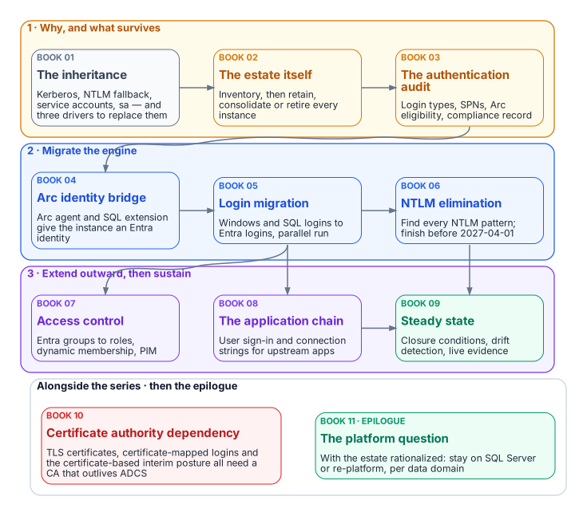
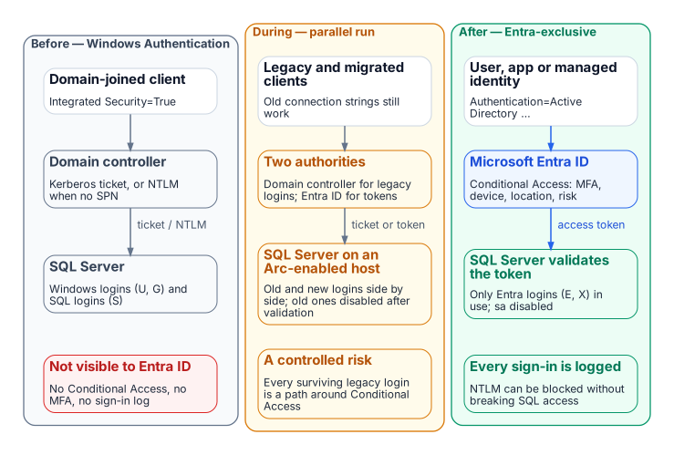

# Book 06 — Data Platform: SQL Server Identity {.unnumbered}

::: {.callout-important appearance="default"}
## Status — draft book
This book is the former SQL Server Identity Transformation narrative series and its Implementation Companion, combined into one ordered book that reads Why / What / Who / How, with a new chapter on who owns the data platform. Every external claim was checked against a primary source on October 20, 2026 and carries a footnote. The previous pages are kept in the repository's [`archive/b06-data-platform/`](https://github.com/WhalerMike/modernization-workbook/tree/main/archive/b06-data-platform) folder, and their old addresses forward here. The old Word download names still work.
:::

::: {.callout-tip}
## Download and present
**[b06-data-platform-bundle.docx](../../../downloads/b06-data-platform-bundle.docx)**: the whole book as one Word document, regenerated on every site deploy. The former `sql-server-narrative-bundle.docx` and per-book file names are kept as aliases.

**15-minute presentation (about 10 minutes narrated)**: the Why / What / Who / How deck and its narrated, self-running edition are on the [Presentations](../../presentations/index.md#book-06) page.

**Technical deep dive (about 50 minutes live, 21 narrated)**: the strategy, then runbooks R01–R10 for DBAs, in modules on the [Presentations](../../presentations/index.md#technical-b06) page.

**Executive briefing (about 30 minutes live, 14 narrated)**: for the CIO, CISO, data platform owner and application owners: why the database hides legacy authentication, counting the estate first, the Entra token target, who owns the engine and who owns the application chain, and the NTLM block date, with each decision's owner and timing, on the [Presentations](../../presentations/index.md#executive-b06) page.
:::

Every SQL Server instance that was joined to the domain inherited Windows Authentication: Kerberos when the service principal name is right, NTLM silently when it isn't, and SQL logins wherever an application couldn't do either. That inheritance is why the database is where legacy authentication hides longest. Nothing in Entra ID sees a Kerberos or NTLM session, so Conditional Access, phishing-resistant authentication and the audit trail never reach it. This book moves the estate to cloud identity for SQL Server 2022 and later: an Entra identity for each instance through Azure Arc, Entra logins for people, groups and applications, NTLM eliminated, and a closure condition that proves it. It starts with the estate itself, because consolidating before migrating is cheaper than migrating what should have been retired.

{fig-alt="The chapters in stages: why and what survives, migrating the engine, and extending outward then sustaining, with the certificate authority dependency alongside the whole sequence."}

## Why, what, who, how

| | Question | Chapters |
|---|---|---|
| **Why** | What Windows Authentication really is, why it must end, and what the estate looks like | [01](01-what-windows-authentication-actually-is.md)–[06](06-retain-consolidate-retire.md) |
| **What** | What is actually authenticating, the Arc identity bridge, and the principals that replace Windows logins | [07](07-the-authentication-audit.md)–[12](12-the-engine-authentication-decision.md) |
| **Who** | Who decides and who does the work for the data platform | [13](13-who-owns-the-data-platform.md) |
| **How** | NTLM elimination, access control, the application chain, closure, the certificate dependency and the platform question | [14](14-ntlm-and-the-patterns-that-generate-it.md)–[23](23-epilogue-the-platform-question.md) |
| **How — runbooks** | Step-by-step implementation, one runbook per stage | [R01](r01-prerequisites.md)–[R10](r10-certificate-discovery-for-adcs.md) |

Appendices: [A — Requirements mapping](appendix-a-requirements-mapping.md) · [B — Security-approval (ATO) kit](appendix-b-ato-kit.md) · [C — Applicability](appendix-c-applicability.md)

## The destination

Windows Authentication and SQL Authentication are eliminated for SQL Server 2022 and later and replaced with Microsoft Entra authentication: OAuth 2.0 tokens, an Entra identity for each instance (the Arc managed identity on SQL Server 2025, an app registration on SQL Server 2022), and multifactor authentication for every human principal. Versions that can't use Entra authentication reach the closed state only by upgrade or retirement.

{fig-alt="Before: a domain-joined client gets a Kerberos ticket or falls back to NTLM, invisible to Entra ID. During: legacy and migrated clients coexist, with two authorities and old logins disabled after validation. After: users, apps and managed identities authenticate with Entra tokens and no domain controller is in the path."}

## Which tracks this book covers

The workbook moves an AD forest to Entra ID on [four tracks](../guides/attribute-driven-migration.md#four-tracks), each with its own source of truth. A SQL Server estate touches three of them:

- **People's SQL access is the HR track.** A person reaches the engine through an Entra group login, and the group's dynamic membership comes from HR-sourced attributes ([Chapters 16](16-groups-roles-and-membership.md) and [17](17-dynamic-membership-delegation-and-privilege.md)).
- **The engine and the applications are the [non-person identity track](../guides/attribute-driven-migration.md#non-person-identity-track).** That covers the engine's service account ([Chapter 02, driver three](02-why-the-inheritance-must-end.md#driver-three-the-service-account-credential-problem)), the Arc managed identity or app registration that replaces it ([Chapter 09](09-what-arc-provides-to-sql-server.md#the-managed-identity-and-the-service-account)), and the application principals that connect to the database ([Chapters 18](18-the-four-class-pattern-for-applications.md) and [19](19-connection-string-migration.md)). None of these has an HR record. Each one's owner is its accountability.
- **The servers come under Azure Arc,** which is the Arc track ([Book 05, Chapter 09](../b05-devices/09-servers-under-azure-arc.md)).

In the program's mapping, the engine's identity supports IA-9 and people's Entra logins support IA-2 ([Appendix A](appendix-a-requirements-mapping.md#mapping-by-part)).

## Reading paths

- **Executives (20 minutes):** Chapters 01, 02, 06 and 13, or the 15-minute presentation.
- **Architects:** Chapters 01–13, then 20–23 and Appendix C first if the estate differs from the book's assumptions.
- **DBAs and engineers:** each narrative stage with its runbook: Chapters 03–06 with R02, 07–08 with R03, 09–10 with R04, 11–12 with R05, 14–15 with R06, 16–17 with R07, 18–19 with R08, 20–21 with R09, 22 with R10.

## Where this book sits in the workbook

This is Book 06 of the [Federal Modernization Workbook](../index.md). It depends on [Book 02 — Identity & Directory](../b02-identity/index.md) for the directory migration, [Book 03 — HR-Driven Identity](../b03-hr-identity/index.md) for the attributes that drive dynamic group access, [Book 04 — Access & Privilege](../b04-access/index.md) for Conditional Access and PIM, and [Book 05 — Devices & Endpoints](../b05-devices/index.md) for bringing servers under Azure Arc. The Federal Compliance books on [SQL Server authentication modernization](https://github.com/WhalerMike/modernization-workbook/blob/main/docs/compliance/Vol_II_Book_01_SQL_Server_Authentication_Modernization.md), the [SQL Server implementation guide](https://github.com/WhalerMike/modernization-workbook/blob/main/docs/compliance/Vol_II_Book_02_SQL_Server_Implementation_Guide.md) and [database consolidation](https://github.com/WhalerMike/modernization-workbook/blob/main/docs/compliance/Vol_II_Book_03_Database_Consolidation_Network_Physics.md) carry the compliance treatment, and the [Data Platform Identity Transformation project](https://github.com/WhalerMike/modernization-workbook/blob/main/docs/projects/data-platform-charter.md) ([plan](https://github.com/WhalerMike/modernization-workbook/blob/main/docs/projects/data-platform-plan.md)) delivers it.

## Chapters and runbooks

::: {#chapters}
:::

<!-- revisions:start: generated by scripts/generate_revisions.py from data/editions.yml; edit those, not this section -->

## Version and revision history {#version-history}

**Version 1.1**, in [edition 2026.11](../../about/archive.md#edition-2026-11) (November 1, 2026). Every edition is kept on the [Archive](../../about/archive.md) page; every change between editions is in the [commit history](https://github.com/WhalerMike/modernization-workbook/commits/main/docs/books/b06-data-platform).

| Version | Edition | Date | Changes |
|---|---|---|---|
| 1.1 | [2026.11](../../about/archive.md#edition-2026-11) | 2026-11-01 | Move the decks and narration audio out of git, onto edition 2026.10 ([#260](https://github.com/WhalerMike/modernization-workbook/pull/260)); Retire Research: move each page to a home by type (guides, training, reference, evaluations, explainers) ([#269](https://github.com/WhalerMike/modernization-workbook/pull/269)) |
| 1.0 | [2026.10](../../about/archive.md#edition-2026-10) | 2026-10-31 | First edition (25 merged changes since the book began) |

: Versions of this book, newest first {.striped .hover}

<!-- revisions:end -->
