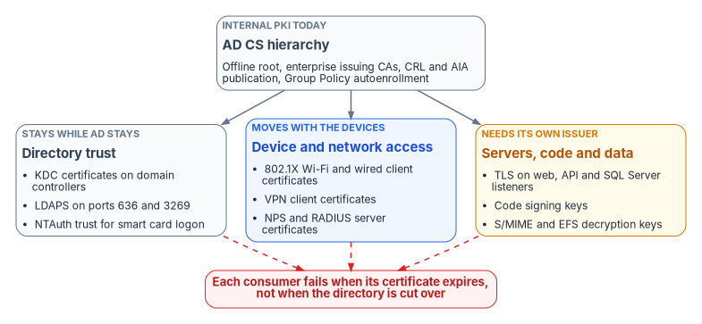
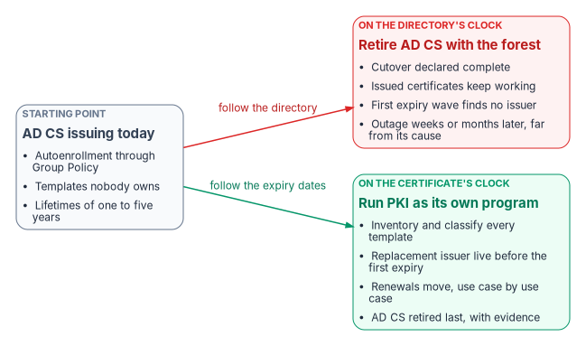

# Chapter 01 — Why Certificates Outlive Every Migration

*Every other migration changes which system answers "who is this?"; certificates are how the answer gets proved, so they have to keep working on both sides of every cutover.*

::: {.callout-note}
## In this chapter
What a certificate does and why so much of the estate quietly depends on one: domain controllers, LDAPS, 802.1X, smart card and PIV sign-in, TLS listeners including SQL Server, code signing and encryption. Why the certificate's failure clock runs past the directory's cutover date. How shrinking public TLS lifetimes, strong-mapping enforcement and the post-quantum transition make manual lifecycle management fail. Why the move off Active Directory Certificate Services (AD CS) is a program of its own, and what the rest of this book covers.
:::

## A certificate is a naming claim

Strip away the ceremony and an X.509 certificate makes one statement: the holder of this private key is entitled to this name. The name might be a DNS name, a user principal name, a device identifier or a service; the key belongs to the subject; and the certification authority (CA) vouches for the binding. Every relying party that accepts the certificate is trusting that the CA checked the binding, and that the binding is still true. The Federal Compliance book on certificates and tokens develops this argument in depth, including why certificate issuance, revocation checking and DNS are one substrate ([Vol I Book 03](../../compliance/Vol_I_Book_03_Certificates_Tokens_Cryptographic_Identity.md)).

That makes a certificate a different kind of object from the accounts, groups and policies the rest of the workbook migrates. An account is a record in a directory, and when you move the directory you move the record. A certificate is a signed statement that has already been handed out. It sits in device stores, on smart cards, in load balancers, in SQL Server configuration and in trust stores on systems nobody remembers configuring. It doesn't move when the directory moves. It keeps working, unchanged, until it expires or is revoked, and then whatever relied on it stops.

AD CS is how most agencies make those statements today. Microsoft lists the applications AD CS supports: S/MIME, secure wireless networks, VPN, IPsec, Encrypting File System (EFS), smart card sign-in, TLS and digital signatures.[^c01-adcs-overview] That list is close to a map of the estate's trust relationships. [Book 02, Chapter 04](../b02-identity/04-the-hidden-migration-surface.md) names PKI as one of the critical Active Directory dependency adapters for exactly this reason: certificates keep working until they expire, so a missing replacement shows up weeks or months after the migration is declared complete.

{#fig-ch01-certificate-consumers fig-alt="A slate card at the top, AD CS hierarchy, internal PKI today: offline root, enterprise issuing CAs, CRL and AIA publication, Group Policy autoenrollment. It connects to three cards. Directory trust, slate, stays while AD stays: KDC certificates on domain controllers, LDAPS on ports 636 and 3269, NTAuth trust for smart card logon. Device and network access, blue, moves with the devices: 802.1X Wi-Fi and wired client certificates, VPN client certificates, NPS and RADIUS server certificates. Servers, code and data, amber, needs its own issuer: TLS on web, API and SQL Server listeners, code signing keys, S/MIME and EFS decryption keys. Dashed red lines from all three lead to a red pill: each consumer fails when its certificate expires, not when the directory is cut over."}

## What leans on certificates

The consumers below are the ones every other book in the workbook touches. Each one has a certificate requirement that Microsoft documents, and each one fails in its own way when the certificate lapses or its issuer disappears.

| Consumer | What the certificate does | What happens without it | Where the workbook migrates it |
|---|---|---|---|
| Domain controllers (Kerberos) | Lets the Key Distribution Center prove its identity to clients; the certificate needs the KDC Authentication EKU, which the Kerberos Authentication template carries[^c01-kdc-cert] | Certificate-based sign-in to the domain, including smart cards and Windows Hello for Business certificate trust, can't validate the DC | Stays as long as domain controllers exist ([Book 02](../b02-identity/04-the-hidden-migration-surface.md)) |
| LDAPS | A Server Authentication certificate with the DC's FQDN turns on LDAP over TLS on ports 636 and 3269; there's no other switch[^c01-ldaps] | LDAPS clients, often appliances and line-of-business applications, can't connect | Stays with the domain controllers |
| Smart card and PIV logon to Windows | The issuing CA must be in the forest's NTAuth store, and every DC that authenticates smart card users needs a domain controller certificate; revocation checking must succeed on both the client and the DC[^c01-smartcard] | "Credentials could not be verified" at the sign-in screen | PIV issuance and binding: [Book 03, Chapter 09](../b03-hr-identity/09-credentials-and-certificates.md) |
| 802.1X and VPN (NPS) | Every NPS needs a server certificate, issued by a CA the clients trust, for EAP-TLS, PEAP-TLS and PEAP-MS-CHAP v2[^c01-nps]; EAP-TLS clients present their own certificates | Clients can't validate the RADIUS server; the network doesn't admit them | Device certificates through Intune profiles ([Book 05](../b05-devices/index.md), and [Chapter 06](06-device-and-user-certificates.md) of this book) |
| Certificates used to sign in against the KDC | Since full enforcement of KB5014754, the KDC requires a strong mapping between certificate and account[^c01-kb5014754] | Authentication is denied | Intune profiles must add the SID to the certificate[^c01-intune-scep] ([Chapter 06](06-device-and-user-certificates.md)) |
| TLS listeners, including SQL Server | Proves the server's name to clients and encrypts the session | Clients that validate the certificate refuse the connection | [Book 06, Chapter 22](../b06-data-platform/22-where-sql-server-touches-adcs.md) for SQL Server; servers generally in [Chapter 04](04-the-target-pki.md) |
| Code signing | Lets a system decide whether to run a script, package or binary | Signed content fails validation once the chain can't be built or the signature isn't trusted | Retained or re-homed ([Chapter 02](02-what-ad-cs-holds-up.md)) |
| Encryption (S/MIME, EFS) | The private key decrypts data that was encrypted to it | Old mail and files can't be opened if the keys are lost | Key history must survive the migration ([Chapter 02](02-what-ad-cs-holds-up.md)) |
| Microsoft Entra certificate-based authentication | A relying party: it validates certificates against CAs uploaded to the tenant and reads their CRLs from an internet-facing HTTP address; Microsoft doesn't provide the PKI that creates client certificates[^c01-cba-limits] | No CRL means no revocation; an unreachable CRL means failed sign-ins | [Book 02, Chapter 04](../b02-identity/04-the-hidden-migration-surface.md); [Book 03, Chapter 09](../b03-hr-identity/09-credentials-and-certificates.md) |

: The certificate consumers every other migration touches {.striped .hover}

Read the last column again. The identity, workforce, device and data-platform books each migrate one slice of these consumers. None of them owns the issuer underneath all of them.

## Why the dependency survives the directory move

Three properties of AD CS make it the part of Active Directory that is hardest to leave.

First, an enterprise CA is wired into the forest. Its templates, enrollment services, NTAuth trust, AIA and CRL publication points all live in the Public Key Services container of the forest's configuration partition, and a change there can affect clients far beyond the CA you're looking at.[^c01-pki-health] Domain members find the CA and enroll through Group Policy autoenrollment. An Entra-joined device managed by Intune has no Group Policy channel at all ([Book 05, Chapter 01](../b05-devices/01-why-group-policy-cant-come-to-the-cloud.md)), so autoenrollment doesn't follow it into the cloud.

Second, the cloud replacements cover only part of the estate. Microsoft Cloud PKI issues leaf certificates through SCEP to Intune-managed devices, and hosts the CRL and AIA endpoints for its CAs.[^c01-cloudpki] That's a clean path for laptops, phones and other managed endpoints. It isn't a path for servers: Intune's supported platforms are client operating systems, not Windows Server,[^c01-intune-platforms] so a web server, an NPS server, a SQL Server host or a domain controller can't get its certificate from Cloud PKI directly. [Book 05](../b05-devices/09-servers-under-azure-arc.md) and [Book 06](../b06-data-platform/22-where-sql-server-touches-adcs.md) reach the same conclusion from their own sides. Entra certificate-based authentication doesn't close the gap either, because it validates certificates and doesn't issue them.[^c01-cba-limits]

Third, the domain controllers need certificates for as long as domain controllers exist. Kerberos certificate trust, LDAPS and smart card logon all hang off them. The program can retire AD CS for every device that moves to Intune and still need an issuer for the forest until the forest itself is gone. Microsoft's own guidance for the Public Key Services data makes the same point about the publication side: treat CRL and AIA URLs as long-lived dependencies, and don't remove a DNS name, virtual directory or directory publication point while unexpired certificates can still reference it.[^c01-pki-health]

So the certificate estate outlives the directory migration twice over. Issued certificates outlive the cutover by however long they have left to run, and some of the issuer's duties outlive it until the last domain controller is decommissioned.

{#fig-ch01-two-clocks fig-alt="Left to right. A slate starting card, AD CS issuing today: autoenrollment through Group Policy, templates nobody owns, lifetimes of one to five years. A red arrow labeled follow the directory leads to a red card, on the directory's clock, retire AD CS with the forest: cutover declared complete; issued certificates keep working; first expiry wave finds no issuer; outage weeks or months later, far from its cause. A green arrow labeled follow the expiry dates leads to a green card, on the certificate's clock, run PKI as its own program: inventory and classify every template; replacement issuer live before the first expiry; renewals move, use case by use case; AD CS retired last, with evidence."}

## The rules are moving under certificates already issued

A certificate estate used to be something you could leave alone between renewals. Three changes have ended that, and each one is a reason the estate needs continuous management rather than a one-time migration.

### Public TLS lifetimes are shrinking on a fixed schedule

In April 2025 the CA/Browser Forum adopted Ballot SC-081v3, which sets a schedule for reducing the maximum validity of publicly trusted TLS certificates from 398 days to 47 days, and the reuse period for domain validation data from 398 days to 10 days, between March 2026 and March 2029. Certificate issuers voted 25 in favor with none against, and all four browser vendors (Apple, Google, Microsoft and Mozilla) voted yes.[^c01-cabf-ballot] The current Baseline Requirements (version 2.3.1, October 4, 2026) list the steps:[^c01-cabf-br]

| Certificates issued | Maximum validity | Renewals per certificate per year (at least) | Renewals per working day for 1,000 certificates |
|---|---|---|---|
| Before March 15, 2026 | 398 days | about 1 | about 4 |
| From March 15, 2026 (in force today) | 200 days | about 2 | about 7 |
| From March 15, 2027 | 100 days | about 4 | about 15 |
| From March 15, 2029 | 47 days | about 8 | about 31 |

: Public TLS maximum validity under the CA/Browser Forum schedule, with the renewal workload it implies (the last two columns are program arithmetic, assuming 250 working days and no renewal before the deadline) {.striped .hover}

The Baseline Requirements govern publicly trusted TLS certificates, not an agency's internal CA. But every agency runs public-facing services, and the internal estate is held to the same arithmetic by a different force: the program's own policy is to keep internal lifetimes short as well, because a short-lived certificate limits how long a compromised key is useful and turns most revocation into simple non-renewal ([Vol I Book 03](../../compliance/Vol_I_Book_03_Certificates_Tokens_Cryptographic_Identity.md) makes the full case). The 100-day step arrives in five months. At 47 days, an estate tracked by spreadsheet and calendar reminder can't keep up even in principle, and the 10-day reuse period means domain validation has to be automated too.

### Mapping rules changed for certificates already in use

KB5014754 is the example of a rule that changed under certificates that were already issued and working. Microsoft moved domain controllers that weren't already in enforcement mode to full enforcement on February 11, 2025, and after the September 9, 2025 update the registry setting that allowed a return to compatibility mode is no longer supported.[^c01-kb5014754] A certificate used to authenticate against the KDC now needs a strong mapping to its account, either a SID extension in the certificate or a mapping based on an identifier that can't be reused; weak mappings such as subject or email address aren't enough.[^c01-kb5014754] For certificates delivered by Intune, that means adding the on-premises SID to the SCEP profile's subject alternative name; the requirement applies to user certificates on every platform and to device certificates on Microsoft Entra hybrid-joined Windows devices.[^c01-intune-scep] An inventory that recorded only expiry dates would have missed every certificate this change broke.

### The algorithms themselves are on a clock

NIST's draft transition plan for post-quantum cryptography (IR 8547, an initial public draft from November 2024) proposes deprecating RSA and ECDSA signatures at the 112-bit security level, which includes RSA-2048, after 2030, and disallowing RSA and ECDSA signatures at every strength after 2035.[^c01-nistir8547] The same draft notes that the journey from algorithm standard to full integration can take 10 to 20 years, and that infrastructure such as PKI has to support the new algorithms before the applications that rely on it can migrate.[^c01-nistir8547] Microsoft has started: AD CS now supports the ML-DSA signature algorithm on Windows Server 2025 with the May 2026 security update or later, with ML-KEM and composite certificates planned, and post-quantum support requires CNG key storage providers rather than legacy CSPs.[^c01-adcs-pqc] Microsoft's reason is the one that matters here: root CA and code signing certificates issued today must stay trustworthy for their whole validity period.[^c01-adcs-pqc] A root CA built in 2026 with a 20-year life expires in 2046, eleven years after the draft's last date for RSA signatures.

Taken together: lifetimes are getting shorter, mapping rules can change after issuance, and the algorithms have a horizon. Each of these turns a certificate inventory from a migration artifact into a standing operational record.

## Manual lifecycle management breaks

The spreadsheet model of certificate management fails in ways that are familiar enough to list. A certificate expires because the reminder went to someone who left. A scan finds a certificate on a production listener that's in no inventory, from an unknown issuer, with an unknown key holder, so it's left alone. A service presents the same key for years because every renewal reused the request. [Vol I Book 03](../../compliance/Vol_I_Book_03_Certificates_Tokens_Cryptographic_Identity.md) calls this the spreadsheet CA and walks through why its failure modes are arithmetic, not staffing.

The replacement has four parts, and the rest of this book builds them:

1. **Discovery.** Every certificate in use, whoever issued it, found on the network and in the CA databases, not only the ones someone recorded ([Chapter 02](02-what-ad-cs-holds-up.md)).
2. **Ownership.** A named owner for every template and every certificate population, and a clear split between who decides policy and who operates issuance ([Chapter 05](05-who-owns-the-certificate-estate.md)).
3. **Automated issuance and renewal.** Intune and Microsoft Cloud PKI for managed devices; Group Policy autoenrollment for the domain workloads that stay while AD stays; automated issuance and installation for servers and appliances ([Chapters 04](04-the-target-pki.md), [06](06-device-and-user-certificates.md) and [07](07-coexistence-and-migration.md)).
4. **Evidence.** Expiry horizons, issuance outside the pipeline and renewal failures watched as signals, not discovered as outages ([Chapter 08](08-lifecycle-monitoring-and-decommissioning.md)).

Where Microsoft covers the need, the program uses Microsoft-native tooling. For discovery and lifecycle automation across everything else (public TLS, servers, load balancers and appliances), the program's certificate lifecycle management tool is CyberArk Certificate Manager, formerly Venafi, from the program's existing machine-identity vendor. The program consolidates certificate lifecycle management on that existing platform and doesn't add a second lifecycle vendor. One naming note for procurement and documentation: Palo Alto Networks completed its acquisition of CyberArk on February 11, 2026,[^c01-pan-cyberark] and now markets the SaaS edition as part of Next-Generation Trust Security (NGTS), describing it as the successor to the offering previously known as Venafi TLS Protect and then CyberArk Certificate Manager SaaS; the self-hosted edition continues as Certificate Manager, Self-Hosted.[^c01-ngts] [Chapter 08](08-lifecycle-monitoring-and-decommissioning.md) covers how the tool fits into the operating model.

## Why the move off AD CS is its own program

It would be tidy to treat the PKI as a workstream inside the directory migration. The program doesn't, for five reasons.

1. **It fails on a different clock.** Directory work fails at cutover, where someone is watching. Certificate work fails at expiry, which can be months later and far from its cause. A program that measures progress by cutover dates will report success on the PKI right up to the outage.
2. **It belongs to everyone, so it belongs to no one.** Identity, workforce identity, devices, network access and the data platform all consume certificates, and each book in the workbook migrates its own consumers. The issuer underneath them needs an owner who answers for all of them at once ([Chapter 05](05-who-owns-the-certificate-estate.md)).
3. **Its sequence is fixed by expiry dates.** The replacement issuer has to be live and trusted before the first expiry wave of each use case, and AD CS has to be retired last, after every renewal is confirmed through the new issuer. That is [Book 02's](../b02-identity/04-the-hidden-migration-surface.md) acceptance condition for the PKI adapter, and it can't be scheduled around the directory's milestones.
4. **There's no single replacement.** Cloud PKI covers Intune-managed devices. Entra certificate-based authentication covers sign-in to the tenant but issues nothing. PIV credentials come from the Federal PKI through the card management system, not from AD CS ([Book 03, Chapter 09](../b03-hr-identity/09-credentials-and-certificates.md)). Servers, domain controllers, network equipment, code signing and encryption keys each need a decision of their own ([Chapter 04](04-the-target-pki.md)).
5. **What stays has to be hardened.** AD CS doesn't disappear on day one; parts of it may run for years. Misconfigured templates and CA settings are a well-documented route to domain-wide compromise, so the AD CS that remains has to be reviewed, fixed and monitored while it runs ([Chapter 03](03-hardening-what-stays.md)).

Federal policy raises the stakes. OMB M-22-09 requires phishing-resistant MFA for agency staff, contractors and partners, and names the PIV standard as one phishing-resistant approach.[^c01-m2209] For most of the federal workforce, phishing-resistant sign-in is a certificate on a card. A PKI program that stalls doesn't just risk outages; it puts the agency's zero trust commitments at risk too.

## What this book covers

The book follows the workbook's Why, What, Who and How structure. It covers assessment of the existing AD CS estate, hardening of what stays, the target design (Microsoft Cloud PKI, the parts of AD CS that remain, and the Federal PKI's role), Intune certificate profiles with strong mapping, Entra certificate-based authentication and its staged rollout, coexistence during the transition, the migration sequence and rollback, and monitoring, drift detection and decommissioning.

| Part | Chapters | Question it answers |
|---|---|---|
| Why | [Chapter 01](01-why-certificates-outlive-every-migration.md) | Why does the certificate estate need its own program? |
| What | [Chapter 02](02-what-ad-cs-holds-up.md), [Chapter 03](03-hardening-what-stays.md), [Chapter 04](04-the-target-pki.md) | What does AD CS hold up today, how is what stays made safe, and what is the target? |
| Who | [Chapter 05](05-who-owns-the-certificate-estate.md) | Who owns the issuer, the templates and the certificates? |
| How | [Chapter 06](06-device-and-user-certificates.md), [Chapter 07](07-coexistence-and-migration.md), [Chapter 08](08-lifecycle-monitoring-and-decommissioning.md) | How are certificates issued, moved, watched and finally retired? |
| Appendices | [Appendix A](appendix-a-deployment-checklists.md), [Appendix B](appendix-b-template-migration-matrix.md) | Deployment checklists and the template-by-template migration matrix |

: The book at a glance {.striped .hover}

The book is written for PKI administrators and certificate services operators, identity and access management architects, Intune and endpoint administrators, security operations and compliance teams, and the governance leads and project managers who have to schedule work that fails on someone else's clock.

## The short version

- A certificate is a signed naming claim that has already been handed out. It doesn't move when the directory moves; it works until it expires, and then whatever relied on it stops.
- Domain controllers, LDAPS, smart card and PIV logon, 802.1X and VPN, TLS listeners including SQL Server, code signing and encryption all lean on the internal PKI that every other book migrates around.
- Cloud PKI issues only to Intune-managed devices, Intune doesn't manage Windows Server, and Entra CBA issues nothing, so servers and the forest itself need another issuer.
- Public TLS maximum validity is 200 days today, 100 days from March 15, 2027 and 47 days from March 15, 2029. Strong-mapping enforcement and the post-quantum transition show the rules change under certificates already issued. Manual lifecycle management can't keep up.
- The move off AD CS runs as its own program: inventory first, replacement issuers live before each expiry wave, CyberArk Certificate Manager for lifecycle automation beyond what Microsoft covers, and AD CS retired last, with evidence.

::: {.callout-tip}
## Continue the book
[← Previous: Book index](index.md) · [Book index](index.md) · [Next: Chapter 02 — What AD CS Holds Up →](02-what-ad-cs-holds-up.md)
:::

[^c01-adcs-overview]: Microsoft Learn, "What is Active Directory Certificate Services?" (Benefits), <https://learn.microsoft.com/windows-server/identity/ad-cs/active-directory-certificate-services-overview> (accessed Oct 20, 2026).
[^c01-kdc-cert]: Microsoft Learn, "Configure and validate the PKI in a hybrid certificate trust model" (Configure domain controller certificates), <https://learn.microsoft.com/windows/security/identity-protection/hello-for-business/deploy/hybrid-cert-trust-pki> (accessed Oct 20, 2026).
[^c01-ldaps]: Microsoft Learn, "Configure certificates for LDAP over SSL in Active Directory Domain Services," <https://learn.microsoft.com/windows-server/identity/ad-ds/configure-ldap-signing-certificates> (accessed Oct 20, 2026).
[^c01-smartcard]: Microsoft Learn, "Guidelines for enabling smart card logon with third-party certification authorities," <https://learn.microsoft.com/troubleshoot/windows-server/certificates-and-public-key-infrastructure-pki/enabling-smart-card-logon-third-party-certification-authorities> (accessed Oct 20, 2026).
[^c01-nps]: Microsoft Learn, "Manage Certificates Used with NPS," <https://learn.microsoft.com/windows-server/networking/technologies/nps/nps-manage-certificates> (accessed Oct 20, 2026).
[^c01-kb5014754]: Microsoft Support, "KB5014754: Certificate-based authentication changes on Windows domain controllers," <https://support.microsoft.com/en-us/topic/kb5014754-certificate-based-authentication-changes-on-windows-domain-controllers-ad2c23b0-15d8-4340-a468-4d4f3b188f16> (accessed Oct 20, 2026).
[^c01-intune-scep]: Microsoft Learn, "Create and assign SCEP certificate profiles in Intune" (Update certificate connector: Strong mapping requirements for KB5014754), <https://learn.microsoft.com/intune/device-configuration/certificates/scep-profiles> (accessed Oct 20, 2026).
[^c01-cba-limits]: Microsoft Learn, "Limitations with Microsoft Entra certificate-based authentication," <https://learn.microsoft.com/entra/identity/authentication/concept-certificate-based-authentication-limitations> (accessed Oct 20, 2026).
[^c01-pki-health]: Microsoft Learn, "Monitor AD CS publication health with Enterprise PKI" (Understand Public Key Services data; Security considerations for forest-wide PKI changes), <https://learn.microsoft.com/windows-server/identity/ad-cs/monitor-ad-cs-health-enterprise-pki> (accessed Oct 20, 2026).
[^c01-cloudpki]: Microsoft Learn, "Overview of Microsoft Cloud PKI for Microsoft Intune" (Overview of features; Architecture), <https://learn.microsoft.com/intune/cloud-pki/> (accessed Oct 20, 2026).
[^c01-intune-platforms]: Microsoft Learn, "Supported operating systems and browsers in Intune," <https://learn.microsoft.com/intune/fundamentals/ref-supported-platforms> (accessed Oct 20, 2026).
[^c01-cabf-ballot]: CA/Browser Forum, "Ballot SC-081v3: Introduce Schedule of Reducing Validity and Data Reuse Periods," voting April 4–11, 2025, <https://cabforum.org/2025/04/11/ballot-sc081v3-introduce-schedule-of-reducing-validity-and-data-reuse-periods/> (accessed Oct 20, 2026).
[^c01-cabf-br]: CA/Browser Forum, *Baseline Requirements for Publicly-Trusted TLS Server Certificates*, version 2.3.1, October 4, 2026, §1.2.2 "Relevant Dates," <https://raw.githubusercontent.com/cabforum/servercert/main/docs/BR.md> (accessed Oct 20, 2026).
[^c01-nistir8547]: NIST, IR 8547 (Initial Public Draft), *Transition to Post-Quantum Cryptography Standards*, November 12, 2024, §1, §2.2 and §4.1.1 (Table 2), <https://csrc.nist.gov/pubs/ir/8547/ipd> (accessed Oct 20, 2026).
[^c01-adcs-pqc]: Microsoft Learn, "Post-Quantum Cryptography in AD CS overview," <https://learn.microsoft.com/windows-server/identity/ad-cs/post-quantum-cryptography-overview> (accessed Oct 20, 2026).
[^c01-pan-cyberark]: Palo Alto Networks, "Palo Alto Networks Completes Acquisition of CyberArk to Secure the AI Era," press release filed as Exhibit 99.1 to Form 8-K, February 11, 2026, <https://www.sec.gov/Archives/edgar/data/1327567/000119312526045600/d40626dex991.htm> (accessed Oct 20, 2026).
[^c01-ngts]: Palo Alto Networks, "Certificate Manager" (Next-Generation Trust Security), <https://www.paloaltonetworks.com/network-security/next-gen-trust-security/certificate-manager> (accessed Oct 20, 2026).
[^c01-m2209]: Office of Management and Budget, M-22-09, *Moving the U.S. Government Toward Zero Trust Cybersecurity Principles*, January 26, 2022, §A (Identity), <https://www.whitehouse.gov/wp-content/uploads/2022/01/M-22-09.pdf> (accessed Oct 20, 2026).
