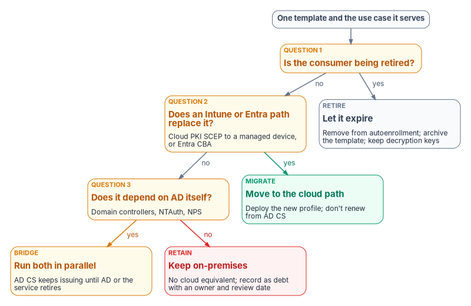

# Chapter 02 — What AD CS Holds Up

*AD CS isn't one server: it's a hierarchy, a set of forest-wide directory objects and a Group Policy channel, and every published template is a promise that some system depends on.*

::: {.callout-note}
## In this chapter
The typical two-tier AD CS topology and what each component does, and the objects AD CS keeps in the forest's configuration partition. The CA inventory record. The common template categories and their extended key usages, and how autoenrollment works. What a certificate inventory collects, at the CA, template, issued-certificate and relying-party layers. The MIGRATE, BRIDGE, RETAIN and RETIRE classification, and the use-case map that applies it, corrected where the source overstated what Cloud PKI and Intune can replace.
:::

## The baseline comes first

Before any certificate moves, the program establishes what the existing Active Directory Certificate Services (AD CS) estate actually is: which CAs exist, what they publish into the forest, which templates are live, who can enroll, what has been issued and who trusts it. [Chapter 01](01-why-certificates-outlive-every-migration.md) explained why the certificate estate fails on its own clock. This chapter is the map that lets the program read that clock: every later decision, from hardening in [Chapter 03](03-hardening-what-stays.md) to the template-by-template plan in [Appendix B](appendix-b-template-migration-matrix.md), starts from the inventory described here.

## The typical topology

Most enterprise AD CS deployments use a two-tier hierarchy, sometimes three. Microsoft's guidance is the reason: if the root CA is compromised, every CA beneath it and every certificate it ever issued is compromised too, so the root is best kept disconnected from the network, with subordinate CAs doing the issuing.[^c02-ca-role] Microsoft's current deployment guidance recommends a standalone root CA that is taken offline after it issues the subordinate CA certificate as production best practice.[^c02-mldsa]

{#fig-ch02-adcs-topology fig-alt="Top to bottom. A slate card, tier 1, offline root CA: standalone, not domain-joined; key in an HSM where possible; online only to sign issuing CAs and its CRL. An arrow labeled signs leads to a slate card, tier 2, enterprise issuing CAs: domain-joined; issue from templates stored in AD. Beside the root, a violet card, forest configuration partition, Public Key Services: Certificate Templates, Enrollment Services, NTAuthCertificates, AIA, CDP, KRA, OID, joined to the issuing CAs by a two-way arrow labeled publishes. Below the issuing CAs, three enrollment channels: autoenrollment for domain members through Group Policy every eight hours, slate; NDES using SCEP for devices without domain credentials, including Intune with the Certificate Connector, amber; CES and CEP for policy-based enrollment over HTTPS off-network or from other forests, amber. At the bottom, a slate card, CRL, AIA and OCSP, where relying parties check status: CRL distribution points and AIA over HTTP and LDAP, and the Online Responder for OCSP. The issuing CAs publish CRLs to it, and a dashed line from the root carries the root CRL."}

| Component | What it does | Notes for the migration |
|---|---|---|
| Offline root CA | Signs the issuing CA certificates and its own CRL; otherwise powered off | Usually a standalone CA on a hardened, non-domain-joined server, brought online for issuing-CA renewal and CRL signing |
| Enterprise issuing CAs | Domain-joined CAs that do day-to-day issuance; only enterprise CAs issue from certificate templates, which AD DS stores and every CA in the forest shares[^c02-templates] | Each one publishes itself into the forest for enrollment discovery |
| Network Device Enrollment Service (NDES) | A registration authority that lets routers and other devices without domain credentials obtain certificates over SCEP[^c02-ndes] | Intune SCEP profiles that use a Microsoft CA need an NDES server and the Certificate Connector for Microsoft Intune[^c02-intune-certs] |
| Certificate Enrollment Web Service (CES) and Certificate Enrollment Policy Web Service (CEP) | Policy-based enrollment over HTTPS for computers that aren't domain members, or are away from the corporate network; CES also allows enrollment across forest boundaries[^c02-ces][^c02-cep] | Often placed in the perimeter network so internet-based clients can enroll[^c02-ces] |
| CA Web Enrollment | Browser-based, interactive certificate requests; the usual way to reach a standalone CA[^c02-webenroll] | Interactive requests are hard to inventory; find out who still uses it |
| CRL distribution points (CDP) | HTTP and LDAP locations where CRLs are published | Entra CBA accepts only one CRL location per CA, over HTTP (or HTTPS; HTTP recommended); it doesn't use LDAP or OCSP[^c02-cba-ca][^c02-cba-crl] |
| Authority Information Access (AIA) | HTTP and LDAP locations from which relying parties retrieve CA certificates to build the chain | LDAP locations are useful only to clients that can query the forest's directory |
| Online Responder (optional) | Answers OCSP requests with a signed status for individual certificates[^c02-adcs-overview] | Serves only the CAs it's configured for; see the use-case map below |

: AD CS components in a typical deployment {.striped .hover}

### What AD CS keeps in the forest

An enterprise CA isn't only a server; it's a set of objects in the Public Key Services branch of the forest's configuration partition. Microsoft describes what each holds:[^c02-pki-health]

| Container or object | What it holds |
|---|---|
| AIA | A `certificateAuthority` object per CA, the directory AIA location clients use to build chains |
| CDP | A `crlDistributionPoint` object per CA server, holding the CRLs it publishes |
| Certification Authorities | The forest's root CA trust store |
| Enrollment Services | The `pKIEnrollmentService` object each enterprise CA creates, which records the certificate types it can issue; its permissions control who can enroll against that CA |
| Certificate Templates | The templates enterprise CAs issue from |
| KRA | Key recovery agent certificate information for CAs that archive keys |
| OID | Enterprise object identifiers for template, EKU, application policy and issuance policy names |
| NTAuthCertificates | CA certificates trusted to issue authentication certificates, such as smart card logon and domain controller certificates; enterprise CAs publish themselves here automatically |

: The Public Key Services objects an enterprise PKI depends on {.striped .hover}

These objects are forest-wide, so a change to any of them can reach clients well beyond the CA in view, and they are exactly what ties AD CS to Active Directory.[^c02-pki-health] The inventory captures them; the decommissioning steps in [Chapter 08](08-lifecycle-monitoring-and-decommissioning.md) remove them last.

### The CA inventory record

Record each CA with the same attributes. The values below are illustrative of a common deployment, not a recommendation; [Chapter 03](03-hardening-what-stays.md) and [Chapter 04](04-the-target-pki.md) set the program's targets.

| Attribute | Root CA | Issuing CA 1 | Issuing CA 2 |
|---|---|---|---|
| CA type | Standalone root | Enterprise subordinate | Enterprise subordinate |
| Server name | `FMP-ROOT-CA` | `FMP-ISS-CA01` | `FMP-ISS-CA02` |
| Operating system | Windows Server 2019 | Windows Server 2022 | Windows Server 2022 |
| Key algorithm and length | RSA 4096 | RSA 2048 | RSA 2048 |
| Key storage provider | CNG or legacy CSP | CNG or legacy CSP | CNG or legacy CSP |
| Hash algorithm | SHA-256 | SHA-256 | SHA-256 |
| CA certificate validity | 20 years | 5 years | 5 years |
| CRL distribution points | HTTP, LDAP | HTTP, LDAP | HTTP, LDAP |
| AIA locations | HTTP, LDAP | HTTP, LDAP | HTTP, LDAP |
| CRL size and publication interval | — | Record both | Record both |
| OCSP configured | No | Yes or no | Yes or no |
| Key protected by an HSM | Yes or no | Yes or no | Yes or no |
| Templates published | None | List | List |

: CA inventory record, with illustrative values {.striped .hover}

Two rows were added to the source's template because the target depends on them. The key storage provider matters because AD CS post-quantum support requires CNG providers and doesn't support legacy CSPs.[^c02-pqc] The CRL size matters because Entra CBA downloads each trusted CA's CRL and enforces size limits ([Book 03, Chapter 09](../b03-hr-identity/09-credentials-and-certificates.md) gives them).

## Template categories

Templates are organized by use case, and the extended key usage (EKU) a template stamps on its certificates says what the certificate may be used for. The categories below appear in most deployments. The template names are AD CS defaults[^c02-template-concepts] (custom templates are usually duplicates of them), and the OIDs are Microsoft's.[^c02-eku]

| Category | Typical templates | EKU (OID) | Typical subjects |
|---|---|---|---|
| User authentication | User, Smartcard User | Client Authentication (`1.3.6.1.5.5.7.3.2`) | Domain users |
| Computer authentication | Computer (Machine), Workstation Authentication | Client Authentication (`1.3.6.1.5.5.7.3.2`) | Domain-joined computers |
| Web server TLS | Web Server | Server Authentication (`1.3.6.1.5.5.7.3.1`) | IIS servers, load balancers, other TLS listeners |
| Network access servers | RAS and IAS Server | Server Authentication (`1.3.6.1.5.5.7.3.1`) | NPS and RRAS servers[^c02-ras-template] |
| Code signing | Code Signing | Code Signing (`1.3.6.1.5.5.7.3.3`) | Developers, build servers |
| Secure email | Exchange User, User, Smartcard User | Secure Email (`1.3.6.1.5.5.7.3.4`) | Mail users |
| EFS | Basic EFS, EFS Recovery Agent | Encrypting File System (`1.3.6.1.4.1.311.10.3.4`); File Recovery (`1.3.6.1.4.1.311.10.3.4.1`) | Domain users, recovery agents |
| Smart card logon | Smartcard Logon | Smart Card Logon (`1.3.6.1.4.1.311.20.2.2`) | Smart card holders not served by PIV |
| Domain controller authentication | Kerberos Authentication; older Domain Controller and Domain Controller Authentication | KDC Authentication (`1.3.6.1.5.2.3.5`) plus Client and Server Authentication | Domain controllers |
| OCSP signing | OCSP Response Signing | OCSP Signing (`1.3.6.1.5.5.7.3.9`) | Online Responders |
| IPsec | IPSec (Offline request) | IP Security IKE Intermediate (`1.3.6.1.5.5.8.2.2`) | VPN gateways |
| Enrollment agent | Enrollment Agent | Certificate Request Agent (`1.3.6.1.4.1.311.20.2.1`) | Enrollment stations, registration authorities |

: Common AD CS template categories {.striped .hover}

Two notes on the table. Domain controllers automatically request a domain controller certificate when an enterprise CA appears in the forest, but certificates from the Domain Controller and Domain Controller Authentication templates don't include the KDC Authentication OID, so Microsoft's guidance is to base the DC certificate on the Kerberos Authentication template.[^c02-kdc-cert] And a template's EKUs aren't a full description of what it allows: who can enroll, whether the requester supplies the subject, and whether the key can be exported matter as much. Those settings are what [Chapter 03](03-hardening-what-stays.md) checks.

## Autoenrollment

Autoenrollment is how domain members get and renew certificates without anyone asking. It has three parts.

- **The Group Policy setting.** Under Computer Configuration (and separately User Configuration) > Policies > Windows Settings > Security Settings > Public Key Policies, *Certificate Services Client – Auto-Enrollment* is set to *Enabled*, with *Renew expired certificates, update pending certificates, and remove revoked certificates* and *Update certificates that use certificate templates* both selected.[^c02-autoenroll-nps]
- **Template permissions.** The groups that should receive the certificate need Read, Enroll and Autoenroll on the template; Microsoft's example grants Read and Autoenroll and warns not to clear Enroll.[^c02-autoenroll-cm] The template also has to be published on a CA.
- **Timing.** Autoenrollment runs every eight hours. A certificate is renewed once it has passed 80 percent of its validity period and is within the template's renewal period, so Microsoft recommends a renewal period longer than eight hours and shorter than 20 percent of the validity period.[^c02-renewal]

Enrollment agents can request certificates on behalf of other users, which makes the Enrollment Agent certificate an impersonation capability. Microsoft's guidance is to restrict who can enroll for that template and to define the templates and subject populations each agent may request for.[^c02-ca-admin] Microsoft notes that it doesn't currently publish a Windows Server 2025 step-by-step procedure for enrollment-agent restrictions on the CA, and advises validating the existing restriction configuration in a lab before relying on it.[^c02-ca-admin] The source's console path for those restrictions is therefore not repeated here; [Chapter 03](03-hardening-what-stays.md) treats the review.

Capture the current autoenrollment configuration before anything moves: the GPOs, where they're linked, any security filtering, and the templates each one effectively delivers. During the transition the same GPOs have to be scoped to exclude devices that have moved to Intune certificate profiles, or those devices keep receiving AD CS certificates in parallel. Devices that are Entra-joined and Intune-managed don't process Group Policy at all ([Book 05, Chapter 01](../b05-devices/01-why-group-policy-cant-come-to-the-cloud.md)), so for them the autoenrollment channel ends at the join, whatever the GPO says.

## What the certificate inventory collects

The inventory has four layers. The source guide included a PowerShell function for the template layer; it stays in the archived guide pending a technical review, together with the guide's assessment module, and isn't reproduced here. Two weaknesses found while reviewing it explain why the book describes the inventory instead of shipping that code. Its EKU auto-classification used a PowerShell `switch`, which runs every matching clause rather than stopping at the first,[^c02-switch] so a template with several EKUs got whichever label matched last; the default User template, which carries EFS, secure email and client authentication EKUs,[^c02-user-template] would have been classified RETIRE. And its permission check read only the Enroll right, not Autoenroll or the rights that let someone change the template.

### CA layer

For each CA, the record in the previous section, plus the health of what it publishes: whether each CRL and AIA URL embedded in issued certificates is reachable from the networks its relying parties sit on, when each CRL next updates, and how large it is. Test the URL in an actual certificate, not the one the CA is configured to write; Microsoft's troubleshooting guidance makes the same distinction.[^c02-pki-health]

### Template layer

For each template in the forest's Certificate Templates container, published or not:

- name, display name, schema version and revision;
- EKUs and application policies;
- the subject name settings, especially whether the enrollee supplies the subject;
- enrollment settings, including manager approval and authorized signatures;
- private key settings: minimum key size, provider, whether the key is exportable or archived;
- validity and renewal periods (`pKIExpirationPeriod` and `pKIOverlapPeriod`)[^c02-renewal];
- the security descriptor: which principals hold Read, Enroll, Autoenroll and the write rights that let them change the template;
- which CAs publish it.

### Issued-certificate layer

From each CA database: the active certificates per template, their subjects and subject alternative names, requesters, expiry dates and revocation status. This is where the expiry waves of [Chapter 01](01-why-certificates-outlive-every-migration.md) become dates on a calendar. Certificates issued outside AD CS, by public CAs, appliances or self-signing, won't appear here; finding them takes network discovery, which the program runs through CyberArk Certificate Manager ([Chapter 08](08-lifecycle-monitoring-and-decommissioning.md)).

### Relying-party layer

For each chain, who trusts it and how: RADIUS and NPS servers, VPN gateways, Wi-Fi controllers and switches, web applications, SQL Server clients ([Book 06, Chapter 22](../b06-data-platform/22-where-sql-server-touches-adcs.md)), the forest's NTAuth store, and the Entra CBA trust store. A replacement issuer is only useful once every relying party for that use case trusts it, so this layer decides the order of work in [Chapter 07](07-coexistence-and-migration.md).

Store every inventory run as a dated, versioned record so that drift is visible between runs; [Chapter 08](08-lifecycle-monitoring-and-decommissioning.md) covers the evidence model.

## Classifying every use case

Not every certificate workload can move at once. Some have a direct cloud equivalent, some need both issuers to run in parallel, some have no cloud equivalent, and some are serving things that are going away. The program classifies every template and use case into one of four categories.

| Classification | Definition | Examples | Action |
|---|---|---|---|
| **MIGRATE** | A cloud path replaces the certificate: Cloud PKI through Intune for a managed device, or Entra CBA for sign-in | Wi-Fi and wired 802.1X, VPN client certificates, device authentication, user sign-in to the tenant | Deploy the cloud profile or method; let the AD CS certificate expire naturally; don't renew it from AD CS |
| **BRIDGE** | Both issuers have to run in parallel because the consumer depends on AD or on a server the cloud path can't reach | Domain controller certificates, LDAPS, NPS and RADIUS server certificates, smart card logon trust in NTAuth, internal server TLS until its issuer is decided | Keep AD CS issuing for these during the transition; plan its retention until AD or the consuming service retires, or until another issuer takes over |
| **RETAIN** | No cloud equivalent exists; the workload stays on an on-premises issuer until the consumer is decommissioned | Legacy mutual-TLS applications, HSM-protected code signing, custom-OID certificates, network equipment enrolling through on-premises SCEP | Keep issuing; record each one as technical debt with an owner and review date; include it in long-term decommissioning |
| **RETIRE** | The consuming application or service has been or will be decommissioned | EFS on file shares that have migrated, VPN certificates for retired concentrators, 802.1X for retired SSIDs | Let the certificates expire; remove the template from autoenrollment; archive the template configuration before deleting it; keep any decryption keys that old data still needs |

: The four classifications {.striped .hover}

{#fig-ch02-classification fig-alt="Top to bottom. A slate pill: one template and the use case it serves. Question 1, amber: is the consumer being retired? Yes leads to RETIRE, slate: let it expire; remove from autoenrollment; archive the template; keep decryption keys. No leads to question 2, amber: does an Intune or Entra path replace it, meaning Cloud PKI SCEP to a managed device or Entra CBA? Yes, in green, leads to MIGRATE: deploy the new profile; don't renew from AD CS. No leads to question 3, amber: does it depend on AD itself, such as domain controllers, NTAuth or NPS? Yes leads to BRIDGE, amber: AD CS keeps issuing until AD or the service retires. No, in red, leads to RETAIN: no cloud equivalent; record as debt with an owner and review date."}

The questions run in that order on purpose. Retirement comes first because migrating a certificate for a service that's going away is wasted work. MIGRATE comes before BRIDGE because the default is to move. RETAIN is what's left, and it should be a short list with a name next to every entry. An EKU can suggest a starting classification, but the template's owner makes the call; [Appendix B](appendix-b-template-migration-matrix.md) records it template by template.

## The use-case map

The map below applies the classification to the common use cases. It corrects the source in several rows, mostly where the source assumed that Cloud PKI or Intune could issue to servers or replace an issuer it can't. The "Cloud path" column names the replacement, if there is one.

| Use case | AD CS template | Classification | Cloud path | Delivery | Dependencies and notes |
|---|---|---|---|---|---|
| Wi-Fi 802.1X (EAP-TLS) | Computer, User | MIGRATE | Cloud PKI | Intune SCEP and trusted certificate profiles | RADIUS servers must trust the Cloud PKI chain; Cloud PKI issues to Intune-managed devices through SCEP[^c02-cloudpki] |
| VPN client certificate | User VPN (custom) | MIGRATE | Cloud PKI | Intune SCEP | VPN gateways must trust the new chain |
| Device authentication | Computer (Machine) | MIGRATE | Cloud PKI | Intune SCEP | The device must be Intune-enrolled; certificates used against the KDC need the SID in the SAN[^c02-intune-scep] |
| User sign-in to the tenant | User, Smartcard User | MIGRATE | Entra CBA | Intune SCEP for software certificates; cards for hardware | Entra CBA configured with trusted CAs and username bindings ([Chapter 06](06-device-and-user-certificates.md)) |
| PIV and smart card sign-in | Smartcard Logon (non-PIV cards only) | MIGRATE for the sign-in path; the issuer doesn't change | Entra CBA | The card | PIV certificates come from a Federal PKI CA through the card management system, not from AD CS ([Book 03, Chapter 09](../b03-hr-identity/09-credentials-and-certificates.md)); smart card logon to the domain still needs the issuing CA in NTAuth and certificates on every DC[^c02-smartcard] |
| Domain controller authentication | Kerberos Authentication | BRIDGE | None | Autoenrollment | Needed for as long as DCs exist |
| LDAPS | Kerberos Authentication or Domain Controller | BRIDGE | None | Autoenrollment | The certificate needs Server Authentication and the DC's FQDN; LDAP clients must trust the chain[^c02-ldaps] |
| Smart card logon across forests | — (trust, not a template) | BRIDGE | None | NTAuth in each forest | Cross-forest certificate sign-in needs the user certificate's issuing CA in the resource forest's NTAuth store and KDC certificates on its DCs[^c02-crossforest]. Restated: the source listed "cross-forest trust certificates" under the domain controller template; the program records the dependency as the NTAuth and KDC-certificate configuration that cross-forest certificate sign-in needs |
| NPS and RADIUS server | RAS and IAS Server | BRIDGE | None | Autoenrollment | Clients must trust the NPS server certificate[^c02-ras-template]; moves only when RADIUS itself moves ([Book 02, Chapter 04](../b02-identity/04-the-hidden-migration-surface.md)) |
| Internal web server TLS | Web Server | BRIDGE until [Chapter 04](04-the-target-pki.md) decides the server issuer | Not Cloud PKI | Server-side automation | Corrected: the source classified this MIGRATE to Cloud PKI through PKCS. Cloud PKI issues only through SCEP to Intune-managed devices[^c02-cloudpki] and Intune doesn't manage Windows Server,[^c02-intune-platforms] so servers need another issuer; publicly reachable names use a public CA |
| SQL Server TLS | Web Server or custom | BRIDGE until [Chapter 04](04-the-target-pki.md) decides the server issuer | Not Cloud PKI | Server-side automation | [Book 06, Chapter 22](../b06-data-platform/22-where-sql-server-touches-adcs.md) |
| Code signing with an HSM-held key | Code Signing | RETAIN | None | Manual, controlled | HSM infrastructure and the signing ceremony stay |
| EFS | Basic EFS | RETIRE | None | — | The program replaces EFS with Microsoft Purview Information Protection (the source's "MIP/AIP"; Microsoft Information Protection is now Purview Information Protection[^c02-purview]). Keep the EFS and recovery-agent private keys until every file encrypted with them has been decrypted or re-protected |
| S/MIME email encryption | Exchange User | BRIDGE | None | Intune PKCS imported certificates for delivery | Corrected: the source classified this MIGRATE to "PKCS imported." Imported PKCS delivers certificates that were issued and exported elsewhere, so the issuer and its key history stay; Microsoft recommends not creating encryption certificates in Intune, because every device of a user needs the same certificate and all of that user's past encryption certificates[^c02-smime][^c02-imported-pfx] |
| OCSP response signing | OCSP Response Signing | Follows the CAs it serves | None | Autoenrollment | Corrected: the source classified this RETIRE because "Cloud PKI handles" status. Cloud PKI publishes CRLs and its documented features don't include an OCSP responder,[^c02-cloudpki] and Entra CBA doesn't use OCSP;[^c02-cba-ca] the Online Responder retires when the last AD CS CA it answers for retires |

: Certificate use cases and their migration paths {.striped .hover}

The pattern in the corrections is the one [Chapter 01](01-why-certificates-outlive-every-migration.md) set out. Everything that ends on an Intune-managed device can MIGRATE. Everything that ends on a server, a domain controller or a key history needs a decision about its issuer, and until that decision is made it is BRIDGE, not MIGRATE. [Chapter 04](04-the-target-pki.md) makes that decision; [Chapter 03](03-hardening-what-stays.md) makes the AD CS that carries the BRIDGE and RETAIN load safe in the meantime.

## What this chapter hands on

- To [Chapter 03](03-hardening-what-stays.md): the template layer of the inventory, especially subject name settings, enrollment rights and write rights, and the CA layer's configuration, which are what the hardening review checks.
- To [Chapter 04](04-the-target-pki.md): every BRIDGE and RETAIN row, each of which needs a target issuer.
- To [Chapter 05](05-who-owns-the-certificate-estate.md): a named owner for every template.
- To [Chapter 07](07-coexistence-and-migration.md): the relying-party layer, which fixes the order of work.
- To [Appendix B](appendix-b-template-migration-matrix.md): the classification of each template.

::: {.callout-tip}
## Continue the book
[← Previous: Chapter 01 — Why Certificates Outlive Every Migration](01-why-certificates-outlive-every-migration.md) · [Book index](index.md) · [Next: Chapter 03 — Hardening What Stays →](03-hardening-what-stays.md)
:::

[^c02-ca-role]: Microsoft Learn, "What is the Certification Authority Role Service?" (Root and subordinate certification authorities), <https://learn.microsoft.com/windows-server/identity/ad-cs/certification-authority-role> (accessed Oct 20, 2026).
[^c02-mldsa]: Microsoft Learn, "Configure a certification authority to use ML-DSA" (Prerequisites, note on standalone root CAs), <https://learn.microsoft.com/windows-server/identity/ad-cs/configure-ml-dsa-certification-authority> (accessed Oct 20, 2026).
[^c02-templates]: Microsoft Learn, "Manage AD CS certificate templates on an enterprise CA," <https://learn.microsoft.com/windows-server/identity/ad-cs/manage-certificate-templates> (accessed Oct 20, 2026).
[^c02-ndes]: Microsoft Learn, "What is Network Device Enrollment Service for Active Directory Certificate Services?" <https://learn.microsoft.com/windows-server/identity/ad-cs/network-device-enrollment-service-overview> (accessed Oct 20, 2026).
[^c02-intune-certs]: Microsoft Learn, "Use certificates for authentication in Microsoft Intune" (General considerations when you use a Microsoft Certification Authority), <https://learn.microsoft.com/intune/fundamentals/certificates/overview> (accessed Oct 20, 2026).
[^c02-ces]: Microsoft Learn, "Certificate Enrollment Web Service overview," <https://learn.microsoft.com/windows-server/identity/ad-cs/certificate-enrollment-web-service> (accessed Oct 20, 2026).
[^c02-cep]: Microsoft Learn, "Certificate Enrollment Policy Web Service overview," <https://learn.microsoft.com/windows-server/identity/ad-cs/certificate-enrollment-policy-web-service-overview> (accessed Oct 20, 2026).
[^c02-webenroll]: Microsoft Learn, "Certification Authority Web Enrollment in Active Directory Certificate Services," <https://learn.microsoft.com/windows-server/identity/ad-cs/certificate-authority-web-enrollment> (accessed Oct 20, 2026).
[^c02-cba-ca]: Microsoft Learn, "How to configure certificate authorities for Microsoft Entra certificate-based authentication," <https://learn.microsoft.com/entra/identity/authentication/how-to-configure-certificate-authorities> (accessed Oct 20, 2026).
[^c02-adcs-overview]: Microsoft Learn, "What is Active Directory Certificate Services?" (Key features), <https://learn.microsoft.com/windows-server/identity/ad-cs/active-directory-certificate-services-overview> (accessed Oct 20, 2026).
[^c02-pki-health]: Microsoft Learn, "Monitor AD CS publication health with Enterprise PKI" (Understand Public Key Services data; Troubleshoot Enterprise PKI monitoring), <https://learn.microsoft.com/windows-server/identity/ad-cs/monitor-ad-cs-health-enterprise-pki> (accessed Oct 20, 2026).
[^c02-pqc]: Microsoft Learn, "Post-Quantum Cryptography in AD CS overview" (Platform requirements), <https://learn.microsoft.com/windows-server/identity/ad-cs/post-quantum-cryptography-overview> (accessed Oct 20, 2026).
[^c02-eku]: Microsoft Learn, "ObjectIdGroupId enumeration (certenroll.h)" (XCN_CRYPT_ENHKEY_USAGE_OID_GROUP_ID), <https://learn.microsoft.com/windows/win32/api/certenroll/ne-certenroll-objectidgroupid> (accessed Oct 20, 2026).
[^c02-ras-template]: Microsoft Learn, "Configure the server certificate template for Remote Access and Network Policy Server," <https://learn.microsoft.com/windows-server/networking/core-network-guide/cncg/server-certs/configure-server-certificate-template-remote-access-network-policy-server> (accessed Oct 20, 2026).
[^c02-kdc-cert]: Microsoft Learn, "Configure and validate the PKI in a hybrid certificate trust model" (Configure domain controller certificates), <https://learn.microsoft.com/windows/security/identity-protection/hello-for-business/deploy/hybrid-cert-trust-pki> (accessed Oct 20, 2026).
[^c02-autoenroll-nps]: Microsoft Learn, "Configure auto-enrollment of certificates for Network Policy Server," <https://learn.microsoft.com/windows-server/networking/core-network-guide/cncg/server-certs/configure-server-certificate-auto-enrollment> (accessed Oct 20, 2026).
[^c02-autoenroll-cm]: Microsoft Learn, "Step-by-step example deployment of the PKI certificates for Configuration Manager: Windows Server 2008 certification authority" (Deploy the client certificate for Windows computers), <https://learn.microsoft.com/intune/configmgr/core/plan-design/network/example-deployment-of-pki-certificates> (accessed Oct 20, 2026).
[^c02-renewal]: Microsoft Learn, "Approval required for certificate renewals when certificate autoenrollment configured," <https://learn.microsoft.com/troubleshoot/windows-server/certificates-and-public-key-infrastructure-pki/approval-required-certificate-renewals-autoenrollment> (accessed Oct 20, 2026).
[^c02-ca-admin]: Microsoft Learn, "Secure, delegate, and audit certification authority administration" (Define the CA operating roles; Limit certificate manager and enrollment-agent scope), <https://learn.microsoft.com/windows-server/identity/ad-cs/secure-delegate-audit-certification-authority> (accessed Oct 20, 2026).
[^c02-switch]: Microsoft Learn, "about_Switch" (Use break and continue to control the flow), <https://learn.microsoft.com/powershell/module/microsoft.powershell.core/about/about_switch> (accessed Oct 20, 2026).
[^c02-user-template]: Microsoft Learn, "CMC Request" (the User template's EKU extension: EFS, secure email and client authentication), <https://learn.microsoft.com/windows/win32/seccertenroll/cmc-request> (accessed Oct 20, 2026).
[^c02-cloudpki]: Microsoft Learn, "Overview of Microsoft Cloud PKI for Microsoft Intune" (Overview of features), <https://learn.microsoft.com/intune/cloud-pki/> (accessed Oct 20, 2026).
[^c02-intune-scep]: Microsoft Learn, "Create and assign SCEP certificate profiles in Intune" (Update certificate connector: Strong mapping requirements for KB5014754), <https://learn.microsoft.com/intune/device-configuration/certificates/scep-profiles> (accessed Oct 20, 2026).
[^c02-smartcard]: Microsoft Learn, "Guidelines for enabling smart card logon with third-party certification authorities," <https://learn.microsoft.com/troubleshoot/windows-server/certificates-and-public-key-infrastructure-pki/enabling-smart-card-logon-third-party-certification-authorities> (accessed Oct 20, 2026).
[^c02-ldaps]: Microsoft Learn, "Configure certificates for LDAP over SSL in Active Directory Domain Services," <https://learn.microsoft.com/windows-server/identity/ad-ds/configure-ldap-signing-certificates> (accessed Oct 20, 2026).
[^c02-crossforest]: Microsoft Learn, "How to set up certificate-based authentication across forests without trust for a web server" (Configure Active Directory), <https://learn.microsoft.com/troubleshoot/windows-server/certificates-and-public-key-infrastructure-pki/set-up-certificate-based-authentication-across-forest-without-trust> (accessed Oct 20, 2026).
[^c02-intune-platforms]: Microsoft Learn, "Supported operating systems and browsers in Intune," <https://learn.microsoft.com/intune/fundamentals/ref-supported-platforms> (accessed Oct 20, 2026).
[^c02-purview]: Microsoft Learn, "What is Azure Information Protection?" (note on Microsoft Purview Information Protection, formerly Microsoft Information Protection), <https://learn.microsoft.com/azure/information-protection/what-is-information-protection> (accessed Oct 20, 2026).
[^c02-smime]: Microsoft Learn, "S/MIME overview to sign and encrypt email in Intune" (Encryption certificates), <https://learn.microsoft.com/intune/device-security/certificates/s-mime> (accessed Oct 20, 2026).
[^c02-template-concepts]: Microsoft Learn, "Certificate templates concepts" (Default certificate templates), <https://learn.microsoft.com/windows-server/identity/ad-cs/certificate-template-concepts> (accessed Oct 20, 2026).
[^c02-imported-pfx]: Microsoft Learn, "Configure and use imported PKCS certificates with Intune," <https://learn.microsoft.com/intune/device-configuration/certificates/imported-pfx-profiles> (accessed Oct 20, 2026).
[^c02-cba-crl]: Microsoft Learn, "Microsoft Entra certificate-based authentication Certificate Revocation List (CRL)" ("supports only HTTP or HTTPS. We recommend using HTTP instead of HTTPS for CRL distribution"; the CA configuration page still says the CDP "can only be HTTP URLs"), <https://learn.microsoft.com/en-us/entra/identity/authentication/concept-certificate-based-authentication-certificate-revocation-list> (accessed Oct 21, 2026).
