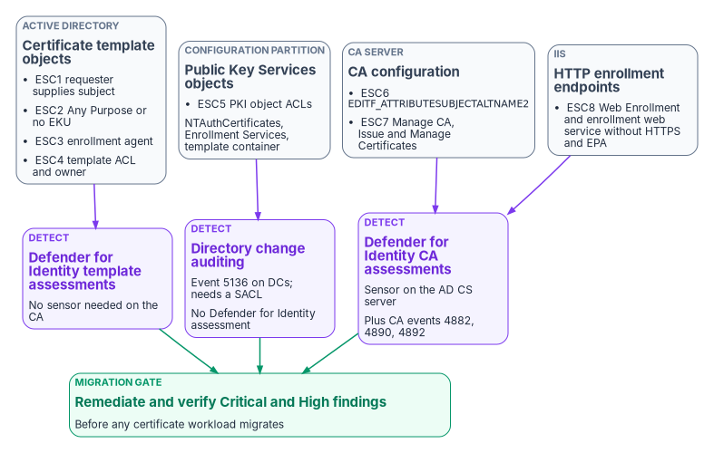
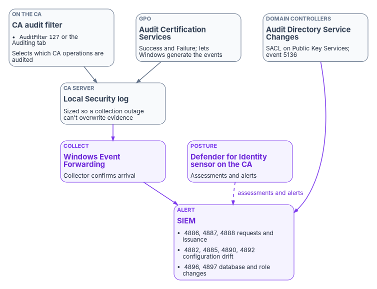

# Chapter 03 — Hardening What Stays

*AD CS doesn't stop issuing trusted credentials just because a replacement is planned, so the CA you're leaving has to be the best-defended system you own until the day it's gone.*

::: {.callout-note}
## In this chapter
Why the AD CS estate gets hardened before anything migrates, and the gate that enforces it. The eight ESC misconfiguration classes as a defensive checklist: what each one is, how to detect it, and how to fix it. How to turn on CA auditing so detection has evidence behind it. The program's risk-scoring matrix, and the hardening baselines for the AD CS that remains, for Microsoft Cloud PKI and for Microsoft Entra certificate-based authentication.
:::

A migration off Active Directory Certificate Services (AD CS) takes months, and for some workloads it never finishes ([Chapter 02](02-what-ad-cs-holds-up.md)). Throughout that time the enterprise CA keeps issuing certificates that domain controllers, VPN gateways, RADIUS servers and Microsoft Entra ID accept as proof of identity. A CA can create credentials the whole environment trusts, so a single over-privileged account or misconfigured setting on it can undo every other identity control.[^c03-ca-audit]

That makes hardening the first technical workstream, not a cleanup task at the end. It also matters for the target. Under the bring-your-own-CA model the program recommends ([Chapter 04](04-the-target-pki.md)), the new Microsoft Cloud PKI issuing CA chains to the existing AD CS hierarchy, so every weakness in that hierarchy is inherited by the cloud issuer the day it goes live.[^c03-cpki-deploy]

{#fig-ch03-esc-control-points fig-alt="Four slate cards in a row represent the four AD CS control points. Certificate template objects in Active Directory hold ESC1 requester-supplied subject, ESC2 Any Purpose or no EKU, ESC3 enrollment agent templates, and ESC4 template ACL and owner. Public Key Services objects in the configuration partition hold ESC5, PKI object ACLs including NTAuthCertificates and Enrollment Services. CA configuration on the CA server holds ESC6, the EDITF_ATTRIBUTESUBJECTALTNAME2 flag, and ESC7, CA permissions Manage CA and Issue and Manage Certificates. HTTP enrollment endpoints in IIS hold ESC8, Web Enrollment and Certificate Enrollment Web Service without HTTPS and Extended Protection. Below them, violet cards show the detection sources: Defender for Identity template assessments for ESC1 to ESC4; directory service change auditing event 5136 on domain controllers for ESC5, which has no Defender for Identity assessment; and Defender for Identity CA assessments, which need a sensor on the AD CS server, plus CA audit events 4882, 4890 and 4892 for ESC6 to ESC8. A green card at the bottom reads remediate Critical and High before any workload migrates."}

## The migration gate

The program carries one rule forward unchanged from its PKI guide: misconfigurations rated **Critical** or **High** in the risk-scoring matrix below are remediated and verified before any certificate workload migrates. Migrating from a CA that can be made to issue arbitrary credentials propagates that weakness into whatever trusts the hierarchy next. This is a program design decision; the risk ratings in the matrix are the program's own scoring, not a vendor classification.

The PKI guide's PowerShell assessment module, which bundled detection checks for these classes, isn't reproduced in this book. It stays in the archive pending a technical review. The checklist below relies on Microsoft's own detection surfaces instead: Microsoft Defender for Identity's AD CS posture assessments, CA audit events, and directory change auditing.

## The ESC taxonomy

The ESC1–ESC8 names come from SpecterOps's 2021 research on AD CS, which grouped common misconfigurations into numbered "domain escalation" classes.[^c03-specterops] Microsoft adopted the same labels in Defender for Identity's certificate assessments, which is why they're the shared vocabulary between security vendors, assessors and Microsoft documentation.[^c03-mdi-certs] This book uses the names only as labels for defensive checks.

Defender for Identity reports its AD CS assessments in Microsoft Secure Score. Certificate *template* assessments are available to every customer with AD CS in the environment; certificate *authority* assessments need a Defender for Identity sensor installed on the AD CS server.[^c03-mdi-overview] Install the sensor on every enterprise CA that remains in service, and configure the auditing it depends on (see [Turn on CA auditing](#turn-on-ca-auditing)).[^c03-mdi-events]

In GCC, Defender for Identity uses the `security.microsoft.com` portal and a GCC sensor endpoint. Microsoft says new features reach GCC, GCC High and DoD within 90 days of commercial release, but preview features may not be supported there.[^c03-mdi-gov] Two of the assessments below (ESC1 and ESC6) are still labeled preview,[^c03-mdi-certs] so confirm they appear in your tenant before relying on them, and run the manual checks in the meantime.

::: {.callout-warning}
The commands in this chapter are illustrative and haven't been tested against a production CA. Run read-only checks first, make changes only under a change record with a tested CA backup, and schedule service restarts: restarting Certificate Services interrupts issuance.[^c03-ca-audit]
:::

### ESC1 — requester-supplied subject on an authentication template

A template allows the requester to supply the subject or subject alternative name (SAN), permits client authentication, and is enrollable by broad, unprivileged groups, so any member can obtain a certificate that names someone else.[^c03-mdi-certs]

Detection:

- Defender for Identity assessment *Prevent users to request a certificate valid for arbitrary users based on the certificate template (ESC1)* lists the exposed templates.[^c03-mdi-certs]
- On each template, check the **Subject Name** tab for **Supply in the request**. In the directory this is the `SubjectNameEnrolleeSupplies` bit (`0x1`) in the template's `msPKI-Certificate-Name-Flag` attribute.[^c03-nameflag]
- Check the template's application policies for authentication purposes: Client Authentication (`1.3.6.1.5.5.7.3.2`), Smart Card Logon, PKINIT client authentication, or Any Purpose (`2.5.29.37.0`).[^c03-mdi-certs][^c03-cpki-scep-eku]
- Check the **Security** tab for **Enroll** granted to Authenticated Users, Domain Users, Domain Computers or Everyone.
- On the CA, review event 4886 (request received) and 4887 (request approved and certificate issued) for requests where the requester and the issued subject differ.[^c03-audit-certsvc]

Remediation, any one of which closes the exposure (do as many as the use case allows):[^c03-mdi-certs]

1. Turn off **Supply in the request** and build the subject from Active Directory.
2. Remove authentication EKUs the template doesn't need.
3. Restrict **Enroll** to the specific groups that need the template.
4. Require **CA certificate manager approval** where requester-supplied names are genuinely needed.
5. Remove the template from every CA's issuance list if it's unused. An unpublished template can't be requested.

Microsoft's template guidance adds that templates with requester-supplied subject information get extra review, and that every permitted identity value must be validated.[^c03-templates]

### ESC2 — Any Purpose or no EKU

A template carries the Any Purpose EKU or no EKU at all and is enrollable by unprivileged users, so the certificates it issues can be presented for purposes the template owner never intended.[^c03-mdi-certs]

Detection:

- Defender for Identity assessment *Edit overly permissive certificate template with privileged EKU (Any purpose EKU or No EKU) (ESC2)*.[^c03-mdi-certs]
- On each template, review **Extensions** → **Application Policies**. A template with an empty list or with Any Purpose is a finding *if* its enrollment permissions include an unprivileged group. A no-EKU template restricted to PKI administrators (for example a subordinate CA template) isn't the same exposure.

Remediation: restrict the template's enrollment permissions, replace Any Purpose with the specific EKUs the use case needs, and add manager approval or authorized-signature requirements where possible.[^c03-mdi-certs]

### ESC3 — enrollment agent templates

A template that issues Certificate Request Agent certificates is enrollable by unprivileged users, so the holder can request certificates on behalf of other users.[^c03-mdi-certs]

Detection:

- Defender for Identity assessment *Edit misconfigured enrollment agent certificate template (ESC3)* lists the risky templates.[^c03-mdi-certs]
- Inventory every template with the Certificate Request Agent application policy and every issued, unexpired enrollment agent certificate.
- Test the CA's enrollment agent restrictions with an allowed and a disallowed request; Microsoft recommends a positive and a negative test for every scoped role.[^c03-ca-audit]

Remediation, at least one of: remove the Certificate Request Agent EKU, remove broad enrollment permissions, require CA certificate manager approval, unpublish the template, or use CA-level enrollment agent restrictions to limit which agents can request which templates for which subjects.[^c03-mdi-certs] Treat an enrollment agent certificate as an impersonation capability: restrict its template to a named agent group, define the templates and subject populations each agent may serve, and keep enrollment agents separate from certificate managers.[^c03-ca-audit] Microsoft notes that it doesn't publish a Windows Server 2025 step-by-step procedure for configuring enrollment agent restrictions, so validate the existing configuration in a lab before treating it as the production control.[^c03-ca-audit]

### ESC4 — template ACLs and owners

An unprivileged group holds rights such as Full Control or Write DACL on a certificate template object, or owns it, so it could change the template into one of the conditions above.[^c03-mdi-certs]

Detection:

- Defender for Identity assessments *Edit misconfigured certificate templates ACL (ESC4)* and *Edit misconfigured certificate templates owner (ESC4)*.[^c03-mdi-certs]
- Review each template's **Security** tab and owner for write-type rights (Full Control, Write, Write DACL, Write Owner) held by anyone other than the PKI administrators.
- Template objects live in the forest configuration partition. Changes to them are logged as event 5136 (directory service object modified) on domain controllers, but only when Audit Directory Service Changes is enabled and the objects carry a matching SACL.[^c03-ds-audit]

Remediation: remove every ACE that gives an unprivileged group the ability to modify the template, change the owner to a privileged, monitored account, and unpublish templates that aren't needed.[^c03-mdi-certs] Microsoft also advises separating template administration from enrollment and not granting administrators broad enrollment rights just to test a change.[^c03-templates] When you remove Authenticated Users from a template ACL, grant each issuing CA's computer account **Read**, or the CA can no longer read the template.[^c03-templates]

### ESC5 — PKI object ACLs

Unprivileged principals hold write rights on the forest's Public Key Services objects, such as the NTAuthCertificates object, the Enrollment Services objects or the Certificate Templates container, so they could alter what the forest trusts or which templates a CA offers.[^c03-specterops]

The NTAuthCertificates object holds the CA certificates trusted to issue authentication certificates such as smart card logon and domain controller certificates; each Enrollment Services object records which certificate types an enterprise CA can issue, and its permissions control who can enroll against that CA.[^c03-pki-containers] Write access to either is control over authentication.

Detection:

- Defender for Identity has no ESC5 assessment; its certificate assessments cover ESC1–ESC4, ESC6–ESC8, ESC11 and ESC15.[^c03-mdi-certs] Detection here is manual and audit-based.
- Review the ACLs on `CN=Public Key Services,CN=Services,CN=Configuration,<forest root>` and its child containers. List the certificates in the NTAuth store with `certutil -viewstore -enterprise NTAuth` and compare them with the approved CA list.[^c03-certutil]
- Set a SACL on the Public Key Services container and enable Audit Directory Service Changes on domain controllers so modifications produce event 5136.[^c03-ds-audit]

Remediation: limit write access on Public Key Services objects to Enterprise Admins and the CA computer accounts that need it, and alert on any change to NTAuthCertificates. Never delete a Public Key Services object because a health tool flags it as stale; Microsoft requires a dependency check, a backup of the object and an approved decommissioning plan first.[^c03-pki-containers]

### ESC6 — the EDITF_ATTRIBUTESUBJECTALTNAME2 flag

The CA-wide `EDITF_ATTRIBUTESUBJECTALTNAME2` policy flag is on, which lets any requester supply SAN values on any template, regardless of the template's own subject-name setting.[^c03-mdi-certs][^c03-templates]

Detection:

- Defender for Identity assessment *Edit vulnerable Certificate Authority setting (ESC6)* (needs the sensor on the CA).[^c03-mdi-certs]
- On each CA, read the policy module's edit flags and look for the flag in the output:

```powershell
# Read-only: list the policy module EditFlags on this CA
certutil -getreg policy\EditFlags
```

Remediation: find out why the flag was turned on (some old enrollment workflows depended on it), then clear it and restart the service, as Microsoft documents:[^c03-mdi-certs]

```powershell
certutil -setreg policy\EditFlags -EDITF_ATTRIBUTESUBJECTALTNAME2
Restart-Service -Name certsvc
```

The PKI guide said the May 2022 security update (KB5014754) "restricts SAN override behavior." That's corrected here. KB5014754 introduced strong certificate mapping: the CA adds a SID security extension (`1.3.6.1.4.1.311.25.2`) and domain controllers check it. Domain controllers moved to Full Enforcement with the February 11, 2025 update, which denies authentication when a certificate can't be strongly mapped, and the `StrongCertificateBindingEnforcement` registry value has been unsupported since the September 9, 2025 update, so compatibility mode is no longer available.[^c03-kb5014754] That reduces what a forged SAN can do against Kerberos, but it doesn't change what the CA will sign, and other relying parties may still trust the SAN. Clear the flag regardless.

### ESC7 — CA permissions

Unprivileged principals hold **Manage CA** or **Issue and Manage Certificates** on the CA itself, which lets them change CA settings (including turning on the ESC6 flag) or approve pending requests and so bypass manager approval.[^c03-mdi-certs]

Detection:

- Defender for Identity assessment *Edit misconfigured Certificate Authority ACL (ESC7)* (needs the sensor on the CA).[^c03-mdi-certs]
- Review the CA's **Security** tab. On an enterprise CA, the default CA administrator configuration includes local Administrators, Enterprise Admins and Domain Admins; record the resulting ACL as your baseline.[^c03-ca-audit]
- Alert on event 4882 (CA security permissions changed), 4890 (certificate manager settings changed) and 4892 (CA property changed).[^c03-ca-audit]

Remediation: remove Manage CA and Issue and Manage Certificates from every unprivileged built-in group.[^c03-mdi-certs] Then build the role model Microsoft describes: separate groups for CA administrators, certificate managers, enrollment agents, auditors, and backup and recovery custodians, populated with named accounts only, with a written owner and review date for each.[^c03-ca-audit] Issue and Manage Certificates is the certificate manager role; it can issue, deny, revoke and reinstate certificates without the broader Manage CA permission.[^c03-pending]

Service accounts need the same scrutiny. The Intune Certificate Connector needs Issue and Manage Certificates to revoke certificates,[^c03-scep-infra] and certificate lifecycle tooling that enrolls through the CA needs it too ([Chapter 04](04-the-target-pki.md)). Each such account is a certificate manager in all but name: give it a dedicated identity, restrict where it can sign in, and include it in the ESC7 review.

### ESC8 — HTTP enrollment endpoints open to NTLM relay

An AD CS web enrollment endpoint accepts NTLM without HTTPS or without Extended Protection for Authentication (EPA), so authentication relayed from another system can be used to request a certificate in that system's name.[^c03-mdi-certs]

Detection:

- Defender for Identity assessment *Edit insecure ADCS certificate enrollment IIS endpoints (ESC8)* lists the problem endpoints (needs the sensor on the CA).[^c03-mdi-certs] Defender for Identity also raises a detection alert for suspicious machine-certificate issuance consistent with this pattern.[^c03-mdi-alerts]
- Inventory every server running Certification Authority Web Enrollment or the Certificate Enrollment Web Service, and check each IIS site for an HTTP binding, **Require SSL**, and the EPA setting.

Remediation, from Microsoft's advisory for these two roles:[^c03-kb5005413]

1. Enable EPA on both services, set to **Required**, the more secure and recommended option. For the Certificate Enrollment Web Service, also set `extendedProtectionPolicy` to `Always` in its `web.config`.
2. Enable **Require SSL** so only HTTPS connections are accepted.
3. Restart IIS.
4. Where you can, go further: restrict NTLM in the domain, block incoming NTLM on the AD CS servers, or set the sites' Windows authentication to Kerberos only.

Better still, remove Web Enrollment wherever nothing depends on it. The Network Device Enrollment Service (NDES) also runs in IIS; the program applies the same HTTPS and NTLM restrictions to NDES sites, and retires NDES altogether for devices that move to Cloud PKI, which needs no NDES server or connector ([Chapter 04](04-the-target-pki.md)).[^c03-cpki-overview]

### Beyond ESC8

Defender for Identity also assesses two later classes that belong on the same checklist:[^c03-mdi-certs]

- **ESC11**: the CA's RPC enrollment interface doesn't require packet privacy. The `IF_ENFORCEENCRYPTICERTREQUEST` flag is on by default but is sometimes turned off for old clients; turn it back on with `certutil -setreg CA\InterfaceFlags +IF_ENFORCEENCRYPTICERTREQUEST` and restart the service.
- **ESC15**: templates on CA servers unpatched for CVE-2024-49019 can issue certificates with arbitrary application policies. Remove unprivileged enrollment, turn off **Supply in the request**, and patch the CA.

## Turn on CA auditing

Every detection above depends on evidence, and AD CS produces none by default. Two settings are needed, and neither works without the other: the CA's audit filter selects which CA operations are audited, and the **Audit Certification Services** advanced audit subcategory lets the operating system generate the events.[^c03-ca-audit]

1. In a dedicated GPO linked to the CA servers, set **Computer Configuration** → **Policies** → **Windows Settings** → **Security Settings** → **Advanced Audit Policy Configuration** → **Audit Policies** → **Object Access** → **Audit Certification Services** to Success and Failure.[^c03-ca-audit]
2. Set the CA audit filter, either on the CA's **Auditing** tab or from an elevated session, then restart the service in a maintenance window:[^c03-ca-audit]

```powershell
certutil -setreg CA\AuditFilter 127
Restart-Service -Name certsvc
```

Full auditing includes the start and stop category, which can slow restarts on a CA with a large database; test the effect first.[^c03-ca-audit] Defender for Identity's sensor documentation asks for the same two settings.[^c03-mdi-events]

{#fig-ch03-ca-audit-path fig-alt="A left-to-right flow. Two slate cards on the left feed a single CA card: the CA audit filter, AuditFilter 127, selects which CA operations are audited, and the Audit Certification Services advanced audit subcategory, set by GPO to Success and Failure, lets Windows generate the events. The CA card shows the local Security log, sized so collection outages don't overwrite evidence. An arrow leads to a violet card for Windows Event Forwarding to a collector, which forwards to a violet SIEM card that alerts on the baseline events 4882, 4885, 4886, 4887, 4888, 4890, 4892, 4896 and 4897. A separate slate card for domain controllers, with Audit Directory Service Changes and a SACL on Public Key Services producing event 5136, also feeds the SIEM card. A dashed violet line from the Defender for Identity sensor on the CA reads posture assessments and alerts."}

Microsoft's focused monitoring baseline for a CA:[^c03-ca-audit]

| Event ID | Meaning | Why the program watches it |
|---|---|---|
| 4886 | Certificate Services received a certificate request | Request volume and requester, per template |
| 4887 | Certificate Services approved a request and issued a certificate | Every issued credential; requests for templates that should be retired |
| 4888 | Certificate Services denied a request | Probing of restricted templates |
| 4870 | Certificate Services revoked a certificate | Revocation evidence for leavers and incidents |
| 4882 | Security permissions for Certificate Services changed | ESC7 drift |
| 4885 | Audit filter changed | Someone turning auditing down |
| 4890 | Certificate manager settings changed | ESC7 drift |
| 4892 | A property of Certificate Services changed | ESC6 and other configuration drift |
| 4896 | Rows deleted from the certificate database | Evidence destruction or unapproved cleanup |
| 4897 | Role separation enabled | Change to the CA's role model |

Certificate Services also logs 4871 and 4872 for CRL publication requests and published CRLs, and 4898 when it loads a template.[^c03-ca-audit][^c03-audit-certsvc] Microsoft recommends generating each event in a nonproduction test before writing the collection rule, so an assumed event doesn't become a blind spot.[^c03-ca-audit]

Forward the events through Windows Event Forwarding to a collector and then to the SIEM. Microsoft's current WEF baseline subscription already includes 4886, 4887 and 4888, but WEF doesn't enable auditing or stop a full local log from overwriting evidence, so size the CA's Security log for the longest plausible collection outage.[^c03-ca-audit] The program's monitoring of these events is in [Chapter 08](08-lifecycle-monitoring-and-decommissioning.md).

## The risk-scoring matrix

The program scores each class for prioritization. The risk level, migration-blocker and priority columns are the program's own scoring, carried forward from its PKI guide with one change: ESC2 is downgraded from "Yes" to "Possible" for domain compromise, because Microsoft describes its main effect as undermining trust in other certificate consumers rather than direct user impersonation.[^c03-mdi-certs] The detection columns are from Microsoft's documentation.[^c03-mdi-certs][^c03-mdi-overview]

| Class | Misconfiguration | Risk level | Domain compromise? | Migration blocker? | Remediation priority | Defender for Identity assessment |
|---|---|---|---|---|---|---|
| ESC1 | Requester supplies subject on an authentication template | Critical | Yes | Yes | Immediate | Yes (template; preview) |
| ESC2 | Any Purpose or no EKU, broadly enrollable | Critical | Possible | Yes | Immediate | Yes (template) |
| ESC3 | Enrollment agent template broadly enrollable | High | Possible | Yes | Within 2 weeks | Yes (template) |
| ESC4 | Writable template ACL or unprivileged owner | High | Possible | Yes | Within 2 weeks | Yes (template; ACL and owner) |
| ESC5 | Writable Public Key Services objects | High | Possible | Yes | Within 2 weeks | No; manual review and event 5136 |
| ESC6 | `EDITF_ATTRIBUTESUBJECTALTNAME2` on | Critical | Yes | Yes | Immediate | Yes (CA sensor; preview) |
| ESC7 | Unprivileged Manage CA or Issue and Manage Certificates | High | Possible | Yes | Within 2 weeks | Yes (CA sensor) |
| ESC8 | HTTP enrollment without HTTPS and EPA | Critical | Yes | Yes | Immediate | Yes (CA sensor) |

"Immediate" means the finding is fixed or the template or endpoint is taken out of service before the next change window closes. Every row is a migration blocker until it's verified closed. Verification means the Defender for Identity assessment shows no exposed entities (scores and statuses update every 24 hours, so allow for the lag),[^c03-mdi-certs] and a manual re-check for ESC5.

## Hardening the AD CS that remains

Templates classified BRIDGE or RETAIN ([Chapter 02](02-what-ad-cs-holds-up.md)) keep AD CS in service for months or years. For that period:

- **Lock the templates.** Remove every template that no BRIDGE or RETAIN workload needs from each CA's issuance list, and remove autoenrollment permissions from the rest except where a workload still depends on them. Removing a template from the issuance list is also Microsoft's usual first rollback step, so it's reversible.[^c03-templates]
- **Alert on unauthorized requests.** With auditing on, alert on 4886 and 4887 for templates that should no longer be requested, and on 4888 spikes.[^c03-ca-audit]
- **Keep CRL publication on schedule.** A lapsed CRL breaks validation for every certificate the CA issued. Entra certificate-based authentication fails when it can't retrieve a configured CRL,[^c03-cba-crl] and Microsoft recommends reviewing CRL next-update times and running `certutil -verify -urlfetch` from representative client networks on a schedule shorter than your shortest renewal window.[^c03-pki-containers]
- **Back up before every change.** Run `Backup-CARoleService` from an elevated session as a CA administrator before changing permissions, templates or audit settings; it backs up the database and the CA private key, so protect the output as recovery material and test restoration only on an isolated system.[^c03-ca-audit]
- **Treat CA servers as Tier 0.** Patch them, administer them only from a hardened management host, avoid routine interactive sign-in, and keep CA private keys, backups and key recovery agent keys under separate custody.[^c03-ca-audit] The Tier 0 designation is the program's; it follows from the fact that the CA can mint domain authentication credentials.
- **Isolate the network.** Allow RPC enrollment to the CA only from the endpoints that need it (domain members for autoenrollment, the Intune Certificate Connector, NDES, and lifecycle tooling) and block everything else at the host and network firewall. This is a program control; the exact port set depends on your RPC configuration.
- **Protect the CA keys.** The program requires FIPS 140-2 or 140-3 validated cryptographic modules for every CA, CA private keys generated and held non-exportable in a hardware security module, and dual control with split knowledge for root CA ceremonies (NIST SP 800-53 `SC-12`, `SC-13`). Record the module validation certificates as assessment evidence.

## Hardening Microsoft Cloud PKI

Cloud PKI removes most of the attack surface above (no templates in the directory, no NDES, no web enrollment), but it adds an administrative surface of its own.

- **Scope the administrators.** Cloud PKI permissions (read CAs, create CAs, revoke issued leaf certificates) can be assigned through custom Intune roles, and each CA can carry scope tags.[^c03-cpki-overview] The Intune Administrator role has these permissions built in.[^c03-cpki-configure] The PKI guide referred to "Intune PKI Administrator" roles; no built-in role by that name exists, so the program creates custom roles and assigns them through privileged access ([Book 04, Chapter 04](../b04-access/04-privileged-roles-and-tiers.md)).
- **Choose EKUs at creation.** A Cloud PKI CA's EKUs can't be edited after creation, and Cloud PKI doesn't allow the Any Purpose EKU on CAs or SCEP profiles.[^c03-cpki-configure] Design the CA's purpose up front.
- **Keep private keys in hardware.** On Windows, set the SCEP profile's key storage provider to **Enroll to Trusted Platform Module (TPM) KSP, otherwise fail**. The PKI guide also called for TPM-backed keys on macOS and for 4096-bit keys on Tier 0 assets; both are corrected. The key storage provider setting applies to Windows only, and on Windows a 4096-bit key can be stored only in the software KSP, not in the TPM or Windows Hello for Business.[^c03-scep] The program therefore uses 2048-bit RSA in the TPM for Windows device certificates.
- **Keep validity short.** Intune SCEP profiles support validity periods up to 24 months, and Microsoft advises at least five days to avoid devices rejecting near-expired certificates.[^c03-scep] The program sets one year for user and device authentication certificates. The PKI guide's two-year figure for "infrastructure certificates" doesn't apply: Cloud PKI issues only to Intune-enrolled devices ([Chapter 04](04-the-target-pki.md)).
- **Watch issuance.** The PKI guide called this "certificate transparency," which is a different, public-CA mechanism. Cloud PKI provides a reporting dashboard of active, expired and revoked certificates, updated every 24 hours, and audit logs of administrative actions such as create, revoke and search.[^c03-cpki-overview] The program exports both to its monitoring ([Chapter 08](08-lifecycle-monitoring-and-decommissioning.md)) and alerts on unexpected issuance volumes there.
- **Don't count on trial keys.** CAs created during a trial use software-backed keys and can't be converted to HSM-backed keys after purchase.[^c03-cpki-overview] Create production CAs only after the license is in place.

## Hardening Entra certificate-based authentication

Entra CBA is a relying party, not a CA ([Book 02, Chapter 04](../b02-identity/04-the-hidden-migration-surface.md)), so its hardening is about what it trusts and how strongly it binds a certificate to a user. Book 03 covers PIV binding and revocation in depth ([Book 03, Chapter 09](../b03-hr-identity/09-credentials-and-certificates.md)), and [Chapter 06](06-device-and-user-certificates.md) covers deployment.

- **Use high-affinity bindings.** Microsoft classes `SKI`, `SHA1PublicKey` and `IssuerAndSerialNumber` mappings in `certificateUserIds` as high affinity, and `PrincipalName`, `RFC822Name`, `Subject` and `IssuerAndSubject` as low affinity. Set the tenant's required affinity binding to high for production, with custom rules only where a population genuinely needs otherwise.[^c03-cba-deep]
- **Require specific issuers and policy OIDs for sensitive resources.** A custom authentication strength can require CBA certificates from named issuers or with named policy OIDs (up to five of each), and Conditional Access can require that strength for the resources that need it.[^c03-authstrength] Pair it with a compliant-device requirement so both the person and the device are verified.
- **Make revocation real.** Turn on **Require CRL validation**, which makes CBA fail for certificates from a CA with no CRL configured.[^c03-cba-crl] Entra supports one HTTP CRL distribution point per CA and no OCSP or LDAP URLs.[^c03-cba-overview] The PKI guide called for "CRL pre-fetching in Entra"; no such setting is documented, so it's removed. The program's own requirement is that each issuing CA trusted by Entra publishes a new CRL at least every 24 hours, because Entra caches the CRL and a revocation isn't seen until the cache refreshes.[^c03-cba-crl]
- **Trust only what you use.** Upload only CA certificates that are actively issuing to users. Use CA scoping, generally available since April 2026, to restrict each issuing CA to the Entra group whose members should hold its certificates; a user outside the scoped group fails authentication even with an otherwise valid certificate. Each CA takes one group, the tenant supports up to 30 scoping rules, and a mistake can lock users out, so pilot it.[^c03-cba-deep][^c03-entra-whatsnew] Remove a decommissioned CA's certificates from the trust store as part of its decommissioning ([Chapter 08](08-lifecycle-monitoring-and-decommissioning.md)).

::: {.callout-tip}
## Continue the book
[← Previous: Chapter 02 — What AD CS Holds Up](02-what-ad-cs-holds-up.md) · [Book index](index.md) · [Next: Chapter 04 — The Target PKI: Cloud PKI, AD CS and Federal PKI →](04-the-target-pki.md)
:::

[^c03-ca-audit]: Microsoft Learn, "Secure, delegate, and audit certification authority administration," <https://learn.microsoft.com/windows-server/identity/ad-cs/secure-delegate-audit-certification-authority> (accessed Oct 20, 2026).
[^c03-cpki-deploy]: Microsoft Learn, "Microsoft Cloud PKI deployment for Microsoft Intune," <https://learn.microsoft.com/intune/cloud-pki/deployment-models> (accessed Oct 20, 2026).
[^c03-specterops]: Will Schroeder and Lee Christensen, SpecterOps, *Certified Pre-Owned: Abusing Active Directory Certificate Services*, June 17, 2021 (updated June 22, 2021), <https://specterops.io/research/certified-pre-owned/> (accessed Oct 20, 2026). Cited for the ESC class names only.
[^c03-mdi-certs]: Microsoft Learn, "Security assessment: Certificates" (Microsoft Defender for Identity), <https://learn.microsoft.com/defender-for-identity/security-posture-assessments/certificates> (accessed Oct 20, 2026).
[^c03-mdi-overview]: Microsoft Learn, "Microsoft Defender for Identity's security posture assessments," <https://learn.microsoft.com/defender-for-identity/security-assessment> (accessed Oct 20, 2026).
[^c03-mdi-events]: Microsoft Learn, "Configure Windows event auditing" (Defender for Identity; configure auditing on an AD CS server), <https://learn.microsoft.com/defender-for-identity/deploy/configure-windows-event-collection> (accessed Oct 20, 2026).
[^c03-mdi-gov]: Microsoft Learn, "Microsoft Defender for Identity for US Government offerings," <https://learn.microsoft.com/defender-for-identity/us-govt-gcc-high> (accessed Oct 20, 2026).
[^c03-nameflag]: Microsoft Learn, "X509CertificateTemplateSubjectNameFlag enumeration (certenroll.h)," <https://learn.microsoft.com/windows/win32/api/certenroll/ne-certenroll-x509certificatetemplatesubjectnameflag>, and "ms-PKI-Certificate-Name-Flag attribute," <https://learn.microsoft.com/windows/win32/adschema/a-mspki-certificate-name-flag> (both accessed Oct 20, 2026).
[^c03-cpki-scep-eku]: Microsoft Learn, "Configure root and issuing CA for Microsoft Cloud PKI" (Any Purpose `2.5.29.37.0` EKU), <https://learn.microsoft.com/intune/cloud-pki/configure-ca> (accessed Oct 20, 2026).
[^c03-audit-certsvc]: Microsoft Learn, "Audit Certification Services," <https://learn.microsoft.com/en-us/previous-versions/windows/it-pro/windows-10/security/threat-protection/auditing/audit-certification-services> (accessed Oct 20, 2026).
[^c03-templates]: Microsoft Learn, "Manage AD CS certificate templates on an enterprise CA," <https://learn.microsoft.com/windows-server/identity/ad-cs/manage-certificate-templates> (accessed Oct 20, 2026).
[^c03-ds-audit]: Microsoft Learn, "Windows security baseline" (System Audit Policies, DS Access: Audit Directory Service Changes, events 5136–5139), <https://learn.microsoft.com/azure/governance/policy/samples/guest-configuration-baseline-windows> (accessed Oct 20, 2026).
[^c03-pki-containers]: Microsoft Learn, "Monitor AD CS publication health with Enterprise PKI," <https://learn.microsoft.com/windows-server/identity/ad-cs/monitor-ad-cs-health-enterprise-pki> (accessed Oct 20, 2026).
[^c03-certutil]: Microsoft Learn, "certutil," <https://learn.microsoft.com/windows-server/administration/windows-commands/certutil> (accessed Oct 20, 2026).
[^c03-kb5014754]: Microsoft Support, "KB5014754: Certificate-based authentication changes on Windows domain controllers," <https://support.microsoft.com/en-us/topic/kb5014754-certificate-based-authentication-changes-on-windows-domain-controllers-ad2c23b0-15d8-4340-a468-4d4f3b188f16> (accessed Oct 20, 2026).
[^c03-pending]: Microsoft Learn, "Review and dispose of pending certificate requests," <https://learn.microsoft.com/windows-server/identity/ad-cs/review-dispose-pending-certificate-requests> (accessed Oct 20, 2026).
[^c03-scep-infra]: Microsoft Learn, "Configure infrastructure to support SCEP with Intune" (grant permissions for certificate revocation), <https://learn.microsoft.com/intune/fundamentals/certificates/scep-infrastructure> (accessed Oct 20, 2026).
[^c03-mdi-alerts]: Microsoft Learn, "Microsoft Defender for Identity alerts in Microsoft Defender format" (Credential Access alerts), <https://learn.microsoft.com/defender-for-identity/alerts-xdr> (accessed Oct 20, 2026).
[^c03-kb5005413]: Microsoft Support, "KB5005413: Mitigating NTLM Relay Attacks on Active Directory Certificate Services (AD CS)," <https://support.microsoft.com/en-us/topic/kb5005413-mitigating-ntlm-relay-attacks-on-active-directory-certificate-services-ad-cs-3612b773-4043-4aa9-b23d-b87910cd3429> (accessed Oct 20, 2026).
[^c03-cpki-overview]: Microsoft Learn, "Overview of Microsoft Cloud PKI for Microsoft Intune," <https://learn.microsoft.com/intune/cloud-pki/> (accessed Oct 20, 2026).
[^c03-cpki-configure]: Microsoft Learn, "Configure root and issuing CA for Microsoft Cloud PKI," <https://learn.microsoft.com/intune/cloud-pki/configure-ca> (accessed Oct 20, 2026).
[^c03-scep]: Microsoft Learn, "Create and assign SCEP certificate profiles in Intune," <https://learn.microsoft.com/intune/device-configuration/certificates/scep-profiles> (accessed Oct 20, 2026).
[^c03-cba-crl]: Microsoft Learn, "Microsoft Entra certificate-based authentication Certificate Revocation List (CRL)," <https://learn.microsoft.com/en-us/entra/identity/authentication/concept-certificate-based-authentication-certificate-revocation-list> (accessed Oct 20, 2026).
[^c03-cba-deep]: Microsoft Learn, "Microsoft Entra certificate-based authentication technical concepts," <https://learn.microsoft.com/en-us/entra/identity/authentication/concept-certificate-based-authentication-technical-deep-dive> (accessed Oct 20, 2026).
[^c03-authstrength]: Microsoft Learn, "Create and manage custom Conditional Access authentication strengths" (advanced options for certificate-based authentication), <https://learn.microsoft.com/entra/identity/authentication/concept-authentication-strength-advanced-options> (accessed Oct 20, 2026).
[^c03-cba-overview]: Microsoft Learn, "What is Microsoft Entra certificate-based authentication?" (unsupported scenarios), <https://learn.microsoft.com/entra/identity/authentication/concept-certificate-based-authentication> (accessed Oct 20, 2026).
[^c03-entra-whatsnew]: Microsoft Learn, "Microsoft Entra releases and announcements" (April 2026: Entra CBA Certificate Authority scoping), <https://learn.microsoft.com/entra/fundamentals/whats-new> (accessed Oct 20, 2026).
