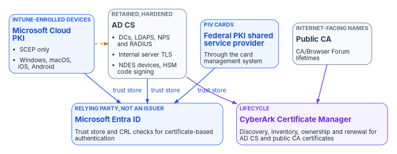
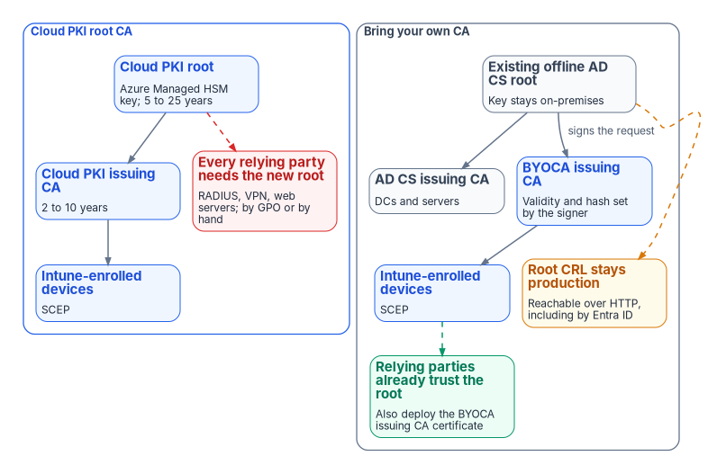

# Chapter 04 — The Target PKI: Cloud PKI, AD CS and Federal PKI

*There's no single replacement for AD CS; the target is four issuers, each chosen for the subjects only it can serve, held together by one root of trust decision and one lifecycle platform.*

::: {.callout-note}
## In this chapter
What Microsoft Cloud PKI is, what it can issue and to whom, and its licensing and cloud availability. Its two deployment models, a cloud root or a cloud issuing CA anchored to your own root, with the decision matrix and the program's recommendation. What AD CS is retained for, including the issuer decision for internal server certificates that [Chapter 02](02-what-ad-cs-holds-up.md) left open. Where the Federal PKI fits for PIV. How certificate lifecycle management with CyberArk Certificate Manager spans all of them.
:::

The PKI guide this book replaces described Microsoft Cloud PKI as eliminating "the need for on-premises ADCS infrastructure for most certificate use cases." That's true for devices and wrong for the estate. Cloud PKI issues certificates to devices enrolled in Microsoft Intune, and only to them.[^c04-cpki-fund] Domain controllers, servers, network equipment, code-signing keys and PIV cards are all outside that boundary, and together they hold up much of what [Chapter 02](02-what-ad-cs-holds-up.md) inventoried.

So the target isn't "Cloud PKI instead of AD CS." It's an issuer for each class of subject: Cloud PKI for Intune-managed devices, AD CS for the things only it can serve, the Federal PKI for PIV, and public CAs for names the internet must trust. Microsoft Entra ID sits beside all of them as a relying party, not an issuer ([Book 02, Chapter 04](../b02-identity/04-the-hidden-migration-surface.md)). A certificate lifecycle management (CLM) platform inventories and renews across the issuers that don't manage their own lifecycle.

{#fig-ch04-issuer-map fig-alt="Top row, four issuer cards. Blue: Microsoft Cloud PKI, issuing through SCEP to Intune-enrolled Windows, macOS, iOS and Android devices. Slate: AD CS, retained, a hardened enterprise CA for domain controllers, LDAPS, NPS and RADIUS servers, internal server TLS, NDES for network devices, and HSM code signing. Blue: Federal PKI shared service provider, issuing PIV certificates through the card management system. Slate: public CA, for names the internet must trust. A dashed amber line joins Cloud PKI and AD CS: the one root decision, where a BYOCA issuing CA chains to the AD CS root. On the bottom row, a violet card for CyberArk Certificate Manager receives arrows from AD CS and the public CA, for discovery, inventory, ownership and renewal. Beside it, a blue card for Microsoft Entra ID, a relying party not an issuer, receives arrows labeled trust store from Cloud PKI, AD CS and Federal PKI, for certificate-based authentication."}

## Microsoft Cloud PKI

Cloud PKI is a Microsoft-hosted PKI managed in the Intune admin center. It hosts the root and issuing CAs, a SCEP registration authority for each issuing CA, the CRL distribution point and the Authority Information Access (AIA) endpoint, which together replace the on-premises CA, NDES server and Intune Certificate Connector for device certificates.[^c04-cpki] The device builds its own key pair and request, so the private key never leaves the device; the registration authority checks the request against an Intune-signed challenge before the issuing CA signs it.[^c04-cpki] [Chapter 06](06-device-and-user-certificates.md) covers the profiles that drive it.

### What it can and can't issue

| Cloud PKI can | Cloud PKI can't |
|---|---|
| Issue leaf certificates to Intune MDM-enrolled Android, iOS/iPadOS, macOS and Windows devices whose platform supports the Intune SCEP profile[^c04-cpki] | Issue to anything not enrolled in Intune. Microsoft states plainly that it issues only to MDM-enrolled devices.[^c04-cpki-fund] Intune's supported platforms don't include Windows Server,[^c04-intune-platforms] so no domain controller, NPS server, web server or SQL Server gets a Cloud PKI certificate ([Book 05, Chapter 09](../b05-devices/09-servers-under-azure-arc.md)) |
| Issue user and device client-authentication certificates for Wi-Fi, VPN and other certificate-based authentication[^c04-cpki-fund] | Issue the TLS server certificates that RADIUS servers, Wi-Fi infrastructure and VPN gateways present to clients. Microsoft says these must come from another PKI or CA[^c04-cpki-deploy] |
| Issue through SCEP, renew and revoke, with RSA 2048, 3072 or 4096 and SHA-256, SHA-384 or SHA-512[^c04-cpki] | Issue through PKCS or imported PKCS profiles; leaf issuance is SCEP only.[^c04-cpki] The guide's use-case map paired Cloud PKI with PKCS for server deployment; that's corrected in [Chapter 02](02-what-ad-cs-holds-up.md) |
| Publish a CRL for each CA, valid seven days, republished every 3.5 days and on every revocation[^c04-cpki] | Answer OCSP; its documented features include CRL and AIA endpoints but no OCSP responder.[^c04-cpki] Entra CBA doesn't use OCSP either[^c04-cba-overview] |
| Host up to three CAs per tenant, counting Cloud PKI root, Cloud PKI issuing and BYOCA issuing CAs together[^c04-cpki] | Offer a data residency option[^c04-cpki] |

The three-CA ceiling is a design constraint, not a footnote. A two-tier cloud hierarchy uses two of the three; a BYOCA design uses one per issuing CA. Plan the CA count before creating anything, because a CA's extended key usages can't be edited after creation, and adding an EKU later means creating a new CA.[^c04-cpki-configure]

### Keys

Licensed Cloud PKI CAs use signing and encryption keys held in Azure Managed HSM, which needs no Azure subscription of your own. CAs created during an Intune Suite or standalone Cloud PKI trial use software-backed keys, and those keys can't be converted to HSM-backed keys after purchase.[^c04-cpki] For the root of trust decision below, that means the cloud root's key is Microsoft-managed in an HSM; under BYOCA the root key stays wherever your AD CS root keeps it.

### Licensing

Cloud PKI requires a subscription in addition to Intune Plan 1 or Plan 2.[^c04-cpki] It's available as a standalone add-on and as part of the Intune Suite.[^c04-addons] Microsoft now calls these "advanced capabilities (formerly Microsoft Intune Suite)."[^c04-whatsnew] Starting July 2026, Microsoft 365 E5 and E7 include Cloud PKI for commercial customers; Microsoft says Government plans are planned to align with the enterprise packaging subject to compliance and regulatory requirements.[^c04-whatsnew][^c04-planning] The PKI guide's licensing line ("Intune Suite add-on or standalone Cloud PKI license") was accurate when written; for a government tenant, confirm the entitlement on the current SKU rather than assuming the commercial E5 change applies.

### Cloud availability

Intune doesn't have a separate GCC instance: GCC tenants use the commercial Intune service, while GCC High and DoD share a separate government instance.[^c04-intune-gov] Cloud PKI became available in GCC High in the week of September 28, 2026, and it isn't supported in DoD environments.[^c04-whatsnew][^c04-cpki] For a GCC tenant, availability follows the commercial service; licensing is the question to settle (above).

## Two deployment models

Cloud PKI offers two ways to anchor trust, and both can coexist in one tenant.[^c04-cpki-deploy]

- **Cloud PKI root CA.** You create a root and one or more issuing CAs in the cloud, private to the tenant. It's a two-tier hierarchy. The root's validity is 5, 10, 15, 20 or 25 years in the admin center, and an issuing CA's is 2, 4, 6, 8 or 10 years, never longer than its root; the Graph API allows custom periods.[^c04-cpki-configure] Every relying party (devices, RADIUS servers, VPN gateways, web servers) has to be given the new root.[^c04-cpki-deploy]
- **Bring your own CA (BYOCA).** You create an issuing CA in the cloud, Intune generates a certificate signing request, and your private CA signs it. The private CA can be AD CS or a non-Microsoft CA, and N-tier private hierarchies are supported.[^c04-cpki][^c04-cpki-deploy] Relying parties that already trust the private root trust the Cloud PKI issued certificates through the existing chain.[^c04-cpki-deploy]

{#fig-ch04-cloud-root-vs-byoca fig-alt="Two side-by-side groups. The left group, Cloud PKI root CA, shows a blue Cloud PKI root card, key in Azure Managed HSM, validity 5 to 25 years, above a blue Cloud PKI issuing CA card, 2 to 10 years, which issues through SCEP to a blue card for Intune-enrolled devices. A red card beside it reads every relying party needs the new root: RADIUS, VPN, web servers, deployed by GPO or by hand. The right group, BYOCA, shows a slate card for the existing offline AD CS root, key on-premises, above two cards side by side: a slate AD CS issuing CA serving domain controllers and servers, and a blue Cloud PKI BYOCA issuing CA, whose validity and hash are set by the signing CA, which issues through SCEP to Intune-enrolled devices. A green card reads relying parties already trust the root; deploy the BYOCA issuing CA certificate as best practice. An amber card under the root reads the root CRL must stay reachable over HTTP, including from Entra ID."}

### What BYOCA actually requires

Four details in Microsoft's procedure correct or sharpen the PKI guide:

- **The signer doesn't have to be the root.** The guide said the offline root must come online to sign the request. Microsoft says the signing CA "can be a root or issuing CA from any tier of the private CA," using AD CS Web Enrollment or `certreq.exe` with the Subordinate Certification Authority template.[^c04-byoca] The program still signs with the root, at a key ceremony, for the reasons under the recommendation below.
- **The signer sets the terms.** A BYOCA issuing CA's validity period isn't configurable; the signing CA determines it. The signing CA also determines the hash algorithm. The key size you choose for the BYOCA CA (RSA 2048, 3072 or 4096) is the upper bound for SCEP profiles that use it, and 1024-bit keys and SHA-1 aren't supported.[^c04-byoca] Renewal repeats the process: Intune creates a new request, your CA signs it, and the renewed CA is staged for testing before activation.[^c04-renew]
- **The AIA comes from your CA.** A BYOCA issuing CA's AIA property is whatever the private CA's AIA configuration says, and AD CS defaults to an LDAP AIA location. Configure an HTTP AIA location on the signing CA before signing.[^c04-byoca] Microsoft notes that the Android OS requires servers to return the entire certificate chain and doesn't discover missing certificates by following AIA paths, so deploy the full chain to Android-managed devices and the relying parties they talk to.[^c04-cpki-deploy]
- **Relying parties still get one new certificate.** Relying parties already have the private root, but Microsoft recommends also deploying the BYOCA issuing CA certificate to them (by Group Policy for domain members), because AIA retrieval isn't guaranteed on every platform.[^c04-cpki-deploy] Managed devices need the private root and the BYOCA issuing CA through Intune trusted certificate profiles.[^c04-cpki-deploy]

One consequence matters more than any of these. Under BYOCA the private root CRL stays where it is, and every relying party, Entra ID included, must still be able to fetch it. Entra CBA accepts only one CRL distribution point per CA, over HTTP (or HTTPS; HTTP recommended), and fails sign-in if it can't reach a configured CRL.[^c04-cba-overview][^c04-cba-crl] An offline root that publishes its CRL only over LDAP, or publishes it late, breaks the cloud issuer as surely as the on-premises one. The root's CRL schedule is a production dependency for the life of the BYOCA CA.

### The deployment-model decision matrix

The matrix carries forward the PKI guide's criteria. Rows marked "corrected" changed after verification; the rest are the program's assessment.

| Criterion | Cloud PKI root CA | BYOCA |
|---|---|---|
| Existing private PKI | Not required | Required: a private CA at any tier to sign the request[^c04-byoca] |
| Trust chain | New chain; deploy the new root to every relying party[^c04-cpki-deploy] | Existing chain preserved; also deploy the BYOCA issuing CA certificate[^c04-cpki-deploy] |
| Root key custody | Microsoft-managed in Azure Managed HSM (licensed CAs)[^c04-cpki] | Organization-managed, wherever the AD CS root key is held |
| Validity and algorithms | Chosen at creation within Microsoft's ranges[^c04-cpki-configure] | Set by the signing CA (corrected)[^c04-byoca] |
| Signing ceremony | None | Once at creation and at each renewal; the signer may be the root or an issuing CA (corrected)[^c04-byoca][^c04-renew] |
| Ongoing on-premises dependency | None | The private root's CRL must stay published and reachable over HTTP (added)[^c04-cba-overview] |
| Audit posture | One provider operates the whole chain | The existing root's controls and evidence carry over; its hardening gate ([Chapter 03](03-hardening-what-stays.md)) applies to the cloud issuer too |
| Cross-forest trust | The new root has to reach every forest | Uses the root trust the forests already share |
| CA count (of three per tenant)[^c04-cpki] | Two for a minimal hierarchy | One per BYOCA issuing CA |
| Licensing | Cloud PKI entitlement (corrected from "Intune Suite license only")[^c04-cpki][^c04-whatsnew] | Cloud PKI entitlement plus the cost of keeping the private root |
| Domain controller, LDAPS and server certificates | Can't serve; Cloud PKI issues only to Intune-enrolled devices[^c04-cpki-fund] | Can't serve, for the same reason |
| Rollback | Revert devices to AD CS autoenrollment and redistribute trust | Simpler: the original root and its issuing CAs keep running |

### The program's recommendation

For an organization with an established AD CS hierarchy, an offline root and cross-forest trust, the program's recommended model is BYOCA. It preserves the trust chain every relying party already holds, needs one cloud CA rather than two, and keeps a natural rollback path. For an organization building PKI for the first time alongside cloud-first identity, a Cloud PKI root removes every on-premises dependency.

Three program rules go with the BYOCA choice:

1. **Harden first.** The root's hierarchy passes the [Chapter 03](03-hardening-what-stays.md) gate before it signs a cloud issuing CA.
2. **Sign with the root.** The cloud issuing CA is signed by the offline root, not by an existing AD CS issuing CA. That keeps the cloud issuer a peer of the AD CS issuing CAs, so its validity doesn't depend on theirs and retiring them later doesn't touch it.
3. **Treat the root CRL as production.** Publish it to an internet-reachable HTTP location on a schedule with margin, monitor it ([Chapter 08](08-lifecycle-monitoring-and-decommissioning.md)), and record the next ceremony date before the current CRL expires.

## AD CS, retained for what only it can do

AD CS stays because some subjects can't be served by Cloud PKI and some protocols are anchored in the domain. The table records what it's kept for and when each use ends. The classifications are from [Chapter 02](02-what-ad-cs-holds-up.md).

| Kept for | Why nothing else serves it now | Ends when |
|---|---|---|
| Domain controller and KDC certificates | Servers can't get Cloud PKI certificates;[^c04-cpki-fund] smart card and certificate logon to the domain needs a DC certificate chaining to a CA in the forest's NTAuth store[^c04-ntauth-3p] | The last domain controller retires |
| LDAPS | Same server limit; LDAP clients need the chain | LDAP-bound applications move ([Book 02, Chapter 04](../b02-identity/04-the-hidden-migration-surface.md)) |
| NPS, RADIUS and VPN gateway server certificates | Cloud PKI doesn't provide relying-party TLS certificates[^c04-cpki-deploy] | RADIUS moves, or a CLM-managed issuer takes the server certificate |
| Internal server TLS, including SQL Server | Servers aren't Intune-managed[^c04-intune-platforms] ([Book 06, Chapter 22](../b06-data-platform/22-where-sql-server-touches-adcs.md)) | See the issuer decision below |
| Network equipment and other non-Intune devices through NDES | Cloud PKI serves only Intune-enrolled devices[^c04-cpki-fund] | The devices are replaced or another enrollment path is approved |
| HSM-held code signing | The key and ceremony stay with the HSM | The signing requirement ends |
| S/MIME issuance and key history | Delivery can move to Intune imported PKCS, but the issuer and its key history stay ([Chapter 02](02-what-ad-cs-holds-up.md)) | Mail encryption moves to another mechanism and old keys are no longer needed |

### The issuer decision for internal server certificates

[Chapter 02](02-what-ad-cs-holds-up.md) classified internal server TLS as BRIDGE until this chapter named its issuer. The program's decision:

- **Internal names** are issued by the retained AD CS hierarchy, requested and renewed through CyberArk Certificate Manager rather than by hand or by server autoenrollment. That gives every server certificate an owner, an expiry alert and automated renewal in one place ([Chapter 05](05-who-owns-the-certificate-estate.md)).
- **Names the internet must trust** are issued by a public CA, also through the CLM platform, because public lifetimes are on the shrinking CA/Browser Forum schedule ([Chapter 01](01-why-certificates-outlive-every-migration.md)).
- **After Active Directory.** Enterprise CAs need AD; standalone CAs don't use certificate templates.[^c04-templates] When the forest retires, server issuance moves to a standalone AD CS issuing CA under the same root, still driven by the CLM platform, which supports both enterprise and standalone Microsoft CAs.[^c04-tpf-msca] Template-based policy then lives in the CLM platform's policy rather than in AD. That keeps server certificates on the existing trust chain with no new root to distribute.

Every retained CA stays under the [Chapter 03](03-hardening-what-stays.md) baseline for as long as it issues. Retirement order and evidence are in [Chapter 08](08-lifecycle-monitoring-and-decommissioning.md).

## Federal PKI for PIV

PIV certificates aren't issued by Cloud PKI or by the program's AD CS, and the migration doesn't change their issuer. The Federal PKI is a network of CAs that issue PIV and PIV-Interoperable credentials, other person certificates and a small number of federal enterprise device certificates. Its root and trust anchor for the federal government is the Federal Common Policy CA G2 (FCPCAG2). Shared service providers operate CAs under the Federal Common Certificate Policy and are contracted to issue the certificates on PIV cards.[^c04-fpki] FIPS 201-3 sets the PIV standard and its PKI requirements.[^c04-fips201] PIV issuance, the card management system and revocation on separation are covered in [Book 03, Chapter 09](../b03-hr-identity/09-credentials-and-certificates.md).

What the target PKI has to do for PIV is trust, not issue:

- **Distribute the federal root.** FCPCAG2 isn't in the Microsoft, Mozilla or Apple trust stores by default, so agencies add it to the trust stores of government-managed devices and servers.[^c04-fpki] Use an Intune trusted certificate profile for managed devices and Group Policy for domain members.
- **Keep NTAuth right while the domain exists.** Smart card logon to the domain with certificates from a non-Microsoft CA needs that issuing CA published to the forest's NTAuth store, and each authenticating domain controller needs a domain controller certificate.[^c04-ntauth-3p] That's one more reason AD CS stays for domain controllers until they retire.
- **Upload the chain to Entra ID.** Entra CBA validates PIV certificates against the CAs in its trust store and checks the issuing CA's HTTP CRL ([Chapter 06](06-device-and-user-certificates.md)); it doesn't issue anything.[^c04-cba-overview]

## Certificate lifecycle management

Cloud PKI and Intune handle issuance, renewal and revocation for the certificates they put on managed devices.[^c04-cpki] Nothing Microsoft-native does the same for server certificates from AD CS, public TLS certificates, appliance certificates or certificates nobody inventoried. That gap is the CLM platform's job: discovery, inventory, ownership, policy and automated renewal across issuers. It grows more urgent as public TLS lifetimes fall ([Chapter 01](01-why-certificates-outlive-every-migration.md); [Vol I Book 03](https://github.com/WhalerMike/modernization-workbook/blob/main/docs/compliance/Vol_I_Book_03_Certificates_Tokens_Cryptographic_Identity.md)).

The program's CLM platform is **CyberArk Certificate Manager** (now part of Palo Alto Networks), from its existing machine-identity vendor. Venafi became part of CyberArk on October 1, 2024,[^c04-venafi] and Palo Alto Networks completed its acquisition of CyberArk on February 11, 2026.[^c04-pan] The SaaS edition is now marketed as Next-Generation Trust Security; the self-hosted edition continues as Certificate Manager, Self-Hosted, on the Trust Protection Foundation.[^c04-ngts] The program consolidates certificate lifecycle management on this platform and doesn't add a second CLM vendor. Its scope in the target:

| Issuer | Who manages the lifecycle |
|---|---|
| Cloud PKI | Intune issues, renews and revokes. The CLM platform reads its inventory for reporting rather than managing it |
| AD CS (retained) | The CLM platform requests, renews and tracks server certificates through its Microsoft CA integration, which supports enterprise and standalone CAs[^c04-tpf-msca] |
| Public CAs | The CLM platform |
| Federal PKI (PIV) | The card management system and the agency's credentialing office ([Book 03](../b03-hr-identity/09-credentials-and-certificates.md)) |

Two facts from the vendor documentation and the FedRAMP Marketplace shape how the program deploys it.

- **Its CA account is privileged.** To enroll through a Microsoft CA, Certificate Manager, Self-Hosted uses an account with Read, Issue and Manage Certificates, and Request Certificates permissions on the CA.[^c04-tpf-msca] Issue and Manage Certificates is the AD CS certificate-manager right, so the account falls under the ESC7 review in [Chapter 03](03-hardening-what-stays.md), and [Chapter 05](05-who-owns-the-certificate-estate.md) scopes it.
- **The SaaS edition has no FedRAMP listing.** In the FedRAMP Marketplace dataset as of October 20, 2026, Palo Alto Networks' authorized packages for the identity platform it acquired, now named Idira, cover privileged access management, access management and endpoint privilege management. None of them is Certificate Manager or Next-Generation Trust Security.[^c04-fedramp] Until a certificate-management package is authorized, the program deploys **Certificate Manager, Self-Hosted** inside its own authorization boundary, alongside the CAs it manages. That's a program decision, to be revisited when the Marketplace changes.

::: {.callout-tip}
## Continue the book
[← Previous: Chapter 03 — Hardening What Stays](03-hardening-what-stays.md) · [Book index](index.md) · [Next: Chapter 05 — Who Owns the Certificate Estate →](05-who-owns-the-certificate-estate.md)
:::

[^c04-cpki-fund]: Microsoft Learn, "Microsoft Cloud PKI fundamentals," <https://learn.microsoft.com/intune/cloud-pki/fundamentals> (accessed Oct 20, 2026).
[^c04-cpki]: Microsoft Learn, "Overview of Microsoft Cloud PKI for Microsoft Intune" (prerequisites, features, architecture, trial, known issues and limitations), <https://learn.microsoft.com/intune/cloud-pki/> (accessed Oct 20, 2026).
[^c04-intune-platforms]: Microsoft Learn, "Supported operating systems and browsers in Intune," <https://learn.microsoft.com/intune/fundamentals/ref-supported-platforms> (accessed Oct 20, 2026).
[^c04-cpki-deploy]: Microsoft Learn, "Microsoft Cloud PKI deployment for Microsoft Intune," section "Option 1: Microsoft Cloud PKI root CA" ("Android OS requires servers to return an entire certificate chain and doesn't do certificate discovery following AIA paths"), <https://learn.microsoft.com/intune/cloud-pki/deployment-models> (accessed Oct 21, 2026).
[^c04-cba-overview]: Microsoft Learn, "What is Microsoft Entra certificate-based authentication?" (unsupported scenarios), <https://learn.microsoft.com/entra/identity/authentication/concept-certificate-based-authentication> (accessed Oct 20, 2026).
[^c04-cpki-configure]: Microsoft Learn, "Configure root and issuing CA for Microsoft Cloud PKI," <https://learn.microsoft.com/intune/cloud-pki/configure-ca> (accessed Oct 20, 2026).
[^c04-addons]: Microsoft Learn, "Use Microsoft Intune Suite add-on capabilities" (available add-ons), <https://learn.microsoft.com/intune/fundamentals/add-ons> (accessed Oct 20, 2026).
[^c04-whatsnew]: Microsoft Learn, "What's new in Microsoft Intune," weeks of June 29, 2026 (service release 2606) and September 28, 2026 (service release 2609), <https://learn.microsoft.com/intune/whats-new/> (accessed Oct 20, 2026).
[^c04-planning]: Microsoft Learn, "Microsoft Intune planning guide" (Step 3, determine costs and licensing), <https://learn.microsoft.com/intune/fundamentals/planning-guide> (accessed Oct 20, 2026).
[^c04-intune-gov]: Microsoft Learn, "Microsoft Intune for US Government GCC High and DoD service description," <https://learn.microsoft.com/intune/fundamentals/government-service> (accessed Oct 20, 2026).
[^c04-byoca]: Microsoft Learn, "Configure Microsoft Cloud PKI - Bring your own CA," <https://learn.microsoft.com/intune/cloud-pki/configure-byoca> (accessed Oct 20, 2026).
[^c04-renew]: Microsoft Learn, "Renew a certificate authority in Cloud PKI," <https://learn.microsoft.com/intune/cloud-pki/renew-ca> (accessed Oct 20, 2026).
[^c04-cba-crl]: Microsoft Learn, "Microsoft Entra certificate-based authentication Certificate Revocation List (CRL)" ("supports only HTTP or HTTPS. We recommend using HTTP instead of HTTPS for CRL distribution"; the CBA overview still says the CDP "can be only HTTP URLs"), <https://learn.microsoft.com/en-us/entra/identity/authentication/concept-certificate-based-authentication-certificate-revocation-list> (accessed Oct 21, 2026).
[^c04-ntauth-3p]: Microsoft Learn, "Guidelines for enabling smart card logon with third-party certification authorities," <https://learn.microsoft.com/troubleshoot/windows-server/certificates-and-public-key-infrastructure-pki/enabling-smart-card-logon-third-party-certification-authorities> (accessed Oct 20, 2026).
[^c04-templates]: Microsoft Learn, "Manage AD CS certificate templates on an enterprise CA," <https://learn.microsoft.com/windows-server/identity/ad-cs/manage-certificate-templates> (accessed Oct 20, 2026).
[^c04-tpf-msca]: CyberArk, "Microsoft Active Directory Certificate Services (ADCS) - Enterprise and Standalone" (Trust Protection Foundation CA template), documentation version 26.1, <https://docs.venafi.com/Docs/current/TopNav/Content/Drivers/cco-MicrosoftCertServices-CATemplate-tpp.php> (accessed Oct 20, 2026).
[^c04-fpki]: GSA, IDManagement.gov, "Federal Public Key Infrastructure 101," <https://www.idmanagement.gov/university/fpki/> (accessed Oct 20, 2026).
[^c04-fips201]: NIST, FIPS 201-3, *Personal Identity Verification (PIV) of Federal Employees and Contractors*, January 2022, <https://csrc.nist.gov/pubs/fips/201-3/final> (accessed Oct 20, 2026).
[^c04-venafi]: Thoma Bravo, "CyberArk Completes Acquisition of Machine Identity Management Leader Venafi," October 1, 2024, <https://www.thomabravo.com/press-releases/cyberark-completes-acquisition-of-machine-identity-management-leader-venafi> (accessed Oct 20, 2026).
[^c04-pan]: Palo Alto Networks, "Palo Alto Networks Completes Acquisition of CyberArk to Secure the AI Era," press release, February 11, 2026, filed as Exhibit 99.1 to Form 8-K, <https://www.sec.gov/Archives/edgar/data/1327567/000119312526045600/d40626dex991.htm> (accessed Oct 21, 2026).
[^c04-ngts]: Palo Alto Networks, "CyberArk Certificate Manager is now Next-Generation Trust Security" (cyberark.com/products/certificate-manager redirects here), <https://www.paloaltonetworks.com/network-security/next-gen-trust-security/certificate-manager> (accessed Oct 20, 2026).
[^c04-fedramp]: General Services Administration, FedRAMP Marketplace product dataset (packages FR2001619337, FR2001619708, FR1913470600 and FR2317253567 for Palo Alto Networks; no package for Certificate Manager or Next-Generation Trust Security), <https://www.fedramp.gov/marketplace/products.json> (dataset last changed Oct 20, 2026; accessed Oct 20, 2026).
