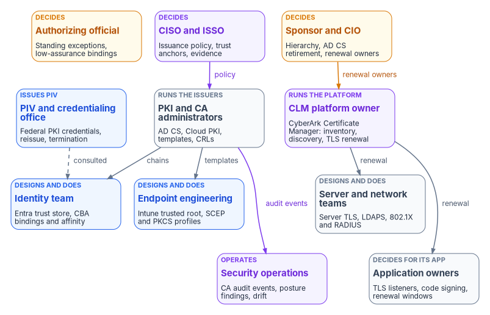
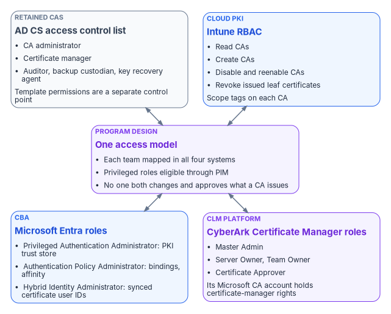

# Chapter 05 — Who Owns the Certificate Estate

*A certificate authority can mint credentials the whole estate trusts, so the people who can change one must never be the only people who decide what it issues.*

::: {.callout-note}
## In this chapter
The teams that decide, do and advise on certificates: PKI and CA administrators, the identity team, endpoint engineering, server and network teams, application owners, the PIV and credentialing office, security operations, the ISSO and authorizing official, and the owner of the certificate lifecycle platform. A responsibility matrix covers the CA hierarchy, trust anchors, issuance policy, template retirement, CBA bindings, renewal, revocation and AD CS decommissioning. A renewal table names one owner for each certificate class, and a role map shows the four permission systems the work runs through.
:::

In most Active Directory estates the certificate authority belongs to whoever installed it. Often that was a domain administrator who added the AD CS role years ago, published a handful of templates and moved on. Ownership after that is implied by group membership: on an enterprise CA, the local Administrators, Domain Admins and Enterprise Admins groups are CA administrators by default.[^c05-adcs-roles] Nobody decided that those groups should control what the CA issues. It happened because the role installed that way.

The certificate estate outlives the migration ([Chapter 01](01-why-certificates-outlive-every-migration.md)), and the target spreads it across more systems, not fewer ([Chapter 04](04-the-target-pki.md)). Microsoft Cloud PKI is administered in Intune. The certificate authorities Entra ID trusts for certificate-based authentication (CBA) are administered in Entra ID. Retained AD CS keeps its own access control list. PIV certificates come from the Federal PKI through the agency's credentialing office. Server and public TLS certificates are discovered and renewed through the program's certificate lifecycle management (CLM) platform. Each of those has its own administrators, and each holds a piece of the decision about what the agency trusts.

[Book 02, Chapter 06](../b02-identity/06-who-owns-the-migration.md) sets out the migration-wide ownership model, including the Risk Management Framework roles of the authorizing official, CISO, ISSO and system owner from NIST SP 800-37.[^c05-sp80037] [Book 05, Chapter 06](../b05-devices/06-who-owns-the-endpoint.md) applies it to devices and servers. This chapter applies the same model to certificates and doesn't repeat those definitions. The roles, matrix and tables below are the program's recommended model. Adapt them to the agency's governance, but keep one decider per row.

{#fig-ch05-certificate-estate-owners fig-alt="Four rows of cards. Top row, decision makers: the sponsor and CIO in amber, who own the CA hierarchy decision, the AD CS retirement schedule and renewal ownership; the authorizing official in amber, who accepts standing exceptions and low-assurance bindings; and the CISO and ISSO in violet, who set issuance policy, trust anchors and evidence. Second row, the certificate authorities: PKI and CA administrators in slate, who run AD CS and Cloud PKI and own templates and CRLs; the CLM platform owner in violet, who runs CyberArk Certificate Manager for inventory, discovery and server and public TLS renewal; and the PIV and credentialing office in blue, which issues PIV through the Federal PKI. Third row, the consumers who design and do: the identity team in blue, which owns the Entra trust store and CBA bindings; endpoint engineering in blue, which owns Intune certificate profiles; and server and network teams in slate, which own server TLS and 802.1X and RADIUS. Bottom row: application owners in slate, who decide for TLS and code-signing certificates on their applications, and security operations in violet, which monitors CA audit events, posture findings and drift. Arrows run from the CISO and ISSO to the PKI administrators labeled policy, from the sponsor to the CLM platform owner labeled renewal owners, from the PKI administrators to the identity team and endpoint engineering labeled chains and templates, from the CLM owner to the server and network teams and application owners labeled renewal, and from the PKI administrators to security operations labeled audit events. A dashed arrow labeled consulted runs from the PIV office to the identity team."}

## Decision rights and work are different things

The program separates three kinds of involvement, as Books 02 and 05 do. A role *decides* when it is accountable for the outcome and can say no. A role *does* the work when it builds, configures or runs the thing. A role is *consulted* when the decision can't be made well without its input, even though the decision isn't its to make.

The split matters more for a CA than for almost any other system. A CA administrator can make changes that bypass the lower-privilege controls on the CA, and Microsoft's guidance treats CA and host administration as high privilege for that reason.[^c05-adcs-roles] Several everyday console actions are risk decisions in disguise. Leaving a template published "in case someone still needs it" is one. So is adding a CA to the Entra trust store without a CRL, which means certificates it revokes still authenticate.[^c05-cba-crl] Setting the tenant's CBA binding to low affinity is another, and so is extending a CRL's validity so that an offline root needs fewer ceremonies. Each one is made by someone with the rights to make it, who may not know that a decision is being made.

## The roles

**PKI and CA administrators** run the certificate authorities: retained AD CS, the Microsoft Cloud PKI root and issuing CAs, and the offline root if there is one. They own the templates, the CRL and AIA publication schedule, CA backups and key ceremonies. Microsoft's least-privilege model for AD CS splits this work into separate roles: CA administrator, certificate manager, enrollment agent, auditor, backup and recovery custodian, and key recovery agent. It treats an Enrollment Agent certificate as an impersonation capability, not a convenience.[^c05-adcs-roles] Template administration is a separate control point from CA administration.[^c05-adcs-roles] Where key archival is used, the certificate manager who retrieves an archived key and the key recovery agent who decrypts it should be different people.[^c05-keyarchival] In the program's model the PKI administrators do the work and decide only what is purely operational, such as CRL publication timing within the window the security office sets. What a CA may issue is a policy decision, and it belongs to the CISO.

**The identity team** owns the Entra ID side of certificates. That covers the PKI-based trust store of CAs that Entra CBA accepts, the CBA method policy, username bindings, affinity and protection level, and the `certificateUserIds` values that bind certificates to users. Entra CBA validates certificates. It doesn't issue them ([Book 02, Chapter 04](../b02-identity/04-the-hidden-migration-surface.md)). [Chapter 06](06-device-and-user-certificates.md) covers the configuration itself. For ownership, the important fact is that Active Directory administrators can change `certificateUserIds` for every synchronized account, because the value flows from on-premises `altSecurityIdentities` through Microsoft Entra Connect.[^c05-cuid] Whoever administers synchronized users, or the Connect servers, can therefore change who a certificate signs in as. The program treats them as part of the binding's control surface.

**Endpoint engineering** owns certificates on Intune-managed devices: trusted root profiles, SCEP and PKCS profiles, the Certificate Connector for Microsoft Intune and its NDES role where AD CS still issues, and the renewal threshold on each profile. [Book 05, Chapter 04](../b05-devices/04-intune-first-onboarding.md) and [Chapter 08](../b05-devices/08-gpo-to-intune-policy-migration.md) cover the profiles. Cloud PKI issues only to devices enrolled in Intune, through the SCEP profile.[^c05-cpki] Intune doesn't manage Windows Server, so server certificates need another issuer and another owner.

**Server and network teams** own the certificates that infrastructure presents: TLS on Windows and Linux servers and appliances, LDAPS, the RADIUS servers behind 802.1X, VPN gateways and wireless controllers. They also run the servers that the certificate path depends on, such as NDES and connector hosts and CRL web endpoints. The [Federal Compliance book on network access control](../../compliance/Vol_I_Book_02_Network_Access_Control_802_1X.md) covers the 802.1X design. [Book 06, Chapter 22](../b06-data-platform/22-where-sql-server-touches-adcs.md) covers where SQL Server depends on AD CS and domain-controller certificates.

**Application owners** decide for their own applications. They know which listeners present which certificate, which clients pin a chain, and which build pipelines sign code. They are the only people who can accept a renewal window or a reissue for their application. Code-signing certificates are the clearest case. A code-signing key that leaks lets anyone sign software the estate will trust, so the program treats issuance and key custody for code signing as a security decision with the application owner doing the work.

**The PIV and credentialing office** runs PIV issuance. The Federal PKI is a network of CAs that issue PIV, PIV-Interoperable and other person certificates. The Federal Common Policy CA G2 is its root and the trust anchor for agency issuing CAs, and the two highest-level CAs are operated by the Federal PKI Management Authority.[^c05-fpki] Many platforms don't include that root in their default trust stores, so the agency has to distribute it.[^c05-fpki] The PIV office doesn't administer the tenant. It owns the credential lifecycle that Entra CBA consumes, including card issuance, reissue and termination, and derived PIV. [Book 03, Chapter 09](../b03-hr-identity/09-credentials-and-certificates.md) covers that lifecycle, including the leaver sequence. In this book the PIV office is consulted on every CBA binding and affinity decision for PIV certificates, because it knows which certificate fields are stable across a card reissue.

**Security operations** receives what the certificate estate emits: CA audit events, CBA sign-in failures, CLM expiry and discovery findings, and the AD CS posture assessments that Microsoft Defender for Identity reports. Defender for Identity assesses certificate templates in any environment with AD CS installed. Its CA-level assessments need a sensor on the AD CS server.[^c05-mdi-certs] [Chapter 08](08-lifecycle-monitoring-and-decommissioning.md) lists the signals. Security operations is consulted on templates and exceptions, because it's the team that sees an exception being used.

**The CISO and ISSO** decide the control requirements: which CAs may issue for which purposes, the certificate policy and lifetimes, key protection, which trust anchors may appear in trust stores, the minimum CBA binding strength, and the evidence an assessor will read. NIST SP 800-53 control SC-17 asks for certificates issued under an organization-defined certificate policy and for trust stores that hold only approved trust anchors.[^c05-sp80053] Both are CISO decisions in the program's model. The ISSO assembles the evidence and tracks findings to closure.

**The authorizing official** accepts residual risk. For certificates that means every standing exception: a template that can't be retired yet, a CA trusted without a working CRL, a low-affinity binding kept for a population whose certificates can't carry a stronger identifier, a CRL validity stretched past policy. It also covers the retirement of AD CS components that change the authorization boundary.

**The CLM platform owner** runs the program's certificate lifecycle management platform. The program's choice is **CyberArk Certificate Manager** (formerly Venafi TLS Protect, now part of Palo Alto Networks), chosen to consolidate on a vendor the program already uses. It is the program's single lifecycle tool, and the program doesn't add a second CLM product. Palo Alto Networks completed its acquisition of CyberArk on February 11, 2026.[^c05-pan-acq] Since then, Palo Alto Networks has marketed the SaaS edition as Next-Generation Trust Security (NGTS). The self-hosted edition continues as Certificate Manager, Self-Hosted, built on the CyberArk Trust Protection Foundation.[^c05-pan-ngts] The self-hosted product discovers certificates across the enterprise, tracks their usage and compliance, and works to renew them before they expire. It supports multiple CAs.[^c05-cyberark-sh] Its documented roles include Master Admin, Server Owner, Certificate Approver and Team Owner.[^c05-cyberark-sh] In the program's model the CLM owner runs the platform and its integrations, and the platform's Server Owner and Team Owner assignments record the renewal owners named in the table below. The CLM owner doesn't decide what may be issued. That stays with the CISO.

The **sponsor and CIO** set scope, funding and sequence. In the program's model they decide the target hierarchy, because it fixes cost and the system boundary for years. They also decide when each AD CS component is retired, because retirement ends the fallback every other team relies on. And they assign renewal ownership per certificate class, because that assignment crosses team lines that only the CIO's organization can settle.

## The responsibility matrix

D = decides (accountable) · R = does the work · C = consulted · blank = informed at most.

| Decision or work item | Sponsor / CIO | AO | CISO / ISSO | PKI / CA admins | Identity | Endpoint eng. | Server and network | App owners | PIV office | SecOps | CLM owner |
|---|---|---|---|---|---|---|---|---|---|---|---|
| CA hierarchy and target: Cloud PKI, retained AD CS, BYOCA, Federal PKI ([Chapter 04](04-the-target-pki.md)) | D | C | C | R | C | C | C | | C | | C |
| Trust anchors in the Entra trust store, Intune trusted root profiles and server trust stores | | C | D | R | R | R | R | | C | C | |
| Certificate policy and issuance policy: purposes, lifetimes, key protection, EKUs | | C | D | R | C | C | C | C | C | C | R |
| Template retirement, per template ([Appendix B](appendix-b-template-migration-matrix.md)) | | | C | D, R | C | C | C | C | | C | C |
| CBA bindings, affinity and protection level ([Chapter 06](06-device-and-user-certificates.md)) | | C | D | C | R | | | | C | C | |
| Low-affinity binding or single-factor CBA kept as a standing exception | C | D | C | | R | | | | C | C | |
| Renewal ownership per certificate class (table below) | D | | C | C | C | C | C | C | C | | R |
| Routine revocation: superseded, cessation of operation, affiliation changed | | | C | R | | R | R | D | | C | R |
| Revocation for key compromise or CA compromise | C | C | D | R | R | R | R | C | C | R | R |
| Public CAs authorized for agency names, and CAA records | | | D | | | | R | C | | C | R |
| Code-signing certificates and key custody | | | D | R | | | | R | | C | C |
| CLM discovery scans and CA connections | | | C | C | | | C | C | | C | D, R |
| Exceptions with an end date | | | D | R | R | R | R | C | | C | |
| Exceptions with no end date, or past the agency's limit | C | D | C | R | R | R | R | C | | C | |
| AD CS decommissioning, per CA ([Chapter 08](08-lifecycle-monitoring-and-decommissioning.md)) | D | C | C | R | R | R | R | C | | C | R |
| Evidence: issuance, revocation, CRL health and drift | | C | D | R | R | R | | | | R | R |

Four rows need comment. The routine revocation row gives the decision to the owner of the certificate, not the CA team. A superseded or decommissioned certificate is the owner's call, and the certificate manager executes it. The compromise row moves the decision to the CISO, because Microsoft's guidance treats a revocation as an authorization and incident-response decision. That guidance also keeps the certificate manager who revokes separate from the CA administrator who changes CDPs, CRL timing and CA configuration.[^c05-adcs-revoke] The template retirement row is the one place the PKI administrators both decide and do. Retiring a template is reversible, and the consumers are consulted before it happens. The two exception rows split on time, as in Book 05. A temporary exception is a control decision. A standing one is a risk acceptance.

## Renewal ownership per certificate class

Expired certificates are the most common way a certificate estate fails, and an expiry is almost always an ownership failure first. Every certificate class below has one renewal owner. That owner answers for the certificate expiring, even when automation does the renewing. The CLM platform records the owner, and the CISO's evidence shows it.

| Certificate class | Issuer in the target | Renewal engine | Renewal owner | Notes |
|---|---|---|---|---|
| User and device authentication on Intune-managed devices (Wi-Fi, VPN, S/MIME) | Cloud PKI through SCEP, or AD CS through the Intune connector (SCEP or PKCS) | Intune profile renewal threshold | Endpoint engineering | Cloud PKI issues only to Intune-enrolled devices.[^c05-cpki] [Chapter 06](06-device-and-user-certificates.md) |
| PIV and derived PIV | Federal PKI issuing CA, through the agency's card management system | Card and credential lifecycle | PIV and credentialing office | [Book 03, Chapter 09](../b03-hr-identity/09-credentials-and-certificates.md) |
| Domain controller, KDC and LDAPS | Retained AD CS | AD CS autoenrollment | PKI/CA administrators for the templates, with the domain controller owners | Stays on AD CS while domain controllers exist ([Chapter 07](07-coexistence-and-migration.md)) |
| RADIUS servers and 802.1X infrastructure | Retained AD CS, or the CLM platform | Autoenrollment or CLM | Network team | Device-side 802.1X certificates are in the first row |
| Internal server TLS on servers, appliances and Linux hosts | AD CS through the CLM platform | CyberArk Certificate Manager | Server team, or the application owner named as Server Owner | Intune doesn't manage Windows Server ([Book 05, Chapter 09](../b05-devices/09-servers-under-azure-arc.md)) |
| Public-facing TLS | Public CA authorized by CAA | CLM platform, with ACME where the endpoint supports it | Application owner, with the CLM owner running the automation | Public lifetimes are shrinking ([Chapter 08](08-lifecycle-monitoring-and-decommissioning.md)) |
| Code signing | Internal or public CA, as the CISO decides | Approved request, never unattended | Application owner | Keys held in hardware, by program policy |
| CA certificates and CRLs, root and issuing | The hierarchy itself | Key ceremony and CRL schedule | PKI/CA administrators | Offline root CRLs on a witnessed schedule |

The program assigns server and public TLS to the CLM platform because Microsoft's issuers don't cover them. Cloud PKI's only enrollment path is its SCEP registration authority for Intune-managed devices.[^c05-cpki] That leaves every certificate on a server, appliance or public listener to AD CS or a public CA. Something has to find those certificates and renew them on time, and that something is the CLM platform.

## Four permission systems, one access model

Decision rights don't change what a console lets someone do. Roles do, and for certificates there are four separate permission systems.

{#fig-ch05-four-permission-planes fig-alt="Four cards, two above and two below, each connected by a two-way arrow to one violet card in the middle. The first card, in slate, is the AD CS access control list, with CA administrator, certificate manager, auditor, backup custodian and key recovery agent, and template permissions as a separate control point. The second card, in blue, is Intune RBAC for Cloud PKI, with the permissions read CAs, create CAs, disable and reenable CAs, and revoke issued leaf certificates, scoped by scope tags. The third card, in blue, is Microsoft Entra roles for CBA, with Privileged Authentication Administrator for the PKI-based trust store, Authentication Policy Administrator for bindings and affinity, and Hybrid Identity Administrator for synchronized certificate user IDs. The fourth card, in violet, is CyberArk Certificate Manager roles, with Master Admin, Server Owner, Certificate Approver and Team Owner, and a Microsoft CA account that holds certificate-manager rights. The violet card in the middle, labeled Program design, One access model, reads: each team mapped in all four systems, privileged roles eligible through PIM, and no single person who can both change and approve what a CA issues."}

**The AD CS access control list** governs the retained CAs. The certificate-manager role holds the **Issue and Manage Certificates** permission and is the role that revokes and reinstates. CA configuration, CRL scheduling and CDP changes need CA-administrator access.[^c05-adcs-revoke] Microsoft recommends one security group per operational role, named accounts only, a recorded owner and review date for each group, and a controlled emergency account whose use is approved and reviewed.[^c05-adcs-roles] Microsoft also notes that current Learn documentation doesn't publish a Windows Server 2025 procedure for enabling CA role separation. It advises against applying the undocumented registry setting from older procedures and recommends validating the configuration with current support guidance before enforcing it.[^c05-adcs-roles]

**Intune RBAC** governs Cloud PKI. The Intune Administrator Entra role can create CAs, but Intune also offers Cloud PKI permissions for custom roles: read CAs, create CAs, disable and reenable CAs, and revoke issued leaf certificates.[^c05-intune-custom-role] Deleting a CA through a custom role needs read, disable and reenable, and revoke together.[^c05-cpki-delete] Revoking and deleting a Cloud PKI CA are permanent and can't be undone.[^c05-cpki-delete] Scope tags can be applied to each CA.[^c05-cpki] The program gives the PKI administrators a custom Cloud PKI role and keeps Intune Administrator for tasks that need it, such as configuring the Certificate Connector, which Microsoft says to do with an Intune Administrator account that has an Intune license.[^c05-connector-prereq]

**Microsoft Entra roles** govern CBA. Configuring the PKI-based trust store is assigned to the Privileged Authentication Administrator role. The Authentication Policy Administrator configures username bindings, the protection level and the affinity binding.[^c05-cba-setup] By default the tenant's protection level is single-factor and its affinity is low.[^c05-cba-setup] Updating `certificateUserIds` needs at least Privileged Authentication Administrator for cloud-only users. For synchronized users it needs at least Hybrid Identity Administrator, and the value can only be set through Microsoft Entra Connect.[^c05-cuid] Microsoft's own CBA guidance observes that the PKI administrator is the person who can supply the list of issuing CAs.[^c05-cba-ca] That's a working dependency between the PKI and identity teams, which the matrix records as a consultation.

**CyberArk Certificate Manager roles** govern the CLM platform. To request and enroll certificates from a Microsoft CA, Certificate Manager, Self-Hosted uses an account that needs Read, Issue and Manage Certificates, and Request Certificates permissions on the CA.[^c05-cyberark-msca] Issue and Manage Certificates is the AD CS certificate-manager permission. The CLM platform's CA account is therefore a certificate manager for every template it can reach. Its administrators hold that power indirectly, so the program scopes the account to the templates the CLM platform is meant to issue and treats CLM Master Admins as privileged.

The Certificate Connector has a similar footprint on the endpoint side. Its service account needs Read and Enroll on every template it uses, and Issue and Manage Certificates on the CA only when it handles revocation. The NDES application pool account needs Read and Enroll on each SCEP template.[^c05-connector-prereq] Grant the revocation permission only to connectors that actually revoke.

| Team | AD CS | Intune RBAC (Cloud PKI) | Microsoft Entra | CyberArk Certificate Manager |
|---|---|---|---|---|
| PKI / CA administrators | CA administrator; template administrator; certificate manager in a separate account | Custom role with the Cloud PKI permissions | None routinely | Consulted; no Master Admin by default |
| Identity team | None | Read CAs, for chain checks | Privileged Authentication Administrator and Authentication Policy Administrator, eligible through PIM; Hybrid Identity Administrator for sync | None |
| Endpoint engineering | Read and Enroll for connector and NDES accounts only | Policy and Profile Manager for certificate profiles ([Book 05, Chapter 06](../b05-devices/06-who-owns-the-endpoint.md)) | None routinely | None |
| Server and network teams | Enroll on their server templates | None | None | Server Owner for their certificates |
| Application owners | Enroll on approved templates only | None | None | Server Owner or Team Owner for their applications |
| PIV office | None | None | Consulted on the trust store and bindings | None |
| Security operations | Auditor | Read CAs | Security Reader | Read access to inventory and findings |
| CLM platform owner | The CLM CA account, scoped to its templates | None | None | Master Admin, eligible not standing |
| ISSO and assessors | Auditor | Read CAs | Global Reader or Security Reader | Read access to inventory |

Every row follows the same rules as in Books 02 and 05. Use least-privileged roles, keep privileged ones eligible rather than permanent, and keep the person who submits a high-impact change from approving it.

## What changes from "whoever installed the CA"

| AD CS habit | What replaces it |
|---|---|
| Domain Admins and Enterprise Admins are CA administrators by default | Named CA-admin, certificate-manager, auditor and backup groups with owners and review dates |
| Whoever can edit a template decides who can enroll | The CISO sets issuance policy; PKI administrators implement it; template retirement goes through [Appendix B](appendix-b-template-migration-matrix.md) |
| Any CA someone uploads is trusted by Entra ID | Trust anchors are a CISO decision; the identity team uploads only approved CAs, each with a CRL |
| Renewal is whoever notices the expiry warning | One renewal owner per certificate class, recorded in the CLM platform |
| Revocation is a console click | Routine revocation is the owner's call; compromise is the CISO's; CA configuration stays with a different role |
| The CA retires when someone turns the server off | AD CS retirement is a sponsor decision with the sequence and evidence in [Chapter 08](08-lifecycle-monitoring-and-decommissioning.md) |

::: {.callout-tip}
## Continue the book
[← Previous: Chapter 04 — The Target PKI: Cloud PKI, AD CS and Federal PKI](04-the-target-pki.md) · [Book index](index.md) · [Next: Chapter 06 — Device and User Certificates: Intune and Entra CBA →](06-device-and-user-certificates.md)
:::

[^c05-adcs-roles]: Microsoft Learn, "Secure, delegate, and audit certification authority administration," sections "Define the CA operating roles," "Assess CA role separation" and "Security considerations," <https://learn.microsoft.com/windows-server/identity/ad-cs/secure-delegate-audit-certification-authority> (accessed Oct 20, 2026).
[^c05-sp80037]: NIST, SP 800-37 Rev. 2, *Risk Management Framework for Information Systems and Organizations: A System Life Cycle Approach for Security and Privacy*, December 2018, <https://csrc.nist.gov/pubs/sp/800/37/r2/final> (accessed Oct 20, 2026).
[^c05-cba-crl]: Microsoft Learn, "Microsoft Entra certificate-based authentication Certificate Revocation List (CRL)," <https://learn.microsoft.com/entra/identity/authentication/concept-certificate-based-authentication-certificate-revocation-list> (accessed Oct 20, 2026).
[^c05-keyarchival]: Microsoft Learn, "Configure AD CS key archival and recover private keys," section "Separate the recovery duties," <https://learn.microsoft.com/windows-server/identity/ad-cs/configure-key-archival-recover-private-keys> (accessed Oct 20, 2026).
[^c05-cuid]: Microsoft Learn, "Mapping to the certificateUserIds attribute in Microsoft Entra ID," section "Roles to update certificateUserIds," <https://learn.microsoft.com/entra/identity/authentication/concept-certificate-based-authentication-certificateuserids> (accessed Oct 20, 2026).
[^c05-cpki]: Microsoft Learn, "Overview of Microsoft Cloud PKI for Microsoft Intune" (prerequisites, overview of features, architecture), <https://learn.microsoft.com/intune/cloud-pki/> (accessed Oct 20, 2026).
[^c05-fpki]: GSA, idmanagement.gov, "Federal Public Key Infrastructure 101," <https://www.idmanagement.gov/university/fpki/> (accessed Oct 20, 2026).
[^c05-mdi-certs]: Microsoft Learn, "Microsoft Defender for Identity's security posture assessments," section "Prerequisites," <https://learn.microsoft.com/defender-for-identity/security-assessment> (accessed Oct 20, 2026).
[^c05-sp80053]: NIST, SP 800-53 Rev. 5, *Security and Privacy Controls for Information Systems and Organizations*, September 2020 (updated December 10, 2020), control SC-17; control text checked against NIST's OSCAL catalog, <https://csrc.nist.gov/pubs/sp/800/53/r5/upd1/final> (accessed Oct 20, 2026).
[^c05-pan-acq]: Palo Alto Networks, "Palo Alto Networks Completes Acquisition of CyberArk to Secure the AI Era," press release, February 11, 2026, filed as Exhibit 99.1 to Form 8-K, <https://www.sec.gov/Archives/edgar/data/1327567/000119312526045600/d40626dex991.htm> (accessed Oct 20, 2026).
[^c05-pan-ngts]: Palo Alto Networks, "CyberArk Certificate Manager is now Next-Generation Trust Security" (product page and FAQ; cyberark.com/products/certificate-manager redirects here), <https://www.paloaltonetworks.com/network-security/next-gen-trust-security/certificate-manager> (accessed Oct 20, 2026).
[^c05-cyberark-sh]: CyberArk, "CyberArk Certificate Manager - Self-Hosted Introduction," documentation version 26.1, <https://docs.venafi.com/Docs/current/TopNav/Content/Products/c-tls-protect-landing.php> (accessed Oct 20, 2026).
[^c05-adcs-revoke]: Microsoft Learn, "Operate certificate revocation, CRL publication, and CDP changes in AD CS," sections "Prerequisites" and "Security considerations for revocation and CDP changes," <https://learn.microsoft.com/windows-server/identity/ad-cs/operate-certificate-revocation-crl-cdp> (accessed Oct 20, 2026).
[^c05-intune-custom-role]: Microsoft Learn, "Create a custom role in Intune," section "Cloud PKI," <https://learn.microsoft.com/intune/fundamentals/role-based-access-control/create-custom-role> (accessed Oct 20, 2026).
[^c05-cpki-delete]: Microsoft Learn, "Delete Microsoft Cloud PKI certification authority," <https://learn.microsoft.com/intune/cloud-pki/delete-ca> (accessed Oct 20, 2026).
[^c05-connector-prereq]: Microsoft Learn, "Prerequisites for the Certificate Connector for Microsoft Intune," section "Accounts," <https://learn.microsoft.com/intune/fundamentals/certificates/connector/prerequisites> (accessed Oct 20, 2026).
[^c05-cba-setup]: Microsoft Learn, "Set up Microsoft Entra certificate-based authentication," sections "Step 1: Configure the CAs with a PKI-based trust store" and "Step 3: Configure an authentication binding policy," <https://learn.microsoft.com/entra/identity/authentication/how-to-certificate-based-authentication> (accessed Oct 20, 2026).
[^c05-cba-ca]: Microsoft Learn, "How to configure certificate authorities for Microsoft Entra certificate-based authentication," <https://learn.microsoft.com/entra/identity/authentication/how-to-configure-certificate-authorities> (accessed Oct 20, 2026).
[^c05-cyberark-msca]: CyberArk, "Microsoft Active Directory Certificate Services (ADCS) - Enterprise and Standalone" (Trust Protection Foundation CA template), documentation version 26.1, <https://docs.venafi.com/Docs/current/TopNav/Content/Drivers/cco-MicrosoftCertServices-CATemplate-tpp.php> (accessed Oct 20, 2026).
