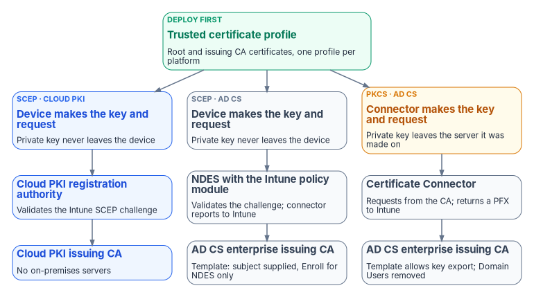

# Chapter 06 — Device and User Certificates: Intune and Entra CBA

*Intune puts certificates on devices. Entra ID decides whether a certificate proves who someone is. Those are two jobs, and each one fails differently.*

::: {.callout-note}
## In this chapter
The three Intune certificate profile types: trusted certificate, SCEP (issued by Microsoft Cloud PKI, or by AD CS through NDES and the Certificate Connector) and PKCS. Which profile fits which use. Strong certificate mapping under KB5014754, where its enforcement stands today, and what Intune profiles need in order to meet it. Then Microsoft Entra certificate-based authentication (CBA): the sign-in flow, the trust store and revocation, username bindings and affinity, single-factor and multifactor certificates, staged rollout, and the move off AD FS.
:::

## Two jobs, two failure modes

Intune is a delivery system. A certificate profile tells a managed device which CA to trust, where to ask for a certificate and what the certificate must contain. When delivery fails, a device has no certificate and Wi-Fi, VPN or an application refuses it. The failure is local and visible in the profile report.

Entra certificate-based authentication is a relying party. It doesn't issue anything. It checks a certificate the user presents against the CAs the tenant trusts, checks revocation, and maps the certificate to one user account.[^c06-cba-deep] When this goes wrong, the danger is the opposite: a certificate that *should* fail might pass, because the trust store holds too much, revocation isn't configured, or a binding is weak. [Book 02, Chapter 04](../b02-identity/04-the-hidden-migration-surface.md) makes the same distinction: CBA validates certificates but isn't a CA.

Keep the two jobs apart in planning. The device side is about issuers and profiles. The user side is about trust and binding. They meet at one point, a user certificate delivered by Intune and then used to sign in, and that point is where most migration surprises come from.

{#fig-ch06-delivery-paths fig-alt="A trusted certificate profile at the top, labeled 'deploy first: root and issuing CA certificates', feeds three paths. Path one, blue, SCEP with Microsoft Cloud PKI: the device creates the key pair and certificate request, the Cloud PKI registration authority validates the Intune SCEP challenge, and the Cloud PKI issuing CA signs. No on-premises servers. Path two, slate, SCEP with AD CS: the device creates the key pair, NDES with the Intune policy module validates the challenge, the Certificate Connector reports to Intune, and the AD CS enterprise issuing CA signs; its template supplies the subject in the request and grants Enroll only to NDES. Path three, slate, PKCS with AD CS: the Certificate Connector generates the key pair on the connector server, requests the certificate from the AD CS enterprise CA, whose template allows key export and has Domain Users removed, and Intune delivers the certificate and key to the device as a PFX. An amber note on path three reads 'private key leaves the server it was made on'."}

## The trusted certificate profile comes first

Every other profile depends on it. A trusted certificate profile deploys the public certificate of the root CA, and of intermediate or issuing CAs, so the device can build the chain to whatever issues its own certificates. Export each CA certificate as a DER-encoded `.cer` file, never the private key, and create one trusted certificate profile per platform.[^c06-trusted-root] Deploy it to the same groups that receive the SCEP, PKCS or imported PKCS profiles and the Wi-Fi, VPN or email profiles that use them. SCEP profiles reference the trusted certificate profile directly; PKCS profiles reference the CA server instead, but the device still needs the chain. If a device doesn't trust the root, the SCEP or PKCS profile fails.[^c06-trusted-root]

On Windows you choose the destination store: computer root, computer intermediate or user intermediate. The profile carries only root or intermediate certificates; Microsoft doesn't support using it to deliver anything else.[^c06-trusted-root] The guide's claim that the profile covers Linux was wrong: trusted certificate profiles are created for Android, iOS/iPadOS, macOS and Windows.[^c06-pkcs]

With Cloud PKI, create trusted certificate profiles for the Cloud PKI root and issuing CAs. With a bring-your-own-CA (BYOCA) issuing CA anchored to a private root, create one for *every* CA certificate in the private hierarchy as well as for the Cloud PKI issuing CA, on every platform.[^c06-byoca] [Chapter 04](04-the-target-pki.md) covers the choice between the two Cloud PKI models.

## SCEP profiles

With SCEP the device generates its own key pair and sends a certificate request; the private key never leaves the device.[^c06-cpki] Intune wraps each request with an encrypted, signed challenge that only Intune and the registration authority can read, and the registration authority rejects any request whose subject or subject alternative name doesn't match what the challenge says Intune expected.[^c06-scep-infra] That challenge is what makes SCEP safe to expose to devices on the internet.

### SCEP with Microsoft Cloud PKI

Cloud PKI hosts the CAs, a SCEP registration authority for each issuing CA, the CRL distribution point and the AIA endpoint, so it needs no on-premises CA, NDES server or Certificate Connector.[^c06-cpki] The administrator creates the root and issuing CAs (or a BYOCA issuing CA), creates trusted certificate profiles for them, and creates a SCEP profile per platform that points at the issuing CA's SCEP URI. The device checks in, builds its request, the validation service checks it against the challenge, and the issuing CA signs.[^c06-cpki] The guide said that Intune generates the request on the device's behalf. It doesn't; the device does.[^c06-cpki]

The constraints that shape design:

- **Only Intune-enrolled devices.** Leaf certificates go to Intune MDM-enrolled devices whose platform supports the SCEP profile: Android, iOS/iPadOS, macOS and Windows.[^c06-cpki] Intune's supported platforms don't include Windows Server,[^c06-intune-platforms] so domain controllers, NPS servers, web servers and other servers can't get Cloud PKI certificates. [Book 05](../b05-devices/09-servers-under-azure-arc.md) explains how servers are managed instead; [Chapter 04](04-the-target-pki.md) decides where their certificates come from and how they renew; [Chapter 07](07-coexistence-and-migration.md) covers them during coexistence.
- **SCEP only.** Cloud PKI issues through SCEP; it isn't a PKCS issuer.[^c06-cpki]
- **Three CAs per tenant**, counting root, issuing and BYOCA issuing CAs together.[^c06-cpki]
- **Fixed CA properties.** A CA's extended key usages can't be edited after creation, Any Purpose isn't allowed, and a SCEP profile that asks for an EKU the issuing CA doesn't carry fails. Don't mix NDES SCEP URLs and Cloud PKI SCEP URLs in one profile.[^c06-byoca]
- **Keys and algorithms.** RSA 2048, 3072 or 4096 with SHA-256, SHA-384 or SHA-512; licensed CAs use Azure Managed HSM keys, while CAs created during a trial use software keys that can't be converted later.[^c06-cpki] Don't build production CAs during a trial.
- **Revocation.** Intune hosts each CA's CRL, valid for seven days, republished every 3.5 days and updated with every revocation.[^c06-cpki] This matches what [Book 03, Chapter 09](../b03-hr-identity/09-credentials-and-certificates.md) records.

Licensing changed in 2026. Cloud PKI requires a subscription on top of Intune Plan 1 or Plan 2,[^c06-cpki] and from July 2026 Microsoft 365 E5 and E7 include it for commercial customers; Microsoft says Government plans are planned to align with the enterprise packaging subject to compliance requirements, so confirm the entitlement for a GCC tenant rather than assume it.[^c06-intune-plan][^c06-whatsnew] Cloud PKI is available in GCC High (announced for the week of September 28, 2026) and not in DoD environments.[^c06-whatsnew][^c06-cpki]

### SCEP with AD CS through NDES and the Certificate Connector

When the issuer is an AD CS CA, the path runs through two pieces of on-premises software. NDES is the SCEP registration authority; the Certificate Connector for Microsoft Intune installs on the same server, adds the Intune policy module that validates the challenge, and reports results to Intune.[^c06-scep-infra] The infrastructure rules are strict:

| Component | Requirement |
|---|---|
| Certification authority | AD CS **enterprise** CA on a supported Windows Server; a standalone CA isn't supported |
| NDES and connector server | Domain-joined, same forest as the enterprise CA; not a domain controller; not the issuing CA |
| Publishing to the internet | A reverse proxy (Microsoft Entra application proxy, Web Application Proxy or a third-party proxy) with preauthentication set to passthrough, because SCEP can't preauthenticate |
| Direct browsing of the NDES URL | Returns 403 once the policy module is installed |
| SCEP template | Subject **supplied in the request**; Client Authentication in application policies; NDES service account has Read and Enroll |
| Revocation | The connector's account needs Issue and Manage Certificates on the CA |

: AD CS requirements for Intune SCEP[^c06-scep-infra] {.striped .hover}

Two of those rows matter for hardening. The SCEP template supplies the subject in the request, which is the setting [Chapter 03](03-hardening-what-stays.md) treats as dangerous on any template a broad group can enroll in. Here the Intune policy module enforces the subject, so the template is safe only while its Enroll permission is limited to the NDES service account; audit that ACL as you would any other template's. And the connector's Issue and Manage Certificates right on the CA is a CA officer right, so the connector server belongs in the CA's administrative tier.

NDES maps a request to a template by the request's purpose: signature, encryption, or both. One NDES server can therefore serve at most three templates; more than three needs more NDES servers.[^c06-ndes-aadj] NDES can't be clustered or load balanced; for availability, install several identically configured NDES servers and let Intune spread requests across them.[^c06-ndes-aadj] Under the hood, NDES enrolls two registration-authority certificates of its own from the CEP Encryption and Exchange Enrollment Agent (Offline request) templates, both with the Certificate Request Agent purpose;[^c06-ndes-ra] they expire like any other certificate and are a frequent cause of NDES outages.

### Keep the connector current

The guide's "v6.2406 or later" is out of date. Each connector release is supported for six months after the next one ships, and an out-of-support connector keeps working for up to 18 months before it may stop. Version 6.2406.0.1001 (September 2024) added the KB5014754 changes; the current release is 6.2510.3.3007 (May 18, 2026), and 6.2510.3.2002 (February 2026) began blocking unknown certificate extensions in SCEP requests.[^c06-connector] Let the connector update itself (it needs outbound 443 to `autoupdate.msappproxy.net`) and alert when the admin center shows it as Warning or Error.[^c06-connector] Up to 100 connector instances can run in a tenant; any instance with the PKCS feature can pick up any PKCS or revocation request, so every such instance needs the same CA permissions.[^c06-connector]

## PKCS and imported PKCS profiles

A PKCS profile doesn't use NDES. The Certificate Connector receives the request from Intune, **generates the key pair on the connector server**, requests the certificate from an AD CS enterprise CA, and returns the certificate and private key to Intune as a PFX, which Intune delivers to the device. Because of that, the template must allow the private key to be exported; on the device, Intune marks the key non-exportable.[^c06-pkcs] The private key exists, however briefly, somewhere other than the device that uses it. That is the trade PKCS makes for not needing NDES, and it's why the program prefers SCEP wherever a use case allows either.

Microsoft's template guidance for PKCS has the same hardening shape as for SCEP: subject supplied in the request, the connector's computer account given Read and Enroll, and **Domain Users removed** from the template's permissions.[^c06-pkcs] A PKCS template with Domain Users still enrolled is an ESC1 finding (Chapter 03).

Imported PKCS profiles distribute certificates that were issued elsewhere, typically S/MIME encryption certificates whose keys are archived so old mail stays readable; the connector handles the imported PFX files.[^c06-connector] For S/MIME with AD CS, Microsoft notes that many administrators use the Exchange Signature Only template for signing and the Exchange User template for encryption.[^c06-pkcs]

## Which profile for which use

The guide's use-case table mixed client and server certificates. Corrected, and limited to what Intune can actually deliver:

| Use case | Profile | Issuer | Platforms | Notes |
|---|---|---|---|---|
| Wi-Fi 802.1X (EAP-TLS), device or user | Trusted certificate + SCEP | Cloud PKI | Windows, iOS/iPadOS, Android, macOS | The RADIUS server must trust the Cloud PKI chain |
| Wired 802.1X | Trusted certificate + SCEP | Cloud PKI | Windows workstations | Servers stay on AD CS auto-enrollment |
| VPN client authentication | Trusted certificate + SCEP | Cloud PKI, or AD CS through NDES while the VPN trusts only AD CS | Windows, iOS/iPadOS, Android, macOS | |
| Client certificate for web application mTLS | Trusted certificate + SCEP | Cloud PKI | As the application supports | |
| User certificate for Entra CBA | Trusted certificate + SCEP | Cloud PKI or AD CS | Windows, iOS/iPadOS, Android, macOS | The issuing CA must be in the Entra trust store |
| S/MIME signing | PKCS | AD CS or existing CA | Windows, iOS/iPadOS, Android, macOS | Exchange Signature Only template on AD CS |
| S/MIME encryption | Imported PKCS | Existing CA with key archival | Windows, iOS/iPadOS, Android, macOS | Old mail needs the old keys |
| User certificate for on-premises Kerberos (certificate logon to AD) | SCEP or PKCS with the SID added | AD CS, or a CA published to NTAuth | Windows | Strong mapping required (next section) |

: Intune certificate profiles by use case {.striped .hover}

Three rows from the guide are gone. *RADIUS NPS server*, *Remote Desktop Gateway* and *application proxy connector* certificates are server certificates, and Intune doesn't manage Windows Server; [Chapter 07](07-coexistence-and-migration.md) covers them. *MDM enrollment bootstrap* isn't a certificate profile at all; enrollment doesn't depend on one. Targeting is the program's design: assign profiles to groups whose membership derives from governed attributes, with the dynamic group and filter templates in [Book 05, Chapter 08](../b05-devices/08-gpo-to-intune-policy-migration.md), not from hand-maintained lists.

Entra-joined devices are a special case for Wi-Fi. They have no on-premises computer object, so RADIUS authentication that maps a device certificate to an AD computer account doesn't work for them; Microsoft's alternative is certificates pushed by Intune or user credentials.[^c06-aadj-plan] Check the RADIUS policy before you move the first Entra-joined device onto 802.1X.

## Strong certificate mapping (KB5014754)

### What changed

Before May 2022, a domain controller would map a certificate to an account by name: the UPN or DNS name in the certificate. Anyone who could get a certificate with someone else's name in it could authenticate as that account. KB5014754 changed the Key Distribution Center (KDC) so that it wants a *strong* mapping: something in the certificate or on the account that ties the two together and can't be reused.[^c06-kb5014754]

A strong mapping is any of:

- **The SID extension.** After the May 10, 2022 update, AD CS adds a non-critical extension with OID `1.3.6.1.4.1.311.25.2`, carrying the requester's SID, to certificates issued from online templates. Non-Microsoft CAs may not add it.[^c06-kb5014754]
- **The SID in a SAN URL.** Intune's form: `URL=tag:microsoft.com,2022-09-14:sid:<value>`, added to new and renewed Intune certificates when the profile asks for it.[^c06-scep-infra][^c06-scep-profile]
- **An explicit strong mapping on the account,** written to `altSecurityIdentities`: `X509IssuerSerialNumber` (Microsoft's recommended form, with the serial number in reversed byte order), `X509SKI` or `X509SHA1PublicKey`. The `X509IssuerSubject`, `X509SubjectOnly` and `X509RFC822` forms are weak.[^c06-kb5014754]

The same `altSecurityIdentities` values are what Entra Connect can sync to `certificateUserIds` for Entra CBA; [Book 03, Chapter 09](../b03-hr-identity/09-credentials-and-certificates.md) covers that write path and the risk of letting AD administrators control it.

### The enforcement timeline and where it stands today

The guide said enforcement began in February 2025. That was one step of four:

| Date | What happened |
|---|---|
| May 10, 2022 | Updates install in **Compatibility mode**: strong mapping preferred, weak mappings still allowed with warnings |
| April 11, 2023 | Updates ignore the **Disabled** setting (`StrongCertificateBindingEnforcement` = 0) |
| February 11, 2025 | Domain controllers without a `StrongCertificateBindingEnforcement` value move to **Full Enforcement**; administrators could still set Compatibility mode |
| September 9, 2025 | Updates stop honoring the registry key; Compatibility mode can no longer be selected |

: KB5014754 strong mapping phases[^c06-kb5014754] {.striped .hover}

As of October 2026, then, every domain controller on a current update is in Full Enforcement and there's no supported way back.[^c06-kb5014754] A certificate used for Kerberos authentication to AD that has neither a strong mapping on the account nor a valid SID extension (or SAN URL) is rejected. The `CertificateBackdatingCompensation` setting that some estates used to soften the weak-mapping check applies only to weak mappings in Compatibility mode, so it no longer has an effect.[^c06-kb5014754]

Two things follow for the migration. First, any certificate that still authenticates to AD has already passed this test; a certificate that fails it fails now, not at some future date. Second, a *new* issuer the migration introduces (Cloud PKI, a third-party CA, a new template) must produce strongly mapped certificates from day one if those certificates will ever be used against a domain controller.

### What Intune profiles need

Strong mapping applies to Intune **user** certificates on all platforms, and to **device** certificates only on Microsoft Entra hybrid joined Windows devices; both need the user or device to be synced from AD so that Entra ID holds an on-premises SID.[^c06-scep-profile][^c06-pkcs]

- **SCEP profiles:** add a SAN attribute of type URI with the value `{{OnPremisesSecurityIdentifier}}`. Intune resolves it and writes the tagged SID URL. The variable works only with the URI attribute.[^c06-scep-profile] The guide said Cloud PKI SCEP includes the SID automatically with no configuration; Microsoft's SCEP profile instructions say you must add the variable, so add it.[^c06-scep-profile] AD CS servers with the KB5014754 update support the tag; a third-party CA might refuse to issue a certificate with it, so check with the vendor first.[^c06-scep-infra]
- **PKCS profiles:** run connector 6.2406.0.1001 or later (in practice, the current release), set `EnableSidSecurityExtension` to 1 under `HKLM\Software\Microsoft\MicrosoftIntune\PFXCertificateConnector`, and restart the two PFX connector services. The change applies to new and renewed certificates. To roll back, restore the value, restart the services and create a new PKCS profile to reissue without the SID.[^c06-pkcs]
- **Entra-joined devices** have no on-premises SID. Their device certificates can't be strongly mapped to AD and aren't meant for Kerberos; use them for Wi-Fi, VPN and applications.
- **Certificates used to sign in to AD** (certificate or smart card logon, which is Kerberos PKINIT) must also come from a CA in the forest's NTAuth store. AD CS enterprise CAs publish themselves there; any other CA, including a Cloud PKI or BYOCA issuing CA, has to be added explicitly.[^c06-ntauth] Don't add a CA to NTAuth unless you intend it to issue logon certificates for the forest; NTAuth membership is one of the objects Chapter 03 tells you to watch.

Microsoft recommends piloting the SAN change on a small group of devices and rolling the updated certificates out gradually.[^c06-intune-notice] Do it with a new profile assigned to the pilot group, not by editing the production profile: on Windows, iOS/iPadOS and macOS, changing or updating a SCEP profile revokes the certificates it already issued.[^c06-intune-remove]

### Finding weak certificates

The KDC logs three events in the System log when a certificate falls short:[^c06-kb5014754]

| Event ID | Meaning |
|---|---|
| 39 | No strong mapping found (an error under enforcement) |
| 40 | The certificate predates the account and has no strong mapping |
| 41 | The certificate's SID extension doesn't match the account's SID |

: KDC strong-mapping events, source Kdcsvc. On Windows Server 2008 R2 SP1 and Windows Server 2008 SP2 the same events use other IDs: 39 is logged as 41, 40 as 48, and 41 as 49.[^c06-kb5014754] {.striped .hover}

Event ID 41 therefore means two different things: a SID mismatch on later versions and no strong mapping on Windows Server 2008 and 2008 R2.[^c06-kb5014754] On a mixed estate, read the event text or the domain controller's OS version before you classify a hit, and add IDs 48 and 49 to the sweep below for any 2008-era domain controller.

::: {.callout-warning}
## Illustrative, not tested against a production forest
The commands in this chapter are examples. They haven't been run against a production forest or tenant. Read each one, run it first in a test scope, and review the output before you change anything.
:::

A read-only sweep of one domain controller's System log for those events:

```powershell
# Read-only: list strong-mapping failures logged by the KDC on this domain controller.
Get-WinEvent -FilterHashtable @{ LogName = 'System'; Id = 39, 40, 41 } -ErrorAction SilentlyContinue |
    Where-Object { $_.ProviderName -match 'Kdc' } |
    Select-Object TimeCreated, Id, ProviderName, Message |
    Sort-Object TimeCreated -Descending
```

Run it on every domain controller, or better, forward the events to the log workspace and alert on them ([Chapter 08](08-lifecycle-monitoring-and-decommissioning.md)). Each hit is a certificate the migration has to reissue or map.

## Entra certificate-based authentication

### How a CBA sign-in works

{#fig-ch06-cba-sign-in fig-alt="A sequence diagram with three participants: the user's device, Microsoft Entra ID sign-in, and the certificate authentication endpoint certauth.login.microsoftonline.com. Step 1: the user enters a username and Entra ID performs home realm discovery. Step 2: the user selects Use a certificate or smart card. Step 3: the client is redirected to the certificate authentication endpoint, which requests the client certificate in the TLS handshake. Step 4: the user picks a certificate. Step 5: Entra ID builds the chain against the trust store and checks the CRL of each CA. Step 6: username bindings, in priority order, find exactly one user. Step 7: authentication binding rules set single-factor or multifactor. A green frame: if the certificate is multifactor and Conditional Access requires MFA, sign-in completes and a primary refresh token is returned. An amber frame: if the certificate is single-factor, a second factor such as a passkey or passwordless phone sign-in is required. A red note: TLS inspection of the certificate authentication endpoint breaks the handshake."}

The flow, as Microsoft documents it:[^c06-cba-deep]

1. The user enters a username; Entra ID performs home realm discovery and finds the user. If CBA is enabled, the sign-in page offers **Use a certificate or smart card**.
2. The client is redirected to the certificate authentication endpoint (`certauth.login.microsoftonline.com` in the commercial cloud, which includes GCC; `certauth.login.microsoftonline.us` in Azure Government), which requests the client certificate as part of a mutual-TLS handshake.
3. The user picks a certificate. Entra ID checks the CRL to confirm it isn't revoked and is valid, and finds the user through the tenant's username bindings.
4. If Conditional Access requires MFA and the authentication binding rule makes the certificate multifactor, Entra ID signs the user in. If the certificate is only single-factor, Entra ID offers a registered second factor.
5. Entra ID returns a primary refresh token, and the application gets its token.

The guide put Conditional Access last and token issuance before it; in practice MFA strength is evaluated against what Conditional Access requires before sign-in completes.[^c06-cba-deep] Allow the certificate authentication endpoint through proxies and firewalls and **turn off TLS inspection** for `*.certauth.login.microsoftonline.com`, or the client certificate never reaches Entra ID.[^c06-cba-deep]

### The trust store

Upload every CA in the chain that issues user certificates. Microsoft now has a **PKI-based trust store** that groups CAs into a container per PKI, holds up to 250 CAs of up to 8 KB each, and supports issuer hints; Microsoft highly recommends it over the classic flat store. Managing it takes the Privileged Authentication Administrator role. Bulk upload of a `.p7b` needs Entra ID P1 or P2; with the free tier, upload CAs one at a time.[^c06-cba-howto] Where a CA exists in both stores the PKI-based one takes priority, and sign-in logs show whether the classic store was used, so you can retire it once the logs stay clean.[^c06-cba-howto]

For each CA, set the base CRL URL and, if the CA publishes them, the delta CRL URL. Without a CRL URL, a revoked certificate still authenticates.[^c06-cba-howto] Turn on **Require CRL validation** so that a CA without a CRL fails closed, and use exemptions only while fixing a broken CRL.[^c06-crl] The other revocation facts were verified in [Book 03, Chapter 09](../b03-hr-identity/09-credentials-and-certificates.md) and still hold:[^c06-crl]

- CRLs must be reachable over HTTP or HTTPS from the internet; Microsoft recommends HTTP. Entra ID supports one CRL endpoint per CA and downloads it within 10 seconds or fails.
- Entra ID **doesn't support OCSP**. The guide said OCSP was supported if configured; that was wrong.[^c06-ocsp]
- Interactive sign-in can download a CRL of up to 20 MB in the commercial cloud (including GCC) and 45 MB in Azure Government; the service limits are 65 MB and 150 MB.
- Entra ID caches the CRL until its next update. A newly revoked certificate is caught only when a newer base or delta CRL loads, so revoke the user's sessions when revocation must be immediate.
- Chains are built on Subject Key Identifier and Authority Key Identifier, and CRL validation covers up to 10 CAs from the leaf.

The trust store is also a blast radius. Adding a CA lets any certificate it issues authenticate *any* user it can be bound to, including synchronized users; Microsoft tells administrators to make sure the PKI can't be easily compromised and to rely on high-affinity bindings.[^c06-cba-howto] **CA scoping** narrows that: a rule ties a CA (by its SKI) to one group, and a user outside the group can't authenticate with that CA's certificates. It allows one group per CA and up to 30 rules, and a mistake can lock users out.[^c06-cba-deep] Use it when several PKIs serve different populations, for example a Federal PKI shared service provider for PIV and a Cloud PKI CA for derived software certificates.

### Username bindings and affinity

Username bindings map a certificate field to a user attribute. By default the SAN Principal Name maps to `userPrincipalName`.[^c06-cba-howto] The full binding table, with example `certificateUserIds` values, is in [Book 03, Chapter 09](../b03-hr-identity/09-credentials-and-certificates.md); in summary, `PrincipalName`, `RFC822Name`, `Subject` and `IssuerAndSubject` are **low affinity**, and `SKI`, `SHA1PublicKey` and `IssuerAndSerialNumber` are **high affinity**.[^c06-cba-deep] The guide classed Issuer + Subject as high affinity; Microsoft classes it as low, because a CA can issue several certificates with the same subject.

How Entra ID evaluates them:[^c06-cba-deep]

- Bindings are evaluated in priority order (lowest number first). The admin center doesn't show priority; Microsoft Graph returns it.
- If the tenant requires high affinity, or a custom rule requires it for this certificate, every low-affinity binding is dropped from the list.
- If a binding's certificate field is present but no user matches, Entra ID moves to the next binding.
- With several bindings configured, CBA is **only as secure as the lowest-affinity binding**. Configure one low-affinity binding at most.

The program's position: production tenants require high affinity, using `IssuerAndSerialNumber` or `SKI` in `certificateUserIds`, written by the credential system's issuance event (Book 03). Low-affinity UPN binding is acceptable in a pilot with test certificates. Change the tenant-wide **Required affinity binding** carefully: setting it to high before every user's `certificateUserIds` holds correct values locks those users out, and so does a high-affinity custom rule that applies to everyone.[^c06-cba-howto]

### Single-factor and multifactor certificates

The authentication binding policy decides whether a certificate counts as one factor or two. The tenant default is single-factor; an Authentication Policy Administrator can change the default or add rules by certificate issuer, by policy OID, or by both.[^c06-cba-howto] When rules overlap, issuer-and-OID rules beat OID rules, and OID rules beat issuer rules; a certificate whose OIDs map to both single-factor and multifactor is treated as single-factor.[^c06-cba-deep] A derived credential whose policy OID differs from the card's doesn't inherit the card's rule; give it its own.[^c06-cba-deep] Enter OIDs in dotted form; "All Issuance Policies" must be entered as `2.5.29.32.0`.[^c06-cba-howto]

The guide's rationale for multifactor is right in substance: Microsoft says a certificate should be treated as multifactor only if it's protected by a PIN or biometric.[^c06-cba-deep] A PIV card qualifies; a software certificate in the user store doesn't. Use policy OIDs to separate them where one CA issues both.

A single-factor certificate can be the first factor with a passkey, passwordless phone sign-in or a FIDO2 key as the second, or a password can be first and the certificate second.[^c06-cba-deep] Two rules protect users from lockout:[^c06-cba-howto][^c06-cba-deep]

- A user in scope of the CBA method is treated as MFA-capable and can't use another method to prove identity while registering new ones. Target CBA to groups of users who actually hold valid certificates, never to All users.
- A user without a certificate, or whose device can't read a smart card, needs another path: a Temporary Access Pass, or another MFA method registered in advance.

### Conditional Access

The built-in **Phishing-resistant MFA** authentication strength accepts CBA alongside FIDO2 security keys and Windows Hello for Business. A custom authentication strength can allow only CBA, as single-factor, multifactor or both, and its advanced options can require certificates from a particular issuer or with a particular policy OID for sensitive resources.[^c06-cba-deep] Conditional Access needs Entra ID P1.[^c06-entra-licensing] The guide said CBA itself needs P1; it doesn't, though the PKI bulk upload does and Conditional Access, which every real deployment uses, does.[^c06-cba-howto][^c06-entra-licensing]

### Staged rollout

Staged rollout lets synchronized users in a federated domain sign in at Entra ID with CBA instead of being redirected to AD FS, while everyone else stays federated.[^c06-cba-migrate] Microsoft is explicit that it's a temporary testing mechanism, not a permanent mixed state, and that the domain should be cut over to managed authentication once testing succeeds.[^c06-sro] Its limits are tighter than the guide implied:[^c06-sro]

- It applies only to users synced by Entra Connect, not cloud-only users, and only to browser and modern-authentication sign-in; legacy authentication still goes to the federation server.
- Up to 10 groups per feature. Nested groups and dynamic groups aren't supported. A group added for the first time is limited to 200 users to avoid a time-out; members added later take up to 24 hours to take effect. Microsoft recommends cloud groups to avoid sync delay.
- A user added to staged rollout needs one more interactive federated sign-in before managed authentication applies; issuing a Temporary Access Pass right after adding the user avoids it.
- Configuring it needs at least the Hybrid Identity Administrator role, under **Entra ID > Entra Connect > Connect sync**.
- For a CBA staged rollout, password sign-in for those users works only if password hash sync is also on.[^c06-cba-migrate]
- Microsoft recommends separate groups for the CBA staged-rollout feature and for the CBA authentication method policy.[^c06-cba-migrate]
- Staged rollout doesn't support Windows Hello for Business hybrid certificate trust with certificates issued through the federation server as registration authority, or smart card users in that model.[^c06-sro]

The sequence the program uses:

1. Configure the trust store with CRL URLs and turn on Require CRL validation.
2. Set username bindings and authentication bindings. Pilot users can start on UPN binding with test certificates; production rules require high affinity.
3. Create pilot groups as cloud security groups, ten to twenty users across certificate types, platforms and CAs.
4. Enable the CBA method for the pilot method group (not All users).
5. Turn on password hash sync if it isn't already, then enable staged rollout for certificate-based authentication with the pilot staged-rollout groups.
6. Issue a Temporary Access Pass to each new pilot user, have them sign in, and confirm in the sign-in log that the certificate was used, which binding matched and what authentication level was granted.
7. Grow the groups in steps the sign-in data supports, inside the 10-group and initial-200 limits.
8. Convert the domain to managed authentication when every population is proven ([Chapter 07](07-coexistence-and-migration.md), wave 5).
9. Remove the staged-rollout groups after conversion.

One trap at the end: when you remove a user from a CBA staged-rollout group after the user has signed in to Windows with a certificate, keep the user enabled for the CBA method long enough to sign in to Windows and refresh the primary refresh token through the federation server.[^c06-sro]

### Migrating from AD FS certificate authentication

Many agencies run AD FS only to do certificate authentication. Entra CBA removes that dependency; the credential and the PKI don't change, and the PKI owners keep control of issuance and revocation. Only the place where revocation and authentication are checked moves.[^c06-cba-migrate]

- **Trust parity.** Every CA AD FS trusts for user certificates goes into the Entra trust store, with internet-reachable CRLs. AD FS may have been reading LDAP CRL locations that Entra ID can't use; [Chapter 07](07-coexistence-and-migration.md) covers the fix.
- **Binding parity.** Translate each AD FS certificate claim rule into a username binding, and test certificates with several SANs and certificates from each CA. Where AD FS mapped through `altSecurityIdentities`, sync those values to `certificateUserIds` with Entra Connect sync rules, which needs the Hybrid Identity Administrator role.[^c06-cba-migrate]
- **Protect the sync path.** If a binding uses a synced attribute, anyone with administrative access to the Entra Connect server can change the value; keep that access tight and privileged accounts cloud-only.[^c06-cba-migrate]
- **Federation risk during the move.** Users in a federated domain who are on staged rollout are still exposed to a compromise of the federation server until the whole domain is converted.[^c06-cba-migrate] That argues for a short staged-rollout period, not a long one.
- **Record the federation configuration before conversion.** `Get-MgDomainFederationConfiguration` captures it, along with customized settings such as `federatedIdpMfaBehavior` and `PromptLoginBehavior`; back up the AD FS farm (the AD FS Rapid Restore Tool) and the Microsoft 365 relying party trust and its claim rules.[^c06-fed-migrate]
- **Conversion isn't one-way.** The guide called it one-way. `Update-MgDomain -AuthenticationType "Managed"` converts a domain, and Microsoft's rollback is to re-federate with `New-MgDomainFederationConfiguration` and restore claim rules.[^c06-fed-migrate] Rollback is possible, but only while the AD FS farm can still be brought back, which is why [Chapter 07](07-coexistence-and-migration.md) keeps it restorable through a defined window.

## What Chapter 07 takes from here

The device side leaves a list of certificates Intune can't deliver: domain controllers, LDAPS, NPS and other servers. The user side leaves a set of CAs Entra ID must trust and CRLs it must reach. [Chapter 07](07-coexistence-and-migration.md) runs both AD CS and the cloud issuers side by side while those lists shrink, and sequences the cutover. For the lifecycle and token context behind CBA, see the Federal Compliance book on [certificates, tokens and cryptographic identity](https://github.com/WhalerMike/modernization-workbook/blob/main/docs/compliance/Vol_I_Book_03_Certificates_Tokens_Cryptographic_Identity.md).

::: {.callout-tip}
## Continue the book
[← Previous: Chapter 05 — Who Owns the Certificate Estate](05-who-owns-the-certificate-estate.md) · [Book index](index.md) · [Next: Chapter 07 — Coexistence and Migration →](07-coexistence-and-migration.md)
:::

[^c06-cba-deep]: Microsoft Learn, "Microsoft Entra certificate-based authentication technical concepts," <https://learn.microsoft.com/en-us/entra/identity/authentication/concept-certificate-based-authentication-technical-deep-dive> (accessed Oct 20, 2026).
[^c06-trusted-root]: Microsoft Learn, "Trusted root certificate profiles for Microsoft Intune," <https://learn.microsoft.com/intune/device-configuration/certificates/trusted-root-profiles> (accessed Oct 20, 2026).
[^c06-pkcs]: Microsoft Learn, "Configure and use PKCS certificates with Intune," <https://learn.microsoft.com/intune/device-configuration/certificates/pkcs-profiles> (accessed Oct 20, 2026).
[^c06-byoca]: Microsoft Learn, "Configure Microsoft Cloud PKI - Bring your own CA," <https://learn.microsoft.com/intune/cloud-pki/configure-byoca> (accessed Oct 20, 2026).
[^c06-cpki]: Microsoft Learn, "Overview of Microsoft Cloud PKI for Microsoft Intune" (prerequisites, features, architecture, known issues and limitations), <https://learn.microsoft.com/intune/cloud-pki/> (accessed Oct 20, 2026).
[^c06-scep-infra]: Microsoft Learn, "Configure infrastructure to support SCEP with Intune," <https://learn.microsoft.com/intune/fundamentals/certificates/scep-infrastructure> (accessed Oct 20, 2026).
[^c06-intune-platforms]: Microsoft Learn, "Operating systems and browsers supported by Microsoft Intune," <https://learn.microsoft.com/intune/fundamentals/ref-supported-platforms> (accessed Oct 20, 2026).
[^c06-intune-plan]: Microsoft Learn, "Microsoft Intune planning guide," Step 3, Determine costs and licensing, <https://learn.microsoft.com/intune/fundamentals/planning-guide#step-3---determine-costs-and-licensing> (accessed Oct 20, 2026).
[^c06-whatsnew]: Microsoft Learn, "What's new in Microsoft Intune," weeks of June 29, 2026 (service release 2606: Intune capabilities added to Microsoft 365 E3 and E5) and September 28, 2026 (service release 2609: Cloud PKI support for GCC High), <https://learn.microsoft.com/intune/whats-new/> (accessed Oct 20, 2026).
[^c06-ndes-aadj]: Microsoft Learn, "Using Certificates for Microsoft Entra joined on-premises single-sign on," Requirements and High Availability, <https://learn.microsoft.com/windows/security/identity-protection/hello-for-business/hello-hybrid-aadj-sso-cert#requirements> (accessed Oct 20, 2026).
[^c06-ndes-ra]: Microsoft Learn, "Renewal of 'Enrollment Agent' certificate used by NDES may fail," <https://learn.microsoft.com/troubleshoot/windows-server/certificates-and-public-key-infrastructure-pki/renewal-of-enrollment-agent-certificate-fail> (accessed Oct 20, 2026).
[^c06-connector]: Microsoft Learn, "Certificate Connector for Microsoft Intune" (capabilities, lifecycle, what's new), <https://learn.microsoft.com/intune/fundamentals/certificates/connector/overview> (accessed Oct 20, 2026).
[^c06-aadj-plan]: Microsoft Learn, "How to: Plan your Microsoft Entra join implementation," RADIUS and Wi-Fi authentication, <https://learn.microsoft.com/entra/identity/devices/device-join-plan#understand-considerations-for-applications-and-resources> (accessed Oct 20, 2026).
[^c06-kb5014754]: Microsoft Support, "KB5014754: Certificate-based authentication changes on Windows domain controllers," section "Audit events" (Kdcsvc events 39, 40 and 41, each listed with its ID "For Windows Server 2008 R2 SP1 and Windows Server 2008 SP2": 41, 48 and 49), <https://support.microsoft.com/en-us/topic/kb5014754-certificate-based-authentication-changes-on-windows-domain-controllers-ad2c23b0-15d8-4340-a468-4d4f3b188f16> (accessed Oct 21, 2026).
[^c06-scep-profile]: Microsoft Learn, "Create and assign SCEP certificate profiles in Intune," Update certificate connector: strong mapping requirements for KB5014754, <https://learn.microsoft.com/intune/device-configuration/certificates/scep-profiles#update-certificate-connector-strong-mapping-requirements-for-kb5014754> (accessed Oct 20, 2026).
[^c06-ntauth]: Microsoft Learn, "Guidelines for enabling smart card logon with third-party certification authorities," <https://learn.microsoft.com/troubleshoot/windows-server/certificates-and-public-key-infrastructure-pki/enabling-smart-card-logon-third-party-certification-authorities> (accessed Oct 20, 2026).
[^c06-intune-notice]: Microsoft Learn, "What's new in Microsoft Intune," Notices, Plan for change: implement strong mapping for SCEP and PKCS certificates, <https://learn.microsoft.com/intune/whats-new/#notices> (accessed Oct 20, 2026).
[^c06-intune-remove]: Microsoft Learn, "Remove SCEP or PKCS certificates in Microsoft Intune," <https://learn.microsoft.com/intune/device-configuration/certificates/remove-profiles> (accessed Oct 20, 2026).
[^c06-cba-howto]: Microsoft Learn, "Set up Microsoft Entra certificate-based authentication," <https://learn.microsoft.com/en-us/entra/identity/authentication/how-to-certificate-based-authentication> (accessed Oct 20, 2026).
[^c06-crl]: Microsoft Learn, "Understand Microsoft Entra certificate-based authentication Certificate revocation list," <https://learn.microsoft.com/en-us/entra/identity/authentication/concept-certificate-based-authentication-certificate-revocation-list> (accessed Oct 20, 2026).
[^c06-entra-licensing]: Microsoft Learn, "Microsoft Entra licensing," Microsoft Entra Conditional Access, <https://learn.microsoft.com/entra/fundamentals/licensing> (accessed Oct 20, 2026).
[^c06-cba-migrate]: Microsoft Learn, "Migrate from federation to Microsoft Entra certificate-based authentication (CBA)," <https://learn.microsoft.com/entra/identity/authentication/concept-certificate-based-authentication-migration> (accessed Oct 20, 2026).
[^c06-sro]: Microsoft Learn, "Microsoft Entra Connect: Cloud authentication via Staged Rollout," <https://learn.microsoft.com/en-us/entra/identity/hybrid/connect/how-to-connect-staged-rollout> (accessed Oct 20, 2026).
[^c06-fed-migrate]: Microsoft Learn, "Migrate from federation to cloud authentication" (prerequisites; plan the project; implement your solution), <https://learn.microsoft.com/entra/identity/hybrid/connect/migrate-from-federation-to-cloud-authentication> (accessed Oct 20, 2026).
[^c06-ocsp]: Microsoft Learn, "What is Microsoft Entra certificate-based authentication?" section "Unsupported scenarios" ("We don't support Online Certificate Status Protocol (OCSP) or Lightweight Directory Access Protocol (LDAP) URLs"), <https://learn.microsoft.com/entra/identity/authentication/concept-certificate-based-authentication> (accessed Oct 21, 2026); the CRL page gives the reason, "We don't support Online Certificate Status Protocol (OCSP) because of performance and reliability reasons," <https://learn.microsoft.com/en-us/entra/identity/authentication/concept-certificate-based-authentication-certificate-revocation-list> (accessed Oct 21, 2026).
