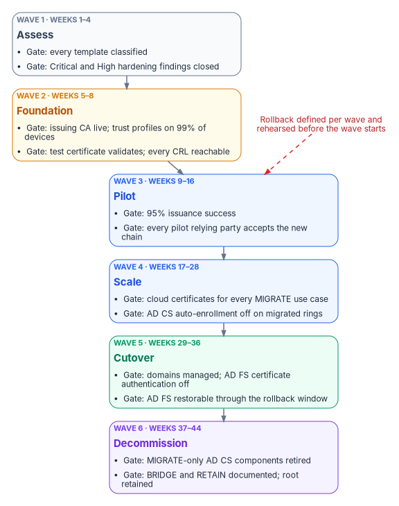

# Chapter 07 — Coexistence and Migration

*For most of the migration, both PKIs are production. The plan has to say which one each certificate comes from on any given day, and how to go back.*

::: {.callout-note}
## In this chapter
The coexistence architecture: what stays on AD CS until Active Directory itself retires (domain controller, LDAPS and other server certificates), how trust has to run in both directions between AD CS and the cloud, why CRL reachability is the most common cause of failure, and how renewals behave while two issuers overlap. Then the migration playbook as six waves, each with an entry gate, the work, an exit gate, a rollback and a planning duration.
:::

## Two PKIs, one estate

Coexistence isn't a phase at the end of the project; it's the condition the project runs in. From the day the first Cloud PKI certificate is issued until the last AD CS-dependent workload retires, devices carry certificates from both issuers, relying parties trust both chains, and two sets of CRLs have to stay reachable. [Chapter 06](06-device-and-user-certificates.md) showed what Intune and Entra ID can take over. This chapter covers the remainder and the order of the moves.

The program's coexistence rules:

1. **Each use case has one issuer at a time per population.** A device group gets its Wi-Fi certificate from AD CS or from Cloud PKI, never both by design; overlap happens only during the renewal window of a move.
2. **Trust goes up before issuance moves.** A relying party trusts the new chain before the first certificate from it is issued to anything that relying party sees.
3. **Revocation must be reachable wherever validation happens.** For every CA, someone can name the CRL URL each relying party uses, and that URL works from where the relying party sits.
4. **Nothing is revoked to force a move.** An AD CS certificate is replaced at renewal or expiry, not revoked early (the guide's own rule, which stands).
5. **Every move has a rollback that has been tested,** and the rollback doesn't depend on something the move itself retired.

{#fig-ch07-trust-directions fig-alt="Two clusters side by side. Left, slate, the on-premises Active Directory forest: AD CS with its offline root and enterprise issuing CAs; domain-joined relying parties such as RADIUS, VPN and mutual-TLS web servers; and, in amber, the NTAuth store of CAs allowed to issue logon certificates. Right, blue, the Microsoft cloud: Cloud PKI with a root and issuing CA or a BYOCA issuing CA; the Entra ID CBA trust store holding every CA in the user-certificate chain; and Intune-managed devices with trusted certificate profiles for both chains. Arrows: AD CS to the Entra ID trust store, labeled upload with internet CRL URLs. Cloud PKI to the domain-joined relying parties, labeled Group Policy or -dspublish RootCA. Cloud PKI to NTAuth, dashed amber, labeled only if it issues logon certificates. AD CS and Cloud PKI each to the Intune-managed devices, labeled trusted certificate profile. A red note pointing at AD CS: LDAP-only CRL locations fail for Entra ID and Entra-joined devices."}

## What stays on AD CS until Active Directory retires

### Domain controller certificates

Domain controller certificates stay on AD CS for as long as there are domain controllers. The guide's reason was that Cloud PKI can't issue the KDC Authentication EKU. The decisive reason is simpler and verifiable: Cloud PKI issues only to Intune-enrolled devices through SCEP, and Intune doesn't manage Windows Server.[^c07-cpki][^c07-intune-platforms] Domain controllers enroll through AD auto-enrollment, and that is how they renew.

Make sure the template is right before coexistence starts, because Microsoft Entra joined devices are less forgiving than domain-joined ones:

- **Use the Kerberos Authentication template, or a copy of it.** The older Domain Controller and Domain Controller Authentication templates don't include the KDC Authentication OID. A domain controller certificate for certificate-based sign-in must carry Client Authentication (`1.3.6.1.5.5.7.3.2`), Server Authentication (`1.3.6.1.5.5.7.3.1`) and KDC Authentication (`1.3.6.1.5.2.3.5`), the domain's DNS name in the SAN, and a CRL distribution point that points to a valid CRL (or an AIA pointing to an OCSP responder). Microsoft's guidance is to duplicate the Kerberos Authentication template with current cryptography and have it supersede the older domain controller templates, so auto-enrollment replaces them.[^c07-dc-certs]
- **Give it an HTTP CRL location.** Entra-joined devices can't read the CRL from Active Directory before they've authenticated, so an LDAP-only CDP on a domain controller certificate breaks their on-premises sign-in. Publish the CRL on an HTTP (not HTTPS) URL, listed first among the distribution points, and publish the delta CRL there too if the CA issues them.[^c07-aadj-sso]
- **Put the root on Entra-joined devices** with an Intune trusted certificate profile.[^c07-dc-pki]

Classify every domain controller template BRIDGE ([Chapter 02](02-what-ad-cs-holds-up.md) defines the classes). It retires with the last domain controller, not with the PKI migration.

### LDAPS

The guide said LDAPS certificates "for endpoints consumed by cloud services" could move to Cloud PKI. They can't: an LDAPS endpoint is a server, and Cloud PKI doesn't issue to servers.[^c07-cpki] LDAPS on domain controllers is enabled simply by installing a qualifying certificate: Server Authentication EKU, the domain controller's FQDN in the subject CN or a SAN DNS entry, a private key in the local computer store without strong private key protection, a key from the Schannel provider, and a chain both the domain controller and LDAPS clients trust. Active Directory checks the NTDS service's certificate store first and picks up a new certificate there without a restart; in the computer's Personal store, a domain controller that finds several qualifying certificates picks one at random.[^c07-ldaps][^c07-ldaps-3p]

During coexistence that has two consequences. The LDAPS certificate keeps renewing from AD CS, and every LDAPS *client* must trust that chain, including cloud-side components and appliances that bind to domain controllers. When an application migrates off LDAP ([Book 02, Chapter 04](../b02-identity/04-the-hidden-migration-surface.md) covers the LDAP adapter), remove it from the list of LDAPS clients; LDAPS itself ends with the domain controllers.

Which certificate serves LDAPS follows from the template rule above. Microsoft's LDAPS article enrolls the built-in Domain Controller template as its example,[^c07-ldaps] but the program supersedes that template, so LDAPS uses the domain controller certificate from the Kerberos Authentication copy. That certificate carries the Server Authentication EKU and the domain's DNS name in the SAN, which LDAPS needs.[^c07-dc-certs][^c07-ldaps] One difference needs a test: the LDAPS article lists a key from the Schannel provider among its requirements, while Microsoft's guidance for the Kerberos Authentication copy sets a Key Storage Provider. Before unpublishing the superseded templates, bind to one domain controller on port 636 with `ldp.exe` after it has enrolled the new certificate.[^c07-ldaps] If the bind fails, give the domain controllers a dedicated LDAPS certificate in the NTDS service store, which Active Directory checks first, and record the exception.

### Other server certificates

NPS and other RADIUS servers, Remote Desktop gateways, internal web servers, SQL Server ([Book 06, Chapter 22](../b06-data-platform/22-where-sql-server-touches-adcs.md)) and network appliances all need server certificates, and none of them is an Intune-managed device. They keep their AD CS-issued certificates during coexistence; internet-facing names use a public CA. [Chapter 04](04-the-target-pki.md) decides how they renew: certificates for internal names are requested and renewed through CyberArk Certificate Manager rather than by hand or by server autoenrollment, so each server moves off autoenrollment as it's onboarded to the platform. [Chapter 08](08-lifecycle-monitoring-and-decommissioning.md) covers that renewal engine in operation. Where the program needs certificate lifecycle tooling across servers and appliances, it uses its existing vendor, CyberArk, and CyberArk Certificate Manager, which CyberArk documents as discovering certificates across the enterprise and renewing them before they expire.[^c07-cyberark-names] The program consolidates on it rather than adding a second lifecycle vendor. Palo Alto Networks completed its acquisition of CyberArk on February 11, 2026,[^c07-panw] and now presents CyberArk Certificate Manager as Next-Generation Trust Security, which it describes as the evolution of the SaaS offering previously known as Venafi TLS Protect;[^c07-ngts] check the current product name in contract documents.

The NPS server certificate needs particular care during the Wi-Fi move. Clients validate it against the root they trust and, for wireless, expect the server's FQDN in its SAN;[^c07-eap-certs] the client certificates it validates change issuer when devices move to Cloud PKI. NPS must trust the Cloud PKI chain before the first pilot device gets a Cloud PKI Wi-Fi certificate (rule 2), and must keep trusting the AD CS chain until the last AD CS client certificate has expired.

## Trust in both directions

### AD CS chain into Entra ID

To let Entra CBA accept certificates issued by AD CS (smart card certificates, software user certificates, PIV certificates chaining through a Federal PKI bridge), upload the root and every intermediate and issuing CA to the Entra ID trust store, each with an internet-facing CRL URL ([Chapter 06](06-device-and-user-certificates.md)).[^c07-cba-howto] This is also what lets AD FS certificate authentication move to Entra ID without reissuing a single certificate.

### Cloud chain into the forest

Domain-joined machines that validate Cloud PKI certificates (RADIUS servers, VPN concentrators joined to the domain, web servers doing mutual TLS) need the Cloud PKI root, and for a BYOCA hierarchy every CA in the private chain plus the BYOCA issuing CA, which Microsoft says must be installed on all relying parties.[^c07-byoca] Two ways to get them there:

- **Group Policy:** import the certificate into *Computer Configuration > Policies > Windows Settings > Security Settings > Public Key Policies > Trusted Root Certification Authorities* in a GPO linked where the relying parties are.[^c07-gpo-dist] Microsoft documents an intermittent problem with this method when many root certificates are distributed by GPO: during policy refresh, applications can briefly see an incomplete root list and treat valid chains as untrusted; Microsoft's workarounds use other stores or Group Policy Preferences.[^c07-gpo-untrusted]
- **Active Directory publication:** `certutil -dspublish <file> RootCA` publishes a root to the directory's trusted root store for the forest.[^c07-certutil]

For a BYOCA hierarchy chained to the existing AD CS root, domain-joined machines already trust the root; they still need the intermediate and the BYOCA issuing CA in the intermediate store for chain building. That's one of the reasons [Chapter 04](04-the-target-pki.md) recommends BYOCA where an AD CS hierarchy and cross-forest trust already exist.

### NTAuth: only for logon certificates

A certificate used to sign in to AD (smart card logon or other certificate logon) must come from a CA in the forest's NTAuth store; enterprise CAs publish themselves there automatically, other CAs need `certutil -dspublish <file> NTAuthCA`.[^c07-ntauth][^c07-certutil] Wi-Fi, VPN and mTLS certificates don't need NTAuth. Publish a Cloud PKI or BYOCA issuing CA to NTAuth only if it will issue logon certificates for that forest, and then only for issuing CAs whose profiles produce strongly mapped user certificates ([Chapter 06](06-device-and-user-certificates.md)). Every NTAuth entry is a CA the forest lets mint logon credentials; [Chapter 03](03-hardening-what-stays.md) treats changes to it as a monitored event.

### More than one forest

Each forest has its own configuration partition, so each needs its own trust distribution (GPO or `-dspublish`) and, if applicable, its own NTAuth entry. Each forest's AD CS root that issues user certificates goes into the single Entra ID trust store. Where several PKIs serve different populations, Entra CBA's CA scoping can tie each CA to the group of users it's meant for.[^c07-cba-deep] The guide's phrase "trusted by Cloud PKI (via Entra upload)" conflated two things: Cloud PKI doesn't trust other CAs; Entra ID's CBA trust store does.

## CRL availability

Most coexistence outages are revocation outages. The relying parties now sit in three places (inside the network, on the internet, and in Entra ID), and each CA's CRL must be reachable from all three where its certificates are validated.

| CA | Where its CRL lives | Who must reach it | Watch for |
|---|---|---|---|
| Cloud PKI root and issuing CAs | Hosted by Intune; valid seven days, republished every 3.5 days and on each revocation[^c07-cpki] | Every relying party that validates Cloud PKI certificates, including on-premises RADIUS and VPN | Outbound HTTP from RADIUS and VPN servers to the Intune-hosted CDP and AIA |
| BYOCA issuing CA | Hosted by Intune, like other Cloud PKI CAs[^c07-cpki] | As above | The *parent* CRLs and AIA come from the private CA; AD CS defaults to an LDAP AIA location[^c07-byoca] |
| AD CS root and issuing CAs (user certificates for Entra CBA) | Wherever the CA publishes: often LDAP plus an internal HTTP URL | Entra ID, over the internet; one HTTP or HTTPS URL per CA, HTTP recommended; no OCSP, no LDAP[^c07-crl] | Internal-only URLs; CRLs over 20 MB (commercial and GCC) or 45 MB (Azure Government) for interactive sign-in[^c07-crl] |
| AD CS CAs behind domain controller certificates | As above | Entra-joined devices signing in on-premises, without authentication | LDAP-only CDPs; publish an HTTP CDP first[^c07-aadj-sso] |

: Where each CRL must be reachable during coexistence {.striped .hover}

Fixing an AD CS CDP means two things. Add an HTTP distribution point that's reachable from the internet (a highly available web server or content delivery network; Microsoft recommends HTTP over HTTPS to avoid a circular dependency), and recognize that the new URL appears only in certificates issued *after* the change. Entra ID uses the CRL URL configured on the CA in its trust store, not the one inside each certificate,[^c07-cba-howto] so Entra CBA works as soon as the trust store points at the published CRL; other relying parties that read the CDP from the certificate keep failing until the certificate renews. The guide suggested Microsoft Entra application proxy for publishing an internal CRL; the program publishes CRLs on plain anonymous HTTP endpoints instead, because Entra ID must download the CRL without authentication within 10 seconds and fails the sign-in if it can't.[^c07-crl]

Entra ID doesn't support OCSP (the guide said it did), so OCSP responders matter only to on-premises relying parties that use them.[^c07-crl]

## Renewal while two issuers overlap

The guide's renewal rules stand, with two corrections:

- **Existing AD CS certificates renew through auto-enrollment** until their population moves. Don't revoke early.
- **New Intune-enrolled devices get the Cloud PKI certificate** for every use case already moved, from their first check-in.
- **A population moves at the profile assignment, and the old certificate leaves at its renewal.** Remove the AD CS auto-enrollment permission or GPO link for that use case only after the population holds valid Cloud PKI certificates and the relying parties have accepted them.
- **Lifetimes.** The guide said to set Cloud PKI validity at or above the remaining AD CS validity to avoid gaps. The gap that matters is between a device getting its new certificate and losing its old one, so the program's rule is different: keep the AD CS certificate valid until the Cloud PKI one is in use, which the auto-enrollment rule above already does. Set Cloud PKI leaf lifetimes by policy; Intune SCEP and PKCS profiles shouldn't go below five days, because a certificate that close to expiry can be rejected on install.[^c07-scep-infra]
- **Removing a profile revokes.** When a SCEP profile assignment is removed from a group, or a device leaves the assigned group, Intune revokes and removes the SCEP certificate on Windows, iOS/iPadOS and macOS.[^c07-intune-remove] A rollback that "falls back to AD CS certificates" only works if those certificates still exist, which is another reason auto-enrollment stays on until a wave's exit gate.
- **Issuing CA renewal.** Cloud PKI now supports in-place renewal of eligible issuing CAs, so issuance continues without editing SCEP profiles or assignments.[^c07-cpki-renew] Plan it in the CA lifecycle calendar ([Chapter 08](08-lifecycle-monitoring-and-decommissioning.md)) rather than at the deadline.

## The migration playbook

The guide's six phases stand as six waves. Each has an entry gate (the previous wave's exit gate), the work, an exit gate, a rollback and a planning duration. Durations are the program's planning figures for a single-forest estate, not commitments; scale them to the inventory from wave 1.

{#fig-ch07-migration-waves fig-alt="Six cards from top to bottom. Wave 1, slate, Assess, weeks 1 to 4: gate, every template classified and Critical and High hardening findings closed. Wave 2, amber, Foundation, weeks 5 to 8: gate, issuing CA live, trust profiles at 99 percent of managed devices, test certificate validates. Wave 3, blue, Pilot, weeks 9 to 16: gate, 95 percent issuance success and every pilot relying party accepts the new chain. Wave 4, blue, Scale, weeks 17 to 28: gate, every managed device holds cloud certificates for MIGRATE use cases. Wave 5, green, Cutover, weeks 29 to 36: gate, domains managed, AD FS certificate authentication off, no AD CS certificates left for MIGRATE use cases. Wave 6, violet, Decommission, weeks 37 to 44: gate, MIGRATE-only AD CS components retired, BRIDGE and RETAIN documented. A red text note beside the waves: rollback is defined per wave and is tested before the wave starts."}

| Wave | Weeks | Exit gate in one line |
|---|---|---|
| 1 Assess | 1–4 | Every template classified; Critical and High hardening findings remediated and re-tested |
| 2 Foundation | 5–8 | Cloud issuing CA live, trust deployed, test certificate validates everywhere |
| 3 Pilot | 9–16 | Pilot devices and users authenticate with cloud-issued certificates and Entra CBA |
| 4 Scale | 17–28 | Every managed device has cloud certificates for MIGRATE use cases |
| 5 Cutover | 29–36 | Federated domains managed; AD FS certificate authentication off |
| 6 Decommission | 37–44 | AD CS components serving only MIGRATE workloads retired |

: Migration waves and exit gates {.striped .hover}

### Wave 1 — Assess (weeks 1–4)

**Entry gate.** Read access to the CA servers and the forest's configuration partition, and the AD and AD CS management tools on an administrative workstation.

**Work.**

1. Inventory every CA: name, host, key algorithm and length, signature algorithm, validity, and whether it's a root.
2. Export every certificate template's configuration and permissions.
3. Run the hardening and detection checklist in [Chapter 03](03-hardening-what-stays.md) against templates, CA settings and PKI object ACLs.
4. Inventory issued, unexpired certificates by template, with expiry dates.
5. Classify every template MIGRATE, BRIDGE, RETAIN or RETIRE ([Chapter 02](02-what-ad-cs-holds-up.md); [Appendix B](appendix-b-template-migration-matrix.md) is the starting matrix).
6. List every relying party (RADIUS, VPN, Wi-Fi controllers, web applications, appliances, AD FS) and the chains and CRLs each one uses.
7. Run the strong-mapping event sweep on every domain controller and list certificates that fail it ([Chapter 06](06-device-and-user-certificates.md)).
8. Remediate Critical and High hardening findings first.
9. Commit the assessment record to the program's evidence repository.

The guide's PowerShell assessment module (its Appendix C) automated steps 1–5. It remains in the archive pending a technical review and isn't reproduced in this book; use it only after that review, or use the read-only checks in Chapter 03.

**Exit gate.** Assessment approved by the PKI owner and the security team ([Chapter 05](05-who-owns-the-certificate-estate.md)); no unclassified templates; every Critical and High finding remediated and re-tested, which is [Chapter 03](03-hardening-what-stays.md)'s migration gate.

**Rollback.** None needed: the wave reads, it doesn't change. The remediations in step 8 have their own change records and rollbacks.

### Wave 2 — Foundation (weeks 5–8)

**Entry gate.** Wave 1 exit gate. Cloud PKI entitlement confirmed for the tenant ([Chapter 06](06-device-and-user-certificates.md)). Users and devices synced with their on-premises SIDs, for any certificate that will be used against AD. For BYOCA, the private root or signing CA available for the signing ceremony.

**Work.**

1. Create the Cloud PKI CAs: a root and issuing CA, or a BYOCA issuing CA whose request is signed with the Subordinate Certification Authority template on the private CA.[^c07-byoca] Use licensed (HSM-backed) keys, not a trial.
2. For BYOCA, export the full chain and confirm the private CA's CRL and AIA locations are reachable over HTTP from where relying parties sit; replace LDAP-only AIA if necessary.
3. Install or update the Certificate Connector (current release) on its own servers if any BRIDGE workload still needs SCEP from AD CS or PKCS ([Chapter 06](06-device-and-user-certificates.md)).
4. Upload every CA that will issue user certificates to the Entra ID trust store with its CRL URL.
5. Deploy Intune trusted certificate profiles for the cloud chain to all managed devices, per platform.
6. Deploy the cloud chain to domain-joined relying parties (Group Policy or `-dspublish`). Publish to NTAuth only if a cloud CA will issue logon certificates.
7. Issue a test certificate to a test device and validate it on every relying party type.
8. Check each CRL and AIA URL from inside the network, from the internet, and through the Entra ID sign-in log of a test CBA sign-in.

**Exit gate.** Issuing CA active; trusted certificate profiles successful on at least 99% of managed devices; connector healthy in the admin center; test certificate validated by every relying party type; every CRL reachable from all three locations.

**Rollback.** Unassign the trusted certificate profiles and remove the cloud chain from the GPO or directory; remove the new CAs from the Entra ID trust store; uninstall or stop the connector. AD CS is unchanged throughout. Deleting a Cloud PKI CA is a last step, because the tenant can hold only three CAs and a re-created CA has new keys.[^c07-cpki]

**Duration.** Four weeks.

### Wave 3 — Pilot (weeks 9–16)

**Entry gate.** Wave 2 exit gate. A pilot device group (50–100 devices across platforms and sites) and a pilot user group defined as cloud security groups. Every pilot relying party trusts the cloud chain.

**Work.**

1. Assign a SCEP profile for Wi-Fi 802.1X to the pilot devices, with the SID URI attribute where the certificate will be used against AD.
2. Confirm on a sample of devices: certificate issued, chain valid, SID URL present where expected.
3. Test Wi-Fi, then VPN, with the cloud-issued certificates.
4. Enable the CBA method and staged rollout for the pilot users ([Chapter 06](06-device-and-user-certificates.md)), within staged rollout's limits: no nested or dynamic groups, at most 10 groups per feature, 200 users when a group is first added.[^c07-sro]
5. Test Entra CBA sign-in: in the sign-in log, confirm the certificate binding and authentication level, and that Conditional Access accepted the strength.
6. Watch the Intune certificate reports and the Entra sign-in logs throughout; route failures to the troubleshooting runbook ([Chapter 08](08-lifecycle-monitoring-and-decommissioning.md)).

AD CS auto-enrollment stays on for pilot devices throughout the wave. That's what makes the rollback work.

**Exit gate.** At least 95% issuance success on pilot devices; no authentication failures caused by certificate configuration; pilot users authenticating with CBA at the intended authentication level; every pilot relying party accepting cloud-issued certificates. These are the program's thresholds.

**Rollback.** Remove the pilot SCEP profile assignments. Intune revokes and removes the cloud certificates,[^c07-intune-remove] and devices fall back to the AD CS certificates they still hold. Remove the pilot groups from staged rollout; users return to federated sign-in after one more interactive sign-in, and users who signed in to Windows with a certificate should stay enabled for the CBA method long enough to refresh their primary refresh token through the federation server.[^c07-sro]

**Duration.** Eight weeks.

### Wave 4 — Scale (weeks 17–28)

**Entry gate.** Wave 3 exit gate. Dynamic groups for certificate targeting built from governed attributes. Every relying party in scope trusts the cloud chain.

**Work.**

1. Extend SCEP profiles to production device groups in rings (by site, region, department or device tier).
2. Deploy PKCS and imported PKCS profiles for S/MIME and the remaining application-specific certificates.
3. Extend staged rollout to further user populations as the sign-in data supports. Staged rollout is a test mechanism with a 10-group limit, not a way to run a permanent mixed state;[^c07-sro] if the populations don't fit, cut over domain by domain (wave 5) rather than stretching staged rollout.
4. Confirm coverage on each platform: Windows, iOS/iPadOS, Android and macOS.
5. Track two populations per use case: devices holding both AD CS and cloud certificates (expected during the wave), and devices holding only cloud certificates (the target).
6. For each ring whose devices hold valid cloud certificates and whose relying parties have accepted them, remove AD CS auto-enrollment for the MIGRATE templates that ring used.

**Exit gate.** Every managed device holds cloud-issued certificates for its MIGRATE use cases; all users intended for Entra CBA are on it, by staged rollout or by a converted domain; AD CS auto-enrollment for MIGRATE templates removed on every migrated ring.

**Rollback.** Per ring: re-link the auto-enrollment GPO or restore the template permission so AD CS certificates are issued again at the next policy refresh, then remove that ring's SCEP assignment. For users: remove the groups from staged rollout.

**Duration.** Twelve weeks.

### Wave 5 — Cutover (weeks 29–36)

**Entry gate.** Wave 4 exit gate. All users in each domain to be converted validated on Entra CBA.

**Work.**

1. Confirm there are no unexpired AD CS certificates left on managed devices for MIGRATE use cases.
2. Record each federated domain's configuration with `Get-MgDomainFederationConfiguration`, export the Microsoft 365 relying party trust and claim rules, and back up the AD FS farm.[^c07-fed-migrate]
3. Convert each domain with `Update-MgDomain -DomainId <domain> -AuthenticationType "Managed"`, starting with a test domain or the domain with the fewest users, and confirm with `Get-MgDomain`.[^c07-fed-migrate][^c07-mig-best]
4. Remove staged rollout groups for converted domains.
5. Turn off AD FS certificate authentication for any relying parties that stay on AD FS.
6. Keep AD FS restorable but out of the sign-in path for the rollback window (the program uses 30 days).
7. Keep BRIDGE templates on AD CS: domain controllers, LDAPS, NPS and other servers.
8. Revise AD CS operating procedures to cover BRIDGE and RETAIN scope only.

**Exit gate.** All target domains managed; AD FS certificate authentication off; Entra CBA working for all users; no AD CS certificates on managed endpoints for MIGRATE templates. Before AD FS is decommissioned, Microsoft's guidance is to observe application usage for at least a week with Entra Connect Health and the sign-in logs.[^c07-adfs-decom]

**Rollback.** Re-federate the domain with `New-MgDomainFederationConfiguration` from the recorded configuration and restore the claim rules;[^c07-fed-migrate] bring AD FS back into the path; re-link the auto-enrollment GPOs for any ring whose certificates must come back. The program's recovery objective is four hours, which is achievable only while the AD FS farm is restorable, hence step 6.

**Duration.** Eight weeks.

### Wave 6 — Decommission (weeks 37–44)

**Entry gate.** Wave 5 exit gate; rollback window closed with no incidents; BRIDGE and RETAIN workloads documented and running.

**Work.** Retire the AD CS components that served only MIGRATE workloads: NDES and connector servers no longer needed, CES/CEP servers, auto-enrollment GPOs for retired templates, and issuing CAs whose remaining certificates have all expired or been superseded. Archive each retired CA's database and keys, keep publishing its final CRL for as long as its certificates could still be validated, and remove its enrollment service object from the directory. Keep the offline root under its documented recovery procedures. [Chapter 08](08-lifecycle-monitoring-and-decommissioning.md) gives the decommissioning procedure step by step.

Two corrections to the guide's version of this wave:

- **The BYOCA case.** The guide said "don't revoke" under BYOCA, which is right but incomplete. The BYOCA issuing CA's certificate was signed by a CA in the private hierarchy, and that CA's CRL is what relying parties check for it. Whichever private CA signed the BYOCA certificate must stay, and keep publishing CRLs, for as long as the BYOCA issuing CA is in use. [Chapter 04](04-the-target-pki.md) recommends signing the BYOCA request with the offline root for exactly this reason: the root outlives the issuing CAs.
- **The cloud-root case.** The guide said to revoke the AD CS issuing CA's certificate from the root when Cloud PKI has its own root. Revoke only after every certificate the issuing CA issued has expired or been revoked and no BRIDGE or RETAIN workload depends on that issuing CA, and publish the root's CRL afterward. Revoking a still-used issuing CA breaks every certificate under it.

**Exit gate.** MIGRATE-only AD CS components retired or archived; offline root retained and documented; no orphaned auto-enrollment GPOs; decommission record committed to the evidence repository.

**Rollback.** Restore the issuing CA from its backup, rejoin it, republish its templates and re-link its GPOs. The program plans eight to twelve hours for a full CA restoration, which is why backups are tested before this wave starts.

**Duration.** Eight weeks.

## Rollback rules that hold across waves

- A wave doesn't start until its rollback has been rehearsed in a test scope.
- No wave's rollback depends on a component the same wave retires. Auto-enrollment, AD FS and the AD CS issuing CAs each stay restorable until the wave after the one that stopped using them.
- Removing a SCEP profile assignment revokes the certificates it issued on Windows, iOS/iPadOS and macOS, and so does editing the profile.[^c07-intune-remove] Treat profile changes and unassignment as changes with impact, not as a harmless undo.
- Staged rollout changes for existing groups can take up to 24 hours,[^c07-sro] so a user rollback isn't instant; plan the communication accordingly.

For the federal policy context behind the move to phishing-resistant, certificate-based sign-in, see the Federal Compliance book on [certificates, tokens and cryptographic identity](https://github.com/WhalerMike/modernization-workbook/blob/main/docs/compliance/Vol_I_Book_03_Certificates_Tokens_Cryptographic_Identity.md).

::: {.callout-tip}
## Continue the book
[← Previous: Chapter 06 — Device and User Certificates: Intune and Entra CBA](06-device-and-user-certificates.md) · [Book index](index.md) · [Next: Chapter 08 — Lifecycle, Monitoring and Decommissioning →](08-lifecycle-monitoring-and-decommissioning.md)
:::

[^c07-cpki]: Microsoft Learn, "Overview of Microsoft Cloud PKI for Microsoft Intune" (prerequisites, features, known issues and limitations), <https://learn.microsoft.com/intune/cloud-pki/> (accessed Oct 20, 2026).
[^c07-intune-platforms]: Microsoft Learn, "Operating systems and browsers supported by Microsoft Intune," <https://learn.microsoft.com/intune/fundamentals/ref-supported-platforms> (accessed Oct 20, 2026).
[^c07-dc-certs]: Microsoft Learn, "On-premises certificate trust deployment guide," Configure domain controller certificates and supersede existing domain controller certificates, <https://learn.microsoft.com/windows/security/identity-protection/hello-for-business/deploy/on-premises-cert-trust#configure-the-enterprise-pki> (accessed Oct 20, 2026).
[^c07-aadj-sso]: Microsoft Learn, "Configure single sign-on for Microsoft Entra joined devices," CRL distribution point and domain controller certificates, <https://learn.microsoft.com/windows/security/identity-protection/hello-for-business/hello-hybrid-aadj-sso#prerequisites> (accessed Oct 20, 2026).
[^c07-dc-pki]: Microsoft Learn, "Configure and validate the PKI in a hybrid certificate trust model," Configure the enterprise PKI, <https://learn.microsoft.com/windows/security/identity-protection/hello-for-business/deploy/hybrid-cert-trust-pki#configure-the-enterprise-pki> (accessed Oct 20, 2026).
[^c07-ldaps]: Microsoft Learn, "Configure certificates for LDAP over SSL in Active Directory Domain Services," <https://learn.microsoft.com/windows-server/identity/ad-ds/configure-ldap-signing-certificates> (accessed Oct 20, 2026).
[^c07-ldaps-3p]: Microsoft Learn, "Enable LDAP over SSL with a third-party certification authority," Requirements for an LDAPS certificate and Improvements, <https://learn.microsoft.com/troubleshoot/windows-server/active-directory/enable-ldap-over-ssl-3rd-certification-authority> (accessed Oct 20, 2026).
[^c07-cyberark-names]: CyberArk, "CyberArk Certificate Manager - Self-Hosted Introduction," <https://docs.venafi.com/Docs/current/TopNav/Content/Products/c-tls-protect-landing.php> (accessed Oct 20, 2026).
[^c07-panw]: Palo Alto Networks, press release, "Palo Alto Networks Completes Acquisition of CyberArk to Secure the AI Era," February 11, 2026, Form 8-K Exhibit 99.1, <https://www.sec.gov/Archives/edgar/data/1327567/000119312526045600/d40626dex991.htm> (accessed Oct 20, 2026).
[^c07-ngts]: Palo Alto Networks, "CyberArk Certificate Manager is now Next-Generation Trust Security," <https://www.paloaltonetworks.com/network-security/next-gen-trust-security/certificate-manager> (accessed Oct 20, 2026).
[^c07-eap-certs]: Microsoft Learn, "Certificate requirements when you use EAP-TLS or PEAP with EAP-TLS," <https://learn.microsoft.com/troubleshoot/windows-server/networking/certificate-requirements-eap-tls-peap> (accessed Oct 20, 2026).
[^c07-cba-howto]: Microsoft Learn, "Set up Microsoft Entra certificate-based authentication," Step 1, Configure the CAs with a PKI-based trust store, <https://learn.microsoft.com/en-us/entra/identity/authentication/how-to-certificate-based-authentication> (accessed Oct 20, 2026).
[^c07-byoca]: Microsoft Learn, "Configure Microsoft Cloud PKI - Bring your own CA," <https://learn.microsoft.com/intune/cloud-pki/configure-byoca> (accessed Oct 20, 2026).
[^c07-gpo-dist]: Microsoft Learn, "Distribute certificates to Windows devices by using Group Policy," <https://learn.microsoft.com/windows-server/identity/ad-cs/distribute-certificates-group-policy> (accessed Oct 20, 2026).
[^c07-gpo-untrusted]: Microsoft Learn, "Valid root CA certificates distributed using GPO might intermittently appear as untrusted," <https://learn.microsoft.com/troubleshoot/windows-server/certificates-and-public-key-infrastructure-pki/valid-root-ca-certificates-untrusted> (accessed Oct 20, 2026).
[^c07-certutil]: Microsoft Learn, "certutil," -dsPublish, <https://learn.microsoft.com/windows-server/administration/windows-commands/certutil#parameters> (accessed Oct 20, 2026).
[^c07-ntauth]: Microsoft Learn, "How to import third-party certification authority (CA) certificates into the Enterprise NTAuth store," <https://learn.microsoft.com/troubleshoot/windows-server/certificates-and-public-key-infrastructure-pki/import-third-party-ca-to-enterprise-ntauth-store> (accessed Oct 20, 2026).
[^c07-cba-deep]: Microsoft Learn, "Microsoft Entra certificate-based authentication technical concepts," Certificate Authority (CA) Scoping, <https://learn.microsoft.com/en-us/entra/identity/authentication/concept-certificate-based-authentication-technical-deep-dive> (accessed Oct 20, 2026).
[^c07-crl]: Microsoft Learn, "Understand Microsoft Entra certificate-based authentication Certificate revocation list," <https://learn.microsoft.com/en-us/entra/identity/authentication/concept-certificate-based-authentication-certificate-revocation-list> (accessed Oct 20, 2026).
[^c07-scep-infra]: Microsoft Learn, "Configure infrastructure to support SCEP with Intune," Modify the validity period of the certificate template, <https://learn.microsoft.com/intune/fundamentals/certificates/scep-infrastructure> (accessed Oct 20, 2026).
[^c07-intune-remove]: Microsoft Learn, "Remove SCEP or PKCS certificates in Microsoft Intune," <https://learn.microsoft.com/intune/device-configuration/certificates/remove-profiles> (accessed Oct 20, 2026).
[^c07-cpki-renew]: Microsoft Learn, "What's new in Microsoft Intune," week of June 8, 2026 (service release 2605), In-place renewal of Cloud PKI issuing certification authorities, <https://learn.microsoft.com/intune/whats-new/> (accessed Oct 20, 2026).
[^c07-sro]: Microsoft Learn, "Microsoft Entra Connect: Cloud authentication via Staged Rollout," <https://learn.microsoft.com/en-us/entra/identity/hybrid/connect/how-to-connect-staged-rollout> (accessed Oct 20, 2026).
[^c07-fed-migrate]: Microsoft Learn, "Migrate from federation to cloud authentication" (document and back up federation settings; plan the rollback; convert domains from federated to managed), <https://learn.microsoft.com/entra/identity/hybrid/connect/migrate-from-federation-to-cloud-authentication> (accessed Oct 20, 2026).
[^c07-mig-best]: Microsoft Learn, "Best practices to migrate applications and authentication to Microsoft Entra ID," Staged authentication migration testing and cutover, <https://learn.microsoft.com/entra/architecture/migration-best-practices#migrate-authentication> (accessed Oct 20, 2026).
[^c07-adfs-decom]: Microsoft Learn, "Active Directory Federation Services (AD FS) decommission guide," Pre-requisites for decommissioning AD FS servers, <https://learn.microsoft.com/windows-server/identity/ad-fs/decommission/adfs-decommission-guide#pre-requisites-for-decommissioning-ad-fs-servers> (accessed Oct 20, 2026).
