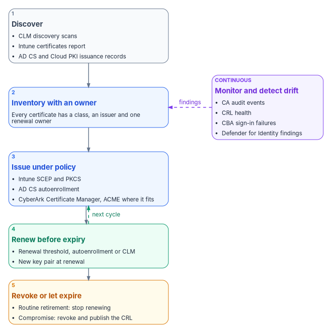
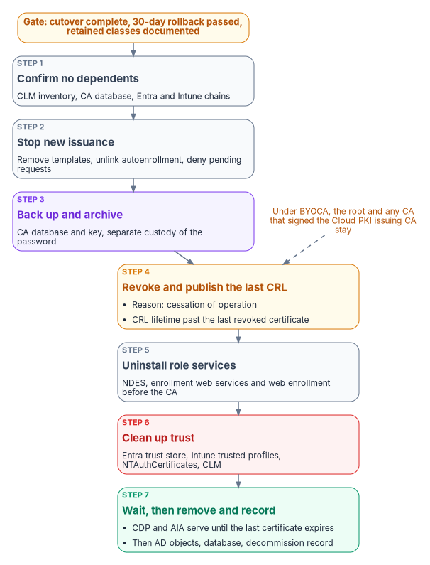

# Chapter 08 — Lifecycle, Monitoring and Decommissioning

*A certificate estate fails at its next expiry or its next stale CRL, so after the migration the work is keeping every certificate owned, renewed and checkable, and retiring the old CAs without stranding a single one.*

::: {.callout-note}
## In this chapter
Renewal at scale as publicly trusted TLS lifetimes fall to 47 days, the three renewal engines in the target, ACME where it applies, and inventory and renewal through CyberArk Certificate Manager. Revocation and the availability of CRLs, including what Entra CBA does and doesn't check. Monitoring sources, compliance checks and drift patterns, a troubleshooting reference, the AD CS decommissioning sequence, and the NIST SP 800-53 evidence an assessor reads for IA-5(2), SC-12 and SC-17.
:::

Migration ends on a date. Certificates don't. Every certificate issued during the migration ([Chapter 06](06-device-and-user-certificates.md)) and every one carried across the coexistence period ([Chapter 07](07-coexistence-and-migration.md)) will reach its expiry date, and every CA that issued it must keep publishing a CRL that relying parties can reach until then. The failure modes are well known: an expiry nobody owned, a certificate nobody inventoried, a key reused across renewals. The [Federal Compliance book on certificates and tokens](https://github.com/WhalerMike/modernization-workbook/blob/main/docs/compliance/Vol_I_Book_03_Certificates_Tokens_Cryptographic_Identity.md) describes them in its "Certificate Lifecycle Automation" sections, along with the argument that manual renewal can't keep up. This chapter is the operating detail for the target in this book. [Chapter 05](05-who-owns-the-certificate-estate.md) names who owns each part.

{#fig-ch08-lifecycle-loop fig-alt="A vertical flow of five cards with a monitoring card beside it. Discover, in slate: CLM discovery scans, the Intune certificates report, and AD CS and Cloud PKI issuance records. Inventory with an owner, in blue: every certificate has a class, an issuer and one renewal owner. Issue under policy, in blue: Intune SCEP and PKCS, AD CS autoenrollment, and CyberArk Certificate Manager with ACME where the endpoint supports it. Renew before expiry, in green: the Intune renewal threshold, autoenrollment and CLM renewal, each with a new key pair. Revoke or let expire, in amber: routine retirement by non-renewal, and revocation published to the CRL for compromise. A violet monitoring card, listing CA audit events, CRL health, CBA sign-in failures, Defender for Identity findings and drift, has dashed arrows back to the inventory card. An arrow also loops from renew back to issue."}

## Renewal at scale as lifetimes shrink

On April 11, 2025, the CA/Browser Forum adopted ballot SC-081v3, which reduces the maximum validity of publicly trusted TLS certificates from 398 days in steps from March 2026 to March 2029.[^c08-cabf-ballot] Under the Baseline Requirements, the maximum validity is 200 days from March 15, 2026, 100 days from March 15, 2027, and 47 days from March 15, 2029.[^c08-cabf-br] As of this writing, the first step is in force. The schedule binds publicly trusted certificates, not internal CAs. The program aligns internal lifetimes with it anyway, profile by profile, as renewal automation proves itself. An estate built to renew a certificate every 47 days can absorb shorter internal lifetimes. An estate that can't renew automatically can't absorb either.

The arithmetic leads to one design rule: no certificate class may depend on a person remembering a date. The target has three renewal engines, and every class in [Chapter 05](05-who-owns-the-certificate-estate.md) runs through one of them.

| Engine | Covers | How renewal works | What to watch |
|---|---|---|---|
| Intune certificate profiles | User and device certificates on Intune-managed devices, from Cloud PKI or AD CS | The device requests renewal when the remaining lifetime falls to the profile's renewal threshold. For example, a threshold of 20 means renewal at 80 percent of the lifetime. SCEP renewal generates a new key pair.[^c08-scep] | On iOS, iPadOS and macOS, renewal happens only inside the threshold window and the device must be unlocked while it syncs. A failed renewal leaves the expired certificate on the device, and Intune doesn't retry.[^c08-scep] |
| AD CS autoenrollment | Domain controller certificates, which also serve LDAPS | Group Policy and template permissions drive renewal on domain-joined machines ([Chapter 02](02-what-ad-cs-holds-up.md)) | The CA must stay online and its CRL current for as long as the class exists |
| CyberArk Certificate Manager | Server TLS from retained AD CS, including NPS and RADIUS servers ([Chapter 04](04-the-target-pki.md) makes that decision); appliances, public TLS, network devices | The platform discovers certificates, tracks them and renews them before they expire, through its CA integrations and its ACME service[^c08-cyberark-sh] | Every certificate needs a Server Owner, and the platform's CA account needs a deliberately scoped set of templates ([Chapter 05](05-who-owns-the-certificate-estate.md)) |

### ACME where it applies

ACME, the Automatic Certificate Management Environment protocol in RFC 8555, lets a client prove control of a name and obtain a certificate with no person in the loop. It defines the `http-01` and `dns-01` challenges for that proof.[^c08-rfc8555] It fits web listeners, load-balanced services and anything else with a resolvable name and a client that can complete a challenge. It doesn't fit managed endpoints, which already renew through Intune, or devices that can't run a client.

Neither Microsoft issuer in the target offers ACME. Cloud PKI's only enrollment path is its SCEP registration authority for Intune-managed devices.[^c08-cpki] The program provides ACME through CyberArk Certificate Manager (now part of Palo Alto Networks), the program's single lifecycle tool. Its self-hosted edition includes an ACME service. CyberArk documents support for `http-01` and `dns-01` challenges, says the implementation was designed and tested with the certbot, win-acme and acme.sh clients, and warns that other clients may run into unsupported parts of the protocol.[^c08-cyberark-acme] One limit matters for federal deployments: CyberArk documents that using win-acme requires FIPS mode to be disabled on the CyberArk server.[^c08-cyberark-acme] Where the server must run in a FIPS-approved mode, use one of the other tested clients. The `dns-01` challenge makes the authoritative DNS zone the gate for automated issuance. The [Federal Compliance book](https://github.com/WhalerMike/modernization-workbook/blob/main/docs/compliance/Vol_I_Book_03_Certificates_Tokens_Cryptographic_Identity.md) develops that point, and it's why the DNS team is consulted on ACME rollout.

### Inventory and renewal through CyberArk Certificate Manager

The CLM platform is where the inventory lives for every certificate Intune doesn't manage. CyberArk Certificate Manager, Self-Hosted automates the provisioning, discovery, monitoring, validation and management of keys and certificates, and it supports multiple CAs.[^c08-cyberark-sh] For AD CS it uses a Microsoft CA template object. That requires Microsoft CA support to be installed and an account with Read, Issue and Manage Certificates, and Request Certificates permissions on the CA.[^c08-cyberark-msca] Since Palo Alto Networks acquired CyberArk, the SaaS edition has been marketed as Next-Generation Trust Security. The self-hosted edition continues under its own name.[^c08-pan-ngts] The program's operating model is the same on either edition.

In the program's model, the platform answers three questions for every certificate it finds: which class it belongs to, who owns its renewal, and whether an issuance record explains it. A certificate on a listener with no enrollment record and no owner is a finding. It's either shadow infrastructure or an unauthorized issuance, and the [Federal Compliance book](https://github.com/WhalerMike/modernization-workbook/blob/main/docs/compliance/Vol_I_Book_03_Certificates_Tokens_Cryptographic_Identity.md) treats it as drift by definition. The platform also reports any certificate that comes within two renewal windows of expiry with no renewal path bound to it. That's an incident while it can still be fixed, not on the day it expires.

## Revocation and CRL availability

Revocation is the part of the lifecycle that fails silently. Microsoft's AD CS guidance is plain about why. Revocation doesn't take effect everywhere at once. Relying parties keep trusting a certificate until they fetch a newer CRL from a location they can reach, and if publication or distribution breaks, a revoked certificate can stay usable.[^c08-adcs-revoke] Short lifetimes change the balance. Most retirements become non-renewals, and revocation is left for compromise. But they don't remove the need for CRLs that work.

### Operating the CRLs that stay

For each CA that stays, the PKI administrators run CRL publication as a production service.

- **Publish before expiry, and plan the overlap.** A base CRL must be published before it expires and be available at every retrieval endpoint. A delta CRL complements a base CRL but doesn't replace it. Overlap must cover the real end-to-end delay of publication, replication, transfer and client reachability. Microsoft recommends sizing these intervals from measurements rather than adopting another organization's schedule.[^c08-adcs-revoke]
- **Treat the offline root as a ceremony.** For an offline root, Microsoft advises against delta CRLs unless a documented requirement justifies them. Instead it recommends a scheduled, witnessed process that publishes a new base CRL, transfers it to every retrieval endpoint, and verifies it from the networks that depend on the root.[^c08-adcs-revoke]
- **Monitor the delivery chain, not just the CA.** A CA that generated a CRL hasn't proved the web endpoint is serving it. Verify that each HTTP endpoint serves a current, complete and readable file, and alert before the CRL reaches its next-update time.[^c08-adcs-revoke]
- **Never strand an old CDP.** Changing a CDP URL affects only certificates issued after the change. Keep the old endpoint and its current CRL available until no unexpired certificate, including a long-lived CA certificate, references it.[^c08-adcs-revoke]
- **Use the right reason code.** Use *key compromise* or *CA compromise* for incidents, *superseded* for replacements, and *cessation of operation* for retired services. *Certificate hold* is the only reason that can be reversed.[^c08-adcs-revoke]

Enterprise PKI (PKIView) gives an early-warning view of CA certificate and CRL health across the forest's Windows CAs, with warnings for failed validation or approaching expiry. Microsoft notes that it doesn't replace end-to-end validation from a relying party.[^c08-pkiview]

### What Entra CBA checks

Entra CBA has its own revocation rules, and they shape the CRL design for any CA it trusts. [Book 03, Chapter 09](../b03-hr-identity/09-credentials-and-certificates.md) covers caching and the **Require CRL validation** setting.

- Each trusted CA supports one CRL distribution point, which must be an HTTP or HTTPS URL. Entra CBA doesn't support OCSP or LDAP URLs.[^c08-cba-overview] Microsoft recommends HTTP rather than HTTPS for the CRL, to minimize latency and avoid a circular dependency on certificate validation.[^c08-cba-crl]
- The largest CRL Entra ID downloads during an interactive sign-in is 20 MB in public Microsoft Entra ID and 45 MB in the Azure US Government clouds, and the download must finish within 10 seconds. If Entra can't download the CRL, CBA fails for every certificate that CA issued.[^c08-cba-crl] Keep lifetimes reasonable and clean up expired certificates so that CRLs stay inside those limits.[^c08-cba-crl]
- If a CA is uploaded without a CRL URL, authentication with that CA's revoked certificates doesn't fail.[^c08-cba-ca]

Cloud PKI hosts its own CRLs. Each CRL is valid for seven days, republished every 3.5 days, and updated with every revocation.[^c08-cpki] One Cloud PKI trap belongs in every runbook. If you revoke a certificate by hand while the user or device still has an active SCEP profile assignment, the device requests and gets a new certificate at its next check-in. Remove the SCEP assignments first.[^c08-cpki-monitor]

## Monitoring

Each part of the estate reports in a different place. The program collects these signals into one view, and security operations owns the alerts ([Chapter 05](05-who-owns-the-certificate-estate.md)).

| Source | What it shows | Where |
|---|---|---|
| Intune certificates report | Certificates on managed devices, with thumbprints, issuance details and status[^c08-intune-reports] | **Devices** > **Monitor** > **Certificates** |
| Cloud PKI CA dashboard | Active, expired, revoked and total issued certificates per issuing CA. Report details can take up to 24 hours to appear.[^c08-cpki-monitor] | Each Cloud PKI issuing CA in the Intune admin center |
| Certificate Connector for Microsoft Intune | Admin and Operational event logs. Event ID ranges: 1000–1999 PKCS, 3000–3999 revoke, 4000–4999 SCEP, 5000–5999 connector health. The admin center shows a warning for deprecated connector versions and an error after the grace period.[^c08-connector] | Event Viewer on the connector server; **Tenant administration** > **Connectors and tokens** > **Certificate connectors** |
| AD CS audit events | Requests received (4886), issued (4887) and denied (4888); revocations (4870); permission, audit-filter, certificate-manager and CA property changes (4882, 4885, 4890, 4892); database row deletion (4896); role separation (4897); CRL publication requests and publications (4871, 4872)[^c08-adcs-audit] | CA Security log, forwarded to the collector |
| Enterprise PKI (PKIView) | CA certificate and CRL validity and approaching expiration[^c08-pkiview] | AD CS management tools |
| Entra sign-in and audit logs | CBA results and failure reasons, whether the classic trust store was used (**Is Legacy Store Used**), and every create, update and delete on the PKI-based trust store[^c08-cba-setup] | Microsoft Entra admin center |
| Microsoft Defender for Identity | AD CS posture assessments in Secure Score, including ESC1–ESC4, ESC6–ESC8, ESC11 and ESC15. CA-level assessments need a sensor on the AD CS server.[^c08-mdi-certs] | Microsoft Defender portal, Secure Score |
| CyberArk Certificate Manager | Discovered certificates, owners, expiry and renewal status[^c08-cyberark-sh] | The CLM platform |

Auditing on AD CS needs two settings. The CA audit filter selects which CA operations are audited. The **Audit Certification Services** advanced audit subcategory makes the operating system generate the events. Neither works without the other.[^c08-adcs-audit] Size the local Security log so that a collector outage can't overwrite CA audit evidence before it's collected.[^c08-adcs-audit] [Chapter 03](03-hardening-what-stays.md) covers the CA hardening that these events confirm.

## Compliance and drift detection

### Certificate presence as a compliance condition

Intune can include custom settings in a device compliance policy, using a PowerShell discovery script on Windows, or a shell script on macOS and Linux, together with a JSON file that defines the compliant values. Custom results count toward Conditional Access decisions the same way built-in settings do. On Windows, the scripts run every eight hours.[^c08-custom-compliance] A discovery script can check that a device holds an unexpired certificate from the expected issuer with the expected EKU. The program uses that check carefully. Making certificate presence a compliance condition turns a failed renewal into lost access, so the grace period is a security-office decision, as in [Book 05, Chapter 06](../b05-devices/06-who-owns-the-endpoint.md).

The source guide's PowerShell health and compliance functions aren't reproduced here. They stay in the archive with the guide's assessment module until they've had a technical review. Their strong-mapping check looked only for the SID tag in the subject alternative name. It would have flagged AD CS-issued certificates that carry the SID in the certificate extension that AD CS adds instead, which is why the table below lists both forms.

### Drift patterns

| Drift | What it means | How to detect it | Response |
|---|---|---|---|
| Expiring with no renewal path | A certificate within two renewal windows of expiry with no renewal engine bound to it | CLM inventory; Intune certificates report | Assign the class owner and bind the certificate to an engine. Reissue if it's too late. |
| AD CS certificate on a migrated device | A device still holds an AD CS certificate for a use case that moved to Cloud PKI | Compare the issuer with the Cloud PKI CA distinguished name | Expected during coexistence until the old certificate expires. Drift once AD CS autoenrollment is unlinked ([Chapter 07](07-coexistence-and-migration.md)). |
| Issuance outside policy | A certificate issued from a template that should be disabled, or by an unexpected CA | Event 4887 for retired templates; changes to the NTAuthCertificates store; CLM discovery of certificates with no enrollment record | Investigate the CA and requester. Revoke unauthorized certificates with the correct reason. |
| Missing strong mapping | A certificate used for Kerberos authentication without the SID, which domain controllers in Full Enforcement reject | No SID extension (OID 1.3.6.1.4.1.311.25.2) and no `tag:microsoft.com,2022-09-14:sid:` URL in the SAN; KDC event 39 | Add the `OnPremisesSecurityIdentifier` URL to SCEP profiles, update the connector for PKCS, and reissue[^c08-kb5014754][^c08-scep][^c08-pkcs] |
| Trust store drift | A trust store holds an anchor that isn't on the approved list, which is an SC-17(b) finding | Entra audit log for trust store changes; **Is Legacy Store Used** in sign-in logs; review of Intune trusted certificate profiles and Group Policy-published roots | Remove unapproved anchors. Retire the classic store after the sign-in logs show it's no longer used.[^c08-cba-setup] |
| CRL near its next update, or an endpoint serving a stale CRL | Revocation checking is about to fail, or is silently out of date | PKIView warnings; endpoint freshness checks; AADSTS220501 in sign-in logs | Publish and verify delivery. Bring an offline CA online if it's the issuer. |
| AD CS posture regression | A template or CA setting that was remediated has come back | Defender for Identity recommendations reopening | Re-remediate through [Chapter 03](03-hardening-what-stays.md). Find the change through events 4882 and 4892. |
| Orphaned profile | A certificate profile assigned to an empty group | Intune assignment review | Remove or reassign the profile |
| Unsupported connector | A connector version past its support window | Connector status shows Warning or Error | Restore automatic update, or update manually[^c08-connector] |

Since the February 2025 Windows security update, domain controllers that weren't already set to a specific mode run in Full Enforcement and deny authentication for certificates that can't be strongly mapped. The option to return to Compatibility mode ended with the September 9, 2025 update, after which the `StrongCertificateBindingEnforcement` registry key is no longer supported.[^c08-kb5014754] KDC event 39 means a certificate couldn't be strongly mapped and has no SID extension. Event 41 means the SID in the certificate doesn't match the account, which can mean the certificate was issued to a different user. Treat a SID mismatch as a security event, not a configuration error.[^c08-kb5014754] Those IDs hold from Windows Server 2012 onward. On Windows Server 2008 R2 SP1 and 2008 SP2, event 41 means no strong mapping and a SID mismatch is logged as event 49, so read the event text or check the domain controller's version before classifying a hit ([Chapter 06](06-device-and-user-certificates.md)).[^c08-kb5014754]

### Persisting the evidence

In the program's model, the drift checks run on a schedule, at least weekly, and their outputs are committed to the program's evidence repository under `assessments/pki/{domain}/{timestamp}/`. The outputs are the CA and template inventory, the posture findings, certificate health and the compliance results. History matters more than any single run. An assessor asks how long a finding stayed open, not only whether it's open now.

## Troubleshooting reference

| Symptom | Likely cause | Check and fix |
|---|---|---|
| SCEP profile stays **Pending** | The device hasn't checked in; the NDES or connector path is down; the Cloud PKI issuing CA is paused | Sync the device. Check connector status and NDES reachability. Check the CA's status in the Intune admin center. |
| PKCS profile fails; connector logs event 1001, or the CA reports "Denied by Policy Module" | Wrong CA FQDN or CA name in the profile; the connector server's computer account lacks Read and Enroll on the template | Confirm both names with `certutil` on the CA. Grant Read and Enroll, then reissue the template.[^c08-pkcs-ts][^c08-connector] |
| Certificate sign-in to AD fails after Full Enforcement; KDC events 39 or 41 (41 or 49 on Windows Server 2008 and 2008 R2) | No strong mapping; or a SID mismatch (event 41, or 49 on 2008-era domain controllers, where 41 means no strong mapping) | See the drift row above. Users and devices must be synchronized for Intune to add the SID.[^c08-scep] Investigate every SID mismatch.[^c08-kb5014754] |
| Entra CBA: AADSTS50017 or "certificate validation failed" | A CA in the chain is missing from the trust store; inconsistent certificate policy extensions across the chain | Upload every CA up to the root. Check the policy OIDs across the chain.[^c08-cba-ca][^c08-aadsts50017] |
| Entra CBA: AADSTS220501, AADSTS500173, AADSTS500179, AADSTS2205012 or AADSTS2205014 | The CRL can't be downloaded (no response, or an HTTP error such as 403) or has expired; the download timed out; or the CRL exceeds the interactive sign-in size limit | Serve the CRL from an internet-facing HTTP endpoint. Check its **Next Update** time. Keep it under the size and 10-second limits.[^c08-aadsts220501][^c08-cba-crl] |
| CBA sign-in works but Conditional Access still demands MFA | The authentication binding rule for that issuer or policy OID is single-factor | Set the rule's protection level to multifactor ([Chapter 06](06-device-and-user-certificates.md))[^c08-cba-setup] |
| Cloud PKI SCEP returns a certificate authority error | The issuing CA is paused or not active; a BYOCA request was never signed and uploaded; the Cloud PKI license has lapsed | Check the CA's status. Complete the BYOCA signing. Check licensing.[^c08-cpki] |
| Trusted root missing on a device | Profile not assigned; device not syncing; bad certificate file | Check the assignment, sync the device, and re-export the CA certificate |
| Certificate expires without renewing | Device offline through the renewal window; profile removed; on Apple platforms, the device was locked or outside the window | Check the profile's assignment and renewal threshold. On iOS, iPadOS and macOS, exclude the device from the profile temporarily to remove the expired certificate and trigger a new request.[^c08-scep] |
| Servers reject Cloud PKI certificates, or the cloud rejects AD CS certificates | The Cloud PKI chain isn't distributed to systems Intune doesn't manage; the AD CS chain isn't in the Entra trust store | Distribute the Cloud PKI root and issuing CA to servers through Group Policy or the CLM platform. Upload the AD CS chain to Entra ([Chapter 07](07-coexistence-and-migration.md)). |
| "Revocation check failed" on premises | The CRL expired because an offline CA didn't publish; the publication or transfer path is broken | Publish a new CRL and verify it at each endpoint, not only at the CA[^c08-adcs-revoke] |
| Connector shows **Warning** or **Error** | The version is past its support window; the server can't reach Intune or the update service; the service has stopped | Allow `autoupdate.msappproxy.net` on port 443 and the Intune endpoints, update the connector, and restart the service. Health events are 5000–5002.[^c08-connector] |
| SCEP through NDES fails after the CA certificate is renewed | The NDES registration authority certificates still refer to the old CA certificate | Renew the RA certificates[^c08-scep-ra] |
| NDES returns access denied | The NDES application pool account lacks Read and Enroll on the SCEP template | Grant both permissions[^c08-connector-prereq] |
| A revoked Cloud PKI certificate comes back | An active SCEP assignment caused the device to reissue | Remove the SCEP assignments, then revoke[^c08-cpki-monitor] |
| A revoked certificate is still accepted | The relying party's cache; the CRL hasn't been published or delivered; Entra is still using its cached CRL | Publish and verify delivery. For Entra, revoke the user's sessions if immediate cutoff is needed ([Book 03, Chapter 09](../b03-hr-identity/09-credentials-and-certificates.md)).[^c08-adcs-revoke] |

## Decommissioning AD CS

Decommissioning is the program's last wave, Wave 6. It comes after cutover ([Chapter 07](07-coexistence-and-migration.md)), and it applies only to the CAs and role services that no longer serve a retained certificate class. Domain controller, LDAPS and RADIUS certificates usually keep at least one AD CS issuing CA alive for as long as domain controllers exist. The sponsor decides each CA's retirement, and the PKI administrators run it ([Chapter 05](05-who-owns-the-certificate-estate.md)).

{#fig-ch08-adcs-decommission fig-alt="A vertical sequence that starts with an amber gate pill: cutover complete, 30-day rollback window passed, and retained classes documented. Step 1, in slate: confirm no dependents, using the CLM inventory, the CA database and the Entra and Intune chains. Step 2, in slate: stop new issuance by removing templates from the CA, unlinking autoenrollment and denying pending requests. Step 3, in violet: back up and archive the CA database and key. Step 4, in amber: revoke outstanding certificates for cessation of operation, set the CRL lifetime past the last revoked certificate's expiry, and publish the final CRL. Step 5, in slate: uninstall the role services, with NDES, enrollment web services and web enrollment before the CA. Step 6, in red: clean up trust by removing the CA from the Entra trust store, Intune trusted certificate profiles, NTAuthCertificates and the CLM platform. Step 7, in green: keep the CDP and AIA endpoints serving until the last certificate expires, then remove the Active Directory objects and the database and record the decommission. A side note in amber says that under BYOCA, the root and any CA that signed the Cloud PKI issuing CA stay."}

**Gate.** Cutover is complete. The 30-day rollback window has passed with no incidents. Every retained certificate class is documented and running on the CAs that remain. Those are the program's gate conditions. Rolling back after decommissioning means restoring the CA from backup and republishing templates, and the program plans eight to twelve hours for it ([Chapter 07](07-coexistence-and-migration.md)).

1. **Confirm nothing depends on the CA.** Use the CLM inventory and the CA database to confirm that no unexpired certificate in a migrated class is still in use. Confirm that domain controllers hold certificates from a retained CA, and that Entra and Intune reference only the new chains.
2. **Stop new issuance.** Remove the templates from the CA's list of templates to issue, unlink the autoenrollment Group Policy for them, and deny any pending requests.[^c08-decom]
3. **Back up and archive.** Back up the CA database and key with `Backup-CARoleService` from a CA-administrator account. Store the backup and its password through separate approved channels, as the retention policy requires.[^c08-adcs-audit]
4. **Revoke and publish the last CRL.** Revoke the outstanding certificates with the reason *cessation of operation*. Set the CRL publication interval so that the CRL's lifetime is longer than the remaining lifetime of the revoked certificates. Then publish a new CRL.[^c08-decom]
5. **Uninstall the role services.** Remove NDES, the certificate enrollment web services and web enrollment before the CA role. Uninstalling an enterprise CA requires Enterprise Admins membership or equivalent. If other role services such as the Online Responder used the CA, reconfigure them first.[^c08-decom] An AD CS Online Responder (OCSP) retires with the last AD CS CA it serves. Entra CBA doesn't use OCSP,[^c08-cba-overview] and Cloud PKI's documented features include CRL and AIA endpoints but no OCSP responder,[^c08-cpki] so nothing in the target takes its place. Relying parties that still query it must be moved to CRL checking first. Retire any Intune Certificate Connector that served only this CA.
6. **Clean up trust.** Remove the CA from the Entra PKI-based trust store once the sign-in logs show it's no longer used. Remove the Intune trusted certificate profiles and any Group Policy-published certificates for it. Delete its certificate from the NTAuthCertificates object, which requires Enterprise Admin permissions.[^c08-decom] Retire the CA object in the CLM platform.
7. **Keep the endpoints until the last certificate expires.** Uninstalling the CA removes only its enrollment services object from Active Directory. The AIA, CDP and certification authority objects stay so that clients can still validate outstanding certificates.[^c08-decom] Keep the HTTP CDP and AIA endpoints serving the final CRL for the same period.[^c08-adcs-revoke] After that, remove the remaining AD objects. Delete certificate templates only after every CA in the forest is gone. With a retained BRIDGE CA, that means not at all.[^c08-decom] Delete the CA database only after the archive is verified.
8. **Clean up domain controllers carefully.** Microsoft's procedure removes domain controller certificates that no longer validate. It doesn't apply to version 1 domain controller templates, and it should run only after the domain controllers hold replacement certificates from a retained CA.[^c08-decom]
9. **Record it.** Commit a decommission record to the evidence repository. It covers what was retired, the final CRL's next-update time, the archive location and custody, and the trust stores the CA was removed from.

Two variations depend on the target model ([Chapter 04](04-the-target-pki.md)). Under the Cloud PKI root model, an AD CS hierarchy that's being retired keeps its offline root only as long as policy and outstanding certificates require. Its root CRL publication continues on schedule until the last subordinate certificate expires. Under BYOCA, the Cloud PKI issuing CA chains to the agency's private CA hierarchy.[^c08-cpki] The root, and any intermediate that signed the Cloud PKI issuing CA, stay in service. They keep publishing CRLs and keep their keys in custody. Only the AD CS issuing CAs that no longer issue are retired. The source guide said the chain "is still in use" under BYOCA without saying which CA. The CA that must stay is the one that signed Cloud PKI's issuing CA, not necessarily the AD CS issuing CA being retired.

## The evidence an assessor reads

The control text below is NIST SP 800-53 Rev. 5.[^c08-sp80053] The evidence column is the program's mapping. The [Federal Compliance book](https://github.com/WhalerMike/modernization-workbook/blob/main/docs/compliance/Vol_I_Book_03_Certificates_Tokens_Cryptographic_Identity.md) argues why these controls can't be closed without lifecycle automation.

| Control | What it requires | What the assessor reads |
|---|---|---|
| IA-5(2)(a)(1) | Enforce authorized access to the private key | Key storage settings on SCEP profiles (TPM where present). With Cloud PKI SCEP, the private key is created on the device and never leaves it.[^c08-cpki] PKCS keys are generated on the connector server and must be exportable from the template, so PKCS templates and connector hosts are in scope.[^c08-pkcs] |
| IA-5(2)(a)(2) | Map the authenticated identity to the account | CBA username bindings and the tenant's affinity setting; `certificateUserIds` change history; the KDC's strong-mapping enforcement state and event 39 and 41 counts |
| IA-5(2)(b)(1) | Validate certificates by building a certification path to an accepted trust anchor, including status checking | The Entra trust store export showing a CRL URL for every CA; **Require CRL validation**; CRL endpoint freshness checks; PKIView results |
| IA-5(2)(b)(2) | Keep a local cache of revocation data | The relying parties' CRL caching behavior, including Entra's cached CRL ([Book 03, Chapter 09](../b03-hr-identity/09-credentials-and-certificates.md)); CRL validity and overlap settings |
| SC-12 | Establish and manage cryptographic keys under the organization's key management requirements | CA key protection: licensed Cloud PKI CAs use Azure Managed HSM keys, while CAs created during a trial use software keys that can't be converted[^c08-cpki]; Managed HSM is FIPS 140-3 Level 3 validated[^c08-mhsm]. AD CS CA keys in an HSM, key ceremony and backup custody records, and key-archival role separation. |
| SC-17(a) | Issue certificates under an organization-defined certificate policy, or obtain them from an approved service provider | The approved certificate policy; the published-template inventory against it; CA audit events 4886, 4887 and 4888; CLM issuance records; Federal PKI as the approved provider for PIV |
| SC-17(b) | Include only approved trust anchors in managed trust stores | Entra trust store exports and audit logs; Intune trusted certificate profiles; Group Policy-published roots; NTAuthCertificates contents; trust store drift findings |

## Where to go next

- [Appendix A — Cloud PKI and CBA Deployment Checklists](appendix-a-deployment-checklists.md) turns this book into task lists with owners.
- [Appendix B — Certificate Template Migration Matrix](appendix-b-template-migration-matrix.md) classifies each template, which drives the decommissioning gate.
- [Chapter 03 — Hardening What Stays](03-hardening-what-stays.md) covers the AD CS settings that the posture findings check.
- [Book 05, Chapter 10](../b05-devices/10-operating-and-evidencing-the-fleet.md) covers the run-state loop for the devices that hold most of these certificates.
- The [Federal Compliance book on certificates and tokens](https://github.com/WhalerMike/modernization-workbook/blob/main/docs/compliance/Vol_I_Book_03_Certificates_Tokens_Cryptographic_Identity.md) covers lifecycle automation and control closure in depth.

::: {.callout-tip}
## Continue the book
[← Previous: Chapter 07 — Coexistence and Migration](07-coexistence-and-migration.md) · [Book index](index.md) · [Next: Appendix A — Cloud PKI and CBA Deployment Checklists →](appendix-a-deployment-checklists.md)
:::

[^c08-cabf-ballot]: CA/Browser Forum, "Ballot SC081v3: Introduce Schedule of Reducing Validity and Data Reuse Periods," voting April 4–11, 2025, <https://cabforum.org/2025/04/11/ballot-sc081v3-introduce-schedule-of-reducing-validity-and-data-reuse-periods/> (accessed Oct 20, 2026).
[^c08-cabf-br]: CA/Browser Forum, *Baseline Requirements for the Issuance and Management of Publicly-Trusted TLS Server Certificates*, §1.2.2 "Relevant Dates," <https://cabforum.org/working-groups/server/baseline-requirements/requirements/> (accessed Oct 20, 2026).
[^c08-scep]: Microsoft Learn, "Create and assign SCEP certificate profiles in Intune," sections "Create a SCEP certificate profile" (renewal threshold) and "Update certificate connector: Strong mapping requirements for KB5014754," <https://learn.microsoft.com/intune/device-configuration/certificates/scep-profiles> (accessed Oct 20, 2026).
[^c08-cyberark-sh]: CyberArk, "CyberArk Certificate Manager - Self-Hosted Introduction," documentation version 26.1, <https://docs.venafi.com/Docs/current/TopNav/Content/Products/c-tls-protect-landing.php> (accessed Oct 20, 2026).
[^c08-rfc8555]: R. Barnes et al., RFC 8555, *Automatic Certificate Management Environment (ACME)*, March 2019, §8.3–8.4, <https://www.rfc-editor.org/rfc/rfc8555> (accessed Oct 20, 2026).
[^c08-cpki]: Microsoft Learn, "Overview of Microsoft Cloud PKI for Microsoft Intune" (overview of features, architecture, trial), <https://learn.microsoft.com/intune/cloud-pki/> (accessed Oct 20, 2026).
[^c08-cyberark-acme]: CyberArk, "ACME integration with Certificate Manager - Self-Hosted," documentation version 26.1, <https://docs.venafi.com/Docs/26.1/TopNav/Content/ACME/cco-ACME-about.php> (accessed Oct 20, 2026).
[^c08-cyberark-msca]: CyberArk, "Microsoft Active Directory Certificate Services (ADCS) - Enterprise and Standalone" (Trust Protection Foundation CA template), documentation version 26.1, <https://docs.venafi.com/Docs/current/TopNav/Content/Drivers/cco-MicrosoftCertServices-CATemplate-tpp.php> (accessed Oct 20, 2026).
[^c08-pan-ngts]: Palo Alto Networks, "CyberArk Certificate Manager is now Next-Generation Trust Security" (product page and FAQ), <https://www.paloaltonetworks.com/network-security/next-gen-trust-security/certificate-manager> (accessed Oct 20, 2026).
[^c08-adcs-revoke]: Microsoft Learn, "Operate certificate revocation, CRL publication, and CDP changes in AD CS," <https://learn.microsoft.com/windows-server/identity/ad-cs/operate-certificate-revocation-crl-cdp> (accessed Oct 20, 2026).
[^c08-pkiview]: Microsoft Learn, "Monitor AD CS publication health with Enterprise PKI," <https://learn.microsoft.com/windows-server/identity/ad-cs/monitor-ad-cs-health-enterprise-pki> (accessed Oct 20, 2026).
[^c08-cba-overview]: Microsoft Learn, "What is Microsoft Entra certificate-based authentication?," section "Unsupported scenarios," <https://learn.microsoft.com/entra/identity/authentication/concept-certificate-based-authentication> (accessed Oct 20, 2026).
[^c08-cba-crl]: Microsoft Learn, "Microsoft Entra certificate-based authentication Certificate Revocation List (CRL)," section "CRL error reference" (AADSTS500173, AADSTS500179, AADSTS2205012, AADSTS2205014), <https://learn.microsoft.com/entra/identity/authentication/concept-certificate-based-authentication-certificate-revocation-list> (accessed Oct 21, 2026).
[^c08-cba-ca]: Microsoft Learn, "How to configure certificate authorities for Microsoft Entra certificate-based authentication," <https://learn.microsoft.com/entra/identity/authentication/how-to-configure-certificate-authorities> (accessed Oct 20, 2026).
[^c08-cpki-monitor]: Microsoft Learn, "Monitoring for Microsoft Cloud PKI," <https://learn.microsoft.com/intune/cloud-pki/monitor-certificates> (accessed Oct 20, 2026).
[^c08-intune-reports]: Microsoft Learn, "Intune Reports," section "Certificates report (Operational)," <https://learn.microsoft.com/intune/device-management/reports/overview> (accessed Oct 20, 2026).
[^c08-connector]: Microsoft Learn, "Certificate Connector for Microsoft Intune," sections "Lifecycle," "Connector status," "Logging" and "What's new for the Certificate Connector," <https://learn.microsoft.com/intune/fundamentals/certificates/connector/overview> (accessed Oct 20, 2026).
[^c08-adcs-audit]: Microsoft Learn, "Secure, delegate, and audit certification authority administration," sections "Protect the CA before delegating work" and "Configure CA auditing," <https://learn.microsoft.com/windows-server/identity/ad-cs/secure-delegate-audit-certification-authority> (accessed Oct 20, 2026).
[^c08-cba-setup]: Microsoft Learn, "Set up Microsoft Entra certificate-based authentication," sections "Step 1: Configure the CAs with a PKI-based trust store" (sign-in log, audit log) and "Step 3: Configure an authentication binding policy," <https://learn.microsoft.com/entra/identity/authentication/how-to-certificate-based-authentication> (accessed Oct 20, 2026).
[^c08-mdi-certs]: Microsoft Learn, "Security assessment: Certificates" (Microsoft Defender for Identity), <https://learn.microsoft.com/defender-for-identity/security-posture-assessments/certificates>, and "Microsoft Defender for Identity's security posture assessments," section "Prerequisites," <https://learn.microsoft.com/defender-for-identity/security-assessment> (accessed Oct 20, 2026).
[^c08-custom-compliance]: Microsoft Learn, "Custom compliance settings in Microsoft Intune," <https://learn.microsoft.com/intune/device-security/compliance/custom-settings> (accessed Oct 20, 2026).
[^c08-kb5014754]: Microsoft Support, "KB5014754: Certificate-based authentication changes on Windows domain controllers," sections "Timeline for Windows updates" and "Audit events" (Kdcsvc events 39, 40 and 41; on Windows Server 2008 R2 SP1 and 2008 SP2, 41, 48 and 49), <https://support.microsoft.com/topic/kb5014754-certificate-based-authentication-changes-on-windows-domain-controllers-ad2c23b0-15d8-4340-a468-4d4f3b188f16> (accessed Oct 21, 2026).
[^c08-pkcs]: Microsoft Learn, "Configure and use PKCS certificates with Intune," sections "Configure certificate templates on the CA" and "Update certificate connector: Strong mapping requirements for KB5014754," <https://learn.microsoft.com/intune/device-configuration/certificates/pkcs-profiles> (accessed Oct 20, 2026).
[^c08-pkcs-ts]: Microsoft Learn, "Troubleshooting PKCS certificate deployment in Intune," <https://learn.microsoft.com/troubleshoot/mem/intune/certificates/troubleshoot-pkcs-certificate-profiles> (accessed Oct 20, 2026).
[^c08-aadsts50017]: Microsoft Learn, "Error AADSTS50017 - Validation of given certificate for certificate-based authentication failed," <https://learn.microsoft.com/troubleshoot/entra/entra-id/app-integration/error-code-aadsts50017-certificate-based-authentication-failed> (accessed Oct 20, 2026).
[^c08-aadsts220501]: Microsoft Learn, "Error AADSTS220501 - Unable to download Certificate Revocation List," <https://learn.microsoft.com/troubleshoot/entra/entra-id/app-integration/error-code-aadsts220501-unable-to-download-certificate-revocation-list> (accessed Oct 20, 2026).
[^c08-scep-ra]: Microsoft Learn, "SCEP deployment to Windows 10 devices fails after you renew the CA certificate," <https://learn.microsoft.com/troubleshoot/mem/intune/certificates/scep-deployment-to-win10-devices-fails> (accessed Oct 20, 2026).
[^c08-connector-prereq]: Microsoft Learn, "Prerequisites for the Certificate Connector for Microsoft Intune," section "Accounts," <https://learn.microsoft.com/intune/fundamentals/certificates/connector/prerequisites> (accessed Oct 20, 2026).
[^c08-decom]: Microsoft Learn, "How to decommission a Windows enterprise certification authority and remove all related objects" (original KB 889250), <https://learn.microsoft.com/troubleshoot/windows-server/certificates-and-public-key-infrastructure-pki/decommission-enterprise-certification-authority-and-remove-objects> (accessed Oct 20, 2026).
[^c08-sp80053]: NIST, SP 800-53 Rev. 5, *Security and Privacy Controls for Information Systems and Organizations*, September 2020 (updated December 10, 2020), controls IA-5(2), SC-12 and SC-17; control text checked against NIST's OSCAL catalog, <https://csrc.nist.gov/pubs/sp/800/53/r5/upd1/final> (accessed Oct 20, 2026).
[^c08-mhsm]: Microsoft Learn, "What is Azure Key Vault Managed HSM?," <https://learn.microsoft.com/azure/key-vault/managed-hsm/overview> (accessed Oct 20, 2026).
