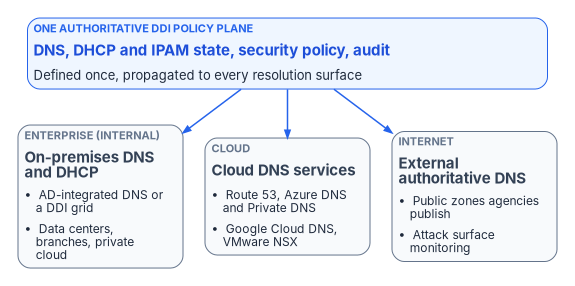
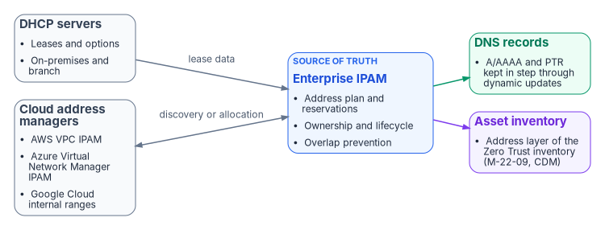

# Chapter 01 — DNS Is Now the Control Plane

*Every connection starts with a name, so whoever governs the name layer governs the enterprise.*

::: {.callout-note}
## In this chapter
Why DNS has stopped being a lookup utility and become the control plane of the hybrid multi-cloud agency. The problem, the structural fix and the ask; the six jobs DNS now does; the three perspectives one policy plane has to cover; how each cloud platform runs its own DNS, and why that fragments ownership; and why IPAM and DHCP are the address layer of the asset inventory.
:::

## Why DNS is now the control plane

Almost every network connection begins with a DNS query.[^c01-m0823] In a hybrid multi-cloud agency, the answer to that query now decides far more than an address. It decides whether traffic to a cloud service stays on a private path, which SaaS front door a user reaches, whether a known-malicious domain is blocked, whether a certificate's revocation check succeeds, and which service a Zero Trust policy is evaluating. NIST's 2026 DNS deployment guide says it plainly: DNS infrastructure "has become more than a service," and is now a security control in its own right.[^c01-nist81]

Most agencies still run it as a commodity utility, split across as many as five independent platforms: Active Directory DNS or an on-premises DDI grid, Amazon Route 53, Azure DNS and Azure Private DNS, Google Cloud DNS, and VMware NSX. None of them shares state with the others. The result is split-brain DNS, the same name resolving to different answers depending on where the query starts, and it fails quietly: as certificate errors, access denials and traffic on the wrong path, rarely as a DNS error. This book makes the case for governing DNS, DHCP and IP address management (together, DDI) as one control plane, and shows what it takes to get there.

::: {.callout-important}
## The case in one paragraph
**Problem.** DNS has become the application surface, the security enforcement plane, and the PKI and identity substrate of the hybrid multi-cloud enterprise, but agencies still run it across several independent platforms with no shared state. Split-brain DNS then breaks private connectivity, SaaS endpoint selection, certificate trust and Layer 7 Zero Trust policy at once.

**Solution.** One authoritative DDI policy plane that propagates DNS, DHCP and IPAM state consistently to every resolution surface, with edge interception (for example the redirect-dns data policy in Cisco Catalyst SD-WAN) pointed at resolvers under agency control rather than around them.[^c01-ciscoredirect] This is an architectural requirement, not a product: enterprise DDI platforms and cloud-native resolvers managed as code can all be evaluated against it (Chapter 12). At least one cloud-delivered DDI management plane is now listed on the FedRAMP Marketplace at the Moderate level (Chapter 03).

**Ask.** Authorize the decision to operate a single authoritative DDI policy plane, and charge the DNS/DDI team, which holds the decision right on all five configuration decisions in Chapter 08 under Chapter 09's responsibility matrix (network engineering configures the edge for Decisions 1 and 2), to settle them within 90 days and report residual risk to the authorizing official.
:::

{#fig-ch01-three-perspectives fig-alt="A policy plane at the top connects to three perspectives: enterprise internal DNS (AD-integrated DNS or a DDI grid for data centers, branches and private cloud), cloud DNS services (Route 53, Azure DNS and Private DNS, Google Cloud DNS, VMware NSX), and external authoritative DNS (public zones and attack surface monitoring)."}

## For decision makers

DNS fragmentation across independent platforms produces split-brain DNS. That is no longer a lookup inconvenience; it breaks private connectivity, SaaS endpoint selection, certificate trust and FQDN-based Zero Trust policy at the same time. A single authoritative DDI policy plane is the structural fix. Five points carry the argument:

- **Split-brain DNS is structural, not a bug to patch.** Independent per-cloud DNS systems diverge because they share no state, and runbooks can't keep pace with the change rate across several consoles and APIs (Chapter 02).
- **DNS is now a security and PKI dependency.** Certificate validation, OCSP and CRL lookups, token audiences and FQDN-based policy all fail quietly under split-brain (Chapter 06).
- **Edge interception can silently bypass the policy plane.** The SD-WAN redirect-dns destination decides whether response policy zones (RPZ), DNSSEC validation and logging apply at all (Chapter 05).
- **Some cloud optimizations stop at the commercial boundary.** Microsoft 365 informed network routing (INR) supports Worldwide Commercial tenants only, not GCC Moderate, GCC High or DoD.[^c01-inr] The DDI architecture is unaffected; that one optimization is simply unavailable (Chapter 05 and [Appendix C — Applicability](appendix-c-applicability.md)).
- **Five configuration decisions carry most of the operational risk:** the redirect-dns target, forwarding chain order, per-cloud conditional forwarding ownership, the Active Directory DNS inventory before decommissioning, and OCSP/CRL reachability from every origin (Chapter 08).

## What DNS was designed to do

The Domain Name System was first specified in RFC 882 and RFC 883 in November 1983, and redefined in RFC 1034 and RFC 1035 in November 1987, which obsoleted RFCs 882, 883 and 973.[^c01-rfc] Its job was simple: let people use memorable hostnames instead of numeric addresses, and give operators a distributed, hierarchical database in which to publish those mappings. A recursive resolver on the campus network forwarded queries to authoritative servers on the internet, cached the answers and served them to local clients. The design assumed that every device had one address, every service lived on a known host, and "inside" and "outside" the network were separated by a physical wire. It was elegant, it scaled, and it was enough for its time. That time has passed.

## What DNS has become

In a hybrid multi-cloud agency, DNS now does six jobs its designers didn't anticipate:

- **Private address publication.** Cloud platforms publish private addresses for private endpoints, internal load balancers and service-to-service traffic through DNS. When an Azure Storage account gets a private endpoint, the same service name resolves to the private endpoint's address inside the virtual network that hosts it and to the public endpoint from everywhere else.[^c01-azstoragepe] The answer has to depend on where the query comes from.
- **Public SaaS endpoint selection.** The DNS answer determines which service front door a client reaches. Microsoft 365 publishes separate endpoint lists for each cloud: the Worldwide list (which includes GCC), GCC High and DoD, with GCC High and DoD using their own namespaces such as `*.office365.us`.[^c01-m365clouds]
- **Security policy enforcement.** Response policy zones and DNS firewall rules block malicious domains before a connection is made, and DNS query logs feed threat detection. NIST now describes an organization's DNS service as both an information source for policy decisions and a policy enforcement point.[^c01-nist81]
- **Certificate validation.** OCSP responders and CRL distribution points are DNS names. A certificate's validity check depends on those names resolving correctly from wherever the client sits (Chapter 06).
- **Service identity.** In a Zero Trust architecture the fully qualified domain name (FQDN) is the stable identity that policy, certificates and audit logs reference; the IP address behind it is ephemeral. A service mesh routes to `payments.internal.agency.example`, not to `10.0.42.17`.
- **Application surface definition.** A wildcard entry such as `*.api.agency.example` declares a namespace of applications, not a single host, and API gateways, WAF rules, certificate subject alternative names and Zero Trust policies are written against it. Managing DNS is managing the application surface.

Taken together, these jobs make DNS the identity substrate, the security enforcement plane and the application surface layer of the enterprise. Governing it is a security and architecture responsibility, not an IT operations chore.

## Three DNS perspectives under one control plane

A unified DDI policy plane manages DNS from three connected perspectives:

- **Enterprise (internal):** Active Directory-integrated DNS or an on-premises DDI grid, DNS views, high availability and anycast, and role-based administration for data centers, branches and private clouds.
- **Cloud:** Amazon Route 53, Azure DNS and Azure Private DNS, and Google Cloud DNS, with discovery of cloud networks and federation with cloud address managers.
- **Internet (external authoritative):** the public zones the agency publishes, whether self-hosted or on a managed authoritative service, together with monitoring of the external attack surface.

## The fragmented landscape

Agencies don't choose to manage DNS in five places. The fragmentation emerges from how cloud platforms were adopted: each platform ships its own DNS service, because DNS is the connective tissue of everything else the platform does, and decoupling it takes deliberate architectural work that the default experience doesn't encourage. Each service has its own console, API, zone model and failure behavior, and none was designed to share policy with the others.

| Platform | How it resolves | Hybrid entry and exit | Native DNS security policy |
|---|---|---|---|
| On-premises | Active Directory-integrated DNS on domain controllers, or an enterprise DDI grid | Conditional forwarders and delegations | RPZ or DNS firewall on the DDI grid, where deployed |
| Amazon Route 53 | Route 53 VPC Resolver (formerly Route 53 Resolver) answers every VPC at the VPC+2 address, for public names and private hosted zones[^c01-r53] | Inbound endpoints accept queries from on-premises or other VPCs; outbound endpoints and forwarding rules send named domains elsewhere[^c01-r53] | Route 53 Resolver DNS Firewall rule groups associated with each VPC[^c01-r53fw] |
| Azure | Azure-provided DNS resolves Azure Private DNS zones only for virtual networks linked to them | Azure DNS Private Resolver inbound endpoints receive queries from outside; outbound endpoints apply DNS forwarding rulesets[^c01-azpr] | DNS resolver policy (formerly DNS security policy): allow, alert or block rules and query logging per virtual network[^c01-azrp] |
| Google Cloud | VMs that use the metadata server at `169.254.169.254` are resolved against Cloud DNS private zones in the network's resolution order[^c01-gcpsp] | Inbound server policies create entry-point addresses in each subnet; DNS peering shares zones between VPC networks[^c01-gcpsp] | Cloud DNS response policies, which override answers for matching names[^c01-gcprp] |
| VMware NSX | A DNS forwarder service attached to a tier-0 or tier-1 gateway, at a listener IP that clients are configured to use[^c01-nsx] | One default zone and up to five FQDN zones, each pointing at up to three upstream servers[^c01-nsx] | None in the forwarder itself; policy depends on the upstream resolvers |

Two points in this table are often misstated. Azure is sometimes described as having no native equivalent of response policy zones; that is no longer true, because Azure DNS resolver policy now filters and logs queries at the virtual network level, including against a Microsoft-managed threat intelligence list.[^c01-azrp] And the NSX forwarder doesn't intercept workload queries: workloads reach it only if they are configured to use its listener address, so which resolver a workload uses depends on how its segment was set up, and that is invisible from the on-premises DNS console.

{#fig-ch01-ipam-source-of-truth fig-alt="DHCP servers and cloud address managers feed an enterprise IPAM, which keeps DNS records in step and supplies the address layer of the asset inventory."}

## The management burden of independence

Run separately, these platforms impose a combinatorial synchronization burden. When a new private endpoint is created in Azure, the engineer who creates it may also have to update the Azure Private DNS zone and its virtual network links, the Private Resolver forwarding ruleset, the Route 53 outbound forwarding rule (if AWS workloads need to reach the endpoint) and the on-premises conditional forwarders (if data-center workloads do). Provisioning is one action; the DNS synchronization it requires is up to four more, on four consoles, in four syntaxes.

Ownership fragments along the same lines. The cloud team owns the cloud DNS services, the network team owns the DDI grid, and the Windows team owns Active Directory DNS. The forwarding rules that connect those systems, the part that actually crosses the boundaries, usually belong to none of them. Chapter 09 sets out who should own each part of the name layer.

## Hybrid cloud IPAM and DHCP

A central IPAM is the authoritative record of the address plan, reservations and ownership across on-premises and cloud address space, and it is what prevents overlaps (Chapter 07 covers cloud address managers and NSX). DHCP lease data and dynamic DNS updates keep address and name records in step through each record's lifecycle, and existing Microsoft DHCP servers can be discovered and brought under the same inventory during transition. This is also the address layer of the asset inventory that Zero Trust depends on: OMB M-22-09 expects agencies to maintain a complete inventory of every device they operate, and CISA's Zero Trust Maturity Model counts cloud network resources, including DNS services, among the assets to be tracked.[^c01-m2209][^c01-ztmm]

::: {.callout-note}
## What this chapter establishes
1. DNS now carries private endpoint publication, SaaS front-door selection, security policy, certificate validation, service identity and the application surface, so it has to be governed as a control plane, not run as a utility.
2. Several independent DNS platforms, each with its own resolver, forwarding model and security policy, share no state; split-brain and an ownership gap follow from that structure.
3. The answer is one authoritative DDI policy plane, with five configuration decisions carrying most of the risk, and IPAM as the address layer of the asset inventory.
:::

::: {.callout-tip}
## Continue the book
[← Previous: Book 08 index](index.md) · [Book index](index.md) · [Next: Chapter 02 — Split-Brain DNS: The Structural Problem →](02-split-brain-dns.md)
:::

[^c01-m0823]: Office of Management and Budget, M-08-23, *Securing the Federal Government's Domain Name System Infrastructure*, August 22, 2008, <https://georgewbush-whitehouse.archives.gov/omb/memoranda/fy2008/m08-23.pdf> (accessed Oct 20, 2026). "Almost every instance of network communication begins with a request to the Domain Name System."
[^c01-nist81]: NIST SP 800-81r3, *Secure Domain Name System (DNS) Deployment Guide*, S. Rose (NIST), C. Liu and R. Gibson (Infoblox), March 2026, <https://csrc.nist.gov/pubs/sp/800/81/r3/final> (accessed Oct 20, 2026). Executive Summary (DNS infrastructure "has become more than a service; it is also a security control"); Sec. 1.2 (an organization's DNS service is both an information source for policy decision points and a policy enforcement point).
[^c01-ciscoredirect]: Cisco, "Redirect DNS in Cisco Catalyst SD-WAN Service-Side VPNs," *Cisco Catalyst SD-WAN Policies Configuration Guide, Cisco IOS XE Catalyst SD-WAN Release 17.x*, <https://www.cisco.com/c/en/us/td/docs/routers/sdwan/configuration/policies/ios-xe-17/policies-book-xe/redirect-dns.html> (accessed Oct 20, 2026). The `redirect-dns` action in a centralized data policy sends matching DNS requests to a specified DNS server.
[^c01-inr]: Microsoft Learn, "Microsoft 365 informed network routing," <https://learn.microsoft.com/en-us/microsoft-365/enterprise/office-365-network-mac-perf-cpe?view=o365-worldwide> (accessed Oct 20, 2026). INR "supports tenants in WW Commercial cloud but not the GCC Moderate, GCC High, DoD, Germany, or China clouds"; Cisco IOS XE SD-WAN 20.4/17.4 is the only listed integrated solution.
[^c01-rfc]: IETF RFC 882, *Domain Names: Concepts and Facilities*, November 1983, <https://www.rfc-editor.org/rfc/rfc882>; RFC 1034, *Domain Names: Concepts and Facilities*, November 1987 (obsoletes RFCs 882, 883 and 973), <https://www.rfc-editor.org/rfc/rfc1034>; RFC 1035, *Domain Names: Implementation and Specification*, November 1987, <https://www.rfc-editor.org/rfc/rfc1035> (accessed Oct 20, 2026).
[^c01-azstoragepe]: Microsoft Learn, "Use private endpoints for Azure Storage," DNS changes for private endpoints, <https://learn.microsoft.com/en-us/azure/storage/common/storage-private-endpoints> (accessed Oct 20, 2026). From outside the virtual network hosting the private endpoint the storage endpoint resolves to the public endpoint; from inside it resolves to the private endpoint's IP address.
[^c01-m365clouds]: Microsoft Learn, "Microsoft 365 endpoints," <https://learn.microsoft.com/en-us/microsoft-365/enterprise/microsoft-365-endpoints?view=o365-worldwide>, and "Microsoft 365 U.S. Government GCC High endpoints," <https://learn.microsoft.com/en-us/microsoft-365/enterprise/microsoft-365-u-s-government-gcc-high-endpoints?view=o365-worldwide> (accessed Oct 20, 2026). The Worldwide endpoints include GCC; GCC High and DoD have their own lists and namespaces.
[^c01-r53]: AWS, *Amazon Route 53 Developer Guide*, "What is Route 53 VPC Resolver?," <https://docs.aws.amazon.com/Route53/latest/DeveloperGuide/resolver.html> (accessed Oct 20, 2026). Renamed from Route 53 Resolver when Route 53 Global Resolver was introduced; VPC+2 address; inbound and outbound endpoints; forwarding rules shareable across accounts.
[^c01-r53fw]: AWS, *Amazon Route 53 Developer Guide*, "Using DNS Firewall to filter outbound DNS traffic," <https://docs.aws.amazon.com/Route53/latest/DeveloperGuide/resolver-dns-firewall.html> (accessed Oct 20, 2026).
[^c01-azpr]: Microsoft Learn, "What is Azure DNS Private Resolver?," <https://learn.microsoft.com/en-us/azure/dns/dns-private-resolver-overview>, and "Azure DNS Private Resolver endpoints and rulesets," <https://learn.microsoft.com/en-us/azure/dns/private-resolver-endpoints-rulesets> (accessed Oct 20, 2026).
[^c01-azrp]: Microsoft Learn, "DNS resolver policy," <https://learn.microsoft.com/en-us/azure/dns/dns-security-policy> (accessed Oct 20, 2026). Filters and logs DNS queries at the virtual network level; allow, alert or block rules on domain lists; optional Microsoft Threat Intelligence managed domain list.
[^c01-gcpsp]: Google Cloud, "DNS server policies," <https://docs.cloud.google.com/dns/docs/server-policies-overview> (accessed Oct 20, 2026). Inbound server policy entry points are internal addresses from the primary range of every subnet; VMs that use the metadata server `169.254.169.254` are resolved in the VPC network name resolution order.
[^c01-gcprp]: Google Cloud, "Manage response policies and rules" (Cloud DNS), <https://docs.cloud.google.com/dns/docs/zones/manage-response-policies> (accessed Oct 20, 2026).
[^c01-nsx]: VMware, *NSX Administration Guide* 4.1, "Add a DNS Forwarder Service," <https://docs.vmware.com/en/VMware-NSX/4.1/administration/GUID-A0172881-BB25-4992-A499-14F9BE3BE7F2.html> (now served from Broadcom TechDocs; accessed Oct 20, 2026). Tier-0 or tier-1 gateway; listener IP; one default zone and up to five FQDN zones, each with up to three DNS servers.
[^c01-m2209]: Office of Management and Budget, M-22-09, *Moving the U.S. Government Toward Zero Trust Cybersecurity Principles*, January 26, 2022, <https://www.whitehouse.gov/wp-content/uploads/2022/01/M-22-09.pdf> (accessed Oct 20, 2026). Devices goal: a complete inventory of every device the government operates, supported by CISA's Continuous Diagnostics and Mitigation (CDM) program.
[^c01-ztmm]: CISA, *Zero Trust Maturity Model*, Version 2.0, April 2023, <https://www.cisa.gov/zero-trust-maturity-model> (accessed Oct 20, 2026). Devices pillar: a dynamic inventory of all assets; cloud assets include network resources such as virtual networks, gateways and DNS services.
