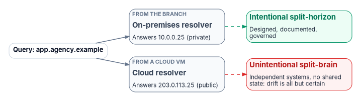
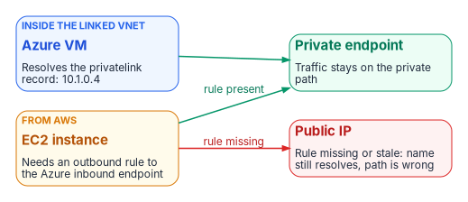
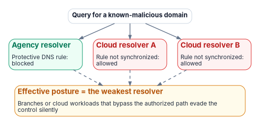

# Chapter 02 — Split-Brain DNS: The Structural Problem

*Same name, different answers, and no amount of process discipline keeps independent systems in step.*

::: {.callout-note}
## In this chapter
What split-brain DNS is, and how it differs from legitimate split-horizon design. Three forms it takes in a hybrid multi-cloud agency: private-IP split-brain across clouds, public SaaS endpoint split-brain, and security policy split-brain. Why runbooks and audits can't fix a structural problem, and what fragmented DDI costs in outages and audit evidence.
:::

{#fig-ch02-split-brain fig-alt="A query for app.agency.example answers a private address from the on-premises resolver and a public address from a cloud resolver. Intentional split-horizon is designed and governed; unintentional split-brain is drift between systems with no shared state."}

## What split-brain DNS is

Split-brain DNS is the condition in which a query for the same name returns different answers depending on where the query originates. The name is right in both cases, but the two answers point to different addresses, and the address decides whether traffic reaches its intended destination by its intended path.

Different answers are not always a fault. Intentional split-horizon DNS, in which the same name resolves to a private address for internal callers and a public address for external ones, is common and legitimate when it is designed, documented and governed. The problem is the unintentional kind: an internal view that has gone stale, an external answer that is wrong for some callers but not others, or a security rule (an RPZ block, a DNS firewall rule) that applies in one view and not the other.

When several independent DNS systems hold copies of the same names with no shared state, unintentional split-brain is close to guaranteed. Each copy drifts on its own schedule, no mechanism pulls them back together, and no single team can see the whole (Chapter 01).

## Private-IP split-brain: the cross-cloud case

{#fig-ch02-private-ip-split-brain fig-alt="An Azure VM inside the linked VNet resolves the privatelink record to 10.1.0.4. An EC2 instance in AWS reaches the private endpoint only if an outbound rule forwards to the Azure inbound endpoint; if the rule is missing or stale the name still resolves, to the public IP."}

The clearest example is an Azure private endpoint. When an Azure Storage account gets a private endpoint, the account's public name is given a CNAME into the matching `privatelink` subdomain, and an A record in the `privatelink.blob.core.windows.net` private DNS zone maps it to an address in the virtual network, for example 10.1.0.4.[^c02-azstoragepe] A client in a virtual network linked to that zone gets the private address, and traffic stays private. A client anywhere else follows the public CNAME chain to the public endpoint. Microsoft deliberately keeps the public chain resolvable from anywhere so that hybrid and gradual migrations don't break existing clients.[^c02-azpedns]

An EC2 instance in AWS sees the private answer only if a Route 53 VPC Resolver outbound forwarding rule sends the service's public zone (`blob.core.windows.net`, which Azure answers through its `privatelink` zone) to an Azure DNS Private Resolver inbound endpoint, or to an agency resolver that does.[^c02-r53][^c02-azpr] If that rule is missing or stale, the name still resolves, but to the public address. Traffic then either leaves the private path, around the controls on it, or is refused by the storage account's network rules. Microsoft's own troubleshooting guide for "403" access-denied errors through a private endpoint calls the DNS check "the single most important diagnostic step" and attributes roughly 70 percent of cases to the name resolving to the public endpoint.[^c02-az403]

Because the name resolves successfully, the failure is intermittent and invisible: the application sees a connection, the network completes it, and only DNS query logging combined with flow analysis shows that the traffic took the wrong path.

## Public SaaS split-brain: Microsoft 365 and the government clouds

Microsoft 365 shows a different form of the problem. Microsoft publishes a separate endpoint list for each Microsoft 365 cloud. The Worldwide list covers commercial tenants and GCC; GCC High and DoD have their own lists and their own namespaces, such as `*.office365.us` and `*.sharepoint.us` for GCC High.[^c02-m365clouds][^c02-m365gcch]

It is sometimes assumed that a GCC tenant must resolve names such as `outlook.office365.com` to GCC-specific endpoints rather than commercial ones. That is not how GCC works: GCC uses the Worldwide endpoint list.[^c02-m365ww] For a GCC-Moderate agency the risk is therefore not a "wrong cloud" answer but resolution-path consistency: every resolver a client can reach must return the answers Microsoft publishes, through the egress path the agency designed, and must not be overridden by a stale conditional forwarder or by a client sending DNS over HTTPS to a public resolver. For GCC High and DoD tenants the namespaces themselves differ, and every resolver in the estate must resolve them correctly. When resolution drifts, the failure surfaces as sign-in failures, Conditional Access denials or poor performance that appear to have nothing to do with DNS. Governing Microsoft 365 resolution explicitly needs a policy plane that covers both on-premises resolvers and the cloud and edge resolvers branch and remote users reach first (Chapter 05).

## Security policy split-brain: the invisible gap

{#fig-ch02-security-policy-split-brain fig-alt="A query for a known-malicious domain is blocked by the agency resolver but allowed by two cloud resolvers whose rules were not synchronized. The effective posture is the weakest resolver."}

DNS security policy (response policy zones, DNS firewall rules, Protective DNS block lists) is enforced only at the resolver that answers the query. A domain blocked at the agency resolver may still be answered by Route 53 VPC Resolver, Azure DNS or Google Cloud DNS if the equivalent rule there (Route 53 Resolver DNS Firewall, Azure DNS resolver policy, Cloud DNS response policies) was never created or has drifted.[^c02-r53fw][^c02-azrp][^c02-gcprp] Each of those controls is configured per VPC or per virtual network, so coverage also depends on every new network being attached to the right policy.

The effective posture across the estate is therefore the intersection of all the resolvers' policies: only as strong as the weakest resolver a client can reach. Because replicating policy across independent systems is manual, the intersection is never quite equal to any one of them, and it narrows over time as each system is updated on its own.

This matters beyond compliance. NIST notes that DNS servers give unusual insight into endpoint connections and data flows and "can often prevent security incidents earlier than other systems," and recommends DNS-based detection of data exfiltration.[^c02-nist81] A block list that applies only to queries reaching the on-premises grid protects nothing for the cloud-native workloads that never query it. The same gap appears in the federal requirements: OMB M-22-09 notes that agencies are already required to route DNS through CISA-operated infrastructure, and CISA's implementation guidance requires all egress resolution to pass through Protective DNS. Branches or cloud workloads that bypass the authorized resolver path also bypass those controls, and nobody notices (Chapter 03).[^c02-m2209][^c02-cisaedns]

## Why process discipline can't fix a structural problem

The usual response to split-brain is process: write a runbook, require engineers to update every DNS system whenever anything changes, and audit compliance. It fails for three reasons.

- **The failure is silent.** When a Route 53 forwarding rule isn't updated after an Azure private endpoint changes, no alarm fires. The divergence accumulates until a workload that happens to query from AWS fails, and the failure looks like a network problem, not a DNS one.
- **The change surface is too large.** Every private endpoint, every address reassignment and every new workload has DNS consequences across every system. In a large estate with dozens of teams provisioning cloud resources, the change rate outruns any manual synchronization process.
- **The systems behave differently.** Each has its own API, rate limits, propagation delay and consistency model. Even a fully scripted synchronization has to solve ordering and conflict resolution when the systems update at different speeds.

The only structural fix is a control plane that holds the authoritative policy objects and propagates them to every surface, so that "does Route 53 have the current forwarding rules?" is answered by the control plane, not by an audit. That is the program's design position, and Chapter 08 sets out the reference architecture.

## What fragmented DDI costs

Organizations that rely on fragmented or do-it-yourself DDI accumulate configuration drift, stale and dangling records, overlapping address space and siloed administration. Each is an operational risk and an audit finding waiting to happen; NIST's guidance treats dangling CNAMEs, lame delegations and zone drift as security threats in their own right.[^c02-nist81] A vendor-published survey of 1,000 networking and security decision-makers, conducted by Enterprise Strategy Group, reports that organizations without enterprise-grade DDI had quarterly cloud outages 44 percent more often than peers with it, and were 38 percent more likely to take hours rather than minutes to recognize an outage.[^c02-esg] Treat such figures as directional, not as a benchmark.

The evidence cost is just as real. Without a unified DDI plane, agencies struggle to show the consistent policy, audit trail and asset inventory that FedRAMP continuous monitoring, NIST SP 800-81r3, CISA Protective DNS and Zero Trust reporting all ask for (Chapter 03 and Chapter 11). And for secure access service edge (SASE) and Zero Trust, DNS is the first trust decision: it chooses the destination before TLS, single sign-on or any application policy can act. Fragmented DNS undermines consistent filtering, encrypted DNS policy and threat blocking at that first step.

::: {.callout-note}
## What this chapter establishes
1. Intentional split-horizon is legitimate; unintentional split-brain is drift between systems with no shared state, and it is close to guaranteed when DNS is fragmented.
2. Split-brain breaks private connectivity, SaaS resolution and security policy silently, because the name still resolves.
3. The effective security posture is that of the weakest resolver a client can reach, and process discipline can't hold independent systems in step; a control plane can.
:::

::: {.callout-tip}
## Continue the book
[← Previous: Chapter 01 — DNS Is Now the Control Plane](01-dns-is-the-control-plane.md) · [Book index](index.md) · [Next: Chapter 03 — Federal Requirements: NIST SP 800-81, FedRAMP and Zero Trust →](03-federal-requirements.md)
:::

[^c02-azstoragepe]: Microsoft Learn, "Use private endpoints for Azure Storage," DNS changes for private endpoints, <https://learn.microsoft.com/en-us/azure/storage/common/storage-private-endpoints> (accessed Oct 20, 2026). The CNAME is updated to an alias in the `privatelink` subdomain, a private DNS zone holds the A records, and resolution differs inside and outside the virtual network.
[^c02-azpedns]: Microsoft Learn, "Azure Private Endpoint private DNS zone values," <https://learn.microsoft.com/en-us/azure/private-link/private-endpoint-dns> (accessed Oct 20, 2026). The public `privatelink` CNAME chain "is deliberately resolvable from anywhere on the internet so that hybrid and gradual-migration scenarios continue to work"; DNS resolution and access control are independent.
[^c02-r53]: AWS, *Amazon Route 53 Developer Guide*, "What is Route 53 VPC Resolver?," <https://docs.aws.amazon.com/Route53/latest/DeveloperGuide/resolver.html> (accessed Oct 20, 2026). Outbound endpoints and forwarding rules; formerly named Route 53 Resolver.
[^c02-azpr]: Microsoft Learn, "Azure DNS Private Resolver endpoints and rulesets," <https://learn.microsoft.com/en-us/azure/dns/private-resolver-endpoints-rulesets> (accessed Oct 20, 2026). Inbound endpoints resolve private DNS zones linked to their virtual network for queries from outside it.
[^c02-az403]: Microsoft Learn, "Troubleshoot '403' access denied errors for Azure Storage or Azure Key Vault through a private endpoint," <https://learn.microsoft.com/en-us/troubleshoot/azure/private-link/troubleshoot-403-access-denied-private-endpoint> (accessed Oct 20, 2026). "Roughly 70 percent of cases are caused by DNS resolving to the public endpoint."
[^c02-m365clouds]: Microsoft Learn, "Microsoft 365 endpoints," <https://learn.microsoft.com/en-us/microsoft-365/enterprise/microsoft-365-endpoints?view=o365-worldwide> (accessed Oct 20, 2026). Five Microsoft 365 clouds, each with its own endpoint list; the Worldwide endpoints include GCC.
[^c02-m365gcch]: Microsoft Learn, "Microsoft 365 U.S. Government GCC High endpoints," <https://learn.microsoft.com/en-us/microsoft-365/enterprise/microsoft-365-u-s-government-gcc-high-endpoints?view=o365-worldwide> (accessed Oct 20, 2026). Endpoints such as `*.office365.us` and `*.sharepoint.us`; last updated July 1, 2026.
[^c02-m365ww]: Microsoft Learn, "Microsoft 365 URLs and IP address ranges," <https://learn.microsoft.com/en-us/microsoft-365/enterprise/urls-and-ip-address-ranges?view=o365-worldwide> (accessed Oct 20, 2026). Endpoints for Microsoft 365 plans "including Government Community Cloud (GCC)."
[^c02-r53fw]: AWS, *Amazon Route 53 Developer Guide*, "Using DNS Firewall to filter outbound DNS traffic," <https://docs.aws.amazon.com/Route53/latest/DeveloperGuide/resolver-dns-firewall.html> (accessed Oct 20, 2026). Rule groups are associated with each VPC and filter queries that pass through VPC Resolver.
[^c02-azrp]: Microsoft Learn, "DNS resolver policy," <https://learn.microsoft.com/en-us/azure/dns/dns-security-policy> (accessed Oct 20, 2026). Applied per virtual network through virtual network links, one policy per VNet, same region only.
[^c02-gcprp]: Google Cloud, "Manage response policies and rules" (Cloud DNS), <https://docs.cloud.google.com/dns/docs/zones/manage-response-policies> (accessed Oct 20, 2026). One response policy per network.
[^c02-nist81]: NIST SP 800-81r3, *Secure Domain Name System (DNS) Deployment Guide*, March 2026, <https://csrc.nist.gov/pubs/sp/800/81/r3/final> (accessed Oct 20, 2026). Sec. 1.1 (DNS servers "can often prevent security incidents earlier than other systems"); Sec. 3.2 (lame delegations, zone drift and zone thrash); Sec. 3.6 (dangling CNAME and lame delegation exploitation); Sec. 4.2.4 (detecting data exfiltration via DNS).
[^c02-m2209]: Office of Management and Budget, M-22-09, *Moving the U.S. Government Toward Zero Trust Cybersecurity Principles*, January 26, 2022, section "Encrypting DNS traffic," <https://www.whitehouse.gov/wp-content/uploads/2022/01/M-22-09.pdf> (accessed Oct 20, 2026).
[^c02-cisaedns]: CISA, *Encrypted DNS Implementation Guidance*, May 16, 2024, <https://www.cisa.gov/resources-tools/resources/encrypted-dns-implementation-guidance> (accessed Oct 20, 2026). Agencies are required to use CISA's Protective DNS for all egress DNS resolution, per M-22-09 and 6 U.S.C. § 663 note.
[^c02-esg]: **Third-party source (vendor).** Infoblox, "The Business Impact of Enterprise-Grade DDI: New Research Findings," blog post, April 15, 2025, reporting Enterprise Strategy Group research, <https://www.infoblox.com/blog/company/the-business-impact-of-enterprise-grade-ddi-new-research-findings/> (accessed Oct 20, 2026). Published by the vendor whose product the research favors; the methodology was not independently reviewed for this book.
