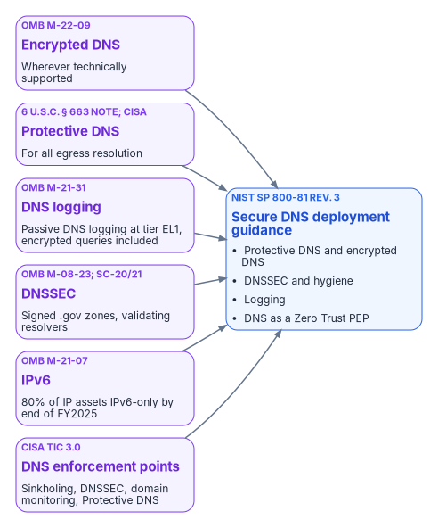

# Chapter 03 — Federal Requirements: NIST SP 800-81, FedRAMP and Zero Trust

*The mandates never name a product, but read together they describe a governed name layer.*

::: {.callout-note}
## In this chapter
What each federal source requires of DNS, quoted rather than paraphrased into something stronger: OMB M-22-09 and CISA's encrypted DNS guidance, CISA Protective DNS, M-21-31 logging, M-08-23 DNSSEC, M-21-07 IPv6 and the TIC 3.0 DNS capabilities. What NIST SP 800-81 Rev. 3 adds, how FedRAMP applies when the policy plane is a cloud service, why the timing matters now, and a control mapping to SP 800-53.
:::

{#fig-ch03-federal-drivers fig-alt="Six requirement cards feed NIST SP 800-81 Rev. 3: OMB M-22-09 encrypted DNS wherever technically supported; Protective DNS for all egress resolution under 6 U.S.C. 663 note and CISA; DNS logging under OMB M-21-31 from tier EL1; DNSSEC under OMB M-08-23 and SP 800-53 SC-20 and SC-21; OMB M-21-07 IPv6 targets; and the TIC 3.0 DNS policy enforcement point capabilities."}

## What the mandates say

The federal requirements on DNS are specific, and it is worth quoting them rather than paraphrasing.

- **OMB M-22-09 (Federal Zero Trust Strategy, January 2022).** "Agencies must resolve DNS queries using encrypted DNS wherever it is technically supported." Agency resolvers must support DNS over HTTPS (DoH) or DNS over TLS (DoT) and use them upstream; endpoints must enable encrypted DNS in applications and the operating system wherever available; and agencies "should explicitly configure endpoints to use agency-designated encrypted DNS servers, rather than relying on automatic network discovery." Agencies keep visibility by logging at their designated resolvers, and were to report gaps in technical support and plans to reach enterprise-wide support by FY24. The memorandum also notes that agencies "are already required to have DNS requests routed through CISA-operated infrastructure."[^c03-m2209]
- **CISA Protective DNS.** CISA launched the Protective DNS Resolver service in 2022 as the successor to the EINSTEIN 3 Accelerated (E3A) DNS sinkholing capability. It filters queries upstream of agency networks and blocks, redirects or sinkholes responses that match threat indicators, alerting the agency and CISA; traffic from mobile, roaming and cloud assets can flow to it directly. Federal civilian executive branch agencies are required to use it.[^c03-cisapdns] CISA's implementation guidance cites the legal basis, 6 U.S.C. § 663 note, and states that agencies must use Protective DNS "for all egress DNS resolution."[^c03-cisaedns]
- **CISA Encrypted DNS Implementation Guidance (May 16, 2024).** Explains how agencies meet M-22-09 while keeping Protective DNS upstream, and suggests six phases: use Protective DNS; block unauthorized DNS traffic, encrypted and unencrypted; encrypt traffic to Protective DNS; encrypt DNS for roaming and nomadic endpoints; encrypt DNS in cloud deployments; and encrypt DNS for on-premises endpoints. It notes that every agency should already have finished the first phase. It describes DoH, DoT and DNS over QUIC (DoQ), and says DoQ is currently supported by fewer products; the Protective DNS service itself supports DoH and DoT.[^c03-cisaedns]
- **OMB M-21-31 (event logging, August 2021).** Passive DNS logging is an EL1 Basic requirement: agencies "shall implement a Domain Name System (DNS) logging system," "including DNS requests made over encrypted DNS connections," with analytics that rapidly identify the host that sourced each query. Agencies were to reach EL1 within one year of the memorandum.[^c03-m2131]
- **OMB M-08-23 (August 2008).** Required DNSSEC to be deployed and operational on all applicable federal information systems by December 2009, following NIST SP 800-81.[^c03-m0823] SP 800-53 controls SC-20 and SC-21 carry the signing and validating-resolver requirements into every system baseline (Chapter 06).[^c03-nist53]
- **OMB M-21-07 (IPv6, November 2020).** Set milestones for IP-enabled assets on federal networks to operate in IPv6-only environments: at least 20 percent by the end of FY2023, 50 percent by the end of FY2024 and 80 percent by the end of FY2025.[^c03-m2107] All three dates have now passed, so any agency short of them is behind, not on track. DDI is where dual-stack and IPv6-only address and name management actually happens (Chapter 07).
- **TIC 3.0 (CISA Security Capabilities Catalog, version 3.3, published September 2026).** Lists five DNS policy enforcement point capabilities: domain name sinkholing; DNSSEC validation of agency clients' lookups, for internal and external domains; DNSSEC signing of agency domains; domain name monitoring to discover the creation of or changes to agency domains; and CISA's Protective DNS Service, which replaced the earlier EINSTEIN 3 Accelerated capability. A separate web capability, domain resolution filtering, prevents use of unauthorized resolvers over DoH.[^c03-tic]

None of these sources names a product. Read together, they require resolvers the agency controls that log every query (encrypted or not, with the source host identifiable), encrypt client-to-resolver traffic wherever the client supports it, forward egress resolution through Protective DNS, sign agency zones and validate DNSSEC, and block clients from routing around them. At enterprise scale that means centralized policy and logging with local or edge delivery, so that roaming, branch and cloud traffic can't slip past the controls. Chapter 05 covers the bypass paths and the controls that close them.

## NIST SP 800-81 Rev. 3: the Secure DNS Deployment Guide

NIST published SP 800-81r3, *Secure Domain Name System (DNS) Deployment Guide*, as a final publication in March 2026 (dated March 19, 2026 in the document history). It supersedes SP 800-81-2 of September 2013. Its authors are Scott Rose of NIST and Cricket Liu and Ross Gibson of Infoblox.[^c03-nist81] NIST describes the revision as a significant change in structure and objective: it treats DNS as both critical infrastructure and a security control. Its executive summary makes five high-level recommendations:

- employ protective DNS wherever technically feasible, for real-time blocking, policy-based filtering, query and response data for forensics and incident response, and integration with the wider security ecosystem;
- encrypt internal and external DNS traffic wherever feasible;
- deploy DNSSEC to protect the integrity of DNS data;
- deploy dedicated DNS servers to reduce attack surfaces; and
- follow the technical guidance for secure, resilient DNS deployments.

The body adds the detail that matters for this book. It asks government agencies and regulated enterprises to implement robust DNS traffic logging, integrated with other system logs. It covers DNS hygiene threats such as lame delegations, zone drift and dangling CNAMEs. It recommends blocking outbound DNS, DoT, DoH and DoQ to unauthorized public resolvers, and using device management to stop users configuring unapproved encrypted DNS. And it positions an organization's DNS service as both an information source for policy decisions and a policy enforcement point in a Zero Trust architecture, citing SP 800-207.[^c03-nist81][^c03-nist207] One distinction is easy to miss: NIST uses "protective DNS" for the general class of service, "not the CISA program of the same name." For a civilian agency, CISA's Protective DNS is the mandated upstream; the agency's own resolvers can add protective DNS policy of their own in front of it.

SP 800-81r3 is guidance, not a mandate in its own right. It is the practical companion to the requirements above, and to the DNS controls in SP 800-53 (SC-20 and SC-21 for authoritative and resolving services, SC-22 for the architecture and provisioning of name and address resolution) that FedRAMP baselines inherit.[^c03-nist53] Its co-authorship by a DDI vendor doesn't change its status as NIST guidance, but it is worth knowing when a vendor cites it.

## FedRAMP and agency authorization

FedRAMP certifies cloud service offerings, not architectures, and it doesn't replace the agency's own authorization. FedRAMP's 2026 rules say that "each agency still authorizes its own federal information systems," that the authorizing official accepts the risk of the agency's specific use (including the configuration selected and the integrations enabled), and that an agency should never create a standalone authorization to operate for a cloud service offering.[^c03-fedramp-use] If the policy plane is delivered as a cloud service, that service needs a FedRAMP certification at the right level, and the agency authorizes its own DDI system with the service as an external dependency. The resolvers, appliances and agents running in agency data centers, branches and cloud tenants remain inside the agency's own authorization boundary.

As one example, the FedRAMP Marketplace lists Infoblox Government Cloud (package FR2017257053) as FedRAMP Certified at Class C, the Marketplace's label for Moderate, under the Rev5 certification type through an agency path, certified since December 15, 2022. Its Marketplace description covers Universal DDI, Universal Asset Insights and the Threat Defense components TIDE and Dossier, delivered as SaaS in AWS GovCloud (US).[^c03-fedramp] In a July 22, 2026 announcement the company said the offering now includes Universal DDI Management, NIOS-X Servers and Universal Asset Insights.[^c03-ibxpr] The listing is for the cloud service; on-premises NIOS appliances are not a FedRAMP-listed offering and sit inside the agency's boundary like any other agency-operated infrastructure. A Class C (Moderate) certification doesn't cover High or DoD impact levels; agencies operating there must confirm whether a separate certification or an agency-specific authorization is required. [Appendix C — Applicability](appendix-c-applicability.md) sets out these boundaries for each Microsoft and federal cloud environment, and Chapter 12 covers platform selection.

## Why the timing matters now

Several forces make DNS governance urgent rather than optional. Each is developed in a later chapter.

- **Zero Trust.** M-22-09 and CISA's Zero Trust Maturity Model move agencies toward access decisions about services identified by name. If those names resolve inconsistently across the estate, the policy written against them is inconsistent too (Chapter 06).
- **The Active Directory transition.** Microsoft's guidance describes a phased path from hybrid identity to cloud-first and "AD-minimized" states.[^c03-entrasoa] Agencies moving along it need a DNS governance program in place before the last domain controller goes, not after, because the records Active Directory maintained don't migrate on their own (Chapter 04).
- **Multi-cloud expansion.** Agencies are adding cloud providers, not consolidating to one, and each brings another independent DNS service. The number of places split-brain can occur grows with each one (Chapters 01, 02 and 07).
- **Certificate and PKI change.** Every change to a certificate authority's revocation endpoints or issuing hierarchy is a set of DNS names that must resolve from every origin (Chapters 06 and 08).
- **The Layer 7 transition.** Once Zero Trust network access, API gateways and service meshes use FQDN-based service identity, DNS inconsistency stops meaning "some workloads reach the wrong address" and starts meaning "policy is unenforced for some callers."
- **Rogue DHCP.** A rogue DHCP server handing out a malicious resolver in option 6 can route a whole subnet around every DNS control at once (Chapter 05).
- **An authorized management plane exists.** With a cloud-delivered DDI management plane now listed at the Moderate level, the lack of an authorization is no longer, by itself, a reason to defer the architecture this book argues for.

## Control mapping for NIST SP 800-53, FedRAMP and CISA Zero Trust

The following table maps the core capabilities of a unified DDI plane to representative SP 800-53 controls. It is illustrative, not exhaustive; agencies should validate it against their own authorization boundary and continuous monitoring strategy. [Appendix B — Requirements Mapping and Sources](appendix-b-requirements-mapping.md) maps each requirement to the chapters and evidence.

| Capability | Primary controls supported | Evidence and notes |
|---|---|---|
| Protective DNS and response policy zones | SC-7, SI-3, SI-4, AC-4 | Query logs, policy hit rates, block events; Protective DNS as the egress upstream; TIC 3.0 DNS sinkholing |
| Encrypted DNS (DoT, DoH, DoQ) | SC-8, SC-13, SC-17 | Resolver certificate management and protocol configuration; supports M-22-09 |
| Name and address resolution architecture | SC-22 | Redundant, role-separated internal and external resolvers |
| DNS query logging | AU-2, AU-12, SI-4 | Passive DNS logs including encrypted queries, source host identifiable; M-21-31 EL1 |
| IPAM inventory and discovery | CM-8, CM-6, SI-4 | Asset inventory reports, discovery logs, address space consistency |
| Audit trails and role-based administration | AU-2, AU-6, AC-2, AC-3, AC-6 | Change logs, role assignments, policy modification history |
| DNSSEC and zone integrity | SC-20, SC-21, SI-7 | Key management, validation status, zone signing evidence; TIC 3.0 DNSSEC capabilities |

::: {.callout-note}
## What this chapter establishes
1. M-22-09, CISA Protective DNS and its encrypted DNS guidance, M-21-31, M-08-23, M-21-07 and TIC 3.0 together require agency-controlled resolvers that log, encrypt, validate and forward egress through Protective DNS, and that clients can't route around.
2. SP 800-81r3 (March 2026) is the practical guide to meeting them; it is guidance, not a mandate.
3. FedRAMP certifies the cloud service, not the architecture; the agency still authorizes its own system, and a Moderate certification doesn't cover High or DoD.
:::

::: {.callout-tip}
## Continue the book
[← Previous: Chapter 02 — Split-Brain DNS: The Structural Problem](02-split-brain-dns.md) · [Book index](index.md) · [Next: Chapter 04 — The Active Directory DNS Departure →](04-active-directory-dns-departure.md)
:::

[^c03-m2209]: Office of Management and Budget, M-22-09, *Moving the U.S. Government Toward Zero Trust Cybersecurity Principles*, January 26, 2022, section "Encrypting DNS traffic," <https://www.whitehouse.gov/wp-content/uploads/2022/01/M-22-09.pdf> (accessed Oct 20, 2026).
[^c03-cisapdns]: CISA, "Protective Domain Name System (DNS) Resolver," <https://www.cisa.gov/resources-tools/services/protective-domain-name-system-dns-resolver> (accessed Oct 20, 2026). Launched in 2022 as a successor to E3A; implemented upstream of agency networks; mandated for FCEB agencies; mobile, roaming and cloud traffic flows to it directly.
[^c03-cisaedns]: CISA, *Encrypted DNS Implementation Guidance*, May 16, 2024, <https://www.cisa.gov/resources-tools/resources/encrypted-dns-implementation-guidance> (accessed Oct 20, 2026). Executive summary (Protective DNS for all egress resolution, per M-22-09 and 6 U.S.C. § 663 note); Sec. 2.1 (phased implementation); Sec. 3 (DoH, DoT, DoQ; Protective DNS supports DoH and DoT over IPv4 and IPv6).
[^c03-m2131]: Office of Management and Budget, M-21-31, *Improving the Federal Government's Investigative and Remediation Capabilities Related to Cybersecurity Incidents*, August 27, 2021, Table 2 (EL1 Basic Requirements), "Passive DNS," <https://www.whitehouse.gov/wp-content/uploads/2021/08/M-21-31-Improving-the-Federal-Governments-Investigative-and-Remediation-Capabilities-Related-to-Cybersecurity-Incidents.pdf> (accessed Oct 20, 2026).
[^c03-m0823]: Office of Management and Budget, M-08-23, *Securing the Federal Government's Domain Name System Infrastructure*, August 22, 2008, <https://georgewbush-whitehouse.archives.gov/omb/memoranda/fy2008/m08-23.pdf> (accessed Oct 20, 2026).
[^c03-nist53]: NIST SP 800-53 Rev. 5, *Security and Privacy Controls for Information Systems and Organizations*, September 2020 (updates as of December 10, 2020; minor release 5.2.0, August 27, 2025), <https://csrc.nist.gov/pubs/sp/800/53/r5/upd1/final> (accessed Oct 20, 2026). SC-20, SC-21, SC-22 and the other controls cited.
[^c03-m2107]: Office of Management and Budget, M-21-07, *Completing the Transition to Internet Protocol Version 6 (IPv6)*, November 19, 2020, <https://www.whitehouse.gov/wp-content/uploads/2020/11/M-21-07.pdf> (accessed Oct 20, 2026).
[^c03-tic]: CISA, *Trusted Internet Connections 3.0 Security Capabilities Catalog*, Version 3.3, publication September 2026, Table 9 (Domain Name System PEP Security Capabilities) and the Web PEP capability Domain Resolution Filtering, <https://www.cisa.gov/sites/default/files/2026-09/TIC_3.0_Security_Capabilities_Catalogs_September_2026_17.pdf>, linked from <https://www.cisa.gov/resources-tools/programs/trusted-internet-connections-tic> (accessed Oct 20, 2026).
[^c03-nist81]: NIST SP 800-81r3, *Secure Domain Name System (DNS) Deployment Guide*, S. Rose (NIST), C. Liu and R. Gibson (Infoblox), March 2026, <https://csrc.nist.gov/pubs/sp/800/81/r3/final> (accessed Oct 20, 2026). Final 03/19/26; supersedes SP 800-81-2 (September 2013); Preface; Executive Summary and its footnote on "protective DNS"; Sec. 1.2 (policy enforcement point); Sec. 2.1.3 (DNS logging); Secs. 3.2 and 3.6 (hygiene threats); Sec. 4.2.2 (restricting public providers).
[^c03-nist207]: NIST SP 800-207, *Zero Trust Architecture*, August 2020, <https://csrc.nist.gov/pubs/sp/800/207/final> (accessed Oct 20, 2026).
[^c03-fedramp-use]: FedRAMP, "Using a FedRAMP Certified Cloud Service," *FedRAMP Consolidated Rules for 2026*, <https://www.fedramp.gov/2026/agencies/use/> (accessed Oct 20, 2026).
[^c03-fedramp]: FedRAMP Marketplace, Infoblox Government Cloud (FR2017257053), <https://www.fedramp.gov/marketplace/products/FR2017257053/>, and Marketplace product data, <https://www.fedramp.gov/marketplace/products.json> (accessed Oct 20, 2026). Status FedRAMP Certified; Class C (Moderate); Rev5; agency path; certified since December 15, 2022; deployed in AWS GovCloud (US).
[^c03-ibxpr]: **Third-party source (vendor).** Infoblox, "Infoblox Government Cloud Achieves FedRAMP Moderate Certification, Bringing Modern DDI and Asset Visibility to Federal Agencies," press release, July 22, 2026, <https://www.infoblox.com/news/news-events/press-releases/infoblox-government-cloud-achieves-fedramp-moderate-certification-bringing-modern-ddi-and-asset-visibility-to-federal-agencies/> (accessed Oct 20, 2026).
[^c03-entrasoa]: Microsoft Learn, "Microsoft Entra cloud-first identity guidance for IT architects," <https://learn.microsoft.com/en-us/entra/identity/hybrid/guidance-it-architects-source-of-authority> (accessed Oct 20, 2026). A phased roadmap from hybrid to cloud-first and AD-minimized states.
