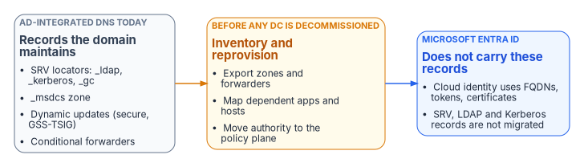

# Chapter 04 — The Active Directory DNS Departure

*Active Directory never presented itself as the agency's DNS service, but for twenty years it was one, and the records it kept for itself do not follow the identities to the cloud.*

::: {.callout-note}
## In this chapter
What AD-integrated DNS does for a domain: zones stored and replicated in the directory, the domain controller locator records that Netlogon registers, secure dynamic updates and the DHCP server's part in them, conditional forwarders, the GlobalNames zone and DNSSEC keys held in AD. Why Microsoft Entra ID inherits none of it, what Kerberos needs from DNS on the way out, what must be reprovisioned before any domain controller is retired, and what the departure means for SQL Server and other token-based services. The step-by-step migration is [Chapter 10](10-migration-sequence.md).
:::

Active Directory has been the hidden DNS substrate of on-premises federal networks for twenty years. Not because anyone chose it as a DNS architecture: when a domain is deployed, its DNS name becomes a zone, the domain controllers running the DNS Server role become its authoritative servers, and every domain-joined machine is pointed at them for all of its resolution, internal and external. Domain controllers then publish the records that let clients find them. Microsoft describes AD DS as depending on DNS so that "clients [can] locate domain controllers" and so that domain controllers can communicate with each other.[^c04-adds]

None of this moves when workloads move to Microsoft Entra ID. Entra ID is a cloud identity service: it consumes fully qualified domain names, but it doesn't host the agency's zones and doesn't publish the locator records that the remaining domain-joined systems need to find a domain controller. Departing AD DNS is therefore an inventory problem before it is a migration problem, and the inventory has to be finished before the first domain controller is retired, because the records a domain controller maintains can't be recovered from it once it's gone.

{#fig-ch04-ad-dns-departure fig-alt="Left, AD-integrated DNS today: SRV locators, the _msdcs zone, secure dynamic updates and conditional forwarders. Middle, inventory and reprovision before any domain controller is decommissioned. Right, Microsoft Entra ID does not carry these records."}

## What AD-integrated DNS actually is

A zone can be stored in a file or in Active Directory Domain Services. Zones stored in AD DS are Active Directory-integrated zones, and they exist only on domain controllers that run the DNS Server role. Storing the zone in the directory brings two things a file-backed zone doesn't have: secure dynamic updates, and multi-master operation, in which every domain controller that hosts the zone acts as a primary and can accept updates.[^c04-zones] Replication rides on AD replication rather than zone transfers. The replication scope decides which domain controllers hold the zone: all DNS servers in the domain, all DNS servers in the forest, a legacy domain-partition scope, or a custom application partition, which the DnsServer cmdlets expose as `Domain`, `Forest`, `Legacy` and `Custom`.[^c04-scope]

The rest of the AD DNS landscape decomposes into components that each need a decision:

| Component | What it does in an AD estate | Why it matters for the departure |
|---|---|---|
| AD-integrated primary zones | The domain's own zone, its `_msdcs` subzone, and often internal application zones, replicated by AD | Multi-master and secure updates disappear with the directory; the zone must be re-created on a platform that provides what its clients still need |
| File-backed primary and secondary zones | Zones held in `%windir%\System32\Dns`, copied to read-only secondaries by AXFR or IXFR[^c04-zones] | Independent of AD and the simplest to move; the risk is clients that use a secondary server directly |
| Stub zones | Hold only the SOA, NS and glue records needed to find another zone's authoritative servers[^c04-zones] | Usually become forwarding rules in the target |
| Conditional forwarders | Send queries for a named namespace to designated servers; stored as zones on the DNS server and replicable through AD[^c04-cf] | The forwarders that cross-forest trusts, partners and cloud namespaces depend on; often undocumented |
| GlobalNames zone | Resolves single-label names without WINS[^c04-gnz] | Single-label resolution in the target depends on client DNS suffix search lists |
| Reverse lookup zones | PTR records under `in-addr.arpa`[^c04-zones] | Must align with the IPAM address plan or they fill with orphans |
| DNSSEC-signed zones | Signed by a Key Master; keys and trust anchors can be held and replicated in AD[^c04-keymaster] | Signing moves with its own sequence ([Chapter 06](06-dns-identity-and-dnssec.md)) |

Conditional forwarders deserve particular attention. The whitepaper this chapter draws on described them as "not easily exported," which overstates the problem: Windows stores a conditional forwarder as a zone on the DNS server, so `Get-DnsServerZone` lists it alongside the others, with its replication scope.[^c04-cf] What is true is that forwarders accumulate over years for partners, trusts and retired systems, and that many agencies have no record of why each one exists. Finding them is easy; deciding which still matter is the work.

## The locator records

Domain controllers advertise themselves through DNS. The Netlogon service on each domain controller registers a family of SRV and A records, and clients find a domain controller through the locator: Netlogon on the client calls `DsGetDcName`, which queries DNS for SRV records of the form `_<service>._<protocol>.<DnsDomainName>`, sends an LDAP UDP ping to the candidates and caches the first that answers.[^c04-dclocator] The records are dynamic. Netlogon re-registers them, and they change as domain controllers are added or retired, as sites change and as services move.

| Record | Service | What fails without it |
|---|---|---|
| `_ldap._tcp.dc._msdcs.<domain>` | LDAP on domain controllers | Domain join, authentication and Group Policy processing |
| `_kerberos._tcp.dc._msdcs.<domain>` and `_kerberos._tcp.<domain>` | Kerberos KDC | Kerberos ticket acquisition; where NTLM is still allowed, Windows falls back to it, otherwise authentication fails[^c04-kerb-ssp] |
| `_ldap._tcp.gc._msdcs.<forest>` and `_gc._tcp.<forest>` | Global catalog | Universal group evaluation, forest-wide searches and address-book lookups |
| `_ldap._tcp.<site>._sites.dc._msdcs.<domain>` | Site-specific domain controller | Clients reach a distant domain controller instead of a local one, adding latency and WAN load |
| `_ldap._tcp.pdc._msdcs.<domain>` | PDC emulator | Anything that must find the PDC emulator specifically |
| `_kpasswd._tcp.<domain>` | Kerberos password change | Password changes through Kerberos |

Microsoft's Netlogon policy reference lists the record mnemonics (`Ldap`, `LdapAtSite`, `Pdc`, `Gc`, `GcAtSite` and others) and the names they register.[^c04-netlogon-records] Two practical sources make the inventory complete. Each domain controller writes the records it intends to register to `%systemroot%\System32\Config\Netlogon.dns`, which Microsoft points to for agencies that run AD on non-Microsoft DNS; and the locator records live in the `_msdcs` and `_sites` folders of the domain zone.[^c04-srv] The program's assessment resolves each critical record from every DNS server and every site, and Chapter 10 makes 30 days of clean resolution a gate for decommissioning.

Because these records are registered dynamically, they can only live on a DNS service that accepts secure registration from domain controllers. That is the reason the locator records stay on AD DNS, or on a DDI platform that accepts GSS-TSIG updates, until the last domain controller goes, and why Azure Private DNS can't host them ([Chapter 10](10-migration-sequence.md) has the detail).

## Secure dynamic updates and the DHCP server

Clients keep their own records current through dynamic update (RFC 2136).[^c04-rfc2136] Secure dynamic update, which authenticates the client and records the owner of each name in an access control list, is available only for AD-integrated zones, and a zone that becomes AD-integrated defaults to accepting only secure updates.[^c04-dynupdate] By default any authenticated user can create a new A or PTR record in such a zone; once a name exists, only the principals on its ACL can change it.[^c04-zones] On the wire, Windows uses GSS-TSIG (RFC 3645) to sign these updates.[^c04-rfc3645]

The DHCP server is part of this. Windows DHCP can register A and PTR records on behalf of clients, and the configuration choices it uses decide whether records stay trustworthy:

- **Name ownership.** When a DHCP server performs a secure update for a client, it becomes the owner of that name, and only it can update the record afterward. If it fails and its partner takes over, the partner can't update the name.[^c04-dynupdate] Both partners in a DHCP failover relationship must therefore use the same DNS credentials.[^c04-dhcp-failover]
- **The DnsUpdateProxy group.** Adding DHCP servers to DnsUpdateProxy solves the ownership problem by leaving the records they create unsecured, so the next object to register the name becomes its owner. Microsoft warns against using it in secure-only zones without further steps.[^c04-dynupdate]
- **A dedicated credential.** The recommended pattern is a dedicated standard user account whose credentials every DHCP server uses for registrations. It matters most when DHCP runs on a domain controller, because the service otherwise inherits the domain controller's authority to modify any record in a secure zone.[^c04-dynupdate] Microsoft "strongly recommends" `DNSCredentials` when DHCP and DNS share a domain controller.[^c04-dnscred] The credentials aren't backed up with the DHCP database and must be set again after a restore.[^c04-dynupdate]
- **Name protection.** Windows DHCP can enable name protection, which creates DHCID records (RFC 4701) and makes an update fail, rather than overwrite, when another client already holds the name.[^c04-nameprot][^c04-rfc4701]
- **Scavenging.** Aging and scavenging remove stale dynamically registered records; without them, DNS slowly becomes a map of where devices used to be. Microsoft documents what happens when scavenging and lease durations disagree: duplicate records with the same address, and Kerberos tickets for one computer delivered to another.[^c04-dupes]

These settings are rarely documented outside the servers themselves, so they belong in the inventory. A read-only check of a DHCP server's registration behavior looks like this:

::: {.callout-warning}
## Illustrative, not tested against a production forest
The commands in this chapter are read-only illustrations checked against Microsoft Learn for cmdlet and parameter names. They haven't been tested against a production forest. Review them, and run them first in a lab or with read-only rights.
:::

```powershell
# Server-level and per-scope DNS registration settings, including name protection
Get-DhcpServerv4DnsSetting -ComputerName dhcp01.corp.example.gov
Get-DhcpServerv4Scope -ComputerName dhcp01.corp.example.gov |
    ForEach-Object {
        Get-DhcpServerv4DnsSetting -ComputerName dhcp01.corp.example.gov -ScopeId $_.ScopeId
    }

# The credential the DHCP server uses for registrations (the account name only)
Get-DhcpServerDnsCredential -ComputerName dhcp01.corp.example.gov

# Who is in DnsUpdateProxy (members create unsecured records)
Get-ADGroupMember -Identity DnsUpdateProxy

# The locator records a domain controller intends to register
Get-Content "\\dc01.corp.example.gov\c$\Windows\System32\Config\netlogon.dns"
```

## What Kerberos needs from DNS on the way out

Kerberos has a deeper dependency on DNS than most incident tickets reveal. The client finds a KDC through the locator records above. It then asks for a service ticket to a Service Principal Name built from the target's host name, and the ticket is encrypted with the key of the account registered for that SPN. The whitepaper described a final step in which the service "resolv[es] the SPN back to an IP" to confirm the connection; Kerberos does no such check, and the text has been corrected. The real DNS failure is simpler and worse: if the client resolves the name to the wrong host, it presents a valid ticket for computer A to computer B, and B rejects it. Microsoft's troubleshooting article on duplicate DNS records walks through exactly this case, in which a ticket meant for one machine is sent to another because both names resolve to the same address.[^c04-dupes] A missing SPN, by contrast, silently drops the connection to NTLM ([Book 06, Chapter 01](../b06-data-platform/01-what-windows-authentication-actually-is.md) explains the fallback). Either way the symptom looks like an identity problem, and the cause is in DNS.

## What Entra ID does not carry

Microsoft's guidance is to shift identity management to Microsoft Entra ID through phased source-of-authority conversion, moving from hybrid toward cloud-first and "AD-minimized" states rather than decommissioning AD all at once.[^c04-soa] AD DS itself isn't deprecated: Windows Server 2025 ships it with new forest and domain functional levels.[^c04-ws2025] What the transition changes is where the DNS records come from:

- **Entra ID publishes no zones and no locator records.** Devices joined only to Entra ID authenticate with tokens and don't look for a domain controller. Hybrid-joined devices still do.
- **Kerberos survives in pockets, and each pocket keeps a DNS dependency.** Microsoft's own bridges for legacy applications include Application Proxy with Kerberos constrained delegation, which needs SPNs and resolvable back-end hosts, and cloud Kerberos trust, which issues tickets for on-premises AD resources.[^c04-soa]
- **Microsoft Entra Domain Services brings its own DNS.** A managed domain includes a DNS server for its own namespace; Microsoft's setup points the virtual network's DNS settings at the managed domain controllers, and DNS zones from an on-premises AD aren't synchronized into it, so resolving them takes conditional forwarders.[^c04-aadds-dns] Microsoft also states that enabling root hints or setting the managed domain's server-level forwarder to anything other than `168.63.129.16` is unsupported.[^c04-aadds-dns] An agency that adopts Domain Services for LDAP-bound applications therefore adds one more DNS authority to govern, and one whose upstream path it can't change, which matters for the Protective DNS requirement in [Chapter 05](05-edge-interception-and-bypass.md).

Decoupling DNS from the identity platform also removes a shared failure: an identity outage no longer takes name resolution with it, and a DNS outage no longer takes authentication with it.

## What must be reprovisioned before AD leaves

A DNS program that runs alongside AD retirement has to account for every category of record AD maintains:

- **Locator records** stay resolvable, served by AD DNS or a DDI platform that accepts secure registration from domain controllers, until every workload that queries them has moved to token-based authentication. If Kerberos is retired in parallel, the records can be allowed to lapse, but on a coordinated timeline, not by accident.
- **Conditional forwarders** are inventoried, tested for reachability over DNS (not just ICMP) and reprovisioned as forwarding rules in the policy plane. Forwarders that point at retired servers are retired, not carried forward.
- **The internal namespace itself**, such as `agency.gov`'s internal view or a legacy `agency.local`, is created explicitly as a zone in the replacement platform and populated from the record export. Nothing creates it by default.
- **Dynamic registration** is re-established for each client population: DHCP-driven registration on the DDI platform for on-premises devices, cloud registration for cloud VMs, with the ownership and credential choices above decided deliberately.
- **GlobalNames, reverse zones and signed zones** each move by their own method ([Chapter 10](10-migration-sequence.md) for the first two, [Chapter 06](06-dns-identity-and-dnssec.md) for signing).

Enterprise DDI platforms commonly provide a coexistence mode for this period. Infoblox NIOS, for example, manages Microsoft DNS and DHCP servers over MS-RPC without installing software on them, in a read-only mode that synchronizes their data into the Grid or a read/write mode that synchronizes changes in both directions.[^c04-nios-ms] NIOS can also accept GSS-TSIG-signed dynamic updates from AD clients, and NIOS DHCP can send GSS-TSIG-signed updates to zones that remain on domain controllers.[^c04-nios-gss] That lets authority move zone by zone while the locator records stay where domain controllers can register them. Other DDI platforms offer comparable integrations; confirm the specific capabilities and supported Windows Server versions for the release you deploy. The sequence, gates and rollback points are in [Chapter 10](10-migration-sequence.md), and [Book 02, Chapter 04](../b02-identity/04-the-hidden-migration-surface.md) places DNS, DHCP and IPAM among the other AD dependencies an identity migration uncovers.

## Implications for modern Microsoft SQL Server

SQL Server deployments are shifting from Kerberos and SPN-based Windows Authentication toward Microsoft Entra authentication, managed identities and certificate-based patterns. [Book 06](../b06-data-platform/index.md) covers that shift; its DNS consequences are these:

- **SPNs and locator records stay necessary** for remaining domain-joined and hybrid instances, and must be inventoried before any AD DNS decommissioning. A name that resolves to the wrong host turns a valid Kerberos ticket into a failed connection; a missing SPN turns it into silent NTLM.
- **Certificate SANs and connection strings use FQDNs.** Split-brain that sends a client to the wrong endpoint produces TLS errors that look like certificate problems ([Chapter 06](06-dns-identity-and-dnssec.md)).
- **Private connectivity** to Azure SQL Database, Azure SQL Managed Instance or equivalent services depends on the private DNS records being visible from every client location ([Chapter 07](07-cloud-private-endpoints-and-ipam.md)).
- **Revocation endpoints** used by the authentication stack must resolve from every origin ([Chapter 08](08-reference-architecture.md), Decision 5). For Entra certificate-based authentication that means the CRL distribution point, since Entra CBA checks CRLs over HTTP and doesn't use OCSP ([Book 07, Chapter 02](../b07-pki/02-what-ad-cs-holds-up.md)).

The net effect is that the name layer must be at least as reliable and consistent as the identity layer it now supports.

::: {.callout-note}
## What this chapter establishes
1. AD-integrated DNS carries the locator records, the `_msdcs` zone, secure dynamic updates, conditional forwarders, GlobalNames and DNSSEC keys; Entra ID replaces none of them, and Entra Domain Services adds a DNS authority of its own.
2. Locator records can live only where domain controllers can register them securely, so they are the last thing to move.
3. The DHCP server's registration credential, DnsUpdateProxy membership and name protection decide whether dynamic records can be trusted, and belong in the inventory.
4. Leaving AD DNS is an inventory problem first: nothing is retired until its dependents are reprovisioned, and for every token-based service the name layer must be as reliable as the identity layer.
:::

::: {.callout-tip}
## Continue the book
[← Previous: Chapter 03 — Federal Requirements: NIST SP 800-81, FedRAMP and Zero Trust](03-federal-requirements.md) · [Book index](index.md) · [Next: Chapter 05 — Edge Interception, Encrypted DNS and Rogue DHCP →](05-edge-interception-and-bypass.md)
:::

[^c04-adds]: Microsoft Learn, "DNS and AD DS," <https://learn.microsoft.com/en-us/windows-server/identity/ad-ds/plan/dns-and-ad-ds> (accessed Oct 20, 2026).
[^c04-zones]: Microsoft Learn, "DNS zones" (Windows Server), <https://learn.microsoft.com/en-us/windows-server/networking/dns/zone-types> (accessed Oct 20, 2026). Zone storage in a file or AD DS; AD-integrated zones only on domain controllers running DNS; secure dynamic updates and multi-master primaries; secondary and stub zones; AXFR and IXFR; reverse zones; default ACL letting any authenticated user create A or PTR records.
[^c04-scope]: Microsoft Learn, "Add-DnsServerPrimaryZone" (DnsServer module), `-ReplicationScope` accepted values Forest, Domain, Legacy and Custom, <https://learn.microsoft.com/en-us/powershell/module/dnsserver/add-dnsserverprimaryzone?view=windowsserver2025-ps> (accessed Oct 20, 2026).
[^c04-cf]: Microsoft Learn, "Add-DnsServerConditionalForwarderZone" (DnsServer module): "Conditional forwarders are stored as zones on a DNS server," with selectable replication scope and directory partition, <https://learn.microsoft.com/en-us/powershell/module/dnsserver/add-dnsserverconditionalforwarderzone?view=windowsserver2025-ps> (accessed Oct 20, 2026).
[^c04-gnz]: Microsoft Learn, "Set-DnsServerGlobalNameZone" (DnsServer module): the GlobalNames zone supports single-label names "without using Windows Internet Name Service (WINS) technology," <https://learn.microsoft.com/en-us/powershell/module/dnsserver/set-dnsserverglobalnamezone?view=windowsserver2025-ps> (accessed Oct 20, 2026).
[^c04-keymaster]: Microsoft Learn, "DNSSEC Key Master," <https://learn.microsoft.com/en-us/windows-server/networking/dns/dnssec-key-master> (accessed Oct 20, 2026).
[^c04-dclocator]: Microsoft Learn, "Locating domain controllers in Windows and Windows Server," DNS-based discovery, <https://learn.microsoft.com/en-us/windows-server/identity/ad-ds/manage/dc-locator> (accessed Oct 20, 2026).
[^c04-netlogon-records]: Microsoft Learn, "Policy CSP - ADMX_Netlogon," Netlogon_DnsAvoidRegisterRecords (mnemonics and the DC Locator records they register; records are "dynamically registered by the Net Logon service"), <https://learn.microsoft.com/en-us/windows/client-management/mdm/policy-csp-admx-netlogon> (accessed Oct 20, 2026).
[^c04-srv]: Microsoft Learn, "How to verify that SRV DNS records have been created for a domain controller" (KB 816587), including Netlogon.dns for non-Microsoft DNS servers, <https://learn.microsoft.com/en-us/troubleshoot/windows-server/networking/verify-srv-dns-records-have-been-created> (accessed Oct 20, 2026).
[^c04-kerb-ssp]: Microsoft Learn, "Kerberos SSP/AP" (Win32 security): "If a Kerberos KDC is not available, Windows uses MSV1_0 and pass-through authentication," <https://learn.microsoft.com/en-us/windows/win32/secauthn/kerberos-ssp-ap> (accessed Oct 20, 2026).
[^c04-rfc2136]: P. Vixie et al., RFC 2136, *Dynamic Updates in the Domain Name System (DNS UPDATE)*, April 1997, <https://www.rfc-editor.org/rfc/rfc2136> (accessed Oct 20, 2026).
[^c04-dynupdate]: Microsoft Learn, "Dynamic update" (Windows Server DNS), secure dynamic update, DnsUpdateProxy and the dedicated user account, <https://learn.microsoft.com/en-us/windows-server/networking/dns/dynamic-update> (accessed Oct 20, 2026).
[^c04-rfc3645]: S. Kwan et al., RFC 3645, *Generic Security Service Algorithm for Secret Key Transaction Authentication for DNS (GSS-TSIG)*, October 2003, <https://www.rfc-editor.org/rfc/rfc3645> (accessed Oct 20, 2026).
[^c04-dhcp-failover]: Microsoft Learn, "DHCP failover overview," DHCP failover and DNS dynamic updates, <https://learn.microsoft.com/en-us/windows-server/networking/technologies/dhcp/dhcp-failover> (accessed Oct 20, 2026).
[^c04-dnscred]: Microsoft Learn, "Event ID 1056 is logged after installing DHCP," <https://learn.microsoft.com/en-us/troubleshoot/windows-server/networking/event-1056-install-dhcp-server-service> (accessed Oct 20, 2026).
[^c04-nameprot]: Microsoft Learn, "Set-DhcpServerv4DnsSetting" (DhcpServer module), `-NameProtection` and Example 2 (DHCID records), <https://learn.microsoft.com/en-us/powershell/module/dhcpserver/set-dhcpserverv4dnssetting> (accessed Oct 20, 2026).
[^c04-rfc4701]: M. Stapp et al., RFC 4701, *A DNS Resource Record (RR) for Encoding Dynamic Host Configuration Protocol (DHCP) Information (DHCID RR)*, October 2006, <https://www.rfc-editor.org/rfc/rfc4701> (accessed Oct 20, 2026).
[^c04-dupes]: Microsoft Learn, "Multiple records with the same IP address due to DNS scavenging and the DHCP lease duration configurations," issue analysis, <https://learn.microsoft.com/en-us/troubleshoot/windows-server/networking/troubleshoot-multiple-records-being-registered-with-the-same-ip-address> (accessed Oct 20, 2026).
[^c04-soa]: Microsoft Learn, "Microsoft Entra cloud-first identity guidance for IT architects," <https://learn.microsoft.com/en-us/entra/identity/hybrid/guidance-it-architects-source-of-authority> (accessed Oct 20, 2026).
[^c04-ws2025]: Microsoft Learn, "What's new in Windows Server 2025," Active Directory Domain Services, <https://learn.microsoft.com/en-us/windows-server/get-started/whats-new-windows-server-2025> (accessed Oct 20, 2026).
[^c04-aadds-dns]: Microsoft Learn, "Administer DNS and create conditional forwarders in a Microsoft Entra Domain Services managed domain," <https://learn.microsoft.com/en-us/entra/identity/domain-services/manage-dns>, and "Tutorial: Create and configure a Microsoft Entra Domain Services managed domain," update DNS settings for the Azure virtual network, <https://learn.microsoft.com/en-us/entra/identity/domain-services/tutorial-create-instance> (both accessed Oct 20, 2026).
[^c04-nios-ms]: Infoblox, *Deployment Guide: Integrating Microsoft Server 2019 into NIOS 8.6*, November 2023, Introduction (MS-RPC management, Read-Only and Read/Write modes), <https://infoblox.com/resources/deployment-guides/integrating-microsoft-server-2019-into-nios-8-6> (accessed Oct 20, 2026).
[^c04-nios-gss]: Infoblox, *Deployment Guide: Configuring and Enabling GSS-TSIG on NIOS* (DG-0141-00), December 2016, <https://infoblox.com/resources/deployment-guides/configuring-and-enabling-gss-tsig-nios> (accessed Oct 20, 2026).
