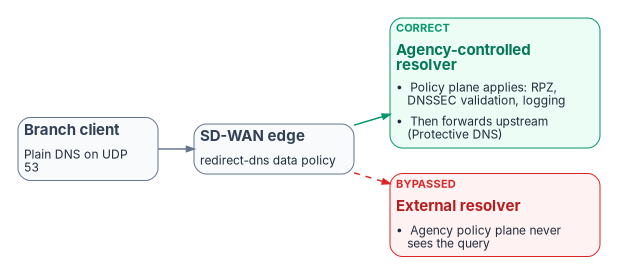
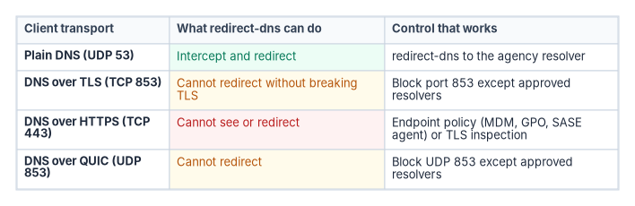

# Chapter 05 — Edge Interception, Encrypted DNS and Rogue DHCP

*Every control in the policy plane assumes the query reaches it; three ordinary mechanisms decide whether it does, and none of them reports when it doesn't.*

::: {.callout-note}
## In this chapter
How SD-WAN edges intercept DNS, using Cisco Catalyst SD-WAN's redirect-dns and Umbrella integration as the worked example, and why the redirect target decides whether agency policy applies at all. What Microsoft 365 informed network routing does and doesn't change. How encrypted DNS becomes the most common bypass, what M-22-09, CISA and NIST SP 800-81r3 require, and how Windows, Edge, Chrome and Firefox are brought under policy. How a rogue DHCP server or router advertisement moves a whole subnet to an attacker's resolver, and the controls that stop it.
:::

The policy plane described in this book applies response policy zones, DNSSEC validation, logging and Protective DNS forwarding only to queries that reach it. Three mechanisms routinely send queries somewhere else, and each does it silently: the client receives a normal-looking answer, and the agency's resolver logs nothing. This chapter takes them in order of where they sit: the network edge, the endpoint and the access layer.

## SD-WAN DNS interception

SD-WAN edges can intercept DNS regardless of the resolver a client was configured with. In Cisco Catalyst SD-WAN this is the redirect-dns action of a centralized data policy: the edge router matches DNS traffic and sends it to a policy-designated resolver. Cisco documents two uses. Unconditional redirect sends every DNS request from a host (its example is legacy printers with hard-coded DNS servers) through the local edge to an enterprise DNS server reached over a service-side VPN. Conditional redirect lets hosts use a provider's DNS by default while queries for named applications go to the enterprise server.[^c05-cisco]

{#fig-ch05-redirect-dns fig-alt="A branch client sends plain DNS on UDP 53 to the SD-WAN edge, whose redirect-dns data policy sends it either to an agency-controlled resolver, where RPZ, DNSSEC validation and logging apply before forwarding upstream to Protective DNS, or to an external resolver that the agency policy plane never sees."}

The feature has documented limits that bound what it can govern. Redirect DNS on service-side VPNs arrived in Cisco IOS XE Catalyst SD-WAN 17.8.1a and vManage 20.8.1; before that it worked only on the NAT direct internet access path. It handles IPv4 only, UDP only (TCP DNS isn't redirected), doesn't redirect DNS arriving from the overlay tunnel, fragmented packets or the router's own queries, and isn't accepted without NAT configuration.[^c05-cisco] The destination decides whether agency policy applies:

- **Correct path:** branch client → SD-WAN edge → network-addressable agency-controlled resolver → DDI policy plane (response policy zones, DNSSEC validation, logging) → per-cloud private resolvers, with internet-bound recursion forwarded through Protective DNS.
- **Bypassed path:** branch client → SD-WAN edge → an external resolver → public recursion. The agency policy plane never sees those queries: no log entry, no RPZ evaluation, no validation under agency trust anchors.

Two refinements of the whitepaper's analysis matter here. First, "agency-controlled resolver" means a server the edge can address: a DDI appliance or virtual member at the branch or across the overlay. A device-resident agent isn't one. Infoblox Endpoint, for example, listens on the loopback address (127.0.0.1, or 127.0.0.2 on macOS) on the device itself and forwards to the Infoblox platform over DNS over TLS on TCP 443; queries for bypassed internal domains and DHCP-learned search domains go to local DNS servers instead.[^c05-ibendpoint] It protects the device wherever it is, but it isn't a redirect target. Second, a secure web gateway or SASE resolver in the path isn't automatically a bypass of the federal requirement: Cisco's Umbrella for Government, now part of the Cisco Security Cloud for Government offering listed as FedRAMP Certified at the High impact level, describes integration with CISA Protective DNS.[^c05-fr-cisco] What such a first hop bypasses is the agency's own policy plane: its internal zones, its RPZ, its logs and its validation policy. The program's position is therefore that the redirect target is always the agency resolver, and any SASE resolver is a forwarding target behind it ([Chapter 08](08-reference-architecture.md), Decisions 1 and 2).

### Umbrella integration on the edge

Cisco SD-WAN's Umbrella integration is a second, separate interception mechanism. A DNS security policy enables `dns-redirect umbrella` per VPN, so the edge sends client queries to Umbrella's resolvers and adds EDNS0 options carrying the device and organization identifiers that select the Umbrella policy. A local domain bypass list names the domains the router doesn't redirect, sending them to an enterprise DNS server instead.[^c05-umbrella] That bypass list is effectively a second copy of the agency's internal namespace, held on every edge. If it falls behind the authoritative zones, internal names go to a public resolver and fail or, worse, resolve to something else. In a governed design the edge sends everything to the agency resolver, and the internal namespace has one definition, in the policy plane.

### DNSSEC and the forwarder position

The whitepaper stated that validation requires "the validating resolver to sit at the first recursive position in the chain." The documented rule is slightly different and leads to the same design. Microsoft's DNSSEC guidance says that when several recursive servers, including forwarders, take part in a response, each must be able to validate it for the chain of trust to hold, and that validation protects clients that don't validate themselves "provided the local (last hop) recursive DNS server is itself secure from hijacking."[^c05-azdnssec] NIST SP 800-81r3 adds that most stub resolvers can't validate and rely on an upstream validating resolver, which is acceptable when the link between them is protected.[^c05-nist81] A validating forwarder can therefore sit behind another resolver. What the agency can't do is let redirect-dns or a forwarding rule hand the client's query to a resolver outside its control and still claim to enforce its own validation policy and trust anchors; SP 800-53 SC-21 asks the agency's resolver to "request and perform" that verification ([Chapter 06](06-dns-identity-and-dnssec.md)).

### Microsoft 365 informed network routing

Microsoft 365 informed network routing (INR) shares Microsoft's measurements of Exchange, SharePoint, OneDrive and Teams experience per office location and internet circuit with a supported SD-WAN, which can then move that traffic to a better link. Cisco IOS XE SD-WAN 20.4/17.4 or later is the only solution Microsoft lists as enabled. Microsoft documents INR as supporting tenants in the Worldwide commercial cloud only, not GCC (which Microsoft's note calls GCC Moderate), GCC High, DoD, Germany or China.[^c05-inr] For agencies in those clouds, local internet breakout and application-aware routing on locally measured path quality remain the main Microsoft 365 optimizations. None of this changes the DDI design: INR is a traffic-flow optimization, not a DNS dependency. The whitepaper's further point, that if Umbrella returned a different Microsoft 365 address than the agency resolver would have, INR telemetry would describe the Umbrella-selected endpoint, follows from the design but isn't documented by either vendor and is kept here only as a reason to have one resolution path.

## Encrypted DNS and bypass controls

{#fig-ch05-encrypted-dns-paths fig-alt="Table of four transports. Plain DNS on UDP 53 can be intercepted and redirected to the agency resolver. DNS over TLS on TCP 853 and DNS over QUIC on UDP 853 cannot be redirected without breaking the session, so block port 853 except to approved resolvers. DNS over HTTPS on TCP 443 cannot be seen or redirected, so it needs endpoint policy or TLS inspection."}

Client-side encrypted DNS to a public resolver is the most common bypass, and it is the one the mandates themselves make more likely if they're applied carelessly. M-22-09 says agencies "must resolve DNS queries using encrypted DNS wherever it is technically supported"; that agency resolvers must support DoH or DoT and use them upstream; that endpoints must enable encrypted DNS in applications and the operating system; and that agencies "should explicitly configure endpoints to use agency-designated encrypted DNS servers, rather than relying on automatic network discovery." It also reminds agencies that DNS requests must already be routed through CISA-operated infrastructure.[^c05-m2209] CISA's implementation guidance turns that into a target state in which agency DNS infrastructure uses Protective DNS as its upstream provider and endpoints and applications can't talk directly to third-party DNS providers over any protocol.[^c05-cisaedns] The goal, then, isn't to prohibit encrypted DNS but to make sure it terminates at an agency-controlled resolver or Protective DNS rather than at an ungoverned public service. [Chapter 03](03-federal-requirements.md) sets out the mandates; this section is about making them true on the wire.

### What the network can and can't block

Each transport leaves a different handle (the protocol specifications are RFC 7858 for DoT, RFC 8484 for DoH and RFC 9250 for DoQ):[^c05-rfcs]

- **Plain DNS (UDP and TCP 53)** can be intercepted, redirected and blocked by port. NIST SP 800-81r3 tells organizations to block outbound DNS except from the servers authorized to talk to the internet.[^c05-nist81]
- **DNS over TLS (TCP 853) and DNS over QUIC (UDP 853)** can't be redirected without breaking the session, because the client validates the resolver's certificate, but they use a dedicated port, so both NIST and CISA treat them as straightforward to block except to approved resolvers.[^c05-nist81][^c05-cisaedns]
- **DNS over HTTPS (TCP 443)** shares a port with all web traffic. Redirect-dns can't see it, and port blocking can't isolate it. NIST recommends RPZ entries that stop resolution of known DoH server names plus firewall rules against public DoH services on dedicated addresses; CISA adds mechanisms that block it independently of destination, such as TLS break-and-inspect or zero trust network architectures.[^c05-nist81][^c05-cisaedns]

Cisco's own Umbrella troubleshooting guide makes the same point about its product: browsers using DoH or DoT can bypass Umbrella entirely, which "can make Umbrella DNS security capability impossible to use if not carefully planned," and it suggests blocking TCP 853 and the proxy and anonymizer category.[^c05-umbrella] An edge-only design can't govern encrypted DNS; the endpoint has to be configured.

### Control the endpoint: Windows

Windows gives three layers of control:

- **The DNS client.** Since Windows Server 2022, and in Windows 11, the DNS client supports DoH; Windows 11 also supports DoT.[^c05-doh][^c05-win11] DoH is used only with servers on the client's list of known DoH servers, and the shipped list contains Cloudflare, Google and Quad9; an agency adds its own resolvers with `Add-DnsClientDohServerAddress`. The **Configure DNS over HTTPS (DoH) name resolution** Group Policy setting allows, prohibits or requires DoH.[^c05-doh]
- **The DNS server.** Since the 2026-06 security update (KB5094125), the Windows Server 2025 DNS Server service can accept DoH from clients, with a certificate whose SAN matches the DoH URI template. Microsoft documents that upstream communication to forwarders, conditional forwarders and authoritative servers remains unencrypted, as do zone transfers and, by default, dynamic updates.[^c05-ws-doh] Microsoft's client-side page still warns against requiring DoH on domain-joined machines "because the Windows Server DNS Server service doesn't support DoH queries" and suggests IPsec instead;[^c05-doh] that statement predates the server feature. And CISA states that tunnelling port-53 DNS through IPsec "is not considered an acceptable substitute" for encrypted DNS under M-22-09.[^c05-cisaedns]
- **Zero Trust DNS.** On Windows 11 Enterprise and Education, Zero Trust DNS blocks outbound IP traffic by default and permits it only to addresses resolved by configured Protective DNS servers over DoH or DoT, or to administrator-defined exceptions.[^c05-ztdns] It turns the resolver from a source of answers into the enforcement point on the device itself.

The server-side limit has a design consequence. A Windows DNS server can now encrypt the client leg, but it can't meet the M-22-09 and CISA expectation that agency resolvers use encrypted DNS upstream to Protective DNS. CISA's guidance anticipates this: for DNS servers that can't encrypt upstream, it suggests a local proxy that forwards their queries to Protective DNS over an encrypted protocol, after confirming feasibility with the vendor. It also requires agencies to disable root hints, so a resolver can't fall back to iterative resolution and bypass Protective DNS, and allows public fallback resolvers only when Protective DNS is unavailable, with alerting when they're used.[^c05-cisaedns] Enterprise DDI platforms generally support encrypted upstream forwarding natively; confirm it for the release you deploy.

### Control the endpoint: browsers

Browsers resolve names themselves, so operating-system policy doesn't cover them. CISA's guidance requires each browser to be configured either to use the operating system's resolver or to use encrypted DNS only with agency DNS infrastructure, and notes that pointing a browser's DoH directly at Protective DNS would bypass internal DNS and break internal names.[^c05-cisaedns]

- **Microsoft Edge and Google Chrome** expose the `DnsOverHttpsMode` policy, with `off`, `automatic` (DoH with insecure fallback) and `secure` (DoH only) modes. Microsoft documents that when the policy isn't configured on a managed device, Edge doesn't send DoH queries.[^c05-edge][^c05-chrome]
- **Firefox** treats an NXDOMAIN answer for the canary domain `use-application-dns.net` as a network signal to leave default DoH off, and disables DoH when enterprise policies are active unless its `DNSOverHTTPS` policy enables it.[^c05-ff-canary][^c05-ff-heur] CISA also notes that Firefox disables DoH when operating-system parental controls are on, and that agencies must re-validate behavior with each browser release.[^c05-cisaedns]

The program's configuration is the CISA one: browsers use the operating system resolver, or DoH only to agency resolvers, set as mandatory policy through Group Policy or Intune, and the agency resolver answers NXDOMAIN for the Firefox canary.

::: {.callout-warning}
## Illustrative, not tested against a production estate
The commands below are illustrations checked against Microsoft Learn for cmdlet, parameter and policy names. They haven't been tested against a production estate. The address and template are placeholders for the agency's own DoH resolver.
:::

```powershell
# Register the agency resolver as a known DoH server, with no plain-text fallback
Add-DnsClientDohServerAddress -ServerAddress '10.10.0.53' `
    -DohTemplate 'https://dns.corp.example.gov/dns-query' `
    -AllowFallbackToUdp $False -AutoUpgrade $True

# Confirm what the client will use
Get-DnsClientDohServerAddress

# Edge: browser DoH off, so the browser uses the governed OS resolver
New-Item -Path 'HKLM:\SOFTWARE\Policies\Microsoft\Edge' -Force | Out-Null
Set-ItemProperty -Path 'HKLM:\SOFTWARE\Policies\Microsoft\Edge' -Name DnsOverHttpsMode -Value 'off'
```

In production, set the Edge and Chrome policies through Group Policy or Intune rather than the registry, so they're enforced and reported.

### Alert on resolution-path anomalies

Prevention is never complete, so the program also watches for its failure: hosts that make outbound connections but whose queries never appear in the governed resolver logs, any use of a fallback public resolver, TCP 853 or UDP 853 attempts to unapproved destinations, and DoH connections to known public DoH endpoints. [Chapter 11](11-operating-the-control-plane.md) turns these into monitored evidence.

## DHCP option 6 and rogue DHCP

A rogue DHCP server that hands out a malicious resolver in option 6 can move an entire subnet onto an attacker-controlled resolver in one step, past every response policy zone and Protective DNS control. MITRE ATT&CK catalogs the technique as DHCP Spoofing (T1557.003), with malware acting as a DHCP server to "provide adversary-owned DNS servers" to victims.[^c05-mitre] The whitepaper's claim that the technique "has been observed in federal network incidents" couldn't be verified and has been removed. In IPv6 networks, rogue router advertisements carrying the RDNSS option (RFC 8106) can do the same and are often the larger attack surface, because many networks govern DHCPv4 carefully and router advertisements not at all.[^c05-rfc8106] RFC 9463 now also lets DHCP and router advertisements announce encrypted, network-designated resolvers;[^c05-rfc9463] M-22-09's instruction to configure agency-designated resolvers explicitly rather than rely on discovery is the federal answer to that channel.[^c05-m2209]

Option 6 isn't the only option that moves traffic. The options that matter most for DNS governance:

| Option | Name | What it sets | Why it's governed |
|---|---|---|---|
| 6 | Domain Server | The resolvers the client uses | Must point to the governed resolvers; inconsistent values across servers apply policy unevenly |
| 15 | Domain Name | The client's default domain | Must match the authoritative zone, or short names resolve in the wrong place |
| 119 | Domain Search | The ordered search suffix list | Stale entries send queries to the wrong zone |
| 81 | Client FQDN | Who registers the client's DNS records | Decides whether the client or the DHCP server owns the name ([Chapter 04](04-active-directory-dns-departure.md)) |
| 82 | Relay Agent Information | Circuit and remote IDs added by the relay | Identifies the switch port for IPAM attribution and investigations |
| 252 | WPAD | The proxy auto-configuration URL | A wrong value bypasses the web proxy; a security-relevant setting distributed by DHCP |

Option numbers and names for 6, 15, 81, 82 and 119 follow the IANA DHCP and BOOTP parameter registry, which lists 224 to 254 as private use.[^c05-iana-dhcp] WPAD's use of 252 is a convention, not an assignment: Microsoft's own example defines option 252 as "WPAD" on a Windows DHCP server, and notes that the WPAD specification never progressed beyond an Internet-Draft.[^c05-wpad]

### What the Windows controls do and don't cover

Windows DHCP servers in a domain must be authorized in Active Directory; an unauthorized Windows DHCP server checks its own status, finds itself missing from the authorized list in the Configuration container, and stops leasing.[^c05-dhcp-auth] The check is performed by the Windows DHCP Server service on itself, so it stops a misconfigured or unauthorized Windows server, not a rogue appliance, a home router plugged into a wall port or malware answering DHCP requests. Those need network controls.

### Controls that close the gap

Unified DHCP and IPv6 governance addresses this through:

- **DHCP snooping and RA Guard on the access switches.** MITRE recommends DHCP snooping on layer 2 switches to prevent DHCP spoofing, and RA Guard (RFC 6105) filters router advertisements from ports that shouldn't send them.[^c05-mitre][^c05-rfc6105]
- **Centralized scope and option management** with change control and an audit trail, so option 6 and RDNSS values are set once and are the same on every authorized server and router.
- **Rogue DHCP and router advertisement detection** through lease analysis and network discovery; enterprise DDI platforms commonly include it.
- **IPAM integration**, so an unexpected lease or an address outside the plan is visible immediately.

::: {.callout-note}
## What this chapter establishes
1. The redirect-dns destination decides whether agency policy applies at all; it must be a network-addressable agency resolver, redirect-dns handles only IPv4 DNS over UDP, and a SASE or Umbrella resolver belongs behind the agency resolver, not in front of it.
2. Encrypted DNS must terminate at agency resolvers or Protective DNS. DoT and DoQ can be blocked by port; DoH can be governed only at the endpoint, through operating-system and browser policy.
3. A Windows DNS server can now accept DoH from clients but still forwards upstream in plain text, so meeting the encrypted-upstream expectation needs a capable resolver or an encrypting proxy; IPsec isn't a substitute.
4. Rogue DHCP and rogue router advertisements can move a whole subnet to an attacker's resolver in one step; AD authorization doesn't stop them, switch-level snooping and RA Guard do.
:::

::: {.callout-tip}
## Continue the book
[← Previous: Chapter 04 — The Active Directory DNS Departure](04-active-directory-dns-departure.md) · [Book index](index.md) · [Next: Chapter 06 — DNS Identity, Certificates and DNSSEC →](06-dns-identity-and-dnssec.md)
:::

[^c05-cisco]: Cisco, *Cisco Catalyst SD-WAN Policies Configuration Guide, Cisco IOS XE Catalyst SD-WAN Release 17.x*, "Redirect DNS in Cisco Catalyst SD-WAN Service-Side VPNs" (use cases, supported releases, restrictions), <https://www.cisco.com/c/en/us/td/docs/routers/sdwan/configuration/policies/ios-xe-17/policies-book-xe/redirect-dns.html> (accessed Oct 20, 2026).
[^c05-ibendpoint]: Infoblox, "Managing Endpoint" (Infoblox Threat Defense documentation), <https://docs.infoblox.com/space/BloxOneThreatDefense/35374260/Managing+Endpoint> (accessed Oct 20, 2026).
[^c05-fr-cisco]: FedRAMP Marketplace dataset, product FR2304757473A, "Cisco Security Cloud for Government" (status FedRAMP Certified, impact level High, certified August 6, 2026; service description including Cisco Umbrella for Government and "integration with CISA Protective DNS"), <https://www.fedramp.gov/marketplace/products.json> (accessed Oct 20, 2026).
[^c05-umbrella]: Cisco, "Configure Integration with Cisco Umbrella and Troubleshooting Common Problems" (Cisco SD-WAN), April 8, 2021, <https://www.cisco.com/c/en/us/support/docs/routers/sd-wan/214155-configure-integration-with-cisco-umbrell.html> (accessed Oct 20, 2026).
[^c05-azdnssec]: Microsoft Learn, "DNSSEC overview" (Azure DNS), DNSSEC validation and trust anchors, <https://learn.microsoft.com/en-us/azure/dns/dnssec> (accessed Oct 20, 2026).
[^c05-nist81]: NIST SP 800-81r3, *Secure Domain Name System (DNS) Deployment Guide*, March 2026, §4.2.2 (blocking unauthorized external DNS, DoT, DoH and DoQ) and §5.2 (DNSSEC considerations for stub resolvers), <https://csrc.nist.gov/pubs/sp/800/81/r3/final> (accessed Oct 20, 2026).
[^c05-inr]: Microsoft Learn, "Microsoft 365 informed network routing," <https://learn.microsoft.com/en-us/microsoft-365/enterprise/office-365-network-mac-perf-cpe?view=o365-worldwide> (accessed Oct 20, 2026).
[^c05-m2209]: Office of Management and Budget, M-22-09, *Moving the U.S. Government Toward Zero Trust Cybersecurity Principles*, January 26, 2022, "Encrypting DNS traffic," pp. 13–14, <https://www.whitehouse.gov/wp-content/uploads/2022/01/M-22-09.pdf> (accessed Oct 20, 2026).
[^c05-cisaedns]: CISA, *Encrypted DNS Implementation Guidance*, May 2024, Executive Summary, §2 (agency implementation checklist, including blocking by transport, and §2.1 phased implementation), §3.3 (agency DNS infrastructure: IPsec, proxies, root hints, fallback resolvers) and Appendix A.1 (web browsers), <https://www.cisa.gov/sites/default/files/2024-05/Encrypted%20DNS%20Implementation%20Guidance_508c.pdf> (accessed Oct 20, 2026); landing page <https://www.cisa.gov/resources-tools/resources/encrypted-dns-implementation-guidance>.
[^c05-rfcs]: Z. Hu et al., RFC 7858, *Specification for DNS over Transport Layer Security (TLS)*, May 2016, <https://www.rfc-editor.org/rfc/rfc7858>; P. Hoffman and P. McManus, RFC 8484, *DNS Queries over HTTPS (DoH)*, October 2018, <https://www.rfc-editor.org/rfc/rfc8484>; C. Huitema et al., RFC 9250, *DNS over Dedicated QUIC Connections*, May 2022, <https://www.rfc-editor.org/rfc/rfc9250> (all accessed Oct 20, 2026).
[^c05-doh]: Microsoft Learn, "Secure DNS Client over HTTPS (DoH)" (Windows Server), <https://learn.microsoft.com/en-us/windows-server/networking/dns/doh-client-support> (accessed Oct 20, 2026).
[^c05-win11]: Microsoft Learn, "Network security" (Windows security book), Domain Name System (DNS) security, <https://learn.microsoft.com/en-us/windows/security/book/operating-system-security-network-security> (accessed Oct 20, 2026).
[^c05-ws-doh]: Microsoft Learn, "DNS encryption using DNS over HTTPS," DNS over HTTPS for DNS Server, <https://learn.microsoft.com/en-us/windows-server/networking/dns/dns-encryption-dns-over-https>, and "Enable DNS over HTTPS in DNS Server," prerequisites, <https://learn.microsoft.com/en-us/windows-server/networking/dns/enable-dns-over-https-server> (both accessed Oct 20, 2026).
[^c05-ztdns]: Microsoft Learn, "Zero Trust DNS," <https://learn.microsoft.com/en-us/windows/security/operating-system-security/network-security/zero-trust-dns/> (accessed Oct 20, 2026).
[^c05-edge]: Microsoft Learn, "DnsOverHttpsMode" (Microsoft Edge browser policy), <https://learn.microsoft.com/en-us/deployedge/microsoft-edge-browser-policies/dnsoverhttpsmode> (accessed Oct 20, 2026).
[^c05-chrome]: Google, Chrome Enterprise policy list, "DnsOverHttpsMode: Controls the mode of DNS-over-HTTPS," <https://chromeenterprise.google/policies/dns-over-https-mode/> (accessed Oct 20, 2026). CISA's guidance (Appendix A.1.2) documents the same policy for Chrome.
[^c05-ff-canary]: Mozilla Support, "Configure networks to disable DNS over HTTPS" (canary domain use-application-dns.net), <https://support.mozilla.org/en-US/kb/configuring-networks-disable-dns-over-https> (accessed Oct 20, 2026); cited by CISA, *Encrypted DNS Implementation Guidance*, Appendix A.1.1.
[^c05-ff-heur]: Mozilla Wiki, "Security/DNS Over HTTPS/Heuristics": "If enterprise policies are active, we disable DoH unless it is explicitly enabled by the DNSOverHTTPS policy," <https://wiki.mozilla.org/Security/DNS_Over_HTTPS/Heuristics> (accessed Oct 20, 2026).
[^c05-mitre]: MITRE ATT&CK, "Adversary-in-the-Middle: DHCP Spoofing" (T1557.003), including mitigation M1037, <https://attack.mitre.org/techniques/T1557/003/> (accessed Oct 20, 2026).
[^c05-rfc8106]: J. Jeong et al., RFC 8106, *IPv6 Router Advertisement Options for DNS Configuration*, March 2017, <https://www.rfc-editor.org/rfc/rfc8106> (accessed Oct 20, 2026).
[^c05-rfc9463]: M. Boucadair et al., RFC 9463, *DHCP and Router Advertisement Options for the Discovery of Network-designated Resolvers (DNR)*, November 2023, <https://www.rfc-editor.org/rfc/rfc9463> (accessed Oct 20, 2026).
[^c05-iana-dhcp]: IANA, "Dynamic Host Configuration Protocol (DHCP) and Bootstrap Protocol (BOOTP) Parameters," BOOTP Vendor Extensions and DHCP Options, <https://www.iana.org/assignments/bootp-dhcp-parameters/bootp-dhcp-parameters.xhtml> (accessed Oct 20, 2026).
[^c05-wpad]: Microsoft Learn, "Add-DhcpServerv4OptionDefinition" (DhcpServer module), Example 1 (option ID 252, "WPAD"), <https://learn.microsoft.com/en-us/powershell/module/dhcpserver/add-dhcpserverv4optiondefinition?view=windowsserver2025-ps>, and "WinHTTP AutoProxy Support," <https://learn.microsoft.com/en-us/windows/win32/winhttp/winhttp-autoproxy-support> (both accessed Oct 20, 2026).
[^c05-dhcp-auth]: Microsoft Learn, "Troubleshooting guide: DHCP authorization failures," DHCP authorization flow, <https://learn.microsoft.com/en-us/troubleshoot/windows-server/networking/troubleshooting-guide-dhcp-authorization-failures>, and "Quickstart: Install and configure DHCP Server," <https://learn.microsoft.com/en-us/windows-server/networking/technologies/dhcp/quickstart-install-configure-dhcp-server> (both accessed Oct 20, 2026).
[^c05-rfc6105]: E. Levy-Abegnoli et al., RFC 6105, *IPv6 Router Advertisement Guard*, February 2011, <https://www.rfc-editor.org/rfc/rfc6105> (accessed Oct 20, 2026).
