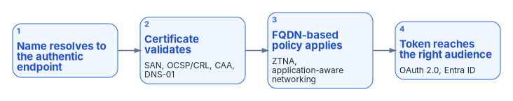
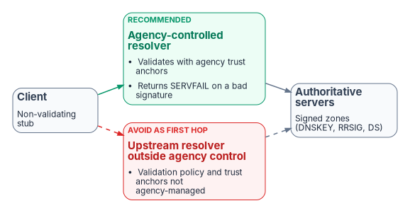

# Chapter 06 — DNS Identity, Certificates and DNSSEC

*A certificate can be valid, unrevoked and issued for the right name and still fail, because every check that makes it trustworthy starts with a DNS lookup.*

::: {.callout-note}
## In this chapter
How DNS identity, the authoritative mapping of names to endpoints, owners and lifecycle, underpins certificate issuance and validation, FQDN-based policy and token-based access. How the move from Kerberos to Microsoft Entra ID tokens changes the DNS surface, how certificate split-brain presents as a PKI failure, and how wildcards, SANs and name constraints scope trust geographically. Then DNSSEC: what it protects, what federal policy and NIST SP 800-81r3 require of it, why validation belongs on a resolver the agency controls, and how Windows Server, Azure DNS and Amazon Route 53 support signing and validation, including the sequence for moving signed zones.
:::

## DNS identity as the foundation for certificates, policy and tokens

DNS identity, meaning the authoritative mapping of names to addresses, owners and lifecycle, is a prerequisite for certificate-based security, application-aware networking and token-based controls. Each of them names its subject by FQDN and trusts DNS to take the caller to that subject.

{#fig-ch06-trust-chain fig-alt="Four steps in sequence: the name resolves to the authentic endpoint; the certificate validates (SAN, OCSP and CRL, CAA, DNS-01); FQDN-based policy applies (ZTNA, application-aware networking); and the token reaches the right audience (OAuth 2.0, Entra ID)."}

- **Certificate issuance.** The ACME `dns-01` challenge, which public CAs and enterprise lifecycle platforms use to prove control of a name, requires creating and removing a TXT record under `_acme-challenge` with controlled, auditable authority.[^c06-rfc8555] An enterprise DDI API makes automated issuance and renewal possible without exposing web servers ([Chapter 11](11-operating-the-control-plane.md) covers the automation). CAA records limit which CAs may issue for a name.[^c06-rfc8659] [Book 07](../b07-pki/08-lifecycle-monitoring-and-decommissioning.md) sets the program's ACME design: CyberArk Certificate Manager is the lifecycle platform, `dns-01` makes the authoritative zone the gate for automated issuance, and the DNS team is consulted on the rollout. As publicly trusted TLS lifetimes fall toward 47 days under the CA/Browser Forum schedule ([Book 07, Chapter 01](../b07-pki/01-why-certificates-outlive-every-migration.md)), that gate is exercised constantly, not once a year.
- **Certificate binding.** DNSSEC provides integrity and authenticity for DNS data, which is what makes DANE TLSA records usable for binding certificates to names independently of the public PKI.[^c06-rfc6698]
- **Encrypted DNS.** DoT, DoH and DoQ resolvers present certificates of their own, which must be issued, rotated and monitored like any other server certificate. A Windows DNS server offering DoH, for example, needs a certificate with the Server Authentication EKU and a SAN matching its DoH URI template ([Chapter 05](05-edge-interception-and-bypass.md)).[^c06-ws-doh]
- **Application-aware networking and zero trust network access.** These depend on FQDN-based policy ("allow this group to this application FQDN") rather than brittle IP rules.
- **Tokens.** OAuth 2.0, JWTs and Microsoft Entra ID operate after the connection is made. DNS decides whether the client reaches the authentic endpoint that issues or accepts the token, and Protective DNS helps keep tokens from being sent to malicious destinations.

DNS identity is the first link in the chain that makes certificate, application and token controls meaningful. Under split-brain, certificate validation failures, access denials and policy gaps become symptoms that are harder to diagnose than classic Kerberos failures.

## From Kerberos to tokens: the DNS surface changes, it doesn't shrink

Kerberos depends on DNS to find a KDC and to reach the host whose SPN the ticket names ([Chapter 04](04-active-directory-dns-departure.md)). Token-based authentication with Microsoft Entra ID removes the KDC from the path but adds a different set of names that must resolve consistently:

- **Authorization endpoints.** Clients must reach the Entra ID token endpoint for their cloud. The global service is `login.microsoftonline.com`, and it is the one Microsoft 365 GCC tenants use (Microsoft describes GCC as operating "in conjunction with Azure Public Cloud"); Azure Government, which also serves Microsoft 365 GCC High and DoD, is `login.microsoftonline.us`, and Entra ID rejects an Azure Government application signing in through the public endpoint.[^c06-national][^c06-aadsts][^c06-gcc] The whitepaper grouped GCC with the `.us` endpoint; that has been corrected. A resolver or proxy that sends a GCC High tenant's sign-ins toward the commercial endpoint breaks authentication.
- **Token audience.** An access token's `aud` claim identifies the API it was issued for, and the API must reject a token whose audience doesn't match. In v2.0 tokens it is always the API's client ID, a GUID; in v1.0 tokens it can be the client ID or the resource URI used in the request.[^c06-aud] The whitepaper said the audience "contains the FQDN"; that is true only where an application's identifier URI is an FQDN and v1.0 tokens are in use. The DNS consequence is narrower than stated but real: renaming an API's host doesn't change its audience, so a rename that isn't reflected in the client configuration fails as an audience or redirect-URI error, not a DNS one.
- **Certificate SANs.** Every TLS server certificate lists the names it is valid for. If DNS sends the client to a server whose certificate doesn't include the name the client asked for, the handshake fails.
- **Revocation endpoints.** CRL distribution points and OCSP responders are named in the certificate and are reached by DNS name. Microsoft Entra certificate-based authentication checks one HTTP CRL location per CA and doesn't use OCSP or LDAP, so for CBA it is the CRL URL that must resolve and be reachable from the internet ([Book 07, Chapter 02](../b07-pki/02-what-ad-cs-holds-up.md)).

### The certificate split-brain problem

The certificate-DNS intersection produces a form of split-brain that is harder to diagnose than the private-IP form, because it presents as a certificate error. Consider a service at `payments.agency.gov` with a TLS certificate from the agency's PKI, whose OCSP responder is `ocsp.pki.agency.gov` and whose CRL is published under `crl.pki.agency.gov`. Inside the network, `payments.agency.gov` resolves to a private address. The revocation endpoints must resolve and be reachable from every place that validates the certificate, including cloud workloads in AWS and Azure that call the service.

If the revocation names exist only in AD DNS, an EC2 instance can't resolve them unless the Route 53 Resolver has a forwarding rule for `pki.agency.gov`. Without the rule, the lookup fails and the TLS client treats revocation status as unavailable: a client that requires a revocation check fails the handshake, and one configured to soft-fail proceeds without it. The DNS failure leaves no trace in the agency resolver's logs, because the query never reached it, and the incident ticket is opened against PKI. The root cause, a missing forwarding rule, can take days to find. This is the scenario behind Decision 5 in [Chapter 08](08-reference-architecture.md) and the test row for OCSP and CRL endpoints in [Chapter 10](10-migration-sequence.md)'s validation matrix.

The conclusion is that PKI trust in a hybrid multi-cloud estate depends on DNS correctness. A certificate that is correctly issued by a trusted CA for the right name, and not revoked, can still fail to be trusted when the DNS fabric under its validation chain is inconsistent. An agency can't claim a functioning PKI trust chain unless DNS resolution is consistent from every network location: on-premises, in every cloud and at every branch.

### Geographic scoping: wildcards, SANs and name constraints

Agencies that run applications in several regions sometimes need to scope trust geographically, for data residency or containment. The question usually starts with a mid-label wildcard such as `application.*.agency.gov`. It doesn't work. RFC 9525 (November 2023, which obsoletes RFC 6125 of March 2011) allows a wildcard in a certificate's DNS name only as the complete leftmost label, allows only one, and makes it match exactly one label; any other form "is invalid and MUST be ignored."[^c06-rfc9525] The whitepaper also traced the history through the CA/Browser Forum's 2012 rules and named specific TLS libraries that reject such certificates; those details weren't verified and have been removed, since RFC 9525 settles the point.

The one-label rule has a consequence that is easy to miss: DNS wildcards can match more than one label, but certificate wildcards can't. A DNS record `*.api.agency.gov` answers for `v2.payments.api.agency.gov`; a certificate for `*.api.agency.gov` doesn't cover it.[^c06-rfc9525] Geographic scoping therefore uses three layers:

| Layer | Mechanism | How it's enforced | Split-brain exposure |
|---|---|---|---|
| DNS namespace | Per-region names (`app.eastus.agency.gov`) and, optionally, leftmost-label wildcards per region (`*.eastus.agency.gov`) | Resolution | High: the zone must be identical on every surface |
| Certificate SANs | One SAN per region, such as `*.eastus.agency.gov` and `*.westus.agency.gov`, in one certificate or one per region | TLS name matching | Medium: the certificate is right, but DNS must still send the client to the right region |
| Name constraints | A per-region issuing CA whose certificate permits only `eastus.agency.gov` | Path validation in the client | Low: the constraint is in the certificate chain, not in DNS |

A multi-SAN wildcard certificate widens the blast radius of a key compromise to every region it covers; that is the trade-off for its convenience. Name constraints are the only cryptographic, rather than procedural, mechanism. RFC 5280 requires conforming CAs to mark the extension critical but says applications "SHOULD," not must, be able to process constraints on DNS names,[^c06-rfc5280] so the program treats name constraints as strong defense in depth and tests its relying parties rather than assuming enforcement. Whatever the certificate layer does, DNS re-enters at the end: if split-brain sends a client in one region to another region's endpoint, the certificate validates, the application answers and the data crosses a boundary policy forbids, with no network-layer sign that anything went wrong.

## DNS as the application surface

For most of the internet's history, network policy was written against IP addresses and ports. That model breaks in cloud-native and zero trust architectures for three reasons: cloud workloads are created and destroyed continuously, so their addresses don't stay put; an address says nothing about the security posture of whatever is using it at the moment; and private address space is reused across every cloud and on-premises network, so a rule for `10.1.0.0/16` in one environment is meaningless in another. Application-layer networking uses the FQDN as the stable service identity instead. A zero trust policy says "allow `payments-service` to call `ledger-api.finance.agency.gov` on 443," a service mesh routes to a service name, and an API gateway checks the `Host` header against its registered names. NIST's zero trust architecture places resource access decisions at policy enforcement points in exactly this way.[^c06-sp800207] The consequence for DNS is that it stops being a lookup utility and becomes the registry of service identities. If the same FQDN resolves differently from different places, the service identity itself is inconsistent, and so are the policies, certificates and access controls that reference it.

Wildcard DNS is the natural way to publish a namespace of applications: one `*.api.agency.gov` record pointing at a gateway serves `payments.api.agency.gov`, `grants.api.agency.gov` and every other API behind it. Wildcards have been part of DNS since RFC 1034, and their matching rules are clarified in RFC 4592.[^c06-rfc4592] The pattern amplifies misconfiguration. If that wildcard is correct in the on-premises platform but missing from Route 53, the failure isn't one broken service but every API behind the gateway, for every AWS-hosted caller at once. A single wildcard certificate deployed across dozens of services behaves the same way: it validates for callers whose DNS is right and fails for those whose DNS is wrong, and examining the certificate can't explain the difference.

Regional namespaces of the form `{app}.{region}.agency.gov` add a variant: geographic split-brain. A record present in one cloud's private zone and absent from another's produces NXDOMAIN rather than a wrong address, a different failure signature that may not trip the same alerts. Governing these namespaces requires one authoritative source publishing the same records to every surface. The address side of this registry, IPAM that tracks FQDN namespaces and wildcard occupancy as well as address assignments, is in [Chapter 07](07-cloud-private-endpoints-and-ipam.md).

## DNSSEC

DNSSEC (DNS Security Extensions) adds data-origin authentication and integrity protection to DNS. It doesn't encrypt queries; it lets a resolver verify that the answer it received is authentic and wasn't modified. It provides:

- **Data-origin authentication:** the answer came from the legitimate authoritative servers for the zone.
- **Integrity protection:** the data hasn't been altered.
- **Authenticated denial of existence:** proof that a name or record type doesn't exist.[^c06-rfc4033]

The core specifications are RFC 4033, 4034 and 4035, and RFC 9364 records DNSSEC as best current practice.[^c06-rfc4033] DNSSEC uses a chain of trust from the root through the top-level domains to individual zones. Zones are signed with private keys; resolvers validate the signatures with the matching public keys (DNSKEY records) and the Delegation Signer (DS) records published in the parent zone. A validating resolver that finds a bad signature answers SERVFAIL, which protects clients that don't validate themselves.[^c06-azdnssec] DNSSEC and encrypted DNS are complements, not alternatives: NIST notes that DNSSEC doesn't protect confidentiality, and that DoH, DoT and DoQ protect the transaction but not the integrity or origin of the data.[^c06-nist81]

### Why it matters in hybrid multi-cloud and federal environments

{#fig-ch06-dnssec-validation fig-alt="A non-validating client stub sends queries either to an agency-controlled resolver that validates with agency trust anchors and returns SERVFAIL on a bad signature, or to an upstream resolver outside agency control whose validation policy and trust anchors the agency does not manage. Both query signed authoritative zones."}

- DNSSEC mitigates cache poisoning and on-path tampering with DNS answers, and it is the foundation for DANE TLSA records.
- **Federal policy.** OMB M-08-23 (August 2008) required agencies to deploy DNSSEC to all applicable information systems by December 2009 and to sign all agency `.gov` domains, in line with SP 800-81 and the SP 800-53 controls.[^c06-m0823] In SP 800-53 Rev. 5, SC-20 asks an authoritative service to provide origin-authentication and integrity artifacts with the data it returns "in response to external name/address resolution queries," and SC-21 asks a recursive or caching resolver to "request and perform" data-origin authentication and integrity verification on the responses it receives.[^c06-sp80053]
- **NIST SP 800-81r3** recommends configuring the internet root key as the trust anchor for validation and enabling automated trust-anchor rollover.[^c06-nist81] On internal zones it is more cautious than the whitepaper was: it calls signing internal zones "likely to be of limited value for most organizations," recommends against it unless it's required, and notes that some government agencies may be required to. Its three reasons are that internal zones may not chain to the public root, so every validator needs extra trust anchors; that dynamically updated zones must be re-signed on every update; and that signing serves no purpose when authoritative and recursive service share the same servers, as they usually do on domain controllers.[^c06-nist81] Where internal signing is required, it recommends a separate delegation from the external parent so a chain of trust to the root is possible.
- **Validation belongs on a resolver the agency controls** ([Chapter 05](05-edge-interception-and-bypass.md)). If redirect-dns or forwarding sends queries to an upstream resolver that validates outside agency control, the agency can't enforce its own validation policy or trust anchors, and SC-21 is met by someone else's system, if at all.

The program's position follows from these: sign external zones and the `.gov` delegations always; validate on every agency resolver with the root trust anchor; and sign internal zones only where the system's authorization requires it, with a delegation that chains to the root.

### Operational considerations

- **Key management.** KSK and ZSK rollover must be automated and audited. NIST recommends a hardware security module for important private keys, usually the KSK, DNSKEY signature validity periods of about five to seven days, and signing-key lifetimes of one to three years.[^c06-nist81]
- **Algorithms.** NIST's table of acceptable DNSSEC algorithms includes RSA with SHA-256 at 2,048 bits or more and ECDSA P-256 and P-384, and it prefers ECDSA because smaller keys and signatures keep responses small.[^c06-nist81] Windows Server's zone-signing wizard defaults to RSA/SHA-256 with a 2,048-bit KSK and a 1,024-bit ZSK, and offers ECDSA P-256 and P-384.[^c06-ws-sign] A default ZSK is below NIST's RSA floor, so the program signs Windows zones with ECDSA or with RSA keys of at least 2,048 bits.
- **Denial of existence.** Windows labels NSEC3 "recommended."[^c06-ws-sign] NIST observes that NSEC3 only raises the cost of zone walking, relies on SHA-1, and considers NSEC "the more prudent approach" unless policy requires NSEC3.[^c06-nist81] Compact denial of existence, published as RFC 9824 in September 2025, is a third option that prevents enumeration and is what Azure DNS uses.[^c06-rfc9824][^c06-azdnssec]
- **Response size.** Signing increases response sizes, so EDNS(0) and correct MTU and fragmentation handling are required, and responses can exceed UDP limits during algorithm rollovers.[^c06-rfc6891][^c06-nist81]
- **Consistency across views.** DNSSEC support differs across cloud DNS services (below). A zone signed in one view and unsigned or differently signed in another produces validation failures that surface as application or certificate errors rather than clear DNSSEC errors, and stub resolvers see only a generic failure, so operators must check the validator's logs.[^c06-nist81] A single policy plane removes most of that class of inconsistency.

## DNSSEC on Windows Server, Azure and AWS

Signing and validation policy should be orchestrated from the central DDI plane, so that key rollover, DS publication and validation behavior don't diverge between environments. The platforms don't offer equal support:

- **Windows Server.** One authoritative primary per zone is its Key Master, which generates keys, performs ZSK and KSK rollovers and polls child zones for signed delegations. For AD-integrated zones, private keys can be stored and replicated in Active Directory to every primary that signs its own in-memory copy of the zone; an HSM is the option for high-security environments.[^c06-keymaster][^c06-ws-sign] Trust anchors on a domain controller are held in the forest directory partition and can replicate to every domain controller; Windows supports RFC 5011 automatic trust-anchor update on rollover.[^c06-ws-dnssec][^c06-ws-validate] Windows 10 and 11 clients are non-validating security-aware stub resolvers; they don't validate, but the Name Resolution Policy Table can require that the resolver validated a given namespace.[^c06-azdnssec]
- **Azure.** Azure DNS signs public zones only, with ECDSAP256SHA256, rolls the ZSK automatically, and handles KSK replacement through support; Microsoft's documentation describes DNSSEC for Azure Public DNS and nothing for Azure Private DNS zones. The default Azure-provided resolver doesn't perform DNSSEC validation, so workloads that need validation must use a validating resolver the agency controls.[^c06-azdnssec][^c06-azfaq] Entra ID consumes FQDNs but does nothing for DNSSEC or private endpoint DNS.
- **AWS.** Route 53 supports DNSSEC signing for public hosted zones only; you can't sign a private hosted zone. The customer owns the KSK, as an asymmetric KMS key, and Route 53 manages the ZSK.[^c06-r53sign] VPC Resolver validation can be enabled per VPC and applies to public signed names during recursion; when the resolver forwards, the target resolver must validate. The VPC Resolver ignores the DO and CD bits and doesn't set the AD bit, so a client can't do its own validation through it.[^c06-r53validate]
- **Everywhere.** Zones that must be signed are signed by the DDI platform, or by the cloud DNS service under DDI control, with rollover automated in one place. Validation happens on resolvers the agency controls, and redirect-dns and cloud forwarding point at those resolvers.

Microsoft's tools show the signed data directly. `nslookup` isn't DNSSEC-aware and shouldn't be used for this; `Resolve-DnsName` with `-DnssecOk` returns the RRSIG records alongside the answer.[^c06-azdnssec]

::: {.callout-warning}
## Illustrative, not tested against a production zone
The commands below are read-only illustrations checked against Microsoft Learn for cmdlet and parameter names. They haven't been tested against a production zone. The names are placeholders.
:::

```powershell
# A signed answer: the A record plus its RRSIG
Resolve-DnsName -Name www.example.gov -Type A -DnssecOk

# The zone's public keys
Resolve-DnsName -Name example.gov -Type DNSKEY -DnssecOk

# On a Windows DNS server: signing settings and keys for a zone
Get-DnsServerDnsSecZoneSetting -ZoneName example.gov
Get-DnsServerSigningKey -ZoneName example.gov
```

### Moving signed zones

Signed zones move by their own sequence, which [Chapter 10](10-migration-sequence.md)'s Phase 6 relies on:

1. **Finish key rollovers first.** Complete any ZSK or KSK rollover in progress before a signed zone migrates, and start no new rollover during the migration.
2. **Keep the old signing until the new chain validates.** Sign the zone on its new platform, publish the new DS record at the parent (for an external zone, through the registrar), confirm from an independent validator that the new chain of trust holds, and only then stop signing at the source. Removing DNSSEC is the reverse: Microsoft documents that the DS record must be removed from the parent and its TTL allowed to expire before a zone is unsigned.[^c06-az-unsign]
3. **Watch validation failures during the move**, on the validators, since clients see only generic failures.[^c06-nist81]
4. **Decide internal zones on their merits.** Where an internal zone was signed on AD DNS and lands on a platform that can't sign private zones, such as Azure Private DNS, that is a documented risk decision, not an implementation detail. The DNS Modernization Guide listed compensating controls for this case. Two of them don't hold as written and have been corrected: Azure virtual network traffic isn't encrypted by default. Virtual network encryption has to be enabled, covers only traffic between VMs on supported sizes with Accelerated Networking, enforces only `AllowUnencrypted` (so traffic to unsupported VMs flows in the clear), and is in public preview in Azure Government;[^c06-vnetenc] and Private Link removes the public endpoint from the path but doesn't make DNS answers inside the network tamper-proof. Network isolation of the resolution path and restricting DNS traffic to authorized resolvers remain valid compensations, and NIST's own position that internal signing is of limited value where it isn't required ([above](#why-it-matters-in-hybrid-multi-cloud-and-federal-environments)) is the stronger argument.
5. **Remove retired trust anchors** for decommissioned zones from validators after the program's 90-day validation period, so stale anchors don't cause failures later.

::: {.callout-note}
## What this chapter establishes
1. DNS identity is the first link in the trust chain for certificates, FQDN-based policy and tokens; under split-brain, PKI and access failures are DNS failures in disguise.
2. Token-based authentication changes the DNS surface rather than shrinking it: national-cloud sign-in endpoints, SANs and revocation endpoints must all resolve consistently from every origin.
3. Certificate wildcards match one label and DNS wildcards can match many; name constraints are the only cryptographic geographic scope, and client support for them must be tested.
4. Validate DNSSEC on resolvers the agency controls, sign external zones always, and sign internal zones only where required; Azure and Route 53 sign public zones only, and neither default cloud resolver gives the agency validation it controls.
:::

::: {.callout-tip}
## Continue the book
[← Previous: Chapter 05 — Edge Interception, Encrypted DNS and Rogue DHCP](05-edge-interception-and-bypass.md) · [Book index](index.md) · [Next: Chapter 07 — Cloud Private Endpoints, SDN and IPAM Consistency →](07-cloud-private-endpoints-and-ipam.md)
:::

[^c06-rfc8555]: R. Barnes et al., RFC 8555, *Automatic Certificate Management Environment (ACME)*, March 2019, §8.4 (DNS challenge), <https://www.rfc-editor.org/rfc/rfc8555> (accessed Oct 20, 2026).
[^c06-rfc8659]: P. Hallam-Baker et al., RFC 8659, *DNS Certification Authority Authorization (CAA) Resource Record*, November 2019, <https://www.rfc-editor.org/rfc/rfc8659> (accessed Oct 20, 2026).
[^c06-rfc6698]: P. Hoffman and J. Schlyter, RFC 6698, *The DNS-Based Authentication of Named Entities (DANE) Transport Layer Security (TLS) Protocol: TLSA*, August 2012, <https://www.rfc-editor.org/rfc/rfc6698> (accessed Oct 20, 2026).
[^c06-ws-doh]: Microsoft Learn, "Enable DNS over HTTPS in DNS Server," prerequisites and certificate requirements, <https://learn.microsoft.com/en-us/windows-server/networking/dns/enable-dns-over-https-server> (accessed Oct 20, 2026).
[^c06-national]: Microsoft Learn, "Microsoft Entra authentication & national clouds," Microsoft Entra authentication endpoints, <https://learn.microsoft.com/en-us/entra/identity-platform/authentication-national-cloud> (accessed Oct 20, 2026).
[^c06-aadsts]: Microsoft Learn, "Error AADSTS900439 - USGClientNotSupportedOnPublicEndpoint" (the Azure Government authority `login.microsoftonline.us` also serves Microsoft 365 GCC High and DoD), <https://learn.microsoft.com/en-us/troubleshoot/entra/entra-id/app-integration/error-aadsts900439-usgclientnotsupportedonpublicendpoint> (accessed Oct 20, 2026).
[^c06-gcc]: Microsoft Learn, "Office 365 GCC - Service Descriptions," customer support ("Office 365 GCC operates in conjunction with Azure Public Cloud"), <https://learn.microsoft.com/en-us/office365/servicedescriptions/office-365-platform-service-description/office-365-us-government/gcc> (accessed Oct 20, 2026).
[^c06-aud]: Microsoft Learn, "Access token claims reference" (Microsoft identity platform), `aud` claim, <https://learn.microsoft.com/en-us/entra/identity-platform/access-token-claims-reference> (accessed Oct 20, 2026).
[^c06-rfc9525]: P. Saint-Andre and R. Salz, RFC 9525, *Service Identity in TLS*, November 2023, §6.3 (wildcard rules; obsoletes RFC 6125), <https://www.rfc-editor.org/rfc/rfc9525> (accessed Oct 20, 2026).
[^c06-rfc5280]: D. Cooper et al., RFC 5280, *Internet X.509 Public Key Infrastructure Certificate and Certificate Revocation List (CRL) Profile*, May 2008, §4.2.1.10 (Name Constraints), <https://www.rfc-editor.org/rfc/rfc5280> (accessed Oct 20, 2026).
[^c06-sp800207]: NIST SP 800-207, *Zero Trust Architecture*, August 2020, <https://csrc.nist.gov/pubs/sp/800/207/final> (accessed Oct 20, 2026).
[^c06-rfc4592]: E. Lewis, RFC 4592, *The Role of Wildcards in the Domain Name System*, July 2006, <https://www.rfc-editor.org/rfc/rfc4592> (accessed Oct 20, 2026).
[^c06-rfc4033]: R. Arends et al., RFC 4033, *DNS Security Introduction and Requirements*, March 2005, <https://www.rfc-editor.org/rfc/rfc4033>; RFC 4034, *Resource Records for the DNS Security Extensions*, March 2005, <https://www.rfc-editor.org/rfc/rfc4034>; RFC 4035, *Protocol Modifications for the DNS Security Extensions*, March 2005, <https://www.rfc-editor.org/rfc/rfc4035>; P. Hoffman, RFC 9364, *DNS Security Extensions (DNSSEC)*, BCP 237, February 2023, <https://www.rfc-editor.org/rfc/rfc9364> (all accessed Oct 20, 2026).
[^c06-azdnssec]: Microsoft Learn, "DNSSEC overview" (Azure DNS): validation, trust anchors, Windows clients as non-validating stubs and NRPT, Azure-provided resolver not validating, key rollover, ECDSAP256SHA256, RFC 9824, nslookup and Resolve-DnsName, <https://learn.microsoft.com/en-us/azure/dns/dnssec> (accessed Oct 20, 2026).
[^c06-nist81]: NIST SP 800-81r3, *Secure Domain Name System (DNS) Deployment Guide*, March 2026: §3.8 and §3.8.1–3.8.6 (DNSSEC signing, algorithms, validity periods, NSEC and NSEC3, algorithm migration, internal zones), §4.2.5–4.2.6 (validation and trust anchors), §5.2 (stub resolvers), <https://csrc.nist.gov/pubs/sp/800/81/r3/final> (accessed Oct 20, 2026).
[^c06-m0823]: Office of Management and Budget, M-08-23, *Securing the Federal Government's Domain Name System Infrastructure*, August 22, 2008, <https://georgewbush-whitehouse.archives.gov/omb/memoranda/fy2008/m08-23.pdf> (accessed Oct 20, 2026).
[^c06-sp80053]: NIST SP 800-53 Rev. 5 (release 5.2.0 OSCAL catalog), SC-20 *Secure Name/Address Resolution Service (Authoritative Source)* and SC-21 *Secure Name/Address Resolution Service (Recursive or Caching Resolver)*, <https://csrc.nist.gov/pubs/sp/800/53/r5/upd1/final>; catalog <https://github.com/usnistgov/oscal-content/blob/main/nist.gov/SP800-53/rev5/json/NIST_SP-800-53_rev5_catalog.json> (accessed Oct 20, 2026).
[^c06-ws-sign]: Microsoft Learn, "Sign DNS zones with DNSSEC" (Windows Server), Zone Signing Wizard parameters, <https://learn.microsoft.com/en-us/windows-server/networking/dns/sign-dnssec-zone> (accessed Oct 20, 2026).
[^c06-rfc9824]: RFC 9824, *Compact Denial of Existence in DNSSEC*, September 2025, <https://www.rfc-editor.org/rfc/rfc9824> (accessed Oct 20, 2026).
[^c06-rfc6891]: J. Damas et al., RFC 6891, *Extension Mechanisms for DNS (EDNS(0))*, April 2013, <https://www.rfc-editor.org/rfc/rfc6891> (accessed Oct 20, 2026).
[^c06-keymaster]: Microsoft Learn, "DNSSEC Key Master," <https://learn.microsoft.com/en-us/windows-server/networking/dns/dnssec-key-master> (accessed Oct 20, 2026).
[^c06-ws-dnssec]: Microsoft Learn, "What is DNSSEC?" (Windows Server), trust anchors, <https://learn.microsoft.com/en-us/windows-server/networking/dns/dnssec-overview> (accessed Oct 20, 2026).
[^c06-ws-validate]: Microsoft Learn, "Validate and secure DNS responses using DNSSEC" (Windows Server), DNSSEC scenarios (RFC 5011 automatic trust-anchor update), <https://learn.microsoft.com/en-us/windows-server/networking/dns/validate-dnssec-responses> (accessed Oct 20, 2026).
[^c06-azfaq]: Microsoft Learn, "Azure DNS FAQ": "Azure Public DNS supports DNSSEC," <https://learn.microsoft.com/en-us/azure/dns/dns-faq> (accessed Oct 20, 2026).
[^c06-r53sign]: AWS, *Amazon Route 53 Developer Guide*, "Configuring DNSSEC signing in Amazon Route 53," <https://docs.aws.amazon.com/Route53/latest/DeveloperGuide/dns-configuring-dnssec.html> (accessed Oct 20, 2026).
[^c06-r53validate]: AWS, *Amazon Route 53 Developer Guide*, "Enabling DNSSEC validation in Amazon Route 53," <https://docs.aws.amazon.com/Route53/latest/DeveloperGuide/resolver-dnssec-validation.html> (accessed Oct 20, 2026).
[^c06-az-unsign]: Microsoft Learn, "How to unsign your Azure Public DNS zone," <https://learn.microsoft.com/en-us/azure/dns/dnssec-unsign> (accessed Oct 20, 2026).
[^c06-vnetenc]: Microsoft Learn, "What is Azure Virtual Network encryption?," <https://learn.microsoft.com/en-us/azure/virtual-network/virtual-network-encryption-overview> (accessed Oct 20, 2026).
