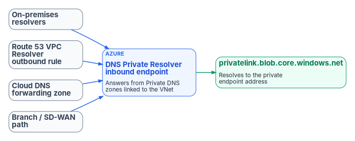
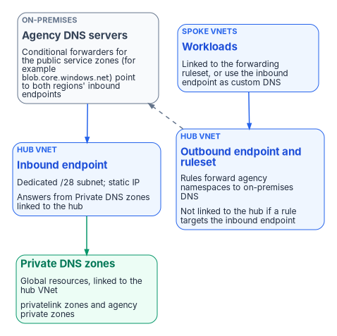
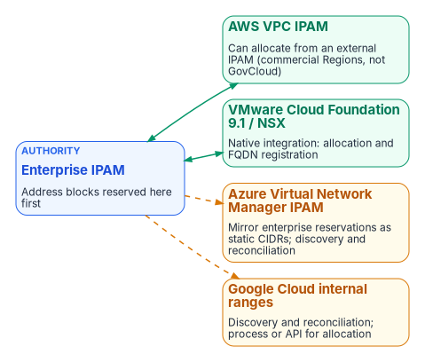

# Chapter 07 — Cloud Private Endpoints, SDN and IPAM Consistency

*Every cloud ships its own private DNS and its own address manager; unless one plane governs both, names and addresses drift apart one console at a time.*

::: {.callout-note}
## In this chapter
How AWS, Azure, Google Cloud and VMware NSX each implement private DNS, and why their differences matter. How Azure private endpoints resolve, which zones must be forwarded from every origin, how to build the Azure DNS Private Resolver in a hub-and-spoke network, and the three hybrid resolution patterns with their validation and rollback steps. How enterprise IPAM stays the authority for address blocks across AWS VPC IPAM, Azure Virtual Network Manager, Google Cloud and VMware Cloud Foundation, and what IPv6 adds.
:::

## How each platform implements private DNS

Each cloud provider and VMware ships its own private DNS service, because DNS is the connective tissue of everything else the platform does. Each has its own console, API, zone model and failure behavior, and none was designed to share policy with the others. The differences below are the reason a single policy plane has to hold the forwarding rules between them.

| Platform | Private namespace | Entry point for queries from outside | Forwarding out | DNS-layer policy |
|---|---|---|---|---|
| AWS | Route 53 private hosted zones, answered by the Route 53 VPC Resolver at the VPC+2 address[^c07-r53] | VPC Resolver inbound endpoint | Outbound endpoint plus Resolver rules (one rule per domain; rules can be shared across accounts)[^c07-r53] | Resolver DNS Firewall filters outbound queries that pass through the VPC Resolver[^c07-r53fw] |
| Azure | Private DNS zones, resolvable only from virtual networks linked to the zone[^c07-azpdns] | DNS Private Resolver inbound endpoint[^c07-azpr] | Outbound endpoint plus DNS forwarding rulesets linked to virtual networks[^c07-azpr] | DNS resolver policy: allow, block or alert on domain lists, including a Microsoft-managed threat intelligence list[^c07-azresolverpolicy] |
| Google Cloud | Cloud DNS private zones scoped to VPC networks; VMs query the metadata server at `169.254.169.254`[^c07-gcpserver] | Inbound server policy entry points in the VPC network[^c07-gcpserver] | Forwarding zones (per domain) and outbound server policies; peering zones resolve across VPC networks[^c07-gcpzones][^c07-gcpserver] | Response policies, rules the resolver consults during lookups (one per network)[^c07-gcpresp] |
| VMware NSX | No cloud-style private zone; the NSX DNS Forwarder Service on the gateway holds a default zone and up to five FQDN zones of up to three servers each[^c07-nsx] | The forwarder's service IP, used by workloads only if they are configured to use it[^c07-nsx] | FQDN zones forward named domains to designated servers | None beyond forwarding |

Three consequences follow. AWS has been renaming its pieces: the service formerly called Route 53 Resolver is now the Route 53 VPC Resolver, renamed when Route 53 Global Resolver was introduced, so older runbooks and diagrams use the old name.[^c07-r53] Azure's private zones exist only for linked virtual networks, so a private endpoint name resolves to its private address only from a path that reaches a resolver inside a linked network. And VMware workloads resolve through whichever DNS server their segment or VM is configured with; the NSX forwarder is opt-in, which makes the resolution path invisible from an on-premises DNS console.

The management burden follows directly. A single new Azure private endpoint can require changes in the Azure private zone, the Private Resolver rulesets, AWS Resolver rules and on-premises conditional forwarders (Chapter 01). The forwarding rules that connect the platforms typically belong to no single team: the cloud team owns cloud DNS, the network team owns the DDI grid, the Windows team owns AD DNS. Chapter 09 assigns that ownership.

## Azure DNS and private endpoints

{#fig-ch07-private-endpoint-forwarding fig-alt="On-premises resolvers, a Route 53 VPC Resolver outbound rule, a Cloud DNS forwarding zone and the branch SD-WAN path all forward the service's public zone, such as blob.core.windows.net, to the Azure DNS Private Resolver inbound endpoint, which answers from the Private DNS zone privatelink.blob.core.windows.net linked to its virtual network with the private endpoint address."}

Azure private endpoints are the most common source of private-IP split-brain in hybrid environments (Chapter 02). Getting them right takes deliberate DNS design rather than reliance on Azure's default public resolution.

### Core behavior

When a private endpoint is created with private DNS integration, Azure creates a private DNS zone group that writes the endpoint's A record into the matching `privatelink` zone, such as `privatelink.blob.core.windows.net`, and deletes the records when the endpoint is deleted.[^c07-azpe] Public DNS carries a CNAME from the service name into the `privatelink` name, so connection strings do not change.[^c07-azpezones] The private answer comes back only when the query reaches a resolver that can see a private zone linked to its virtual network: the Azure-provided resolver in a linked network, or a DNS Private Resolver inbound endpoint in a linked network (or another resolver forwarding to one).[^c07-azpe] A query that falls through to public recursion follows the public CNAME chain and gets the public address. Private DNS zones are global resources, not tied to a region or a single virtual network.[^c07-azpdns]

Three behaviors catch teams out:

- **DNS answers do not grant access.** The public CNAME chain is resolvable from anywhere by design; whether a caller can connect is decided by the service's public network access setting and firewall, not by DNS.[^c07-azpezones] A wrong DNS answer therefore shows up as a connection over the public path or as an access denial, not as a DNS error.
- **One zone per service type, everywhere.** Microsoft recommends a single private DNS zone of each name across all networks; separate zones with the same name for different networks need manual record merging, and a zone already serving one service should not be associated with a second service's private endpoints.[^c07-azpe]
- **The NXDOMAIN trap.** Once a network uses a `privatelink` zone for a service type, a lookup for a public resource of that type that has its own private endpoint elsewhere (for example, a partner's storage account) returns NXDOMAIN, because the CNAME leads into your private zone where no record exists. Microsoft's fix is the "fallback to internet" setting on the zone's virtual network link.[^c07-azpezones]

### Zones to plan for

Use Microsoft's recommended zone names: records are generated automatically only for those names.[^c07-azpezones] Conditional forwarders on non-Azure resolvers must point at the **public DNS zone forwarder** for each service, for example `database.windows.net`, not `privatelink.database.windows.net`.[^c07-azpe] Azure Government uses different names, so a design that spans both clouds needs both sets. Every zone in the table holds A records.

| Service | Private DNS zone (Azure commercial) | Forward from other resolvers | Azure Government private DNS zone |
|---|---|---|---|
| Storage (blob, file, table, queue) | `privatelink.blob.core.windows.net` and the matching `file`, `table`, `queue` zones | `blob.core.windows.net`, `file.core.windows.net`, `table.core.windows.net`, `queue.core.windows.net` | `privatelink.blob.core.usgovcloudapi.net` and matching zones |
| Azure SQL Database | `privatelink.database.windows.net` | `database.windows.net` | `privatelink.database.usgovcloudapi.net` |
| Azure Cosmos DB (NoSQL) | `privatelink.documents.azure.com` | `documents.azure.com` | `privatelink.documents.azure.us` |
| Azure Key Vault | `privatelink.vaultcore.azure.net` | `vault.azure.net`, `vaultcore.azure.net` | `privatelink.vaultcore.usgovcloudapi.net` |
| Azure Container Registry | `privatelink.azurecr.io` | `azurecr.io` | `privatelink.azurecr.us` |
| Event Hubs, Service Bus, Relay | `privatelink.servicebus.windows.net` (shared) | `servicebus.windows.net` | `privatelink.servicebus.usgovcloudapi.net` |
| App Service and Functions | `privatelink.azurewebsites.net` | `azurewebsites.net`, `scm.azurewebsites.net` | `privatelink.azurewebsites.us` |
| Azure Monitor (Private Link Scope) | `privatelink.monitor.azure.com`, `privatelink.oms.opinsights.azure.com`, `privatelink.ods.opinsights.azure.com`, `privatelink.agentsvc.azure-automation.net`, `privatelink.blob.core.windows.net` | `monitor.azure.com`, `oms.opinsights.azure.com`, `ods.opinsights.azure.com`, `agentsvc.azure-automation.net`, `blob.core.windows.net` and others | `privatelink.monitor.azure.us` and matching zones |
| Azure Automation | `privatelink.azure-automation.net` | `{regionCode}.azure-automation.net` | `privatelink.azure-automation.us` |
| Foundry Tools (formerly Cognitive Services) | `privatelink.cognitiveservices.azure.com`, `privatelink.openai.azure.com`, `privatelink.services.ai.azure.com` | `cognitiveservices.azure.com`, `openai.azure.com`, `services.ai.azure.com` | `privatelink.cognitiveservices.azure.us` |
| Azure Data Factory | `privatelink.datafactory.azure.net` | `datafactory.azure.net` | `privatelink.datafactory.azure.us` |
| Azure SignalR | `privatelink.service.signalr.net` | `service.signalr.net` | Not listed |
| Azure Machine Learning workspace | `privatelink.api.azureml.ms`, `privatelink.notebooks.azure.net` | `api.azureml.ms`, `notebooks.azure.net` and others | `privatelink.api.ml.azure.us`, `privatelink.notebooks.usgovcloudapi.net` |

Microsoft's full list is long and changes; treat this table as the common set and check the source before adding a service.[^c07-azpezones]

Two kinds of record live in a private zone, and they are managed differently. Private endpoint records come from the private DNS zone group, which is the default and right choice for most endpoints; manual records are needed only for custom names or where policy requires explicit record management.[^c07-azpe] Virtual machine records come from **autoregistration** on a virtual network link, which creates an A record when a VM starts and removes it when the VM is deleted or stopped and deallocated.[^c07-pdns-faq] Autoregistration covers only VMs and only their primary NIC, does not create PTR records, and lets each virtual network autoregister into only one zone.[^c07-azautoreg] It has no role in `privatelink` zones; link those without registration.

### Recommended pattern with a unified control plane

- Make the DDI policy plane the system of record for the private namespaces and their forwarding rules (Chapter 08, Decision 3).
- Configure conditional forwarding so that on-premises resolvers, Route 53 VPC Resolver outbound rules, Google Cloud DNS forwarding zones and branch SD-WAN paths all send each service's public zone to the Azure DNS Private Resolver inbound endpoint, or to an agency resolver that forwards there.[^c07-azpe]
- Link the private DNS zones to the virtual network that hosts the inbound endpoint, and to any other network whose workloads resolve through the Azure-provided resolver.[^c07-azrulesets]
- Validate end to end, from every major origin (on-premises, AWS, Google Cloud, branches), that the FQDN returns the private address and that traffic stays on the private path.
- Monitor for resolution-path anomalies, so that a missing or stale forwarding rule is found before it causes a silent fallback to the public path.

DDI platforms that synchronize records with Azure DNS have documented limits. Infoblox's Azure DNS integration, for example, does not sync Azure DNS tags or records with non-simple routing policies, splits multi-value record sets into separate records, cannot change or delete Azure's NS records, does not sync the SOA MNAME or serial number, and converts Azure alias records to CNAME or address records.[^c07-ibxazure] The vendor page does not say how synchronization interacts with private endpoint zones. Review the current documentation for any platform before relying on synchronization for a given zone; owning the forwarding rules and leaving `privatelink` zones to Azure is often the simpler choice.

### The Azure DNS Private Resolver in a hub-and-spoke network

{#fig-ch07-hub-spoke-resolver fig-alt="On-premises DNS servers forward the Azure service public zones to the inbound endpoint in the hub virtual network, which answers from private DNS zones linked to the hub. Spoke workloads use an outbound endpoint and forwarding ruleset in the hub to reach on-premises namespaces; the ruleset is not linked to the hub when a rule targets the inbound endpoint."}

The DNS Private Resolver is the managed bridge between on-premises DNS and Azure: inbound endpoints receive queries from on-premises (over ExpressRoute or VPN) and answer from private zones linked to their virtual network; outbound endpoints, with forwarding rulesets linked to virtual networks, send Azure-originated queries for named domains to on-premises or other clouds.[^c07-azpr] It is a recursive resolver and forwarding service, not an authoritative server, so on-premises DNS reaches Azure private zones by conditional forwarding to the inbound endpoint, never by NS delegation to it.[^c07-arch] In a hub-and-spoke network the resolver sits in the hub. The design rules that matter:

- **Dedicated subnets.** Each endpoint needs its own subnet, delegated to `Microsoft.Network/dnsResolvers` and used for nothing else, between /28 and /24; a /28 accommodates current limits.[^c07-azpr]
- **Limits.** Each resolver supports 5 inbound and 5 outbound endpoints and references one virtual network in its own region; a ruleset holds up to 1,000 rules and links to up to 500 virtual networks in the same region; a rule takes up to 6 target servers; each endpoint handles up to 10,000 queries per second.[^c07-azpr]
- **Platform constraints.** The resolver does not support virtual networks with encryption enabled, IPv6-enabled subnets, ExpressRoute FastPath or Azure Lighthouse, and rulesets cannot be linked across tenants.[^c07-azpr]
- **Static inbound address.** An inbound endpoint takes a static or dynamic address; a dynamic one changes only if the endpoint is reprovisioned.[^c07-azrulesets] The program uses static addresses so that every on-premises and cross-cloud forwarder can be written once.
- **Two ways to reach it from spokes.** Link the forwarding ruleset to spoke networks (spokes need no peering or zone links; a rule forwards the private zone to the hub's inbound endpoint), or set the inbound endpoint as the spoke networks' custom DNS server (the hub must then be linked to the private zones).[^c07-azrulesets]
- **Avoid loops.** If a ruleset contains a rule whose target is an inbound endpoint, do not link that ruleset to the virtual network where the inbound endpoint lives. `168.63.129.16` cannot be a rule target.[^c07-azrulesets]
- **Don't mix custom and Azure-provided DNS.** A virtual network's DNS server list is not a dependable primary-and-fallback chain; some clients (CoreDNS in AKS, for example) pick among the listed servers, so listing a custom resolver alongside `168.63.129.16` sends some queries to a server that cannot answer the custom namespace. Microsoft's guidance is to list only the custom servers and have them forward to Azure.[^c07-aksdns] (Microsoft makes one exception: with Azure VPN Gateway and custom DNS servers, `168.63.129.16` must be added to the list.[^c07-azvnetdns])
- **Wildcard rules.** A `.` rule must point at a server that resolves public names, because some Azure services depend on public resolution.[^c07-azrulesets]
- **Resilience.** The service has built-in high availability and zone redundancy within a region.[^c07-azpr] For regional resilience, deploy a resolver in each region the landing zone spans and configure on-premises forwarders with the inbound endpoints of both regions.[^c07-hybriddns]

Microsoft's public DNS zones, used for internet-facing names, are a separate service hosted on an anycast network of authoritative servers.[^c07-azpubdns] They matter here only as the public half of the split-horizon pattern below.

### Illustrative deployment

::: {.callout-warning}
The PowerShell below is illustrative. It has not been tested against a production tenant or forest. Names, addresses and zones are examples; review every line, and run it in a test subscription first.
:::

The sequence creates the resolver in the hub, both endpoints, a ruleset for on-premises namespaces, ruleset links for the spokes, a zone link for the hub, and the on-premises conditional forwarders. The Azure cmdlets follow Microsoft's quickstart; the `Az.DnsResolver` and `Az.PrivateDns` modules are required.[^c07-azpsquick]

```powershell
# Example names and addresses; replace before use
$rg        = "rg-hub-networking"
$location  = "eastus"
$resolver  = "dnspr-hub-eastus-001"
$ruleset   = "fwdrs-hub-eastus-001"
$inboundIP = "10.0.4.4"

# 1. Two dedicated /28 subnets, each delegated to the resolver
$hubVNet = Get-AzVirtualNetwork -ResourceGroupName $rg -Name "vnet-hub-eastus"
Add-AzVirtualNetworkSubnetConfig -VirtualNetwork $hubVNet -Name "snet-dnspr-inbound" `
    -AddressPrefix "10.0.4.0/28" `
    -Delegation (New-AzDelegation -Name "dnspr-in" -ServiceName "Microsoft.Network/dnsResolvers") | Out-Null
Add-AzVirtualNetworkSubnetConfig -VirtualNetwork $hubVNet -Name "snet-dnspr-outbound" `
    -AddressPrefix "10.0.4.16/28" `
    -Delegation (New-AzDelegation -Name "dnspr-out" -ServiceName "Microsoft.Network/dnsResolvers") | Out-Null
$hubVNet = $hubVNet | Set-AzVirtualNetwork

# 2. The resolver, bound to the hub virtual network
New-AzDnsResolver -ResourceGroupName $rg -Name $resolver -Location $location `
    -VirtualNetworkId $hubVNet.Id

# 3. Inbound endpoint with a static address
$inSubnet = Get-AzVirtualNetworkSubnetConfig -VirtualNetwork $hubVNet -Name "snet-dnspr-inbound"
$ipConfig = New-AzDnsResolverIPConfigurationObject -PrivateIPAllocationMethod Static `
    -PrivateIPAddress $inboundIP -SubnetId $inSubnet.Id
New-AzDnsResolverInboundEndpoint -ResourceGroupName $rg -DnsResolverName $resolver `
    -Name "ep-inbound-001" -Location $location -IpConfiguration $ipConfig

# 4. Outbound endpoint and forwarding ruleset
$outSubnet = Get-AzVirtualNetworkSubnetConfig -VirtualNetwork $hubVNet -Name "snet-dnspr-outbound"
New-AzDnsResolverOutboundEndpoint -ResourceGroupName $rg -DnsResolverName $resolver `
    -Name "ep-outbound-001" -Location $location -SubnetId $outSubnet.Id
$outboundEP = Get-AzDnsResolverOutboundEndpoint -ResourceGroupName $rg `
    -DnsResolverName $resolver -Name "ep-outbound-001"
New-AzDnsForwardingRuleset -ResourceGroupName $rg -Name $ruleset -Location $location `
    -DnsResolverOutboundEndpoint $outboundEP

# 5. Rules: on-premises namespaces to on-premises DNS; the Azure private namespace to the inbound endpoint
$onPrem1 = New-AzDnsResolverTargetDnsServerObject -IPAddress "10.1.0.10" -Port 53
$onPrem2 = New-AzDnsResolverTargetDnsServerObject -IPAddress "10.1.0.11" -Port 53
$hubIn   = New-AzDnsResolverTargetDnsServerObject -IPAddress $inboundIP -Port 53
New-AzDnsForwardingRulesetForwardingRule -ResourceGroupName $rg -DnsForwardingRulesetName $ruleset `
    -Name "rule-corp-contoso-com" -DomainName "corp.contoso.com." `
    -ForwardingRuleState "Enabled" -TargetDnsServer @($onPrem1, $onPrem2)
New-AzDnsForwardingRulesetForwardingRule -ResourceGroupName $rg -DnsForwardingRulesetName $ruleset `
    -Name "rule-azure-contoso-com" -DomainName "azure.contoso.com." `
    -ForwardingRuleState "Enabled" -TargetDnsServer $hubIn

# 6. Link the ruleset to the spokes only (never to the hub: rule-azure-contoso-com targets its inbound endpoint)
foreach ($spokeName in @("vnet-spoke-workload-001", "vnet-spoke-workload-002")) {
    $spoke = Get-AzVirtualNetwork -ResourceGroupName "rg-spoke-networking" -Name $spokeName
    New-AzDnsForwardingRulesetVirtualNetworkLink -ResourceGroupName $rg `
        -DnsForwardingRulesetName $ruleset -VirtualNetworkLinkName "link-$spokeName" `
        -VirtualNetworkId $spoke.Id
}

# 7. Link the private zones to the hub so the inbound endpoint can answer them
New-AzPrivateDnsVirtualNetworkLink -ResourceGroupName "rg-dns" `
    -ZoneName "privatelink.blob.core.windows.net" -Name "link-hub" -VirtualNetworkId $hubVNet.Id
```

On each on-premises Windows DNS server, forward the public service zones (not the `privatelink` zones) and the Azure private namespace to the inbound endpoints of both regions:

```powershell
# Run on on-premises Windows DNS servers; 10.2.4.4 is the second region's inbound endpoint
$inboundIPs = @("10.0.4.4", "10.2.4.4")
$zones = @(
    "blob.core.windows.net",
    "file.core.windows.net",
    "database.windows.net",
    "vault.azure.net",
    "vaultcore.azure.net",
    "azurewebsites.net",
    "servicebus.windows.net",
    "azure.contoso.com"
)
foreach ($zone in $zones) {
    Add-DnsServerConditionalForwarderZone -Name $zone -MasterServers $inboundIPs `
        -ReplicationScope "Forest"
}

# Validate from on-premises, then repeat from an Azure VM, an AWS instance and a branch
Resolve-DnsName -Name "storageacct.blob.core.windows.net" -Type A
Resolve-DnsName -Name "azvm01.azure.contoso.com" -Type A
# From an Azure VM in a spoke: an on-premises name
Resolve-DnsName -Name "dc01.corp.contoso.com" -Type A
```

Forwarding a whole public service zone sends every lookup in it through Azure, including lookups for other organizations' resources; set "fallback to internet" on the zone links so that those still resolve.[^c07-azpezones] Where the DDI platform is the agency resolver, the same forwarders live there instead (Chapter 08, Decision 3).

### Hybrid resolution patterns

Three patterns cover most hybrid namespaces. Each needs a validation step from both sides and a rollback that is cheap to run.

| Pattern | Use when | Configuration | Validation | Rollback |
|---|---|---|---|---|
| Same namespace, different answers (split horizon) | An application needs a private answer inside Azure and a public answer outside, under one name | Public zone `contoso.com` with `app` → public address; private zone `contoso.com` with `app` → private address; link the private zone to every network that must get the private answer; those networks use Azure-provided DNS or the inbound endpoint | From a linked VM, `app.contoso.com` returns the private address; from outside, querying a public resolver returns the public address | Remove the private zone's network link; internal clients fall back to public resolution |
| Subdomain delegation | A subdomain such as `azure.contoso.com` moves to Azure while the parent stays on premises | Create the public zone in Azure DNS; add NS records (and glue if needed) in the on-premises parent; for internal names create a private zone of the same name, link it, and forward it from on premises to the inbound endpoint | A test name under the subdomain resolves from on premises; an on-premises name resolves from Azure through the ruleset | Remove the NS delegation and the Azure zone |
| Progressive migration with conditional forwarding | Zones move to Azure one at a time | Deploy the resolver; add ruleset rules for every on-premises namespace; forward Azure-hosted namespaces from on premises to the inbound endpoint; move one zone at a time, then remove its ruleset rule; when all zones have moved, remove the on-premises forwarders | After each zone, test every migrated and unmigrated zone from on-premises and Azure vantage points | Recreate the zone on premises from backup and point the forwarders back |

Microsoft supports split horizon directly: a private and a public zone can share a name and give different answers inside a virtual network and on the internet.[^c07-azpdns] The private half of the delegation pattern must use forwarding, because the resolver cannot be the target of an NS delegation.[^c07-arch] Chapter 10 places the third pattern inside the book's migration sequence, and Chapter 02 explains why every split-horizon name must be published from one source of truth.

## SDN–IPAM consistency across cloud providers and VMware

{#fig-ch07-sdn-ipam fig-alt="Enterprise IPAM, where address blocks are reserved first, feeds AWS VPC IPAM, which can allocate from an external IPAM in commercial Regions but not GovCloud, and VMware Cloud Foundation 9.1 and NSX, which have native allocation and FQDN registration. Azure Virtual Network Manager IPAM mirrors enterprise reservations as static CIDRs, and Google Cloud internal ranges rely on discovery and reconciliation."}

Each cloud provider, and VMware, has its own software-defined networking constructs and native address management. Unintegrated, they allocate address space independently of the enterprise DDI plane, recreating for addresses the same divergence that split-brain DNS creates for names.

### The consistency problem

AWS VPCs, Azure virtual networks, Google Cloud VPC networks and VMware NSX segments each have their own address pools and allocation logic. When cloud teams create networks directly in a provider console or in VCF Automation, the resulting CIDRs can overlap with on-premises space, with other clouds or with other divisions, and the enterprise DDI system does not know until discovery runs or a conflict appears. DNS shows the same pattern: private zones and records are created inside the provider or NSX with no synchronized policy or inventory in the central policy plane.

### AWS VPC IPAM integration

Amazon VPC IPAM can use an external IPAM as the authority for a scope. Since November 2025 it has integrated with Infoblox Universal IPAM: the VPC IPAM administrator sets a private scope's authority to Infoblox, creates a top-level pool, and provisions a CIDR, either any available block (Infoblox chooses from its allowed range) or a specific one (Infoblox accepts or rejects it). Child pools and VPCs then come from that block through standard VPC IPAM operations. The integration requires the VPC IPAM Advanced Tier, applies only to private scopes, and is not available in the AWS GovCloud (US) or China Regions, so it does not help a GovCloud estate today.[^c07-awsipam]

### Azure and Google Cloud

Azure Virtual Network Manager IPAM provides hierarchical pools (a root pool and up to seven layers of child pools) that assign non-overlapping CIDRs to virtual networks, support IPv4 and IPv6, and accept static CIDR allocations for ranges in use outside Azure, so that Azure allocations avoid on-premises and other-cloud space.[^c07-avnmipam] Google Cloud internal ranges reserve blocks of internal addresses in a VPC network, including ranges reserved for use outside the network so that its own resources cannot take them.[^c07-gcpir] Neither offers the AWS pattern of handing allocation authority to an external IPAM. On Azure, the practical control is to mirror the enterprise IPAM's reservations into Virtual Network Manager pools as static CIDRs and reconcile; on Google Cloud, to mirror them as internal ranges. On both, DDI discovery and cloud federation bring networks, subnets and DNS zones into the central inventory, so that overlaps and policy gaps become visible, and address-block governance still needs an explicit process or API integration.

### VMware Cloud Foundation and NSX

VMware Cloud Foundation 9.1 added native integration with Infoblox. When vCenter administrators or VCF Automation tenants provision networks, VCF allocates and reserves the address blocks from Infoblox, and when tenants deploy workloads, their FQDN records are registered in Infoblox DNS automatically. The enterprise IPAM thus stays the authority for physical and virtual address space while cloud teams keep self-service.[^c07-vmw] The announcement does not detail IPv6 support, certificate requirements or limits; confirm the current scope against VMware and Infoblox documentation before relying on it.

### Discovery and the inventory

Federation is what turns separate address managers into one inventory. A DDI platform that imports allocation data from each provider's API can present on-premises and cloud private address space as one hierarchy, which is what makes three tasks possible: detecting overlap before two networks are peered or joined through a transit gateway, planning new allocations without collisions, and reporting the full inventory of IP-connected assets for SP 800-53 CM-8 (Chapter 03 maps the control). Active discovery (network device polling and DHCP lease correlation) and passive discovery (the source addresses seen by the agency's recursive resolvers) fill in what the APIs do not report, including devices that block scans. The program's design position is that IPAM must also track the name side: which FQDNs and wildcard namespaces exist and which certificates are bound to them, because in a Layer 7 estate the FQDN namespace is the application registry (Chapter 06).

### Operational implications

- Treat the enterprise IPAM as the authoritative source for address blocks used across on-premises, cloud and VMware environments.
- Where native integration exists (AWS VPC IPAM in commercial Regions, VCF 9.1 and NSX), enable it so that cloud and VCF tenants allocate from the central authority rather than inventing CIDRs.
- Where it does not (Azure, Google Cloud and AWS GovCloud), require address blocks to be reserved in the enterprise IPAM before cloud or NSX networks are created, mirror those reservations into the native pools, and run continuous discovery and reconciliation.
- Pair address consistency with DNS consistency: private zones and records created in cloud or NSX DNS services must be synchronized or conditionally forwarded, so that resolution matches the address that was allocated.
- Monitor synchronization health. Integration reduces independent authoring but adds a failure mode if the central IPAM is unreachable or sync lag allows a conflicting allocation (Chapter 12).

SDN–IPAM consistency is the address-layer counterpart to split-brain DNS. A single authoritative DDI plane that federates with cloud and VMware networking prevents the overlaps and inventory gaps that otherwise surface only when connectivity fails or an audit finds undocumented address space. The landing-zone build for each provider is in [Federal Compliance Volume I, Book 01](https://github.com/WhalerMike/modernization-workbook/blob/main/docs/compliance/Vol_I_Book_01_Cloud_Landing_Zone_IPAM_FedRAMP.md) and [Volume VIII](https://github.com/WhalerMike/modernization-workbook/blob/main/docs/compliance/Vol_VIII_Book_00_DDI_Automation_Overview.md).

## IPv6 lifecycle and dual-stack considerations

OMB M-21-07 sets IPv6-only targets for IP-enabled assets on federal networks: at least 20% by the end of FY2023, 50% by the end of FY2024 and 80% by the end of FY2025.[^c07-m2107] A unified DDI plane supports dual-stack and IPv6-only operation through:

- Unified IPv4 and IPv6 address planning and allocation, to prevent overlaps. Azure Virtual Network Manager IPAM pools accept IPv6 as well as IPv4.[^c07-avnmipam]
- DHCPv6, router advertisement governance and dynamic DNS with consistent lifecycle management for both protocols.
- DNS views and conditional forwarding that handle dual-stack resolution paths correctly, including AAAA records for private endpoints where the cloud service supports them.
- Hygiene and discovery that surface dual-stack assets for inventory and Zero Trust policy.

Cloud resolvers lag here. The Azure DNS Private Resolver cannot use IPv6-enabled subnets,[^c07-azpr] so its endpoints sit in IPv4 subnets even in a network that is otherwise dual-stack. Split-brain risk rises in dual-stack environments when IPv4 and IPv6 resolution paths are managed separately; a single policy plane reduces it.

::: {.callout-note}
## What this chapter establishes
1. Every origin must forward each Azure service's public zone to a resolution point linked to the `privatelink` zone, or private endpoints fall back silently to public addresses.
2. The Private Resolver is a forwarding bridge, not an authority: dedicated subnets, static inbound addresses, no ruleset loops, no mixed DNS server lists, and a resolver per region.
3. The enterprise IPAM is the authority for address blocks; integration depth differs by platform and is absent in AWS GovCloud.
4. Address consistency and name consistency are the same problem and need the same policy plane.
:::

::: {.callout-tip}
## Continue the book
[← Previous: Chapter 06 — DNS Identity, Certificates and DNSSEC](06-dns-identity-and-dnssec.md) · [Book index](index.md) · [Next: Chapter 08 — Reference Architecture and the Five Critical Decisions →](08-reference-architecture.md)
:::

[^c07-r53]: AWS, *Amazon Route 53 Developer Guide*, "What is Route 53 VPC Resolver?," <https://docs.aws.amazon.com/Route53/latest/DeveloperGuide/resolver.html> (accessed Oct 20, 2026).
[^c07-r53fw]: AWS, *Amazon Route 53 Developer Guide*, "Using DNS Firewall to filter outbound DNS traffic," <https://docs.aws.amazon.com/Route53/latest/DeveloperGuide/resolver-dns-firewall.html> (accessed Oct 20, 2026).
[^c07-azpdns]: Microsoft Learn, "What is Azure Private DNS?," <https://learn.microsoft.com/azure/dns/private-dns-overview> (accessed Oct 20, 2026).
[^c07-azpr]: Microsoft Learn, "What is Azure DNS Private Resolver?," <https://learn.microsoft.com/azure/dns/dns-private-resolver-overview> (accessed Oct 20, 2026).
[^c07-azresolverpolicy]: Microsoft Learn, "DNS resolver policy," <https://learn.microsoft.com/azure/dns/dns-security-policy> (accessed Oct 20, 2026).
[^c07-gcpserver]: Google Cloud, Cloud DNS documentation, "DNS server policies," <https://docs.cloud.google.com/dns/docs/server-policies-overview> (accessed Oct 20, 2026).
[^c07-gcpzones]: Google Cloud, Cloud DNS documentation, "Zones overview," <https://docs.cloud.google.com/dns/docs/zones/zones-overview> (accessed Oct 20, 2026).
[^c07-gcpresp]: Google Cloud, Cloud DNS documentation, "Manage response policies and rules," <https://docs.cloud.google.com/dns/docs/zones/manage-response-policies> (accessed Oct 20, 2026).
[^c07-nsx]: Microsoft Learn, "Configure a DNS forwarder in the Azure portal" (Azure VMware Solution; describes the NSX DNS Forwarder Service), <https://learn.microsoft.com/azure/azure-vmware/configure-dns-azure-vmware-solution> (accessed Oct 20, 2026).
[^c07-azpe]: Microsoft Learn, "Azure Private Endpoint DNS integration scenarios," <https://learn.microsoft.com/azure/private-link/private-endpoint-dns-integration> (accessed Oct 20, 2026).
[^c07-azpezones]: Microsoft Learn, "Azure Private Endpoint private DNS zone values," <https://learn.microsoft.com/azure/private-link/private-endpoint-dns> (accessed Oct 20, 2026).
[^c07-azautoreg]: Microsoft Learn, "What is the autoregistration feature in Azure DNS private zones?," <https://learn.microsoft.com/azure/dns/private-dns-autoregistration> (accessed Oct 20, 2026).
[^c07-pdns-faq]: Microsoft Learn, "Azure Private DNS FAQ," question "What causes the automatically registered virtual machine DNS records in a private zone be created or deleted?," <https://learn.microsoft.com/azure/dns/dns-faq-private> (accessed Oct 21, 2026). Records are created when the VM starts and removed "when you stop a virtual machine and it is deallocated." The autoregistration overview says only "deleted or stopped"; this book uses the FAQ's more precise wording.
[^c07-azrulesets]: Microsoft Learn, "Azure DNS Private Resolver endpoints and rulesets," <https://learn.microsoft.com/azure/dns/private-resolver-endpoints-rulesets> (accessed Oct 20, 2026).
[^c07-ibxazure]: **Third-party source (vendor).** Infoblox documentation, "Limitations of Azure DNS Integration," <https://docs.infoblox.com/space/BloxOneDDI/365461729/Limitations+of+Azure+DNS+Integration> (accessed Oct 20, 2026).
[^c07-arch]: Microsoft Learn, Azure Architecture Center, "Azure DNS Private Resolver," <https://learn.microsoft.com/azure/architecture/networking/architecture/azure-dns-private-resolver> (accessed Oct 20, 2026).
[^c07-aksdns]: Microsoft Learn, "Troubleshoot DNS resolution failures from inside the pod but not from the worker node" (do not combine Azure DNS with custom DNS servers in virtual network settings), <https://learn.microsoft.com/troubleshoot/azure/azure-kubernetes/connectivity/dns/troubleshoot-dns-failure-from-pod-but-not-from-worker-node> (accessed Oct 20, 2026).
[^c07-azvnetdns]: Microsoft Learn, "Configure DNS name resolution for Azure virtual networks," <https://learn.microsoft.com/azure/virtual-network/virtual-networks-name-resolution-for-vms-and-role-instances> (accessed Oct 20, 2026).
[^c07-hybriddns]: Microsoft Learn, Azure Architecture Center, "Design a hybrid Domain Name System (DNS) solution by using Azure," multiregional design, <https://learn.microsoft.com/azure/architecture/hybrid/hybrid-dns-infra> (accessed Oct 20, 2026).
[^c07-azpubdns]: Microsoft Learn, "What is Azure Public DNS?," <https://learn.microsoft.com/azure/dns/public-dns-overview> (accessed Oct 20, 2026).
[^c07-azpsquick]: Microsoft Learn, "Quickstart: Create an Azure DNS Private Resolver using Azure PowerShell," <https://learn.microsoft.com/azure/dns/dns-private-resolver-get-started-powershell> (accessed Oct 20, 2026).
[^c07-awsipam]: AWS, "Amazon VPC IPAM automates IP assignments from Infoblox IPAM," What's New, November 17, 2025 (available in all Regions where VPC IPAM is supported, excluding the AWS China and AWS GovCloud (US) Regions), <https://aws.amazon.com/about-aws/whats-new/2025/11/amazon-vpc-ipam-automates-ip-from-infoblox/>; and *Amazon VPC IPAM User Guide*, "Integrate VPC IPAM with Infoblox infrastructure" (Advanced Tier; private scopes only), <https://docs.aws.amazon.com/vpc/latest/ipam/integrate-infoblox-ipam.html> (both accessed Oct 20, 2026).
[^c07-avnmipam]: Microsoft Learn, "What is IP address management (IPAM) in Azure Virtual Network Manager?," <https://learn.microsoft.com/azure/virtual-network-manager/concept-ip-address-management> (accessed Oct 20, 2026).
[^c07-gcpir]: Google Cloud, VPC documentation, "Internal ranges," <https://docs.cloud.google.com/vpc/docs/internal-ranges> (accessed Oct 20, 2026).
[^c07-vmw]: **Third-party source (vendor blog).** VMware Cloud Foundation blog, "VCF 9.1 Networking: Seamless DDI Integration with Infoblox," May 15, 2026, <https://blogs.vmware.com/cloud-foundation/2026/05/15/vcf-networking-9-1-seamless-ddi-integration-with-infoblox/> (accessed Oct 20, 2026).
[^c07-m2107]: Office of Management and Budget, M-21-07, *Completing the Transition to Internet Protocol Version 6 (IPv6)*, November 19, 2020, <https://www.whitehouse.gov/wp-content/uploads/2020/11/M-21-07.pdf> (accessed Oct 20, 2026).
