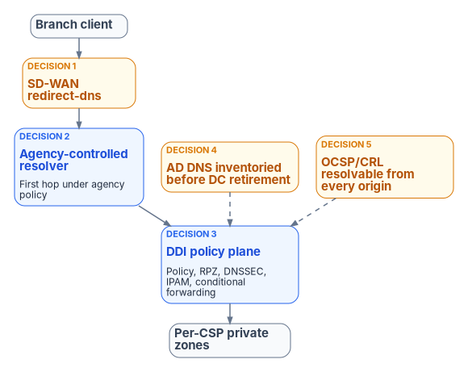

# Chapter 08 — Reference Architecture and the Five Critical Decisions

*The architecture is simple to draw; the risk sits in five settings that are easy to get wrong and hard to see when they are.*

::: {.callout-note}
## In this chapter
The governed resolution path from the branch edge to the per-cloud private zones, and the five configuration decisions that carry almost all of its operational risk, each with the check to run before the next change. What a DDI policy plane is made of and how it relates to the cloud DNS services it governs. The target operating model for agencies that already copy records into every cloud, how the design differs between commercial and federal clouds, and the vendor questions that are still open.
:::

## The end-to-end resolution flow and five decisions

{#fig-ch08-reference-architecture fig-alt="A branch client's query passes the SD-WAN redirect-dns edge (Decision 1) to an agency-controlled resolver that is the first hop under agency policy (Decision 2), then to the DDI policy plane holding policy, RPZ, DNSSEC, IPAM and conditional forwarding (Decision 3), and on to per-cloud private zones. AD DNS is inventoried before decommissioning (Decision 4), and OCSP and CRL endpoints resolve from every origin (Decision 5)."}

The end-to-end resolution flow runs from the SD-WAN branch edge, through a network-addressable agency-controlled resolver, into the DDI policy plane (policy, response policy zones, DNSSEC, IPAM) and on to per-cloud private zones and authoritative services. Internet-bound recursion leaves through CISA's Protective DNS Resolver, which federal civilian executive branch agencies are required to use and which blocks, redirects or sinkholes queries that match threat indicators before they reach a malicious destination.[^c08-cisapdns] The same path covers on-premises clients, which reach the agency resolver directly, and cloud workloads, which reach the policy plane through the per-cloud forwarding in Chapter 07.

Five decisions carry almost all of the operational risk. Each one fails silently: the query still resolves, just outside policy or to the wrong address. Each therefore comes with a check to run in the live configuration, not the design document, before the next SD-WAN or DDI change.

### Decision 1 — the redirect-dns destination

The SD-WAN redirect-dns target (Chapter 05) must be a network-addressable resolver under agency control: a DDI resolver or forwarding proxy at the branch or in a regional hub. It must never be a client-side loopback stub, because the edge redirects to an IP address on the network and cannot reach an agent listening on the client itself. Endpoint DNS agents commonly work that way; Infoblox Endpoint, for example, listens on port 53 on the device's loopback address (127.0.0.1, or 127.0.0.2 on macOS) and forwards over DNS over TLS on TCP 443.[^c08-ibxendpoint] An endpoint agent protects the roaming device; it does not replace the branch resolver.

- **Check:** read the redirect-dns target from every branch's running data policy and confirm each is an agency resolver address. Any other target bypasses the policy plane for every query from that branch, and nothing alerts on it.

### Decision 2 — forwarding chain order

Any additional resolver, such as a SASE provider's DNS service, must be a forwarding target of the agency-controlled resolver, never the redirect-dns target. The agency resolver is always the first hop under agency policy control, so its response policy zones, DNSSEC validation and logging apply before anything else sees the query. The correct order is: branch or on-premises client → agency resolver → DDI policy plane → optional SASE DNS → CISA Protective DNS or other approved recursion.

- **Check:** trace the order in the running configuration, not just the presence of each element. A chain with every component present but the SASE service first is the common failure.

### Decision 3 — per-cloud conditional forwarding

The policy plane holds the authoritative forwarding rules for every private namespace across every cloud and VMware environment, and pushes the same rules to every resolver that clients use, branch resolvers included. Rules kept in only one place (for example on the data center grid but not on branch resolvers) leave the other origins without private resolution. The targets differ by platform (Chapter 07):

| Namespace | Forward to |
|---|---|
| Azure services behind private endpoints | Azure DNS Private Resolver inbound endpoints, for each service's public zone (for example `database.windows.net`), not the `privatelink` zone[^c08-azpe] |
| Azure private zones for agency namespaces | Azure DNS Private Resolver inbound endpoints |
| Route 53 private hosted zones | Route 53 VPC Resolver inbound endpoints[^c08-r53] |
| Google Cloud private zones | Cloud DNS inbound server policy entry points |
| On-premises namespaces, from each cloud | The agency resolvers, through each cloud's outbound path (Resolver rules, forwarding rulesets, forwarding zones, NSX FQDN zones) |

- **Check:** for one representative name in each private namespace, resolve it from on-premises, from each cloud and from a branch, and compare the answers. Any origin that returns a public address or NXDOMAIN has a missing or stale rule.

### Decision 4 — AD DNS inventory before retirement

SRV records, conditional forwarders and namespace delegations held in AD DNS are inventoried and reprovisioned in the policy plane before any domain controller is decommissioned (Chapter 04). Skipping this step cannot be undone: once the last domain controller holding a zone is gone, its records cannot be recovered from it.

- **Check:** the inventory export exists, is dated, and has been reconciled against the policy plane before a decommissioning change is approved.

### Decision 5 — OCSP and CRL reachability from every origin

PKI validation endpoints must resolve consistently from on-premises, every cloud and every branch (Chapter 06). OCSP and CRL names that exist only in AD DNS today must be published in the policy plane with forwarding that makes them reachable from cloud-originated queries; otherwise certificate validation fails in the cloud while it succeeds on premises, and the failure looks like a certificate problem.

- **Check:** resolve every OCSP responder and CRL distribution point named in the agency's issuing CA certificates from each origin, and fetch one response from each.

## What a DDI policy plane is made of

The policy plane is not one box. It has three parts, and products package them differently:

- **An authoritative and recursive DNS and DHCP layer** on premises: appliances or virtual appliances that host internal zones (replacing AD DNS), act as the recursive resolvers clients use, and apply response policy zones and DNSSEC. In a replicated grid each member answers from its local copy of the database, so a change made at the primary reaches remote members after a replication delay that grows with distance. The program's design position is that grid changes converge in seconds, not milliseconds, and that time-critical security changes (an emergency block, for example) must be verified on the members that serve the affected clients.
- **A management and policy plane**, increasingly delivered as a cloud service, that holds the system of record for zones, forwarding rules, IPAM data and security policy and pushes them to every managed surface.
- **Local resolvers and agents** at branches, in cloud networks and on roaming endpoints, which keep resolving from local state if the management plane is unreachable (Chapter 12).

The relationship to cloud DNS is overlay management, not replacement. Route 53 still serves Route 53 zones and Azure Private DNS still serves Azure private zones; the policy plane holds one policy object, propagates it to every managed surface, and shows the state of all of them in one place.

Infoblox is one example. Its on-premises grid is NIOS (with NIOS-X as the newer server form), and its cloud-delivered management plane is Universal DDI, formerly BloxOne DDI, whose management now covers DNS records in Amazon Route 53, Azure DNS and Google Cloud DNS, Windows Server DNS and DHCP configuration, and external authoritative DNS providers such as Cloudflare and Akamai.[^c08-ibxrelease] Its documented Azure DNS limits are in Chapter 07. On authorization, the FedRAMP-listed offering is **Infoblox Government Cloud**, a SaaS service in AWS GovCloud (US) that is FedRAMP Certified at Moderate (package FR2017257053) and whose listed scope includes Universal DDI and Universal Asset Insights.[^c08-fedramp] A July 2026 Infoblox press release describes that offering as including Universal DDI Management, NIOS-X Servers and Universal Asset Insights; the release doesn't date the certification, which the Marketplace records as December 2022.[^c08-ibxpr] On-premises NIOS appliances are not a FedRAMP cloud service; they sit inside the agency's own authorization boundary (Chapter 03). Other enterprise DDI platforms, and cloud-native resolvers managed as code, are evaluated against the same requirements in Chapter 12.

## Moving from per-cloud local syncs to a unified control plane

Agencies that already copy DNS records into each cloud provider should change the operating model from "author copies in every silo" to "one authoritative policy and state plane that the silos consume."

### Target operating model

- The DDI policy plane holds the system of record for zones, forwarding rules, IPAM data and security policy.
- Cloud DNS services (Route 53, Azure Private DNS, Google Cloud DNS and others) become synchronized targets or forwarding destinations rather than independently authored sources.
- SD-WAN redirect-dns and other edge interceptors point at network-addressable resolvers inside the governed path.
- AD DNS is inventoried and either coexists during the transition or is migrated; Entra ID does not inherit SRV, LDAP or Kerberos records (Chapter 04 and Book 02's [hidden migration surface](../b02-identity/04-the-hidden-migration-surface.md)).

### Expected improvements

- Far less unintentional split-brain for private endpoints and SaaS resolution.
- Faster, safer change: a new private endpoint or application namespace is published once.
- Uniform Protective DNS, logging and, where required, DNSSEC validation for the queries that matter.
- One hybrid inventory instead of islands of address and name data.
- A cleaner AD retirement path and fewer "works in one cloud but not another" incidents.

## Commercial and federal clouds compared

The architecture is the same in every environment; authorization and a few integrations change. The [Applicability](appendix-c-applicability.md) page explains each environment, and the table summarizes what changes for this chapter's components.

| Component | Commercial clouds at FedRAMP Moderate (including Microsoft 365 GCC-Moderate) | GCC High, Azure Government, AWS GovCloud, DoD |
|---|---|---|
| Cloud-delivered DDI management plane | Must hold FedRAMP Moderate or better plus an agency ATO; Infoblox Government Cloud is listed at Moderate[^c08-fedramp] | A Moderate authorization does not cover High; use a service authorized at the required level or keep the policy plane inside the agency's boundary |
| On-premises and in-tenant resolvers and grid | Inside the agency boundary | Inside the agency boundary |
| SD-WAN redirect-dns to agency resolvers (Decisions 1 and 2) | Applies | Applies |
| Response policy zones, DNSSEC, Protective DNS forwarding | Applies | Applies (air-gapped enclaves differ; see Applicability) |
| AD DNS inventory before retirement (Decision 4) | Required | Required |
| OCSP and CRL reachability (Decision 5) | Required | Required |
| Azure private endpoint zones | Commercial zone names (`privatelink.*.windows.net` and similar) | Azure Government zone names (`*.usgovcloudapi.net`, `*.azure.us` and similar); Chapter 07[^c08-azpezones] |
| AWS VPC IPAM allocation from an external IPAM | Available in commercial Regions | Not available in AWS GovCloud (US); use reservation and reconciliation[^c08-awsipam] |
| Microsoft 365 informed network routing | Worldwide commercial tenants only; not GCC-Moderate[^c08-inr] | Not available[^c08-inr] |
| Microsoft 365 optimization | Local breakout and application-aware routing (Chapter 05) | Same |

## Questions to settle with vendors

Some behaviors that the five decisions depend on are not documented by any vendor. Take these to the vendors directly rather than designing around assumptions:

1. **Endpoint agents and redirect-dns.** Can the DDI vendor's endpoint agent act as a network-addressable proxy that redirect-dns can target, or only as a loopback stub? Infoblox's documentation describes a loopback listener,[^c08-ibxendpoint] which is why Decision 1 requires a branch resolver; confirm with each vendor.
2. **Cloud DNS synchronization and private endpoints.** Do the vendor's documented Azure DNS synchronization limits affect private endpoint zones or conditional forwarding for Azure-managed namespaces? The limits are published; their effect on private endpoints is not (Chapter 07).
3. **Namespace tracking.** Does the vendor's IPAM track wildcard records and subdomain occupancy, or only host-level A and AAAA records?
4. **Source address under redirect-dns.** When the SD-WAN edge redirects a query, does the resolver see the client's address or the edge router's? The answer decides whether per-client policy and logging work at the branch.
5. **Telemetry in government clouds.** Is there a roadmap for informed network routing, or an equivalent telemetry mechanism, in GCC-Moderate or GCC High?
6. **Migration guidance.** Is there a published path from AD DNS to the vendor's grid and management plane for agencies part-way through AD retirement?

::: {.callout-note}
## What this chapter establishes
1. The governed path is SD-WAN edge, agency resolver, DDI policy plane, per-cloud private zones, with egress through Protective DNS.
2. Five decisions carry almost all of the operational risk; each fails silently and needs a check in the running configuration.
3. Cloud DNS services become consumers of one authoritative state, not independently authored sources; the policy plane overlays them rather than replacing them.
4. Authorization, not architecture, is what changes between commercial and federal clouds.
:::

::: {.callout-tip}
## Continue the book
[← Previous: Chapter 07 — Cloud Private Endpoints, SDN and IPAM Consistency](07-cloud-private-endpoints-and-ipam.md) · [Book index](index.md) · [Next: Chapter 09 — Who Owns DNS, DHCP and IPAM →](09-who-owns-dns.md)
:::

[^c08-cisapdns]: Cybersecurity and Infrastructure Security Agency, "Protective Domain Name System (DNS) Resolver," <https://www.cisa.gov/resources-tools/services/protective-domain-name-system-dns-resolver> (accessed Oct 20, 2026).
[^c08-ibxendpoint]: **Third-party source (vendor).** Infoblox documentation, "Managing Endpoint," <https://docs.infoblox.com/space/BloxOneThreatDefense/35374260/Managing+Endpoint> (accessed Oct 20, 2026).
[^c08-azpe]: Microsoft Learn, "Azure Private Endpoint DNS integration scenarios," <https://learn.microsoft.com/azure/private-link/private-endpoint-dns-integration> (accessed Oct 20, 2026).
[^c08-r53]: AWS, *Amazon Route 53 Developer Guide*, "What is Route 53 VPC Resolver?," <https://docs.aws.amazon.com/Route53/latest/DeveloperGuide/resolver.html> (accessed Oct 20, 2026).
[^c08-ibxrelease]: **Third-party source (vendor blog).** Infoblox, "November 2025 – January 2026 Innovations: What's New in Infoblox DDI," <https://www.infoblox.com/blog/company/november-2025-january-2026-innovations-whats-new-in-infoblox-ddi/> (accessed Oct 20, 2026).
[^c08-fedramp]: FedRAMP, Marketplace product data (entry FR2017257053, Infoblox Government Cloud: FedRAMP Certified, Moderate, since December 15, 2022; AWS GovCloud (US)), <https://www.fedramp.gov/marketplace/products.json> (accessed Oct 20, 2026).
[^c08-ibxpr]: **Third-party source (vendor).** Infoblox, "Infoblox Government Cloud Achieves FedRAMP Moderate Certification, Bringing Modern DDI and Asset Visibility to Federal Agencies," press release, July 22, 2026, <https://www.infoblox.com/news/news-events/press-releases/infoblox-government-cloud-achieves-fedramp-moderate-certification-bringing-modern-ddi-and-asset-visibility-to-federal-agencies/> (accessed Oct 21, 2026). Why the dates differ: the release headlines the Moderate certification as 2026 news and lists the offering as including Universal DDI Management, NIOS-X Servers and Universal Asset Insights, but it gives no certification date, mentions no earlier authorization and does not say whether its product list is new. The FedRAMP Marketplace record dates the certification to December 15, 2022 and shows no later status change. This book takes the certification date from the Marketplace and cites the release only as the vendor's description of what the offering includes.
[^c08-azpezones]: Microsoft Learn, "Azure Private Endpoint private DNS zone values," <https://learn.microsoft.com/azure/private-link/private-endpoint-dns> (accessed Oct 20, 2026).
[^c08-awsipam]: AWS, "Amazon VPC IPAM automates IP assignments from Infoblox IPAM," What's New, November 17, 2025, <https://aws.amazon.com/about-aws/whats-new/2025/11/amazon-vpc-ipam-automates-ip-from-infoblox/> (accessed Oct 20, 2026).
[^c08-inr]: Microsoft Learn, "Microsoft 365 informed network routing," <https://learn.microsoft.com/microsoft-365/enterprise/office-365-network-mac-perf-cpe> (accessed Oct 20, 2026).
