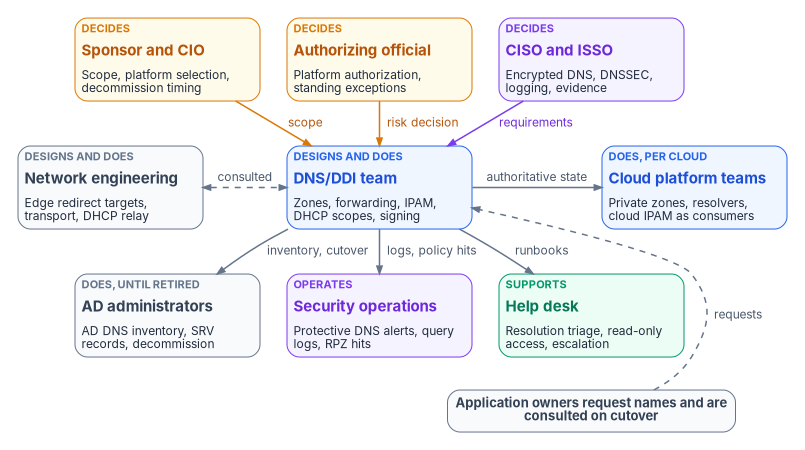
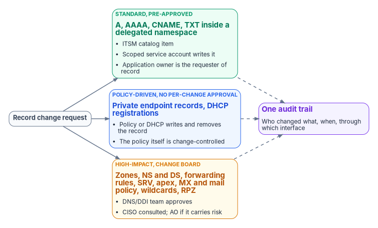

# Chapter 09 — Who Owns DNS, DHCP and IPAM

*In an Active Directory estate, DNS belonged to whoever ran the domain controllers; a single policy plane concentrates that authority, so its owners have to be named on purpose, one decider per decision, or the cloud, network and directory teams will each own a piece of it by accident.*

::: {.callout-note}
## In this chapter
The people who decide, do and advise on name and address services: the sponsor and CIO, the CISO and ISSO, the authorizing official, network engineering, the DNS/DDI team, AD administrators during the AD DNS departure, cloud platform teams, security operations, application owners and the help desk. A responsibility matrix covers zones and delegation, split-horizon design, the resolver path, DNSSEC, encrypted DNS, IPAM, DHCP, record change approval and platform selection. A record-change model and a role map show how the decisions turn into permissions in each system.
:::

Ownership of DNS was rarely written down in an Active Directory estate, because AD wrote it down for you. The DnsAdmins group has full control of every zone and record in the domain by default,[^c09-zone-acl] and Microsoft describes it as a privileged group with administrative control over the DNS Server service.[^c09-dnsadmins] Any authenticated user can create A and PTR records in an AD-integrated zone unless the default ACL is changed.[^c09-zone-acl] DHCP servers register records on behalf of their clients, and the DnsUpdateProxy group exists to let them.[^c09-groups] Change approval, where it existed, sat in the same small team that ran the domain controllers. Microsoft's own AD DS planning guidance names a "DNS for AD DS owner" who coordinates with the organization's separate DNS and DHCP groups,[^c09-dns-owner] which is a fair description of how many agencies still work.

That arrangement doesn't survive this book's target. [Chapter 08](08-reference-architecture.md) puts zones, forwarding rules, IPAM data and security policy in one authoritative policy plane, and makes every cloud DNS service a consumer of it. Concentrating authority is the point, and it means a single team now holds the power to break resolution for every user, every cloud and every branch at once. Meanwhile each cloud keeps its own role system, the SD-WAN edge decides which resolver a branch query reaches, and security policy (encrypted DNS, Protective DNS, DNSSEC) has become a federal requirement, not a preference ([Chapter 03](03-federal-requirements.md)). The decisions that the domain controller team used to make by default now belong to several teams, and some of them carry risk that only the authorizing official can accept.

[Book 02, Chapter 06](../b02-identity/06-who-owns-the-migration.md) sets out the migration-wide ownership model, including the Risk Management Framework definitions of the authorizing official, CISO, ISSO and system owner. [Book 05, Chapter 06](../b05-devices/06-who-owns-the-endpoint.md) applies it to endpoints, which matters here because encrypted DNS settings are pushed to devices by the endpoint team. This chapter applies the same model to DNS, DHCP and IPAM. The roles, the matrix, the change classes and the role map below are the program's recommended model. Adapt them to the agency's governance, but keep one decider per row.

{#fig-ch09-ddi-owners fig-alt="Three rows of cards. Top row, decision makers: the sponsor and CIO in amber, who own scope, platform selection and decommission timing; the authorizing official in amber, who owns platform authorization and standing exceptions; and the CISO and ISSO in violet, who set encrypted DNS, DNSSEC, logging and evidence requirements. Each sends an arrow to the DNS/DDI team, labeled scope, risk decision and requirements. Middle row: network engineering in slate, which designs and does edge redirect targets, transport and DHCP relay and is connected to the DNS/DDI team by a dashed two-way arrow labeled consulted; the DNS/DDI team in blue, which designs and does zones, forwarding, IPAM, DHCP scopes and signing; and cloud platform teams in blue, which run private zones, resolvers and cloud IPAM as consumers and receive authoritative state from the DNS/DDI team. Bottom row: AD administrators in slate, who do AD DNS inventory, SRV records and decommissioning until AD DNS is retired; security operations in violet, which operates Protective DNS alerts, query logs and RPZ hits; and the help desk in green, which supports with resolution triage, read-only access and escalation. The DNS/DDI team sends inventory and cutover work to AD administrators, logs and policy hits to security operations and runbooks to the help desk. A slate pill reads: application owners request names and are consulted on cutover, with a dashed arrow labeled requests to the DNS/DDI team."}

## Where the roles come from

Three parts of the series supply the inputs. [Chapter 08](08-reference-architecture.md) names the five configuration decisions that carry most of the operational risk: the redirect-dns target, the forwarding chain order, per-cloud conditional forwarding, the AD DNS inventory before retirement, and OCSP and CRL reachability. Each of those decisions needs one owner, and the owner isn't always the team that types the configuration. The redirect-dns target is configured on the SD-WAN edge by network engineering, but what it must point at is a policy-plane decision.

[Chapter 11](11-operating-the-control-plane.md) supplies the delegation model: corporate administrators with full visibility and policy over the estate, divisional scopes covering each division's zones, IP spaces and DHCP scopes, predefined manager, operator and auditor roles, and non-interactive automation accounts held to the same scopes. That model describes how permissions are cut inside the policy plane. This chapter decides who holds them.

The program's DNS modernization runbooks supply the operating gates that [Chapter 10](10-migration-sequence.md) sequences. Platform engineering owns the runbooks. Every migration phase needs change control approval. Legacy DNS servers stay in place through a validation window with no SRV failures and a period of parallel operation before they're decommissioned. Any zone that loses DNSSEC protection in the move, such as an internal zone moved to a cloud private zone service, is accepted with documented compensating controls. Each of those gates hides a decision. Somebody approves the phase, somebody declares the validation window passed, and somebody accepts the loss of signing. The matrix below names them.

## Decision rights and work are different things

The program separates three kinds of involvement, as Book 02 does. A role *decides* when it is accountable for the outcome and can say no. A role *does* the work when it builds, configures or runs the thing. A role is *consulted* when the decision can't be made well without its input, even though the decision isn't its to make.

The split matters for DNS because name changes are cheap to make and expensive to get wrong. Nearly every DNS decision is made in a console or a pull request by someone who can make it, and many of them are risk decisions in disguise. Leaving a branch's redirect-dns pointed at a public resolver turns off Protective DNS for that branch. Exempting a device class from encrypted DNS policy creates a monitoring gap. Creating a private zone named after a public namespace silently changes what every linked network sees. Moving an internal zone to a service that doesn't sign it removes DNSSEC. The authorizing official is the official who accepts security and privacy risk on the organization's behalf under the Risk Management Framework,[^c09-sp80037] so decisions that amount to accepting risk have to reach that person, not stop at the console.

## The roles

The **sponsor and CIO** set scope, funding and sequence. In the program's model they decide which platform model the agency adopts ([Chapter 12](12-selection-cost-and-residual-risk.md)), when AD DNS and Windows DHCP are decommissioned, and how divisions are scoped in the policy plane. They also break ties between network engineering, the DNS/DDI team and the cloud platform teams, which will happen, because all three can reasonably claim the resolver path.

The **CISO and ISSO** decide the control requirements the name layer has to meet. OMB M-22-09 requires agencies to resolve DNS queries using encrypted DNS wherever it is technically supported, to configure endpoints to use agency-designated encrypted DNS servers rather than automatic network discovery, and to log the contents of encrypted requests at the agency's designated resolvers.[^c09-m2209] Federal civilian executive branch agencies are required to use CISA's Protective DNS service.[^c09-cisapdns] The CISO turns those requirements into policy: which resolvers are designated, which transports are allowed, where DNSSEC signing and validation apply, what is logged and how long it is kept. The ISSO assembles the evidence an assessor will read ([Chapter 11](11-operating-the-control-plane.md) lists it), tracks findings to closure, and is consulted on every change that alters a control.

The **authorizing official** accepts residual risk. For DNS, DHCP and IPAM that means the authorization of any cloud-delivered management plane at the right impact level ([Chapter 03](03-federal-requirements.md) and [Appendix C](appendix-c-applicability.md)), and every standing exception: a zone that can't be signed in its new home, an application or device class that can't use encrypted DNS, a branch that can't be redirected to an agency resolver, a policy-plane design that keeps a management dependency outside the agency's boundary. The program routes each one to the authorizing official with an owner and a review date, so that a temporary exception doesn't quietly become a permanent risk acceptance.

**Network engineering** owns the transport and the edge. It configures SD-WAN redirect-dns and other edge interceptors, DHCP relay toward the authorized DHCP servers, the connectivity that carries port 53 and encrypted DNS between sites and clouds, and the access-switch controls (DHCP snooping, RA Guard) that [Chapter 05](05-edge-interception-and-bypass.md) relies on against rogue DHCP. In the program's model network engineering *does* Decisions 1 and 2 on the edge, while the DNS/DDI team *decides* what the edge must point at and in what order. That split stops the most common failure in the series, a branch edge pointed around the governed resolver because it was convenient at the time.

The **DNS/DDI team** owns the policy plane. It designs and runs the authoritative internal zones, the forwarding rules for every private namespace (Decision 3), the IPAM system of record, DHCP scopes and options, response policy zones, and DNSSEC signing operations. In Chapter 11's terms it holds the corporate administrator role. It decides the split-horizon design and the namespace structure, approves high-impact record changes, and is the approver of record for platform-level change. Like identity engineering in Book 02, it is the team most likely to be over-trusted, because it holds roles that can change every answer at once. The program's answer is to scope its own automation accounts, put a second approver in front of zone, delegation and forwarding changes, and keep its privileged roles eligible rather than standing where the platform supports it. In many agencies this team is part of network engineering or of platform engineering. That is fine, as long as the decision rights below are assigned to a named group and not to "the network team" in general.

**Active Directory administrators** run AD DNS and Windows DHCP until they are retired. During the departure ([Chapter 04](04-active-directory-dns-departure.md)) they own the inventory behind Decision 4: every AD-integrated zone, the SRV and `_msdcs` records, conditional forwarders, dynamic-update clients and DHCP scopes. They also own two things that are easy to miss. One is DnsAdmins membership. Microsoft Defender for Identity flags non-privileged members of DnsAdmins as an exposure, because the group can be delegated to network staff and becomes an attractive target.[^c09-dnsadmins] The program treats DnsAdmins as a privileged group and empties it of anyone who isn't a domain administrator before the transition starts. The other is the DNSSEC Key Master. On Windows DNS, one server per signed zone generates and manages the keys and performs key rollovers. For AD-integrated zones the Key Master is a domain controller and the private keys can replicate through AD, and if the Key Master is lost without access to the key material the zone has to be re-signed with new keys.[^c09-keymaster] Moving signing to the policy plane is a planned handover, not something that happens when the last domain controller goes. AD administrators execute the decommission, but they don't decide its timing.

**Cloud platform teams** run the cloud-native DNS, resolver and IPAM services as consumers of policy-plane state, not as independent authors (Chapter 08). Their work is shaped by each provider's role model:

- **Azure.** Microsoft's landing-zone guidance hosts the `privatelink` private DNS zones centrally in the connectivity subscription, notes that typically only networking and identity administrators manage records there, and denies workload teams the ability to create their own `privatelink` zones. A `DeployIfNotExists` policy, whose managed identity holds Private DNS Zone Contributor on the central zones, writes and removes the private endpoint records instead.[^c09-caf-pl] Private DNS Zone Contributor manages private zone resources but not the virtual networks they're linked to; DNS Zone Contributor covers public zones only.[^c09-azure-roles] IPAM pools in Azure Virtual Network Manager need Network Contributor on the network manager to create, and pool access can be delegated to other users.[^c09-avnm-ipam]
- **AWS.** Route 53 VPC Resolver forwarding rules can be shared with other accounts through AWS Resource Access Manager. An account that receives a shared rule can associate it with its VPCs but can't change or delete it.[^c09-aws-rules] VPC IPAM integrates with AWS Organizations through a delegated IPAM account, which must be a member account, not the management account.[^c09-aws-ipam]

Both models support the same split: the platform team owns the shared rules, central zones and address pools, and workload accounts or subscriptions consume them. The program's rule is that what the platform team publishes in each cloud is generated from, or reconciled against, the policy plane, so that a forwarding rule or address pool exists in one authoritative place.

**Security operations** receives what the name layer emits: Protective DNS alerts, response policy zone hits, query logs and resolution-path anomalies such as hosts whose queries never appear in the governed resolver logs ([Chapter 05](05-edge-interception-and-bypass.md)). CISA's Protective DNS service blocks, redirects or sinkholes queries that match threat indicators and alerts the originating agency.[^c09-cisapdns] Security operations is consulted on response policy changes and on every encrypted DNS exception, because it's the team that finds out when an exception gets used.

**Application owners** request and own the names of their applications. They know which FQDNs their certificates, token audiences and connection strings depend on ([Chapter 06](06-dns-identity-and-dnssec.md)), and they're the only people who can accept a cutover window for their own namespace. In the program's model an application owner can be given a delegated namespace in the policy plane, with a scoped automation account that can write records under it (for example, ACME DNS-01 challenge records, as [Chapter 11](11-operating-the-control-plane.md) describes), but can't create zones, delegations or wildcard records. Certificate issuance itself is [Book 07](../b07-pki/index.md)'s subject.

The **help desk** fields resolution failures that users report as certificate errors, access denials or "the app is down." It needs read access and runbooks: resolution tests from the client's vantage point, the expected answer for each origin, and a clear escalation path to the DNS/DDI team. In the program's model the help desk holds the auditor role in the policy plane and no write roles. Clearing a client cache is a help desk action. Changing a record isn't.

Two further roles are small but carry outsized risk. **.gov domain managers** control the agency's public delegation in the .gov registrar. Only domain managers can change a domain's name servers or enter its DNSSEC DS data, and the registrar warns that incorrect DNSSEC setup can make the domain stop working.[^c09-dotgov] An organization's senior official authorizes domain requests.[^c09-dotgov] The program assigns domain manager rights to named members of the DNS/DDI team, keeps the senior official current, and treats any name server or DS change as a high-impact change. **Endpoint engineering** configures encrypted DNS and resolver settings on managed devices to the CISO's policy, as [Book 05](../b05-devices/06-who-owns-the-endpoint.md) describes. It does the work. It doesn't decide which resolvers are designated.

## The responsibility matrix

D = decides (accountable) · R = does the work · C = consulted · blank = informed at most.

| Decision or work item | Sponsor / CIO | CISO / ISSO | AO | Network eng. | DNS/DDI team | AD admins | Cloud platform | SecOps | App owners | Help desk |
|---|---|---|---|---|---|---|---|---|---|---|
| Platform selection and deployment model (Chapter 12) | D | C | C | C | R | C | C | C | | |
| Authorization of a cloud-delivered management plane | C | C | D | | R | | C | | | |
| Namespace design: internal zones and delegation to divisions and apps | | C | | C | D, R | C | C | | C | |
| Public zones, .gov name servers and DS records | | C | | | D, R | | C | | C | |
| Split-horizon design: which names answer differently, from where | | C | | C | D, R | | C | C | C | |
| Resolver path: redirect-dns targets at the edge (Decision 1) | | C | | R | D | | | C | | |
| Forwarding chain order (Decision 2) | | C | | R | D, R | | C | C | | |
| Per-cloud conditional forwarding rules (Decision 3) | | | | C | D, R | C | R | | | |
| DNSSEC signing of public zones and key rollover | | D | | | R | C | C | | | |
| DNSSEC for internal zones, and accepting zones that lose it | | C | D | | R | C | R | C | | |
| DNSSEC validation on agency resolvers | | D | | C | R | | C | C | | |
| Encrypted DNS policy: designated resolvers, allowed transports | | D | | C | R | | C | C | | |
| Encrypted DNS exceptions, standing or past the agency's limit | C | C | D | R | R | | | C | C | |
| IPAM as source of truth: address plan and top-level blocks | | C | | C | D, R | | R | | | |
| Cloud CIDR allocation from delegated pools | | | | C | D | | R | | C | |
| DHCP scopes, reservations and options 6 and RDNSS | | C | | R | D, R | R | | C | | |
| Rogue DHCP and router advertisement detection | | D | | R | R | | | R | | |
| Standard record changes in a delegated namespace | | | | | D | | | | R | |
| High-impact record changes (zones, NS, SRV, apex, mail policy, wildcards, RPZ) | | C | | C | D, R | C | C | C | C | |
| Private endpoint record automation (policy-driven) | | C | | | D | | R | | C | |
| Protective DNS forwarding and query logging | | D | | C | R | | C | R | | |
| AD DNS inventory and reconciliation (Decision 4) | | C | | | D | R | C | | C | |
| AD DNS and Windows DHCP decommission timing | D | C | C | C | R | R | | | C | C |
| Migration phase go/no-go (Chapter 10) | C | C | | C | D | C | C | C | C | C |
| OCSP and CRL resolution from every origin (Decision 5) | | C | | C | D, R | | R | | C | |

Four rows need comment. The resolver-path rows split deciding from doing on purpose: network engineering configures the edge, but the DNS/DDI team decides what the edge points at, because getting Decisions 1 and 2 wrong silently removes Protective DNS, logging and response policy for a whole branch. The DNSSEC rows split three ways. Signing public zones and validating answers are control requirements the CISO sets. Moving an internal zone to a service that won't sign it is a risk acceptance, so the authorizing official decides it, with the compensating controls written down. The encrypted DNS rows split on time, like the exception rows in Book 05: the CISO sets the policy and can grant a temporary exception, but one that has no end date, or has outlived the agency's limit, goes to the authorizing official. And the standard record change row gives the decision to the DNS/DDI team even though the application owner does the work, because the team decided in advance what a standard change is and pre-approved it.

## Record change approval

Most DNS changes don't need a change board, and treating them all the same way is how agencies end up with either a six-week wait for a CNAME or no control at all. The program sorts record changes into three classes.

{#fig-ch09-record-change-classes fig-alt="A record change request on the left branches into three cards. The first, in green, is standard and pre-approved: A, AAAA, CNAME and TXT records inside a delegated namespace, submitted as an ITSM catalog item, written by a scoped service account, with the application owner as requester of record. The second, in blue, is policy-driven with no per-change approval: private endpoint records and DHCP registrations, which the policy or DHCP writes and removes, and the policy itself is change-controlled. The third, in amber, is high-impact and goes to the change board: zones, NS and DS records, forwarding rules, SRV records, apex records, MX and mail policy, wildcards and response policy zones, approved by the DNS/DDI team with the CISO consulted and the authorizing official involved if the change carries risk. All three cards feed a violet card on the right labeled one audit trail: who changed what, when, through which interface."}

- **Standard changes** are A, AAAA, CNAME and TXT records inside a namespace already delegated to a division or an application. They are pre-approved, requested through an ITSM catalog item or a pipeline, and written by a scoped service account ([Chapter 11](11-operating-the-control-plane.md)). The application owner is the requester of record.
- **Policy-driven changes** are records that a system writes and removes as part of a lifecycle: private endpoint records written by policy, VM registrations, and DHCP-driven dynamic updates. Microsoft's landing-zone pattern is an example: the `DeployIfNotExists` policy adds the record when a private endpoint is created and removes it when the endpoint is deleted.[^c09-caf-pl] These need no per-change approval. The policy that writes them is itself a high-impact change.
- **High-impact changes** are zone creation and deletion, NS and DS records, forwarding rules, SRV and `_msdcs` records, apex records, MX and mail-authentication records, wildcard records, and response policy. They go to the change board with the DNS/DDI team as approver and the CISO consulted, and to the authorizing official when the change accepts risk.

Permissions have to match the classes, and they can't do all of the work. Microsoft notes that an Azure custom role that blocks record-set deletion while allowing updates isn't an effective control, because an update can remove every record from a set, which has the same effect on resolution as deleting it.[^c09-azure-protect] The program's answer is to scope who can write at all (zone or record-set scope, not resource group or subscription), route high-impact changes through an approval, and watch the audit trail for record sets that suddenly go empty.

## Roles in each system

Decision rights don't change what a console lets someone do. Roles do, and during the transition there are up to four role systems: the policy plane's own roles, Windows DNS and DHCP, and each cloud's access model. The program maps each team to the least-privileged role in each system it touches.

| Team | Policy plane (Chapter 11 model) | Windows DNS and DHCP (until retired) | Azure | AWS |
|---|---|---|---|---|
| DNS/DDI team | Corporate administrator; privileged roles eligible, not standing | None routinely; zone-specific delegation for cutover work | Private DNS Zone Contributor and DNS Zone Contributor on central DNS resource groups[^c09-azure-roles] | IAM permissions for Route 53 and VPC Resolver in the network account |
| Network engineering | Read; operator for DHCP options and relay targets | None | Network Contributor on hub networking, not on DNS zones[^c09-azure-roles] | Network-account VPC permissions |
| AD administrators | Read, then operator for reconciliation | DnsAdmins and DHCP Administrators, held only by domain administrators[^c09-groups] | None | None |
| Cloud platform teams | Operator scoped to cloud-synchronized zones and IP spaces | None | Policy managed identity with Private DNS Zone Contributor on central `privatelink` zones; Network Contributor on network manager IPAM pools[^c09-caf-pl][^c09-avnm-ipam] | Owner of shared Resolver rules and the delegated IPAM account[^c09-aws-rules][^c09-aws-ipam] |
| Divisions and application owners | Manager or operator within their scope; scoped automation accounts | None | Allocation from delegated IPAM pools; no DNS zone roles | Associate shared rules; allocate from shared pools |
| Security operations | Auditor; response policy operator if the CISO assigns it | Read | Reader on DNS and resolver resources | Read |
| ISSO and assessors | Auditor | Read | Reader | Read |
| Help desk | Auditor | None | None | None |

Two notes. The Windows column gets shorter every phase; by the time AD DNS is decommissioned it is empty, and DnsAdmins membership should have been reduced well before that. The cloud columns use the provider's built-in roles where Microsoft or AWS documents them. Where the policy plane writes to a cloud through an integration account, that account is the most powerful identity in the design, because it can change every synchronized zone. It belongs to the DNS/DDI team, it is non-interactive, and its credentials are rotated and evidenced like any other privileged secret.

## What changes from AD DNS, in one table

| AD DNS habit | What replaces it |
|---|---|
| DnsAdmins has full control of every zone in the domain | One decider per row in the matrix; doers hold scoped roles in each system |
| Any authenticated user can create A and PTR records | Standard changes inside delegated namespaces, written by scoped accounts |
| The domain controller team decides DNS by default | The DNS/DDI team decides, network and cloud teams do, the CISO sets requirements, the AO accepts risk |
| Each cloud team authors its own zones and forwarders | Cloud services consume policy-plane state; shared rules and central zones owned by the platform team |
| The SD-WAN edge points wherever was convenient | The redirect-dns target is a policy-plane decision that network engineering implements |
| DNSSEC keys live with a domain controller Key Master | Signing moves to the policy plane in a planned handover; zones that lose signing are an AO decision |
| Change history is a zone's serial number | One audit trail across UI, API and workflow, plus the approval record for high-impact changes |

::: {.callout-tip}
## Continue the book
[← Previous: Chapter 08 — Reference Architecture and the Five Critical Decisions](08-reference-architecture.md) · [Book index](index.md) · [Next: Chapter 10 — The Migration Sequence →](10-migration-sequence.md)
:::

[^c09-zone-acl]: Microsoft Learn, "DNS zones," section "Access to zones and names," <https://learn.microsoft.com/windows-server/networking/dns/zone-types> (accessed Oct 20, 2026).
[^c09-dnsadmins]: Microsoft Learn, "Security assessment: Unsafe permissions on the DnsAdmins group" (Microsoft Defender for Identity), <https://learn.microsoft.com/defender-for-identity/unsafe-permissions-dns-admins-group> (accessed Oct 20, 2026).
[^c09-groups]: Microsoft Learn, "Active Directory security groups," sections "DnsAdmins," "DnsUpdateProxy" and "DHCP Administrators," <https://learn.microsoft.com/windows-server/identity/ad-ds/manage/understand-security-groups> (accessed Oct 20, 2026).
[^c09-dns-owner]: Microsoft Learn, "DNS for AD DS Owner Role," <https://learn.microsoft.com/windows-server/identity/ad-ds/deploy/assigning-the-dns-for-ad-ds-owner-role> (accessed Oct 20, 2026).
[^c09-sp80037]: National Institute of Standards and Technology, SP 800-37 Rev. 2, *Risk Management Framework for Information Systems and Organizations: A System Life Cycle Approach for Security and Privacy*, December 2018, <https://csrc.nist.gov/pubs/sp/800/37/r2/final> (accessed Oct 20, 2026).
[^c09-m2209]: Office of Management and Budget, M-22-09, *Moving the U.S. Government Toward Zero Trust Cybersecurity Principles*, January 26, 2022, section "Encrypting DNS traffic," <https://www.whitehouse.gov/wp-content/uploads/2022/01/M-22-09.pdf> (accessed Oct 20, 2026).
[^c09-cisapdns]: Cybersecurity and Infrastructure Security Agency, "Protective Domain Name System (DNS) Resolver," <https://www.cisa.gov/resources-tools/services/protective-domain-name-system-dns-resolver> (accessed Oct 20, 2026).
[^c09-keymaster]: Microsoft Learn, "DNSSEC Key Master," <https://learn.microsoft.com/windows-server/networking/dns/dnssec-key-master>, and "Transfer Key Master role," section "Transfer without access to the signing keys," <https://learn.microsoft.com/windows-server/networking/dns/transfer-dnssec-key-master> (accessed Oct 20, 2026).
[^c09-caf-pl]: Microsoft Learn, "Private Link and DNS integration at scale" (Cloud Adoption Framework), <https://learn.microsoft.com/azure/cloud-adoption-framework/ready/azure-best-practices/private-link-and-dns-integration-at-scale> (accessed Oct 20, 2026).
[^c09-azure-roles]: Microsoft Learn, "Azure built-in roles for Networking," sections "DNS Zone Contributor," "Network Contributor" and "Private DNS Zone Contributor," <https://learn.microsoft.com/azure/role-based-access-control/built-in-roles/networking>, and "How to protect DNS zones and records," <https://learn.microsoft.com/azure/dns/dns-protect-zones-recordsets> (accessed Oct 20, 2026).
[^c09-avnm-ipam]: Microsoft Learn, "Manage IP addresses with Azure Virtual Network Manager," section "Prerequisites," <https://learn.microsoft.com/azure/virtual-network-manager/how-to-manage-ip-addresses-network-manager>, and "What is IP address management (IPAM) in Azure Virtual Network Manager?," <https://learn.microsoft.com/azure/virtual-network-manager/concept-ip-address-management> (accessed Oct 20, 2026).
[^c09-aws-rules]: Amazon Web Services, "Managing forwarding rules," section "Sharing Resolver rules with other AWS accounts and using shared rules," Amazon Route 53 Developer Guide, <https://docs.aws.amazon.com/Route53/latest/DeveloperGuide/resolver-rules-managing.html> (accessed Oct 20, 2026).
[^c09-aws-ipam]: Amazon Web Services, "Integrate IPAM with accounts in an AWS Organization," Amazon VPC IPAM User Guide, <https://docs.aws.amazon.com/vpc/latest/ipam/enable-integ-ipam.html> (accessed Oct 20, 2026).
[^c09-dotgov]: Cybersecurity and Infrastructure Security Agency, get.gov, "Domain management," <https://get.gov/help/domain-management/> (accessed Oct 20, 2026).
[^c09-azure-protect]: Microsoft Learn, "How to protect private DNS zones and records," section "Custom roles," <https://learn.microsoft.com/azure/dns/dns-protect-private-zones-recordsets> (accessed Oct 20, 2026).
