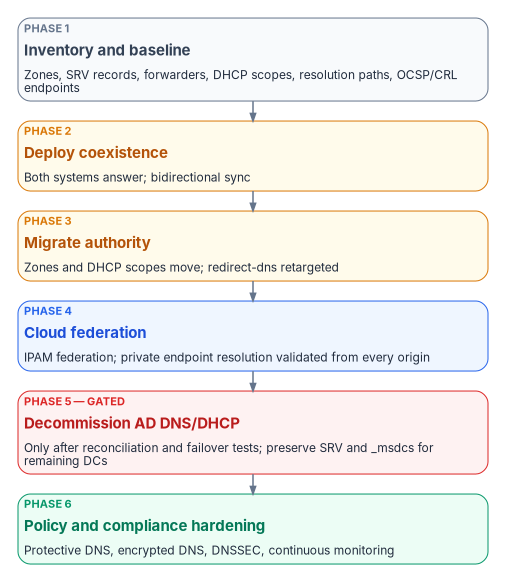
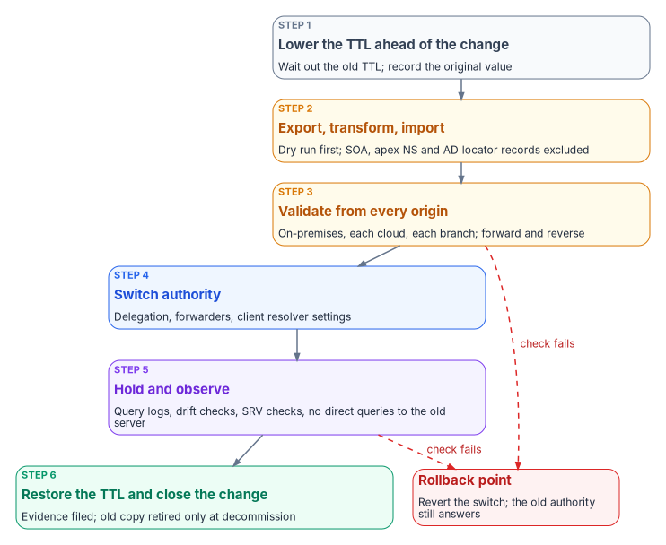

# Chapter 10 — The Migration Sequence

*Name resolution has to keep working while its authority moves, so the migration is a series of small, reversible cutovers, each proven from every origin before the next one starts.*

::: {.callout-note}
## In this chapter
The six phases that move an agency from AD-integrated DNS and DHCP, plus independent cloud DNS, to a single authoritative DDI policy plane. For each phase: what it changes, how it is validated, and where its rollback point is. The chapter also maps the detailed operational playbook onto the six phases, gives the per-zone cutover loop and the three cutover patterns, and sets the gates for decommissioning AD DNS and DHCP. Operating the result is [Chapter 11](11-operating-the-control-plane.md).
:::

This is the book's canonical sequence (Inventory → Coexist → Migrate authority → Federate clouds → Decommission AD DNS and DHCP → Harden and evidence), applied to the move from AD-integrated DNS and DHCP plus independent cloud DNS to a unified DDI plane while keeping services running. The people who approve and run each phase are set out in [Chapter 09](09-who-owns-dns.md); the architecture the sequence builds is [Chapter 08](08-reference-architecture.md).

{#fig-ch10-migration-phases fig-alt="Six phases top to bottom: inventory and baseline; deploy coexistence; migrate authority; cloud federation; decommission AD DNS and DHCP, which is gated on reconciliation and failover tests and must preserve SRV and _msdcs records for remaining domain controllers; policy and compliance hardening."}

## The six phases

- **Phase 1 — Inventory and baseline.** Export every AD DNS zone, SRV record, conditional forwarder and DHCP scope. Document current resolution paths, including SD-WAN redirect-dns targets, and the OCSP and CRL endpoints in use.
- **Phase 2 — Deploy coexistence.** Stand up the DDI platform's resolvers and its Microsoft DNS and DHCP synchronization. Establish conditional forwarding so that both systems can answer during the transition.
- **Phase 3 — Migrate authority.** Move authoritative zones and DHCP scopes to the DDI platform, zone by zone, and move clients onto the governed resolvers in waves. Retarget SD-WAN redirect-dns to network-addressable agency resolvers ([Chapter 08](08-reference-architecture.md), Decision 1).
- **Phase 4 — Cloud federation.** Enable cloud discovery and IPAM federation with AWS, Azure and Google Cloud, and VMware where it applies. Validate private endpoint resolution end to end from every origin.
- **Phase 5 — Decommission AD DNS and DHCP.** Only after full inventory reconciliation and successful failover testing. Preserve the SRV and `_msdcs` records that remaining domain controllers and domain-joined systems still need.
- **Phase 6 — Policy and compliance hardening.** Enable Protective DNS forwarding, encrypted DNS, DNSSEC signing and validation where required, and continuous monitoring dashboards, and assemble the evidence in [Chapter 11](11-operating-the-control-plane.md).

Each phase ends with a rollback point and a resolution-path consistency test (the success measure defined in [Chapter 12](12-selection-cost-and-residual-risk.md)), not with a calendar date. A phase is finished when its validation criteria pass and its evidence is filed; the next phase does not start before then.

## How the operational playbook maps to the six phases

The program's operational DNS playbook breaks the same work into eleven smaller steps, written for the common case of an Azure-heavy estate. The table maps them onto the six phases so that a team working from the playbook and a program office tracking the phases see the same progress. The durations are the program's planning estimates for a single forest and a hub-and-spoke Azure footprint; they are not commitments, and the gates, not the estimates, decide when a step ends.

| Playbook step | Book phase | Validation that closes it | Planning estimate |
|---|---|---|---|
| 0 — Assessment | 1 Inventory | Every DNS server queried without error; complete zone, forwarder and SRV inventory; health findings reviewed | 1–2 days |
| 1 — Deploy cloud private resolver | 2 Coexist | Resolver provisioned; inbound endpoint address recorded; outbound endpoint and ruleset in place | 1 day |
| 2 — Create private zones; import non-AD zones | 3 Migrate authority | Record counts match source and target; answers correct from cloud workloads | 2–3 days |
| 3 — Configure forwarding rulesets | 2 Coexist | Resolution works in both directions: cloud to on-premises and on-premises to cloud | 1–2 days |
| 4 — Migrate conditional forwarders | 3 Migrate authority | Every previously forwarded namespace resolves from the cloud | 1 day |
| 5 — Migrate GlobalNames zone | 3 Migrate authority | Single-label names resolve through the DNS suffix search list | 1 day |
| 6 — Private endpoint DNS zones | 4 Federate clouds | Private endpoint names resolve to private addresses from on-premises and every cloud | 2 days |
| 7 — Migrate reverse lookup zones | 3 Migrate authority | Reverse lookups return the right names; zones align with IPAM | 1–2 days |
| 8 — Move clients in waves | 3 Migrate authority | No resolution, authentication or application failures in each wave | 1–2 weeks |
| 9 — SRV validation and monitoring | 5 Decommission (gate) | Every critical SRV record resolves from every location for 30 consecutive days | 30 days |
| 10 — Decommission legacy DNS servers | 5 Decommission | No client impact after a 7-day burn-in; no queries reach the old servers | 1–2 weeks |

Phase 6 (harden and evidence) has no playbook step of its own because its work runs through every step: logging is enabled in step 1, evidence is filed at the close of each step, and the hardening controls in [Chapter 05](05-edge-interception-and-bypass.md) and [Chapter 06](06-dns-identity-and-dnssec.md) are switched on once authority has moved.

## The cutover loop every phase repeats

Every change that moves authority, whether one zone, one forwarder, one DHCP scope or one wave of clients, runs the same loop. The old authority keeps answering until the new one has been proven, so each step has a cheap way back.

{#fig-ch10-cutover-loop fig-alt="Six steps top to bottom: lower the TTL ahead of the change and record the original value; export, transform and import with a dry run first, excluding SOA, apex NS and AD locator records; validate from every origin, forward and reverse; switch authority through delegation, forwarders and client resolver settings; hold and observe with query logs, drift checks and SRV checks; restore the TTL and close the change. Dashed red arrows from the validate and observe steps lead to a rollback point where the change is reverted and the old authority still answers."}

1. **Lower the TTL ahead of the change.** Cached answers outlive the change by up to the old TTL, so reduce TTLs on the records that will move (the program uses 300 seconds, set at least 48 hours before cutover) and record the original values so they can be restored.
2. **Export, transform and import, dry run first.** Never migrate the SOA or apex NS records; the target platform creates its own. Leave Active Directory locator records (SRV and `_msdcs`) where domain controllers can still register them (see Phase 5).
3. **Validate from every origin.** Query the moved names, forward and reverse, from on-premises, each cloud, and the branch path. A name that resolves only from where it was tested has not been validated.
4. **Switch authority.** Change the delegation, the forwarders or the clients' resolver settings, one at a time.
5. **Hold and observe.** Watch query logs, drift reports and SRV checks ([Chapter 11](11-operating-the-control-plane.md)) and confirm that no client still queries the old server directly.
6. **Restore the TTL and close the change,** with its evidence filed. Retire the old copy only at decommissioning.

A failed check at step 3 or step 5 sends the change back to the rollback point: revert the switch and the old authority, still intact, answers again.

## Phase 1 — Inventory and baseline

The inventory is read-only, so it carries no rollback risk, and it is the step whose omission cannot be repaired later: records maintained by AD DNS cannot be recovered from a decommissioned domain controller ([Chapter 04](04-active-directory-dns-departure.md); [Book 02, Chapter 04](../b02-identity/04-the-hidden-migration-surface.md) covers DNS, DHCP and IPAM as AD dependencies). The program's assessment collects the following and commits the output, as JSON, to the program's assessment repository:

| What to collect | Why it matters |
|---|---|
| Every zone on every DNS server: type, AD integration and replication scope, dynamic-update setting, signing state, record count, notify and secondary servers | Decides the target and method for each zone |
| Every record in every zone, with type, TTL and timestamp | The source for import and for reconciliation after cutover |
| Zone health: aging and scavenging state, stale records, duplicate host names, reverse records with no matching forward record | Clean up before migrating, not after; stale records migrate as faithfully as good ones |
| The critical AD locator records, resolved from every DNS server and every site | The baseline the Phase 5 gate is measured against |
| Conditional and server-level forwarders, with a reachability test of each target over DNS, not just ICMP | Forwarders that point at retired servers are common and must not be carried forward |
| DNSSEC state: signed zones, key master, keys and rollover schedule, trust anchors | Signed zones move on their own schedule (Phase 6 and [Chapter 06](06-dns-identity-and-dnssec.md)) |
| DHCP: scopes, exclusions, reservations, options (especially option 6, the DNS servers), failover relationships, dynamic-update credentials | Scopes move with their options, or clients land on the wrong resolver |
| Resolution paths: client resolver settings, VNet and VPC DNS settings, SD-WAN redirect-dns targets, forwarding chains | The paths [Chapter 08](08-reference-architecture.md)'s decisions govern |
| OCSP and CRL endpoints, and where each resolves | Decision 5: they must resolve from every origin |

::: {.callout-warning}
## Illustrative commands, not tested
The commands in this chapter are short illustrations of the cmdlets and CLI commands involved, checked against Microsoft Learn for name and parameter syntax. They have not been tested against a production forest or tenant. Review, adapt and test them before running them anywhere that matters.
:::

The DnsServer, DhcpServer and DnsClient modules cover the collection on Windows:[^c10-dnsserver-module][^c10-get-rr][^c10-resolve]

```powershell
# Zones and their properties on one DNS server
Get-DnsServerZone -ComputerName dc01.corp.example.gov |
    Select-Object ZoneName, ZoneType, IsDsIntegrated, IsReverseLookupZone, IsSigned

# Every record in one zone, with TTL and timestamp
Get-DnsServerResourceRecord -ZoneName corp.example.gov -ComputerName dc01.corp.example.gov

# Server-level forwarders
Get-DnsServerForwarder -ComputerName dc01.corp.example.gov

# A critical locator record, resolved against a specific server
Resolve-DnsName -Name _ldap._tcp.dc._msdcs.corp.example.gov -Type SRV -Server 10.1.0.10

# DHCP configuration, scopes and leases, to an XML file
Export-DhcpServer -ComputerName dhcp01.corp.example.gov -File C:\assess\dhcp01.xml -Leases
```

`Export-DhcpServer` writes the server configuration, every DHCPv4 and DHCPv6 scope and, with `-Leases`, the lease data.[^c10-dhcp-export] For AD-integrated zones, `Export-DnsServerZone` writes a file to the DNS directory, but Microsoft documents it as a troubleshooting export that is not in zone-file format, so the record-level export is the better source for an import.[^c10-export-zone]

### Where each component goes

The inventory sorts every component into a target and a method. The target is the DDI policy plane; where the agency uses Azure's own DNS services under that plane, the Azure-native equivalent is shown too.

| AD DNS component | Target under the policy plane | Azure-native equivalent | Method | Risk |
|---|---|---|---|---|
| AD-integrated zone, internal | Authoritative zone on the DDI platform | Azure Private DNS zone linked to the VNets | Export records, create zone, import, validate | Medium |
| AD-integrated zone, external | Public authoritative zone | Azure DNS public zone | Export, import, then change NS delegation at the registrar | High |
| File-backed primary | Authoritative zone | Public or private zone | Export, transform, import; check who consumes its secondaries | Low |
| Secondary zone | Retired once its primary has moved | Retired | Confirm no client uses the secondary server as its resolver | Low |
| Stub zone or conditional forwarder | Forwarding rule in the policy plane | DNS forwarding ruleset rule on the Private Resolver | Recreate the rule; test the targets from the new resolver | Low |
| GlobalNames zone | Zone of CNAMEs plus a DNS suffix search list | Private zone plus suffix search list | Import CNAMEs; push the search list through policy | Medium |
| AD locator records (SRV, `_msdcs`) | Stay with a service that accepts domain controller registration until the last DC goes | None (see below) | Forward the AD namespaces to the domain controllers; monitor | High |
| Dynamic registration | DHCP-driven DDNS on the DDI platform | Autoregistration for VMs only | Re-establish per client population | Medium |
| Reverse lookup zones | Reverse zones aligned to IPAM | Private `in-addr.arpa` zones | Create per reverse zone, import PTRs | Medium |
| DNSSEC-signed zones | Signed authoritative zone ([Chapter 06](06-dns-identity-and-dnssec.md)) | Public zones only; Azure Private DNS does not sign (Chapter 06) | Stay signed on the old platform until the new chain validates (Phase 6) | High |

Two Azure behaviors drive the "None" and "VMs only" entries. Azure Private DNS populates autoregistered records from the Azure DHCP service and ignores client registration messages, so domain controllers cannot register their own locator records there; statically imported SRV records would go stale the first time a domain controller changes.[^c10-pdns-faq] And autoregistration creates A records for a VM's primary NIC only: it does not create PTR records, and it does not cover load balancers or other resources.[^c10-autoreg] Reverse zones and non-VM records therefore need IPAM-driven or automated record management.

## Phase 2 — Deploy coexistence

Coexistence puts the new resolvers in place and makes both systems able to answer for each other's namespaces, without moving any authority yet. Its rollback is simply removing what was added; existing DNS is untouched.

- **Synchronize before you migrate.** Enterprise DDI platforms commonly read Microsoft DNS and DHCP servers into their own database, so the inventory stays current while authority moves. Infoblox NIOS, for example, manages Microsoft Windows DNS and DHCP servers from Grid Manager and synchronizes their data into the Grid.[^c10-nios-ms] Start read-only; write access comes zone by zone in Phase 3.
- **Forward in both directions.** On-premises resolvers forward the cloud namespaces, and the public zone of every Azure service reached through a private endpoint (for example `blob.core.windows.net`, not `privatelink.blob.core.windows.net`; see [Chapter 07](07-cloud-private-endpoints-and-ipam.md)), to the cloud resolver's inbound address; the cloud resolver forwards the on-premises and AD namespaces back. The Azure DNS Private Resolver mechanics (dedicated subnets of at least /28 delegated to `Microsoft.Network/dnsResolvers`, inbound and outbound endpoints, and forwarding rulesets of up to 1,000 rules) are in [Chapter 07](07-cloud-private-endpoints-and-ipam.md).[^c10-pr-overview]
- **Give every namespace exactly one authoritative path.** If the cloud forwards a namespace on-premises and on-premises forwards it back, queries loop and never resolve. Document every forwarding path and review it for loops at every step.
- **Check the transport.** UDP and TCP port 53 must be open from the resolver subnets to the targets across ExpressRoute or VPN, and network security groups on the resolver subnets must allow it.[^c10-vnet-names]

On a Windows DNS server, an AD-integrated conditional forwarder to the cloud resolver's inbound endpoint, replicated forest-wide, looks like this:[^c10-cf-cmdlet]

```powershell
Add-DnsServerConditionalForwarderZone -Name "blob.core.windows.net" `
    -MasterServers 10.0.4.4 -ReplicationScope "Forest"
```

And the reverse rule in an Azure DNS forwarding ruleset, sending the AD namespace to two domain controllers (the domain name takes a trailing dot):[^c10-az-fwdrule][^c10-pr-quickstart]

```bash
az dns-resolver forwarding-rule create \
  --resource-group rg-hub-networking \
  --ruleset-name fwdrs-hub-001 \
  --name rule-corp \
  --domain-name "corp.example.gov." \
  --forwarding-rule-state Enabled \
  --target-dns-servers '[{ip-address:"10.1.0.10",port:53},{ip-address:"10.1.0.11",port:53}]'
```

The `az dns-resolver` commands come from an Azure CLI extension, which installs itself the first time one is run.[^c10-az-fwdrule]

Two configuration errors cause most coexistence failures. First, an on-premises conditional forwarder that targets `168.63.129.16`: that address is reachable only from inside an Azure VNet, so the query silently falls back to public resolution and private endpoints resolve to public addresses; target the Private Resolver's inbound endpoint instead.[^c10-pr-troubleshoot] Second, Windows DNS forwarders with a timeout of three seconds or less: when they forward to Azure, Microsoft recommends a forwarding timeout above four seconds so Azure recursion can complete, or Private DNS records can come back with public addresses.[^c10-vnet-names]

## Phase 3 — Migrate authority

This is where zones, forwarders, DHCP scopes and clients move. Each move is one pass through the cutover loop, and each has its own rollback point.

### Zones and records

The record migration follows the loop: export each zone's records to structured output, transform them to the target's record format (record sets grouped by name and type, TTLs carried across), import with a dry run first, validate from every vantage point, then switch the delegation or forwarders and observe for 30 days before the old copy is retired. To lower a record's TTL ahead of cutover on a Windows DNS server, copy the record object, change its TTL and write it back:[^c10-set-rr]

```powershell
$old = Get-DnsServerResourceRecord -ZoneName corp.example.gov -Name app01 -RRType A
$new = [ciminstance]::new($old)
$new.TimeToLive = [System.TimeSpan]::FromSeconds(300)
Set-DnsServerResourceRecord -ZoneName corp.example.gov -OldInputObject $old -NewInputObject $new
```

Check record types the target handles differently before the import, not after it. The record-type catalog and each platform's support for types such as DNAME and apex aliases are in [Appendix A](appendix-a-dns-record-types.md). For TXT records, re-test SPF, DKIM and DMARC after the move; for MX, coordinate with the messaging team.

### Three cutover patterns

Three patterns cover almost every zone. Each has a defined rollback.

| Pattern | When to use it | Configuration | Rollback |
|---|---|---|---|
| Split horizon (same name, different answers) | A name must return a private address inside and a public one outside ([Chapter 02](02-split-brain-dns.md)) | A public zone and a private zone of the same name with different record sets; the private zone visible only to the governed resolvers | Withdraw the private view; internal clients fall through to the public answer |
| Subdomain delegation | A new namespace, such as a cloud subdomain, moves while the parent stays put | NS records (and glue where needed) for the child in the parent zone, pointing at the new authority; a private view of the child for internal resolution | Remove the delegation records from the parent and the child zone from the target |
| Progressive migration with conditional forwarding | Whole zones move one at a time | Bidirectional forwarding from Phase 2; export, import and validate each zone, then remove the forwarder that pointed at its old home | Restore the zone from the archived export and point the forwarders back |

::: {.callout-important}
## Rollback can delete records in Azure Private DNS
Removing a VNet link from an Azure Private DNS zone removes the VM records autoregistered through it, and disabling autoregistration on an existing link deletes all of that link's autoregistered records immediately.[^c10-pdns-faq] Microsoft states that deleted autoregistered records cannot be restored.[^c10-dns-faq] Rolling back by unlinking is safe only for zones with no autoregistration; plan the rollback for the others before the change.
:::

### GlobalNames and reverse zones

The GlobalNames zone (single-label names, the WINS replacement described in [Chapter 04](04-active-directory-dns-departure.md)) moves as a zone of CNAME records. Single-label resolution against it then depends on each client's DNS suffix search list, pushed through Group Policy or Intune, so the change is validated per client population and rolled back by reverting the search list. Reverse lookup zones move per zone, but only after their boundaries are reconciled with IPAM; a reverse zone that disagrees with the address plan is a source of orphaned PTR records.

### DHCP scopes

DHCP moves scope by scope, with its options. On Windows, `Export-DhcpServer` and `Import-DhcpServer` carry the configuration, scopes and leases between servers; the import requires a backup path, because it backs up the target server's DHCP database before changing it.[^c10-dhcp-export][^c10-dhcp-import] Moving to a DDI platform uses the platform's own import or synchronization, but the order is the same: move the scope, confirm the options, then authorize the new server and de-authorize the old one.

Three points decide whether a DHCP cutover is quiet:

- **Option 6 moves with the scope.** The DNS-server option is what moves clients onto the governed resolvers, so it is set deliberately, per scope, and checked after import. A scope that keeps the old value keeps its clients on the old resolver. The governance of option 6 against rogue DHCP is in [Chapter 05](05-edge-interception-and-bypass.md).
- **Keep failover through the move.** Windows Server DHCP failover runs two servers in hot standby (an active server with a standby that holds a reserve, 5% by default) or load balance (both servers answering, 50:50 by default).[^c10-dhcp-failover] Move both partners of a relationship together, or re-create the relationship on the target, so a scope never runs on one server by accident. For sites with an unreliable WAN, enterprise DDI platforms also offer split-scope designs in which each site serves part of the pool locally.
- **Re-establish dynamic DNS registration.** Lease events must keep creating and removing A and PTR records on the new platform, or DNS becomes a map of where devices used to be.

Three target states are common, and most agencies end with a mix: cloud-native DHCP with autoregistration for cloud VMs; on-premises DHCP for physical and legacy devices with forwarding for cross-environment resolution; and a centralized DDI platform that manages DHCP, DNS records and IPAM across both through one API.

### Moving clients in waves

Clients move last within the phase, in waves (pilot, then a department, then the whole organization), by changing DHCP option 6 on-premises and the custom DNS settings on cloud networks. Two details matter on Azure. The DNS server list on a VNet is not a dependable primary-and-fallback chain: clients that use it in order stay on the first reachable server even when it is answering badly, and some clients pick among the listed servers ([Chapter 07](07-cloud-private-endpoints-and-ipam.md)). Either way, do not pad the list with a resolver that has a different view (such as Azure-provided DNS behind a custom resolver) as a "fallback".[^c10-vnet-manage] And VMs keep their old DNS settings until they are restarted or renew their DHCP lease.[^c10-vnet-manage][^c10-vnet-faq] Roll a wave back by reverting option 6 or the VNet setting and renewing leases.

### Retargeting the edge

At the branch, SD-WAN redirect-dns moves to network-addressable agency resolvers, and any SASE resolver becomes a forwarding target of the agency resolver rather than the redirect target ([Chapter 08](08-reference-architecture.md), Decisions 1 and 2; the mechanics are in [Chapter 05](05-edge-interception-and-bypass.md)). Verify the order in the running configuration, not the design document.

## Phase 4 — Cloud federation

Federation brings each cloud's DNS and address data under the policy plane: cloud discovery and IPAM federation, private endpoint zones published once and consumed everywhere, and the per-cloud forwarding rules held in one place (Decision 3). The design is [Chapter 07](07-cloud-private-endpoints-and-ipam.md); this phase's contribution is the validation matrix. Before the phase closes, every class of name resolves correctly from every origin:

| Name tested | On-premises | Each cloud | Branch (through redirect-dns) |
|---|---|---|---|
| On-premises host names | Native | Through the outbound forwarding rule | Through the agency resolver |
| Cloud host names | Through the inbound endpoint | Native | Through the agency resolver |
| Private endpoint (`privatelink`) names | Private address, not public | Private address | Private address |
| AD locator records | Native | Through the forwarding rule to the DCs | Through the agency resolver |
| OCSP and CRL endpoints | Resolves | Resolves | Resolves |

A private endpoint name that returns a public address from any origin is a failed test, even if the application appears to work.

## Phase 5 — Decommission AD DNS and DHCP

Decommissioning is the one step whose mistakes cannot be rolled back cheaply, so it is gated rather than scheduled. While any domain controller remains, its domain's zones (including `_msdcs`) must be hosted by a DNS service that accepts secure dynamic registration from domain controllers: AD DNS itself, or a DDI platform that supports it. That is why the locator records stay on AD DNS through the hybrid period, reached by forwarding, and why they are the last thing to move.

The gates, all of which must pass:

1. **The inventory reconciles.** Every zone, record, forwarder and scope from Phase 1 is accounted for in the target or deliberately retired, in both directions: nothing missing from the target and nothing unexplained in it.
2. **SRV resolution holds.** Every critical locator record resolves from every VNet and every on-premises site, checked every 15 minutes, with 100% success for 30 consecutive days and no open alerts ([Chapter 11](11-operating-the-control-plane.md) has the monitoring).
3. **Parallel operation has run its course.** The program requires 90 days of parallel operation with no critical alerts and no unresolved drift.
4. **Failover has been tested** on the new resolvers and DHCP servers, not assumed.
5. **The old servers are idle.** A final query-log review shows no direct queries reaching the legacy DNS servers.

Then decommission in this order: remove the legacy DNS addresses from DHCP options, Group Policy and VNet settings; remove the on-premises conditional forwarders for zones that have moved; archive the final zone and DHCP exports; de-authorize the old DHCP servers in Active Directory;[^c10-dhcp-indc] and only then remove the DNS and DHCP server roles. Allow a 7-day burn-in with no client impact before the phase closes. The rollback during burn-in is to reinstall the role from the archived exports and put the addresses back into DHCP and Group Policy, which is why the exports are archived before anything is removed.

::: {.callout-warning}
## Do not decommission early
Do not remove legacy DNS servers until the parallel-operation period has passed with no critical alerts. Losing the locator records through a premature decommission causes forest-wide authentication and domain-join failures that are hard to diagnose under pressure.
:::

## Phase 6 — Policy and compliance hardening

With authority moved, the controls that depend on a single governed path can be switched on everywhere: Protective DNS forwarding and encrypted DNS ([Chapter 05](05-edge-interception-and-bypass.md)), DNSSEC signing and validation where required ([Chapter 06](06-dns-identity-and-dnssec.md); the program's own rule for the migration period is to finish any key rollover in progress before a signed zone moves, start no new rollover while zones are moving, and keep the old signing in place until the new chain of trust validates), and the monitoring and evidence in [Chapter 11](11-operating-the-control-plane.md). The phase closes when the evidence checklist in Chapter 11 is complete.

## What success looks like

The migration is finished when four things are true and the query logs prove them:

- The same query returns the intended answer, private or public, from every governed origin.
- Private endpoint traffic stays on the private path.
- Nothing depends on a decommissioned DNS server.
- Query logging confirms resolution-path consistency.

The four risks that most often stop it are the ones this chapter's gates exist for: split-brain from missing or stale forwarding rules, private endpoints falling back to public addresses, orphaned SRV records when domain controllers are retired before their records are inventoried, and OCSP or CRL endpoints that resolve from some locations and not others.

Before the next SD-WAN or DDI change, whatever phase the program is in: audit every branch's redirect-dns target; verify the forwarding chain order in the running configuration; complete the AD DNS inventory before touching a domain controller; confirm the sovereign-cloud limits on Microsoft 365 telemetry with the program office if any part of the estate is in GCC or DoD ([Appendix C](appendix-c-applicability.md)); and take open questions to the vendors rather than working around unconfirmed behavior.

::: {.callout-note}
## What this chapter establishes
1. The migration runs in six phases: inventory, coexistence, authority, cloud federation, AD DNS and DHCP decommissioning, hardening.
2. Every move of authority is one pass through the same cutover loop, validated from every origin, with a rollback point where the old authority still answers.
3. AD locator records stay where domain controllers can register them until the last domain controller goes; AD DNS and DHCP are decommissioned only through gates, never on a date.
:::

::: {.callout-tip}
## Continue the book
[← Previous: Chapter 09 — Who Owns DNS, DHCP and IPAM](09-who-owns-dns.md) · [Book index](index.md) · [Next: Chapter 11 — Operating the Control Plane: Delegation, Automation and Evidence →](11-operating-the-control-plane.md)
:::

[^c10-dnsserver-module]: Microsoft Learn, "DnsServer Module," <https://learn.microsoft.com/powershell/module/dnsserver/> (accessed Oct 20, 2026).
[^c10-get-rr]: Microsoft Learn, "Get-DnsServerResourceRecord," <https://learn.microsoft.com/powershell/module/dnsserver/get-dnsserverresourcerecord?view=windowsserver2025-ps> (accessed Oct 20, 2026).
[^c10-resolve]: Microsoft Learn, "Resolve-DnsName," <https://learn.microsoft.com/powershell/module/dnsclient/resolve-dnsname?view=windowsserver2025-ps> (accessed Oct 20, 2026).
[^c10-dhcp-export]: Microsoft Learn, "Export-DhcpServer," <https://learn.microsoft.com/powershell/module/dhcpserver/export-dhcpserver?view=windowsserver2025-ps> (accessed Oct 20, 2026).
[^c10-export-zone]: Microsoft Learn, "Export-DnsServerZone," <https://learn.microsoft.com/powershell/module/dnsserver/export-dnsserverzone?view=windowsserver2025-ps> (accessed Oct 20, 2026).
[^c10-pdns-faq]: Microsoft Learn, "Azure Private DNS FAQ," <https://learn.microsoft.com/azure/dns/dns-faq-private> (accessed Oct 20, 2026).
[^c10-autoreg]: Microsoft Learn, "What is the autoregistration feature in Azure DNS private zones?," <https://learn.microsoft.com/azure/dns/private-dns-autoregistration> (accessed Oct 20, 2026).
[^c10-nios-ms]: Infoblox, NIOS 8.5 documentation, introduction to managing Microsoft Windows DNS and DHCP servers from Grid Manager, <https://docs.infoblox.com/space/nios85/35480435> (accessed Oct 20, 2026).
[^c10-pr-overview]: Microsoft Learn, "What is Azure DNS Private Resolver?," <https://learn.microsoft.com/azure/dns/dns-private-resolver-overview> (accessed Oct 20, 2026).
[^c10-vnet-names]: Microsoft Learn, "Configure DNS name resolution for Azure virtual networks," <https://learn.microsoft.com/azure/virtual-network/virtual-networks-name-resolution-for-vms-and-role-instances> (accessed Oct 20, 2026).
[^c10-cf-cmdlet]: Microsoft Learn, "Add-DnsServerConditionalForwarderZone," <https://learn.microsoft.com/powershell/module/dnsserver/add-dnsserverconditionalforwarderzone?view=windowsserver2025-ps> (accessed Oct 20, 2026).
[^c10-az-fwdrule]: Microsoft Learn, "az dns-resolver forwarding-rule," <https://learn.microsoft.com/cli/azure/dns-resolver/forwarding-rule?view=azure-cli-latest> (accessed Oct 20, 2026).
[^c10-pr-quickstart]: Microsoft Learn, "Quickstart: Create an Azure DNS Private Resolver using Azure PowerShell," <https://learn.microsoft.com/azure/dns/dns-private-resolver-get-started-powershell> (accessed Oct 20, 2026).
[^c10-pr-troubleshoot]: Microsoft Learn, "Troubleshoot hybrid DNS resolution failures with Azure DNS Private Resolver," <https://learn.microsoft.com/troubleshoot/azure/dns/troubleshoot-azure-dns-private-resolver-hybrid-resolution-failure> (accessed Oct 20, 2026).
[^c10-set-rr]: Microsoft Learn, "Set-DnsServerResourceRecord," <https://learn.microsoft.com/powershell/module/dnsserver/set-dnsserverresourcerecord?view=windowsserver2025-ps> (accessed Oct 20, 2026).
[^c10-dns-faq]: Microsoft Learn, "Azure DNS FAQ," <https://learn.microsoft.com/azure/dns/dns-faq> (accessed Oct 20, 2026).
[^c10-dhcp-import]: Microsoft Learn, "Import-DhcpServer," <https://learn.microsoft.com/powershell/module/dhcpserver/import-dhcpserver?view=windowsserver2025-ps> (accessed Oct 20, 2026).
[^c10-dhcp-failover]: Microsoft Learn, "DHCP failover overview," <https://learn.microsoft.com/windows-server/networking/technologies/dhcp/dhcp-failover> (accessed Oct 20, 2026).
[^c10-vnet-manage]: Microsoft Learn, "Create, change, or delete a virtual network" (Change DNS servers), <https://learn.microsoft.com/azure/virtual-network/manage-virtual-network> (accessed Oct 20, 2026).
[^c10-vnet-faq]: Microsoft Learn, "Azure Virtual Network frequently asked questions (FAQ)" (Name resolution), <https://learn.microsoft.com/azure/virtual-network/virtual-networks-faq> (accessed Oct 20, 2026).
[^c10-dhcp-indc]: Microsoft Learn, "Remove-DhcpServerInDC," <https://learn.microsoft.com/powershell/module/dhcpserver/remove-dhcpserverindc?view=windowsserver2025-ps> (accessed Oct 20, 2026).
