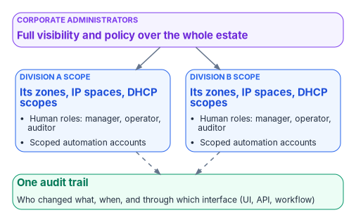
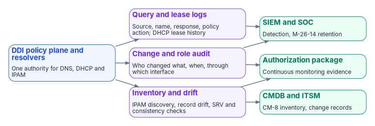
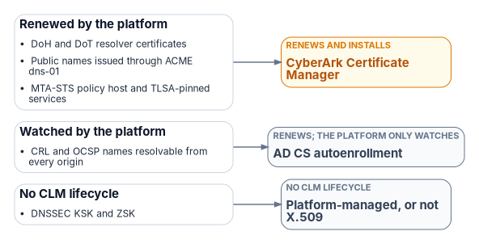

# Chapter 11 — Operating the Control Plane: Delegation, Automation and Evidence

*One policy plane is only an improvement if divisions can still run their own networks through it, every change leaves a trace, and the logs it keeps are the evidence an authorizing official asks for.*

::: {.callout-note}
## In this chapter
How divisions keep scoped autonomy under one authority, and the Windows and Azure equivalents of that model. The API, ITSM, identity and ACME certificate integrations the plane must support. What to log and monitor, against OMB M-26-14: query and lease logs, platform metrics, SRV checks, drift detection and record hygiene. A troubleshooting reference for the hybrid period, and the evidence checklist that closes [Chapter 10](10-migration-sequence.md)'s final phase.
:::

A single policy plane only works if the divisions that own their own networks can still operate them. This chapter sets out what the plane must support for delegated administration, automation, ITSM and identity integration, certificate automation, monitoring and compliance evidence. Where it names products, they illustrate the requirement; equivalent capabilities should be confirmed in current vendor documentation for any platform under evaluation. Who holds each role is decided in [Chapter 09](09-who-owns-dns.md).

## Delegated administration across divisions

{#fig-ch11-delegated-administration fig-alt="Corporate administrators have full visibility and policy over the whole estate. Division A and Division B each have a scope covering their own zones, IP spaces and DHCP scopes, with human roles (manager, operator, auditor) and scoped automation accounts. Everything feeds one audit trail."}

The policy plane should let corporate administrators keep full visibility while giving divisional teams scoped autonomy:

- Corporate administrators see and manage the entire estate.
- Each divisional team is assigned a scope that limits it to the zones, IP spaces, address blocks, DHCP scopes and other objects that belong to the division, including zones synchronized from cloud DNS services. Child objects inherit their parent's scope.
- Predefined roles cover DNS, DHCP and IPAM functions (for example manager, operator and auditor), and custom roles can combine granular create, read, update and delete permissions.
- Divisional users and automation accounts cannot see or change objects outside their scope.
- The result is fewer tickets and faster divisional change, with one authoritative policy plane and a full audit trail for corporate oversight.

::: {.callout-note}
## Illustrative implementation
Infoblox Universal DDI implements this model as access views combined with access policies in the Infoblox Portal: a policy joins a role, a user group and an access view. Infoblox documents IP spaces, address blocks, DNS views and DNS zones as assignable to an access view, with subnets, ranges, fixed addresses and DHCP objects inheriting the view of their parent.[^c11-ib-views] Its access-policy documentation also states that access views currently support only the DDI IPAM manager, operator, auditor and user roles, with other roles planned,[^c11-ib-policies] so confirm which DNS and DHCP roles can be scoped to a view in the release under evaluation. Other enterprise DDI platforms provide comparable delegation models under different names.
:::

The same model has to hold for any Microsoft and Azure DNS that remains in service during and after the migration, because a division that cannot work through the plane will work around it:

| Platform | Delegation mechanism | Notes |
|---|---|---|
| Windows DNS on domain controllers | DnsAdmins group | Members get read, write, create and delete rights on DNS data.[^c11-ad-groups] Microsoft lists DnsAdmins among Active Directory's privileged groups; treat membership as privileged access, not a convenience. |
| Windows DHCP | DHCP Administrators and DHCP Users groups | Administrators manage scopes and can back up and restore the database; Users have read-only access.[^c11-ad-groups] |
| Azure public DNS | DNS Zone Contributor role at resource group, zone or record-set scope | Covers public zones only; it grants nothing on private zones.[^c11-az-protect] |
| Azure Private DNS | Private DNS Zone Contributor role at resource group, zone or record-set scope | Custom roles can limit an account to one record type, such as CNAMEs.[^c11-az-protect-private] |

Two Azure details matter for divisional scopes. A custom role that removes delete permission does not protect a record set, because an account that can modify it can empty it, which has the same effect on resolution; Microsoft recommends resource locks (CanNotDelete or ReadOnly) on critical zones alongside RBAC.[^c11-az-protect-private][^c11-secure-dns] And record-set-level scoping is the closest Azure equivalent to the plane's divisional scopes, so it is the right granularity for automation accounts.

## API and automation

Every object in the policy plane should be reachable through a documented API, so that infrastructure as code, ITSM workflows, certificate automation and CI pipelines all go through the same authority and the same audit trail:

- API coverage for IPAM, DHCP, DNS configuration and DNS data.
- Non-interactive service accounts for automation, bound by the same role and scope restrictions as human users and unable to log in to the console.
- A migration path for existing automation, so scripts written against the legacy grid keep working while authority moves (ask whether the platform proxies legacy API calls through the new policy plane, and for how long).
- Supported Terraform and Ansible integrations, so network and cloud teams can manage DDI objects in the same pipelines as the rest of their infrastructure. For Infoblox Universal DDI, for example, the Terraform provider manages DNS zones, views and records, DHCP and IPAM objects and other platform resources,[^c11-tf] and a Red Hat–certified Ansible collection, `infoblox.universal_ddi`, covers the same platform.[^c11-ansible]

Divisions can then automate their own DDI operations through scoped service accounts, while corporate teams keep policy, audit and cross-estate visibility.

## ITSM integration

Integration with the agency's ITSM platform, commonly ServiceNow, should let change requests, catalog items and incidents drive or draw on authoritative DDI data rather than manual updates:

- Synchronizing networks, IP addresses and devices into the CMDB, and continuously reconciling live network and cloud asset data against CMDB records to find missing, stale or misclassified configuration items.
- Workflow actions to reserve and release IP addresses, register DNS records and manage DDI objects from change and catalog workflows.
- Pushing correlated security events, such as Protective DNS blocks, into incident management.

Enterprise DDI vendors publish their own ServiceNow integrations; confirm which of these functions each one covers, and for which product line. For Infoblox, ServiceNow documents an IntegrationHub spoke with actions and subflows such as registering or reserving an IP address from a Service Catalog request,[^c11-snow-spoke] and a Service Graph Connector that imports subnets, IP pools, allocated addresses and DNS data into the CMDB; that connector is documented against the NIOS API (WAPI) rather than Universal DDI.[^c11-snow-sgc] An agency moving to the SaaS management plane should confirm which integrations follow it.

## Certificate automation (ACME DNS-01)

DDI platforms generally do not provide full certificate lifecycle management. What they provide is the authoritative DNS control that automated issuance and renewal through ACME DNS-01 challenges depends on:

- ACME clients and plug-ins call the DDI API to create and remove the TXT records that DNS-01 validation needs. Posh-ACME and lego, for example, both ship Infoblox plug-ins that work through the NIOS WAPI,[^c11-poshacme][^c11-lego] so check support for the management plane actually in use.
- Issuance and renewal can then be automated without exposing web servers, provided the automation account's permissions are scoped to the names it serves. Both plug-ins expect an account limited to modifying TXT records in the relevant zones or view.[^c11-poshacme][^c11-lego]
- DNSSEC, CAA records and consistent private endpoint resolution ([Chapter 06](06-dns-identity-and-dnssec.md) and [Chapter 07](07-cloud-private-endpoints-and-ipam.md)) remain prerequisites for trustworthy certificate validation after issuance.
- Certificate inventory, multi-CA orchestration and post-issuance deployment still need a dedicated certificate lifecycle platform that uses the DDI policy plane: in this program, CyberArk Certificate Manager ([Book 07](../b07-pki/index.md); see [Certificates in this book and the CLM platform](#certificates-and-the-clm-platform)).

## Identity governance integration

Identity governance platforms such as SailPoint typically reach DDI through APIs rather than packaged connectors: a custom connector or workflow calls the DDI API directly, or the identity platform opens ITSM requests that in turn call DDI workflow actions. This supports joiner, mover and leaver automation for network resources (IP allocation, DNS registration), but expect custom development. Confirm whether a supported connector exists for the platforms in use.

## Monitoring and telemetry

The policy plane, and every resolver and DHCP server still in service, should produce the continuous telemetry that incident response, continuous monitoring and Zero Trust reporting need. OMB M-26-14 sets the floor for federal agencies.

### What M-26-14 requires of DNS and DHCP logs

M-26-14 rescinded M-21-31, whose event-logging tiers made passive DNS a basic requirement and whose logging tables named DNS and DHCP records with 12 months of active and 18 months of cold retention. M-26-14 names neither DNS nor DHCP. It states its minimum baseline as activities the logs must support: among them, determining the identity used for each operation, "determining source and destination network address information, including protocols, ports, and session attributes," identifying changes to IT, OT and IoT infrastructure, hunting for known indicators of compromise and anomalous activity, and determining the attack vector, including lateral movement, with automated alerts for all of them. Retained logs must be actively searchable for six months after creation and retrievable for a year; timestamps must be synchronized to a traceable time source; and logs may be stored anywhere so long as they are readily available to the agency's top-level security operations center.[^c11-m2614] Which log sources meet the baseline is set in the agency's logging plan, using CISA's Logging Reference Architecture. For the name layer, the query log (which host asked for which name) and the lease history (which device held which address) are how resolvers and DHCP servers supply that network-address and attribution evidence; that is this book's design reading, not a line item in the memo. The control mapping to NIST SP 800-53 is in [Chapter 03](03-federal-requirements.md).

### Sources of query, lease and change logs

{#fig-ch11-evidence-flow fig-alt="Left, the DDI policy plane and resolvers. Three violet streams leave it: query and lease logs (source, name, response, policy action, DHCP lease history); change and role audit (who changed what, when, through which interface); and inventory and drift (IPAM discovery, record drift, SRV and consistency checks). On the right, three green consumers: the SIEM and SOC for detection and M-26-14 retention, fed by query logs and the change audit; the CMDB and ITSM for CM-8 inventory and change records, fed by inventory and drift; and the authorization package for continuous monitoring evidence, fed by the change audit and inventory."}

| Source | What it logs | How to collect it |
|---|---|---|
| DDI platform resolvers | Query, response and policy action per query; response-policy and Protective DNS hits | The platform's log export or SIEM integration |
| Windows DNS servers | Audit events (on by default: zone, record and server setting changes, dynamic updates, zone transfers, DNSSEC operations); analytic events (off by default: each query and response) | Enable the DNS-Server Analytical log; Microsoft measured about 5% degradation at 100,000 queries per second and no apparent impact at 50,000 or below.[^c11-dns-logging] The Microsoft Sentinel "Windows DNS Events via AMA" connector collects analytic events, through Azure Arc for servers outside Azure.[^c11-sentinel-dns] |
| Azure virtual networks | Every query from the VNet, with query name and type, source address, resolution path and the policy rule action | A DNS resolver policy linked to the VNet, with diagnostic settings to a Log Analytics workspace (the `DNSQueryLogs` table), storage account or Event Hubs[^c11-resolver-policy][^c11-dns-traffic] |
| Windows DHCP servers | Lease events in the DHCP audit log; failover state changes in the Admin channel and configuration changes in the Operational channel | `Get-DhcpServerAuditLog` shows the audit-log settings;[^c11-dhcp-audit] failover events are also written to the audit log[^c11-dhcp-failover-events] |
| Azure control plane | Every change to zones, record sets, links and resolvers | The Azure activity log, routed by diagnostic setting[^c11-monitor-ref] |

The DHCP lease history matters as much as the query log: it is what turns "this address queried a command-and-control domain" into "this device, at this time", the attribution that M-26-14's network-address and attack-vector requirements depend on.

### Platform metrics and alert thresholds

Azure publishes the following platform metrics.[^c11-monitor-ref] The thresholds are the program's starting points; tune them to each zone's normal behavior.

| Resource | Metric | Program alert threshold |
|---|---|---|
| Azure DNS public zone | Query Volume | A sudden drop of more than 50%, which usually means resolution has moved somewhere unexpected |
| Azure DNS public zone | Record Set Count | Any unexpected decrease (records deleted outside change control) |
| Azure DNS public zone | Record Set Capacity Utilization | 80% of the zone's record-set limit |
| Azure Private DNS zone | Record Set Count; Virtual Network Link Count and capacity utilization | Unexpected change; 80% of the link limit |
| Azure DNS Private Resolver | Queries Per Second, per endpoint | Inbound endpoint at zero during business hours (resolver or path failure); a spike of more than 200% (a possible forwarding loop) |

Two limits apply. Microsoft notes that the public-zone metrics and alerting are supported only in the Azure public cloud, with sovereign-cloud support to follow, so agencies in Azure Government need another source for the same signal.[^c11-monitor-ref] And the Private Resolver exposes no forwarding-failure metric: detect failed forwarding from the query logs (failed responses for forwarded namespaces) and from synthetic tests, not from a metric.

### SRV record monitoring

From coexistence until the last domain controller is retired, the locator records that domain join, Kerberos, Group Policy and replication depend on ([Chapter 04](04-active-directory-dns-departure.md)) are tested continuously: resolved every 15 minutes, from a monitoring host in every site and every VNet, with any failure opening an incident. This is the check behind the 30-day gate in Chapter 10's Phase 5. A minimal check, run as a scheduled task under an account with DNS read access only:

::: {.callout-warning}
## Illustrative commands, not tested
The commands in this chapter are short illustrations, checked against Microsoft Learn for cmdlet and parameter names but not tested against a production forest or tenant. Review, adapt and test them before use.
:::

```powershell
$domain = "corp.example.gov"     # the AD domain
$forest = "example.gov"          # the forest root domain
$names  = "_ldap._tcp.dc._msdcs.$domain", "_kerberos._tcp.dc._msdcs.$domain",
          "_gc._tcp.$forest", "_kpasswd._tcp.$domain"
foreach ($n in $names) {
    try   { Resolve-DnsName -Name $n -Type SRV -DnsOnly -ErrorAction Stop | Out-Null }
    catch { Write-Warning "SRV lookup failed: $n" }  # raise an incident here
}
```

`Resolve-DnsName` and its `-Type`, `-DnsOnly` and `-Server` parameters are from the DnsClient module.[^c11-resolve] Add the site-specific locator records (`_ldap._tcp.<site>._sites.dc._msdcs.<domain>`) for every AD site, because a missing site record sends clients to remote domain controllers rather than failing outright.

### Drift detection

During the hybrid period the same zone exists in two places, and the copies diverge: a record added on one side by hand, a dynamic registration that reached only the old server, an import that skipped a type. Drift detection compares them on a schedule and opens a ticket when they differ. The method is simple: export both sides, normalize each record to a name, type and data tuple (excluding SOA and NS, which each platform manages itself), and report what exists only on one side. After migration the same job compares the policy plane, as the source of truth, with every consumer it synchronizes to, which is how the "sync lag and sync failure" risk in [Chapter 12](12-selection-cost-and-residual-risk.md) is caught.

On Windows the source side is `Get-DnsServerResourceRecord`;[^c11-get-rr] on Azure Private DNS the target side is `az network private-dns record-set list`, which returns every record set in a zone.[^c11-az-recordset] Commit each drift report to the program's repository so the history of drift is itself evidence.

### Record hygiene

Stale records are how DNS becomes a map of where things used to be, and dangling CNAMEs that point at deprovisioned cloud resources let someone else claim the name and take over the subdomain.[^c11-dangling] Each platform needs an explicit cleanup mechanism:

- **Windows DNS:** aging and scavenging, configured per zone (no-refresh and refresh intervals) and per server. Where Azure VMs register in Windows DNS through dynamic DNS, Microsoft warns that long Azure DHCP leases can cause scavenging to remove records prematurely, so set the intervals with that in mind.[^c11-vnet-names]
- **Azure Private DNS:** autoregistered VM records are removed when the VM is deleted or stopped and deallocated.[^c11-pdns-faq] Manually created records have no aging; remove them through the same automation that created them, or with a scheduled job that checks each record against the resources that still exist.
- **The policy plane:** DHCP-driven DDNS removes records when leases expire. Report stale-record and dangling-CNAME rates monthly as hygiene metrics.

## Troubleshooting reference

The failures below are the common ones during the hybrid period. The resolution column is where to look first; the prevention column is the control that stops it recurring.

| Symptom | Likely cause | Resolution | Prevention |
|---|---|---|---|
| A cloud workload cannot resolve an on-premises name | Missing or wrong forwarding rule, or port 53 blocked from the outbound endpoint subnet | Check the rule exists for the namespace; test the targets on UDP and TCP 53 from the outbound subnet; check NSGs | Test each rule when it is created; include port 53 in deployment validation |
| An on-premises client cannot resolve a cloud private name | No conditional forwarder to the inbound endpoint, the endpoint is unreachable, or the private zone is not linked to the resolver's VNet | Check the forwarder, the route to the inbound endpoint and the zone link | Monitor inbound endpoint reachability; deploy forwarders as code |
| A private endpoint name returns its public address | The `privatelink` zone is not linked to the querying VNet, the on-premises forwarder targets `168.63.129.16`, or a Windows forwarder times out | Link the zone; target the inbound endpoint, not `168.63.129.16`;[^c11-pr-troubleshoot] raise the Windows forwarding timeout above four seconds[^c11-vnet-names] | Create `privatelink` zones before private endpoints; enforce links by policy ([Chapter 07](07-cloud-private-endpoints-and-ipam.md)) |
| Domain join or Kerberos fails from a cloud VM | Locator SRV records unresolvable from the VNet | Check the forwarding rule for the AD namespace; resolve `_ldap._tcp.dc._msdcs.<domain>` as SRV; check tickets with `klist` | Prove SRV forwarding before any cloud VM joins the domain; run the SRV check before and after each phase |
| Queries never resolve | A forwarding loop: cloud forwards to on-premises, which forwards back | Trace both directions for the namespace; give it one authoritative path | Document every forwarding path; review for loops each phase |
| NXDOMAIN or old answers just after a move | Cached answers within the old TTL | Confirm the record in the target; flush client caches (`ipconfig /flushdns`); wait out the TTL | Lower TTLs at least 48 hours before cutover; restore after |
| Intermittent failures from cloud VMs | The VNet's DNS list includes a retired or unreachable server, or VMs still hold old settings | Fix the list order; restart or renew leases on affected VMs[^c11-vnet-manage] | Audit VNet DNS settings each phase |
| Records missing after a rollback | A VNet link was removed or autoregistration disabled, deleting autoregistered records | Re-enable autoregistration or re-create the records; deleted autoregistered records cannot be restored[^c11-pdns-faq] | Plan rollback for autoregistered zones before the change (Chapter 10) |
| Stale records accumulate in a private zone | Manual records never removed | Run the cleanup job; compare records to existing resources | Schedule drift and hygiene jobs |
| Cross-forest names fail | The partner forest's forwarding rule is missing or its target addresses changed | Check the rule and the partner's current DNS addresses | Keep a register of partner DNS addresses in the forwarder inventory |
| Resolver endpoint not answering | Platform issue, subnet problem or NSG blocking port 53 | Check resolver health and NSGs; confirm the endpoint's subnet is dedicated to it | Alert on inbound QPS at zero |
| DNSSEC validation fails after a zone moves | The chain of trust is broken (DS record at the parent not updated) | Validate the chain with `Resolve-DnsName -DnssecOk`;[^c11-resolve] fix the DS record | Follow the signed-zone sequence in [Chapter 06](06-dns-identity-and-dnssec.md) |

## Compliance evidence

The policy plane should produce the continuous telemetry and audit trail that FedRAMP, NIST and Zero Trust reporting require:

- DNS query logs (source, query name, response, policy action, timestamp) for Protective DNS, M-26-14 logging and incident response, including queries made over encrypted DNS, exported to the SIEM and SOAR platforms, actively searchable for six months and retrievable for a year.[^c11-m2614]
- DHCP lease history, so every query can be tied to a device.
- Response policy and Protective DNS hit data.
- IPAM discovery and inventory reports for CM-8 component inventory, and continuous discovery data for CMDB reconciliation.[^c11-sp80053]
- Configuration change and role audit trails (who changed what, when and through which interface) for AU-2, AU-6 and AU-12.[^c11-sp80053]
- Resolution-path consistency metrics: the percentage of queries answered by the governed resolver.
- Stale record and dangling CNAME rates for hygiene reporting.
- Drift reports and SRV check history for the migration period.

These artifacts support the control mapping in [Chapter 03](03-federal-requirements.md), continuous monitoring, FedRAMP evidence packages and Zero Trust maturity assessments.

## Sample evidence checklist

For a program office or an authorization package. The first five items are the five configuration decisions in [Chapter 08](08-reference-architecture.md), checked here:

- **Decision 1.** Documented redirect-dns targets for every branch, all of them network-addressable agency-controlled resolvers.
- **Decision 2.** Forwarding chain order verified in the running configuration: the agency-controlled resolver is the redirect-dns target, and any additional resolvers are its forwarding targets.
- **Decision 3.** Every per-cloud private namespace has its forwarding rule in the policy plane, with a passing validation from every origin (Chapter 10, Phase 4).
- **Decision 4.** AD DNS inventory completed and reconciled before any domain controller is decommissioned.
- **Decision 5.** OCSP and CRL endpoints resolvable from on-premises, every cloud and every branch.
- Protective DNS and encrypted DNS configuration evidence aligned with M-22-09, CISA guidance and SP 800-81r3 ([Chapter 03](03-federal-requirements.md), [Chapter 05](05-edge-interception-and-bypass.md)).
- IPAM inventory and discovery reports covering the hybrid address space.
- Query logs, DHCP lease logs and policy audit trails retained for continuous monitoring at M-26-14 retention: searchable for six months, retrievable for a year.
- Rogue DHCP and router advertisement detection, and option 6 and RDNSS consistency controls, documented.
- Delegated roles and scopes reviewed, with DnsAdmins and equivalent privileged memberships justified.

## Certificates in this book and the CLM platform {#certificates-and-the-clm-platform}

[Book 07](../b07-pki/index.md) gives each class of certificate one issuer and one renewal engine, and makes CyberArk Certificate Manager, Self-Hosted the system of record for every certificate that Intune and the PIV system don't manage ([Chapter 04](../b07-pki/04-the-target-pki.md), [Chapter 05](../b07-pki/05-who-owns-the-certificate-estate.md)). The certificates this book's systems depend on map to it as follows; [Book 07, Appendix C](../b07-pki/appendix-c-anatomy-of-the-clm-platform.md) describes the platform itself.

| Certificate | Book 07 class | Issued by | Renewed by | What the CLM platform does |
|---|---|---|---|---|
| DoH and DoT resolver certificates | Internal server TLS | Retained AD CS | CyberArk Certificate Manager | Renews them; CAPI driver for Windows DNS, an Adaptable driver or vendor API for appliances (inference) |
| Public names issued through ACME dns-01 | Public TLS | Public CA authorized by CAA | CyberArk Certificate Manager | Its ACME service issues; the DDI API writes the TXT records |
| CRL and OCSP names resolvable from every origin | CA certificates and CRLs | The hierarchy | AD CS autoenrollment | Revocation monitoring checks the endpoints |
| MTA-STS policy host and TLSA-pinned services | Internal server TLS | Retained AD CS or public CA | CyberArk Certificate Manager | Renews the leaf; TLSA records must change with it (inference) |
| DNSSEC KSK and ZSK | Not a Book 07 class | The DNS platform | Platform-managed, or not X.509 | Nothing: DNSSEC keys aren't X.509 certificates |

{fig-alt="DoH and DoT resolver certificates, Public names issued through ACME dns-01, MTA-STS policy host and TLSA-pinned services go to CyberArk Certificate Manager (renews and installs); CRL and OCSP names resolvable from every origin go to AD CS autoenrollment (renews; the platform only watches); DNSSEC KSK and ZSK go to Platform-managed, or not X.509 (no clm lifecycle)."}

The program's ACME server is CyberArk Certificate Manager's ACME service. CyberArk tested it with certbot, win-acme and acme.sh, and it must run on servers that aren't in FIPS mode; validate any other client, such as Posh-ACME or lego, before relying on it.[^clm-acme]


::: {.callout-note}
## What this chapter establishes
1. A single policy plane must still give each division scoped autonomy, with one audit trail, and any DNS left on Windows or Azure needs the same discipline.
2. Every change, human or automated, goes through the same API, roles and scopes.
3. The plane, and every resolver and DHCP server still running, must produce the query, lease, change and inventory evidence that M-26-14, FedRAMP and Zero Trust reporting require, at the required retention.
:::

::: {.callout-tip}
## Continue the book
[← Previous: Chapter 10 — The Migration Sequence](10-migration-sequence.md) · [Book index](index.md) · [Next: Chapter 12 — Platform Selection, Cost and Residual Risk →](12-selection-cost-and-residual-risk.md)
:::

[^c11-ib-views]: Infoblox, "About Access Views" (Universal DDI documentation), <https://infoblox-docs.atlassian.net/wiki/x/PgKSK> (accessed Oct 20, 2026).
[^c11-ib-policies]: Infoblox, "Creating Access Policies" (Infoblox Portal documentation), <https://docs.infoblox.com/space/BloxOneCloud/35431431> (accessed Oct 20, 2026).
[^c11-ad-groups]: Microsoft Learn, "Active Directory security groups," <https://learn.microsoft.com/windows-server/identity/ad-ds/manage/understand-security-groups>; and "Appendix B: Privileged Accounts and Groups in Active Directory," <https://learn.microsoft.com/windows-server/identity/ad-ds/plan/security-best-practices/appendix-b--privileged-accounts-and-groups-in-active-directory> (accessed Oct 20, 2026).
[^c11-az-protect]: Microsoft Learn, "How to protect DNS zones and records," <https://learn.microsoft.com/azure/dns/dns-protect-zones-recordsets> (accessed Oct 20, 2026).
[^c11-az-protect-private]: Microsoft Learn, "How to protect private DNS zones and records," <https://learn.microsoft.com/azure/dns/dns-protect-private-zones-recordsets> (accessed Oct 20, 2026).
[^c11-secure-dns]: Microsoft Learn, "Secure your Azure DNS deployment," <https://learn.microsoft.com/azure/dns/secure-dns> (accessed Oct 20, 2026).
[^c11-tf]: Infoblox, "terraform-provider-bloxone" (Terraform provider for Universal DDI), GitHub, <https://github.com/infobloxopen/terraform-provider-bloxone> (accessed Oct 20, 2026).
[^c11-ansible]: Red Hat Ecosystem Catalog, "universal_ddi" (Infoblox certified Ansible collection), <https://catalog.redhat.com/en/software/collection/infoblox/universal_ddi> (accessed Oct 20, 2026).
[^c11-snow-spoke]: ServiceNow, "Infoblox spoke" (IntegrationHub), <https://docs.servicenow.com/bundle/utah-integrate-applications/page/administer/integrationhub-store-spokes/concept/infoblox-spoke.html> (accessed Oct 20, 2026).
[^c11-snow-sgc]: ServiceNow, "Service Graph Connector for Infoblox," <https://docs.servicenow.com/bundle/xanadu-servicenow-platform/page/product/configuration-management/concept/sgc-cmdb-integration-infoblox.html> (accessed Oct 20, 2026).
[^c11-poshacme]: Posh-ACME, "Infoblox" (DNS plugin guide), <https://poshac.me/docs/latest/Plugins/Infoblox/> (accessed Oct 20, 2026).
[^c11-lego]: lego, "Infoblox" (DNS provider), <https://go-acme.github.io/lego/dns/infoblox/> (accessed Oct 20, 2026).
[^c11-m2614]: Office of Management and Budget, M-26-14, *Ensuring Effective and Efficient Agency Logging and Network Visibility to Defend Against Evolving Cyber Threats*, May 22, 2026, rescission of M-21-31, "Agency Logging Plan" and Appendix B (Minimum Logging Baseline Requirements, items 1, 2, 3 and 5), <https://www.whitehouse.gov/wp-content/uploads/2026/05/M-26-14-Ensuring-Effective-and-Efficient-Agency-Logging-and-Network-Visibility-to-Defend-Against-Evolving-Cyber-Threats.pdf> (accessed Oct 21, 2026).
[^c11-dns-logging]: Microsoft Learn, "Enable DNS Logging and Diagnostics," <https://learn.microsoft.com/windows-server/networking/dns/dns-logging-and-diagnostics> (accessed Oct 20, 2026).
[^c11-sentinel-dns]: Microsoft Learn, "Stream and filter data from Windows DNS servers with the AMA connector," <https://learn.microsoft.com/azure/sentinel/connect-dns-ama> (accessed Oct 20, 2026).
[^c11-resolver-policy]: Microsoft Learn, "DNS resolver policy," <https://learn.microsoft.com/azure/dns/dns-security-policy> (accessed Oct 20, 2026).
[^c11-dns-traffic]: Microsoft Learn, "Secure and view DNS traffic," <https://learn.microsoft.com/azure/dns/dns-traffic-log-how-to> (accessed Oct 20, 2026).
[^c11-dhcp-audit]: Microsoft Learn, "Get-DhcpServerAuditLog," <https://learn.microsoft.com/powershell/module/dhcpserver/get-dhcpserverauditlog?view=windowsserver2025-ps> (accessed Oct 20, 2026).
[^c11-dhcp-failover-events]: Microsoft Learn, "DHCP failover events in Windows Server," <https://learn.microsoft.com/windows-server/networking/technologies/dhcp/dhcp-failover-events> (accessed Oct 20, 2026).
[^c11-monitor-ref]: Microsoft Learn, "Azure DNS monitoring data reference," <https://learn.microsoft.com/azure/dns/monitor-dns-reference> (accessed Oct 20, 2026).
[^c11-resolve]: Microsoft Learn, "Resolve-DnsName," <https://learn.microsoft.com/powershell/module/dnsclient/resolve-dnsname?view=windowsserver2025-ps> (accessed Oct 20, 2026).
[^c11-get-rr]: Microsoft Learn, "Get-DnsServerResourceRecord," <https://learn.microsoft.com/powershell/module/dnsserver/get-dnsserverresourcerecord?view=windowsserver2025-ps> (accessed Oct 20, 2026).
[^c11-az-recordset]: Microsoft Learn, "az network private-dns record-set," <https://learn.microsoft.com/cli/azure/network/private-dns/record-set?view=azure-cli-latest> (accessed Oct 20, 2026).
[^c11-vnet-names]: Microsoft Learn, "Configure DNS name resolution for Azure virtual networks," <https://learn.microsoft.com/azure/virtual-network/virtual-networks-name-resolution-for-vms-and-role-instances> (accessed Oct 20, 2026).
[^c11-pdns-faq]: Microsoft Learn, "Azure Private DNS FAQ," <https://learn.microsoft.com/azure/dns/dns-faq-private> (accessed Oct 20, 2026).
[^c11-pr-troubleshoot]: Microsoft Learn, "Troubleshoot hybrid DNS resolution failures with Azure DNS Private Resolver," <https://learn.microsoft.com/troubleshoot/azure/dns/troubleshoot-azure-dns-private-resolver-hybrid-resolution-failure> (accessed Oct 20, 2026).
[^c11-vnet-manage]: Microsoft Learn, "Create, change, or delete a virtual network" (Change DNS servers), <https://learn.microsoft.com/azure/virtual-network/manage-virtual-network> (accessed Oct 20, 2026).
[^c11-dangling]: Microsoft Learn, "Prevent dangling DNS entries and avoid subdomain takeover," <https://learn.microsoft.com/azure/security/fundamentals/subdomain-takeover> (accessed Oct 20, 2026).
[^c11-sp80053]: National Institute of Standards and Technology, SP 800-53 Rev. 5, *Security and Privacy Controls for Information Systems and Organizations*, September 2020 (updated December 10, 2020), <https://csrc.nist.gov/pubs/sp/800/53/r5/upd1/final> (accessed Oct 20, 2026).
[^clm-acme]: CyberArk, 26.1, "ACME" (RFC 8555 with http-01 and dns-01; tested with certbot, win-acme and acme.sh), <https://docs.venafi.com/Docs/current/TopNav/Content/ACME/cco-ACME-about.php>, and "Deploying on Windows Server" ("you cannot have FIPS enabled on any server that is used for ACMEv2"), <https://docs.venafi.com/Docs/current/TopNav/Content/Install/r-deploy-windows-server.php> (accessed Oct 23, 2026).
