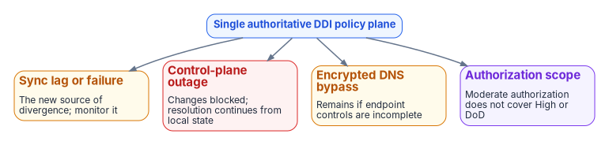

# Chapter 12 — Platform Selection, Cost and Residual Risk

*Choose the policy plane on the evidence each candidate can produce for your authorization boundary, price it by what it actually meters, and keep the risks it doesn't remove on the record.*

::: {.callout-note}
## In this chapter
How to measure success and what drives cost and staffing, including the metered cost of cloud-native resolvers. Selection criteria and a decision framework, the authorization status of the main options as the FedRAMP Marketplace shows it today, a comparison of what each platform model can and can't do across clouds, and the questions to put to every vendor. The chapter closes with the residual risks that remain after a unified policy plane is in place, and the book's conclusion.
:::

## Cost, staffing and success measures

Adopting a single authoritative DDI policy plane needs a view of cost, staffing and how success will be measured. Licensing and operating cost vary with the deployment model (SaaS management with local resolvers, on-premises or in-tenant appliances, or cloud-native services managed as code) and with the number of resolvers, sites and IP address objects under management. Staffing goes mainly to operating the policy plane, monitoring synchronization and the initial migration. [Chapter 09](09-who-owns-dns.md) assigns that work.

The headline success measure is **resolution-path consistency**: the percentage of tested names that return the same answer, or the intentionally different internal and external answers, from every governed origin. Baseline the current rate, set a target and report progress to the authorizing official. Secondary measures are address-block overlap incidents and the certificate and access errors traced to wrong DNS answers.

### What the cloud-native path meters

Commercial DDI licensing is quoted per agency and isn't published, so this book doesn't estimate it. Get quotes on the same assumptions for every candidate: number of sites and resolvers, managed IP addresses or objects, the clouds in scope and the authorization boundary.

The cloud-native components, by contrast, have public meters, and they appear in every model, because even a commercial policy plane forwards into cloud resolvers and writes into cloud private zones. Azure's list prices show how the cost is structured. Azure DNS Private Resolver is billed per inbound endpoint, per outbound endpoint and per forwarding ruleset, each per month. There is no separate resolver-instance charge and no Private Resolver query meter in the price list.[^c12-azure-prices][^c12-azure-pricing-page] Private DNS zones are billed per zone per month, with private queries billed per million, and DNS security policy (Azure's DNS-layer threat blocking[^c12-azure-dns-security]) is billed per million queries and per managed domain.[^c12-azure-prices]

| Azure meter (US commercial, Zone 1) | Unit | List price, USD | Effective since |
|---|---|---|---|
| Private Resolver inbound endpoint | Per endpoint per month | 180.00 | Sep 1, 2022 |
| Private Resolver outbound endpoint | Per endpoint per month | 180.00 | Sep 1, 2022 |
| Private Resolver forwarding ruleset | Per ruleset per month | 2.50 | Sep 1, 2022 |
| Private DNS zone, first 25 | Per zone per month | 0.50 | Dec 1, 2019 |
| Private DNS queries | Per million queries | 0.40 | Dec 1, 2019 |
| DNS security policy queries | Per million queries | 0.60 | Jun 1, 2025 |

These are Azure Retail Prices API list prices retrieved on October 20, 2026, before any agreement discounts, and they change. Use the Azure pricing calculator for a current estimate.[^c12-azure-prices] As a worked example at those prices, a hub with one inbound endpoint, one outbound endpoint and one ruleset costs about $362.50 a month per region before zones and queries, and a second region for resilience doubles that. The same endpoint price appears in the US Gov zone of the price list. On AWS, VPC IPAM charges for each active IP address it monitors in an organization's member accounts,[^c12-aws-ipam] so IPAM cost grows with the address estate, not with the number of administrators.

::: {.callout-warning}
## Correction to earlier program guidance
Earlier program cost guidance for Azure DNS Private Resolver priced a resolver instance by the hour with low-cost endpoints. The published meters are the reverse: the endpoints carry the cost, per endpoint per month, and there is no resolver-instance meter. Re-estimate any budget built on the earlier figures.
:::

## Selection criteria

Selection should follow the architectural requirements, not a vendor list:

- **A single authoritative policy plane** for DNS, DHCP and IPAM across on-premises, every cloud and VMware.
- **Authorization status** at the impact level and in the cloud environment where it will be used ([Applicability](appendix-c-applicability.md)).
- **Consistent resolution and security policy** (response policy zones and Protective DNS forwarding, encrypted DNS, DNSSEC validation, logging) across every hybrid surface.
- **Support for the five configuration decisions** in [Chapter 08](08-reference-architecture.md), including network-addressable resolvers that SD-WAN redirect-dns can target at every branch.
- **Delegated administration, APIs and ITSM integration** as described in [Chapter 11](11-operating-the-control-plane.md), mapped to the owners in [Chapter 09](09-who-owns-dns.md).
- **Scale**: resolver sizing and policy distribution for the agency's full branch estate.

The table turns these criteria into a decision framework. Score each candidate on the evidence it can produce, not on its marketing.

| Dimension | Evidence to request |
|----|----|
| Authorization | FedRAMP Marketplace listing for the exact offering, impact level and region; the components inside the authorized boundary; the agency ATO path |
| Policy-plane coverage | Demonstrated management of on-premises, each cloud in use and VMware, from one system of record, and whether each integration writes to the cloud or only reads from it |
| Edge and endpoint fit | Network-addressable resolvers that redirect-dns can target; encrypted DNS termination; endpoint agent behavior |
| Security policy | Response policy and Protective DNS forwarding, DNSSEC signing and validation, logging export to the SIEM |
| IPAM integration | External-IPAM allocation where the cloud supports it; discovery and reconciliation where it does not |
| Delegation and automation | Scoped roles, service accounts, API coverage, Terraform and ITSM integration |
| Scale and resilience | Resolver sizing for the branch estate; behavior when the management plane is unreachable |
| Migration path | Microsoft DNS and DHCP coexistence; support for existing automation during transition |
| Operating cost and skills | Licensing model, metered cloud components, staffing for operation and synchronization monitoring, training needs |

### Authorization status, as the Marketplace shows it

Authorization belongs to a specific cloud service offering, not to a vendor or a product family ([Chapter 03](03-federal-requirements.md)). As of October 20, 2026, the FedRAMP Marketplace data shows:[^c12-marketplace]

| Offering | Marketplace status | What it means for selection |
|---|---|---|
| Infoblox Government Cloud (FR2017257053) | FedRAMP Certified, Moderate, since December 15, 2022; SaaS in AWS GovCloud (US) | The listed service description covers Universal DDI, Universal Asset Insights and the threat defense components TIDE and Dossier. In July 2026 Infoblox announced that Universal DDI Management, NIOS-X servers and Universal Asset Insights were available through it.[^c12-ibx-pr] On-premises NIOS appliances aren't a cloud service and sit inside the agency's own boundary |
| BlueCat, EfficientIP | No listing | Their DDI products can be deployed as software or appliances that the agency operates inside its own boundary (BlueCat documents Address Manager and DNS/DHCP Server appliances for Azure and Azure Government[^c12-bluecat-azure]). The Marketplace lists no FedRAMP authorization for either vendor, so a vendor-hosted management service from them would need its own authorization path |
| Azure (commercial) | FedRAMP Certified, High | Azure DNS is listed in Microsoft's FedRAMP High audit scope for Azure public regions[^c12-azure-scope] |
| AWS US East/West; AWS GovCloud | FedRAMP Certified, Moderate; High | AWS lists Amazon Route 53 as in scope in both[^c12-aws-scope] |
| Cisco Catalyst SD-WAN for Government (FR2012534927) | FedRAMP Certified, Moderate, since March 14, 2024 | Relevant when the SD-WAN management plane that sets redirect-dns is itself cloud-delivered |

Two cautions. A Moderate authorization doesn't cover High or DoD workloads ([Applicability](appendix-c-applicability.md)), whatever the vendor's commercial-versus-federal comparison tables say about feature parity. And confirm current status on the Marketplace for every candidate at decision time rather than relying on this table or on vendor claims.

## Comparing the platform models

Options to evaluate against the framework fall into three models. The capabilities below are what each vendor or provider documents; they are examples to verify in the candidate's current documentation, not a ranking.

| Model and example | Cross-cloud DNS reach as documented | What to check |
|---|---|---|
| SaaS policy plane: Infoblox Universal DDI | Manages DNS records for internal environments, Amazon Route 53, Azure DNS and Google Cloud DNS, and for Cloudflare and Akamai[^c12-ibx-blog] | Published integration limits, such as Azure DNS: no Azure DNS tags, no non-simple routing policy records, multi-value record sets split into separate records, NS records read-only, SOA changes taking several sync intervals and MNAME and serial not synchronized[^c12-ibx-azure] |
| Agency-operated DDI: BlueCat | Cloud Discovery & Visibility imports Route 53, Azure DNS and Google Cloud DNS public and private zones into Address Manager, but can't export Address Manager data back into the clouds[^c12-bluecat-cdv] | Discovery is not authoritative synchronization: decide how changes reach each cloud |
| Agency-operated DDI: EfficientIP SOLIDserver | DNS Cloud manages public and private DNS services on Route 53, Google Cloud DNS and Azure DNS[^c12-eip] | Sync direction, conflict handling and per-cloud limits, which the product page doesn't state |
| Cloud-native, managed as code | Azure DNS Private Resolver and Route 53 VPC Resolver forward between clouds and on-premises; Azure DNS security policy blocks known malicious domains;[^c12-azure-dns-security] shared Resolver rules can be centrally owned[^c12-aws-rules] | No single multi-cloud IPAM source of truth or multi-division delegation model by itself; needs a CI drift gate and explicit controls against split-brain between clouds |

The cloud-native path is common and reduces independent authoring, but by itself it gives neither a single multi-cloud IPAM source of truth nor a multi-division delegation model. Enterprise DDI platforms supply those, at the cost of an integration layer whose limits become the new source of divergence. That trade is the decision, and it is settled by evidence from the agency's own estate.

### Why decide now

The case for deciding before the next migration wave, rather than after, rests on forcing functions the series has already verified. M-22-09 requires encrypted DNS to agency-designated resolvers ([Chapter 05](05-edge-interception-and-bypass.md)). Every new cloud adds an independent DNS system and another set of conditional forwarders ([Chapter 07](07-cloud-private-endpoints-and-ipam.md)). Agencies retiring Active Directory must have the AD DNS inventory reprovisioned before the last domain controller goes, and starting after it is gone means recovering from orphaned records under pressure ([Chapter 04](04-active-directory-dns-departure.md)). And rogue DHCP option 6 can move a subnet off the governed resolver in one step ([Chapter 05](05-edge-interception-and-bypass.md)). None of these waits for a platform decision; each is cheaper with one.

### Questions to put to every vendor

Take these to every candidate, in writing, before committing. Several were raised during the program's earlier research and are only partly answered in public documentation.

1. **Endpoint agents and redirect-dns.** Can the platform's endpoint agent act as a network-addressable proxy that an SD-WAN redirect-dns policy can target, or does it only listen on the device's loopback address? Infoblox documents its Endpoint as listening on 127.0.0.1 port 53 (127.0.0.2 on macOS) and forwarding to its platform over DNS over TLS on TCP 443,[^c12-ibx-endpoint] which makes it a client-side agent, not a redirect target (Chapter 08, Decision 1).
2. **Cloud integration limits.** What are the documented limits of each cloud integration, and do they affect private endpoint resolution or conditional forwarding for cloud-managed namespaces? The Azure DNS limits above answer the first half for one vendor; the second half is still a question.
3. **Wildcards and namespace occupancy.** Does IPAM track wildcard records and subdomain occupancy, or only host-level A and AAAA records?
4. **Source address under redirect-dns.** When the edge redirects a query, does the resolver see the workstation's address or the edge router's? The answer decides whether query logs attribute traffic to a device.
5. **Sovereign-cloud telemetry.** Microsoft 365 informed network routing supports WW Commercial tenants but not GCC Moderate, GCC High or DoD;[^c12-inr] ask the SD-WAN vendor and Microsoft whether any alternative telemetry is planned.
6. **AD DNS migration support.** Is there a published, supported path from AD-integrated DNS to the platform that preserves SRV resolution and secure dynamic updates during coexistence?

## Residual risk and limitations

{#fig-ch12-residual-risks fig-alt="Four risks around a single authoritative DDI policy plane: sync lag or failure, the new source of divergence; control-plane outage, where changes are blocked but resolution continues from local state; encrypted DNS bypass if endpoint controls are incomplete; and authorization scope, since a Moderate authorization does not cover High or DoD."}

The residual risks are real:

- **Sync lag and sync failure** between the policy plane and per-cloud DNS or IPAM services become the new source of divergence. Vendors document their own sync limits, such as SOA changes that take several intervals to reach Azure,[^c12-ibx-azure] so monitor synchronization health and test resolution after every high-impact change.
- **Control-plane concentration.** If the management plane is unavailable, changes cannot be made, but existing resolution should continue from local resolver state. Define the operational response and any local override procedures, and decide in advance who may invoke them ([Chapter 09](09-who-owns-dns.md)).
- **Authorization scope.** A Moderate authorization does not cover High or DoD environments ([Applicability](appendix-c-applicability.md)).
- **Commercial-only optimizations.** Microsoft 365 informed network routing is unavailable in GCC Moderate, GCC High and DoD, and the only SD-WAN solution Microsoft lists for it is Cisco IOS XE SD-WAN 20.4/17.4 or later;[^c12-inr] Microsoft 365 optimization there relies on local breakout and application-aware routing.
- **Loopback endpoint agents.** A client-side DNS agent listening on loopback cannot be a redirect-dns target; a network-addressable resolver is required.
- **Encrypted DNS bypass** remains possible where endpoint and network controls are incomplete.
- **Open engineering questions** for very large branch estates, such as resolver and forwarding-proxy sizing and source-address behavior under redirect-dns, need vendor engagement and testing.

None of these negates the architecture. They define the operational controls and vendor engagements still required.

## Conclusion

DNS is no longer a name-lookup utility. It is the identity substrate, the security enforcement plane and the definition of the application surface for the hybrid multi-cloud agency. Independent DNS systems produce structural split-brain that breaks private connectivity, certificate trust and Zero Trust policy. A single authoritative DDI policy plane, authorized at the right impact level, keeps DNS, DHCP and IPAM consistent across the enterprise, cloud and internet perspectives. It puts the NIST SP 800-81r3 recommendations and the M-22-09 requirements into practice, carries the AD-to-Entra and VMware transitions, and works with SD-WAN edges that are configured correctly. The five configuration decisions in Chapter 08 remain the highest-leverage actions, and Chapter 09 names who owns each one. Governing DNS is a strategic security and architecture task, not an operations afterthought.

::: {.callout-tip}
## Continue the book
[← Previous: Chapter 11 — Operating the Control Plane: Delegation, Automation and Evidence](11-operating-the-control-plane.md) · [Book index](index.md) · [Next: Appendix A — DNS Record Types and Ecosystem Integrations →](appendix-a-dns-record-types.md)
:::

[^c12-azure-prices]: Microsoft, Azure Retail Prices API, service "Azure DNS," meters for Private Resolver, Private Zone, Private Queries and DNS Security Policy, <https://prices.azure.com/api/retail/prices?$filter=serviceName%20eq%20'Azure%20DNS'> (retrieved Oct 20, 2026).
[^c12-azure-pricing-page]: Microsoft, "Azure DNS pricing," <https://azure.microsoft.com/pricing/details/dns/> (accessed Oct 20, 2026); the page lists the Private Resolver meters as per endpoint per month and per ruleset per month.
[^c12-azure-dns-security]: Microsoft Learn, "DNS security and private name resolution (cross-cloud)," section "Azure services and features," <https://learn.microsoft.com/azure/networking/design-guide/dns-security> (accessed Oct 20, 2026).
[^c12-aws-ipam]: Amazon Web Services, "Integrate IPAM with accounts in an AWS Organization," Amazon VPC IPAM User Guide, <https://docs.aws.amazon.com/vpc/latest/ipam/enable-integ-ipam.html> (accessed Oct 20, 2026).
[^c12-marketplace]: FedRAMP, Marketplace product data (entries FR2017257053 Infoblox Government Cloud; F1209051525 Azure Commercial Cloud; AGENCYAMAZONEW AWS US East/West; F1603047866 AWS GovCloud; FR2012534927 Cisco Catalyst SD-WAN for Government; no entries for BlueCat or EfficientIP), <https://www.fedramp.gov/marketplace/products.json> (data last changed Oct 20, 2026; accessed Oct 20, 2026).
[^c12-ibx-pr]: **Third-party source (vendor).** Infoblox, "Infoblox Government Cloud Achieves FedRAMP Moderate Certification, Bringing Modern DDI and Asset Visibility to Federal Agencies," press release, July 22, 2026, <https://www.infoblox.com/news/news-events/press-releases/infoblox-government-cloud-achieves-fedramp-moderate-certification-bringing-modern-ddi-and-asset-visibility-to-federal-agencies/> (accessed Oct 20, 2026).
[^c12-bluecat-azure]: **Third-party source (vendor).** BlueCat, "Introduction to BlueCat Azure Virtual Appliances," BlueCat Integrity 26.1.0, <https://docs.bluecatnetworks.com/r/BlueCat-Azure-Virtual-Appliances/Introduction-to-BlueCat-Azure-Virtual-Appliances/26.1.0> (accessed Oct 20, 2026).
[^c12-azure-scope]: Microsoft Learn, "Azure, Dynamics 365, Microsoft 365, and Power Platform services compliance scope," section "Azure public services by audit scope," <https://learn.microsoft.com/azure/azure-government/compliance/azure-services-in-fedramp-auditscope> (accessed Oct 20, 2026).
[^c12-aws-scope]: Amazon Web Services, "AWS Services in Scope by Compliance Program: FedRAMP," <https://aws.amazon.com/compliance/services-in-scope/FedRAMP/> (accessed Oct 20, 2026).
[^c12-ibx-blog]: **Third-party source (vendor).** Infoblox, "November 2025 – January 2026 Innovations: What's New in Infoblox DDI," February 19, 2026, <https://www.infoblox.com/blog/company/november-2025-january-2026-innovations-whats-new-in-infoblox-ddi/> (accessed Oct 20, 2026).
[^c12-ibx-azure]: **Third-party source (vendor).** Infoblox, "Limitations of Azure DNS Integration," <https://docs.infoblox.com/space/BloxOneDDI/365461729/Limitations+of+Azure+DNS+Integration> (accessed Oct 20, 2026).
[^c12-bluecat-cdv]: **Third-party source (vendor).** BlueCat, "Introduction to Cloud Discovery & Visibility," Cloud Discovery & Visibility Administration Guide 24.1, <https://docs.bluecatnetworks.com/r/Cloud-Discovery-Visibility-Administration-Guide/Introduction-to-Cloud-Discovery-Visibility/24.1> (accessed Oct 20, 2026).
[^c12-eip]: **Third-party source (vendor).** EfficientIP, "DNS Cloud," <https://efficientip.com/products/dns-cloud/> (accessed Oct 20, 2026).
[^c12-aws-rules]: Amazon Web Services, "Managing forwarding rules," section "Sharing Resolver rules with other AWS accounts and using shared rules," Amazon Route 53 Developer Guide, <https://docs.aws.amazon.com/Route53/latest/DeveloperGuide/resolver-rules-managing.html> (accessed Oct 20, 2026).
[^c12-ibx-endpoint]: **Third-party source (vendor).** Infoblox, "Managing Endpoint," <https://docs.infoblox.com/space/BloxOneThreatDefense/35374260/Managing+Endpoint> (accessed Oct 20, 2026).
[^c12-inr]: Microsoft Learn, "Microsoft 365 informed network routing," <https://learn.microsoft.com/microsoft-365/enterprise/office-365-network-mac-perf-cpe> (accessed Oct 20, 2026).
