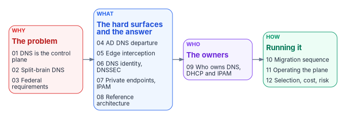

# Book 08 — DNS, DHCP & IPAM: The Hybrid Multi-Cloud Control Plane {.unnumbered}

::: {.callout-important appearance="default"}
## Status — draft book
This book brings together the workbook's Next Generation DDI series, the Next Generation DNS whitepaper, the DNS Modernization Guide and the DNS record-type reference. Every external claim was checked against a primary source on October 20, 2026 and carries a footnote. The earlier pages are kept in the repository's [`archive/b08-ddi/`](https://github.com/WhalerMike/modernization-workbook/tree/main/archive/b08-ddi) folder, and their old addresses forward to the chapters that replaced them.
:::

::: {.callout-tip}
## Download and present
**[b08-ddi-bundle.docx](../../../downloads/b08-ddi-bundle.docx)**: the whole book as one Word document, regenerated on every site deploy.

**15-minute presentation**: the Why / What / Who / How deck and its narrated, self-running edition, with built-in captions, are on the [Presentations](../../presentations/index.md#book-08) page.
:::

DNS was designed to answer one question: what is the address for this name? In a hybrid multi-cloud agency it now does far more. It publishes private endpoints, selects SaaS front doors, enforces security policy, anchors certificate validation and defines the application surface that Zero Trust policy is written against. Most agencies still run it as a commodity utility spread across independent platforms: Active Directory DNS or an on-premises DDI grid, AWS Route 53, Azure DNS, Google Cloud DNS and VMware NSX. The result is split-brain DNS that breaks private connectivity, certificate trust and Layer 7 policy at once, and that shows up as certificate errors and access denials rather than DNS errors. This book makes the case for one authoritative DDI policy plane, and walks through who owns it, how to get there and how to run it.

## Why, what, who, how

{fig-alt="Four cards left to right. Why, the problem, in red: Chapters 01 DNS is the control plane, 02 split-brain DNS and 03 federal requirements. What, the hard surfaces and the answer, in blue: Chapters 04 AD DNS departure, 05 edge interception, 06 DNS identity and DNSSEC, 07 private endpoints and IPAM, and 08 reference architecture. Who, the owners, in violet: Chapter 09 who owns DNS, DHCP and IPAM. How, running it, in green: Chapters 10 migration sequence, 11 operating the plane and 12 selection, cost and risk."}

| | Question | Chapters |
|---|---|---|
| **Why** | Why is DNS now the control plane, why does split-brain DNS follow, and what do federal requirements demand? | [01](01-dns-is-the-control-plane.md), [02](02-split-brain-dns.md), [03](03-federal-requirements.md) |
| **What** | What the hard surfaces are, from AD DNS to cloud private endpoints, and what architecture answers them | [04](04-active-directory-dns-departure.md), [05](05-edge-interception-and-bypass.md), [06](06-dns-identity-and-dnssec.md), [07](07-cloud-private-endpoints-and-ipam.md), [08](08-reference-architecture.md) |
| **Who** | Who decides and who does the work for DNS, DHCP and IPAM | [09](09-who-owns-dns.md) |
| **How** | Migrate in six phases, operate and evidence the control plane, and choose a platform knowing the cost and residual risk | [10](10-migration-sequence.md), [11](11-operating-the-control-plane.md), [12](12-selection-cost-and-residual-risk.md) |

Appendices: [A — DNS record types and ecosystem integrations](appendix-a-dns-record-types.md) · [B — Requirements mapping and sources](appendix-b-requirements-mapping.md) · [C — Applicability](appendix-c-applicability.md)

Start with [Appendix C](appendix-c-applicability.md) if you work in GCC High, DoD or an air-gapped environment. It sets out which statements in the chapters change at higher impact levels.

## The canonical sequence

Every chapter aligns to one sequence. It is the order in which the work is done, and the order in which evidence accumulates:

**Inventory → Coexist → Migrate authority → Federate clouds → Decommission AD DNS and DHCP → Harden and evidence**

Five configuration decisions carry most of the risk along the way. Each is settled in [Chapter 08](08-reference-architecture.md) and checked in [Chapter 11](11-operating-the-control-plane.md):

| Decision | Settled in | Phase |
|----|----|----|
| 1. redirect-dns targets a network-addressable agency resolver | Ch 05, Ch 08 | Migrate authority |
| 2. The agency resolver is the first hop; other resolvers are its forwarders | Ch 05, Ch 08 | Migrate authority |
| 3. The policy plane holds every per-cloud conditional forwarding rule | Ch 07, Ch 08 | Federate clouds |
| 4. AD DNS is inventoried and reprovisioned before any domain controller goes | Ch 04, Ch 10 | Inventory, Decommission |
| 5. OCSP and CRL endpoints resolve from every origin | Ch 06, Ch 08 | Federate clouds, Harden |

## Reading paths

- **Executives (20 minutes):** Chapters 01, 03, 08 and 09, or the 15-minute presentation.
- **Enterprise and network architects:** Chapters 01, 02, 07, 08, then 10.
- **Identity architects:** Chapters 04 and 06, then 10.
- **Network and security engineers:** Chapters 05, 06, 07 and 10, with Appendix A at hand.
- **Program managers:** Chapters 01, 09, 10 and 12.
- **GCC High, DoD or air-gapped readers:** Appendix C, then Chapters 03, 05, 07 and 11.

## Where this book sits in the workbook

This is Book 08 of the [Federal Modernization Workbook](../index.md). [Book 02 — Identity & Directory](../b02-identity/04-the-hidden-migration-surface.md) finds DNS, DHCP and IPAM among the hidden dependencies on Active Directory. [Book 05 — Devices & Endpoints](../b05-devices/index.md) moves the clients whose resolver settings change here, and [Book 07 — PKI & Certificates](../b07-pki/index.md) depends on the revocation endpoints this book keeps resolvable. For the implementation and control-closure detail, see the Federal Compliance volume on [Multi-Cloud DDI automation](https://github.com/WhalerMike/modernization-workbook/blob/main/docs/compliance/Vol_VIII_Book_00_DDI_Automation_Overview.md) and the [landing zone and IPAM](https://github.com/WhalerMike/modernization-workbook/blob/main/docs/compliance/Vol_I_Book_01_Cloud_Landing_Zone_IPAM_FedRAMP.md) book; for the services view inside the wider program, see [Client-Server to Hybrid-Cloud, Chapter 06](https://github.com/WhalerMike/modernization-workbook/blob/main/docs/client-server-to-hybrid-cloud/06-network-services.md).

Platform-specific examples are illustrative; evaluate every option against the architectural requirement of a single authoritative policy plane. Footnotes cite primary sources (federal documents, IETF standards and the cloud providers' own documentation) wherever one exists; the few third-party sources are labeled as such, and [Appendix B](appendix-b-requirements-mapping.md) lists both groups separately.

## Chapters

::: {#chapters}
:::
