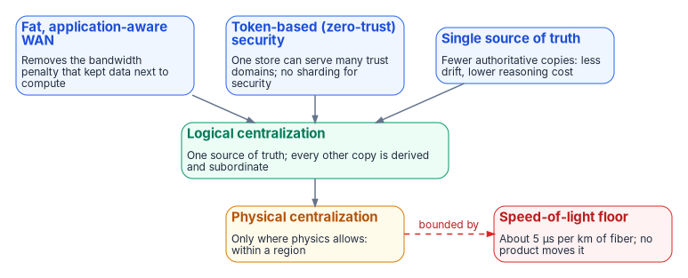
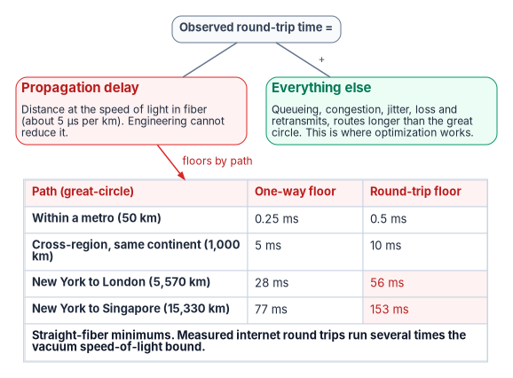
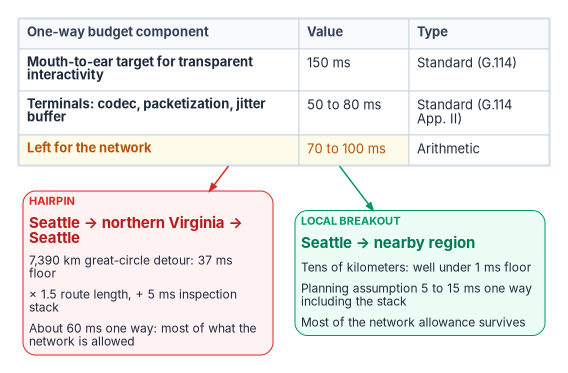

# Chapter 01 — Why Physics Decides the Architecture

*Bandwidth is something you can buy; latency is something distance charges you, and no contract renegotiates it.*

::: {.callout-note}
## In this chapter
The question this book answers and the case in one paragraph. Why the pendulum is swinging back from fragmented data toward logical centralization, and the three forces pushing it. The speed-of-light floor stated precisely, with measured, estimated and assumed figures kept apart. What ITU-T G.114's 150 ms figure actually allows a network, what a hairpin spends of it, why no product shortens a fiber path, and why the correct response is to need less global synchronization rather than faster synchronization.
:::

## Why physics decides

Every network modernization argument eventually reaches a number measured in milliseconds. A voice call sounds wrong, a thick client takes four seconds to open a record, a database replica falls behind, and someone proposes a product to fix it. Some of those problems are product problems. Many are not. Part of every delay on a wide-area path is the time light takes to travel through glass, and that part is set by geography. Nothing sold to an agency changes it.

This book is about what follows from taking that seriously. If latency has a physical floor, then two kinds of decision get mixed up in most network programs and need to be pulled apart. Choosing a pipe (fiber, MPLS, satellite, cellular, direct internet access) is a physics decision: it settles how long packets take and how often they arrive. Choosing the control layer that governs those pipes (SD-WAN, a security service edge, TIC 3.0 policy enforcement) is a compliance decision: it settles whether the traffic is protected, inspected, measured and evidenced. Chapter 02 makes that split the organizing idea of the book. This chapter establishes the physics underneath it.

::: {.callout-important}
## The case in one paragraph
**Problem.** Agencies are consolidating data and identity toward fewer authoritative sources, which is right, while routing branch traffic through distant inspection points and expecting faster circuits or better products to make the result feel local. Distance sets a latency floor of about 5 microseconds per kilometer of fiber, and a cross-country hairpin can spend most of what the network is allowed for a voice call before any inspection happens.

**Solution.** Centralize the truth logically, not physically. Keep strong consistency inside a region, where it is nearly free, and design everything that crosses long distances to need fewer synchronous round trips. Shorten the paths that must be short with local breakout, and govern those paths so the shorter path isn't a compliance regression (Chapter 02).

**Ask.** Before approving any network or data-platform change justified by performance, require the path to be decomposed into its propagation floor and its addressable gap, with every figure labeled as a measurement, an estimate or an assumption. Treat a proposal that promises to move the floor as a proposal that hasn't been checked.
:::

{#fig-ch01-three-forces fig-alt="Three blue cards across the top, fat application-aware WAN, token-based zero-trust security and single source of truth, each point down to a green Logical centralization card: one source of truth with every other copy derived and subordinate. Below it an amber Physical centralization card, only within a region, is bounded by a dashed red arrow to a red Speed-of-light floor card: about 5 microseconds per kilometer of fiber, which no product moves."}

## For decision makers

- **Latency has a floor set by distance.** Light in optical fiber covers roughly 200 km per millisecond, so every 1,000 km of path costs about 5 ms one way before any equipment touches the packet.[^c01-g114]
- **Optimization works on the gap above the floor, never the floor.** Queueing, loss, jitter and indirect routing are often several times the floor on real internet paths, which is why network work can help, but none of it shortens the distance.[^c01-inflation]
- **The 150 ms voice figure is mouth-to-ear, not network.** ITU-T G.114 treats delays under 150 ms as essentially transparent, but terminals consume 50 to 80 ms of that, leaving the network roughly 70 to 100 ms.[^c01-g114] A cross-country hairpin can spend most of it.
- **Strong consistency spends round trips, so it's a latency problem.** A fatter pipe doesn't make a synchronous commit across a continent faster.
- **The architectural answer is to need less global synchronization.** Centralize the source of truth, keep strong consistency within a region, and make long-distance copies asynchronous and subordinate.

## The pendulum

For a decade the default answer to "where should the data live?" has been to spread it out. Every microservice owns its own store, and a large shared database server is treated as a legacy embarrassment. Microsoft's own architecture guidance states the rule plainly: two services shouldn't share a data store, and each service manages its own private store that other services can't access directly.[^c01-msdata] The reasons were good ones: independent deployment, schemas that can change without coordinating every consumer, and freedom to choose a store that fits each workload.

The cost arrived later. Every service-owned copy of a customer, an employee, an organizational unit or a device is a copy that can disagree with the others, and the reconciliation work that fragmentation creates was rarely budgeted. The result is drift: two systems that each believe they hold the right answer, and an incident queue full of "which number is correct?" The same guidance that prescribes private stores also says to use a single source of truth where strong consistency is required, with other services holding copies that are eventually consistent with it but are not themselves the source of truth.[^c01-msdata] That second rule is the one this book builds on.

The pendulum is now swinging back. The question worth asking is whether wide-area networks that are fast and application-aware, together with security that travels with each request as a token, make it efficient to consolidate onto fewer, larger authoritative stores and stay close to one source of truth. This book's answer is a qualified yes, with one hard boundary set by physics. The qualification matters as much as the answer.

## Three forces toward logical centralization

| Force | What it removes | Consequence for where data lives |
|---|---|---|
| Fat, application-aware WAN | The bandwidth penalty that forced data to sit next to the compute using it | The system of record can be centralized without the old throughput tax, at least within a region |
| Token-based (zero-trust) security | The need to fragment data behind network perimeters to isolate it | One logical store can safely serve many trust domains; data no longer has to be sharded for security |
| Single-source-of-truth discipline | The reconciliation cost of many divergent authoritative copies | Fewer authoritative copies means less drift and a model one engineer can hold in their head |

Each force is real. Chapter 04 develops the first two: why logical centralization beats fragmentation for governance, and why token-based security is the enabler that lets one store serve many tenants and trust domains ([Chapter 04 — Logical Centralization and Token-Based Security](04-logical-centralization-and-token-security.md)). This chapter is about the force that pushes the other way.

### Logical centralization is not physical centralization

The word "centralize" fuses two different things, and separating them prevents most of the mistakes that follow.

::: {.callout-important}
## Centralize the truth; distribute the copies
Logical centralization means one authoritative source of record. Physical centralization means one big server in one place. The first is good. The second runs into walls that no network removes. Read replicas, caches and edge stores are fine, provided they stay explicitly derived, subordinate and disposable. A convenience copy must never quietly promote itself to a source of truth; that promotion is where drift is born.
:::

Physical centralization hits three walls:

- **The speed of light.** Wide-area networks got fast in bandwidth. They did not get fast in latency, because the floor is distance. The rest of this chapter is about this wall.
- **Blast radius.** One central server is one outage, one bad schema migration or one noisy tenant away from taking everything down. Distribution is partly a failure-domain strategy, not only a performance one.
- **Data residency.** Some data must stay in a particular jurisdiction or boundary regardless of how good the network is. That constraint is legal and contractual, not technical, so no technology removes it.

## The speed-of-light floor

### Two latencies, added together

Wide-area round-trip time is the sum of two components with completely different physics:

| Component | What it is | Can engineering reduce it? |
|---|---|---|
| Propagation delay | The time for the signal to travel the distance at the speed of light in fiber | No. Fixed by the length of the path |
| Everything else | Queueing, congestion, jitter, loss and retransmission, and routes longer than the great circle | Yes, often substantially. This is the whole addressable surface |

The first is a tax levied by physics. The second is the gap between the latency an agency observes and that floor. Every technique Chapter 05 examines (SD-WAN path selection, forward error correction, jitter smoothing, steering latency-critical flows onto lean paths) works on the second component. None of them removes a microsecond of propagation delay. The improvements are real because the gap is usually large, but the floor stays where distance puts it ([Chapter 05 — SD-WAN, SASE and Governed-Path Transport](05-sd-wan-sase-and-governed-transport.md)).

::: {.callout-important}
## Optimization attacks the gap, never the floor
A proposal that claims to make a long path faster than its propagation floor allows hasn't been checked. A proposal that claims to shrink the gap above the floor can be true, and should be judged by measurement.
:::

### The numbers

The speed of light in vacuum is exactly 299,792.458 km/s.[^c01-c] Light in optical fiber is slower. ITU-T Recommendation G.114, the international planning reference for one-way transmission time, uses a planning value of 5 µs per kilometer for optical fiber cable systems.[^c01-g114] That is the same as 200,000 km/s, about two-thirds of the vacuum speed, or roughly 1 ms for every 200 km, one way.

Applied to great-circle distances, that gives floors no optimization can beat:

| Path | Great-circle distance | One-way floor | Round-trip floor |
|---|---|---|---|
| Within a metro | 50 km (illustrative) | 0.25 ms | 0.5 ms |
| Cross-region, same continent | 1,000 km (illustrative) | 5 ms | 10 ms |
| New York to London | 5,570 km | 28 ms | 56 ms |
| New York to Singapore | 15,330 km | 77 ms | 153 ms |

*Arithmetic, not measurement: distances by the haversine formula on a 6,371 km mean Earth radius between city centers, multiplied by G.114's 5 µs/km. The metro and same-continent rows use round illustrative distances.*

These are minimums for a perfectly straight fiber path. Real paths are longer. A 2017 measurement study that compared internet latencies with the speed-of-light bound along the great circle found ping times more than three times that bound, attributing the excess to the physical infrastructure and routing, and found that fetching small web pages ran far slower still once protocol round trips were added.[^c01-inflation] Since fiber alone accounts for about 1.5 times the vacuum bound, a measured path at three times the vacuum bound is running at roughly twice the straight-fiber floor. Some of that excess can be clawed back by better routing and peering. None of it can go below the straight-line floor.

{#fig-ch01-propagation-floor fig-alt="Observed round-trip time splits into a red Propagation delay card, about 5 microseconds per kilometer of fiber, which engineering cannot reduce, plus a green Everything else card: queueing, congestion, jitter, loss and retransmits, and routes longer than the great circle, where optimization works. A table lists one-way and round-trip floors: metro 50 km 0.25 and 0.5 ms; cross-region 1,000 km 5 and 10 ms; New York to London 5,570 km 28 and 56 ms; New York to Singapore 15,330 km 77 and 153 ms. A note says these are straight-fiber minimums and measured internet round trips run several times the vacuum speed-of-light bound."}

### Measurements, estimates and assumptions

Network business cases fail review when they mix kinds of number. This book labels every figure as one of four types, and expects agency documents to do the same:

| Type | What it is | Examples in this chapter |
|---|---|---|
| Physical constant or standard | A value fixed by physics or published by a standards body | Speed of light; G.114's 5 µs/km and its 150 ms and 400 ms thresholds |
| Arithmetic | A result computed from stated inputs, which anyone can recompute | The floors table; the hairpin worked example below |
| Measurement | A value observed on a real network, with its method and population | The 2017 path-inflation study; an agency's own latency samples |
| Design assumption | A planning value chosen by the program, to be replaced with a measurement | The 1.5 route-length factor and the 5 ms inspection allowance below |

A figure with no label is treated as an assumption until someone shows otherwise.

## The 150 ms budget, read correctly

Network documents often say that ITU-T G.114 "budgets 150 ms one way" for voice. The recommendation says something more careful, and the difference matters for branch design.

G.114 recommends not exceeding 400 ms of one-way delay for general network planning, and says that although a few applications may be slightly affected by end-to-end delays below 150 ms, if delays are kept under that figure most applications, speech and non-speech, will experience essentially transparent interactivity.[^c01-g114] Both figures are end to end: for speech, mouth to ear. They include the terminals as well as the network.

The terminals take a large share. G.114's appendix on voice over IP works its examples with terminals contributing 50 ms of mean delay with 10 ms packets, or 80 ms with 20 ms packets, and links them to the 100 ms network delay objective of ITU-T Y.1541 Class 0.[^c01-g114] Subtracting the terminals from the 150 ms target leaves the network roughly 70 to 100 ms one way, which is consistent with that objective. That allowance, not 150 ms, is what a hairpin spends.

G.114 also makes a point about expectations that applies directly to field offices: delays in the mid-200 ms range may be tolerable on long inter-regional calls, but planners should not let local and regional calls encounter such delays, because users expect those calls to be delay-transparent.[^c01-g114] A call between two offices in the same state that hairpins across the country is a regional call with an inter-regional delay.

## What a hairpin costs

A hairpin sends traffic to a distant inspection or egress point and back before it reaches its destination, even though a shorter path exists. It was the routing model the original Trusted Internet Connections consolidation required, and CISA now describes it bluntly: MTIPS backhaul increases contention and latency for remote and branch users.[^c01-sase] TIC 3.0's Branch Office use case exists in part to help agencies gain application performance, naming latency, throughput and jitter, by letting branches connect more directly to sanctioned cloud services and the web ([Chapter 03 — What TIC 3.0 and Federal Policy Actually Require](03-what-tic-3-requires.md)).[^c01-bo]

The cost is easy to work out. Take a field office in Seattle whose internet-bound traffic is routed to an inspection point in northern Virginia, and whose destination is a cloud region in the Pacific Northwest:

| Input or step | Value | Type |
|---|---|---|
| Seattle to northern Virginia, great circle | 3,695 km | Arithmetic (haversine) |
| Detour out and back | 7,390 km | Arithmetic |
| Propagation floor of the detour, one way | 37 ms | Arithmetic (× 5 µs/km) |
| Route length relative to the great circle | × 1.5 | Design assumption, conservative against the 2017 measurements |
| Inspection stack at the hub | + 5 ms | Design assumption |
| Hairpin, one way | about 60 ms | Arithmetic from the above |
| Local breakout to a nearby region, one way, including the stack | 5 to 15 ms | Design assumption, to be replaced by measurement |

Against a network allowance of roughly 70 to 100 ms, the hairpin spends most of the budget on geography before the call has gone anywhere useful. An office in Honolulu or Anchorage hairpinning through the East Coast does worse: the Honolulu to northern Virginia great circle alone is 7,730 km, a 39 ms one-way floor before the return leg.

{#fig-ch01-hairpin-budget fig-alt="A slate table sets out the one-way budget: a 150 ms mouth-to-ear target for transparent interactivity from ITU-T G.114; terminals for codec, packetization and jitter buffer take 50 to 80 ms; 70 to 100 ms is left for the network. It points to two cards. A red hairpin card, Seattle to northern Virginia and back, shows a 7,390 km detour with a 37 ms floor, multiplied by 1.5 for route length plus 5 ms for the inspection stack, about 60 ms one way, most of what the network is allowed. A green local-breakout card, Seattle to a nearby region, shows tens of kilometers, well under a 1 ms floor, a planning assumption of 5 to 15 ms one way including the stack, so most of the network allowance survives."}

Two cautions keep this honest. First, the 5 to 15 ms local-breakout figure is a planning assumption, not a measurement; the sources this book draws on reported it without a measurement method, so an agency should replace it with samples from its own offices. Second, an earlier version of this argument claimed a hairpin spends 100 to 130 ms one way on the detour. For a continental United States hairpin that doesn't follow from the arithmetic above; it is plausible only for distant non-contiguous offices or as a round-trip figure. Use the worked method, not the headline.

## No product shortens a fiber path

Distance is the one latency variable a buyer controls, and it is controlled by where traffic goes, not by what it goes through. Three consequences follow.

- **A faster circuit doesn't straighten the path.** Buying more bandwidth on the same hairpin raises throughput and leaves latency where it was. Carrier topology is not geometry: a carrier's backbone may route a short-haul circuit through a distant switching center, and only measurement shows it.
- **Local breakout is the only fix for the geographic term.** Moving the egress and the inspection point near the user deletes the detour. That is why Microsoft's connectivity principles for Microsoft 365 tell customers to egress connections locally and avoid network hairpins, and define a hairpin as traffic first directed to an intermediate location such as a security stack, cloud access broker or cloud-based web gateway.[^c01-m365] [Chapter 12 — Microsoft 365 Traffic and the Optimize Inspection Exemption](12-microsoft-365-traffic.md) deals with what that guidance means inside a boundary that inspects everything.
- **The inspection point has a location too.** A cloud-delivered security service is only "local" if its point of presence is near the user and well peered with the destination. Moving inspection from a distant hub to a distant cloud point of presence moves the hairpin without removing it.

Local breakout solves exactly one problem: the geographic hairpin. It satisfies none of the protection controls that are often claimed near it. A branch moved from a governed hairpin to ungoverned local breakout has better latency and less assessed boundary protection than it started with. That is the subject of Chapter 02.

## Strong consistency is a latency problem

The same physics decides how far a single source of truth can stretch.

A strongly consistent, synchronous commit doesn't need bandwidth; it needs agreement, and agreement means messages travel to other nodes and back. A commit that must be durable on a remote replica before it acknowledges pays at least one round trip every time. A consensus protocol pays at least one round trip to a quorum: in Raft, a command can complete in the common case once a majority of the cluster has responded to a single round of remote procedure calls.[^c01-raft] Across New York and London that is a floor of 56 ms per synchronous commit, multiplied by every dependent operation in a transaction. No amount of bandwidth changes it, because the limiting resource is the time light takes to make the trip.

There is a second, subtler effect. A quorum commit waits for the slowest response it needs, so commit latency is governed by a tail statistic, not an average. A path with an excellent mean and an ugly 99th percentile inflicts poor commit latency, because every so often the one packet the quorum is waiting for is the one that was queued, dropped and retransmitted. Large-scale systems work treats this tail as the thing that dominates service performance as systems grow, and designs for it explicitly.[^c01-tail] Propagation delay is constant and so doesn't widen the tail. Congestion, loss and jitter, the addressable gap, are what widen it. That is the opening Chapter 05 exploits: network work can tighten the tail even though it can't touch the floor.

## Need less global synchronization

Two design rules fall directly out of the physics.

1. **Keep strong consistency inside a region.** At metro and intra-regional distances the propagation floor is under a millisecond to a few milliseconds, so synchronous consistency is close to free. A single-region writer is not a limitation to apologize for; it exploits the physics deliberately.
2. **Across regions, stop spending round trips.** The improvement is not a faster synchronous path, because physics caps that. It is an architecture that needs fewer synchronous crossings: asynchronous replication, bounded staleness, and data types that merge cleanly. Microsoft's microservices guidance makes the same point from the data side: define the consistency each component needs, and prefer eventual consistency where possible.[^c01-msdata]

The Federal Modernization Program's own SaaS data plane is designed this way, and [Chapter 08 — Reference Architecture: Consistency Classes Meet Network Classes](08-reference-architecture.md) walks it end to end. In outline, as program design choices: one shared single-region PostgreSQL store is the tenant registry and system of record; applications authenticate to it without stored passwords, presenting a Microsoft Entra access token in place of the database password, which Azure Database for PostgreSQL supports;[^c01-pgentra] dedicated, physically separate resources are provisioned only for tenants whose compliance posture requires them; and no global synchronous write path exists, on purpose.

The same rule applies beyond databases. Identity, policy and configuration all have a source of truth and many consumers. Every place an agency design assumes a distant authority must answer synchronously, on the critical path of a user action, is a place where distance will show up as delay. Chapter 06 lists the ones that matter for legacy protocols on re-routed paths, including the short list of Active Directory operations that genuinely need a reachable domain controller ([Chapter 06 — Legacy Protocols on Re-Routed Paths](06-legacy-protocols-on-re-routed-paths.md)).

::: {.callout-note}
## What this chapter establishes
1. Logical centralization of the source of truth is right; physical centralization stops at three walls: the speed of light, blast radius and data residency.
2. Wide-area latency is a propagation floor, about 5 µs per kilometer of fiber, plus an addressable gap. Optimization works on the gap, never the floor.
3. ITU-T G.114's 150 ms is a mouth-to-ear figure; after the terminals, the network has roughly 70 to 100 ms one way, and a cross-country hairpin can spend most of it.
4. No product shortens a fiber path. Local breakout fixes the geographic term and nothing else.
5. Strong consistency spends round trips, so the architectural answer is to need less global synchronization, not faster synchronization.
:::

::: {.callout-tip}
## Continue the book
[← Previous: Book 09 index](index.md) · [Book index](index.md) · [Next: Chapter 02 — Transport Is Physics, Control Is Compliance →](02-transport-is-physics-control-is-compliance.md)
:::

[^c01-g114]: International Telecommunication Union, Recommendation ITU-T G.114 (05/2003), *One-way transmission time*, in force with Amendments 1 (09/2003) and 2 (11/2009), <https://www.itu.int/rec/T-REC-G.114-200305-I/en> (accessed Oct 20, 2026). Clause 4 (do not exceed 400 ms one way for general network planning; below 150 ms end to end, most applications experience essentially transparent interactivity); Table A.1 (optical fibre cable system planning value 5 µs/km, marked provisional); Appendix II.2 (terminals contributing 50 ms or 80 ms mean delay; the 100 ms objective of ITU-T Y.1541 Class 0; local and regional calls expected to be delay-transparent).
[^c01-c]: National Institute of Standards and Technology, "CODATA Value: speed of light in vacuum," 2022 CODATA recommended values, <https://physics.nist.gov/cgi-bin/cuu/Value?c> (accessed Oct 20, 2026). 299 792 458 m/s, exact.
[^c01-inflation]: Mirjam Kühne, "Why is the Internet so Slow?!," RIPE Labs, June 23, 2017, <https://labs.ripe.net/Members/mirjam/why-is-the-internet-so-slow> (accessed Oct 20, 2026), summarizing I. N. Bozkurt, A. Aguirre, B. Chandrasekaran, P. B. Godfrey, G. Laughlin, B. Maggs and A. Singla, "Why Is the Internet so Slow?!," *Passive and Active Measurement (PAM) 2017*, pp. 173–187. Median ping time more than three times the speed-of-light ("c-latency") bound; median fetch time of popular landing pages about 37 times it.
[^c01-msdata]: Microsoft Learn, "Data considerations for microservices," Azure Architecture Center, <https://learn.microsoft.com/azure/architecture/microservices/design/data-considerations> (accessed Oct 20, 2026). Two services shouldn't share a data store; use a single source of truth when you require strong consistency, with other copies eventually consistent and not the source of truth; define the required consistency for each component and prefer eventual consistency where possible.
[^c01-sase]: Cybersecurity and Infrastructure Security Agency, *The Journey to Zero Trust: Using Secure Access Service Edge in a Modern TIC 3.0 Solution*, Version 1.0, June 2026, Section 5.1 (Legacy Architecture), <https://www.cisa.gov/sites/default/files/2026-07/The_Journey_to_Zero_Trust-Using_SAS_in_a_Modern_TIC3.0_Solution.pdf> (accessed Oct 20, 2026).
[^c01-bo]: Cybersecurity and Infrastructure Security Agency, *Trusted Internet Connections 3.0 Branch Office Use Case*, Version 3.0, publication September 2026, Section 3 (Purpose of the Branch Office Use Case), <https://www.cisa.gov/sites/default/files/2026-09/TIC_3.0_Branch_Office_Use_September_2026_6.pdf> (accessed Oct 20, 2026).
[^c01-m365]: Microsoft Learn, "Microsoft 365 network connectivity principles," <https://learn.microsoft.com/microsoft-365/enterprise/microsoft-365-network-connectivity-principles?view=o365-worldwide> (accessed Oct 20, 2026). Sections "Egress network connections locally" and "Avoid network hairpins"; a hairpin is WAN or VPN traffic first directed to an intermediate location such as a security stack, cloud access broker or cloud-based web gateway.
[^c01-raft]: Diego Ongaro and John Ousterhout, "In Search of an Understandable Consensus Algorithm (Extended Version)," USENIX Annual Technical Conference 2014, <https://raft.github.io/raft.pdf> (accessed Oct 20, 2026). Section 2: in the common case a command can complete as soon as a majority of the cluster has responded to a single round of remote procedure calls.
[^c01-tail]: Jeffrey Dean and Luiz André Barroso, "The Tail at Scale," *Communications of the ACM* 56 (2013), pp. 74–80, <https://research.google/pubs/the-tail-at-scale/> (accessed Oct 20, 2026).
[^c01-pgentra]: Microsoft Learn, "Microsoft Entra authentication in Azure Database for PostgreSQL flexible server," <https://learn.microsoft.com/azure/postgresql/security/security-entra-concepts>, and "Use Microsoft Entra ID authentication in Azure Database for PostgreSQL flexible server," <https://learn.microsoft.com/azure/postgresql/security/security-entra-configure> (accessed Oct 20, 2026). Clients sign in with a Microsoft Entra identity as the user name and an access token as the password.
