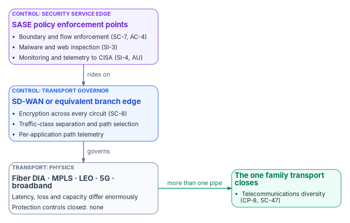
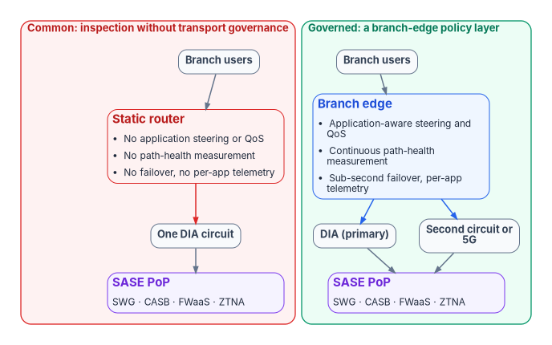

# Chapter 02 — Transport Is Physics, Control Is Compliance

*Choosing a pipe settles how fast traffic arrives; choosing what governs the pipe settles whether you can defend it to an assessor, and neither choice makes the other.*

::: {.callout-note}
## In this chapter
Why "SD-WAN versus DIA" answers two different questions as if they were one. What direct internet access solves (the hairpin), what it satisfies (none of the protection controls), and what bare local breakout breaks (the assessed boundary). What a branch with DIA and a SASE service still lacks. The transport menu, and the one control family that transport selection does close. What the governing layer contributes, why it is itself attack surface, and the order of operations.
:::

## The false versus

Federal network programs keep framing a procurement as "SD-WAN or DIA," as if a buyer picks one. Direct internet access (DIA) is a pipe: local internet breakout at the branch instead of backhauling internet-bound traffic to a central access point. SD-WAN is a control surface that governs pipes. One provides connectivity. The other makes that connectivity measurable, governable and defensible at scale. They answer different questions, and an agency that treats them as alternatives ends up in one of two failure modes: a governed network too slow for voice, or a fast network that is a compliance finding.

The acronym causes its own confusion. In this book DIA always means direct internet access. It is not a Defense Information Systems Agency circuit (DISA is that agency, and its transport network is the Defense Information Systems Network, DISN)[^c02-disn], and it is not the Defense Intelligence Agency, which is what the letters DIA name in a defense context. An earlier version of one of this book's source papers made exactly that error, and every finding built on it fell.

Chapter 01 established why latency has a physical floor. This chapter applies it. Transport is a physics decision: fiber, MPLS, low earth orbit (LEO) satellite and 5G differ enormously in latency, loss and capacity. Control is a compliance decision: the governing layer and the security service edge above it are what close the protection controls. TIC 3.0 is why an agency can't stop at the pipe.

::: {.callout-important}
## The case in one paragraph
**Problem.** Programs treat transport and control as competing options. A branch that moves from a governed hairpin to bare local breakout gains latency and loses assessed boundary protection, and a branch with DIA and a cloud security service but no branch-edge layer has inspection applied to traffic nobody governs or measures before it leaves the building.

**Solution.** Buy transport on measured physics, knowing it closes exactly one control family (telecommunications diversity). Get the protection controls from the control layer: a branch-edge governor for path selection, encryption and telemetry, and policy enforcement points above it for boundary, flow, malware and monitoring. Protect that governor as the high-value, internet-facing system it is.

**Ask.** Before the next transport or SD-WAN procurement, run the decision sequence at the end of this chapter against the current portfolio, file the authorization-boundary change before cutover rather than after, and name an owner for each step ([Chapter 09 — Who Owns the Network and Its Transport](09-who-owns-the-network.md)).
:::

{#fig-ch02-pipe-and-governor fig-alt="Three stacked layers. At the top a violet card, the security service edge: SASE policy enforcement points providing boundary and flow enforcement (SC-7, AC-4), malware and web inspection (SI-3), and monitoring and telemetry to CISA (SI-4, AU). It rides on a blue card, the transport governor: an SD-WAN or equivalent branch edge providing encryption across every circuit (SC-8), traffic-class separation and path selection, and per-application path telemetry. That governs a slate card, transport: fiber DIA, MPLS, LEO, 5G and broadband, whose latency, loss and capacity differ enormously and which close no protection controls. A green arrow labeled more than one pipe leads from transport to a green card: the one family transport closes, telecommunications diversity (CP-8, SC-47)."}

## For decision makers

- **DIA solves one problem, the geographic hairpin.** It is the only fix for that problem; no security product shortens a fiber path (Chapter 01).
- **DIA satisfies none of the protection controls claimed near it.** Boundary protection, flow enforcement, transmission confidentiality, malware inspection and monitoring come from the control layer, never from the pipe.
- **Bare local breakout is a compliance regression with better latency.** With local breakout the branch becomes an external boundary, and the agency has to be able to say what monitors and controls it.
- **Transport closes one control family: telecommunications diversity.** That is an argument for more than one pipe, not an argument that any pipe protects anything.
- **The governor is itself attack surface.** A controller with agency-wide routing authority and a fleet of internet-facing edges are exactly the kind of system CISA's 2026 directives target.
- **Order decides the outcome.** Deploy the governor before production traffic, and treat the boundary change as the significant change it is.

## What direct internet access solves: one thing

Under the original TIC model, branch traffic traveled to a consolidated access point before it could reach the internet or a cloud service, and Chapter 01 showed what that costs in milliseconds. TIC 3.0 no longer requires agencies to route traffic through TIC access points if they have an alternative that provides situational awareness to both the agency and CISA by other means.[^c02-sase] Local breakout is how a branch takes advantage of that.

What it removes is the detour. Moving egress near the user deletes the propagation and route-inflation terms of the hairpin, and lets inspection move to a point of presence where the latency budget can afford it. That is a real gain and, for latency-sensitive traffic, the only one available. It is also the whole of what the pipe contributes.

## What it satisfies: none of the protection controls

Every transport is a pipe. The controls an agency asserts for the traffic crossing it are satisfied by whatever governs the pipe:

| Control (NIST SP 800-53 Rev. 5) | What it asks for | Satisfied by the pipe? | Where it is actually satisfied |
|---|---|---|---|
| SC-7 Boundary Protection | Monitor and control communications at external managed interfaces | No | Policy enforcement point at the boundary |
| SC-7(4) External Telecommunications Services | A managed interface and a traffic flow policy for each external telecommunication service, with documented exceptions | No; each new pipe adds an interface to manage | The governing layer, per circuit |
| SC-8 and SC-8(1) Transmission Confidentiality and Integrity | Protect transmitted information, with cryptographic mechanisms | No | Encryption at the branch edge or the endpoint |
| AC-4 Information Flow Enforcement | Enforce approved authorizations for information flow | No | Branch-edge policy and policy enforcement points |
| SI-3 Malicious Code Protection | Mechanisms at system entry and exit points | No | Inspection at the policy enforcement point |
| SI-4 System Monitoring | Detect attacks, indicators of attack and unauthorized connections | No | Telemetry from the governor and the enforcement points |

*Control statements from the SP 800-53 Rev. 5 catalog, release 5.2.0.*[^c02-sp80053]

MPLS is the case that most often confuses this. A carrier MPLS VPN separates one customer's traffic from another's, and agencies have long treated it as "private." The standard is explicit that the architecture does not by itself encrypt data for privacy or detect tampering in transit, and that cryptographic measures must be applied in addition if those are wanted.[^c02-rfc4364] Separation is a property of the carrier's configuration, not a confidentiality control the agency can evidence.

## What bare local breakout breaks: the assessed boundary

SC-7 asks a system to monitor and control communications at its external managed interfaces.[^c02-sp80053] Under a hairpin, the branch's external interface was the access point, and someone had assessed it. Under local breakout, the branch is an external boundary. An agency asserting SC-7 there should be able to say what is monitored and controlled at that boundary, by what, and produce the record.

CISA's Branch Office use case states the standard it will be held to. Its policy enforcement parity capability says that when branches connect directly to cloud and web services, their boundary protections should align with those at the agency campus, so that an attacker cannot evade security mechanisms by directing traffic down a forwarding path with less rigor; and where multiple means of conveyance are used, it names redundant links and SD-WAN as examples, path priorities, the order in which security functions execute, and policy enforcement should keep security parity on every path.[^c02-bo] A branch moved from an assessed hairpin to ungoverned breakout fails that test by construction. It has lost assessed boundary protection relative to where it started: a compliance regression with better latency.

None of this means an agency is out of compliance for lacking any particular product. TIC 3.0 is non-prescriptive guidance, and it names no required technology.[^c02-ticfaq] The argument is about evidence: an agency with an ungoverned branch edge will find it hard to produce what its own control assertions promise, and the gap surfaces at assessment time rather than at deployment. Chapter 03 states what TIC 3.0 and federal policy actually require, and what they don't ([Chapter 03 — What TIC 3.0 and Federal Policy Actually Require](03-what-tic-3-requires.md)).

## What DIA plus SASE still leaves out

Most agencies that have adopted local breakout pair it with a Secure Access Service Edge (SASE) service: secure web gateway, cloud access security broker, firewall as a service and zero trust network access, delivered from nearby points of presence. That is the architecture TIC 3.0 was written to permit, and agencies adopting it are moving in the right direction. What it changes is where inspection happens. It doesn't change whether the transport between the user and the point of presence is governed.

A branch with DIA and no branch-edge policy layer has:

- **No path selection.** One link is the path. If it degrades through latency, jitter or partial loss short of an outage, nothing at the branch detects it and moves traffic. A second link, if one exists, sits idle as a cold standby.
- **No application awareness.** Interactive database traffic, authentication exchanges, video calls, backups and patch downloads are forwarded identically.
- **No queue management before the WAN.** Quality of service has to be applied where traffic enters the constrained link. Without a device there, priority flows share an unmanaged queue with bulk transfers, and the agency's stated prioritization exists only in a document.
- **No use of two circuits at once.** Links can't be aggregated, and failover between them is manual or absent.
- **No per-application transport telemetry.** Interface counters say a link was busy. They don't say which application experienced which latency over which path, which is what a monitoring or continuous-monitoring assertion about transport needs.

{#fig-ch02-branch-edge fig-alt="Two side-by-side columns. The red-outlined left column, common: inspection without transport governance, runs from branch users through a red static-router card (no application steering or QoS, no path-health measurement, no failover and no per-application telemetry) to one DIA circuit and a violet SASE point of presence offering SWG, CASB, FWaaS and ZTNA. The green-outlined right column, governed: a branch-edge policy layer, runs from branch users through a blue branch-edge card (application-aware steering and QoS, continuous path-health measurement, sub-second failover and per-application telemetry) to two circuits, DIA as primary and a second circuit or 5G, which both reach the same violet SASE point of presence."}

The governed branch is no more secure than the common one at the point of presence. It is governed and measured between the user and the point of presence, which the first is not, and that stretch is the most variable, most user-proximate and least instrumented part of the path.

Three objections usually follow, and each has an answer:

- **"It's redundant."** SASE inspects and enforces on traffic that has arrived at its point of presence. A branch-edge layer decides which traffic goes where, over which link, with what priority, before it leaves the building. They work at different points on the path and neither substitutes for the other. CISA's own definition treats them as complementary: SASE combines networking tools such as SD-WAN with security tools such as a secure web gateway, cloud access security broker, zero trust network access and next-generation firewall.[^c02-sase]
- **"It adds risk."** It does, and the honest answer says so. The section on the governor below sets out what the risk is and what it costs to manage. The branch already has a router with a management plane; the replacement produces telemetry and enforces auditable policy the incumbent doesn't, and has to be brought under the agency's vulnerability management like any other internet-reachable device.
- **"It isn't authorized under our controls."** Ask which control or enhancement it violates. FedRAMP authorizes the security posture of a cloud service; it doesn't prescribe the network path used to reach one, and Chapter 03 sets out why a refusal with no identifiable control basis should be documented as a governance problem in its own right.

## The transport menu

Every transport is a pipe. Their physics differs enormously; their contribution to the protection controls is the same, which is none.

| Transport | Physics that decides its use | Planning figure | Type of figure |
|---|---|---|---|
| Terrestrial fiber (DIA, dedicated, dark fiber) | Propagation at about 5 µs/km plus route length; lowest latency for a given distance | 5 µs/km[^c02-g114] | Standard (ITU-T G.114 planning value) |
| MPLS from a carrier | Rides the same fiber; latency set by the carrier's topology, not geography; separation without encryption[^c02-rfc4364] | Measure per circuit | Measurement required |
| Low earth orbit satellite | Short space path, plus the distance from the ground station to the internet exchange and the destination | 12 ms between earth stations for a 400 km orbit[^c02-g114] | Standard (G.114 planning value, propagation through space only) |
| Medium earth orbit satellite (about 14,000 km) | Long space path | 110 ms between earth stations[^c02-g114] | Standard (G.114 planning value) |
| Geostationary satellite (about 36,000 km) | Space path alone exceeds the network share of the voice budget | 260 ms between earth stations[^c02-g114] | Standard (G.114 planning value) |
| 5G and LTE cellular | Radio interface plus the carrier core and backhaul; contention varies by cell and hour | 4 ms (eMBB) or 1 ms (URLLC) one way across the radio interface, unloaded[^c02-m2410] | Standard (IMT-2020 minimum requirement, radio only) |
| Commodity broadband | Shared access network; asymmetric; contention ratios vary | Measure per site | Measurement required |

Two cautions apply to the table. First, the cellular figures are minimum requirements for the radio interface alone, under unloaded conditions with a single user;[^c02-m2410] they say nothing about end-to-end latency through a carrier core to a cloud region, which has to be measured. Second, LEO operators publish median latency figures that change as constellations and ground infrastructure are built out, and none could be retrieved for this book from a primary source with its method stated. Treat any vendor latency claim for satellite or cellular service as a starting assumption and replace it with a measurement from the agency's own sites. G.114's planning values make the structural point without vendor figures: geostationary capacity, at 260 ms of space propagation alone, can't carry conversational voice inside the transparent-interactivity target, while low orbit can.[^c02-g114]

## The one control family transport closes

Transport selection does close something: diversity of telecommunications services. SP 800-53's CP-8 family asks for alternate telecommunications services that let essential functions resume when primary services are unavailable; its enhancements ask that the alternate not share a single point of failure with the primary (CP-8(2)) and that it come from a provider separated from the primary provider to reduce susceptibility to the same threats (CP-8(3)). SC-47 asks for alternate communications paths for system operations and organizational command and control.[^c02-sp80053]

That is an argument for multiple pipes from separated providers over physically diverse routes, and a branch with fiber DIA and a cellular or LEO second path can evidence it. It is not an argument that any single pipe provides protection controls. And every additional external telecommunications service adds a managed interface that SC-7(4) expects to have its own traffic flow policy, confidentiality and integrity protection, and documented exceptions.[^c02-sp80053] Diversity closes one family and enlarges another; the governing layer is what keeps the second one manageable.

## The governor: what the control layer contributes

The branch-edge layer, usually SD-WAN, is the transport governor. CISA's SASE guidance defines its job narrowly and correctly: SD-WAN optimizes wide-area connectivity through dynamic, policy-driven routing based on user, device, network and application context.[^c02-sase] In practice the governor contributes:

- **Encryption across every circuit.** SD-WAN overlays typically run authenticated, encrypted tunnels between edges regardless of the underlay. In one vendor's implementation, for example, IPsec is enabled by default in the data plane on all routers, using AES-GCM-256 for both encryption and authentication.[^c02-ciscoipsec] That is the transport's contribution to SC-8, and it is why the underlay can be untrusted broadband. (Whether the cryptographic module is validated is a separate question that Chapter 05 takes up.)
- **Traffic-class separation and path selection.** Application-aware steering, quality of service at the point of entry to the constrained link, and active-active use of more than one circuit with failover driven by measured path health.
- **Application-layer path telemetry.** Per-application, per-path latency, loss and jitter, exportable to the agency's logging pipeline. This is what makes transport claims in an authorization package evidence rather than assertion.

The boundary, flow and malware closures come from the security service edge above it: the secure web gateway, cloud access security broker, firewall and zero trust network access functions CISA groups under SASE.[^c02-sase] SD-WAN alone does not satisfy the Branch Office use case; the use case is a set of security capabilities, and SD-WAN appears in it only as an example of how multiple means of conveyance can be governed with parity.[^c02-bo] Chapter 05 develops the governor in depth: differentiated transport, what it can and can't do at the propagation floor, SASE above SD-WAN, and how to secure the controller and edges ([Chapter 05 — SD-WAN, SASE and Governed-Path Transport](05-sd-wan-sase-and-governed-transport.md)).

The governor is also available to buy. CISA notes that GSA's Enterprise Infrastructure Solutions (EIS) vehicle provides SD-WAN networking and connectivity options to and from agency networks, cloud services and the internet.[^c02-ticfaq] CISA's FAQ also says agencies must consider FedRAMP authorization when selecting service providers, and the cloud-delivered parts of candidate products don't all sit at the same level: listings for SD-WAN controllers and security service edges range from Moderate to High, and a listing covers the cloud service offering, not the edge appliances an agency installs in its own offices.[^c02-fedramp] [Chapter 05](05-sd-wan-sase-and-governed-transport.md) lists current examples and how to read them before a requirement names a service.

## The governor is itself attack surface

A paper that credits the governor with closing controls owes the reader the controls that protect the governor. The exposure is consequential and new in two ways. The controller holds agency-wide routing and policy authority: whoever controls it decides where every branch's traffic goes, including where DNS queries are redirected ([Book 08 Chapter 05 — Edge Interception and Bypass](../b08-ddi/05-edge-interception-and-bypass.md)). And a fleet of internet-facing branch edges replaces a small number of hardened, centrally staffed egress points.

CISA's 2026 directives describe exactly this class of system. BOD 26-02 defines edge devices as technology that resides on the boundary of an agency's network and is accessible from the public internet, says CISA is aware of widespread exploitation campaigns by advanced threat actors targeting end-of-support edge devices, and notes that edge devices are attractive targets because of their extensive reach into an organization's network.[^c02-bod2602] Three weeks later, on February 25, 2026, CISA issued Emergency Directive 26-03 for Cisco SD-WAN systems, after CISA, NSA and four international partners reported actors globally compromising those systems through an authentication bypass and a privilege escalation and establishing long-term persistence; the revised directive of March 11, 2026 also required agencies to deliver Cisco SD-WAN syslog to CISA through CISA's Comprehensive Log Aggregation Warehouse (CLAW).[^c02-ed2603] The controller and manager are the components named.

Protecting the governor is ordinary security engineering, applied to a system that deserves more of it than a branch router ever did. As a program design position, the package for any SD-WAN or SASE deployment should show at least:

- **Management-plane access** limited to named administrators with phishing-resistant multifactor authentication and least privilege (AC-2, AC-6, IA-2(1)), with the management interfaces themselves not reachable from the internet (SC-7).
- **A configuration baseline and least functionality** for controllers and edges (CM-2, CM-7), so a change to agency-wide routing policy is a reviewed change, not a console edit.
- **Flaw remediation inside the federal clock.** BOD 26-04, issued June 10, 2026, replaced BOD 22-01 and BOD 19-02 with risk-based remediation timelines whose shortest window, three days, applies to the highest-risk vulnerabilities, such as an automatable, total-impact flaw in a publicly exposed asset (SI-2).[^c02-bod2604] Branch edges are publicly exposed assets. An agency that can't patch them inside those windows has a different problem, and should solve that one first.
- **Lifecycle discipline.** BOD 26-02 requires agencies to remove listed end-of-support edge devices within 12 and 18 months and to keep a continuous discovery process afterwards (SA-22).[^c02-bod2602] A thousand-site SD-WAN fleet is a thousand edge devices on that clock.
- **Logging of the governor itself** (AU-2, AU-6, AU-12): controller audit records, policy changes and edge events in the agency's pipeline, and to CISA where a directive requires it.

## Order of operations

The two decisions have to be made in the right order, because the order decides whether modernization is a gain or a regression:

1. **Buy the pipe on measured physics**, within the acquisition and supply-chain envelope, and with diversity where the mission needs it.
2. **Deploy the governor before production traffic** moves onto the new connections.
3. **Treat the boundary change as the significant change it is**, and file the authorization-boundary update before cutover, not after.
4. **Handle Microsoft 365 traffic through its own documented exception** rather than an ad hoc bypass ([Chapter 12 — Microsoft 365 Traffic and the Optimize Inspection Exemption](12-microsoft-365-traffic.md)).
5. **Register the supporting technical evidence**: path assignments per application class, the quality-of-service policy, the failover policy and its measured recovery time, and the telemetry source.

Doing these out of order, and above all lighting up fast connections before the security layer is live, is the most common and most costly mistake in branch modernization. Chapter 13 turns this sequence into a decision plan with cost and evidence ([Chapter 13 — Sequencing, Cost and Evidence](13-sequencing-cost-and-evidence.md)); Chapter 10 covers the posture for agencies where neither SD-WAN nor a TIC 3.0 use case is close ([Chapter 10 — The Long Interim](10-the-long-interim.md)).

::: {.callout-note}
## What this chapter establishes
1. Transport is a physics decision and control is a compliance decision; "SD-WAN versus DIA" sets them against each other when they answer different questions.
2. DIA solves the geographic hairpin and satisfies none of the protection controls; bare local breakout turns the branch into an external boundary nobody governs, a compliance regression with better latency.
3. A branch with DIA and SASE but no branch-edge layer has inspection without transport governance: no path selection, application awareness, queue management, multi-circuit use or per-application telemetry.
4. Transport closes exactly one control family, telecommunications diversity, and each new pipe adds a managed interface to govern.
5. The governor closes encryption, separation and telemetry; SASE above it closes boundary, flow and malware; and the governor is itself a high-value, internet-facing target that needs its own controls.
6. Order of operations decides the outcome: governor before traffic, boundary change before cutover.
:::

::: {.callout-tip}
## Continue the book
[← Previous: Chapter 01 — Why Physics Decides the Architecture](01-why-physics-decides-the-architecture.md) · [Book index](index.md) · [Next: Chapter 03 — What TIC 3.0 and Federal Policy Actually Require →](03-what-tic-3-requires.md)
:::

[^c02-sase]: Cybersecurity and Infrastructure Security Agency, *The Journey to Zero Trust: Using Secure Access Service Edge in a Modern TIC 3.0 Solution*, Version 1.0, June 2026, <https://www.cisa.gov/sites/default/files/2026-07/The_Journey_to_Zero_Trust-Using_SAS_in_a_Modern_TIC3.0_Solution.pdf> (accessed Oct 20, 2026). Preface (TIC 3.0 is flexible, non-prescriptive guidance and does not mandate routing through TIC access points where agencies provide situational awareness to the agency and CISA by other means); Section 4 (CISA's SASE definition and the SD-WAN, SWG, CASB, ZTNA and NGFW capabilities).
[^c02-disn]: Defense Information Systems Agency, *DISN Connection Process Guide*, v5.1, Appendix J (Acronyms), September 2016, <https://disa.mil/-/media/Files/DISA/Services/DISN-Connect/References/DISN-Acronyms.ashx> (accessed Oct 20, 2026).
[^c02-sp80053]: National Institute of Standards and Technology, SP 800-53 Rev. 5, *Security and Privacy Controls for Information Systems and Organizations*, release 5.2.0, August 27, 2025, <https://csrc.nist.gov/pubs/sp/800/53/r5/upd1/final>; control text read from the NIST OSCAL catalog, <https://github.com/usnistgov/oscal-content/tree/main/nist.gov/SP800-53/rev5> (accessed Oct 20, 2026). Controls cited: SC-7, SC-7(4), SC-8, SC-8(1), AC-4, SI-3, SI-4, CP-8, CP-8(2), CP-8(3), SC-47.
[^c02-rfc4364]: IETF RFC 4364, *BGP/MPLS IP Virtual Private Networks (VPNs)*, E. Rosen and Y. Rekhter, February 2006, Section 1.6 (Security) and Section 13.1 (Data Plane), <https://www.rfc-editor.org/rfc/rfc4364> (accessed Oct 20, 2026). The methods "do not by themselves encrypt the data for privacy, nor do they provide a way to determine whether data has been tampered with en route."
[^c02-bo]: Cybersecurity and Infrastructure Security Agency, *Trusted Internet Connections 3.0 Branch Office Use Case*, Version 3.0, publication September 2026, Universal Security Capabilities (Resilience; Policy Enforcement Parity), <https://www.cisa.gov/sites/default/files/2026-09/TIC_3.0_Branch_Office_Use_September_2026_6.pdf> (accessed Oct 20, 2026).
[^c02-ticfaq]: Cybersecurity and Infrastructure Security Agency, "Trusted Internet Connections — Frequently Asked Questions," <https://www.cisa.gov/tic-faq> (accessed Oct 20, 2026). TIC 3.0 is non-prescriptive guidance; EIS provides SD-WAN networking and connectivity options to and from agency networks, cloud services and the internet; agencies must consider FedRAMP authorization when selecting service providers.
[^c02-g114]: International Telecommunication Union, Recommendation ITU-T G.114 (05/2003), *One-way transmission time*, Table A.1 (planning values: optical fibre cable 5 µs/km; satellite systems at 400 km, 14,000 km and 36,000 km altitude, 12 ms, 110 ms and 260 ms, propagation through space only between earth stations) and Clause 4, <https://www.itu.int/rec/T-REC-G.114-200305-I/en> (accessed Oct 20, 2026).
[^c02-m2410]: International Telecommunication Union, Report ITU-R M.2410-0 (11/2017), *Minimum requirements related to technical performance for IMT-2020 radio interface(s)*, Section 4.7.1 (user plane latency: 4 ms for eMBB, 1 ms for URLLC, one way across the radio interface, unloaded conditions), <https://www.itu.int/dms_pub/itu-r/opb/rep/R-REP-M.2410-2017-PDF-E.pdf> (accessed Oct 20, 2026).
[^c02-ciscoipsec]: Cisco, "Configure Security Parameters," *Cisco Catalyst SD-WAN Security Configuration Guide, Cisco IOS XE Catalyst SD-WAN Release 17.x*, <https://www.cisco.com/c/en/us/td/docs/routers/sdwan/configuration/security/ios-xe-17/security-book-xe/configure-security-param.html> (accessed Oct 20, 2026). Cited as one example of an SD-WAN data plane, not as a product recommendation.
[^c02-fedramp]: FedRAMP Marketplace data, <https://www.fedramp.gov/marketplace/products.json>, `last_change` 2026-10-21T05:02:15Z (accessed Oct 21, 2026). Listings FR2012534927, FR2315535023, FR2317253567, FR2105946715, FR2227062482 and FR1719759604: `status`, `impact_level`, `cert_class`, the date of the event-log change to FedRAMP Certified, and `service_description`.
[^c02-bod2602]: Cybersecurity and Infrastructure Security Agency, BOD 26-02, *Mitigating Risk From End-of-Support Edge Devices*, February 5, 2026, <https://www.cisa.gov/news-events/directives/bod-26-02-mitigating-risk-end-support-edge-devices> (accessed Oct 20, 2026). Definition of edge devices; exploitation campaigns targeting end-of-support edge devices; 12-month and 18-month removal requirements.
[^c02-ed2603]: Cybersecurity and Infrastructure Security Agency, ED 26-03, *Mitigate Vulnerabilities in Cisco SD-WAN Systems*, February 25, 2026, and V1 of March 11, 2026, <https://www.cisa.gov/news-events/directives/v1-ed-26-03-mitigate-vulnerabilities-cisco-sd-wan-systems>; and CISA, "CISA and Partners Release Guidance for Ongoing Global Exploitation of Cisco SD-WAN Systems," February 25, 2026, <https://www.cisa.gov/news-events/alerts/2026/02/25/cisa-and-partners-release-guidance-ongoing-global-exploitation-cisco-sd-wan-systems> (accessed Oct 20, 2026). CVE-2026-20127 (authentication bypass) for initial access and CVE-2022-20775 for privilege escalation; long-term persistence; syslog delivery through CLAW.
[^c02-bod2604]: Cybersecurity and Infrastructure Security Agency, BOD 26-04, *Prioritizing Security Updates Based on Risk*, June 10, 2026, <https://www.cisa.gov/news-events/directives/bod-26-04-prioritizing-security-updates-based-risk>, and CISA, "Patch Smarter, Not Harder," June 10, 2026, <https://www.cisa.gov/news-events/news/patch-smarter-not-harder> (accessed Oct 20, 2026). Supersedes and revokes BOD 19-02 and BOD 22-01; four decision variables (asset exposure, KEV status, exploit automation, technical impact); only the highest-risk vulnerabilities, publicly exposed, automatable and giving full control, must be patched within three days.
