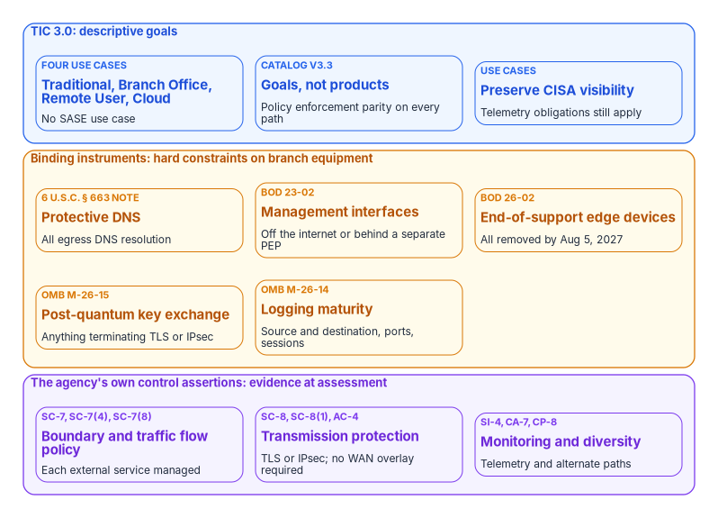
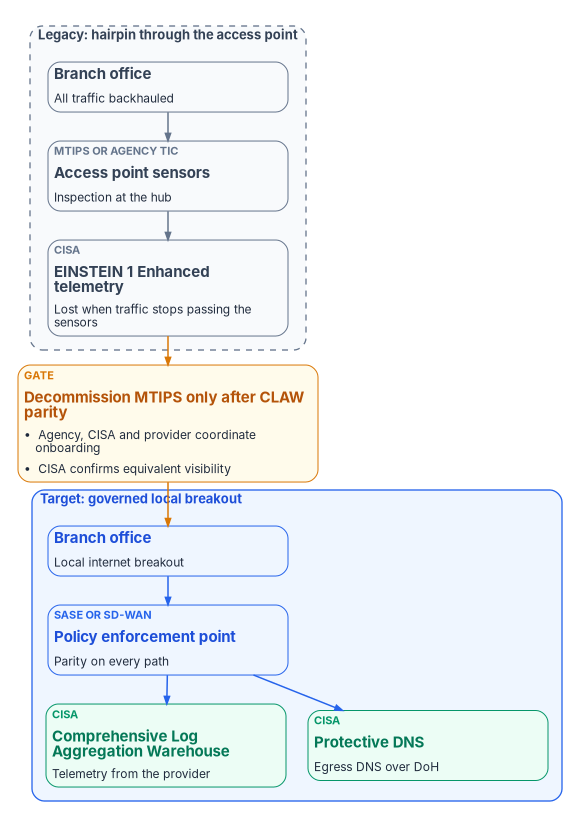

# Chapter 03 — What TIC 3.0 and Federal Policy Actually Require

*Federal network policy names no product, but it isn't requirement-free, and the requirements it does set decide what a branch has to be able to prove.*

::: {.callout-note}
## In this chapter
What TIC 3.0 asks for, read from the current documents rather than from what is said about them, and the binding obligations around it that land directly on branch equipment: Protective DNS, BOD 23-02, BOD 26-02 and M-26-15. The control assertions an agency makes about its own boundary, the encryption requirement that is narrower than usually claimed, logging under M-26-14 and CISA telemetry once MTIPS goes away, why FedRAMP doesn't constrain routing, and how the DoD comparison should be drawn. [Appendix B](appendix-b-requirements-mapping.md) maps every requirement to the chapters and evidence.
:::

Most branch-network decisions in federal agencies are argued in policy terms. A proposal to break out locally is refused "for TIC reasons." An SD-WAN is bought because "TIC 3.0 requires it." A refresh is deferred because "FedRAMP won't allow that path." Each of those statements is checkable, and most of them fail the check. TIC 3.0 mandates no technology, FedRAMP says nothing about the path an agency uses to reach a service, and no federal instrument names SD-WAN or SASE as required.

The opposite mistake is just as common: concluding that because policy is technology-neutral, the branch is unconstrained. It isn't. Four binding obligations dictate where DNS goes, how management interfaces are exposed, when edge hardware must be replaced and what anything terminating TLS or IPsec must support. And the agency's own authorization packages assert controls about every external boundary, which is what a branch becomes the moment it breaks out locally. This chapter states both halves precisely, because the rest of the book depends on them: [Chapter 02](02-transport-is-physics-control-is-compliance.md) argues that control is a compliance decision, and this chapter says what compliance actually asks for.

{#fig-ch03-obligation-layers fig-alt="Three stacked groups. Top group, TIC 3.0 descriptive goals, in blue: four use cases (Traditional, Branch Office, Remote User, Cloud, with no SASE use case); the Security Capabilities Catalog version 3.3, which sets goals rather than products and requires policy enforcement parity on every path; and the use cases' requirement to preserve CISA visibility. Middle group, binding instruments in amber: Protective DNS for all egress DNS resolution under 6 U.S.C. 663 note; BOD 23-02, management interfaces off the internet or behind a separate policy enforcement point; BOD 26-02, end-of-support edge devices all removed by August 5, 2027; OMB M-26-15, post-quantum key exchange on anything terminating TLS or IPsec; and OMB M-26-14 logging of source and destination addresses, ports and sessions. Bottom group, the agency's own control assertions in violet: SC-7, SC-7(4) and SC-7(8) for the boundary and traffic flow policy; SC-8, SC-8(1) and AC-4 for transmission protection by TLS or IPsec with no WAN overlay required; and SI-4, CA-7 and CP-8 for monitoring and alternate paths."}

## From consolidation to capabilities

The Trusted Internet Connections initiative began in 2007 as a consolidation mandate: civilian agencies were to reduce their external connections to a small approved set of access points, through which traffic would be routed and inspected. OMB M-08-05 operationalized it. Managed Trusted Internet Protocol Services (MTIPS) later moved the operation of those access points to commercial providers under GSA contract; today MTIPS is a service under GSA's Enterprise Infrastructure Solutions (EIS) contract.[^c03-scc] Consolidation worked. The routing model it required didn't age well, because every cloud interaction from every location had to detour through a physical access point first.

OMB M-19-26, *Update to the Trusted Internet Connections (TIC) Initiative* (September 12, 2019), rescinded M-08-05 along with M-08-16, M-08-27 and M-09-32, and replaced routing-based compliance with capability-based compliance.[^c03-m1926] CISA's June 2026 guidance on SASE states the consequence plainly: TIC 3.0 doesn't require agencies to route traffic through TIC access points if they have an alternative that gives both the agency and CISA situational awareness.[^c03-sase] No instrument rescinding M-19-26 was found; TIC 3.0 is operative.

The TIC 3.0 Program Guidebook lists the program's guiding principles, and one of them is "descriptive, not prescriptive." It also states that the terms and logical components of the guidance are vendor and technology neutral, and that where TIC 3.0's controls don't adequately address residual risk, agencies "are obligated to apply the controls or explore options for compensating controls."[^c03-guidebook] That last sentence matters as much as the first. Discretion comes with an obligation to close the gap by other means.

## The document set, read from the cover pages

Earlier versions of the source papers for this book couldn't confirm TIC version numbers and warned readers to take them from the cover pages. That has now been done. CISA republished the set in September 2026; the revision tables say the only 2026 changes were updated footnote links, so the substantive content of the current versions dates from July 2025 (April 2021 for the Traditional TIC Use Case). CISA's landing page labels three volumes v1.1, but their cover pages read 1.2; cite the cover.[^c03-core]

| Volume or use case | Cover version | Content last revised | What it is |
|---|---|---|---|
| Volume 1, Program Guidebook | 1.2 | July 2025 | History, principles, telemetry and authorities |
| Volume 2, Reference Architecture | 1.2 | July 2025 | Trust zones, policy enforcement points, management entities |
| Volume 3, Security Capabilities Catalog | 3.3 | July 2025 | Universal and policy enforcement point (PEP) capabilities |
| Volume 4, Use Case Handbook | 1.2 | July 2025 | How use cases are structured and combined |
| Volume 5, Overlay Handbook | 1.2 | July 2025 | How vendors and agencies map products to capabilities |
| Traditional TIC Use Case | 1.0 | April 2021 | The access-point model, still a valid choice |
| Branch Office Use Case | 3.0 | July 2025 | Branch to cloud, branch to web, branch to campus |
| Remote User Use Case | 2.2 | July 2025 | Users off the agency network |
| Cloud Use Case | 1.2 | July 2025 | Agency use of IaaS, PaaS, SaaS and email |

There are four use cases: Traditional, Branch Office, Remote User and Cloud.[^c03-core] **There is no "SASE use case."** An agency deploying SASE at its branches operates under the Branch Office and Cloud use cases. What CISA has published on SASE is a separate guidance document, *The Journey to Zero Trust: Using Secure Access Service Edge in a Modern TIC 3.0 Solution*, version 1.0, June 2026, which describes itself as an example approach based on CISA's work with agencies that replaced MTIPS with SASE, and as vendor-agnostic.[^c03-sase] It is the one federal document that describes SASE in a TIC 3.0 architecture. It permits and describes; it doesn't require.

## What the catalog and the Branch Office use case require

The Security Capabilities Catalog is precise about its own status. Its purpose is "to provide goals to be achieved, not detailed guidance on how to accomplish these goals," and the choice of solution is left to each agency.[^c03-scc] It has two parts:

- **Twenty universal security capabilities**, enterprise-level principles that apply to every use case (backup and recovery, inventory, least privilege, situational awareness, policy enforcement parity and others).
- **Policy enforcement point capabilities in twelve groups**: Files, Email, Web, Networking, Resiliency, Domain Name System, Intrusion Detection, Enterprise, Unified Communications and Collaboration, Data Protection, Services and Identity. These may or may not apply, depending on the use case.

Two of the catalog's statements constrain branch design more than any capability does. First, **policy enforcement parity**: once an agency decides a capability is needed to protect its network or data, it needs to implement that capability at all access points to that network or data. Second, **telemetry**: TIC 3.0 no longer specifies collection durations or timeliness (TIC 2.x required a 24-hour packet capture), but agencies must still meet the telemetry requirements set by law, OMB and CISA.[^c03-scc]

The Branch Office Use Case applies those two ideas to three security patterns: branch office to an agency-sanctioned cloud service provider, branch office to the web, and branch office to the agency campus. An agency may implement a subset. Each pattern offers options, including direct connection with enforcement at the branch, routing through the campus, or routing through a cloud access security broker or other security-as-a-service provider. The web pattern is the riskiest, and the use case asks for "the greatest rigor" at the branch enforcement point for it.[^c03-branch]

The use case is also the one TIC 3.0 document that names SD-WAN, and it does so in a specific way. Where multiple means of conveyance are used ("redundant links, SD-WAN, etc."), path priorities, the order in which security functions execute, and policy enforcement "should ensure security parity on all conveyance paths," so that an attacker can't evade protections by steering traffic onto a path with less rigor.[^c03-branch] SD-WAN appears as an example of a conveyance whose paths must all be governed, not as a requirement. Its telemetry section is unambiguous about the other half: as branches connect directly to external services, "agencies must preserve CISA visibility through information sharing."[^c03-branch]

Read together, the TIC documents require a branch that breaks out locally to have a policy enforcement point that applies the agency's chosen capabilities with the same rigor as the campus, on every path, while preserving CISA's visibility. They don't say what that enforcement point is. That's why local breakout is gated on an authorized security architecture rather than on circuits: a circuit can be ordered in a quarter, while an authorized local-breakout architecture takes much longer, which is the critical path [Chapter 11](11-field-office-wan-transformation.md) plans around.

## Technology-neutral is not requirement-free

Four binding obligations land directly on branch network equipment. None of them picks a product. All of them constrain what a branch can look like.

**Egress DNS must go to CISA's Protective DNS.** M-22-09 records this as an existing obligation: agencies "are already required to have DNS requests routed through CISA-operated infrastructure."[^c03-m2209] CISA's *Encrypted DNS Implementation Guidance* states that agencies must use Protective DNS for all egress DNS resolution, under both M-22-09 and 6 U.S.C. § 663 note; that agency DNS infrastructure must disable root hints; and that agency networks may permit communication with external third-party resolvers only from authorized internal DNS servers.[^c03-edns] The underlying obligation is statutory: the Federal Cybersecurity Enhancement Act of 2015 requires agencies to apply CISA's capabilities to "all information traveling between an agency information system and any information system other than an agency information system."[^c03-guidebook] This dictates where a class of traffic must go.

**Internet-exposed management interfaces must be removed or fronted.** BOD 23-02 (June 13, 2023) covers the management interfaces of "routers, switches, firewalls, VPN concentrators, proxies, load balancers," and out-of-band server management interfaces. Within 14 days of discovery or CISA notification, an agency must take the interface off the internet or, as the preferred action, enforce access to it "through a policy enforcement point separate from the interface itself."[^c03-bod2302] A branch appliance with an internet-reachable management plane is in scope regardless of where it sits.

**End-of-support edge devices must come off agency networks.** BOD 26-02, *Mitigating Risk From End-of-Support Edge Devices* (February 5, 2026), defines edge devices as technology "that reside on the boundary of an agency's network and are accessible from the public internet": routers, switches, firewalls, wireless access points, load balancers, network security appliances, software-defined networks and similar. The directive applies to devices that are edge devices, are end of support, and sit on the network boundary; it excludes operational technology and FedRAMP-authorized cloud services.[^c03-bod2602] A branch router with its own internet circuit meets that test. The milestones, counted from the issue date:

| Within | Date | Action |
|---|---|---|
| 3 months | May 5, 2026 | Inventory devices on CISA's end-of-support edge device list and report |
| 12 months | February 5, 2027 | Decommission listed devices whose support ends by then; inventory devices reaching end of support in the next 12 months |
| 18 months | August 5, 2027 | Decommission all identified end-of-support edge devices and report |
| 24 months | February 5, 2028 | Continuous discovery; decommission devices on or before their end-of-support dates |

This is a dated obligation to replace physical branch hardware, whatever architecture program is or isn't funded. [Chapter 10](10-the-long-interim.md) explains why that makes the refresh the moment the branch architecture is chosen, and why the replacement specification matters.

**Anything terminating TLS or IPsec must support post-quantum key exchange.** OMB M-26-15, *Execution of the Migration to Post-Quantum Cryptography* (June 24, 2026), implements Executive Order 14412 of June 22, 2026.[^c03-m2615][^c03-eo14412] It states that all network infrastructure terminating TLS or IPsec sessions, "including firewalls, Virtual Private Network concentrators, cloud gateways, and Application Programming Interface (API) proxies," must be configured to support PQC-capable key exchanges using NIST PQC algorithms, and it adds that such terminators should sit as close to the endpoint as feasible. Agencies must mitigate as much quantum risk as feasible by December 31, 2030, and submit a migration plan within 120 days, which is October 22, 2026. The memorandum doesn't apply to national security systems.[^c03-m2615] A branch firewall or VPN concentrator that can't perform a FIPS 203 (ML-KEM) key exchange won't satisfy it, and that is a refresh decision.

The right formulation for a program document follows from these four: federal policy is technology-neutral, and it isn't requirement-free.

## The control assertions an agency makes about its own boundary

The obligations that bite hardest at a branch are often the ones the agency wrote into its own authorization packages. Where a branch performs local internet breakout, the branch is an external boundary, and the system security plan asserts controls about it. The table gives the controls that matter most, from NIST SP 800-53 Rev. 5 (release 5.2.0, August 27, 2025), with their SP 800-53B baseline membership.[^c03-sp80053][^c03-sp80053b]

| Control | What it asserts | Low | Moderate | High |
|---|---|---|---|---|
| SC-7 Boundary Protection | Monitor and control communications at external managed interfaces and key internal ones | ✓ | ✓ | ✓ |
| SC-7(4) External Telecommunications Services | A managed interface and a traffic flow policy for each external telecommunication service; protect what crosses it; document and review each exception | — | ✓ | ✓ |
| SC-7(8) Route Traffic to Authenticated Proxy Servers | Route defined internal traffic to defined external networks through authenticated proxies at managed interfaces | — | ✓ | ✓ |
| SC-8 and SC-8(1) | Protect transmitted information; use cryptographic mechanisms to do it | — | ✓ | ✓ |
| AC-4 Information Flow Enforcement | Enforce approved authorizations for flows within and between systems | — | ✓ | ✓ |
| AC-17 Remote Access | Usage restrictions, authorization and monitoring of remote access | ✓ | ✓ | ✓ |
| SI-4 System Monitoring | Detect attacks and indicators of potential attacks | ✓ | ✓ | ✓ |
| CA-7 Continuous Monitoring | A monitoring strategy with defined metrics and ongoing assessment | ✓ | ✓ | ✓ |
| CP-8, CP-8(1), CP-8(2) | Alternate telecommunications services that don't share a single point of failure with the primary | — | ✓ | ✓ |
| CP-8(3) Separation of Primary and Alternate Providers | Alternate services from a provider separated from the primary | — | — | ✓ |

None of this says an agency is out of compliance for lacking SD-WAN. It says an agency with an ungoverned branch edge will struggle to produce the evidence its own assertions promise: what is monitored and controlled at that boundary, by what, under which documented traffic flow policy, and where the record is. The gap surfaces at assessment time, not at deployment time. That is the honest form of the architectural argument, and it's an evidence argument, not a mandate argument.

Two corrections to the way the sources stated control closures. First, a field-office design that pairs local internet with a physically diverse cellular path closes CP-8(2) at the Moderate baseline, but CP-8(3), provider separation, is a High-baseline control and isn't asserted in a Moderate package.[^c03-sp80053b] Second, an SD-WAN overlay's IPsec is *one* way to implement SC-8(1), not the only one, as the next section shows. Which enforcement layer closes which control (overlay, SASE, firewall) is [Chapter 05](05-sd-wan-sase-and-governed-transport.md)'s subject. CISA's own mapping in the SASE guidance is a useful cross-check: it maps Networking PEP capabilities to SASE and next-generation firewalls, DNS PEP capabilities to SASE plus Protective DNS, and Identity PEP capabilities to identity and access management.[^c03-sase]

The same evidence logic runs through CISA's Zero Trust Maturity Model, whose cross-cutting capabilities (Visibility and Analytics, Automation and Orchestration, and Governance) apply to every pillar. A flat branch fleet with nothing at the edge gives the Networks pillar nothing to report under any of them. The model describes itself as "a general guide," not "a strict set of requirements," so this is a maturity argument rather than a compliance one.[^c03-ztmm]

## The encryption requirement that is and isn't there

### What is required

- **SC-8**, in the Moderate and High baselines, requires protecting the confidentiality or integrity of transmitted information on internal and external networks. Its discussion says how: "Protecting the confidentiality and integrity of information can be accomplished by physical or logical means," physical by protected distribution systems and logical by encryption.[^c03-sp80053]
- **SC-8(1)**, also Moderate and High, requires cryptographic mechanisms during transmission, and its discussion names them: "Cryptographic mechanisms that protect the confidentiality and integrity of information during transmission include TLS and IPSec." The two are listed as alternatives; nothing requires both.[^c03-sp80053]
- **SC-13**, in all three baselines, is a selection control: the agency determines its cryptographic uses and the type of cryptography each needs. Its statement doesn't itself require FIPS validation; its discussion lists FIPS-validated and NSA-approved cryptography among the generally applicable standards.[^c03-sp80053]
- **M-22-09** requires encrypted DNS "wherever it is technically supported," HTTPS "for all web and application program interface (API) traffic" in the agency's environment, and a zero trust architecture plan describing the agency's approach to environmental isolation.[^c03-m2209]
- **Executive Order 14028 §3(d)** required agencies to adopt encryption for data in transit "to the maximum extent consistent with Federal records laws and other applicable laws." It names no protocol or layer.[^c03-eo14028]
- **BOD 18-01** requires HTTPS with HSTS on publicly accessible federal websites and STARTTLS on internet-facing mail servers, so its scope is public-facing systems only.[^c03-bod1801]

**TLS versions are two different requirements.** NIST SP 800-52 Rev. 2 (August 2019) "requires support for TLS 1.3 by January 1, 2024."[^c03-sp80052] Separately, Executive Order 14306 (June 6, 2025) directs requirements for agencies to support TLS 1.3 or a successor "as soon as practicable, but not later than January 2, 2030," and M-26-15 repeats that date as the foundation for post-quantum key exchange.[^c03-eo14306][^c03-m2615] The 2030 date is a post-quantum readiness deadline, not a relaxation of 2024. An agency citing 2030 to justify TLS 1.2-only servers today is out of step with SP 800-52 Rev. 2.

### What isn't required

No federal instrument requires the WAN transport itself to be encrypted where the payload is already protected end to end. Three lines of evidence in the control catalog support that:

1. **The controls that would require it aren't baselined.** SC-8(3), *Cryptographic Protection for Message Externals*, covers "message headers and routing information," which is exactly what application-layer TLS doesn't protect. SC-8(4) covers concealing traffic patterns. Neither is in the Low, Moderate or High baseline.[^c03-sp80053][^c03-sp80053b] If policy intended to require protection beyond the payload, SC-8(3) is where it would live.
2. **SC-8 can be met without encryption.** A protected distribution system satisfies it, so an encrypted tunnel isn't compelled.
3. **The assessment is layer-blind.** The SC-8(1) assessment objective asks only that cryptographic mechanisms are implemented during transmission, and its assessment objects include "mechanisms supporting and/or implementing alternative physical safeguards."[^c03-sp80053]

M-22-09 confines its network actions to DNS and HTTP and says so: the strategy "focuses agencies on two critical and widely used protocols in the near-term, DNS and HTTP traffic." Its sentence "All traffic must be encrypted and authenticated as soon as practicable" is often quoted as a mandate for encrypted transport. It belongs to the memorandum's vision, and its own actions don't reach WAN transport as a category.[^c03-m2209]

The practical consequence: an agency whose branch traffic is TLS-protected end to end with validated modules, whose egress DNS reaches Protective DNS, and which has a documented managed interface and traffic flow policy at each external telecommunication service under SC-7(4), has a defensible SC-8, SC-8(1) and SC-7(4) implementation with no overlay in it. The residual exposure is real (destination addresses, server names in TLS handshakes and unencrypted DNS, packet sizes and timing, routing metadata) and no baselined control names it. An overlay addresses it. That is a defensible risk decision, not a compliance obligation, and it shouldn't be budgeted as one.

### Where encryption is load-bearing

SC-8(1) applies to the information, not to the protocol. A cleartext protocol carrying in-scope information across an unprotected path is an SC-8 finding whatever the transport looks like, and for those flows an overlay or tunnel is often the only practical remedy because the application can't be changed. Two supporting controls point the same way. CM-7(1), Moderate and High, requires periodic review to identify and disable nonsecure functions, ports, protocols and services, and its discussion names FTP among unsecure protocols. AC-4's discussion includes "keeping export-controlled information from being transmitted in the clear to the Internet."[^c03-sp80053]

The action that follows is cheap: **inventory the cleartext protocols crossing branch WAN links and treat the inventory as an SC-8 exposure register.** Cleartext LDAP, SMB without encryption, FTP, telnet, unencrypted database connections and legacy line-of-business protocols are where the absence of transport encryption is a real finding. Each entry gets one of three dispositions: encrypt at the application, tunnel that flow specifically, or retire it. [Chapter 06](06-legacy-protocols-on-re-routed-paths.md) covers what those protocols do on re-routed paths.

One date sits on the same equipment. On September 22, 2026, all FIPS 140-2 certificates moved to the CMVP Historical List. That isn't revocation: CMVP "supports the purchase and use of these modules for existing systems," and agencies set their own transition to FIPS 140-3-only modules.[^c03-cmvp] Acquisition documents written now should state the validation expectation explicitly, particularly given M-26-15's post-quantum requirement on the same devices.

## DNS: what satisfies the Protective DNS obligation

The Protective DNS obligation is the one hard external-path mandate, and an enterprise DDI platform satisfies half of it. The platform provides the authorized internal resolvers, the place where root hints are disabled, the enforcement that endpoints resolve only through those resolvers, and encrypted DNS transport under M-22-09. It doesn't replace CISA's resolvers. The compliant chain is endpoints, then agency resolvers, then egress forwarded to Protective DNS. [Book 08 Chapter 03](../b08-ddi/03-federal-requirements.md) sets out the full DNS requirement set, and [Book 08 Chapter 05](../b08-ddi/05-edge-interception-and-bypass.md) covers interception at the SD-WAN edge and the redirect-dns target.

The trap is easy to configure by accident. A vendor's own protective-DNS or threat-intelligence resolver has the same shape as CISA's, and a deployment that forwards egress queries to the vendor's cloud resolvers instead of CISA's satisfies the product design and breaches the federal requirement. So does an endpoint agent that opens its own DNS-over-HTTPS session to a vendor cloud, bypassing the agency resolvers. Vendor threat intelligence applied *at* the internal resolver, with egress still forwarded to CISA, is compatible; vendor resolution *instead of* CISA isn't. The failure is silent (resolution works, users notice nothing), so it deserves a verification task in the running estate, not an assumption.

A SASE deployment can carry this obligation too. CISA's SASE guidance describes agencies configuring SASE agents to intercept traditional DNS and DNS over HTTPS, routing network DNS through the SASE service, and configuring the SASE service to forward to Protective DNS using DNS over HTTPS, which it says also supports M-22-09's encrypted DNS requirement.[^c03-sase] The same rule applies: egress must terminate at CISA.

## Logging and CISA telemetry after MTIPS

### M-21-31 is rescinded

OMB M-26-14, *Ensuring Effective and Efficient Agency Logging and Network Visibility to Defend Against Evolving Cyber Threats* (May 22, 2026), states: "Effective immediately, OMB Memorandum M-21-31 is rescinded."[^c03-m2614] The event-logging tiers EL0 to EL3 no longer exist in federal policy. In their place, agencies prioritize two objectives, continuous event monitoring and threat hunting, investigation, response and forensics, and are measured against a five-level maturity model (Level 0 Ineffective to Level 4 Optimal) in which a system's overall maturity is its lowest-scoring element. CISA was to publish a Logging Reference Architecture within 90 days; it did so on August 20, 2026.[^c03-lra] Reading M-26-14's action table against that date:

| Action | Due after the reference architecture | Date (worked from August 20, 2026) |
|---|---|---|
| First Agency Logging Plan to OMB and CISA | 90 days | November 18, 2026 |
| At least Level 1 on every element | 120 days | December 18, 2026 |
| At least Level 2 on every element | 180 days | February 16, 2027 |
| At least Level 3 on every element | 320 days | July 6, 2027 |

The memo sets one minimum for every log it covers: searchable for at least six months and retrievable for at least a year (its Appendix B baseline). The maturity model then states retention level by level, and Level 4 restates that same minimum.[^c03-m2614] Among the minimum log content, agencies must be able to determine "source and destination network address information, including protocols, ports, and session attributes."[^c03-m2614] That's the transport-layer record a branch with nothing at its edge doesn't produce.

### CISA telemetry: CLAW and Protective DNS replace the MTIPS sensors

The TIC Program Guidebook is clear that TIC doesn't replace or negate telemetry requirements, including telemetry collected and shared with CISA, and that the Security Capabilities Catalog doesn't detail what telemetry to provide.[^c03-guidebook] In the legacy architecture, network telemetry came from sensors at MTIPS provider locations and agency access points and reached CISA through the EINSTEIN 1 Enhanced (E1E) capability. CISA's SASE guidance states what happens at local breakout: when agencies move to a SASE-based architecture, "this telemetry is no longer provided to CISA." For comparable visibility, agencies can send telemetry to CISA's **Comprehensive Log Aggregation Warehouse (CLAW)**, a cloud-based service, and doing so "requires coordination among agencies, CISA, and SASE."[^c03-sase] The Program Guidebook points agencies to the CLAW Cloud Interface Reference Architecture (formerly the NCPS Cloud Interface Reference Architecture) for telemetry guidance.[^c03-guidebook]

{#fig-ch03-telemetry-continuity fig-alt="Top, a dashed slate group labeled legacy, hairpin through the access point: a branch office backhauls all traffic to MTIPS or agency TIC access point sensors, which produce EINSTEIN 1 Enhanced telemetry for CISA, lost when traffic stops passing the sensors. An amber gate follows: decommission MTIPS only after CLAW parity, with the agency, CISA and the provider coordinating onboarding and CISA confirming equivalent visibility. Bottom, a blue group labeled target, governed local breakout: a branch office breaks out locally through a SASE or SD-WAN policy enforcement point with parity on every path, which sends telemetry to CISA's Comprehensive Log Aggregation Warehouse and egress DNS to CISA's Protective DNS over DNS over HTTPS, both shown in green."}

Two consequences belong in a program plan, not in a cutover runbook:

- **CLAW onboarding is a three-party effort** (agency, CISA and the SASE or SD-WAN provider) with its own lead time. It belongs on the critical path next to the authorization package for local breakout.
- **MTIPS shouldn't be decommissioned before CLAW telemetry is confirmed flowing.** Cutting the circuits first trades a gap in transport for a gap in CISA visibility, which is worse than the position being fixed. The exit criterion for leaving MTIPS is confirmed CLAW parity, not branch cutover completion. This is the program's design position, derived from the Branch Office use case's requirement to preserve CISA visibility.[^c03-branch]

CLAW was earlier called the "Cloud Log Aggregation Warehouse," and older documents, including this book's sources, still use that name. CISA's current name is **Comprehensive** Log Aggregation Warehouse; the Program Guidebook's July 2025 revision changed the word from "Cloud" to "Comprehensive."[^c03-guidebook]

## FedRAMP does not constrain routing

FedRAMP certifies cloud service offerings. It governs the security posture of the service, not the network topology an agency uses to reach it, and it doesn't prohibit SD-WAN, require hairpin routing or mandate any path. Under FedRAMP's 2026 rules, "each agency still authorizes its own federal information systems," the authorizing official accepts the risk of the agency's specific use of a service, and an agency "should never create a standalone authorization to operate for a cloud service offering."[^c03-fedramp-use] The route from a branch to a certified service is part of the agency's own system, authorized under the agency's own boundary.

Agencies still refuse network changes on stated FedRAMP grounds. The right response is one question: **name the control or control enhancement the change violates.** There isn't one. A refusal with no identifiable control basis is a governance failure in its own right and should be recorded as one.

Three points of precision for packages written now:

- **Don't cite a FedRAMP Moderate control count.** FedRAMP Notice 0013 (June 16, 2026) removed "the vast majority of FedRAMP-assigned control parameter values" and "nearly all FedRAMP-specific control guidance" from the Rev5 baselines, and gives no new counts.[^c03-ntc0013]
- **Use the new vocabulary without overstating it.** The 2026 rules use "FedRAMP Certified" as the current program term and define Certification Classes A through D, from minimal to significant assurance.[^c03-fedramp-defs] The Marketplace labels the former Moderate level as Class C (Moderate); Microsoft 365 GCC, for example, is listed as FedRAMP Certified, Class C (Moderate).[^c03-mso365] Optional early adoption began July 4, 2026, and mandatory adoption is January 1, 2027.[^c03-fedramp-timeline]
- **Rev5 dates.** FedRAMP stops accepting new Rev5 certification requests on June 11, 2027; the end date for existing Rev5 certifications "has not been finalized but is likely to be no later than 2029."[^c03-ntc0013] The sources' statement that existing authorizations remain valid to at least December 31, 2028 isn't in FedRAMP's notice and shouldn't be repeated.

Microsoft 365 informed network routing is a separate question: it's a Microsoft feature limited to commercial tenants, not a FedRAMP constraint, and [Book 08 Appendix C](../b08-ddi/appendix-c-applicability.md) records that GCC Moderate tenants can't use it. [Chapter 12](12-microsoft-365-traffic.md) covers Microsoft 365 traffic.

## Policy currency, October 2026

Network documents written before mid-2026 are likely to carry at least one stale citation. The current position:

| Instrument | Status as of October 21, 2026 |
|---|---|
| OMB M-19-26 (TIC 3.0) | Operative; no rescinding instrument found[^c03-m1926] |
| OMB M-22-09 (Federal Zero Trust Strategy) | Operative and cited as current in CISA's 2026 TIC and SASE documents; its actions were set to be met by the end of FY 2024, so its deadlines have passed and no successor was found[^c03-m2209][^c03-sase] |
| OMB M-21-31 (event logging) | Rescinded May 22, 2026, by M-26-14[^c03-m2614] |
| OMB M-26-15 (post-quantum migration) | Issued June 24, 2026; plans due October 22, 2026[^c03-m2615] |
| Executive Order 14028 | In effect; EO 14306 (June 6, 2025) amends EO 13694 and EO 14144, including striking Section 5 of EO 14144, and adds the TLS 1.3 date[^c03-eo14306] |
| CISA BOD 22-01 and BOD 19-02 | Revoked by BOD 26-04, *Prioritizing Security Updates Based on Risk* (June 10, 2026), which sets remediation timelines from four variables: asset exposure, KEV status, exploit automation and technical impact. Phase II is due August 9, 2026 and Phase III December 7, 2026[^c03-bod2604] |
| CISA ED 26-03 | *Mitigate Vulnerabilities in Cisco SD-WAN Systems*, issued February 25, 2026 and superseded in its actions by Version 1 on March 11, 2026; required affected agencies to provide SD-WAN syslog to CISA through CLAW[^c03-ed2603] |
| GSA Networx and WITS 3 | Expired May 31, 2026 and February 28, 2026[^c03-gsa-legacy] |
| GSA EIS | Option period 1 runs to July 31, 2027, option period 2 to July 30, 2032; 219 agencies had completed transition as of August 31, 2026[^c03-gsa-eis][^c03-gsa-transition] |

Two corrections to the sources here. EO 14306 doesn't amend EO 14028; its title and text amend EO 13694 and EO 14144.[^c03-eo14306] And ED 26-03 was issued on February 25, 2026, not February 26.[^c03-ed2603] ED 26-03 matters to this book for a reason beyond its date: it is a reminder that a branch-edge controller is itself attack surface, which [Chapter 05](05-sd-wan-sase-and-governed-transport.md) takes up.

With Networx and WITS 3 gone, a recommendation to "exit MTIPS" is no longer a contract-vehicle question. The vehicle question has resolved itself; the remaining question is which EIS services the agency has ordered, which [Chapter 09](09-who-owns-the-network.md) assigns to the telecom acquisition owner.

## The DoD contrast, correctly drawn

The Department of Defense is often cited as the prescriptive counterexample to civilian TIC policy. It is, but not in the way usually claimed. The DoD Zero Trust Strategy (November 2022) set a dated capability target: a minimum set of 91 target-level activities that components must reach by the end of FY 2027 (September 30, 2027), with 61 further activities for the advanced level.[^c03-dod-news][^c03-dod-ds] That is a harder, more binding deadline than anything civilian agencies face.

But the strategy doesn't point to specific technologies or solutions; it sets the capabilities DoD must implement and leaves components to decide how.[^c03-dod-bd] The civilian and defense difference is about bindingness and deadlines, not technology prescription. An agency drawing the contrast the other way will be corrected.

::: {.callout-note}
## What this chapter establishes
1. TIC 3.0 is descriptive: four use cases and a catalog of goals, with policy enforcement parity on every path and preserved CISA visibility. There is no SASE use case, and no federal instrument requires SD-WAN or SASE.
2. Four binding obligations constrain branch equipment anyway: Protective DNS for all egress resolution, BOD 23-02 for management interfaces, BOD 26-02 for end-of-support edge devices (all removed by August 5, 2027), and M-26-15 for post-quantum key exchange on anything terminating TLS or IPsec.
3. The hardest test is the agency's own control assertions (SC-7, SC-7(4), SC-7(8), SI-4, CA-7, CP-8) at a branch that has become an external boundary. It is an evidence argument.
4. SC-8 doesn't require an encrypted WAN where the payload is already protected; cleartext protocols are where encryption is load-bearing.
5. M-21-31 is rescinded; M-26-14 governs logging. CLAW and Protective DNS replace the MTIPS sensors, and MTIPS stays until CISA confirms CLAW parity.
6. FedRAMP certifies services, not routes. Ask for the control.
:::

::: {.callout-tip}
## Continue the book
[← Previous: Chapter 02 — Transport Is Physics, Control Is Compliance](02-transport-is-physics-control-is-compliance.md) · [Book index](index.md) · [Next: Chapter 04 — Logical Centralization and Token-Based Security →](04-logical-centralization-and-token-security.md)
:::

[^c03-m1926]: Office of Management and Budget, M-19-26, *Update to the Trusted Internet Connections (TIC) Initiative*, September 12, 2019 (rescinds M-08-05, M-08-16, M-08-27 and M-09-32), <https://www.whitehouse.gov/wp-content/uploads/2019/09/M-19-26.pdf> (accessed Oct 21, 2026).
[^c03-scc]: Cybersecurity and Infrastructure Security Agency, *Trusted Internet Connections 3.0, TIC Core Guidance Volume 3: Security Capabilities Catalog*, Version 3.3, publication September 2026 (revision history: v3.3 July 2025; 2026 changes were footnote links only), §1.1 (MTIPS defined as services under GSA's EIS contract), §2, §4 and §4.1 (Policy Enforcement Parity, 3.UNI.PEPAR), §4.2, <https://www.cisa.gov/sites/default/files/2026-09/TIC_3.0_Security_Capabilities_Catalogs_September_2026_17.pdf> (accessed Oct 21, 2026).
[^c03-sase]: Cybersecurity and Infrastructure Security Agency, *The Journey to Zero Trust: Using Secure Access Service Edge in a Modern TIC 3.0 Solution*, Version 1.0, June 2026 (published June 24, 2026), Preface, §3, §5.5 (CISA Telemetry and Security Services), Appendix A (Table 2, TIC Security Capability Solutions) and Appendix B, <https://www.cisa.gov/sites/default/files/2026-07/The_Journey_to_Zero_Trust-Using_SAS_in_a_Modern_TIC3.0_Solution.pdf>, linked from <https://www.cisa.gov/resources-tools/resources/using-sase-modern-tic-30-solution> (accessed Oct 21, 2026).
[^c03-guidebook]: Cybersecurity and Infrastructure Security Agency, *Trusted Internet Connections 3.0, TIC Core Guidance Volume 1: Program Guidebook*, Version 1.2, publication September 2026 (revision history: v1.2 July 2025, including "changed word 'Cloud' to 'Comprehensive' to describe CLAW"), guiding principles, §10 (Telemetry Requirements), §13 (TIC and EINSTEIN) and Appendix A (TIC Authorities, quoting 6 U.S.C. § 663 note), <https://www.cisa.gov/sites/default/files/2026-09/TIC_3.0_Program_Guidebook_September_2026_47.pdf> (accessed Oct 21, 2026).
[^c03-core]: Cybersecurity and Infrastructure Security Agency, "Trusted Internet Connections (TIC) 3.0 Core Guidance Documents" (revision date September 23, 2026), <https://www.cisa.gov/resources-tools/resources/trusted-internet-connections-tic-30-core-guidance-documents>; versions read from the cover pages and revision tables of the linked Program Guidebook, Reference Architecture, Security Capabilities Catalog, Use Case Handbook, Overlay Handbook, and Branch Office, Remote User and Cloud use cases (all accessed Oct 21, 2026).
[^c03-branch]: Cybersecurity and Infrastructure Security Agency, *Trusted Internet Connections 3.0 Branch Office Use Case*, Version 3.0, publication September 2026 (revision history: v3.0 July 2025), §3, §6 (Security Patterns 1–3), §7 (Policy Enforcement Parity guidance; §7.2.3 Networking PEP) and §8 (Telemetry Requirements), <https://www.cisa.gov/sites/default/files/2026-09/TIC_3.0_Branch_Office_Use_September_2026_6.pdf> (accessed Oct 21, 2026).
[^c03-m2209]: Office of Management and Budget, M-22-09, *Moving the U.S. Government Toward Zero Trust Cybersecurity Principles*, January 26, 2022, §III.C (Networks) and "Encrypting DNS traffic," <https://www.whitehouse.gov/wp-content/uploads/2022/01/M-22-09.pdf> (accessed Oct 21, 2026).
[^c03-edns]: Cybersecurity and Infrastructure Security Agency, *Encrypted DNS Implementation Guidance*, May 16, 2024, executive summary and §2, <https://www.cisa.gov/sites/default/files/2024-05/Encrypted%20DNS%20Implementation%20Guidance_508c.pdf>, linked from <https://www.cisa.gov/resources-tools/resources/encrypted-dns-implementation-guidance> (accessed Oct 21, 2026).
[^c03-bod2302]: Cybersecurity and Infrastructure Security Agency, Binding Operational Directive 23-02, *Mitigating the Risk from Internet-Exposed Management Interfaces*, June 13, 2023, <https://www.cisa.gov/news-events/directives/binding-operational-directive-23-02> (accessed Oct 21, 2026).
[^c03-bod2602]: Cybersecurity and Infrastructure Security Agency, Binding Operational Directive 26-02, *Mitigating Risk From End-of-Support Edge Devices*, February 5, 2026, Definitions, Scope and Required Actions, <https://www.cisa.gov/news-events/directives/bod-26-02-mitigating-risk-end-support-edge-devices> (accessed Oct 21, 2026). Calendar dates are computed from the issue date.
[^c03-m2615]: Office of Management and Budget, M-26-15, *Execution of the Migration to Post-Quantum Cryptography*, June 24, 2026, §1, §3.A–D and §4 (TLS 1.3) and the zero trust "Networks" item, <https://www.whitehouse.gov/wp-content/uploads/2026/06/M-26-15-Execution-of-the-Migration-to-Post-Quantum-Cryptography.pdf> (accessed Oct 21, 2026). The October 22, 2026 plan date is computed as 120 days from June 24, 2026.
[^c03-eo14412]: Executive Order 14412, *Securing the Nation Against Advanced Cryptographic Attacks*, June 22, 2026, <https://www.whitehouse.gov/presidential-actions/2026/06/securing-the-nation-against-advanced-cryptographic-attacks/> (accessed Oct 21, 2026).
[^c03-sp80053]: NIST, SP 800-53 Rev. 5, *Security and Privacy Controls for Information Systems and Organizations*, September 2020 (release 5.2.0, August 27, 2025), <https://csrc.nist.gov/pubs/sp/800/53/r5/upd1/final>; control statements, discussions and assessment objects for SC-7, SC-7(4), SC-7(8), SC-8, SC-8(1), SC-8(3), SC-8(4), SC-13, CM-7(1), AC-4, AC-17, SI-4, CA-7 and CP-8(2)–(3) checked in NIST's OSCAL Rev. 5 catalog (version 5.2.0), <https://github.com/usnistgov/oscal-content/tree/main/nist.gov/SP800-53/rev5> (both accessed Oct 21, 2026).
[^c03-sp80053b]: NIST, SP 800-53B, *Control Baselines for Information Systems and Organizations*; membership checked against NIST's OSCAL Rev. 5 Low, Moderate and High baseline profiles, <https://github.com/usnistgov/oscal-content/tree/main/nist.gov/SP800-53/rev5> (accessed Oct 21, 2026).
[^c03-ztmm]: Cybersecurity and Infrastructure Security Agency, *Zero Trust Maturity Model*, Version 2.0, April 2023, §3 and §5.6 (Cross-Cutting Capabilities), <https://www.cisa.gov/sites/default/files/2023-04/zero_trust_maturity_model_v2_508.pdf> (accessed Oct 21, 2026).
[^c03-eo14028]: Executive Order 14028, *Improving the Nation's Cybersecurity*, May 12, 2021, §3(d), 86 Fed. Reg. 26633, <https://www.govinfo.gov/content/pkg/FR-2021-05-17/pdf/2021-10460.pdf> (accessed Oct 21, 2026).
[^c03-bod1801]: Cybersecurity and Infrastructure Security Agency, Binding Operational Directive 18-01, *Enhance Email and Web Security*, October 16, 2017, <https://www.cisa.gov/news-events/directives/bod-18-01-enhance-email-and-web-security> (accessed Oct 21, 2026).
[^c03-sp80052]: NIST, SP 800-52 Rev. 2, *Guidelines for the Selection, Configuration, and Use of Transport Layer Security (TLS) Implementations*, August 2019, abstract, <https://csrc.nist.gov/pubs/sp/800/52/r2/final> (accessed Oct 21, 2026).
[^c03-eo14306]: Executive Order 14306, *Sustaining Select Efforts to Strengthen the Nation's Cybersecurity and Amending Executive Order 13694 and Executive Order 14144*, June 6, 2025, §§1–2 (including the TLS 1.3 text added to EO 14144 §4(f)), <https://www.whitehouse.gov/presidential-actions/2025/06/sustaining-select-efforts-to-strengthen-the-nations-cybersecurity-and-amending-executive-order-13694-and-executive-order-14144/> (accessed Oct 21, 2026).
[^c03-cmvp]: NIST Computer Security Resource Center, "FIPS 140-3 Transition Effort," <https://csrc.nist.gov/projects/fips-140-3-transition-effort> (accessed Oct 21, 2026).
[^c03-m2614]: Office of Management and Budget, M-26-14, *Ensuring Effective and Efficient Agency Logging and Network Visibility to Defend Against Evolving Cyber Threats*, May 22, 2026, rescission, "Prioritization," "Agency Actions," Appendix B item 5 and Appendix C (Logging Maturity Model), <https://www.whitehouse.gov/wp-content/uploads/2026/05/M-26-14-Ensuring-Effective-and-Efficient-Agency-Logging-and-Network-Visibility-to-Defend-Against-Evolving-Cyber-Threats.pdf> (accessed Oct 21, 2026). Calendar dates in the table are computed from the reference architecture's publication date.
[^c03-lra]: Cybersecurity and Infrastructure Security Agency, "Logging Reference Architecture" (published August 20, 2026), <https://www.cisa.gov/logging> (accessed Oct 21, 2026).
[^c03-fedramp-use]: FedRAMP, "Using a FedRAMP Certified Cloud Service," *FedRAMP Consolidated Rules for 2026*, <https://www.fedramp.gov/2026/agencies/use/> (accessed Oct 21, 2026).
[^c03-ntc0013]: FedRAMP, Notice NTC-0013, *Rev5 Baseline Changes*, June 16, 2026, <https://fedramp.gov/notices/0013> (accessed Oct 21, 2026).
[^c03-fedramp-defs]: FedRAMP, "Definitions," *FedRAMP Consolidated Rules for 2026* ("FedRAMP Certified" and "Certification Class"), <https://www.fedramp.gov/2026/definitions/> (accessed Oct 21, 2026).
[^c03-mso365]: FedRAMP Marketplace, Microsoft 365 Government Community Cloud & Supporting Services (MSO365MT): FedRAMP Certified, Class C (Moderate), Rev5, agency path, <https://www.fedramp.gov/marketplace/products/MSO365MT/> (accessed Oct 21, 2026).
[^c03-fedramp-timeline]: FedRAMP, "Important Dates for the Consolidated Rules for 2026," <https://www.fedramp.gov/2026/timeline/> (accessed Oct 21, 2026).
[^c03-bod2604]: Cybersecurity and Infrastructure Security Agency, Binding Operational Directive 26-04, *Prioritizing Security Updates Based on Risk*, June 10, 2026, <https://www.cisa.gov/news-events/directives/bod-26-04-prioritizing-security-updates-based-risk> (accessed Oct 21, 2026). Phase dates are computed from the issue date.
[^c03-ed2603]: Cybersecurity and Infrastructure Security Agency, Emergency Directive 26-03 (V1), *Mitigate Vulnerabilities in Cisco SD-WAN Systems* (original February 25, 2026; V1 March 11, 2026), <https://www.cisa.gov/news-events/directives/v1-ed-26-03-mitigate-vulnerabilities-cisco-sd-wan-systems> (accessed Oct 21, 2026).
[^c03-gsa-legacy]: General Services Administration, "Legacy IT contracts" (Networx contracts ended May 31, 2026; WITS 3 contracts ended February 28, 2026), <https://www.gsa.gov/technology/it-contract-vehicles-and-purchasing-programs/legacy-it-contracts> (accessed Oct 21, 2026).
[^c03-gsa-eis]: General Services Administration, "Enterprise Infrastructure Solutions" (contract periods and ceiling; last updated October 15, 2026), <https://www.gsa.gov/technology/it-contract-vehicles-and-purchasing-programs/telecommunications-and-network-services/enterprise-infrastructure-solutions> (accessed Oct 21, 2026).
[^c03-gsa-transition]: General Services Administration, "Enterprise Infrastructure Solutions Transition" (219 agencies completed as of August 31, 2026; last updated September 29, 2026), <https://www.gsa.gov/technology/it-contract-vehicles-and-purchasing-programs/telecommunications-and-network-services/enterprise-infrastructure-solutions/eis-transition> (accessed Oct 21, 2026).
[^c03-dod-news]: C. Todd Lopez, "New 'Overlays' Provide Guide on Path to Zero Trust," DOD News, June 4, 2024: by fiscal year 2027 the department expects "target level" implementation, "91 out of the 152 target activities identified in DOD's Zero Trust Strategy and Roadmap, which was released in November 2022," <https://www.war.gov/News/News-Stories/Article/Article/3795170/new-overlays-provide-guide-on-path-to-zero-trust/> (accessed Oct 21, 2026). The strategy PDF on dodcio.defense.gov serves only as a file download.

[^c03-dod-ds]: **Third-party source (trade press).** DefenseScoop, "DOD zero trust implementations" (April 4, 2024), reporting the DoD Zero Trust Strategy's 91 target-level and 61 advanced-level activities and the September 30, 2027 target, <https://defensescoop.com/2024/04/04/dod-zero-trust-implementations-phase-2027/> (accessed Oct 21, 2026). The strategy PDF on dodcio.defense.gov refused automated retrieval.
[^c03-dod-bd]: **Third-party source (trade press).** Breaking Defense, "DoD releases zero trust strategy to thwart hackers who often breach perimeter," November 22, 2022, <https://breakingdefense.com/2022/11/dod-releases-zero-trust-strategy-to-thwart-hackers-who-often-breach-perimeter/> (accessed Oct 21, 2026).
