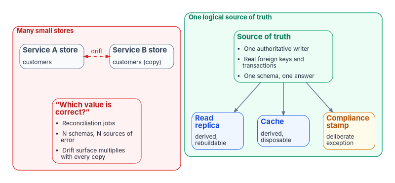
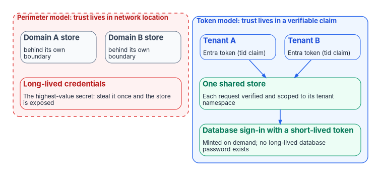

# Chapter 04 — Logical Centralization and Token-Based Security

*Centralize the truth and distribute the copies; identity, not network location, is what makes one shared store safe, and consistency classes are what keep it inside the speed of light.*

::: {.callout-note}
## In this chapter
Why the old reasons for fragmenting data into many small authoritative stores have weakened, and what a single source of truth actually buys. The distinction between logical and physical centralization that the rest of the book depends on. Why token-based security, not hardware, removes the strongest historical reason to fragment, and the risk it moves into code. Then the consistency classes, from strong to eventual, that let a centralized system serve distant readers without spanning distance synchronously.
:::

[Chapter 01](01-why-physics-decides-the-architecture.md) set out the three forces pulling architecture back toward centralization and the one wall none of them moves: propagation delay over distance. This chapter takes the first two forces in turn. The single-source-of-truth discipline says there should be fewer authoritative copies of anything. Token-based security says those fewer copies can safely serve many trust domains. Neither one says the copies should sit on one server in one place. That last step is where physics, failure domains and law push back, and the consistency classes at the end of the chapter are how a design respects them.

{#fig-ch04-ssot-vs-fragmented fig-alt="Left, a red panel titled many small stores: a Service A store and a Service B store each holding customer records, joined by a dashed red drift arrow, and a note asking which value is correct, listing reconciliation jobs, N schemas and N sources of error, and a drift surface that multiplies with every copy. Right, a green panel titled one logical source of truth: a source-of-truth card with one authoritative writer, real foreign keys and transactions, and one schema, with arrows to a read replica (derived, rebuildable), a cache (derived, disposable) and an amber compliance stamp (deliberate exception)."}

## The objection that no longer holds

The case for splitting data into many small databases rested on two claims: that one server couldn't carry the workload, and that independent services needed independent stores so they could deploy and fail independently. Both claims have weakened.

The scaling claim weakened because single machines grew. A memory-optimized cloud virtual machine today can offer up to 832 vCPUs and about 15 TiB of memory, with remote storage rated in the hundreds of thousands of IOPS.[^c04-msv3] A workload that needed a sharded cluster a decade ago may now fit on one well-provisioned node with room to spare. The Federal Modernization Program's position follows from that: scale up before scaling out, and shard only when a measured limit forces it, not against a hypothetical one.

The independence claim carried a cost nobody priced. Every independent store that holds a customer record, a price or an entitlement is a copy of some shared truth, and every copy is a place to go stale, diverge or silently disagree. The cost arrives later, as reconciliation jobs, eventual-consistency archaeology and incidents that begin with "which system has the right number?"

## What a single source of truth buys

One authoritative source of record is cheaper to reason about, and the cost of reasoning about a system is usually its scarcest resource.

| Property | Many small authoritative stores | One logical source of truth |
|---|---|---|
| Cross-entity invariants | Enforced by application code and reconciliation, eventually | Enforced by the database, with real foreign keys and transactions |
| Joins across the data | Distributed query, fan-out or duplicated data | A local join |
| "Which value is correct?" | A judgment call, often an incident | Defined: there is exactly one |
| Drift surface | One per copy, multiplied by every replication path | Limited to the derived copies you deliberately create |
| Mental model | N schemas and their interactions | One schema and its invariants |

This is the program's first operating principle applied to data: every claim has exactly one canonical source, and every other representation is a pointer back to it. Drift is treated as a named failure mode the architecture prevents, not an accident to clean up afterward. Fewer authoritative copies is the most direct lever on it.

## Logical and physical centralization

The word "centralize" covers two different decisions. Most mistakes in this debate come from treating them as one.

::: {.callout-important}
## Two meanings of "centralize"
- **Logical centralization: one source of truth.** One place is authoritative for a given fact, and everything else is derived from it. This is almost always right.
- **Physical centralization: one server in one location.** One machine holds and serves all the data. This is sometimes right, and it is limited by propagation delay, blast radius and data-residency law.
:::

The goal is the first. The second is an implementation choice, made only as far as it stays safe and cheap and abandoned when physics, failure domains or law push back. One logical source of truth can be physically replicated across three regions for durability and still be a single source of truth, because exactly one copy accepts authoritative writes and the others are explicitly subordinate. [Chapter 01](01-why-physics-decides-the-architecture.md) explains why the physical step stops at the propagation floor; the last section of this chapter shows how consistency classes let a design stop there without losing distant readers.

## Small databases survive, repurposed

"The era of small SQL servers is over" is accurate only in a narrower form: the era of small SQL servers *as sources of truth* is ending. Small databases keep two roles.

1. **Disposable accelerators.** Read replicas, caches and materialized edge stores are derived and rebuildable. Because none of them is authoritative, none can drift authoritatively: you can discard one and regenerate it from the source of truth. Keeping them current across distance is a transport question, taken up in [Chapter 05](05-sd-wan-sase-and-governed-transport.md).
2. **Compliance-stamped exceptions.** Where a customer's regulatory posture demands hard physical isolation, a dedicated small store is provisioned for that customer. It is a deliberate exception with its own boundary, not the default layout.

Patterns that push SQL to the edge, close to the application, point the same way. They create near-cache copies derived from a central truth, not distributed sources of truth. Truth consolidates while convenience copies multiply.

## Where drift is born

Drift rarely starts in the database engine. It starts when a team finds the central store too slow or too hard to reach and creates an unofficial local copy "just for performance." That copy slowly turns into a shadow source of truth nobody approved.

So the way to stay close to a single source of truth is to remove the incentive to fork it. The central store has to be easy enough and fast enough to reach that nobody is tempted to copy it. Two forces do that work. Token-based security removes the access friction, as the next section explains. Application-aware transport removes the latency friction within the limits [Chapter 05](05-sd-wan-sase-and-governed-transport.md) describes. Centralization of truth is sustained by making the central path the easiest one, not by policy alone.

## Token-based security as the enabler

A great deal of historical fragmentation had nothing to do with scale. It came from **isolation by perimeter**. When the only way to enforce "who may touch this data" was network segmentation, the safest way to separate two trust domains was to give each its own database behind its own boundary. No hardware advance addresses that reason.

Token-based security does. NIST's zero trust architecture starts from the premise that no implicit trust is granted to assets or accounts based solely on their physical or network location.[^c04-sp800207] OMB M-22-09 applies the same rule to federal agencies: MFA is enforced at the application layer rather than the network layer, and approaching an application from a particular network must not be treated as any less risky than approaching it from the public internet.[^c04-m2209] Once every request carries a verifiable statement of who is asking and what they are entitled to, the trust boundary travels with the request instead of living in the network. One logical store can then serve many trust domains.

| Dimension | Perimeter model | Token model |
|---|---|---|
| Where trust lives | In the caller's network location | In a signed, verifiable claim the caller presents |
| Unit of isolation | A network segment, often with its own datastore | A verified identity, scoped per request |
| Default posture | Trust inside the perimeter | Verify every request |
| Effect on data layout | A store per trust domain | One store across many trust domains |
| Highest-value secret | Long-lived credentials guarding the perimeter and the database | Short-lived tokens minted on demand |

The consequence for data architecture is direct: you no longer shard for security. Two customers, two business units or two sensitivity levels can share a logical store when the store enforces scoping on a verified identity in every request.

{#fig-ch04-perimeter-vs-token fig-alt="Two panels stacked vertically. Top, a dashed red panel titled perimeter model, trust lives in network location: a Domain A store and a Domain B store, each behind its own boundary, above a red card for long-lived credentials, the highest-value secret, which exposes the store if stolen once. Bottom, a blue panel titled token model, trust lives in a verifiable claim: Tenant A and Tenant B each present an Entra token with a tid claim to one shared store, which verifies each request and scopes it to the tenant's namespace, and which signs in to its database with a short-lived token minted on demand, so no long-lived database password exists."}

### Inbound: identity travels with the request

A multitenant service that accepts Microsoft Entra tokens from many customer tenants shows how this works. Microsoft's validation rules for such an application are specific. It verifies the token's signature against the issuer's published signing keys, checks that the tenant ID (`tid`) claim is a GUID and that the issuer claim matches that tenant, and uses `tid` as part of the key for any data it stores about the caller.[^c04-access-tokens] Microsoft states the rule plainly: always check that the token's `tid` matches the tenant the data was stored under, and never allow data in one tenant to be reached from another.[^c04-claims] Isolation holds because the tenant's identity is proven on every call, not assumed from where the call came from.

### Outbound: the database password disappears

The sharper demonstration is how the service authenticates to its own database. Azure Database for PostgreSQL flexible server, for example, accepts a Microsoft Entra access token in the password field of the connection. An application running under a managed identity requests a token for the database resource and connects with it, so no credential is stored in code or configuration.[^c04-pg-mi] The token is valid for 5 to 60 minutes and is acquired just before connecting, and the resource identifier it is requested for differs between clouds.[^c04-pg-entra]

::: {.callout-important}
## The highest-value secret is removed, not protected
A stored database password is usually the most valuable secret in a deployment: steal it once and the central store is exposed. Token-based authentication doesn't guard that secret better; it eliminates it. Each connection is authorized by a token minted on demand, scoped to the database audience and refreshed before it expires. There is nothing durable to steal.
:::

The program's own SaaS data plane uses both halves, inbound tenant verification and outbound passwordless database sign-in, around a single regional store. [Chapter 08](08-reference-architecture.md) walks through it as the book's worked example.

### Why this makes centralization safe

Together, inbound verification and outbound passwordless sign-in change the risk calculation that originally justified fragmentation:

- **There is no shared trust zone to break into.** Every request proves its identity again, so a single foothold doesn't yield ambient access to every tenant's data.
- **There is no long-lived database credential to steal.** The "one leaked connection string compromises everything" failure is designed out.
- **Per-request scoping replaces per-store isolation.** A tenant's reach is bounded by its verified identity on each call, so one store holding many tenants isn't a security downgrade compared with many stores.

Token security removes access friction as well as risk. When reaching the central store means presenting the right scoped identity, instead of requesting a network path, a firewall exception and a shared secret, the central store becomes easier to reach than a private copy. Security turns from a reason to fragment into a reason to centralize.

[Chapter 05](05-sd-wan-sase-and-governed-transport.md) carries the same idea one layer down: a credential minted per event, rather than a standing session or a durable secret, applied to the network path the request travels on.

### The risk it imports

The consolidation bet has a cost, and it should be named. When isolation between tenants or domains is enforced in code, by per-request identity scoping, rather than by physical separation, **the blast radius moves into that code path.** A defect in tenant resolution or namespace scoping isn't a contained single-tenant fault; it is a potential cross-tenant exposure. The trade is deliberate: you give up the failure-domain isolation of many physical stores in exchange for the simplicity and drift resistance of one logical store. In return you owe the shared isolation path disproportionate rigor. It must be small, exhaustively tested and fail-closed, rejecting unsigned, unknown and inactive tenants by default. The single most valuable test of such a design is that no code path lets a validated identity for tenant A address tenant B's data.

### The constraint token security doesn't remove

Token security removes the security reason to fragment. It doesn't remove the legal one. Data-residency and sovereignty rules can still require certain data to sit in a certain place or boundary, and no identity model overrides them. The program's answer is to keep the default plane centralized and provision a dedicated, physically isolated stamp for the customers who need one, with cloud-specific token audiences handled explicitly in the authentication layer. The exception is provisioned on purpose, with its own boundary; it doesn't become the default layout.

## Consistency classes: needing less global synchronization

Logical centralization still leaves a physical question: how do readers and writers far from the authoritative copy see its data? [Chapter 01](01-why-physics-decides-the-architecture.md) showed that no product shortens the round trip across a continent. The answer is to need fewer synchronous crossings of it, and the tool for that is choosing a consistency class per flow.

Consistency models form a spectrum. Microsoft's Azure Cosmos DB, used here as a documented example, defines five levels from strongest to weakest: strong, bounded staleness, session, consistent prefix and eventual. Its documentation shows what strong consistency costs over distance. For an account spanning several regions with strong consistency, write latency equals twice the round-trip time between the two farthest regions plus 10 milliseconds at the 99th percentile, and strong consistency across regions more than 8,000 kilometers apart is blocked by default because the write latency is too high.[^c04-cosmos] Bounded staleness instead guarantees that a region lags the writer by no more than a configured number of versions or a configured time interval.[^c04-cosmos] That is the physics of [Chapter 01](01-why-physics-decides-the-architecture.md) written into a product's service terms.

The techniques for needing less global synchronization each move a workload off a synchronous cross-region path it can't afford:

- **Strong within a region, asynchronous across regions.** At metro and regional distances the propagation floor is small enough that synchronous consistency costs little. Keep the single authoritative writer and its quorum inside one region, and replicate to other regions asynchronously. This is the default for most systems and the program's choice.
- **Bounded staleness instead of global serializability.** Where the business tolerates reads that are a known, small interval behind, a local read from a slightly stale replica replaces a cross-region round trip. The staleness bound is a contract, not an accident.
- **Causal consistency.** Preserving cause-and-effect order without imposing a total global order costs far less across distance and is enough for many applications.
- **Conflict-free replicated data types (CRDTs).** For genuinely multi-writer data, replicas accept writes locally and merge deterministically. Shapiro and colleagues formalized the conditions under which such replicas are guaranteed to converge.[^c04-crdt] Cross-region traffic becomes a mergeable bulk update rather than a coordination round trip.
- **Voting replicas placed by path.** Put quorum members on short, low-latency links so the fastest paths decide the quorum, and put non-voting replicas on the long paths for durability and read scale.

A short decision procedure turns these into a layout:

1. **Does this data have one source of truth?** It should. Identify the single authoritative writer; everything else is a derived copy.
2. **What is the weakest consistency each reader and writer actually tolerates?** Not the strongest anyone can imagine needing, but the weakest that is still correct. Use strong consistency only where it's required.
3. **Which network class matches each flow?** Strong, synchronous flows stay inside a region on low-latency paths. Everything that crosses regions is asynchronous or merge-based and can use bulk transport.

The third question is where the data layer meets the network layer. [Chapter 08](08-reference-architecture.md) maps each consistency class to a network class and applies the result to the program's SaaS data plane and to branch architectures.

::: {.callout-note}
## What this chapter establishes
- Larger single machines have removed the scaling objection for most workloads; scale up before scaling out.
- A single source of truth is cheapest where it matters most: in the cost of reasoning about the system and in the absence of drift.
- Logical centralization (one truth) is almost always right; physical centralization (one server in one place) is limited by propagation delay, blast radius and law.
- Small databases survive as disposable caches and compliance-stamped exceptions, not as competing sources of truth.
- Token-based security removes the perimeter reason to fragment. One store can serve many trust domains, and the long-lived database secret disappears.
- The price is that isolation is enforced in code, so the tenant-resolution path must be small, tested and fail-closed.
- Choosing the weakest tolerable consistency for each flow is how a centralized truth serves distant readers without spanning distance synchronously.
:::

::: {.callout-tip}
## Continue the book
[← Previous: Chapter 03 — What TIC 3.0 and Federal Policy Actually Require](03-what-tic-3-requires.md) · [Book index](index.md) · [Next: Chapter 05 — SD-WAN, SASE and Governed-Path Transport →](05-sd-wan-sase-and-governed-transport.md)
:::

[^c04-msv3]: Microsoft Learn, "Msv3 High Memory sizes series" (host specifications: 416–832 vCPUs, 5,696–15,200 GiB memory, remote storage 130,000–260,000 IOPS), <https://learn.microsoft.com/azure/virtual-machines/sizes/memory-optimized/msv3-hm-series> (accessed Oct 21, 2026).
[^c04-sp800207]: National Institute of Standards and Technology, SP 800-207, *Zero Trust Architecture*, August 2020, abstract, <https://csrc.nist.gov/pubs/sp/800/207/final> (accessed Oct 21, 2026).
[^c04-m2209]: Office of Management and Budget, M-22-09, *Moving the U.S. Government Toward Zero Trust Cybersecurity Principles*, January 26, 2022, section on identity (MFA at the application layer; networks not treated as less risky than the internet), <https://www.whitehouse.gov/wp-content/uploads/2022/01/M-22-09.pdf> (accessed Oct 21, 2026).
[^c04-access-tokens]: Microsoft Learn, "Access tokens in the Microsoft identity platform," section "Validate tokens" (multitenant applications: signing key issuer, `tid` is a GUID and matches `iss`, `tid` part of the data key), <https://learn.microsoft.com/entra/identity-platform/access-tokens> (accessed Oct 21, 2026).
[^c04-claims]: Microsoft Learn, "Secure applications and APIs by validating claims," section "Validate the tenant," <https://learn.microsoft.com/entra/identity-platform/claims-validation> (accessed Oct 21, 2026).
[^c04-pg-mi]: Microsoft Learn, "Connect with managed identity in Azure Database for PostgreSQL flexible server" (the managed identity's access token is passed in the password field), <https://learn.microsoft.com/azure/postgresql/security/security-connect-with-managed-identity> (accessed Oct 21, 2026).
[^c04-pg-entra]: Microsoft Learn, "Use Microsoft Entra ID authentication in Azure Database for PostgreSQL flexible server," section "Authenticate with Microsoft Entra ID" (token as password; valid 5 to 60 minutes; resource value differs by cloud), <https://learn.microsoft.com/azure/postgresql/security/security-entra-configure> (accessed Oct 21, 2026).
[^c04-cosmos]: Microsoft Learn, "Consistency levels in Azure Cosmos DB" (five levels; bounded staleness K versions or T interval; multi-region strong write latency 2 × RTT + 10 ms at P99; strong consistency over 8,000 km blocked by default), <https://learn.microsoft.com/azure/cosmos-db/consistency-levels> (accessed Oct 21, 2026).
[^c04-crdt]: Marc Shapiro, Nuno Preguiça, Carlos Baquero and Marek Zawirski, "Conflict-free Replicated Data Types," *Stabilization, Safety, and Security of Distributed Systems (SSS 2011)*, LNCS 6976, Springer, 2011, pp. 386–400; also INRIA Research Report RR-7687, <https://hal.sorbonne-universite.fr/inria-00609399v1> (accessed Oct 21, 2026).
