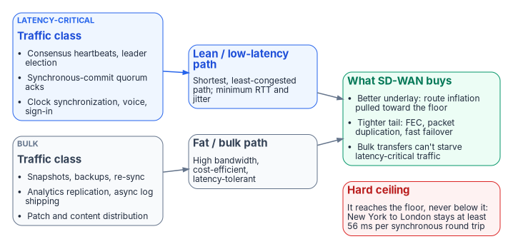
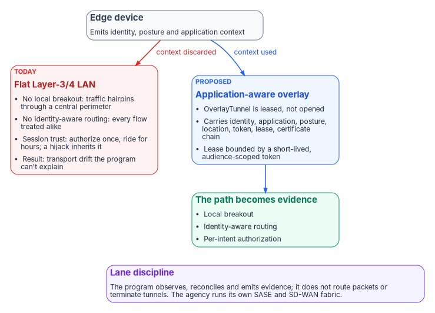
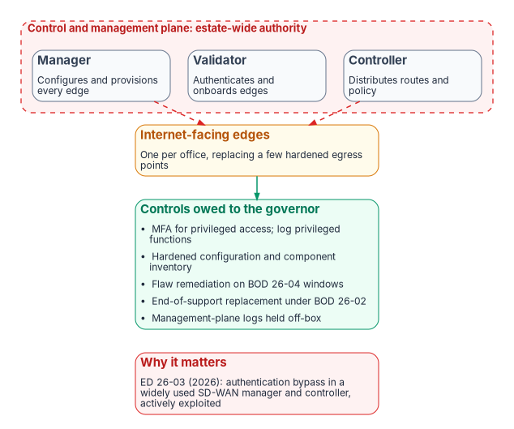

# Chapter 05 — SD-WAN, SASE and Governed-Path Transport

*SD-WAN can take a path down to the floor physics sets and SASE can make the traffic on it lawful, but neither one governs the path itself, and the device that does the governing is the newest thing an adversary will aim at.*

::: {.callout-note}
## In this chapter
What SD-WAN's differentiated transport buys: path classes, route-inflation recovery, tail-latency tools such as forward error correction and packet duplication, and protection of latency-critical traffic from bulk transfers, with the hard ceiling it can't pass. How SASE security services sit above SD-WAN in CISA's model and in the TIC 3.0 Branch Office Use Case. The program's proposed governed-path model, in which the path is leased per intent and bound to a short-lived token. The decision records the fabric must emit, and the controls the controller and edges need before they're credited with closing anything.
:::

[Chapter 02](02-transport-is-physics-control-is-compliance.md) separated the pipe from the governor: transport is a physics decision, and control is a compliance decision. This chapter is about the governor. It has three layers, and each answers a different question. SD-WAN decides which traffic takes which path and measures how each path is doing. SASE decides whether a flow is allowed and inspects it at a policy enforcement point (PEP). The governed path, which is still a proposal in the program, decides whether the path itself was authorized for this caller and this intent, and records the answer as evidence. Sitting over all three is a question the sources answered only briefly: who protects the governor?

## SD-WAN as differentiated transport

Software-defined WAN selects among several underlay paths per traffic class. It can put latency-sensitive traffic on a short, low-jitter path and push bulk traffic onto a larger, slower or cheaper one. The question worth asking precisely is whether that helps systems that must stay in sync over distance, and whether it helps with the speed-of-light problem [Chapter 01](01-why-physics-decides-the-architecture.md) describes.

The answer is yes, meaningfully, but only inside the gap between observed latency and the physical floor. SD-WAN never moves the floor. The gap is usually large, and it hurts distributed systems disproportionately because it inflates the latency tail, so working inside it is valuable. Describing that as "beating the speed of light" is the error to avoid.

The split into a lean class and a bulk class maps onto what a distributed database, and most branch traffic, actually emits:

| Traffic class | What it carries | Wants | Best path |
|---|---|---|---|
| Lean, low-latency | Consensus heartbeats, leader election, synchronous-commit quorum acknowledgements, clock synchronization; at a branch, voice, interactive sessions and sign-in | Minimum round-trip time (RTT) and jitter | Shortest, least-congested path; small packets |
| Fat, bulk | Base snapshots, backups, re-sync after a partition, analytics replication, asynchronous log shipping; at a branch, patch and content distribution | Throughput and cost efficiency | High-bandwidth path; latency-tolerant |

This is differentiated transport per traffic class. It is the network layer's reflection of a decision the data layer already makes: what must be strongly consistent and what can be eventually consistent ([Chapter 04](04-logical-centralization-and-token-security.md)). When the two decisions agree, a design gets the best synchronization physics allows. [Chapter 08](08-reference-architecture.md) turns that agreement into a reference architecture.

{#fig-ch05-path-classes fig-alt="Latency-critical traffic (consensus heartbeats, leader election, synchronous-commit acknowledgements, clock synchronization, voice and sign-in) goes to a blue lean low-latency path; bulk traffic (snapshots, backups, re-sync, analytics replication, asynchronous log shipping, patch and content distribution) goes to a slate fat bulk path. Both lead to a green card of what SD-WAN buys: a better underlay that pulls route inflation toward the floor, a tighter tail through forward error correction, packet duplication and fast failover, and bulk transfers that can't starve latency-critical traffic. A red hard-ceiling card notes New York to London stays at least 56 ms per synchronous round trip."}

### Recovering route inflation

Real paths are longer than the great-circle distance and slower than light in fiber. Measurements across the public internet found ping times more than three times the vacuum speed-of-light bound between the same endpoints.[^c05-bozkurt] Light in fiber accounts for roughly a factor of 1.5 of that on its own (it travels about 200 km per millisecond), so the rest is route length, peering and queueing: the part a better path can recover.

A premium backbone shows how much is recoverable. Microsoft publishes median round-trip times between its regions measured by continuous probes; in the dataset ending July 30, 2026, traffic from UK South to East US took a median 78 ms.[^c05-azlatency] As worked arithmetic: London to the East US region in southern Virginia is about 6,150 km great-circle, so the fiber floor for a round trip is about 2 × 6,150 ÷ 200 ≈ 62 ms. A managed backbone runs about 1.3 times the floor on that pair. That ratio, not a vendor claim, is the ceiling on what path selection can do for a cross-ocean flow: SD-WAN that steers the latency-critical class onto a premium underlay recovers the difference between an internet path and a backbone path, and nothing below the floor.

### Shrinking the tail

This is the underrated effect, and the most valuable one for synchronization. A quorum commit waits for the slowest member it must hear from, so commit latency is a tail (p99) statistic, and the tail is inflated by loss, congestion and jitter rather than by propagation. SD-WAN's loss tools act on the tail directly:

- **Forward error correction (FEC).** The edge sends redundant parity data so a lost packet can be rebuilt at the receiver without waiting for a retransmission. Cisco Catalyst SD-WAN, as one documented example, sends a parity packet for every group of four, which recovers up to one lost packet per group, and can send parity always or only when measured loss crosses a threshold.[^c05-fec] FEC trades bandwidth for latency. For a quorum gated by its unluckiest packet, removing retransmission waits can cut p99 commit latency far more than any reduction in the mean.
- **Packet duplication across two paths.** The edge sends a copy of each latency-critical packet on an alternate tunnel and the receiver keeps the first to arrive, so a lossy path stops setting the tail. Cisco positions the feature for voice and video on noisy links and requires multiple WAN links.[^c05-dup]
- **Fast path failover.** Continuous path-quality measurement moves a class off a degrading link before the transport protocol's own loss detection reacts.

::: {.callout-tip}
## The leverage point
Distributed-database performance is a tail problem, and SD-WAN's loss and jitter tools are tail tools. A path can go from three times the floor with a ragged tail to close to the floor with a tight one, a large improvement in how well replicas stay in sync, without anyone violating physics.
:::

### Keeping bulk traffic off the commit path

A re-sync or backup can saturate a link and queue the small, latency-critical consensus packets behind it: self-inflicted tail latency. Class separation means a bulk transfer can't starve or delay heartbeats and commit acknowledgements, so the database stays in sync during exactly the heavy-transfer events that would otherwise destabilize it. At a branch the same separation keeps a patch wave from degrading a voice call.

### The clock angle

A second way networking helps runs through time rather than distance. Google's Spanner orders transactions with TrueTime, an interface that exposes clock uncertainty explicitly. Google's implementation keeps that uncertainty generally under 10 ms by using GPS and atomic clock references, and a coordinator makes a commit visible only after its timestamp is certain to be in the past, a step the paper calls commit wait.[^c05-spanner] Ordering then costs bounded clock uncertainty instead of an extra round trip across a continent.

You can't make light faster, but you can make a system need fewer trips through it by spending clock certainty instead of round trips. The program's design position is that clock synchronization traffic belongs in the lean class, alongside consensus traffic, because the same short, quiet path that serves a quorum is the one a time service wants. SD-WAN assists the speed-of-light problem here not by reducing propagation but by supporting a design that propagates less often.

### The hard ceiling

::: {.callout-important}
## SD-WAN gets a path to the floor with a tight tail. It never gets it below the floor.
A synchronous, strongly consistent commit across continents pays at least one round trip every time. Microsoft's own worked figure for New York to London is 5,585 km straight-line, 28 ms one way and 56 ms round trip at 200 km per millisecond, before any route is longer than a straight line.[^c05-tcpip] SD-WAN removes the excess over that floor and tames the tail; the floor is the speed-of-light tax on strong consistency, and it doesn't negotiate.
:::

So SD-WAN doesn't change the architectural conclusion of [Chapter 01](01-why-physics-decides-the-architecture.md): need less global synchronization. It makes that conclusion cheaper to live with. The synchronization a design keeps becomes more reliable and tighter in the tail, and asynchronous bulk replication runs efficiently on its own path.

## What the branch edge adds, and what TIC 3.0 asks of it

At a field office the same capabilities answer a governance question rather than a database one. [Chapter 02](02-transport-is-physics-control-is-compliance.md) explains why a direct internet access (DIA) circuit and a SASE service together leave the stretch between the user and the PoP ungoverned. The branch-edge layer is what governs it: application-aware steering, queue management where traffic enters the constrained link, concurrent use of two circuits, continuous path-health measurement with failover, and per-application path telemetry. That telemetry is the piece that matters most for evidence. Interface counters say a link was busy; they don't say which application saw which latency over which path, which is what a monitoring assertion about branch transport needs ([Chapter 13](13-sequencing-cost-and-evidence.md)).

The TIC 3.0 Branch Office Use Case, Version 3.0 (September 2026), anticipates multiple paths and puts one requirement on them. Its policy enforcement parity capability says that when branch locations connect directly to cloud and web services, their protections should match those enforced at the agency campus so that an attacker can't evade security by steering traffic onto a path with less rigor, and that where multiple means of conveyance such as redundant links or SD-WAN are used, path priorities, the order security functions execute in and policy enforcement should keep security parity on every path.[^c05-ticbo] The same document's networking guidance asks agencies to verify that flows go to the right destinations and that the points making that decision can't easily be bypassed or manipulated.[^c05-ticbo] Read together, those two sentences are a requirement on the SD-WAN policy itself: every path class has to land on enforcement of equal strength, and the steering decision is a security control.

## SASE above SD-WAN

SD-WAN governs paths. It doesn't inspect content, enforce web or cloud-application policy, or broker access to private applications. Those functions belong to the security services above it.

CISA's June 2026 guide on SASE in a TIC 3.0 solution defines SASE as a framework combining networking tools, giving SD-WAN, routing and bandwidth optimization as examples, with security tools such as a secure web gateway (SWG), cloud access security broker (CASB), zero trust network access (ZTNA) and next-generation firewall (NGFW).[^c05-cisasase] The guide is vendor-agnostic and describes SD-WAN as optimizing wide-area connectivity through policy-driven routing on user, device, network and application context. In its notional reference architecture, SWG, CASB and NGFW capabilities manage traffic to external resources, SD-WAN manages and routes internal agency traffic, ZTNA controls access to private applications, and the SASE solution sends telemetry to CISA's Comprehensive Log Aggregation Warehouse (CLAW).[^c05-cisasase] Branch offices reach the service either through agents on devices or through branch firewalls that forward traffic to it.[^c05-cisasase]

Two corrections follow from reading the primary documents rather than earlier summaries of them. CISA does list SD-WAN among SASE's networking tools, so the program's earlier statement that CISA's material on SD-WAN is only procurement-oriented no longer holds. But "for example" is not "required": neither the SASE guide nor the Branch Office Use Case mandates SD-WAN, and TIC 3.0 stays technology-neutral ([Chapter 03](03-what-tic-3-requires.md)). The program's position is that a branch-edge policy layer is an architecture requirement the agency decides on, stated as such, not a CISA mandate.

| Function | Provided by | Control families it supports |
|---|---|---|
| Path selection, traffic-class separation, failover, multipath | SD-WAN overlay | Availability; traffic-flow policy (SC-7(4)) |
| Encryption across every circuit | SD-WAN overlay tunnels | Transmission confidentiality and integrity (SC-8) |
| Per-application path telemetry | SD-WAN edges and controller | Monitoring (SI-4) and logging |
| Web and cloud-application policy, inspection, malware | SASE: SWG, CASB, NGFW or firewall-as-a-service | Boundary protection (SC-7), malicious code protection |
| Access to private applications | SASE: ZTNA | Remote access (AC-17), access enforcement |
| Telemetry to CISA | SASE solution, per CISA's guide | CISA telemetry obligations ([Chapter 03](03-what-tic-3-requires.md)) |
| Telecommunications diversity | The pipes themselves | CP-8 ([Chapter 02](02-transport-is-physics-control-is-compliance.md)) |

SD-WAN alone doesn't satisfy the Branch Office Use Case's security capabilities; the boundary, flow and malware closures come from the services above it.

### The enforcement point has a location

The physics argument applies to the PEP too. A SASE PoP that is far from the branch, or poorly peered with the cloud the user is reaching, reintroduces the hairpin the agency was trying to delete. Microsoft's connectivity guidance says this plainly for its own services: routing traffic through a cloud-based network or security provider can hurt connections if the provider isn't well peered, and agencies should evaluate the number and location of the provider's PoPs relative to their branch offices and to Microsoft's peering points, and the cost of backhaul inside the provider's network.[^c05-m365] Choosing a SASE service is therefore partly a geography decision. Ask for PoP locations near each office cluster, measure branch-to-PoP latency before cutover, and treat a distant PoP as a hairpin with a different name. Microsoft 365 traffic Microsoft classifies as Optimize has its own documented handling ([Chapter 12](12-microsoft-365-traffic.md)); Microsoft 365 informed network routing isn't available to GCC Moderate tenants ([Book 08 Appendix C](../b08-ddi/appendix-c-applicability.md)), so path selection rests on the SD-WAN's own measurements. How an SD-WAN edge handles DNS, and why its redirect target decides whether agency DNS policy applies at all, is in [Book 08 Chapter 05](../b08-ddi/05-edge-interception-and-bypass.md).

### Authorization status is not uniform

Before a requirement names a SASE or SD-WAN service, check what each candidate's FedRAMP listing actually covers. The Marketplace shows, as of October 21, 2026, for some widely used examples:[^c05-fedramp]

| Example offering (as listed) | Status and level | Since | What the listing describes |
|---|---|---|---|
| Palo Alto Networks GCS-HIGH | FedRAMP Certified, Class D (High) | December 9, 2024 | Strata network security platform, Prisma Access and Prisma SD-WAN; Palo Alto's own FedRAMP support table marks Prisma SD-WAN and its controller as supported at Moderate only[^c05-pafedramp] |
| Palo Alto Networks Government Cloud Services | FedRAMP Certified, Class C (Moderate) | January 21, 2021 | The same platform family at Moderate |
| Zscaler Internet Access – Government (High) | FedRAMP Certified, Class D (High) | July 2, 2022 | Secure web gateway (security service edge) |
| Zscaler Private Access – Government | FedRAMP Certified, Class D (High) | April 29, 2020 | Zero trust access to private applications |
| Netskope NewEdge Government | FedRAMP Certified, Class D (High) | December 19, 2023 | Security service edge platform |
| Cisco Security Cloud for Government | FedRAMP Certified, Class D (High) | August 6, 2026 | Umbrella for Government and Secure Access for Government |
| Cisco Catalyst SD-WAN for Government | FedRAMP Certified, Class C (Moderate) | March 14, 2024 | Cloud-delivered SD-WAN manager, validator and controller |
| Cisco Meraki US Government Region | FedRAMP Certified, Class C (Moderate) | February 18, 2025 | Cloud-managed networking, including MX security and SD-WAN appliances |

These are examples, not a market survey or a recommendation. Three cautions apply. A listing covers the cloud-delivered management and service plane; the edge appliances in each office are agency-operated equipment inside the agency's own boundary. Nor does a FedRAMP-certified, vendor-hosted controller move directive obligations off the agency: ED 26-03 V1 has separate required actions for off-premises (cloud) deployments, under which the agency obtains forensic images and cloud logs from the vendor, and Cisco's 2026 SD-WAN advisories list its FedRAMP environment among the affected deployment types.[^c05-edv1cloud][^c05-ciscorpa2] Several vendors carry both a Moderate and a High listing for different offerings, so cite the offering, not the vendor. Zscaler is one: the High offering in the table (FR2227062482, Class D, certified July 2, 2022) and Zscaler Internet Access – Government (FR1720454205, Class C (Moderate), certified December 14, 2018) are two separate Marketplace listings.[^c05-fr-zia] And statuses change; read them from the Marketplace data at the time the requirement is written. On the acquisition side, GSA lists SD-WAN among the Enterprise Infrastructure Solutions (EIS) services for the non-traditional TIC 3.0 use cases, as fully managed, co-managed or do-it-yourself implementations.[^c05-gsatic] [Chapter 09](09-who-owns-the-network.md) covers who orders it.

## The governed path

::: {.callout-warning}
## Forward-looking section: a proposed direction, not a ratified one
This section rests on the program's decision on application-aware networking and a token-bound transport plane, whose status is Proposed. Its implementing specifications (FMP_122, token-based transport authorization; FMP_123, application-aware overlay fabric model; FMP_124, transport-plane telemetry contract) are still open. Read it as where the architecture is going, not where it has arrived.
:::

### Identity is the new boundary, but only halfway

[Chapter 04](04-logical-centralization-and-token-security.md) showed how token-based security lets one logical store serve many trust domains, because the trust boundary travels with the request. That argument was about the data plane: who may touch the data. The same principle applies to the transport plane, the path the request rides on, and there it doesn't yet hold.

NIST's zero trust architecture says access to individual enterprise resources is granted per session, with trust in the requester evaluated before access is granted.[^c05-sp800207] Data-plane tokens meet that rule at the moment of connection and then stop. AWS states the limit for its own token-based database sign-in directly: the token is used only for authentication and doesn't affect the session after it is established.[^c05-rds] Microsoft documents managed-identity tokens for Azure Database for PostgreSQL as valid for up to 24 hours.[^c05-pgfaq] The program's proposed decision names the gap in its own words: identity is the new boundary, "but only halfway," because a TLS connection established once can ride for minutes to hours carrying intent its issuer can no longer vouch for. The data plane re-proves identity on every call; the transport plane proves it once and coasts.

::: {.callout-important}
## The unified thesis
"Identity is the new boundary" has to hold on both planes. The data plane is anchored by token-bound access, a fresh, scoped credential per call. The proposal anchors the transport plane by token-bound transport, a fresh, scoped credential per path. A central source of truth reached over an ungoverned, session-trusted network is half secured: the front door checks identity and the hallway doesn't.
:::

### An efficient edge device is necessary, not sufficient

Take a well-tuned edge device: identity-anchored, emitting telemetry, compliant with policy. Put it on a flat datacenter LAN that isn't application-aware and its value is bounded by the fabric under it, in three ways:

| What the flat LAN lacks | Consequence for the edge device |
|---|---|
| Local breakout with application-aware path selection | Traffic hairpins through a central perimeter; the device's efficiency is spent on the detour |
| Identity-aware routing, where identity, telemetry and routing meet | Every flow is treated alike; no per-user or per-application path selection or segmentation, so the device's identity signals have nowhere to land |
| Per-call authorization | Trust collapses into a long-lived session: authorize once, ride for hours, and a hijacked session inherits that trust |

The pattern is the same each time. The edge device emits identity, posture and application context, and a flat Layer-3/4 network discards it. The program can then govern what runs and who runs it, but not how it gets there, and the blind spot surfaces as authorization drift findings nobody can explain, because the transport context is invisible.

{#fig-ch05-overlay-tunnel fig-alt="An edge device emitting identity, posture and application context has two paths. To the left, a red card for today's flat Layer-3/4 LAN lists no local breakout, no identity-aware routing, session trust that a hijack inherits, and resulting transport drift the program can't explain. To the right, a blue card for the proposed application-aware overlay: an OverlayTunnel is leased, not opened, carries identity, application, posture, location, token, lease and certificate chain, and its lease is bounded by a short-lived, audience-scoped token. It leads to a green card where the path becomes evidence: local breakout, identity-aware routing and per-intent authorization. A violet lane-discipline card states the program observes, reconciles and emits evidence but does not route packets or terminate tunnels."}

### Leased, not opened

The requirement isn't a faster LAN. It is an application-aware overlay in which the path is a typed, identity-anchored, governed object. The proposal defines it as an `OverlayTunnel` carrying identity, application, posture, location, token, lease and certificate chain. Tunnels are leased, not opened: the lease is bounded by the token's lifetime, and the record of it is tied to the source of truth. The authorizing token is short-lived and audience-scoped, bound to the caller's identity, the target application, the device's posture and an organizationally derived location. A session, meaning any authorization that outlives a single authorized intent, stops being a first-class concept.

This is the data-plane move transposed onto the network. There, a stored database password was replaced by a freshly minted, audience-scoped token per connection. Here, the open session is replaced by a freshly leased, audience-scoped tunnel per path. In both cases the durable, hijackable artifact is removed and authorization becomes a per-event act. Short-lived workload identity of this kind already exists as an open standard: SPIFFE issues short-lived cryptographic identity documents that workloads present to each other to set up TLS or to sign and verify JWTs.[^c05-spiffe] The proposal deliberately picks no token format. The certificate chain in the lease comes from the agency's PKI ([Book 07 Chapter 06](../b07-pki/06-device-and-user-certificates.md)), and the identity and posture claims come from the same Conditional Access model that governs sign-in ([Book 04 Chapter 03](../b04-access/03-the-conditional-access-model.md)).

NIST SP 800-53 already has the hooks an assessor would test such a design against: session authenticity (SC-23), session termination (AC-12), network disconnect at the end of a session or after inactivity (SC-10), and a documented traffic-flow policy for each external telecommunications interface (SC-7(4)).[^c05-sp80053] The proposal doesn't add a requirement so much as give those controls a mechanism that produces evidence on every path.

### A flat LAN is a drift generator

The sharpest consequence for a governance program: a flat LAN doesn't merely run slower, it manufactures drift. The proposal adds a sixth drift class, `DRIFT-TRANSPORT`, beside the existing five (`DRIFT-SCHEMA`, `DRIFT-SEMANTIC`, `DRIFT-PROVENANCE`, `DRIFT-AUTHZ`, `DRIFT-IDENTITY`). Under it, a tunnel or flow observed without an issuing token is a P2 finding, and variance between the canonical organizational and location binding and the observed path is a P4 finding. Drift is born where the governed path is the path of most resistance and an ungoverned shortcut exists; a flat, session-trusted LAN is that shortcut one layer down, the network equivalent of an unofficial local database nobody blessed.

### Lane discipline

The program's stake in the overlay is governance, not packet forwarding. Under the proposal, transport adapters observe, reconcile and emit evidence; they don't route packets or terminate tunnels. The decision is doctrinal rather than implementation-prescriptive: it names no SD-WAN vendor and no token format, and it keeps the program out of the data plane. The agency runs whatever SASE and SD-WAN fabric it chooses; the program requires only that the fabric be application-aware and token-bound, so identity, application, posture and location can drive routing and authorization and the path becomes auditable.

## The evidence the fabric must emit

Whether or not the governed path is adopted, the program's modernization specifications for SD-WAN and SASE set the same contract for any adapter that observes them. Both consume identity from the identity plane rather than keeping a parallel identity store; SASE's overlay binds to certificates issued against identity-plane objects, not to per-device pre-shared keys or location-based trust. And both treat every decision as a record with full provenance, consumed as control input rather than as an after-the-fact report.

::: {.callout-warning}
## Illustrative schema
The records below are the program's adapter contract shapes, shown for structure. Field names are design positions, not a vendor API; map them to what a given controller and PEP actually export, and review before relying on them.
:::

```yaml
sdwan_decision:
  controller_id: "{controller}"
  decision_kind: "path-selection | failover | application-steering | qos"
  source_site: "{site_id}"
  destination: "{site_id | application_id}"
  selected_path: "{transport_id}"
  identity_context: "{issuer_identity | n/a}"
  sla_state: "{sla_class}"
  policy_refs:
    - "{authoritative_policy_id}"
  evaluation_timestamp: "ISO 8601"

sase_decision:
  pdp_id: "{policy_decision_point}"
  decision: "permit | deny | escalate"
  identity_context: "{issuer_identity}"
  resource_scope: "{application_id | url | dns_name}"
  network_overlay: "{overlay_id}"
  certificate_thumbprint: "{cert_id}"
  policy_refs:
    - "{authoritative_policy_id}"
  evaluation_timestamp: "ISO 8601"
```

Each adapter declares a mission class (enforcement, telemetry or integration), a class (modernization, replacing a legacy WAN or VPN, or conformance, observing state) and a boundary disposition. SD-WAN controllers often sit outside the agency's cloud boundary, so the disposition must be explicit: in-boundary, a named exception, or a compensating controller. A controller that fits none of those needs an authorizing decision before it's registered.

The drift the specifications watch for is concrete:

| Drift | SD-WAN example | SASE example |
|---|---|---|
| Schema | Controller policy schema diverges from the canonical shape | Vendor policy schema diverges from the canonical shape |
| Provenance | Telemetry chain breaks between site, controller and program, most often at a boundary crossing | Overlay certificate fails to bind to an identity-plane object |
| Authorization | A policy decision emitted outside its declared scope | A decision recorded outside the consent envelope |
| Semantic or identity | Service-level class means different things to the controller and the canonical model | The PDP receives an identity claim it can't resolve: halt and alert |

The specifications are candid about limits. Vendor maturity inside government cloud boundaries varies, so an adapter may carry significant compensating logic. Some vendors' path-quality telemetry is proprietary, and some PDPs don't emit decision records at all, so records may have to be synthesized from logs and labeled as derived. A controller with no identity-aware policy can't realize the full specification, and a certificate-anchored overlay depends on an agency PKI that issues certificates bound to identity objects. How these records become evidence for the boundary change is the subject of [Chapter 13](13-sequencing-cost-and-evidence.md).

## Securing the controller and the edges

A paper that credits the governor with closing controls owes the reader the controls that protect the governor. An SD-WAN deployment replaces a few hardened egress points with a fleet of internet-facing edges, one per office, and adds a management, orchestration and control plane with authority over routing and policy for the whole estate. CISA's definition of an edge device, any device on the boundary of an agency network that is reachable from the public internet, covers every one of those branch edges.[^c05-bod2602]

{#fig-ch05-governor-attack-surface fig-alt="A dashed red cluster labeled control and management plane with estate-wide authority holds three slate cards: a manager that configures and provisions every edge, a validator that authenticates and onboards edges, and a controller that distributes routes and policy. Dashed red arrows run from the manager and controller to an amber card for internet-facing edges, one per office, replacing a few hardened egress points. That leads to a green card of controls owed to the governor: MFA for privileged access and logging of privileged functions, hardened configuration and component inventory, flaw remediation on BOD 26-04 windows, end-of-support replacement under BOD 26-02, and management-plane logs held off-box. A red card notes ED 26-03 in 2026, an actively exploited authentication bypass in a widely used SD-WAN manager and controller."}

The risk isn't hypothetical. On February 25, 2026, CISA issued Emergency Directive 26-03 for Cisco Catalyst SD-WAN Manager (formerly vManage) and Controller (formerly vSmart), covering an authentication bypass that lets an unauthenticated remote attacker gain administrative privileges (CVE-2026-20127) and a privilege-escalation flaw (CVE-2022-20775).[^c05-ed2603] The directive's sequence is a template for any SD-WAN control plane: inventory every in-scope system, collect logs and forensic images and store logs off the device, patch, hunt for compromise, rebuild the management plane from patched images if root compromise is found and then migrate the edges, harden against the vendor's guide, and send SD-WAN syslog to CISA through CLAW.[^c05-ed2603] The exposure didn't end with the directive. CISA's Supplemental Direction extends the hunt to CVE-2026-20133 and CVE-2026-20182 and says the malicious activity likely began in 2023;[^c05-edsupp] Cisco added the Validator (formerly vBond) to the CVE-2026-20127 advisory on June 16, 2026;[^c05-ciscorpa] and CISA's Known Exploited Vulnerabilities (KEV) catalog lists nine Cisco Catalyst SD-WAN CVEs added during 2026, the newest, CVE-2026-76504, on September 30 with a due date of October 3.[^c05-kev2026] The directive's sequence is a standing posture, not a one-time event. The point is not that one vendor had a bad year. It's that an SD-WAN control plane is exactly the kind of high-value, estate-wide target an emergency directive gets written about, and an agency should be ready to execute that sequence before it's ordered to.

Two standing directives govern the fleet in normal times. BOD 26-02 (February 5, 2026) requires agencies to inventory edge devices on CISA's end-of-support list, decommission listed devices, and within 24 months maintain continuous discovery of edge devices approaching end of support.[^c05-bod2602] BOD 26-04 (June 10, 2026), which revokes BOD 22-01 and BOD 19-02, replaces flat remediation clocks with a risk model built on asset exposure, presence in the Known Exploited Vulnerabilities catalog, exploit automation and technical impact; the shortest window is three days.[^c05-bod2604] An internet-facing SD-WAN edge scores high on exposure by definition, so the program's working assumption is that its vulnerabilities will land in the shortest windows. An agency that can't patch a branch appliance inside those windows has a problem to solve before it deploys several hundred of them.

| Exposure | What to require | NIST SP 800-53 anchor[^c05-sp80053] |
|---|---|---|
| Administrative takeover of the manager or controller | Phishing-resistant MFA for every privileged account; management interfaces reachable only from an administrative network; privileged actions logged | IA-2(1), AC-6(9), SC-7(5) |
| Rogue edges or peers joining the overlay | Certificate-based edge onboarding from the agency PKI; validator allow-list; alert on unexpected peers | IA-3, CM-8 |
| Unpatched or end-of-support edges | Fleet inventory with software versions and support dates; remediation inside BOD 26-04 windows; replacement plan under BOD 26-02 | CM-8, SI-2 |
| Configuration drift across hundreds of edges | Hardened baseline from the vendor's hardening guide; drift detection against the controller's intended state | CM-6 |
| Lost forensic trail | Management-plane and edge logs exported off-box to the agency log pipeline and to CISA | AU-6, AU-9 |
| Cloud-hosted control plane | The controller's own authorization status and boundary disposition recorded in the package | CA-3, SA-9 |

None of this argues against SD-WAN. The branch already has a router with a management plane; the replacement adds telemetry and auditable policy the incumbent lacks. It does mean the order of operations in [Chapter 13](13-sequencing-cost-and-evidence.md) has a step zero: bring the governor under vulnerability management, privileged-access control and logging before it carries production traffic, because once it does, it is the most consequential network device the agency owns.

::: {.callout-note}
## What this chapter establishes
- SD-WAN's lean and bulk path classes mirror the data layer's strong and eventual consistency split; aligning them gives the best synchronization physics permits.
- SD-WAN recovers route inflation and, more importantly, shrinks the tail with FEC, packet duplication and fast failover, and keeps bulk transfers off the commit path. It reaches the floor; it never goes below it.
- At the branch, TIC 3.0's policy enforcement parity makes the steering policy a security control: every path class must land on enforcement of equal strength.
- SASE security services sit above SD-WAN. CISA lists SD-WAN among SASE's networking tools but mandates neither; the boundary, flow and malware closures come from the services above it, and the PEP's location is a physics decision too.
- FedRAMP status differs by offering, not by vendor; read it from the Marketplace data when the requirement is written.
- The proposed governed path extends per-call identity to the transport plane: tunnels leased per intent, bound to a short-lived token, with the path recorded as evidence and the program kept out of the data plane.
- The controller and edges are new, estate-wide attack surface. ED 26-03, BOD 26-02 and BOD 26-04 define what protecting them looks like; that protection comes before production traffic.
:::

::: {.callout-tip}
## Continue the book
[← Previous: Chapter 04 — Logical Centralization and Token-Based Security](04-logical-centralization-and-token-security.md) · [Book index](index.md) · [Next: Chapter 06 — Legacy Protocols on Re-Routed Paths →](06-legacy-protocols-on-re-routed-paths.md)
:::

[^c05-bozkurt]: I. N. Bozkurt, A. Aguirre, B. Chandrasekaran, P. B. Godfrey, G. Laughlin, B. Maggs and A. Singla, "Why Is the Internet so Slow?!," *Passive and Active Measurement (PAM 2017)*, LNCS 10176, pp. 173–187, <https://doi.org/10.1007/978-3-319-54328-4_13>; summarized by the authors in APNIC Blog, June 19, 2017 (minimum ping times more than 3× the c-latency bound; median page fetch about 37×), <https://blog.apnic.net/2017/06/19/why-is-the-internet-so-slow/> (accessed Oct 21, 2026).
[^c05-azlatency]: Microsoft Learn, "Azure network round-trip latency statistics" (P50 of 1-minute probe measurements; dataset for the 30 days ending July 30, 2026; UK South to East US 78 ms), <https://learn.microsoft.com/azure/networking/azure-network-latency> (accessed Oct 21, 2026). The 6,150 km great-circle distance (London to the East US region's Virginia location) and the 62 ms floor are the chapter's own arithmetic at 200 km per millisecond.
[^c05-tcpip]: Microsoft Learn, "TCP/IP performance tuning for Azure VMs," section "Common TCP/IP tuning techniques" (New York to London 5,585 km, 28 ms one way, 56 ms RTT; minimum RTT = 2 × distance ÷ 200 km per ms), <https://learn.microsoft.com/azure/virtual-network/virtual-network-tcpip-performance-tuning> (accessed Oct 21, 2026).
[^c05-fec]: Cisco, *Cisco Catalyst SD-WAN Policies Configuration Guide, Cisco IOS XE Catalyst SD-WAN Release 17.x*, "Forward Error Correction" (one parity packet per group of four; FEC Adaptive and FEC Always), <https://www.cisco.com/c/en/us/td/docs/routers/sdwan/configuration/policies/ios-xe-17/policies-book-xe/forward-error-correction.html> (accessed Oct 21, 2026).
[^c05-dup]: Cisco, *Policies Configuration Guide*, "Packet Duplication for Noisy Channels" (copies sent on alternate SD-WAN tunnels; receiver discards duplicates; for sites with multiple WAN links; voice and video), <https://www.cisco.com/c/en/us/td/docs/routers/sdwan/configuration/policies/vedge/policies-book/packet-duplication.html> (accessed Oct 21, 2026).
[^c05-spanner]: J. C. Corbett et al., "Spanner: Google's Globally-Distributed Database," *OSDI 2012*, Secs. 1, 3 and 4.1.2 (TrueTime uncertainty generally under 10 ms using GPS and atomic clocks; commit wait), <https://research.google/pubs/spanner-googles-globally-distributed-database-2/> and <https://static.googleusercontent.com/media/research.google.com/en//archive/spanner-osdi2012.pdf> (accessed Oct 21, 2026).
[^c05-ticbo]: CISA, *Trusted Internet Connections 3.0 Branch Office Use Case*, Version 3.0, publication September 2026, Sec. 6 (three security patterns), Universal Security Capabilities (Policy Enforcement Parity) and Sec. 7.2.3 (Networking PEP Security Capabilities), <https://www.cisa.gov/sites/default/files/2026-09/TIC_3.0_Branch_Office_Use_September_2026_6.pdf>, linked from <https://www.cisa.gov/resources-tools/programs/trusted-internet-connections-tic> (accessed Oct 21, 2026).
[^c05-cisasase]: CISA, *The Journey to Zero Trust: Using Secure Access Service Edge in a Modern TIC 3.0 Solution*, Version 1.0, June 2026, Sec. 4 (definition and key capabilities), Sec. 5 (trust zones; telemetry to CLAW) and Appendix C (notional reference architecture), <https://www.cisa.gov/resources-tools/resources/using-sase-modern-tic-30-solution> (accessed Oct 21, 2026).
[^c05-m365]: Microsoft Learn, "Microsoft 365 network connectivity principles," section "Egress network connections locally" and "Avoid network hairpins" (evaluating cloud-based network and security providers' PoP locations and peering), <https://learn.microsoft.com/microsoft-365/enterprise/microsoft-365-network-connectivity-principles> (accessed Oct 21, 2026).
[^c05-fedramp]: FedRAMP Marketplace product data, <https://www.fedramp.gov/marketplace/products.json> (last change October 21, 2026; accessed Oct 21, 2026): Palo Alto Networks GCS-HIGH (FR2317253567), Palo Alto Networks Government Cloud Services (FR1913470600), Zscaler Internet Access – Government – High (FR2227062482), Zscaler Private Access – Government (FR1719759604), Netskope NewEdge Government (FR2105946715), Cisco Security Cloud for Government (FR2304757473A), Cisco Catalyst SD-WAN for Government (FR2012534927), Cisco Meraki US Government Region (FR2315535023). Product pages at <https://www.fedramp.gov/marketplace/products/{id}/>.
[^c05-gsatic]: GSA, "Trusted Internet Connections" (solutions for the Branch Office, Remote User, Cloud and other TIC 3.0 use cases "are available from the Enterprise Infrastructure Solutions contract," including "SD-WAN Service as fully managed, co-managed, or do-it-yourself implementations"), <https://www.gsa.gov/technology/it-contract-vehicles-and-purchasing-programs/enterprise-infrastructure-solutions/trusted-internet-connections> (accessed Oct 21, 2026).
[^c05-sp800207]: National Institute of Standards and Technology, SP 800-207, *Zero Trust Architecture*, August 2020, Sec. 2.1, tenet 3, <https://csrc.nist.gov/pubs/sp/800/207/final> (accessed Oct 21, 2026).
[^c05-rds]: Amazon Web Services, *Amazon RDS User Guide*, "IAM database authentication for MariaDB, MySQL, and PostgreSQL" (token lifetime 15 minutes; used only for authentication and doesn't affect the session after it is established), <https://docs.aws.amazon.com/AmazonRDS/latest/UserGuide/UsingWithRDS.IAMDBAuth.html> (accessed Oct 21, 2026).
[^c05-pgfaq]: Microsoft Learn, "Microsoft Entra authentication in Azure Database for PostgreSQL flexible server," section "Frequently asked questions" (user tokens valid up to 1 hour; system-assigned managed identity tokens up to 24 hours), <https://learn.microsoft.com/azure/postgresql/security/security-entra-concepts> (accessed Oct 21, 2026).
[^c05-spiffe]: SPIFFE, "SPIFFE Overview" (SVIDs as short-lived cryptographic identity documents used for TLS or JWT signing and verification), <https://spiffe.io/docs/latest/spiffe-about/overview/> (accessed Oct 21, 2026).
[^c05-sp80053]: NIST SP 800-53 Rev. 5, *Security and Privacy Controls for Information Systems and Organizations*, release 5.2.0, OSCAL catalog <https://github.com/usnistgov/oscal-content/tree/main/nist.gov/SP800-53/rev5>, publication page <https://csrc.nist.gov/pubs/sp/800/53/r5/upd1/final> (accessed Oct 21, 2026). SC-7(4), SC-7(5), SC-10, SC-23, AC-12, AC-6(9), IA-2(1), IA-3, CM-6, CM-8, SI-2, AU-6, AU-9, CA-3 and SA-9 as cited.
[^c05-ed2603]: CISA, ED 26-03, *Mitigate Vulnerabilities in Cisco SD-WAN Systems*, issued February 25, 2026, updated as V1 on March 11, 2026, <https://www.cisa.gov/news-events/directives/ed-26-03-mitigate-vulnerabilities-cisco-sd-wan-systems> (accessed Oct 21, 2026).
[^c05-edsupp]: Cybersecurity and Infrastructure Security Agency, *Supplemental Direction ED 26-03: Hunt and Hardening Guidance for Cisco SD-WAN Systems* (names CVE-2026-20127, CVE-2022-20775, CVE-2026-20133 and CVE-2026-20182; activity "likely began in 2023"; hardening: a firewall allow-listing only known edge, controller, validator and manager IPs, with static IPs on all edge appliances; "Host Infrastructure in GovCloud"; "Federal organizations should migrate to FEDRAMP-compliant cloud infrastructure"), <https://www.cisa.gov/news-events/directives/supplemental-direction-ed-26-03-hunt-and-hardening-guidance-cisco-sd-wan-systems> (accessed Oct 24, 2026).
[^c05-ciscorpa]: Cisco, Security Advisory cisco-sa-sdwan-rpa-EHchtZk, "Cisco Catalyst SD-WAN Controller Authentication Bypass Vulnerability," CVE-2026-20127, version 2.0, June 16, 2026 (Validator added to the affected products; the deployment types listed include the FedRAMP environment), <https://sec.cloudapps.cisco.com/security/center/content/CiscoSecurityAdvisory/cisco-sa-sdwan-rpa-EHchtZk> (accessed Oct 24, 2026).
[^c05-kev2026]: Cybersecurity and Infrastructure Security Agency, Known Exploited Vulnerabilities catalog, JSON feed, catalog version 2026.10.23, <https://www.cisa.gov/sites/default/files/feeds/known_exploited_vulnerabilities.json> (accessed Oct 24, 2026). Cisco Catalyst SD-WAN entries added in 2026: CVE-2026-20127 and CVE-2022-20775 (February 25, due February 27), CVE-2026-20122, CVE-2026-20128 and CVE-2026-20133 (April 20), CVE-2026-20182 (May 14, due May 17), CVE-2026-20245 (June 9), CVE-2026-20262 (June 15) and CVE-2026-76504 (September 30, due October 3).
[^c05-edv1cloud]: Cybersecurity and Infrastructure Security Agency, "V1: ED 26-03: Mitigate Vulnerabilities in Cisco SD-WAN Systems," March 11, 2026, Required Actions, "If Off-Prem (cloud) deployments" (the agency requests the forensic snapshot and the AWS network logs from Cisco), <https://www.cisa.gov/news-events/directives/v1-ed-26-03-mitigate-vulnerabilities-cisco-sd-wan-systems> (accessed Oct 24, 2026).
[^c05-ciscorpa2]: Cisco, Security Advisory cisco-sa-sdwan-rpa2-v69WY2SW, "Cisco Catalyst SD-WAN Controller Authentication Bypass Vulnerability," CVE-2026-20182, version 2.0, June 16, 2026 ("This vulnerability affects all deployment types," including On-Prem and "Cisco SD-WAN for Government (FedRAMP)"; the same deployment-type list appears in the advisories for CVE-2026-20127, CVE-2026-20245 and CVE-2026-20262), <https://sec.cloudapps.cisco.com/security/center/content/CiscoSecurityAdvisory/cisco-sa-sdwan-rpa2-v69WY2SW> (accessed Oct 24, 2026).
[^c05-pafedramp]: Palo Alto Networks, "FedRAMP Moderate and High Support" ("SD-WAN Controller" and "Prisma SD-WAN managed by Strata Cloud Manager" marked supported at Moderate and not at High), <https://docs.paloaltonetworks.com/fedramp/prisma-sase/fedramp-moderate-and-high-requirements/fedramp-moderate-and-high-support> (accessed Oct 24, 2026).
[^c05-bod2602]: CISA, BOD 26-02, *Mitigating Risk From End-of-Support Edge Devices*, February 5, 2026 (edge device definition; 3-, 12-, 18- and 24-month actions), <https://www.cisa.gov/news-events/directives/bod-26-02-mitigating-risk-end-support-edge-devices> (accessed Oct 21, 2026).
[^c05-bod2604]: CISA, BOD 26-04, *Prioritizing Security Updates Based on Risk*, June 10, 2026 (revokes BOD 19-02 and BOD 22-01; four risk variables; three-day window with forensic triage at the top), <https://www.cisa.gov/news-events/directives/bod-26-04-prioritizing-security-updates-based-risk> (accessed Oct 21, 2026).
[^c05-fr-zia]: FedRAMP Marketplace product data, packages FR2227062482, "Zscaler Internet Access - Government (Secure Web Gateway - vTIC) - High" (FedRAMP Certified; Class D; impact level High; JAB path; certified July 2, 2022), and FR1720454205, "Zscaler Internet Access - Government (Secure Web Gateway - vTIC)" (FedRAMP Certified; Class C; impact level Moderate; agency path; certified December 14, 2018), <https://www.fedramp.gov/marketplace/products.json> (accessed Oct 21, 2026).
