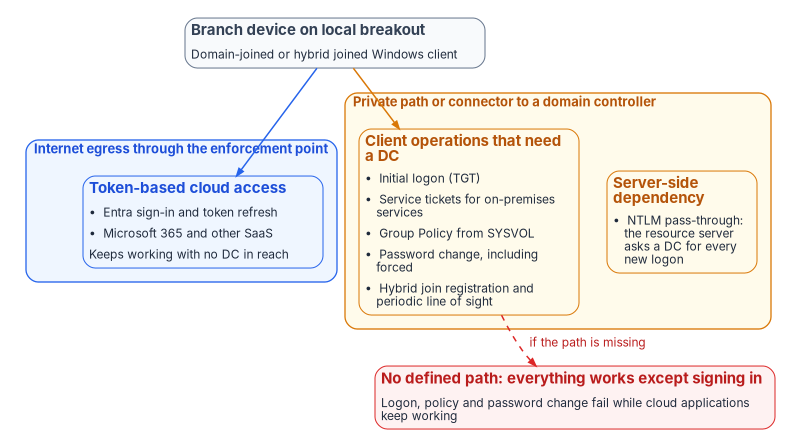
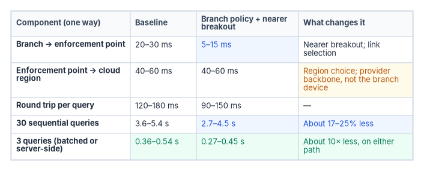

# Chapter 06 — Legacy Protocols on Re-Routed Paths

*Re-routing a branch breaks things for a short list of specific reasons; design around the list, not around the folklore.*

::: {.callout-note}
## In this chapter
What fails when traffic is proxied through an enforcement point or moved to a new path, and the one widely repeated mechanism that doesn't occur. What Kerberos and NTLM actually need from the network, and why a branch on local breakout can find that everything works except signing in. Why chatty applications are fixed by cutting round trips more than by changing transport. And where transport does matter for token-based access: queue priority and a stable, documented egress address that Conditional Access and continuous access evaluation can rely on.
:::

Long-lived, stateful sessions fail more often when an enforcement point sits in the path and when the path itself changes. Earlier versions of the program's own analysis said so correctly, then gave the wrong reasons: a TCP sequence-number break that doesn't happen, a Kerberos address check that Windows doesn't perform, a 5-millisecond domain controller requirement that doesn't exist and a 15-minute token refresh that no policy mandates. Wrong mechanisms produce wrong remedies. This chapter replaces them with the documented ones. [Chapter 05](05-sd-wan-sase-and-governed-transport.md) covers the transport and enforcement layers themselves; this chapter covers what the applications and protocols riding on them need.

{#fig-ch06-dc-dependencies fig-alt="A slate card for a domain-joined or hybrid joined Windows client at a branch on local breakout has two arrows. A blue arrow leads into a blue panel, internet egress through the enforcement point, holding token-based cloud access: Entra sign-in and token refresh, Microsoft 365 and other SaaS, which keep working with no domain controller in reach. An amber arrow leads into an amber panel, private path or connector to a domain controller, holding client operations that need a DC (initial logon TGT, service tickets for on-premises services, Group Policy from SYSVOL, password change including forced change, hybrid join registration and periodic line of sight) and a server-side dependency (NTLM pass-through, where the resource server asks a DC for every new logon). A dashed red arrow labeled if the path is missing leads to a red card: no defined path, everything works except signing in; logon, policy and password change fail while cloud applications keep working."}

## What actually breaks

These are the documented reasons sessions fail on proxied and re-routed paths:

- **Connection resets and idle timeouts.** An enforcement point that terminates and re-originates connections holds state on both sides and reaps idle connections on its own schedule. A database connection pool or thick client that assumes an idle connection stays open indefinitely will find it closed.
- **Certificate pinning and end-to-end mutual TLS.** TLS inspection works by decrypting and re-encrypting with the inspector's own certificate, so an application that pins a server certificate, or a protocol that requires mutual TLS end to end, fails when inspected. Microsoft's own inspection service handles this with bypass rules: the connection fails if inspection terminates a pinned application's traffic, so those destinations are excluded.[^c06-gsa-tls] This is a genuine incompatibility, not a tuning problem.
- **Authentication bound to the TLS channel.** Windows Extended Protection for Authentication can bind Kerberos or NTLM authentication to the outer TLS channel with a channel binding token. A proxy that terminates TLS changes the channel, and Microsoft lists NTLM authentication failures through proxy servers among the symptoms.[^c06-cbt]
- **Connection-oriented authentication over HTTP.** NTLM's challenge-response over HTTP takes several round trips on one connection, and the server keeps that connection open for the sequence. Proxies that don't preserve the client-to-server connection prevent it from working.[^c06-iis-ntlm]
- **Applications that key state to the client address.** Some applications tie session state, licensing, geolocation or authorization to the client IP. Behind a cloud enforcement point the client presents the point's egress address, and it may present a different one after a point-of-presence change. Microsoft's Delivery Optimization is a documented example: its service calls can't pass through a proxy that alters the client's IP address, because the service uses that address for geolocation and peer matching.[^c06-do]
- **Protocols the enforcement point can't parse.** Non-HTTP protocols may be passed through untouched, blocked or handed to a generic proxy that behaves differently from what the endpoints expect. Even within HTTP, an inspection service may not support every version; Microsoft documents that its TLS inspection doesn't negotiate HTTP/2, so HTTP/2-only sites need a bypass rule.[^c06-gsa-tls-limits]
- **Path changes that alter the effective MTU.** Classic path MTU discovery depends on ICMP "packet too big" messages. Where those are filtered, connections hang instead of failing cleanly,[^c06-pmtud] which presents as a stalled transfer rather than an outage and is correspondingly hard to diagnose.

### Address continuity, not sequence continuity

One widely cited mechanism doesn't occur. **A path change doesn't cause TCP sequence-number discontinuity.** A TCP connection is defined by its pair of sockets, and its sequence numbers live in the connection state each endpoint keeps.[^c06-tcp] The route packets take between the endpoints isn't part of that state. It follows that the earlier claim, that a proactive SD-WAN path switch preserves a session while a reactive router reroute terminates it, isn't true as a general statement.

What does break an established connection is a change in the address the server sees. If the new path egresses through a different NAT, the server receives segments from a socket that doesn't match the connection, and TCP's reset processing tears it down.[^c06-tcp] A re-route that leaves the apparent source address unchanged generally won't break it. **The operative property is address continuity**, and stating it correctly makes the case for a deterministic egress policy stronger, not weaker.

## Kerberos: the real dependencies

Kerberos is often described as breaking under source address translation. The usual version says Microsoft key distribution centers (KDCs) record the client's IP address in the ticket and reject tickets when NAT at a cloud point of presence changes it. **That doesn't happen under Microsoft's defaults.**

The protocol makes addresses optional. RFC 4120 defines the client address field in a ticket as optional: a ticket with no addresses can be used from any location, and because of NAT the RFC recommends that policy allow such tickets to be issued and accepted.[^c06-rfc4120] Where addresses are present, the check belongs to the application server processing the request, which returns `KRB_AP_ERR_BADADDR` on a mismatch; it isn't a KDC function.[^c06-rfc4120] Windows doesn't populate or enforce the field by default. `KdcUseClientAddresses`, which controls whether the KDC adds IP addresses to the service ticket reply, defaults to 0; `KdcDontCheckAddresses` defaults to 1; and the client-side `ClientIpAddresses` defaults to 0, which Microsoft attributes to DHCP and NAT.[^c06-kdc-keys] This is why Kerberos works across NAT in ordinary deployments.

Two timing figures that circulate are also wrong. There is no sub-5-millisecond round-trip requirement to a domain controller and no 5-millisecond Kerberos timeout. The figure they appear to come from is clock-skew tolerance, `SkewTime`, which defaults to 5 minutes.[^c06-kdc-keys] The Kerberos client waits 10 seconds for a KDC response by default and retries three times,[^c06-kdc-keys] which is a tolerance measured in seconds. Ticket lifetimes are long. The default domain policy sets the ticket-granting ticket (TGT) lifetime to 10 hours and its renewal period to 7 days,[^c06-maxticket][^c06-maxrenew] and service tickets to 600 minutes. A service ticket that expires during an authenticated connection doesn't interrupt it; tickets authenticate only new connections.[^c06-svcticket] Kerberos also travels well over modern paths: the Windows client has used TCP rather than UDP by default since Windows Vista,[^c06-kdc-keys] and RFC 4120 requires KDCs to accept TCP on port 88.[^c06-rfc4120]

### What genuinely needs a reachable domain controller

The list to design around is short and specific. Earlier versions of the program's analysis gave four items; the documented list is slightly longer.

1. **Initial TGT acquisition at logon**, including the first sign-in on a device. Kerberos contacts the KDC for a TGT when a user logs on with a network account.[^c06-kerb-ssp]
2. **Service tickets for on-premises services.** To reach an on-premises service, the client presents its TGT to the KDC and requests a service ticket for that service.[^c06-kerb-overview] Cached tickets cover repeat access within their lifetime, but the first access to each service needs a KDC, and so does TGT renewal.
3. **Group Policy retrieval from SYSVOL.**
4. **Password changes**, including expiry-forced changes, which cached credentials can't satisfy.
5. **Microsoft Entra hybrid join.** Registration needs line of sight to a domain controller, and hybrid joined devices need it periodically afterward. Microsoft names device password change, user password change with cached credentials and TPM reset as scenarios that break without it.[^c06-hybrid-plan]

Cloud access isn't on the list. After hybrid join completes and the user has signed in once, the device doesn't need a domain controller to reach cloud resources, except after a password change.[^c06-hybrid-faq]

A branch on local internet breakout whose domain controllers sit in a datacenter reaches them over whatever private path or connector the agency has provided, not over the enforcement point's internet egress. An architecture that leaves that path out breaks logon, policy and password change while cloud applications keep working. That asymmetry produces the characteristic report that "everything works except signing in," and it is a design question to settle explicitly for every branch.

### What happens when the KDC is out of reach: NTLM

When Kerberos can't reach a KDC, Windows falls back to the older NTLM authentication package and pass-through authentication.[^c06-kerb-ssp] The fallback is silent, and it moves the dependency rather than removing it. Under NTLM, the resource server must contact a domain controller for the account's domain every time it needs a new access token, whereas with Kerberos the server authenticates the client from the ticket alone, contacting a domain controller only to validate a privilege attribute certificate.[^c06-ntlm][^c06-kerb-overview] So a re-routed branch that hides the domain controllers from clients can quietly convert Kerberos traffic into NTLM, which the program is eliminating. [Book 06, Chapter 14](../b06-data-platform/14-ntlm-and-the-patterns-that-generate-it.md) tracks Microsoft's NTLM deprecation and the unreachable-domain-controller pattern as it appears in SQL Server connections; the network's job is not to create new instances of that pattern.

### Ways to provide the path

Three mechanisms can give a branch on local breakout a defined path to a domain controller. Which one fits is a design decision for each branch class.

- **A private path.** An MPLS circuit, an IPsec tunnel or an SD-WAN overlay carries domain controller traffic to the datacenter, separate from the internet egress.
- **A zero trust network access connector that publishes the domain controllers.** Microsoft Entra Private Access is one example: its Kerberos single sign-on guidance requires publishing the domain controllers, with Kerberos, NTP, LDAP, SMB, password change and Global Catalog ports, so clients can obtain tickets.[^c06-gsa-kerberos] The same guidance states that it covers single sign-on only and excludes the configuration domain-joined clients need for domain operations such as password change and Group Policy.[^c06-gsa-kerberos] Publishing the domain controllers for single sign-on doesn't by itself cover items 3 to 5 of the list above.
- **A Kerberos KDC proxy.** The KDC proxy protocol lets a client change passwords and obtain service tickets through a proxy server over HTTPS.[^c06-kkdcp] Windows clients use a configured KDC proxy for a domain when they can't locate a domain controller.[^c06-kdcproxy-policy]

The durable answer is to remove the dependency. Microsoft's own guidance, where the line-of-sight requirement is a concern, is to Microsoft Entra join devices instead.[^c06-hybrid-concept] [Book 05](../b05-devices/index.md) covers that transition.

### The corrected remediation

The audit the earlier analysis recommended asked whether the network was breaking a Kerberos address check. The right audit has three parts:

1. **Confirm the KDC address settings are at their defaults.** If a hardening baseline in the estate has set `KdcUseClientAddresses` or `KdcDontCheckAddresses` away from the defaults, that setting, not the network, is the exposure, and it should be reconsidered.
2. **Confirm every branch has a defined, monitored path to a domain controller** for each operation on the list above.
3. **Where applications key state to a client source address, establish a deterministic egress policy** so those applications see a stable address.

Only the third is a transport remedy, and it is the one a branch-edge policy layer actually delivers.

::: {.callout-warning}
## Illustrative, not tested against a production estate
The command below is a read-only example. Review it, and run it first against a test domain controller, before using it across an estate.
:::

```powershell
# Report the Kerberos address-handling values on a domain controller.
# An absent value means the default applies:
#   KdcUseClientAddresses = 0, KdcDontCheckAddresses = 1.
$kdc = 'HKLM:\SYSTEM\CurrentControlSet\Services\Kdc'
Get-ItemProperty -Path $kdc -ErrorAction SilentlyContinue |
    Select-Object KdcUseClientAddresses, KdcDontCheckAddresses
```

## Round trips dominate

Chatty database access over a long path is a real problem, and the arithmetic is worth doing carefully, because the earlier analysis drew conclusions its own inputs didn't support.

Take a branch with one-way latency of 20–30 ms to its enforcement or breakout point and 40–60 ms from there to the cloud region. One query's round trip is then 2 × (60–90 ms), or 120–180 ms. A transaction that issues 30 sequential queries spends 3.6–5.4 seconds on network latency before any database work. That is why chatty applications feel broken from branch offices.

The earlier analysis then claimed that SD-WAN-optimized routing to a nearby point of presence at 25 ms round trip would take the same transaction to 750 ms, a sixfold improvement. That can't happen. The path has two legs, and a branch-edge device acts on the first one only. The leg from the point of presence to the cloud region is set by geography and the provider's backbone, and no branch appliance deletes it. A 25 ms end-to-end round trip would require the cloud region to be about as close as the point of presence.

{#fig-ch06-round-trip-decomposition fig-alt="A table with four columns: component, baseline, branch policy plus nearer breakout, and what changes it. Branch to enforcement point, one way: 20 to 30 ms at baseline, 5 to 15 ms with branch policy and nearer breakout, changed by nearer breakout and link selection. Enforcement point to cloud region, one way: 40 to 60 ms in both cases, changed by region choice and the provider backbone, not the branch device. Round trip per query: 120 to 180 ms versus 90 to 150 ms. Thirty sequential queries: 3.6 to 5.4 seconds versus 2.7 to 4.5 seconds, about 17 to 25 percent less. Three queries, batched or server-side: 0.36 to 0.54 seconds versus 0.27 to 0.45 seconds, about ten times less on either path."}

*Inputs, stated so they can be replaced: 30 sequential round trips per transaction; one-way leg latencies as shown; no application change. These are illustrative design assumptions, not measurements; substitute values measured in your own estate, using the method in [Chapter 13](13-sequencing-cost-and-evidence.md).*

With branch-edge policy and a nearer breakout, the round trip falls to 2 × (45–75 ms), or 90–150 ms, and the 30-query transaction to 2.7–4.5 seconds: between 17 and 25 percent less. That is worth having, and it is what the intervention delivers. (Earlier versions put the gain at 20 to 25 percent; at the slow end of the range it is closer to 17.)

The larger gain is elsewhere. **Cutting the transaction from 30 sequential round trips to 3**, through batching, stored procedures or a server-side API, takes it to 0.36–0.54 seconds on today's path and 0.27–0.45 seconds with the branch improvement: about an order of magnitude either way. (Earlier versions gave 270–540 ms, which mixed the best case of one path with the worst case of the other.) Network work and application work aren't competing options here; the application change dominates. A business case that offers transport modernization as the cure for chattiness invites a reviewer to point that out. Where transport can't change at all, as in the interim posture of [Chapter 10](10-the-long-interim.md), cutting round trips is the only lever available.

One case is different, and many agencies are in it. A branch still hairpinning across the country to a central access point before reaching a cloud region has a first leg of 40–60 ms one way rather than 20–30. Replacing that hairpin with local breakout to a nearby point of presence recovers far more than the increment above, and that change, discussed in [Chapter 02](02-transport-is-physics-control-is-compliance.md), is where most of the available latency recovery already happened. The branch-edge layer is worth roughly the increment in the table, plus the governance and telemetry properties that are the real reason to deploy it.

## Token-based access and continuous verification

### What the policy says, and doesn't

Token-based authentication is the access mechanism for modern federal applications: OAuth 2.0 and OpenID Connect tokens from agency identity providers, SAML assertions from federation services and session tokens from zero trust access points. OMB M-22-09 requires phishing-resistant MFA for agency staff, contractors and partners, enforced at the application layer rather than the network layer.[^c06-m2209] [Chapter 03](03-what-tic-3-requires.md) covers the policy set in full.

**M-22-09 mandates no token lifetime.** Earlier versions of the program's analysis twice cited "the 15-minute token refresh cycles mandated by M-22-09." The memorandum contains no such mandate. What it says about sessions is that a zero trust architecture should be able to evaluate any active session continuously and, where it finds undue risk, respond by requiring reauthentication, limiting access or denying it.[^c06-m2209]

The intervals that do exist come from NIST SP 800-63B-4, *Digital Identity Guidelines: Authentication and Authenticator Management*, final July 2025.[^c06-sp80063b] It sets an overall reauthentication timeout that should be no more than 30 days at AAL1, no more than 24 hours at AAL2 with an inactivity timeout of no more than one hour, and no more than 12 hours at AAL3 (a "shall") with an inactivity timeout that should be no more than 15 minutes.[^c06-sp80063b-aal] Earlier versions of the analysis gave the publication's title as *Authentication and Lifecycle Management*; the title above is the published one.

On the platform side, Microsoft Entra access tokens are valid for one hour by default. In sessions where the client and service support continuous access evaluation (CAE), tokens can live up to 28 hours, because critical events and policy evaluation, not expiry, drive revocation. Critical events can take up to 15 minutes to propagate, while IP-location policy is enforced immediately.[^c06-cae] Zero trust didn't abolish sessions; it made them revocable. The design question at the branch isn't how to survive a refresh cycle that doesn't exist. It is whether the agency can see and revoke a session it issued, and whether the signals that drive revocation reach the enforcement point. [Book 04, Chapter 03](../b04-access/03-the-conditional-access-model.md) covers how Conditional Access and CAE evaluate those signals.

### Where transport actually matters

Authentication and token exchanges are small, latency-sensitive and on the critical path of every user interaction. Two properties of a branch-edge policy layer bear on them directly.

**Queue priority.** Small authentication exchanges that share an unmanaged queue with a backup job wait behind it. Classifying and prioritizing identity traffic where it enters the constrained link is straightforward and cheap, and it is impossible without a device there.

**Deterministic egress.** Conditional Access location policies, and CAE's enforcement of them, depend on the IP address that Microsoft Entra ID and each resource see. Microsoft documents that SD-WAN deployments, source NAT across load-balanced egress, proxies, split-tunnel VPNs and branches with direct internet access for some applications all produce "IP address variation," where the identity provider and the resource see different addresses.[^c06-cae] The consequences are concrete:

- When egress addresses are dedicated and enumerable for both sign-in and resource traffic, and named locations contain all of them, CAE enforces both critical events and location changes, with long-lived tokens.
- When resource traffic leaves through addresses that aren't dedicated or can't be enumerated, CAE enforces critical events only, and tokens fall back to the one-hour default. Microsoft warns against adding such shared addresses to trusted named locations, because doing so weakens security.[^c06-cae]
- CAE sees only IP-based named locations. Country-based locations and MFA trusted IPs aren't enforced in real time, and named locations totaling more than 5,000 IP ranges disable real-time location-change enforcement.[^c06-cae]
- Strict location enforcement, which blocks access as soon as the resource sees a disallowed address, requires that all sign-in and resource traffic leave through known, dedicated egress addresses. Microsoft advises against enabling it where traffic uses shared or undefinable egress.[^c06-cae-strict]

An egress address that changes unpredictably between sessions therefore produces both false risk detections and gaps in the location signal policy depends on. A stable, documented egress presentation for each branch makes location policies mean what they are written to mean. It is the same address-continuity property that keeps legacy sessions alive, serving the modern access model.

Token protection, a Conditional Access session control, approaches token replay from the other direction. It accepts only sign-in session tokens cryptographically bound to the device they were issued to, so a stolen token can't be used from another device, regardless of the network path it arrives on.[^c06-token-protection] It complements a stable egress rather than replacing it: one binds the token to a device, the other makes the network signal trustworthy.

Earlier versions also claimed "sub-10 ms path selection decisions by SD-WAN policy engines" and token-relay degradation of 250–400 ms. No source supports either figure, and both are removed. Where an agency needs such numbers, [Chapter 13](13-sequencing-cost-and-evidence.md) gives the method for measuring them in its own estate.

::: {.callout-note}
## What this chapter establishes
- Proxied and re-routed paths break sessions for documented reasons: idle timeouts, certificate pinning and mutual TLS, channel binding, connection-oriented HTTP authentication, address-keyed applications, unparsed protocols and MTU black holes.
- A path change doesn't break TCP sequence continuity; a change in the apparent source address does. Address continuity is the operative property.
- Windows Kerberos doesn't put client addresses in tickets or check them by default, has no millisecond-scale timing requirement and issues long-lived tickets.
- A short list of operations needs a reachable domain controller: initial logon, service tickets for on-premises services, Group Policy, password change and hybrid join. Every branch needs a defined path for them, or Kerberos quietly falls back to NTLM.
- For chatty applications, cutting round trips gains about an order of magnitude; branch transport improvements gain roughly 17 to 25 percent.
- No federal policy mandates a token lifetime. Transport matters to token-based access through queue priority and a stable, enumerable egress address that Conditional Access and CAE can rely on.
:::

::: {.callout-tip}
## Continue the book
[← Previous: Chapter 05 — SD-WAN, SASE and Governed-Path Transport](05-sd-wan-sase-and-governed-transport.md) · [Book index](index.md) · [Next: Chapter 07 — Network Access Control: 802.1X and RADIUS →](07-network-access-control.md)
:::

[^c06-gsa-tls]: Microsoft Learn, "Frequently asked questions for Transport Layer Security inspection," sections on certificate pinning and the system bypass list, <https://learn.microsoft.com/entra/global-secure-access/faq-transport-layer-security> (accessed Oct 21, 2026).
[^c06-cbt]: Microsoft Learn, "Authentication failure from non-Windows NTLM or Kerberos servers" (KB 976918; Extended Protection for Authentication and channel binding tokens; NTLM authentication failures from proxy servers), <https://learn.microsoft.com/troubleshoot/windows-server/windows-security/authentication-fails-non-windows-ntlm-kerberos-server> (accessed Oct 21, 2026).
[^c06-iis-ntlm]: Microsoft Learn, "IIS authenticates browser clients," section on Windows NT Challenge/Response (multiple round trips on one connection; some proxies prevent it from working), <https://learn.microsoft.com/troubleshoot/developer/webapps/iis/www-authentication-authorization/iis-authenticates-browser-client> (accessed Oct 21, 2026).
[^c06-do]: Microsoft Learn, "Using a proxy with Delivery Optimization," section "TLS inspection and certificate pinning" (service calls can't go through a proxy that alters the client's IP address), <https://learn.microsoft.com/windows/deployment/do/delivery-optimization-proxy> (accessed Oct 21, 2026).
[^c06-gsa-tls-limits]: Microsoft Learn, "What is Transport Layer Security inspection?," section "Known limitations" (no HTTP/2 negotiation; bypass HTTP/2-only sites), <https://learn.microsoft.com/entra/global-secure-access/concept-transport-layer-security> (accessed Oct 21, 2026).
[^c06-pmtud]: M. Mathis and J. Heffner, RFC 4821, *Packetization Layer Path MTU Discovery*, March 2007, section 2 (classical PMTUD fails with connection hangs when ICMP Packet Too Big messages aren't delivered), <https://www.rfc-editor.org/rfc/rfc4821.html> (accessed Oct 21, 2026).
[^c06-tcp]: W. Eddy, ed., RFC 9293, *Transmission Control Protocol (TCP)*, August 2022, sections 3.3.1 (connection state in the TCB), 3.4 and 3.4.1 (sequence numbers; a connection is defined by a pair of sockets) and 3.5.2 (reset generation), <https://www.rfc-editor.org/rfc/rfc9293.html> (accessed Oct 21, 2026).
[^c06-rfc4120]: C. Neuman, T. Yu, S. Hartman and K. Raeburn, RFC 4120, *The Kerberos Network Authentication Service (V5)*, July 2005, sections 3.2.3 (server address check, `KRB_AP_ERR_BADADDR`), 5.3 (`caddr` OPTIONAL; addressless tickets recommended because of NAT) and 7.2.2 (KDCs MUST accept TCP, port 88), <https://www.rfc-editor.org/rfc/rfc4120.txt> (accessed Oct 21, 2026).
[^c06-kdc-keys]: Microsoft Learn, "Kerberos protocol registry entries and KDC configuration keys in Windows" (`KdcUseClientAddresses` default 0; `KdcDontCheckAddresses` default 1; `ClientIpAddresses` default 0 because of DHCP and NAT; `SkewTime` default 5 minutes; `KdcWaitTime` 10 seconds; `KdcSendRetries` 3; `MaxPacketSize` 0 since Windows Vista so UDP is never used), <https://learn.microsoft.com/troubleshoot/windows-server/windows-security/kerberos-protocol-registry-kdc-configuration-keys> (accessed Oct 21, 2026).
[^c06-maxticket]: Microsoft Learn, "Max-Ticket-Age attribute" (10 hours in the Default Domain Policy), <https://learn.microsoft.com/windows/win32/adschema/a-maxticketage> (accessed Oct 21, 2026).
[^c06-maxrenew]: Microsoft Learn, "Max-Renew-Age attribute" (7 days in the Default Domain Policy), <https://learn.microsoft.com/windows/win32/adschema/a-maxrenewage> (accessed Oct 21, 2026).
[^c06-svcticket]: Microsoft Learn, "Maximum lifetime for service ticket" (Default Domain Policy 600 minutes; ongoing operations aren't interrupted when the ticket expires during the connection), <https://learn.microsoft.com/en-us/previous-versions/windows/it-pro/windows-10/security/threat-protection/security-policy-settings/maximum-lifetime-for-service-ticket> (accessed Oct 21, 2026).
[^c06-kerb-ssp]: Microsoft Learn, "Kerberos SSP/AP" (TGT obtained from the KDC at network logon; if a KDC isn't available, Windows uses MSV1_0 and pass-through authentication), <https://learn.microsoft.com/windows/win32/secauthn/kerberos-ssp-ap> (accessed Oct 21, 2026).
[^c06-kerb-overview]: Microsoft Learn, "Kerberos authentication overview in Windows Server," sections "How Kerberos authentication works" and "More efficient authentication to servers," <https://learn.microsoft.com/windows-server/security/kerberos/kerberos-authentication-overview> (accessed Oct 21, 2026).
[^c06-hybrid-plan]: Microsoft Learn, "Plan your Microsoft Entra hybrid join implementation," section "Prerequisites" (periodic line of sight; device password change, user password change and TPM reset break without it), <https://learn.microsoft.com/entra/identity/devices/hybrid-join-plan> (accessed Oct 21, 2026).
[^c06-hybrid-concept]: Microsoft Learn, "Microsoft Entra hybrid joined devices" (periodic line of sight required; without it devices become unusable; consider Microsoft Entra join if this is a concern), <https://learn.microsoft.com/entra/identity/devices/concept-hybrid-join> (accessed Oct 21, 2026).
[^c06-hybrid-faq]: Microsoft Learn, "Microsoft Entra device management FAQ," Microsoft Entra hybrid join FAQ (no line of sight needed for cloud resources after first sign-in, except when the password changes), <https://learn.microsoft.com/entra/identity/devices/faq> (accessed Oct 21, 2026).
[^c06-ntlm]: Microsoft Learn, "NTLM overview" (the resource server contacts a domain controller for a domain account whenever a new access token is needed), <https://learn.microsoft.com/windows-server/security/kerberos/ntlm-overview> (accessed Oct 21, 2026).
[^c06-gsa-kerberos]: Microsoft Learn, "Use Kerberos for single sign-on (SSO) to your resources with Microsoft Entra Private Access," section "Publish domain controllers," <https://learn.microsoft.com/entra/global-secure-access/how-to-configure-kerberos-sso> (accessed Oct 21, 2026).
[^c06-kkdcp]: Microsoft, [MS-KKDCP], *Kerberos Key Distribution Center (KDC) Proxy Protocol*, as summarized in Microsoft Learn, "Networking transport task protocols," <https://learn.microsoft.com/openspecs/document_programs/ms-docproglp/2aa736a8-0727-4748-afe9-941120f3f4ae> (accessed Oct 21, 2026).
[^c06-kdcproxy-policy]: Microsoft Learn, "Policy CSP - ADMX_Kerberos," setting KdcProxyServer ("Specify KDC proxy servers for Kerberos clients"), <https://learn.microsoft.com/windows/client-management/mdm/policy-csp-admx-kerberos> (accessed Oct 21, 2026).
[^c06-m2209]: Office of Management and Budget, M-22-09, *Moving the U.S. Government Toward Zero Trust Cybersecurity Principles*, January 26, 2022, identity actions (phishing-resistant MFA at the application layer) and section on user authorization (continuous evaluation of active sessions), <https://www.whitehouse.gov/wp-content/uploads/2022/01/M-22-09.pdf> (accessed Oct 21, 2026).
[^c06-sp80063b]: National Institute of Standards and Technology, SP 800-63B-4, *Digital Identity Guidelines: Authentication and Authenticator Management*, July 2025 (final, July 31, 2025), <https://csrc.nist.gov/pubs/sp/800/63/b/4/final> (accessed Oct 21, 2026).
[^c06-sp80063b-aal]: National Institute of Standards and Technology, SP 800-63B-4, "Authentication Assurance Levels," reauthentication requirements for AAL1, AAL2 and AAL3, <https://pages.nist.gov/800-63-4/sp800-63b/aal/> (accessed Oct 21, 2026).
[^c06-cae]: Microsoft Learn, "Continuous access evaluation" (one-hour default access token; up to 28 hours in CAE sessions; up to 15 minutes event propagation, instant IP-location enforcement; IP address variation table; supported location policies; 5,000-range limit), <https://learn.microsoft.com/entra/identity/conditional-access/concept-continuous-access-evaluation> (accessed Oct 21, 2026).
[^c06-cae-strict]: Microsoft Learn, "Strictly enforce location policies using continuous access evaluation (preview)," <https://learn.microsoft.com/entra/identity/conditional-access/concept-continuous-access-evaluation-strict-enforcement> (accessed Oct 21, 2026).
[^c06-token-protection]: Microsoft Learn, "Token Protection in Microsoft Entra Conditional Access," <https://learn.microsoft.com/entra/identity/conditional-access/concept-token-protection> (accessed Oct 21, 2026).
