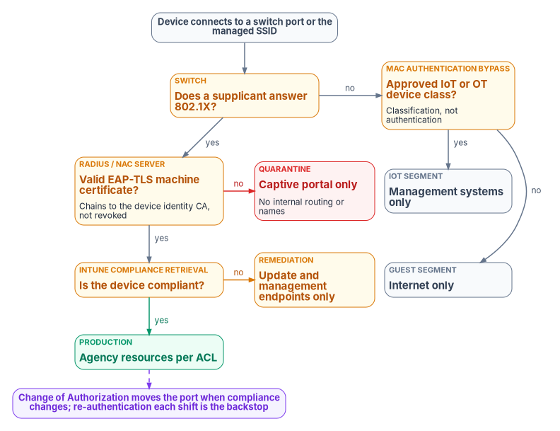
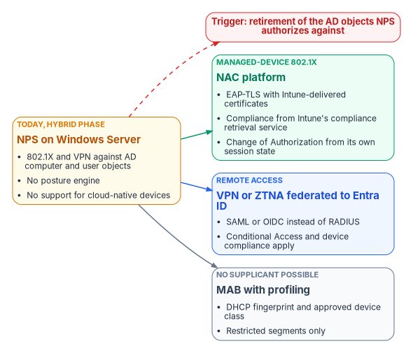
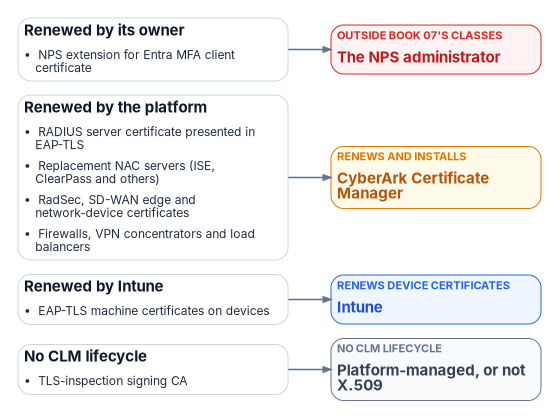

# Chapter 07 — Network Access Control: 802.1X and RADIUS

*Every token, policy and inspection point in this book assumes the device on the wire is the device it claims to be; 802.1X turns that assumption into a proof, and the RADIUS server that checks the proof is usually the last piece of the network still standing on Active Directory.*

::: {.callout-note}
## In this chapter
Why device admission is a separate control from user sign-in, and how 802.1X, EAP and RADIUS divide the work. Which EAP method to use and why password-based methods are now breaking on their own. Why Windows Network Policy Server (NPS) is an Active Directory dependency, what can replace it, and how Intune compliance becomes the posture signal. Then the policy tiers, the wired and wireless configuration, RADIUS transport security after Blast-RADIUS, the inventory and logging the design produces, a phased rollout, and the controls it closes.
:::

A device plugged into a conference-room jack in most federal buildings gets an address and a route before anyone asks who it is. Physical access controls are strong at the building door, but they aren't port authentication. Conference rooms are open to vendors and visitors with facility badges and no IT authorization. Wiring closets in older buildings often sit behind the same badge reader as the floor. Vacated office wings keep live switch ports for weeks or months. Hoteling desks have live ports by design, with a different occupant every day. Printers, badge readers, HVAC controllers and video endpoints share the switch fabric with workstations. Each of these is a working network connection with no authentication gate.

User identity doesn't close that gap. Consider two cases in a modernized estate. In the first, an attacker steals a user's credential and presents a valid Microsoft Entra ID token from an unmanaged laptop; Conditional Access requires a compliant device and refuses ([Book 04, Chapter 03](../b04-access/03-the-conditional-access-model.md)). In the second, the attacker skips the credential entirely and plugs the laptop into a jack. Without network access control the port issues a lease and routes traffic at once, and the window for reconnaissance, ARP and DNS poisoning and lateral scanning opens before any user control is involved. Network access control (NAC) closes the second case at the port. Zero Trust has to verify both the user and the device, independently, and NAC is the device half at the one place a connection is physically made.

The same function has a migration problem. NPS, the RADIUS server built into Windows Server, authenticates 802.1X wired and wireless access and VPN connections against Active Directory. Every access point, switch and VPN concentrator that sends it RADIUS requests is therefore an AD dependency. [Book 02, Chapter 04](../b02-identity/04-the-hidden-migration-surface.md) rates the RADIUS and NPS adapter as critical for that reason: if NPS goes away before its replacement is validated, the result is not a degraded experience but a total loss of network access. This chapter covers the design that replaces it. The Federal Compliance book on [network access control with 802.1X](https://github.com/WhalerMike/modernization-workbook/blob/main/docs/compliance/Vol_I_Book_02_Network_Access_Control_802_1X.md) carries the full engineering detail, including sample switch, wireless and query configurations; certificates are [Book 07](../b07-pki/06-device-and-user-certificates.md)'s subject.

{#fig-ch07-admission-decision fig-alt="Top to bottom, with the 802.1X path running down the left, each failed check branching to its right, and the MAC Authentication Bypass branch in a column on the far right. A slate pill: a device connects to a switch port or associates with the managed SSID. An amber question: does a supplicant answer the 802.1X request? If no, the switch falls back to MAC Authentication Bypass, an amber question asks whether the MAC matches an approved IoT or OT device class, yes leads to a slate IoT segment limited to its management systems, and no leads to a slate guest segment with internet only. If a supplicant answers, an amber question asks whether the EAP-TLS machine certificate is valid, chains to the device identity CA and is not revoked. No leads to a red quarantine segment with a captive portal and no internal routing. Yes leads to an amber question: is the device compliant in Intune? No leads to an amber remediation segment that can reach only management, update and antivirus endpoints. Yes leads to a green production segment with access governed by network ACLs. A dashed line from production leads to a violet note: Change of Authorization moves a port between segments when compliance changes, and re-authentication every shift is the backstop."}

## How port-based admission works

IEEE 802.1X-2020, *Port-Based Network Access Control*, is the current standard. It lets administrators restrict the use of LAN ports to authenticated and authorized devices, and it supersedes 802.1X-2010.[^c07-ieee8021x] It defines three roles in every admission event:

- The **supplicant** is software on the device. Windows has a built-in supplicant configured through Intune profiles; macOS uses its native supplicant through MDM; Linux commonly uses `wpa_supplicant`.
- The **authenticator** is the switch or wireless access point. It doesn't validate credentials. It relays the exchange and enforces the result it is given.
- The **authentication server** is the RADIUS server. It validates the credential and returns the decision: accept or reject, plus attributes such as a VLAN, a session timeout or a filter.

The exchange between supplicant and server is the Extensible Authentication Protocol (EAP). The authenticator carries EAP to the server inside RADIUS, and any RADIUS packet that carries an EAP-Message attribute must also carry a Message-Authenticator attribute.[^c07-rfc3579] RADIUS itself dates from 2000; its assigned authentication port is UDP 1812, and it protects responses with an MD5 hash computed over the packet and a shared secret.[^c07-rfc2865] That last detail matters later in this chapter.

### The voice VLAN precedent: assertion before proof

Network access control didn't begin with 802.1X. It began with the desk phone. When IP telephony arrived, a phone and a workstation had to share a wall jack while landing in different segments with different quality of service. The mechanism that solved it was DHCP. A phone booting on the data VLAN declared its class in its DHCP request, using option 60, the vendor class identifier, and the server answered with vendor-specific options that told it which VLAN to move to.[^c07-rfc2132] The switch authenticated nothing. The naming and addressing plane classified the device, and the network gave it a segment scoped to its function before it touched anything else.

That is the pattern this chapter generalizes: a device asserts an identity, an authoritative service classifies it, and the network admits it to a segment scoped to what it is. The precedent also carries the weakness that motivates the rest of the design. DHCP option steering is identity by assertion, not proof; any device can send a phone's vendor class string. That is acceptable when the worst outcome is mis-prioritized traffic and not acceptable when the worst outcome is an unauthorized device in a production segment. EAP-TLS replaces the assertion with a proof, a certificate whose private key never leaves the device. The assertion-based methods survive in two deliberately narrow roles below: MAC Authentication Bypass for devices that can't run a supplicant, and DHCP fingerprinting as a classification and anomaly signal.

## Choosing the EAP method

The program's position is EAP-TLS for every managed device. The comparison:

| EAP method | Credential | Client certificate | Program position |
|---|---|---|---|
| PEAP with MS-CHAPv2 | Password | No | Retire. MS-CHAPv2 is subject to the same attacks as NTLMv1, and Windows now blocks its single sign-on (below) |
| EAP-TTLS with PAP | Password | No | Don't use for managed devices; the password travels in the tunnel |
| PEAP with EAP-TLS | Certificate | Yes | Acceptable where a platform requires it; adds a tunnel EAP-TLS doesn't need |
| **EAP-TLS** | **Certificate** | **Yes** | **Required for managed devices: mutual certificate authentication** |

EAP-TLS authenticates both ends. The RADIUS server presents its certificate to the supplicant, and the supplicant presents a machine certificate to the server; neither side can be impersonated without the private key. RFC 9190 updates the original EAP-TLS specification, RFC 5216, for TLS 1.3, while RFC 5216 still governs earlier TLS versions.[^c07-rfc9190] Microsoft calls certificate-based EAP methods generally the most secure option and notes that EAP-TLS is the only EAP method allowed for WPA3-Enterprise 192-bit mode.[^c07-eap-windows] With strict server validation (a pinned root and named server certificates in the profile), EAP-TLS also defeats the rogue access point that offers a look-alike SSID and a self-signed certificate.

Two corrections to the source material belong here. NIST SP 800-120, *Recommendation for EAP Methods Used in Wireless Network Access Authentication*, was withdrawn in October 2018 as out of date, with readers directed to the relevant IETF standards; it can't be cited as current federal guidance.[^c07-sp800120] NIST SP 800-153, *Guidelines for Securing Wireless Local Area Networks*, remains final and gives configuration and monitoring recommendations for WLANs,[^c07-sp800153] but the claim that FedRAMP Moderate makes a FIPS-approved, mutual-certificate EAP method mandatory couldn't be traced to any FedRAMP or NIST text. EAP-TLS everywhere is the program's design position, grounded in the control requirements under [Controls](#the-controls-this-closes) below.

The password-based methods are also failing on their own schedule. Credential Guard is enabled by default on eligible devices upgraded to Windows 11, version 22H2, and on Windows Server 2025. With it on, MS-CHAPv2 can't use the signed-in credentials for single sign-on, so PEAP-MSCHAPv2 Wi-Fi and VPN connections prompt for a password or fail. Microsoft's resolution is to move to certificate-based authentication such as EAP-TLS or PEAP-TLS, which Credential Guard doesn't block.[^c07-credguard] Beginning with the October 2026 security update, Windows 11 versions 24H2 through 26H2 and Windows Server 2025 also restrict NTLMv1-derived credentials for single sign-on on devices *without* Credential Guard, which Microsoft warns can break Wi-Fi, Ethernet and VPN connections that use MS-CHAPv2.[^c07-ntlmv1-2026] Older NPS guidance still recommends PEAP-MSCHAPv2 for wireless,[^c07-nps-best] and agencies that followed it now have a deadline they didn't choose.

## The RADIUS server is the Active Directory dependency

NPS works today because most estates are hybrid-joined. It accepts an EAP-TLS or PEAP-TLS client certificate when the certificate is issued by an enterprise CA or maps to a user or computer account in Active Directory, and computer certificates are expected to carry the device's DNS name in the subject alternative name.[^c07-nps-certreq] Network policies typically authorize by the AD group membership of the computer or user. Microsoft's Entra join planning guidance states the consequence plainly: Microsoft Entra joined devices don't support RADIUS authentication that relies on an on-premises computer object and certificate, and the alternatives are certificates pushed by Intune or user credentials.[^c07-aadj-plan] An NPS server can only authorize a cloud-native device through workarounds such as placeholder computer objects in AD, which the program treats as unsustainable at fleet scale. NPS's usefulness therefore shrinks in direct proportion to the progress of the AD-to-Entra migration.

Three more facts limit NPS as a target:

- **Entra ID has no RADIUS service.** The NPS extension for Microsoft Entra multifactor authentication adds a second factor, but NPS still performs primary authentication against AD before handing off. Microsoft recommends federating VPNs to Entra ID with SAML instead, so they get Conditional Access, MFA and device compliance.[^c07-radius-entra] The source registry's "entra-radius" cloud proxy doesn't exist as a Microsoft product; [Book 02, Chapter 04](../b02-identity/04-the-hidden-migration-surface.md) records the same correction.
- **NPS has no posture engine.** Network Access Protection, which once made NPS a health evaluator, was deprecated in Windows Server 2012 R2 and isn't available in Windows Server 2016 or later.[^c07-nps-overview] NPS is also absent from the list of NAC products that integrate with Intune's compliance service (next section).[^c07-intune-nac] The source's "NPS Extension for Intune NAC" isn't a real component; it has been removed.
- **NPS is a Windows Server role with Windows Server constraints.** It isn't available on Server Core installations.[^c07-nps-overview] Configuration doesn't replicate between servers; it is exported and imported as XML with `Export-NpsConfiguration` and `Import-NpsConfiguration`, and the exported file contains RADIUS shared secrets in clear text, so it has to be stored and moved like a secret.[^c07-nps-export]

None of this means NPS must be ripped out on day one. The program's decision, carried in the Federal Compliance book as governance decision D3, is that the RADIUS platform is gated by the Entra migration timeline, not by preference. An agency can run NPS through the hybrid-joined phase, and the hybrid configuration should be done well (two servers in each region, every RADIUS client configured with primary and secondary, configuration synchronized by export and import, and an alert when accounting from a production authenticator stops for more than five minutes). But the D3 decision record must name the migration trigger, and the replacement must authorize Entra-native devices before cloud-native cutover retires the AD computer objects NPS depends on.

{#fig-ch07-radius-target fig-alt="Left to right. An amber card, today: NPS on Windows Server, authenticating 802.1X and VPN against Active Directory computer and user objects, with no posture and no cloud-native device support. Three arrows lead to three target cards. Wired and wireless 802.1X for managed devices goes to a green card: a NAC platform that authenticates EAP-TLS with Intune-delivered certificates and reads compliance from Intune's compliance retrieval service. Remote access goes to a blue card: VPN or ZTNA federated to Microsoft Entra ID with SAML so Conditional Access applies. Devices that cannot run a supplicant go to a slate card: MAC Authentication Bypass with profiling into restricted segments. A dashed red line from the NPS card leads to a red note: the trigger for each move is the retirement of the AD objects NPS authorizes against, not a date."}

### What can replace it

| Option | What it is | Entra-joined devices | Posture from Intune | Where it runs and how it is authorized |
|---|---|---|---|---|
| NPS on Windows Server | Built-in RADIUS server and proxy | Only through AD workarounds | No | Agency-operated inside the boundary; the hybrid-phase interim |
| On-premises NAC platform (examples: Cisco ISE 3.1 and later, Aruba ClearPass with the Intune extension v6 and later, Forescout eyeExtend, Fortinet FortiNAC) | Customer-deployed RADIUS and policy engine | Yes, by certificate and Intune device ID | Yes, through the compliance retrieval service[^c07-intune-nac] | Agency-operated software, assessed as a component of the agency system; no FedRAMP listing applies |
| Cloud-delivered NAC or RADIUS service | Vendor-operated RADIUS, often with a cloud PKI | Yes | Depends on the product (Portnox Cloud is on Intune's partner list)[^c07-intune-nac] | Must hold a FedRAMP authorization at the right impact level; see below |
| VPN or ZTNA federated to Entra ID | Removes RADIUS from remote access | Yes | Yes, through Conditional Access | The access broker's own authorization; [Chapter 05](05-sd-wan-sase-and-governed-transport.md) covers SASE |

Cloud-delivered RADIUS is the option most constrained by authorization status, so state it precisely. As of October 21, 2026, the FedRAMP Marketplace lists no Portnox, SecureW2 or HPE Aruba cloud offering. IronWiFi's "Cloud RADIUS and Wi-Fi Authentication Platform" is listed at *Initial Implementation*, entered August 13, 2026, with no certification class. Juniper Mist is *FedRAMP Certified* at Class C (Moderate), certified March 28, 2025, but its Marketplace description covers wireless, wired and SD-WAN operations and doesn't name a cloud NAC or RADIUS service. Cisco Meraki US Government Region is certified at Class C (February 18, 2025), and Forescout for Government at Class D (High, March 20, 2026).[^c07-fedramp] A listed offering covers only what is inside its authorized boundary, so the agency has to confirm that the specific RADIUS or NAC function it plans to use is part of the certified service before it designs around it. [Chapter 03](03-what-tic-3-requires.md) explains the 2026 vocabulary, in which "authorization" became "certification" and impact levels became certification classes.

## Posture comes from Intune, not from a probe

The program uses Intune device compliance as the posture signal instead of an inline NAC probe. A second agent or agentless probe would be a second management plane that has to be reconciled with the MDM inventory, with its own false positives and negatives. Intune's compliance policy already evaluates the controls a probe would check (patch level, antivirus, encryption) on every enrolled Windows and macOS device. [Book 05](../b05-devices/04-intune-first-onboarding.md) owns those policies. The NAC minimum the program asks for is OS patches current within 30 days, BitLocker on with the recovery key escrowed to Entra ID, Microsoft Defender Antivirus on with definitions current within seven days, Secure Boot, a TPM, and the firewall on for every profile.

The integration point is Intune's **compliance retrieval service**, which replaced the legacy Intune NAC service in 2021; Intune supported the legacy service only through March 31, 2024.[^c07-intune-nac] It works like this:

1. The NAC product is registered with Microsoft Entra ID and granted delegated permissions to the Intune NAC API.
2. The NAC product is configured with the Intune discovery URL and for certificate authentication.
3. When a device connects to Wi-Fi or VPN, the NAC product asks Intune for the device's enrollment and compliance state, and redirects an unenrolled or noncompliant device to enrollment or remediation.[^c07-intune-nac]

The service requires certificate-based authentication with the **Intune device ID in the certificate's subject alternative name**, as a URI value defined by the NAC vendor; Microsoft's example is `IntuneDeviceId://{{DeviceID}}`. Querying by MAC address is the fallback where certificates can't be used. The service returns the compliance state, whether Intune manages the device, the MAC address and the Intune device ID.[^c07-intune-nac] The source's certificate profile put `{{DeviceId}}@<tenant>` in a UPN-type SAN and had NPS validate it against Entra ID through Graph; that design matched no documented integration and is corrected here. The SAN format belongs in the SCEP or PKCS profile, which [Book 07, Chapter 06](../b07-pki/06-device-and-user-certificates.md) covers.

Two timing facts shape the enforcement design. First, posture is only as fresh as Intune's knowledge of the device. Intune's estimated maintenance check-in is about every eight hours, and a device gets at most one maintenance sync every 6.5 hours.[^c07-intune-refresh] For Windows, Intune also supports client-driven compliance evaluation: the device watches certain settings (firewall, antivirus, BitLocker, Defender status, OS build, real-time protection, Secure Boot) and requests a check-in when one changes, which shortens the lag considerably for those settings.[^c07-intune-wincomp] Second, the compliance retrieval service throttles broad queries. A NAC product may make as many single-device queries as it needs, but an unfiltered "all noncompliant devices" query should run at most once every four hours; more frequent calls get HTTP 503.[^c07-intune-nac]

## Change of Authorization

Re-authentication alone would leave a device that fails compliance mid-shift on the production VLAN until its session expires. RADIUS Change of Authorization (CoA), defined in RFC 5176, closes that window: a dynamic authorization client sends a CoA-Request or Disconnect-Request to the authenticator, by default on UDP port 3799. RFC 5176 is an Informational RFC, not a standard.[^c07-rfc5176] Ports vary in practice; Cisco's Catalyst 1300 switches, for example, listen for CoA on UDP 1700 by default and support Cisco ISE as their only dynamic authorization client.[^c07-cisco-coa] Check every authenticator model's port and supported clients before writing firewall rules.

Dedicated NAC platforms issue CoA from their own session state. Microsoft's NPS documentation describes no dynamic authorization client function, so the program treats NPS as unable to initiate CoA. The source design routed around that gap with a purpose-built cloud function that polled Intune and sent CoA to switches. If an agency builds one, it is real engineering:

- **Network path.** The function needs reachability to the CoA port on every switch's management interface, a cloud-to-management-plane path that must be firewalled to exactly that flow.
- **Authenticator trust.** Every switch must trust the function as a dynamic authorization client, with its own shared secret under the same rotation regime as the RADIUS secrets.
- **Session identity.** A CoA must carry the attributes that identify the session (Calling-Station-Id, NAS-IP-Address, Acct-Session-Id), which exist only in RADIUS accounting. The accounting feed stops being telemetry and becomes enforcement infrastructure, with Tier 0-adjacent integrity and availability requirements.
- **Throttling.** The source design polled every 15 minutes for devices whose state had changed. A broad noncompliant-devices query at that rate exceeds the compliance retrieval service's four-hour limit;[^c07-intune-nac] a poller has to work device by device or use another Microsoft-supported interface with its own limits.

The engineering cost of that list is one of the strongest arguments for a NAC platform in the D3 decision. Whatever issues the CoA, state its timing honestly. "Within 20 minutes" means 20 minutes after Intune registers the state change, and Intune's own evaluation can lag the device. The bound that always holds is the re-authentication backstop below: even with the CoA path down, no noncompliant device survives past the next re-authentication.

## The policy tiers

The RADIUS server returns a VLAN (and optionally a filter and a session timeout) for every authenticated device. The VLAN is the enforcement: it decides which segment the device enters and what it can reach. The VLAN numbers below are the program's examples.

| Tier | Example VLAN | Condition | Network access |
|---|---|---|---|
| Production | 100–190, by department | Valid certificate and Intune compliant | Agency resources, governed by network ACLs |
| Remediation | 200 | Valid certificate, Intune noncompliant | Intune, Windows Update and Defender update endpoints, and DNS for those names only |
| Quarantine | 999 | No certificate, unknown CA, expired or revoked | Captive portal only; no internal routing or internal name resolution |
| Guest | 500 | MAC Authentication Bypass, unmanaged device | Internet only |
| IoT and OT | 300 | MAC Authentication Bypass, approved device class | That device class's management systems only |

A device reaches production only by passing two independent checks: a certificate that is valid, issued by the device identity CA and not revoked, and a compliant state in Intune. A device that passes the first and fails the second goes to remediation, never silently to production. The remediation segment lets the device fix itself: updates install, definitions refresh, Intune re-evaluates, and CoA moves the port back without a reconnect. Build its allow list from Microsoft's published endpoint lists for the tenant's cloud rather than from a copied list of host names, because the endpoints differ between commercial, GCC and GCC High clouds ([Chapter 12](12-microsoft-365-traffic.md) covers how those lists are maintained).

Quarantine catches devices that fail certificate authentication entirely. A captive portal tells the person at the keyboard that the device isn't authorized and to contact the help desk, which prevents a flood of "the network is down" tickets.

### MAC Authentication Bypass

Devices that can't run a supplicant, such as IP phones, printers, badge readers, cameras and HVAC controllers, are admitted by MAC Authentication Bypass (MAB): when the 802.1X timeout expires with no answer, the switch sends the device's MAC address to the RADIUS server as the credential. The policy matches it against approved device-class prefixes (to the IoT segment) and lets everything else fall to guest.

::: {.callout-warning}
## MAB is classification, not authentication
MAC addresses are trivially spoofed. An attacker who learns an approved device's MAC address can claim its segment. Restrict MAB to device classes where a supplicant is technically impossible, keep the IoT segment's routing to the minimum each class needs, and require 802.1X for every class that can do it.
:::

### Session timers

| Parameter | Program value | Purpose |
|---|---|---|
| Session-Timeout | 28,800 seconds (8 hours) | Re-authenticate once per shift: re-check the certificate and compliance even with no CoA |
| Termination-Action | RADIUS-Request | Re-authenticate rather than disconnect at timeout |
| Idle-Timeout | 1,800 seconds (30 minutes) | Release ports whose device has gone quiet |

A device compliant at 08:00 that fails a check at 14:00 lands in remediation by 16:00 at the latest, and much sooner when CoA is working and Intune has registered the change.

## Certificates and supplicant profiles

EAP-TLS needs a machine certificate on every managed device, in the computer store rather than the user store so that authentication works before anyone signs in, with its key generated on the device and held in the TPM where one exists. The RADIUS server trusts the device identity issuing CA; Microsoft Cloud PKI or AD CS through the Intune certificate connector can issue it, and the EAP-TLS exchange is the same either way. [Book 07, Chapter 06](../b07-pki/06-device-and-user-certificates.md) covers the trusted root, SCEP and PKCS profiles, revocation and renewal; [Book 07, Chapter 07](../b07-pki/07-coexistence-and-migration.md) covers the RADIUS server's own certificate, which stays on AD CS while NPS remains, requested and renewed through CyberArk Certificate Manager with the network team as its owner ([Book 07, Chapter 05](../b07-pki/05-who-owns-the-certificate-estate.md)). Two operational rules from the source carry forward: revoke a device's certificate in the same change window as a wipe or decommission, and publish CRLs over HTTP so every RADIUS server can reach them.

Intune delivers the supplicant configuration. Wi-Fi and wired network profiles for Windows let the administrator pick EAP-TLS, name the expected RADIUS server certificate names, choose the trusted root profiles used to validate the server, and select the SCEP or PKCS certificate profile the device presents.[^c07-intune-wifi][^c07-intune-wired] Deploy the network profile, the certificate profile and the trusted root profile to the same groups.[^c07-intune-wired-howto] One wired setting deserves a warning of its own. When the Windows wired profile's 802.1X setting is *Enforce*, Wired AutoConfig requires 802.1X on the port, and if the profile doesn't match the network the device loses network access, can't fetch a corrected profile, and needs the policy removed by hand.[^c07-intune-wired] Pilot it on a small group, and keep it at *Do not enforce* until the switch side is in enforcement for that site.

## Wired and wireless

Wired 802.1X goes on every access port that faces an end device. Uplinks and trunks between switches are excluded and depend on the physical security of the infrastructure. The setting that matters most for rollout is multi-authentication mode: a phone in the wall jack and a PC daisy-chained behind it authenticate independently, the phone by MAB to the voice segment and the PC by EAP-TLS to the data segment, on the same physical port.

::: {.callout-warning}
## Illustrative configuration
The switch configuration below is a vendor-specific illustration from the program's design, not tested against a production network. Command syntax differs across platforms and software releases; check it against your vendor's documentation and test in monitor mode before enforcing anything.
:::

```text
! Example access port facing an endpoint (Cisco IOS XE style)
interface GigabitEthernet1/0/1
 switchport mode access
 switchport access vlan 10              ! fallback only; 802.1X overrides it
 authentication port-control auto       ! enable 802.1X on the port
 authentication host-mode multi-auth    ! phone and PC authenticate separately
 authentication order dot1x mab         ! try 802.1X first, then MAB
 authentication priority dot1x mab      ! 802.1X wins when both are present
 dot1x pae authenticator
 dot1x timeout tx-period 10
 dot1x max-reauth-req 3
 spanning-tree portfast
 ip dhcp snooping limit rate 15
```

Wireless uses the same supplicant and certificates, with the access point or wireless controller as authenticator. The managed SSID should be WPA3-Enterprise. The source described it as "SAE plus EAP-TLS"; that is a mix-up. Simultaneous Authentication of Equals (SAE) is WPA3-Personal. WPA3-Enterprise uses IEEE 802.1X, like WPA2-Enterprise, with mandatory server certificate validation and protected management frames.[^c07-wpa3-enum] The source's claim that WPA3-Enterprise eliminates KRACK-class attacks has also been removed; it couldn't be verified as stated. WPA3-Enterprise 192-bit mode is a stricter variant aligned with the CNSA suite that permits only EAP-TLS with restricted cipher suites.[^c07-eap-windows] Windows 11 supports WPA3-Enterprise with enhanced server certificate validation and TLS 1.3 for EAP-TLS, and Microsoft notes that Wi-Fi 7 for enterprise requires WPA3-Enterprise.[^c07-win-netsec] Personal devices and visitors get a separate guest SSID on its own VLAN with no route to agency resources.

## Securing RADIUS itself

RADIUS over UDP protects its responses with MD5, and in 2024 that became exploitable. Blast-RADIUS (CVE-2024-3596) lets an attacker positioned between a RADIUS client and server forge an Access-Accept for a failed login, without learning the credential or the shared secret. Nearly all RADIUS-over-UDP implementations were affected for non-EAP methods such as PAP; EAP is largely protected because the Message-Authenticator attribute that RFC 3579 requires can't be forged. The short-term mitigation is to require Message-Authenticator on all requests and responses; the long-term one is to run RADIUS inside TLS.[^c07-blastradius] For NPS, Microsoft's KB5040268 adds settings to send and require Message-Authenticator and to drop unprotected responses from remote RADIUS servers. All of them are off by default, and Microsoft recommends turning them on for unsecured networks.[^c07-kb5040268] NPS already requires Message-Authenticator for EAP clients by default.[^c07-nps-clients] The program turns the KB5040268 settings on everywhere, because a RADIUS client that sends PAP for a single legacy device is enough to expose that path.

The program's rules for the rest of the trust chain:

- **Shared secrets.** One secret per authenticator, 32 or more characters of cryptographic randomness, stored in a managed secret store and rotated every 180 days.
- **RADIUS over TLS where firmware supports it.** RadSec replaces the shared-secret-and-MD5 model between authenticator and server with mutual TLS. Its original specification, RFC 6614 (2012), is Experimental. The standards-track replacement for RADIUS over TLS and DTLS was in IESG evaluation as a Proposed Standard as of September 2026, and RFC 9765 (RADIUS/1.1, April 2025, Experimental) removes MD5 by negotiating a new version over TLS.[^c07-radext] Prefer RadSec on new equipment and record where it isn't available.
- **Refresh.** CISA's BOD 26-02 requires agencies to inventory and replace end-of-support edge devices, which it defines to include switches and wireless access points, but only devices that sit on the agency's network boundary; it sets decommissioning milestones at 12 and 18 months from February 5, 2026.[^c07-bod2602] Interior access switches may fall outside that scope, so don't assume the directive funds the access layer. Where a refresh does happen, specify 802.1X, RadSec, CoA and WPA3-Enterprise support in the purchase ([Chapter 09](09-who-owns-the-network.md) assigns who writes that requirement).

## Inventory, profiling and logs

The naming and addressing plane and NAC complete each other. [Book 08](../b08-ddi/index.md) makes DHCP, DNS and IPAM authoritative; this chapter annotates that record with the identity each device proved, or didn't.

- **Profiling.** DHCP fingerprinting classifies devices that can't run a supplicant by the pattern of options they request, so MAB policy can assign a segment by device type rather than by MAC prefix alone. The same signal catches anomalies: a valid agency certificate presented by a device whose fingerprint matches no managed platform suggests a certificate copied off a managed device.
- **The inventory record.** When a device is placed in a segment, IPAM records its MAC address, its DNS name, the VLAN and address it received, the time and lease, and the NAC result (certificate SAN and compliance verdict). That record covers managed and unmanaged devices alike.
- **Closing the static-address bypass.** A device with a manually configured address never touches DHCP. On enforced segments 802.1X quarantines it regardless of how it addressed itself, and DHCP snooping with IP source guard drops traffic from addresses that have no lease ([Book 08, Chapter 05](../b08-ddi/05-edge-interception-and-bypass.md) covers rogue DHCP defenses). With that bypass closed, DHCP is the only working way to get an address, and IPAM annotated with NAC results becomes the one record that enumerates every component.

RADIUS accounting records every Start, Interim-Update and Stop with the MAC address (Calling-Station-Id), switch and port (NAS-IP-Address, NAS-Port), the result, the VLAN (Tunnel-Private-Group-ID), the rejection reason and the certificate identity, and the program forwards it to the agency SIEM. Three detections are the minimum: a device in a production VLAN whose Intune state isn't compliant; repeated 802.1X failures from one MAC address in an hour, which suggests a rogue device or an expired certificate; and a valid device certificate presented from a MAC address that doesn't match the enrolled device, which suggests certificate theft and should trigger quarantine. The Federal Compliance book gives sample queries; adapt their table and field names to the agency's own log schema, since they depend on how accounting is ingested.

## Rolling it out

Turning on enforcement before every device is enrolled is how a NAC program causes an outage: printers, badge readers and anything else that can't run a supplicant lose connectivity at once. The program's sequence runs four phases over roughly 90 to 180 days, and it sits inside the RADIUS migration sequence in [Book 02, Chapter 04](../b02-identity/04-the-hidden-migration-surface.md) (inventory every RADIUS client and policy, run old and new in parallel, cut clients over, and decommission NPS only after a 30-day validation window).

1. **Monitor mode (weeks 1–4).** Run 802.1X on every port in open mode: the exchange happens, RADIUS returns accept or reject, and the switch ignores the reject. Log everything. The phase ends with a baseline: devices that passed EAP-TLS and were compliant, passed but noncompliant, had no supplicant and fell to MAB, had missing or expired certificates, and unrecognized MAB devices. That baseline decides Phase 2 readiness and seeds the exception list.
2. **Wired enforcement (weeks 5–10).** Remove open mode from workstation ports. Re-push certificate profiles to devices with expired certificates, register every approved IoT and OT device with a device-class tag in IPAM, stand up the captive portal, enable and test CoA, and turn on the detections with alert routing to the SOC.
3. **Wireless enforcement (weeks 11–14).** Push the WPA3-Enterprise profile through Intune, let devices move to the new SSID with their machine certificates, and retire the legacy SSID once the logs show every managed device has moved. Deploy the guest SSID in parallel.
4. **IoT segmentation and hardening (weeks 15–20).** Tighten the IoT segment's ACLs per device class (phones to the voice gateway, badge readers to the access control server), make IPAM registration a prerequisite for any new MAB approval, and run a tabletop in which a rogue device is plugged into a conference-room port: the quarantine fires, the SOC is alerted, and CoA responds.

For assessors, the program keeps RADIUS accounting exports (90 days, per the agency's AU-11 retention), Intune compliance reports for NAC-enrolled devices, the DHCP audit log for NAC-controlled scopes, and the Phase 1 baseline report.

## The controls this closes

| Control | Before | After |
|---|---|---|
| IA-3 Device identification and authentication | A port can't tell a managed device from an unauthorized one | Every device presents an EAP-TLS machine certificate, checked against the device identity CA and Intune, before it gets a routed address |
| IA-3(1) Cryptographic bidirectional authentication | No mutual device-to-network authentication | The RADIUS server and the device each prove possession of a certificate's private key |
| AC-3 Access enforcement | Policy is enforced only once a device has layer 3 connectivity | Policy is enforced at the port, before connectivity |
| AC-18(1) Wireless access: authentication and encryption | The managed SSID admits anything that knows the passphrase | WPA3-Enterprise with EAP-TLS admits only enrolled devices with valid certificates |
| AC-19 Access control for mobile devices | Personal devices reach the managed SSID | Unmanaged devices can't authenticate and are pointed to guest |
| AC-20 Use of external systems | Vendor laptops in conference rooms are treated as agency devices | Vendor devices are quarantined unless an approved, time-limited exception exists |
| SC-7(5) Deny by default, allow by exception | Unauthenticated devices get whatever the port's VLAN offers | The default is quarantine; access requires a successful authentication |
| CM-6, CM-7 Configuration settings, least functionality | A noncompliant device reaches production; IoT devices move laterally | Noncompliant devices go to remediation; each IoT class reaches only its management systems |
| CM-8 System component inventory | Unmanaged devices appear in no inventory | Every connection produces an accounting record tied to an IPAM lease |

IA-3 asks the system to uniquely identify and authenticate devices before establishing a local, remote or network connection, and NIST's discussion names IEEE 802.1X with EAP and a RADIUS server with EAP-TLS as example mechanisms.[^c07-sp80053] The connection is made at exactly one place, the port or the wireless association, so the authentication has to interpose there. A scanner finds a device only after it has connected, an MDM agent reports only from devices already enrolled, and a firewall evaluates packets from devices already admitted. For remote devices there is no agency port to interpose at; IA-3 is met at the access broker instead, as the next section explains.

One correction to the source's control table: it listed **SC-7(3) Access Points** as closed by making every switch port an enforcement point. SC-7(3) actually requires limiting the number of *external network connections* to the system, and NIST's discussion cites the Trusted Internet Connections initiative as its example.[^c07-sp80053] Switch ports aren't what it means. SC-7(3) belongs with the TIC and branch-egress discussion in [Chapter 03](03-what-tic-3-requires.md), and the row has been replaced here with AC-18(1), which is the wireless control this design does close.

## From port to token

Every admission decision in this chapter answers three questions: is the device known, is its identity proven, and is its posture current? What changes across the rest of the book is where the answer is enforced. At the port it is enforced by a VLAN, and that enforcement is location-bound by construction; it protects the wire and only the wire. When the same device reaches an application through a cloud front door or a Zero Trust Network Access broker, the port's verdict is out of scope. The broker asks the same three questions at every request and enforces the answer in a token: the device certificate becomes a claim, the Intune compliance state becomes a claim, and Conditional Access carries both to the resource ([Book 04, Chapter 03](../b04-access/03-the-conditional-access-model.md)). [Chapter 04](04-logical-centralization-and-token-security.md) explains why that token is what lets the network stop being the trust boundary, and [Chapter 05](05-sd-wan-sase-and-governed-transport.md) covers the SASE layer that enforces it for branches and remote users.

This is a continuum, not a replacement. The machine certificate provisioned for the RADIUS exchange is the same certificate, from the same pipeline and with the same TPM-bound key and revocation, that the identity plane uses elsewhere. The port remains the enforcement point for the one layer no token reaches, the physical wire, while the token carries the same device identity everywhere the wire doesn't go.

## Certificates in this book and the CLM platform {#certificates-and-the-clm-platform}

[Book 07](../b07-pki/index.md) gives each class of certificate one issuer and one renewal engine, and makes CyberArk Certificate Manager, Self-Hosted the system of record for every certificate that Intune and the PIV system don't manage ([Chapter 04](../b07-pki/04-the-target-pki.md), [Chapter 05](../b07-pki/05-who-owns-the-certificate-estate.md)). The certificates this book's systems depend on map to it as follows; [Book 07, Appendix C](../b07-pki/appendix-c-anatomy-of-the-clm-platform.md) describes the platform itself.

| Certificate | Book 07 class | Issued by | Renewed by | What the CLM platform does |
|---|---|---|---|---|
| RADIUS server certificate presented in EAP-TLS | RADIUS and 802.1X servers | Retained AD CS | CyberArk Certificate Manager | Renews it; CAPI driver on NPS, then re-select it in the NPS policy (inference) |
| Replacement NAC servers (ISE, ClearPass and others) | RADIUS and 802.1X servers | Retained AD CS | CyberArk Certificate Manager | No listed driver: EST, SCEP or an Adaptable driver (inference) |
| RadSec, SD-WAN edge and network-device certificates | Internal server TLS | Retained AD CS | CyberArk Certificate Manager | EST or SCEP enrollment from the devices |
| Firewalls, VPN concentrators and load balancers | Internal server TLS | Retained AD CS or public CA | CyberArk Certificate Manager | F5, NetScaler and Palo Alto drivers |
| EAP-TLS machine certificates on devices | Device and user auth (Intune) | Cloud PKI or AD CS through the connector | Intune | Nothing: Intune renews them |
| TLS-inspection signing CA | Not a Book 07 class | Not stated | Platform-managed, or not X.509 | Not a Book 07 class; treat as a subordinate CA (inference) |

{fig-alt="RADIUS server certificate presented in EAP-TLS, Replacement NAC servers (ISE, ClearPass and others), RadSec, SD-WAN edge and network-device certificates, Firewalls, VPN concentrators and load balancers go to CyberArk Certificate Manager (renews and installs); EAP-TLS machine certificates on devices go to Intune (renews device certificates); TLS-inspection signing CA go to Platform-managed, or not X.509 (no clm lifecycle)."}

The network team owns the RADIUS and NAC server certificates, and the CLM platform renews them ([Book 07, Chapter 05](../b07-pki/05-who-owns-the-certificate-estate.md)).[^clm-capi][^clm-est][^clm-drivers][^clm-pan]


::: {.callout-tip}
## Continue the book
[← Previous: Chapter 06 — Legacy Protocols on Re-Routed Paths](06-legacy-protocols-on-re-routed-paths.md) · [Book index](index.md) · [Next: Chapter 08 — Reference Architecture: Consistency Classes Meet Network Classes →](08-reference-architecture.md)
:::

[^c07-ieee8021x]: IEEE, IEEE 802.1X-2020, *IEEE Standard for Local and Metropolitan Area Networks—Port-Based Network Access Control*, approved January 30, 2020, published February 28, 2020, <https://standards.ieee.org/ieee/802.1X/7345/> (accessed Oct 21, 2026).
[^c07-rfc3579]: B. Aboba and P. Calhoun, RFC 3579, *RADIUS (Remote Authentication Dial In User Service) Support For Extensible Authentication Protocol (EAP)*, September 2003, section 3.3, <https://www.rfc-editor.org/rfc/rfc3579.html> (accessed Oct 21, 2026).
[^c07-rfc2865]: C. Rigney et al., RFC 2865, *Remote Authentication Dial In User Service (RADIUS)*, June 2000, <https://www.rfc-editor.org/rfc/rfc2865.html> (accessed Oct 21, 2026).
[^c07-rfc2132]: S. Alexander and R. Droms, RFC 2132, *DHCP Options and BOOTP Vendor Extensions*, March 1997, sections 8.4 and 9.13, <https://www.rfc-editor.org/rfc/rfc2132.html> (accessed Oct 21, 2026).
[^c07-rfc9190]: J. Preuß Mattsson and M. Sethi, RFC 9190, *EAP-TLS 1.3: Using the Extensible Authentication Protocol with TLS 1.3*, February 2022, <https://www.rfc-editor.org/rfc/rfc9190.html> (accessed Oct 21, 2026).
[^c07-eap-windows]: Microsoft Learn, "Extensible Authentication Protocol (EAP) for network access," sections "Authentication methods" and "WPA3-Enterprise 192-bit mode," <https://learn.microsoft.com/windows-server/networking/technologies/extensible-authentication-protocol/network-access> (accessed Oct 21, 2026).
[^c07-sp800120]: National Institute of Standards and Technology, SP 800-120, *Recommendation for EAP Methods Used in Wireless Network Access Authentication*, September 2009, withdrawn October 19, 2018, <https://csrc.nist.gov/pubs/sp/800/120/final> (accessed Oct 21, 2026).
[^c07-sp800153]: National Institute of Standards and Technology, SP 800-153, *Guidelines for Securing Wireless Local Area Networks (WLANs)*, February 2012, <https://csrc.nist.gov/pubs/sp/800/153/final> (accessed Oct 21, 2026).
[^c07-credguard]: Microsoft Learn, "Considerations and known issues when using Credential Guard," sections "Upgrade considerations," "Wi-fi and VPN considerations" and "Known issues," <https://learn.microsoft.com/windows/security/identity-protection/credential-guard/considerations-known-issues> (accessed Oct 21, 2026).
[^c07-ntlmv1-2026]: Microsoft Learn, "Windows message center," announcement "Take action: NTLMv1 hardening changes might affect network connections on devices without Credential Guard," October 14, 2026, citing KB5066470, <https://learn.microsoft.com/windows/release-health/windows-message-center> (accessed Oct 21, 2026).
[^c07-nps-best]: Microsoft Learn, "Network Policy Server Best Practices," section "Authentication," <https://learn.microsoft.com/windows-server/networking/technologies/nps/nps-best-practices> (accessed Oct 21, 2026).
[^c07-nps-certreq]: Microsoft Learn, "Configure Certificate Templates for PEAP and EAP requirements," section "Minimum client certificate requirements," <https://learn.microsoft.com/windows-server/networking/technologies/nps/nps-manage-cert-requirements> (accessed Oct 21, 2026).
[^c07-aadj-plan]: Microsoft Learn, "How to: Plan your Microsoft Entra join implementation," section "RADIUS and Wi-Fi authentication," <https://learn.microsoft.com/entra/identity/devices/device-join-plan#understand-considerations-for-applications-and-resources> (accessed Oct 21, 2026).
[^c07-radius-entra]: Microsoft Learn, "RADIUS authentication with Microsoft Entra ID," <https://learn.microsoft.com/entra/architecture/auth-radius> (accessed Oct 21, 2026).
[^c07-nps-overview]: Microsoft Learn, "Network Policy Server overview," sections "NPS features" and "Windows Server installation options and NPS," <https://learn.microsoft.com/windows-server/networking/technologies/nps/nps-top> (accessed Oct 21, 2026).
[^c07-intune-nac]: Microsoft Learn, "Network access control (NAC) integration with Intune," including "How the NAC integration works," "Enable NAC" and "Data shared with NAC partners," <https://learn.microsoft.com/intune/device-security/integrate-network-access-control> (accessed Oct 21, 2026).
[^c07-nps-export]: Microsoft Learn, "Export an NPS Configuration for Import on Another Server," <https://learn.microsoft.com/windows-server/networking/technologies/nps/nps-manage-export>, and "Export-NpsConfiguration," <https://learn.microsoft.com/powershell/module/nps/export-npsconfiguration> (accessed Oct 21, 2026).
[^c07-fedramp]: FedRAMP Marketplace product data, `products.json`, records FR2631154499 (IronWiFi), FR2102758152 (Juniper Mist), FR2315535023 (Cisco Meraki US Government Region) and FR2523857656 (Forescout for Government), data last changed October 21, 2026, <https://www.fedramp.gov/marketplace/products.json> (accessed Oct 21, 2026).
[^c07-intune-refresh]: Microsoft Learn, "Common questions, answers, and scenarios with policies and profiles in Microsoft Intune," section "Policy refresh intervals," <https://learn.microsoft.com/intune/device-configuration/troubleshoot-device-profiles#policy-refresh-intervals> (accessed Oct 21, 2026).
[^c07-intune-wincomp]: Microsoft Learn, "Device compliance settings for Windows in Intune," section "How compliance calculation is triggered on Windows devices," <https://learn.microsoft.com/intune/device-security/compliance/ref-windows-settings> (accessed Oct 21, 2026).
[^c07-rfc5176]: M. Chiba et al., RFC 5176, *Dynamic Authorization Extensions to Remote Authentication Dial In User Service (RADIUS)*, January 2008, <https://www.rfc-editor.org/rfc/rfc5176.html> (accessed Oct 21, 2026).
[^c07-cisco-coa]: Cisco, "Configure Change of Authorization on a Catalyst 1300 Switch through the Web UI," <https://www.cisco.com/c/en/us/support/docs/smb/switches/Catalyst-switches/kmgmt3734-configure-change-of-authorization-catalyst-web-ui.html> (accessed Oct 21, 2026).
[^c07-intune-wifi]: Microsoft Learn, "Add Wi-Fi settings for Windows devices in Intune," section "Enterprise profile," <https://learn.microsoft.com/intune/device-configuration/templates/ref-wifi-settings-windows> (accessed Oct 21, 2026).
[^c07-intune-wired]: Microsoft Learn, "Add wired network settings for Windows devices in Microsoft Intune," section "Wired Network," <https://learn.microsoft.com/intune/device-configuration/templates/ref-wired-network-settings-windows> (accessed Oct 21, 2026).
[^c07-intune-wired-howto]: Microsoft Learn, "Add and use wired networks settings on your devices in Microsoft Intune," section "Create the profile," <https://learn.microsoft.com/intune/device-configuration/templates/configure-wired-networks> (accessed Oct 21, 2026).
[^c07-wpa3-enum]: Microsoft Learn, "NetworkAuthenticationType Enum," fields `Wpa3Sae` and `Wpa3Enterprise`, <https://learn.microsoft.com/uwp/api/windows.networking.connectivity.networkauthenticationtype> (accessed Oct 21, 2026).
[^c07-win-netsec]: Microsoft Learn, "Network security" (Windows security book), section "Wi-Fi connections," <https://learn.microsoft.com/windows/security/book/operating-system-security-network-security> (accessed Oct 21, 2026).
[^c07-blastradius]: Blast-RADIUS research team, "Blast-RADIUS," CVE-2024-3596, <https://blastradius.fail/> (accessed Oct 21, 2026).
[^c07-kb5040268]: Microsoft Support, "KB5040268: How to manage the Access-Request packets attack vulnerability associated with CVE-2024-3596," for Windows updates released on or after July 9, 2024, <https://support.microsoft.com/en-us/servicing/os/windows/2024/06/kb5040268-how-to-manage-the-access-request-packets-attack-vulnerability-associated-with-cve-2024-359> (accessed Oct 21, 2026).
[^c07-nps-clients]: Microsoft Learn, "RADIUS Clients," section "Message Authenticator attribute," <https://learn.microsoft.com/windows-server/networking/technologies/nps/nps-radius-clients> (accessed Oct 21, 2026).
[^c07-radext]: Internet Engineering Task Force, RADIUS EXTensions (radext) working group documents, listing RFC 6614 (Experimental, May 2012), RFC 9765 (Experimental, April 2025) and draft-ietf-radext-radiusdtls-bis (IESG evaluation, Proposed Standard), <https://datatracker.ietf.org/wg/radext/documents/> (accessed Oct 21, 2026).
[^c07-bod2602]: Cybersecurity and Infrastructure Security Agency, BOD 26-02, *Mitigating Risk From End-of-Support Edge Devices*, February 5, 2026, <https://www.cisa.gov/news-events/directives/bod-26-02-mitigating-risk-end-support-edge-devices> (accessed Oct 21, 2026).
[^c07-sp80053]: National Institute of Standards and Technology, SP 800-53 Rev. 5, *Security and Privacy Controls for Information Systems and Organizations*, controls IA-3, IA-3(1), AC-18(1) and SC-7(3), <https://csrc.nist.gov/pubs/sp/800/53/r5/upd1/final>; control text checked against the release 5.2.0 OSCAL catalog, <https://github.com/usnistgov/oscal-content/blob/main/nist.gov/SP800-53/rev5/json/NIST_SP-800-53_rev5_catalog.json> (accessed Oct 21, 2026).
[^clm-capi]: CyberArk, Certificate Manager, Self-Hosted 26.1, "CAPI" application driver (installs certificates and keys into the Windows CAPI store over WinRM, optionally binds IIS, and can grant a named Windows identity read access to the private key), <https://docs.venafi.com/Docs/current/TopNav/Content/Drivers/cco-CAPI-AppDriverConfig-tpp.php> and <https://docs.venafi.com/Docs/current/TopNav/Content/Drivers/r-CAPI-AppObjSettings-tpp.php> (accessed Oct 23, 2026).
[^clm-est]: CyberArk, 26.1, "EST" (Enrollment over Secure Transport on TCP 50443) and "System requirements" (SCEP, Network Device Enrollment, on port 80), <https://docs.venafi.com/Docs/current/TopNav/Content/Devices/cco-devices-est-about.php> and <https://docs.venafi.com/Docs/current/TopNav/Content/Install/r-install-SysReq-ALLVenProducts.php> (accessed Oct 23, 2026).
[^clm-drivers]: CyberArk, 26.1, "System requirements," supported applications (F5 BIG-IP LTM Advanced, NetScaler, Palo Alto NGFW, Apache/PEM, Java keystores, PKCS#12, Azure Key Vault, AWS and others) and the Server Agent, <https://docs.venafi.com/Docs/current/TopNav/Content/Install/r-install-SysReq-ALLVenProducts.php> (accessed Oct 23, 2026).
[^clm-pan]: CyberArk, 26.1, "Palo Alto Networks" application driver (manages the appliance's own device certificates and its trust store; decryption keys go through bulk provisioning), <https://docs.venafi.com/Docs/current/TopNav/Content/Drivers/cco-PaloAltoNetworks-AppDriverConfig.php> (accessed Oct 23, 2026).
