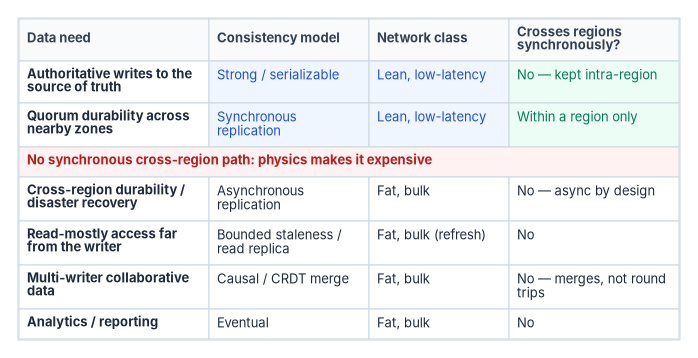
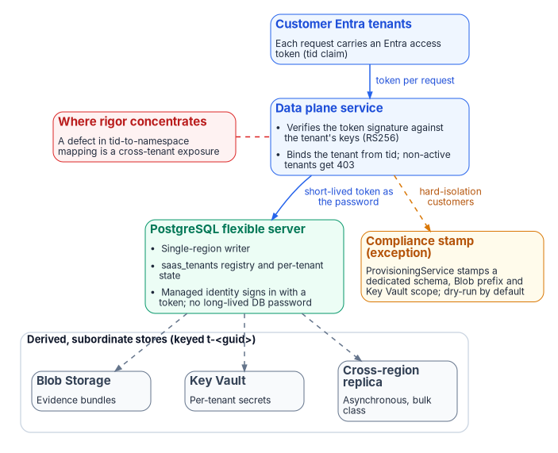
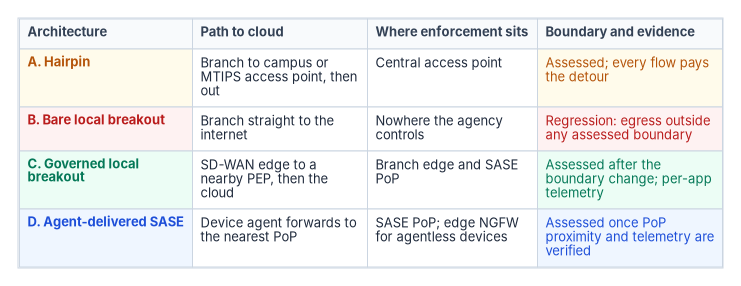

# Chapter 08 — Reference Architecture: Consistency Classes Meet Network Classes

*The data layer and the network layer are answering the same question from opposite ends, and the architecture works only where their answers agree.*

::: {.callout-note}
## In this chapter
The single design rule that ties the data layer to the network layer, and the mapping from each kind of data flow to a lean or bulk network class. The program's multitenant SaaS data plane as the worked example: one regional writer, token security on both sides, derived stores, a provisioned exception, and the narrow place where differentiated transport would matter. Four branch egress architectures (hairpin, bare local breakout, governed local breakout and agent-delivered SASE) compared on path, enforcement and evidence. Then the five decisions that carry most of the risk, each with how to check it.
:::

The preceding chapters argued a doctrine in pieces. Centralize the truth and distribute the copies ([Chapter 04](04-logical-centralization-and-token-security.md)). Let token security make the central store safe to share. Refuse to span the speed of light synchronously ([Chapter 01](01-why-physics-decides-the-architecture.md)). Use SD-WAN to take the paths you keep down to the floor, and SASE to make the traffic on them lawful ([Chapter 05](05-sd-wan-sase-and-governed-transport.md)). This chapter puts the pieces together twice: once for a data plane, where the question is which flows may cross a region synchronously, and once for a branch office, where the question is where traffic leaves the building and what enforces policy when it does. The same rule governs both.

## The single design rule

::: {.callout-important}
## Align consistency class with transport class.
The data layer asks what must be strongly consistent and what can be eventually consistent. The network layer asks what rides the lean, low-latency path and what rides the fat, bulk path. They are the same question viewed from opposite sides. When the answers agree, a design gets the best synchronization physics permits. When they disagree, it pays for the mismatch.
:::

A mismatch costs in both directions. Strong-consistency traffic on the bulk path inherits the bulk path's latency and tail, and every commit waits on it. Trivial asynchronous replication on the premium path wastes the scarce resource the quorum actually needs. The architecture works when each class of data rides the class of transport built for it.

## The mapping

[Chapter 04](04-logical-centralization-and-token-security.md) gave the decision procedure: identify the single authoritative writer, choose the weakest consistency each reader and writer tolerates, then match each flow to a network class. Applied to the common data needs, the third step produces this layout:

| Data need | Consistency model | Network class | Crosses regions synchronously? |
|---|---|---|---|
| Authoritative writes to the source of truth | Strong or serializable | Lean, low-latency | No; kept inside a region |
| Quorum durability across nearby zones | Synchronous replication | Lean, low-latency | Within a region only |
| Cross-region durability and disaster recovery | Asynchronous replication | Fat, bulk | No; asynchronous by design |
| Read-mostly access far from the writer | Bounded staleness or read replica | Fat, bulk (refresh) | No |
| Multi-writer collaborative data | Causal or CRDT merge | Fat, bulk | No; merges, not round trips |
| Analytics and reporting | Eventual | Fat, bulk | No |

The pattern is stark: only the top two rows ride the lean path, and neither crosses a region synchronously. Everything that spans distance is asynchronous and rides the bulk path. That is the physics of [Chapter 01](01-why-physics-decides-the-architecture.md) made into a layout.

{#fig-ch08-consistency-network-classes fig-alt="A table of six data needs. Authoritative writes (strong or serializable) and quorum durability across nearby zones (synchronous replication) ride the lean low-latency path and stay within a region. A red divider row states there is no synchronous cross-region path because physics makes it expensive. Cross-region disaster recovery, read-mostly access far from the writer, multi-writer collaborative data and analytics use asynchronous replication, bounded staleness, causal or CRDT merge, and eventual consistency on the fat bulk path, none of them crossing regions synchronously."}

Managed databases document the same split as service behavior. Azure Database for PostgreSQL flexible server, the store in the worked example below, lists high availability within a region with a recovery point objective of zero, while its cross-region read replicas are updated asynchronously and Microsoft gives their RPO as typically 30 seconds to 5 minutes.[^c08-pgbc] Microsoft says replica lag across regions is typically at least several minutes and can be longer, depends on write load and the latency between primary and replica, and that replicas aren't intended for synchronous scenarios that need up-to-the-minute accuracy.[^c08-pgrel][^c08-pgrr] The lean path, in other words, is a zone-to-zone path inside a region; the bulk path is everything else.

Three placement techniques make the mapping concrete:

- **Voting members on the lean links, learners on the bulk links.** In Raft-based systems a learner replicates from the leader but can neither vote nor count toward quorum; etcd's design adds learners as non-voting members for exactly this reason.[^c08-etcd] Put voters where the paths are short so the fastest links decide the quorum, and put learners across regions for durability and read scale without dragging the quorum across a continent.
- **Merge rather than coordinate for genuinely multi-writer data.** Conflict-free replicated data types let replicas accept writes locally and converge deterministically, under conditions Shapiro and colleagues formalized.[^c08-crdt] Cross-region traffic becomes a bulk-class merge stream, not a lean-class round trip.
- **Spend clock certainty only where strong cross-region semantics are required.** Clock-based ordering of the Spanner kind ([Chapter 05](05-sd-wan-sase-and-governed-transport.md)) replaces round trips with bounded clock uncertainty, and the clock traffic belongs on the lean class. It is the exception, not the default.

The output is a layout in which the lean path carries a small volume of latency-critical, intra-region consensus and clock traffic, and the bulk path carries everything that spans distance, which by design tolerates latency.

## Worked example: the program's SaaS data plane

The program offers governance as a service: many customer Microsoft Entra tenants governed by one operated service. Its SaaS architecture decision had to answer this book's central question, one shared store or many, and chose deliberately. The decision, paraphrased: one shared, elastically scaled data plane with strong per-tenant data-namespace isolation, plus a control plane that can stamp dedicated resources where a customer's compliance posture requires it. The durable tenant registry and per-tenant state live in a single PostgreSQL flexible server, and a `data_namespace` derived from each tenant's directory GUID is the isolation handle. That is logical centralization with a deliberate physical-isolation escape hatch, written down as an accepted decision before this book named the doctrine.

| Doctrine | The program's realization | Where it's decided |
|---|---|---|
| One logical source of truth | A single PostgreSQL flexible server holds the `saas_tenants` registry and per-tenant state | SaaS architecture decision |
| Token security, inbound | Per-request verification of the Entra token's signature against the issuing tenant's keys (RS256) and of its `tid` claim; tenants not onboarded or not active get 403 | SaaS architecture decision, security section |
| Token security, outbound | Passwordless sign-in: a short-lived Entra token used as the PostgreSQL password; no long-lived database secret exists | Passwordless database authentication decision |
| Distribute the copies | Evidence bundles in Blob Storage and per-tenant secrets in Key Vault, keyed by the same namespace | SaaS architecture decision |
| Compliance-stamped exception | The control plane's `ProvisioningService` stamps a dedicated schema, Blob prefix and Key Vault scope for hard-isolation customers | SaaS architecture decision |
| Refuse to span light synchronously | Single-region writer; no global synchronous multi-writer commit path exists | Single flexible server |
| Sovereign-cloud readiness | Token audience and issuer, Graph and Azure Resource Manager resolution branch per cloud | Authentication layer |

{#fig-ch08-saas-data-plane fig-alt="Customer Entra tenants send a token per request to the data plane service, which verifies the token signature against the tenant's keys (RS256), binds the tenant from the tid claim and rejects non-active tenants with 403. It signs in to a single-region PostgreSQL flexible server with a short-lived token as the password; the server holds the saas_tenants registry and per-tenant state, and its managed identity signs in with a token so no long-lived database password exists. Dashed arrows lead to derived, subordinate stores keyed t-guid: Blob Storage for evidence bundles, Key Vault for per-tenant secrets and an asynchronous, bulk-class cross-region replica. A dashed amber arrow leads to the compliance stamp exception, where ProvisioningService stamps a dedicated schema, Blob prefix and Key Vault scope, dry-run by default, for hard-isolation customers. A red note marks the tid-to-namespace mapping as where rigor concentrates, because a defect there is a cross-tenant exposure."}

### One registry, one writer

The tenant registry is the system of record for who is onboarded and in what state. A tenant is identified by its Entra directory GUID and moves through an explicit lifecycle (`PENDING → ACTIVE → SUSPENDED → ACTIVE`, or on to `DEPROVISIONED`), and illegal transitions are rejected at the model boundary. There is exactly one authoritative copy of that truth. Evidence in Blob and secrets in Key Vault are keyed by a namespace derived deterministically from the tenant GUID (`t-<guid>`), so the derived stores are subordinate pointers to the registry, never independent sources of it.

Because the writer is in one region, the strong-consistency path never crosses a continent. That isn't a limitation to engineer away. At single-region distances strong consistency costs little, so the program takes it, and the first two rows of the mapping table are satisfied by the database's in-region high availability rather than by anything the WAN does.

### Token security on both sides

[Chapter 04](04-logical-centralization-and-token-security.md) explains the mechanism; the worked example shows where it sits. Inbound, the service never trusts a caller because of where it connects from. It validates each Entra token against the issuing tenant's published keys and binds the tenant from `tid`, which is what Microsoft's guidance requires of a multitenant API: check that `tid` matches the tenant the data was stored under, and never let one tenant's data be reached from another.[^c08-claims] Outbound, the service's managed identity is the database's Entra administrator and connects with an access token in the password field, so no credential sits in code or configuration.[^c08-pgmi] The token provider caches and refreshes the token off the connection hot path and never presents one about to expire. The same connection seam accepts an AWS RDS IAM token, whose lifetime is 15 minutes, so passwordless sign-in isn't tied to one cloud.[^c08-rds]

### The escape hatch, and the trigger to revisit

The program doesn't pretend physical centralization suits every customer. A customer whose compliance posture can't accept shared-plane, in-code isolation gets a stamp: a dedicated schema, Blob prefix and Key Vault scope, provisioned by the control plane. Provisioning is dry-run by default, so the stamp executor only plans until a concrete executor is injected in production, which makes the control plane safe to exercise in CI. A government tenant plan and per-cloud token audiences exist for customers under stricter boundaries; Azure Database for PostgreSQL's Entra token resource differs between clouds, which is why the audience has to be resolved per cloud rather than hard-coded.[^c08-pgentra] Sovereign SaaS itself is a future decision and a named review trigger.

The decision also writes "scale up before scaling out" into its own expiry conditions. One stated review trigger is the tenant registry outgrowing a single PostgreSQL flexible server. The architecture stays on one writer until a measured limit forces a change, rather than sharding pre-emptively against a hypothetical one.

### Where SD-WAN would enter, and where it wouldn't

Because the data plane has one writer in one region, there is no global synchronous commit path for SD-WAN to optimize; the design already removed the workload that would need it. Differentiated transport would matter in exactly two bulk-class places:

- **Cross-region disaster-recovery replication** of the registry, asynchronous by design. SD-WAN would improve its lag and resilience, not its correctness.
- **Read-replica and evidence freshness** for tenants far from the home region, read at bounded staleness.

The day a sovereign-cloud stamp needs a second region that must stay in sync, the full toolkit of [Chapter 05](05-sd-wan-sase-and-governed-transport.md) becomes load-bearing: path classes, FEC for the commit tail, a lean class for clock traffic. Until then, the program's answer to the speed-of-light tax is the cheapest one available: don't span it synchronously in the first place. The proposed next step is orthogonal to the data topology. Governing the path itself, with token-bound tunnels and a `DRIFT-TRANSPORT` finding class, would hold the network that carries the program's claims to the same per-call standard as the data plane ([Chapter 05](05-sd-wan-sase-and-governed-transport.md), "The governed path").

### The one risk, named plainly

Tenant isolation on the shared plane is enforced in code, by tenant-resolution middleware and namespace scoping, so the blast radius lives in that code path, and the decision record lists it as a negative trade-off ([Chapter 04](04-logical-centralization-and-token-security.md), "The risk it imports"). The database topology isn't where this architecture can quietly fail; the tenant-resolution path is. The single highest-value verification for the whole design is a test that no code path lets a validated `tid` for tenant A address tenant B's `data_namespace`.

## Branch architectures

At a branch office the rule changes vocabulary but not shape. The lean class is interactive traffic, voice, sign-in and the few Active Directory operations that still need a reachable domain controller ([Chapter 06](06-legacy-protocols-on-re-routed-paths.md)). The bulk class is backups, patch waves and content distribution ([Chapter 11](11-field-office-wan-transformation.md)). The question the branch adds is where traffic leaves and what enforces policy when it does. Four architectures cover the options in practice.

{#fig-ch08-branch-architectures fig-alt="A table of four branch architectures. A, hairpin, in amber: the path runs from the branch to the campus or an MTIPS access point and then out; enforcement sits at the central access point; the boundary is assessed but every flow pays the detour. B, bare local breakout, in red: the branch goes straight to the internet; enforcement sits nowhere the agency controls; it is a regression, with egress outside any assessed boundary. C, governed local breakout, in green: an SD-WAN edge sends traffic to a nearby policy enforcement point and then the cloud; enforcement sits at the branch edge and the SASE point of presence; the boundary is assessed after the boundary change and per-application telemetry exists. D, agent-delivered SASE, in blue: a device agent forwards to the nearest point of presence; enforcement sits at the SASE point of presence, with an edge firewall for agentless devices; the boundary is assessed once point-of-presence proximity and telemetry are verified."}

**A. Hairpin.** Branch traffic travels to the agency campus or a managed access point and leaves from there. It is the TIC 2.0 shape: CISA's SASE guide describes legacy architectures in which branch offices and remote users tunnel to the agency's MTIPS provider, and lists the cost first among the challenges: backhaul increases contention and latency.[^c08-cisasase] The boundary is assessed and the telemetry reaches CISA. Every flow pays the detour, and [Chapter 01](01-why-physics-decides-the-architecture.md) works through what that does to a one-way voice budget. Microsoft defines the same thing from the other side: a hairpin happens when traffic bound for a destination is first sent to an intermediate location such as a security stack or cloud gateway.[^c08-m365]

**B. Bare local breakout.** A direct internet circuit with a router and nothing else. It fixes the latency and loses the boundary: a branch moved from a hairpin to ungoverned local breakout has lost assessed boundary protection relative to where it started. This is a compliance regression with better latency, and [Chapter 02](02-transport-is-physics-control-is-compliance.md) explains why no transport choice closes the gap.

**C. Governed local breakout.** An SD-WAN edge at the branch steers each class: lean traffic to a nearby enforcement point and on to the cloud, bulk traffic where it's cheapest, campus-bound traffic over the overlay. Enforcement is split between the branch edge and a SASE PoP close to the office. This is the TIC 3.0 Branch Office Use Case implemented with an edge, and it is the program's reference pattern. Its requirement is the one [Chapter 05](05-sd-wan-sase-and-governed-transport.md) drew from the use case: every path class lands on enforcement of equal strength.

**D. Agent-delivered SASE.** Agents on managed devices send traffic to the nearest SASE PoP regardless of where the device is, and a branch firewall forwards traffic for devices that can't run an agent; CISA's notional architecture describes both.[^c08-cisasase] It suits small sites and roaming users and needs little branch hardware. Its blind spots are the agentless devices, path quality between the branch and the PoP, and the PoP's distance, which is a physics decision like any other.

The four map onto the TIC 3.0 Branch Office Use Case's own options. For branch-to-cloud and branch-to-web traffic it describes direct access with enforcement at the branch (and the cloud service), access through the agency campus, and access through a CASB or other security-as-a-service provider; for branch-to-campus traffic, a protected connection over a private link or shared infrastructure such as the internet.[^c08-ticbo] Architecture A is the campus option, C combines direct access with a security service, and D is the security-service option delivered by agents. Architecture B isn't an option in the use case at all: every option in it puts a policy enforcement point somewhere the agency defines policy.

| | A. Hairpin | B. Bare breakout | C. Governed breakout | D. Agent SASE |
|---|---|---|---|---|
| Propagation to a cloud region | Detour to the access point and back out | Shortest | Branch to nearby PoP to region | Device to nearest PoP to region |
| Policy enforcement | Central access point | None the agency controls | Branch edge and SASE PoP | SASE PoP; branch firewall for agentless devices |
| Per-application path telemetry | Only at the access point | None | At the edge, per path | Agent-side; none for agentless devices |
| CISA telemetry | Existing access-point integration | None | SASE to CLAW | SASE to CLAW |
| Boundary status | Assessed | Regression | Assessed after the boundary change | Assessed once PoP proximity and telemetry are verified |

Three branch-specific constraints apply whichever pattern a site uses. Microsoft 365 traffic Microsoft classifies as Optimize needs its own documented exception, not an ad hoc bypass ([Chapter 12](12-microsoft-365-traffic.md)). Microsoft 365 informed network routing isn't available to GCC Moderate tenants, so path selection for it rests on the SD-WAN's own measurements ([Book 08 Appendix C](../b08-ddi/appendix-c-applicability.md)). And DNS must reach the agency's resolver whatever the egress, which is a redirect-target decision on the edge ([Book 08 Chapter 05](../b08-ddi/05-edge-interception-and-bypass.md)). Where neither an SD-WAN edge nor a TIC 3.0 use case is close, the posture to hold in the meantime is in [Chapter 10](10-the-long-interim.md); the full field-office case, with sizing and cost, is [Chapter 11](11-field-office-wan-transformation.md).

## The five design decisions

Most of the risk in this architecture sits in five decisions. Each one fails quietly when it's skipped: nothing breaks on the day, and the cost appears later as latency nobody can attribute, a finding at assessment, or a breach of a device nobody patched.

### Decision 1 — one writer, one region

Keep each source of truth's authoritative writer and its synchronous quorum inside one region, and make every cross-region copy asynchronous, bounded-stale or merge-based. Treat a requirement for synchronous cross-region consistency as an exception to be justified, with its round-trip cost stated in milliseconds.

*How to check:* for each system of record, name the writer's region and list every replica with its replication mode. Any synchronous replica outside the writer's region needs a written justification and a measured commit latency.

### Decision 2 — classify every flow and write the path policy

Assign each application class a path class, priority, failover behavior and source-address presentation, and write it down as the application-to-path policy. NIST SP 800-53 already asks for this: SC-7(4) requires a traffic-flow policy for each managed interface to an external telecommunications service, with each exception documented with its business need and duration and reviewed.[^c08-sp80053] Writing the policy before it can be enforced turns the eventual SD-WAN purchase into enforcement of an existing policy rather than a technology acquisition ([Chapter 10](10-the-long-interim.md)).

*How to check:* an assessor asking for the SC-7(4) traffic-flow policy gets a document that names every application class and its path, and the SD-WAN configuration can be diffed against it.

### Decision 3 — choose the egress pattern per site, and change the boundary first

Choose A, C or D per site from measured latency and the site's device mix, never B. File the authorization-boundary change for local egress before the first production flow leaves locally, not after. The boundary change is a significant change and should be treated as one ([Chapter 13](13-sequencing-cost-and-evidence.md)).

*How to check:* for every site already egressing locally, there is an approved boundary change dated before cutover and a named PEP that enforces policy for each path class.

### Decision 4 — bring the governor under control before it carries traffic

Put the SD-WAN manager, controller and every edge under privileged-access control, configuration baselines, vulnerability management on BOD 26-04's windows and end-of-support tracking under BOD 26-02, with management-plane logs held off the devices ([Chapter 05](05-sd-wan-sase-and-governed-transport.md), "Securing the controller and the edges"). An unprotected governor is a single point of compromise for the whole estate.

*How to check:* the fleet inventory lists every edge with its software version and support date, and the agency could execute an ED 26-03-style inventory, log collection and patch sequence within a day.

### Decision 5 — make the path evidence

Export per-application path telemetry and the SD-WAN and SASE decision records ([Chapter 05](05-sd-wan-sase-and-governed-transport.md), "The evidence the fabric must emit") to the agency's log pipeline, and send the telemetry CISA requires through the SASE solution to CLAW ([Chapter 03](03-what-tic-3-requires.md)). CISA's guide is explicit that replacing MTIPS requires equivalent telemetry.[^c08-cisasase] Without this the architecture works but can't be shown to work, and the transport baseline that attributes post-migration cost doesn't exist ([Chapter 13](13-sequencing-cost-and-evidence.md)).

*How to check:* for a sample branch and application, the agency can produce which path a flow took, the latency it saw, the policy that chose the path and the PEP that inspected it, for any hour in the retention window.

::: {.callout-note}
## What this chapter establishes
- One rule unifies the data and network layers: align each flow's consistency class with its transport class.
- Only authoritative writes and intra-region quorum durability need the lean path, and neither crosses a region synchronously; managed databases document the same split as RPO zero in-region and asynchronous lag across regions.
- The program's SaaS data plane implements the doctrine: one regional writer, token security inbound and outbound, namespace-keyed derived stores, a dry-run-by-default compliance stamp, and a review trigger instead of pre-emptive sharding. SD-WAN would help only its asynchronous replication until a second synchronous region is required.
- At the branch, governed local breakout is the reference pattern; bare local breakout is a regression; agent-delivered SASE suits small and roaming sites if the PoP is close and agentless devices are covered.
- Five decisions carry most of the risk: one writer per region, a written path policy, the boundary change before cutover, a protected governor, and the path as evidence.
:::

::: {.callout-tip}
## Continue the book
[← Previous: Chapter 07 — Network Access Control: 802.1X and RADIUS](07-network-access-control.md) · [Book index](index.md) · [Next: Chapter 09 — Who Owns the Network and Its Transport →](09-who-owns-the-network.md)
:::

[^c08-pgbc]: Microsoft Learn, "Overview of business continuity in Azure Database for PostgreSQL flexible server" (high availability RPO = 0; read replicas RPO typically 30 seconds to 5 minutes; replicas updated asynchronously), <https://learn.microsoft.com/azure/postgresql/backup-restore/concepts-business-continuity> (accessed Oct 21, 2026).
[^c08-pgrel]: Microsoft Learn, "Reliability in Azure Database for PostgreSQL," section "Resilience to region-wide failures" (up to five read replicas; asynchronous physical replication; cross-region lag typically at least several minutes, depending on write load and latency), <https://learn.microsoft.com/azure/reliability/reliability-database-postgresql> (accessed Oct 21, 2026).
[^c08-pgrr]: Microsoft Learn, "Read replicas in Azure Database for PostgreSQL flexible server," section "When to use a read replica" (not intended for synchronous replication scenarios; geo-replicas typically lag more than same-region replicas), <https://learn.microsoft.com/azure/postgresql/read-replica/concepts-read-replicas> (accessed Oct 21, 2026).
[^c08-etcd]: etcd, "Learner" design note (a learner joins as a non-voting member and can neither vote nor count toward quorum until promoted), <https://etcd.io/docs/v3.5/learning/design-learner/> (accessed Oct 21, 2026).
[^c08-crdt]: M. Shapiro, N. Preguiça, C. Baquero and M. Zawirski, "Conflict-free Replicated Data Types," *SSS 2011*, LNCS 6976, pp. 386–400; INRIA Research Report RR-7687, <https://hal.sorbonne-universite.fr/inria-00609399v1> (accessed Oct 21, 2026).
[^c08-claims]: Microsoft Learn, "Secure applications and APIs by validating claims," section "Validate the tenant," <https://learn.microsoft.com/entra/identity-platform/claims-validation> (accessed Oct 21, 2026).
[^c08-pgmi]: Microsoft Learn, "Connect with managed identity in Azure Database for PostgreSQL flexible server" (the access token is passed in the password field), <https://learn.microsoft.com/azure/postgresql/security/security-connect-with-managed-identity> (accessed Oct 21, 2026).
[^c08-rds]: Amazon Web Services, *Amazon RDS User Guide*, "IAM database authentication for MariaDB, MySQL, and PostgreSQL" (authentication token lifetime 15 minutes; used in place of a password), <https://docs.aws.amazon.com/AmazonRDS/latest/UserGuide/UsingWithRDS.IAMDBAuth.html> (accessed Oct 21, 2026).
[^c08-pgentra]: Microsoft Learn, "Use Microsoft Entra ID authentication in Azure Database for PostgreSQL flexible server," section "Authenticate with Microsoft Entra ID" (token resource value differs by cloud; look it up with `az cloud show`), <https://learn.microsoft.com/azure/postgresql/security/security-entra-configure> (accessed Oct 21, 2026).
[^c08-cisasase]: CISA, *The Journey to Zero Trust: Using Secure Access Service Edge in a Modern TIC 3.0 Solution*, Version 1.0, June 2026, Sec. 5.1 (legacy architectures: branch offices tunnel to the MTIPS provider; backhaul increases contention and latency), Sec. 5.2 (trust zones: SASE agents or branch NGFWs forwarding to SASE), Sec. 5.5 (replacing MTIPS requires equivalent telemetry; CLAW) and Appendix C, <https://www.cisa.gov/resources-tools/resources/using-sase-modern-tic-30-solution> (accessed Oct 21, 2026).
[^c08-m365]: Microsoft Learn, "Microsoft 365 network connectivity principles," section "Avoid network hairpins," <https://learn.microsoft.com/microsoft-365/enterprise/microsoft-365-network-connectivity-principles> (accessed Oct 21, 2026).
[^c08-ticbo]: CISA, *Trusted Internet Connections 3.0 Branch Office Use Case*, Version 3.0, publication September 2026, Secs. 6.1–6.3 (security patterns and their options), <https://www.cisa.gov/sites/default/files/2026-09/TIC_3.0_Branch_Office_Use_September_2026_6.pdf> (accessed Oct 21, 2026).
[^c08-sp80053]: NIST SP 800-53 Rev. 5, release 5.2.0, SC-7(4) External Telecommunications Services (managed interface and traffic-flow policy per service; documented, time-bound, reviewed exceptions), OSCAL catalog <https://github.com/usnistgov/oscal-content/tree/main/nist.gov/SP800-53/rev5> (accessed Oct 21, 2026).
