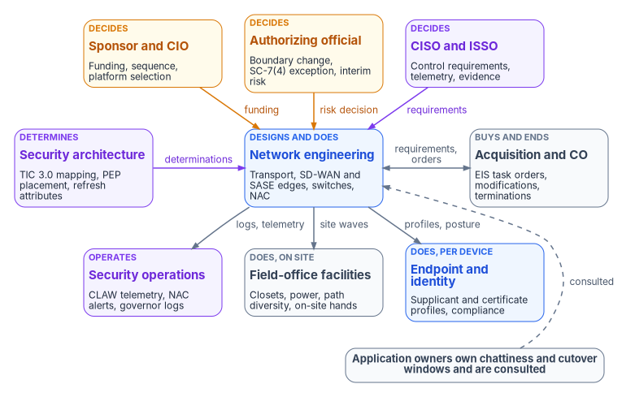
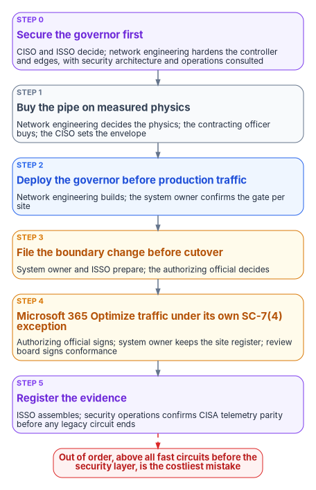

# Chapter 09 — Who Owns the Network and Its Transport

*The most expensive network mistakes in this book are not engineering errors but ownership gaps: a circuit bought before anyone owned the governor, a cutover before anyone filed the boundary change, a telemetry contract cancelled before anyone confirmed its replacement; naming one decider for each of those steps is cheaper than any product.*

::: {.callout-note}
## In this chapter
The people who decide, do and advise when transport, branch control, TIC 3.0 posture and network access control change: the sponsor and CIO, the authorizing official, the system owner, the CISO and ISSO, security architecture, network engineering, telecommunications acquisition and the contracting officer, security operations and its CISA reporting, endpoint and identity engineering, field-office facilities, application owners and the help desk. A responsibility matrix covers each decision; the decision sequence gets an owner per step; and a role map shows where each team needs access.
:::

Network ownership used to look simple because the network was one thing. A network team ran the circuits, the routers and the firewall; the telecom office paid the bills; security reviewed changes when asked. The architecture in this book breaks that into pieces with different owners. [Chapter 02](02-transport-is-physics-control-is-compliance.md) separates transport, which is a physics and acquisition decision, from control, which is a compliance decision. [Chapter 03](03-what-tic-3-requires.md) puts TIC 3.0 capability mapping, CISA telemetry and the authorization boundary in front of every branch change. [Chapter 07](07-network-access-control.md) moves device admission from an Active Directory server role to a policy decision that reads Intune. Each piece now has a natural owner, and none of them is "the network team" in general.

The sources keep arriving at the same instruction. The short paper on SD-WAN and direct internet access ends with an ask: before the next transport or SD-WAN procurement, run the decision sequence, file the boundary update before cutover, and name an owner for each step. *The Long Interim* explains why branch-edge programs take years by listing things that are all ownership problems: acquisition competes for the same contracting staff as everything else, a new device class at every branch is assessment work for the same security staff, TIC 3.0 adoption is mapping and telemetry work rather than a purchase, and an agency promising an SD-WAN program alongside its other deadlines is promising the same people twice. The field-office paper names the failure that costs the most: decommissioning managed TIC circuits before CISA confirms the replacement telemetry, which trades one compliance gap for a worse one.

[Book 02, Chapter 06](../b02-identity/06-who-owns-the-migration.md) sets out the migration-wide ownership model and the Risk Management Framework roles. [Book 05, Chapter 06](../b05-devices/06-who-owns-the-endpoint.md) applies it to endpoints, [Book 07, Chapter 05](../b07-pki/05-who-owns-the-certificate-estate.md) to certificates and [Book 08, Chapter 09](../b08-ddi/09-who-owns-dns.md) to DNS, DHCP and IPAM. This chapter applies it to transport, the branch control layer and network access control. The roles, the matrix and the role map are the program's recommended model. Adapt them to the agency's governance, but keep one decider per row.

{#fig-ch09-network-owners fig-alt="Three rows of cards. Top row, decision makers: the sponsor and CIO in amber, who own funding, sequence and platform selection; the authorizing official in amber, who owns the boundary change, the SC-7(4) exception and the interim risk; and the CISO and ISSO in violet, who set control requirements, telemetry and evidence. Middle row: security architecture in violet, which owns TIC 3.0 capability mapping and PEP placement; network engineering in blue, which designs and runs transport, SD-WAN and SASE edges, switches and the NAC platform; and telecommunications acquisition in slate, which owns EIS task orders, modifications and circuit terminations through the contracting officer. Arrows run from the decision row to network engineering labeled funding, risk decision and requirements; security architecture sends design determinations to network engineering; network engineering and acquisition exchange requirements and orders in both directions. Network engineering sends logs and telemetry to security operations, site waves to facilities, and profile and posture work to endpoint and identity engineering in the bottom row. Bottom row: security operations in violet, which operates CLAW telemetry, NAC alerts and governor logs; field-office facilities in slate, which owns closets, power, physical path diversity and on-site hands; and endpoint and identity engineering in blue, which owns supplicant and certificate profiles, Intune compliance and the NAC application consent. A slate pill reads: application owners own chattiness and cutover windows and are consulted, with a dashed arrow to network engineering."}

## Where the roles come from

Four parts of the series supply the inputs.

The **decision sequence** comes from [Chapter 02](02-transport-is-physics-control-is-compliance.md) and is sequenced in [Chapter 13](13-sequencing-cost-and-evidence.md): buy the pipe on measured physics within the acquisition and supply-chain envelope; deploy the governor before production traffic; treat the boundary change as the significant change it is; handle Microsoft 365 traffic through its own documented exception; and register the supporting evidence. Doing these out of order, especially lighting up fast connections before the security layer is live, is the most common and most costly mistake in the series. Each step has a different natural owner, which is why it goes wrong: the person who can order a circuit isn't the person who can accept a boundary change.

The **exception instruments** for Microsoft 365 Optimize traffic ([Chapter 12](12-microsoft-365-traffic.md) and [Appendix A](appendix-a-optimize-exemption-instruments.md)) already assign signers on purpose. The authorizing official signs the SC-7(4) traffic-flow exception memo, because the exception is the one thing that can't be transferred. The system owner signs the site register that says which sites and circuits are in scope and when each ends. The architecture review board signs the determination that the design is TIC 3.0 conformant and where each policy enforcement point (PEP) capability now sits, and the ISSO concurs. Keeping the architecture determination separate from the risk acceptance is deliberate: each signer answers a question that is actually theirs. This chapter generalizes that discipline to the rest of the network.

The **field-office case** in [Chapter 11](11-field-office-wan-transformation.md) supplies the coordination items that sit on the critical path: acquisition engaged in Phase 0 rather than at cutover, branch migration waves keyed to contract renewal dates already in the pipeline, CLAW onboarding started alongside the accreditation package, and each branch's MPLS or managed TIC decommission gated on confirmed telemetry parity. CISA's guidance for agencies replacing MTIPS with SASE says that integrating SASE telemetry with CISA's Comprehensive Log Aggregation Warehouse (CLAW) "requires coordination among agencies, CISA, and SASE"; that is a three-party dependency, not a configuration change one team completes.[^c09-cisa-sase]

The program's **network and access modernization charter** supplies the structure. Its purpose is to replace perimeter-and-VPN remote access and static wide-area networking with identity-driven, application-aware access over an authoritative naming and addressing plane. It names four domain leads (naming and addressing, identity-driven access, customer-edge enforcement, and certificates) under a project sponsor and lead who are still to be named, and its principles assign authority before technology: identity is the root namespace; the naming plane is a truth plane that other inventories reconcile to; access decisions consume identity and don't keep a parallel identity authority; overlays are certificate-anchored where feasible; and the customer-owned half of boundary and encryption controls, which no cloud provider's authorization covers, is in scope. The domain leads map onto this book's roles: naming and addressing is [Book 08](../b08-ddi/09-who-owns-dns.md)'s DNS/DDI team, certificates are [Book 07](../b07-pki/05-who-owns-the-certificate-estate.md)'s PKI administrators, and identity-driven access and customer-edge enforcement are split below between network engineering, security architecture and endpoint and identity engineering.

## Decision rights and work are different things

The program separates three kinds of involvement, as Book 02 does. A role *decides* when it is accountable for the outcome and can say no. A role *does* the work when it builds, configures, buys or runs the thing. A role is *consulted* when the decision can't be made well without its input, even though the decision isn't its to make.

The split matters more for networks than for most systems, because many network decisions are risk decisions that look like engineering or purchasing. Turning on local internet breakout at a branch before the governor's inspection is live leaves that branch's egress outside any assessed boundary. Terminating a managed TIC circuit before CISA confirms CLAW telemetry removes visibility CISA had yesterday. Exempting Microsoft 365 Optimize traffic from inspection punctures named controls (SI-3, SI-4(10), AC-4 and AU-3, as Chapter 12 records). Keeping a MAC Authentication Bypass exception with no end date leaves a spoofable path into a segment. The authorizing official is the senior official who accepts security and privacy risk to organizational operations, assets and individuals under the Risk Management Framework,[^c09-sp80037] so decisions that amount to accepting risk have to reach that person, not stop at a change ticket or a purchase order.

Two more facts shape the split. FedRAMP authorizes the security posture of a cloud service; it says nothing about the network topology an agency uses to reach it, and it neither prohibits SD-WAN nor requires hairpin routing ([Chapter 03](03-what-tic-3-requires.md) states this precisely). An architectural refusal with no identifiable control basis is therefore a governance failure in its own right, and the program records it as one, with the refusing role named. And the contract is a decision right of its own: under the Federal Acquisition Regulation only contracting officers have authority to enter into, administer or terminate contracts, within the limits of their written delegation.[^c09-far] No engineer can cancel a circuit, however obviously redundant it is.

## The roles

The **sponsor and CIO** set scope, funding and sequence. In the program's model they decide which governor platforms the agency adopts (SD-WAN, SASE, NAC), the order of branch waves, and when legacy transport and NPS are retired. They also own the honest version of the plan. A program conceived now usually lands in a later budget year, a capital refresh across hundreds of sites rarely fits inside operations and maintenance, and the same network and security staff are carrying other federal deadlines at the same time ([Chapter 10](10-the-long-interim.md) lists them). Saying so in the program plan is more credible than promising the same people twice. The CIO breaks ties between network engineering, security architecture and the cloud and endpoint teams, which will happen, because all of them can reasonably claim the branch edge.

The **authorizing official** accepts residual risk. For this book that means four things. The boundary change: a new device class at every branch, a new egress path or a new governor changes the system described in the authorization package, and the program treats it as a significant change that is decided before cutover, not discovered by an assessor afterwards. The SC-7(4) traffic-flow exception for Microsoft 365 Optimize traffic, which SP 800-53 requires to be documented with its mission need and duration and reviewed on a cadence.[^c09-sp80053] The interim posture: when neither SD-WAN nor a TIC 3.0 use case is close, *The Long Interim* recommends recording which control assertions depend on transport evidence that doesn't exist, the compensating measures, and the funded remediation, because an undocumented gap found by an assessor is a finding and a documented gap with a plan is an accepted risk ([Chapter 10](10-the-long-interim.md)). And every standing exception: a MAB device class with no end date, a site that can't be redirected to an agency resolver, a branch that keeps a path around the governor.

The **system owner** owns the authorization boundary and the package that describes it. In the program's model the system owner signs the site register for any exception, prepares the boundary change with the ISSO, owns each site's cutover go/no-go against the gates in Chapter 13, and names a revert owner for every site who can act within one shift without a change board. The system owner is also where the "governor before traffic" rule is enforced: a site whose control layer isn't live and logging doesn't get its new egress turned on.

The **CISO and ISSO** decide the control requirements the network has to meet: which TIC 3.0 security capabilities apply and at what level, encryption on each path, what is logged and for how long, posture requirements for network admission, the MAB policy, and the evidence an assessor will read. The CISO also sets the acquisition envelope for security: cryptographic module validation, supply-chain requirements and post-quantum readiness for equipment that terminates TLS or IPsec. FIPS 140-2 validations moved to the CMVP Historical List in September 2026; CMVP supports their continued use in existing systems, but new purchases should state the validation expectation explicitly rather than inherit it.[^c09-fips1403] The ISSO assembles the evidence, tracks findings to closure and concurs on the architecture review determination. The CISO owns the confirmation that CISA telemetry has reached parity before any legacy TIC path is decommissioned.

**Security architecture** owns the design determinations that sit between engineering and risk: TIC 3.0 use case selection and capability mapping, where each PEP capability lives (campus, SASE, endpoint), the reference architecture choices in [Chapter 08](08-reference-architecture.md), and the target attributes every equipment refresh must carry. In many agencies it chairs or staffs the architecture review board. It decides whether a design is conformant. It doesn't accept the risk of a non-conformant one; that goes to the authorizing official.

**Network engineering** owns transport and the control layer as built and run. It chooses each site's transport on measured physics (fiber, MPLS, LEO satellite, 5G) and verifies diversity physically, because two circuits in one conduit aren't diverse. It designs and operates SD-WAN edges and controllers, SASE connectors, branch switching and wireless, the NAC platform and its RADIUS service, the CoA path, and the edge settings other books depend on: the redirect-dns target that [Book 08, Chapter 05](../b08-ddi/05-edge-interception-and-bypass.md) makes a DNS/DDI decision, DHCP relay and snooping, and 802.1X on every access port. It also owns the hardening of the governor itself. [Chapter 02](02-transport-is-physics-control-is-compliance.md) makes the point that the governor is attack surface; [Chapter 05](05-sd-wan-sase-and-governed-transport.md) covers securing the controller and edges. Network engineering is the team most likely to be over-trusted, because its administrators can change every path at once. The program's answer is the same as for the DNS/DDI team in Book 08: scoped administrative roles in the controller, a second approver for changes to policy that affect inspection or egress, and privileged access that is eligible rather than standing where the platform supports it.

**Telecommunications acquisition and the contracting officer** own the contracts. Enterprise Infrastructure Solutions (EIS) is GSA's multiple-award contract for federal telecommunications and networking; its first option period runs to July 31, 2027 and its second to July 30, 2032, agencies order through task orders, and GSA solutions brokers can help define requirements and execute those orders.[^c09-gsa-eis] A branch-edge program is an EIS task order or a competed acquisition, and requirements, market research, solicitation, evaluation and award take quarters before a device ships. The acquisition team's job in this book is to be engaged in Phase 0, to sequence branch waves to renewal dates already in the pipeline, to write the security envelope the CISO sets into every order, and to terminate circuits only when the matrix below says the gate has passed. Telecommunications services diversity (CP-8, alternate telecommunications services with agreements that let essential functions resume within a defined time[^c09-sp80053]) is the one control family that transport selection itself closes, so acquisition and network engineering own it together.

**Security operations** receives what the network emits: governor and SASE logs, NAC accounting and alerts, Protective DNS hits, and the telemetry CISA receives. It is the agency's working end of the three-party CLAW coordination with CISA and the vendor.[^c09-cisa-sase] It confirms, per branch, that the replacement telemetry is flowing before the CISO signs off on a decommission, and it runs the detections [Chapter 07](07-network-access-control.md) specifies, including the one that matters most: a valid device certificate presented from the wrong hardware. Security operations is consulted on every inspection exception and every MAB exception, because it is the team that finds out when an exception gets used.

**Endpoint and identity engineering** own the device and identity side of network decisions. Endpoint engineering builds the Wi-Fi, wired and VPN profiles, the certificate and trusted root profiles they reference and the Intune compliance policies that become NAC posture; in Intune the built-in Policy and Profile Manager role is enough to create wired network profiles.[^c09-intune-wired] Identity engineering registers the NAC product with Microsoft Entra ID and grants it delegated permissions to the Intune NAC API, which is how the compliance retrieval service is enabled,[^c09-intune-nac] and owns the Conditional Access policies that carry device posture into tokens ([Book 04, Chapter 06](../b04-access/06-who-decides-access.md)). Both do the work. Neither decides the posture requirement; the CISO does.

**Field-office facilities** own the physical layer that the architecture assumes: wiring closets and their access control, power and cooling for new edge equipment, building entrances for diverse carriers, and the on-site hands that every branch cutover needs. Two NAC facts make facilities a real party. Vacated office space keeps live switch ports until someone tells network engineering to shut them, and many of the devices that fall to MAB (badge readers, HVAC controllers, cameras) are owned by facilities or physical security, not IT. Facilities is consulted on every site wave and does the work of registering its own devices before MAB approval. The field-office paper's assumptions about seat distribution by office also come from facilities and HR headcount data, so facilities is the source of record for site sizing.

**Application owners** own the part of user experience that transport can't fix. In an interval where transport can't change, reducing an application's round trips is the only lever that moves its performance ([Chapter 06](06-legacy-protocols-on-re-routed-paths.md)), and it belongs to the application owner. Application owners also accept cutover windows for their own traffic, state which path class their application needs, and are consulted on any inspection exception that covers their traffic.

The **help desk** fields what users report as "the network is down": a quarantined device behind the captive portal, a laptop whose certificate expired, a slow application at a newly cut-over branch. It needs read access to NAC session results and SD-WAN path status, runbooks, and a clear escalation path. It doesn't hold write roles in the controller or the NAC policy. Re-pushing a device's certificate profile is a help desk action. Changing a VLAN assignment isn't.

## The responsibility matrix

D = decides (accountable) · R = does the work · C = consulted · blank = informed at most.

| Decision or work item | Sponsor / CIO | AO | System owner | CISO / ISSO | Security arch. | Network eng. | Acquisition / CO | SecOps | Endpoint and identity | Facilities | App owners |
|---|---|---|---|---|---|---|---|---|---|---|---|
| Governor platforms: SD-WAN, SASE, NAC (D3) | D | C | C | C | C | R | R | C | C | | |
| Transport per site on measured physics | C | | | | C | D, R | C | | | C | C |
| Telecommunications diversity (CP-8) and physical path verification | | | C | C | | D, R | R | | | R | |
| Security envelope for purchases: module validation, supply chain, PQC | | | | D | C | C | R | | | | |
| Target attributes for every equipment refresh, including BOD 26-02 replacements | C | | | C | D, R | R | R | | | | |
| EIS task orders and modifications | C | | | C | | C | D, R | | | | |
| TIC 3.0 use case and PEP capability placement | | C | C | C | D, R | C | | C | C | | |
| Architecture review determination (conformance) | | | C | C | D | R | | C | | | |
| Boundary change filed before cutover | C | D | R | R | C | C | | | | | |
| Governor live and logging before production traffic, per site | | | D | C | | R | | C | | C | C |
| Site cutover window, rollback and revert owner | | | D | | | R | | C | | R | C |
| SC-7(4) exception for Microsoft 365 Optimize traffic | C | D | R | C | R | R | | C | C | | C |
| Controller and edge hardening; administrative access to the governor | | | | D | C | R | | C | | | |
| CLAW onboarding with CISA and the vendor | C | | C | D | C | R | C | R | | | |
| CISA telemetry parity confirmed, per branch | | | C | D | | C | | R | | | |
| Managed TIC and MPLS circuit termination, per branch | C | | C | C | | C | D, R | C | | | |
| NAC posture requirements and policy tiers | | | | D | C | R | | C | R | | |
| 802.1X enforcement phase per site (monitor, then enforce) | | | C | C | | D, R | | C | R | C | |
| MAB exception for a device class | | | | D | | R | | C | | R | |
| Standing MAB or bypass exception with no end date | | D | R | C | | R | | C | | C | |
| NPS retirement timing | D | C | C | C | | R | | C | R | | |
| Interim posture: documented gap and compensating measures | C | D | R | R | C | C | | C | | | |
| Application chattiness remediation | | | | | | C | | | | | D, R |
| Logging and detections for governor and NAC | | | | D | C | R | | R | C | | |

Five rows need comment. The governor row gives the platform decision to the CIO because it fixes cost and the boundary for years, while network engineering and acquisition do the work. The **boundary change** and the **governor before traffic** rows split on purpose: the authorizing official decides whether the boundary may change, but the system owner decides, site by site, whether a site is ready, because a site without its control layer live is the cheapest way to turn an approved design into an unapproved one. The **telemetry** rows split three ways: the CISO decides CLAW onboarding and parity, security operations does the confirming, and the contracting officer terminates the circuit only after that confirmation, which is how the field-office paper's Phase 2 exit criterion becomes enforceable. The **MAB** rows split on time, like the exception rows in Books 05 and 08: the CISO can approve an exception for a device class, but one with no end date goes to the authorizing official. And the **refresh** row gives security architecture the decision, because BOD 26-02 has put boundary edge-device replacement on a directive clock (decommissioning milestones at 12 and 18 months from February 5, 2026),[^c09-bod2602] and a refresh run as like-for-like replacement forecloses the architecture question for the life of the new equipment. *The Long Interim* calls telling the people scoping those replacements, in writing, what the eventual target needs the cheapest high-value action available. The directive covers devices on the network boundary, so interior access switches may need their own justification.

## An owner for each step

{#fig-ch09-sequence-owners fig-alt="Top to bottom, six numbered cards joined by arrows. Step 0, violet: secure the governor first; the CISO and ISSO decide, and network engineering hardens the controller and edges, with security architecture and operations consulted. Step 1, slate: buy the pipe on measured physics within the acquisition and supply-chain envelope; network engineering decides the physics, the contracting officer buys, the CISO sets the envelope. Step 2, blue: deploy the governor before production traffic; network engineering builds it, the system owner confirms the gate per site. Step 3, amber: treat the boundary change as a significant change, filed before cutover; the system owner and ISSO prepare it and the authorizing official decides. Step 4, amber: handle Microsoft 365 Optimize traffic through its own SC-7(4) exception; the authorizing official signs, the system owner keeps the site register and the architecture review board signs the conformance determination. Step 5, violet: register the evidence; the ISSO assembles it and security operations confirms CISA telemetry parity before any legacy circuit is terminated. A dashed red line from step 5 leads to a red note: out of order, above all fast circuits before the security layer, is the costliest mistake."}

| Step | Decides | Does | The gate that ends the step |
|---|---|---|---|
| 0. Secure the governor first | CISO / ISSO | Network engineering, with security architecture and security operations consulted | Controller and edges under vulnerability management, privileged-access control and off-box logging before they carry production traffic |
| 1. Buy the pipe on measured physics within the acquisition and supply-chain envelope | Network engineering for the physics; contracting officer for the order | Network engineering, acquisition, facilities | Measured latency and diversity recorded per site; order placed against a renewal date |
| 2. Deploy the governor before production traffic | System owner, per site | Network engineering | Control layer live, inspecting and logging to the SIEM |
| 3. Treat the boundary change as a significant change | Authorizing official | System owner and ISSO | Boundary change decided before the first production cutover |
| 4. Handle Microsoft 365 traffic through its own documented exception | Authorizing official | System owner, security architecture | SC-7(4) memo signed; site register current |
| 5. Register the supporting evidence | CISO | ISSO, security operations | Evidence registered; CISA telemetry parity confirmed before any legacy circuit ends |

[Chapter 13](13-sequencing-cost-and-evidence.md) explains why the order matters and what evidence each gate needs. This table only answers who can say the gate has passed.

## Roles in each system

Decision rights don't change what a console lets someone do. Roles do, and a modernized network has more consoles than the old one: the SD-WAN or SASE controller, the NAC platform (and NPS until it retires), the switches and wireless controllers, Intune, Microsoft Entra ID, and the contract record. The program maps each team to the least-privileged role in each system it touches. Role names below are generic because they differ by product; map them to the platform's own role model.

| Team | SD-WAN / SASE controller | NAC platform and NPS | Switches and wireless | Intune and Entra ID | Contract record |
|---|---|---|---|---|---|
| Network engineering | Administrator, eligible not standing; second approver for egress and inspection policy | Administrator; NPS local administrators until retirement | Administrator through the controller or an AAA-backed account | Read device and compliance data | Read |
| Security architecture | Read; policy reviewer | Read | Read | Read | Read |
| Security operations | Read and log export | Read session and accounting data; quarantine action if the CISO assigns it | Read | Read compliance data | None |
| ISSO and assessors | Auditor | Auditor | Read configuration exports | Read reports | Read |
| Endpoint and identity engineering | None | Read, to diagnose posture | None | Policy and Profile Manager for network and certificate profiles;[^c09-intune-wired] consent for the NAC application[^c09-intune-nac] | None |
| Acquisition and contracting officer | None | None | None | None | Owner |
| Facilities | None | Request MAB registrations | None | None | Read |
| Help desk | Read path status | Read session results; re-run authentication | None | Sync device; re-push profiles | None |

Two notes. The service accounts that connect these systems are the most powerful identities in the design: the NAC platform's application registration can read the compliance state of every device, the CoA client can move any port, and the controller's integration accounts can change every branch's policy. They belong to the team that owns the platform, they are non-interactive, and their credentials are rotated and evidenced like any other privileged secret. And the NPS column gets shorter every phase; by the time NPS retires, its local administrators and its exported configuration files, which carry RADIUS shared secrets in clear text ([Chapter 07](07-network-access-control.md)), should be gone with it.

## The charter's plan, in one table

The program's network and access plan runs in five phases. Its success measures are deliberately small: an authoritative naming plane operational for the pilot, an identity-driven access path for a pilot population with the VPN path documented as residual, at least one access or path decision emitted as a claim with provenance, and the customer-edge approach and boundary dispositions documented for every network service in scope.

| Phase | What it establishes | Who owns it in this book |
|---|---|---|
| 0. Charter and alignment | Naming-plane ownership, pilot population, boundary dispositions | Sponsor and CIO; system owner for dispositions |
| 1. Naming and addressing | The authoritative DNS, DHCP and IPAM plane as the asset-identity join key | DNS/DDI team ([Book 08](../b08-ddi/09-who-owns-dns.md)) |
| 2. Identity availability | Identity claims reachable by every access decision point; gaps listed | Identity engineering ([Book 04](../b04-access/06-who-decides-access.md)) |
| 3. Identity-driven access pilot | ZTNA or SASE for a pilot population; residual VPN path documented | Network engineering, with security architecture |
| 4. Customer-edge enforcement and evidence | The 802.1X or equivalent approach and its accreditation path; one decision emitted as a claim | Network engineering for enforcement; CISO and ISSO for evidence |

The charter's out-of-scope list is worth keeping visible: it doesn't replace existing wide-area contracts in the first phase, doesn't attempt microsegmentation inside every workload, and doesn't design for non-federal networks. Its first actions are the ones this chapter's matrix makes assignable: confirm who owns the naming plane, inventory current remote-access paths and residual VPN use, find where identity claims can be consumed, and define the pilot.

## What changes from "the network team," in one table

| Old habit | What replaces it |
|---|---|
| The network team decides the network | One decider per row; network engineering does most of the work and decides physics and enforcement phasing |
| Circuits are ordered when they're cheap | Orders follow measured physics and the CISO's envelope, sequenced to renewal dates, placed by the contracting officer |
| The fast connection goes live first | The system owner confirms the governor is live and logging before production traffic moves |
| The boundary change is written after cutover | The authorizing official decides the boundary change before the first production cutover |
| Inspection exemptions are a firewall rule | An SC-7(4) exception signed by the authorizing official, with a site register and a review date |
| A managed TIC circuit is cancelled when the branch moves | It is terminated only after security operations confirms CISA telemetry parity for that branch |
| NPS belongs to whoever runs the domain controllers | The NAC platform belongs to network engineering, posture to the CISO, profiles to endpoint engineering, and retirement timing to the CIO |
| A refresh replaces like with like | Security architecture writes the target attributes into every refresh, including directive-driven ones |
| "FedRAMP won't allow it" ends the conversation | The refusing role names the control, or the refusal is recorded as a governance failure |

::: {.callout-tip}
## Continue the book
[← Previous: Chapter 08 — Reference Architecture: Consistency Classes Meet Network Classes](08-reference-architecture.md) · [Book index](index.md) · [Next: Chapter 10 — The Long Interim →](10-the-long-interim.md)
:::

[^c09-cisa-sase]: Cybersecurity and Infrastructure Security Agency, *The Journey to Zero Trust: Using SASE in a Modern TIC 3.0 Solution*, June 24, 2026, sections on telemetry sharing and Protective DNS, <https://www.cisa.gov/sites/default/files/2026-07/The_Journey_to_Zero_Trust-Using_SAS_in_a_Modern_TIC3.0_Solution.pdf>; landing page <https://www.cisa.gov/resources-tools/resources/using-sase-modern-tic-30-solution> (accessed Oct 21, 2026).
[^c09-sp80037]: National Institute of Standards and Technology, SP 800-37 Rev. 2, *Risk Management Framework for Information Systems and Organizations: A System Life Cycle Approach for Security and Privacy*, December 2018, <https://csrc.nist.gov/pubs/sp/800/37/r2/final> (accessed Oct 21, 2026).
[^c09-far]: Federal Acquisition Regulation, 48 CFR 1.602-1, "Authority," <https://www.acquisition.gov/far/1.602-1> (accessed Oct 21, 2026).
[^c09-sp80053]: National Institute of Standards and Technology, SP 800-53 Rev. 5, *Security and Privacy Controls for Information Systems and Organizations*, controls SC-7(4) and CP-8, <https://csrc.nist.gov/pubs/sp/800/53/r5/upd1/final>; control text checked against the release 5.2.0 OSCAL catalog, <https://github.com/usnistgov/oscal-content/blob/main/nist.gov/SP800-53/rev5/json/NIST_SP-800-53_rev5_catalog.json> (accessed Oct 21, 2026).
[^c09-fips1403]: National Institute of Standards and Technology, "FIPS 140-3 Transition Effort," <https://csrc.nist.gov/Projects/FIPS-140-3-Transition-Effort> (accessed Oct 21, 2026).
[^c09-gsa-eis]: General Services Administration, "Enterprise Infrastructure Solutions (EIS)," <https://www.gsa.gov/technology/it-contract-vehicles-and-purchasing-programs/telecommunications-and-network-services/enterprise-infrastructure-solutions> (accessed Oct 21, 2026).
[^c09-intune-wired]: Microsoft Learn, "Add and use wired networks settings on your devices in Microsoft Intune," section "Prerequisites," <https://learn.microsoft.com/intune/device-configuration/templates/configure-wired-networks> (accessed Oct 21, 2026).
[^c09-intune-nac]: Microsoft Learn, "Network access control (NAC) integration with Intune," section "How the NAC integration works," <https://learn.microsoft.com/intune/device-security/integrate-network-access-control> (accessed Oct 21, 2026).
[^c09-bod2602]: Cybersecurity and Infrastructure Security Agency, BOD 26-02, *Mitigating Risk From End-of-Support Edge Devices*, February 5, 2026, <https://www.cisa.gov/news-events/directives/bod-26-02-mitigating-risk-end-support-edge-devices> (accessed Oct 21, 2026).
