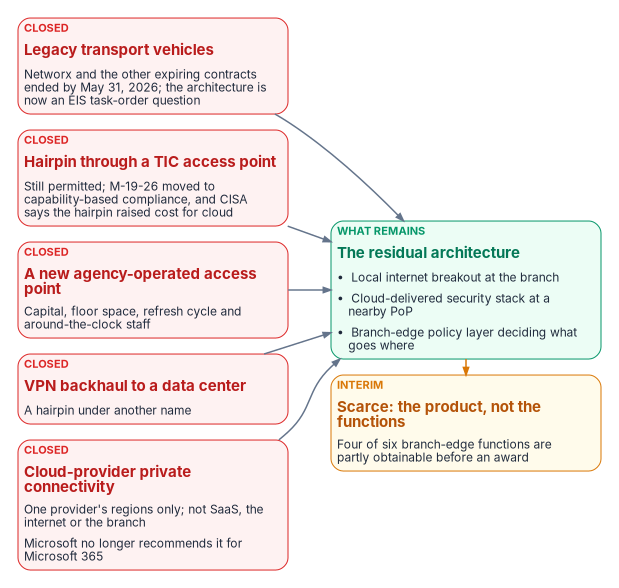
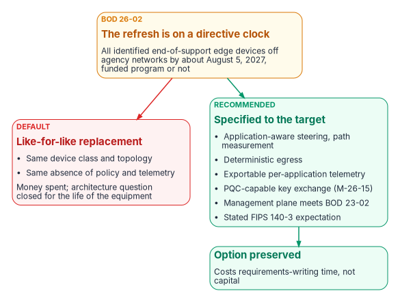

# Chapter 10 — The Long Interim

*The years before the architecture can be bought aren't a waiting room: most of the program's work can start now, and one directive is already spending the money.*

::: {.callout-note}
## In this chapter
Why a branch-edge policy layer feeding a cloud-delivered security stack is the architecture that remains once every alternative has closed, and which of its functions an agency can assemble before any award. Why the target is years away, and the one directive (BOD 26-02) that pulls the branch hardware refresh into the interval anyway. The ten interim actions that need no acquisition, and the engineering realities they have to respect. Cost and the measurement plan are [Chapter 13](13-sequencing-cost-and-evidence.md)'s subject; the policy facts behind this chapter are set out in [Chapter 03](03-what-tic-3-requires.md).
:::

Most writing about federal branch networking assumes the agency is about to deploy SD-WAN and adopt a TIC 3.0 use case. For many agencies neither is true, and neither will be true for years. The acquisition isn't funded, the task orders aren't placed, the branch count runs to hundreds or thousands, and the network and security staff who would run the program are already carrying three other federal deadlines that fall inside the next fifteen months.

This chapter is about that interval. Its argument has three parts. First, the architecture this book recommends is the residual one: it is what is left after the alternatives closed, one at a time, and it should be argued that way rather than as a mandate. Second, the target is genuinely far off, for structural reasons a program plan should state honestly. Third, the interval is not empty. Four of the six functions a branch-edge layer provides are partly obtainable now, a directive-driven hardware refresh will happen inside the interval whatever is funded, and ten actions the eventual program needs anyway can be done without an award.

{#fig-ch10-alternatives-closed fig-alt="Five red cards on the left, each naming an alternative and why it has closed. Legacy transport vehicles: Networx and the other expiring contracts ended by May 31, 2026, so the architecture is now an EIS task-order question. Hairpin through a TIC access point: still permitted, but M-19-26 replaced physical routing with capability-based compliance and CISA says the hairpin raised cost and degraded cloud performance. A new agency-operated access point: capital, floor space, refresh and around-the-clock staff. VPN backhaul to a data center: a hairpin under another name. Cloud-provider private connectivity: covers one provider's regions, not SaaS, the internet or the branch, and Microsoft no longer recommends it for Microsoft 365. All five arrows lead to one green card on the right: the residual architecture, local internet breakout at the branch, a cloud-delivered security stack at a nearby point of presence, and a branch-edge policy layer deciding what goes where. An amber note below it says the scarcity is in the product category, not the functions."}

## The case by elimination

The case for a branch-edge policy layer is usually made forward, from its benefits. It is stronger made backward, from what is left. [Chapter 03](03-what-tic-3-requires.md) establishes that no federal instrument requires SD-WAN or SASE; CISA's June 2026 SASE guidance describes SASE as a compliant path for TIC 3.0, and it presents itself as guidance for agencies, not as a requirement.[^c10-sase] So the architecture can't be justified by mandate. It can be justified because every alternative has closed.

### The legacy transport vehicles have expired

GSA reports that the expiring telecommunications contracts, Networx among them, had all ended by May 31, 2026.[^c10-tptr] As of August 31, 2026, 219 agencies had completed their transition to Enterprise Infrastructure Solutions (EIS), whose first option period runs to July 31, 2027 and second to July 30, 2032.[^c10-eis-transition][^c10-eis] (The source paper's figure of 214 agencies as of July 31, 2026 is superseded by GSA's later count. GSA's own August report tabulates 221; this book uses the figure on GSA's transition page.)

MTIPS is still orderable under EIS as a managed security service for the TIC 3.0 Traditional use case, so the expiry doesn't eliminate managed TIC services.[^c10-gsa-tic] What it does mean is that every agency has already been through a transition decision. The architecture is now a task-order question rather than a contract-vehicle question, and an agency that meant to defer the decision until its vehicle changed has run out of deferral.

One scoping detail is worth settling early. The service list on GSA's EIS page doesn't name SD-WAN as a service, while CISA's TIC FAQ says EIS provides SD-WAN networking and connectivity options to and from agency networks, cloud services and the internet.[^c10-eis][^c10-ticfaq] Before the requirement is written, the agency should confirm with GSA and its EIS contractor which EIS service the branch-edge layer will be ordered under. [Chapter 09](09-who-owns-the-network.md) assigns that to the telecom acquisition owner.

### The hairpin is what policy moved away from

OMB M-19-26 (September 12, 2019) rescinded M-08-05 and the related TIC memoranda and replaced physical-routing compliance with capability-based compliance; agencies can use approved TIC 3.0 use cases "without being required to route traffic through a TICAP/MTIPS solution."[^c10-m1926] CISA's account of why is unusually direct. The TIC 3.0 Program Guidebook says that over time "greater bandwidth demands, transport encryption, and perimeter services were placed on agency TIC access points beyond their ability to scale," and that the growing demands and degraded performance "increased the cost and decreased the effectiveness of the TIC initiative when using cloud services."[^c10-guidebook]

That is the government stating in policy that the transport model degraded performance and raised cost for cloud services. The hairpin architecture is still permitted, and an agency running it is not out of compliance. It is now the expensive option, defended on its own merits. [Chapter 01](01-why-physics-decides-the-architecture.md) prices the hairpin in milliseconds.

### A new agency-operated access point is a capital and staffing commitment

Standing up or expanding an agency-operated TIC access point is still allowed. It takes capital, floor space, a refresh cycle, and staff to run an inspection stack around the clock. For an agency that already has one, continuing is rational. For an agency that doesn't, building one now to serve cloud-bound branch traffic has to be defended against every alternative in this section, and the program knows of few agencies making that case.

### VPN backhaul is a hairpin under another name

Backhauling branch traffic over IPsec to a data center and egressing there still works and is still widely deployed. It is also a hairpin: it adds the data center round trip to every cloud interaction, concentrates capacity at the aggregation point, and gives the branch none of the functions in the table below. Where it persists, it usually persists because the concentrator is already paid for.

### Cloud-provider private connectivity solves less than agencies assume

Dedicated private connectivity into a cloud provider, the ExpressRoute and Direct Connect family, is good for what it covers: traffic between agency infrastructure and that provider's regions. It doesn't cover SaaS in general, the open internet or a second provider, and it governs nothing at the branch. An agency with private connectivity to its primary cloud and nothing at the branch edge has solved the leg it was least worried about.

Microsoft 365 deserves separate treatment, because many agencies were approved for ExpressRoute for Office 365 years ago and haven't revisited the approval. An authorization granted then is not a statement of current Microsoft guidance, and the guidance has changed underneath it:

- **Microsoft no longer recommends it.** The Azure documentation's section on when to use ExpressRoute for Microsoft 365 now reads, in full, "We no longer recommend the use of ExpressRoute for Microsoft 365 traffic."[^c10-er-azure] The Microsoft 365 documentation adds that Microsoft authorization is required and is granted "only in the rare scenarios where it's necessary."[^c10-er-m365]
- **Microsoft's flagship connectivity guidance doesn't mention it.** The *Microsoft 365 network connectivity principles* page (updated August 2026) doesn't contain the word "ExpressRoute." Its recommendation runs the other way: direct internet access "should be prioritized for the Microsoft 365 domains by reducing reliance on wide area network (WAN) backhauling, avoiding network hairpins."[^c10-principles] Microsoft's endpoint-management guidance names SD-WAN devices that support automated Microsoft 365 configuration as the easiest way to choose which requests to trust.[^c10-er-managing] (The source paper placed that SD-WAN sentence on the principles page; it is on the endpoint-management page.)
- **It can't carry all Microsoft 365 traffic, and never could.** Microsoft states that "some Microsoft 365 traffic can only be routed through the Internet," and that Microsoft 365 requires internet connectivity however the rest is managed.[^c10-er-azure][^c10-er-managing] Route filters advertise IP prefixes, and Default-category endpoints publish none. In the Worldwide endpoint data current on October 21, 2026 (version 2026081400), 10 of 63 endpoint sets are marked for ExpressRoute and 53 are not. The 53 include the device-registration endpoint `enterpriseregistration.windows.net` and the certificate revocation (CRL and OCSP) endpoints, all marked required.[^c10-endpoints] (The source paper counted roughly seven against forty.) A circuit can never be an agency's only path to Microsoft 365, so a compliant internet egress path is mandatory beside it, and the branch-edge question isn't avoided by having a circuit.
- **Old circuits may still be advertising.** Microsoft documents that Microsoft peering on circuits configured before August 1, 2017, "will have all Microsoft Office service prefixes advertised through Microsoft peering, even without route filters."[^c10-routefilter] An agency with an older circuit may be advertising Office 365 prefixes today with no route filter and no current authorization on file. Check it as a discrete action rather than assuming.
- **The GCC arrangement is documented as working but not as to how.** Office 365 GCC pairs with Microsoft Entra ID in commercial Azure, while GCC High and DoD pair with Azure Government.[^c10-feature] GCC has no endpoint web service instance of its own (the valid instances are Worldwide, China, USGovDoD and USGovGCCHigh) and uses the Worldwide list.[^c10-endpoints] The ExpressRoute FAQ nonetheless says Office 365 GCC endpoints "are reachable through the Azure US Government ExpressRoute," after a support ticket listing the prefixes to be advertised.[^c10-erfaq] Nearby on the same page, Microsoft says Azure Government peering is limited to public IPs within Azure Government regions and doesn't extend to commercial ranges, which is where GCC endpoints sit. Microsoft doesn't reconcile the two or state which prefixes the GCC arrangement uses. Don't assume an existing Azure Government circuit carries GCC traffic; confirm the prefix arrangement with Microsoft in writing, and record the ambiguity in the architecture documentation.
- **Hairpinning to a circuit is a defect, not a design.** Microsoft's implementation guidance says a discovered hairpin "should be remediated before continuing. Either find another meet-me location, or use selective Internet breakout egress points to avoid the hairpin."[^c10-implementing]

Microsoft's guidance to bypass inspection for Microsoft 365 applies to circuit paths as well as internet paths, so a circuit creates no inspection-friendly exception. How an agency reconciles that guidance with an inspect-everything boundary is [Chapter 12](12-microsoft-365-traffic.md)'s subject. For GCC-Moderate tenants, Microsoft 365 informed network routing isn't available either ([Book 08, Appendix C](../b08-ddi/appendix-c-applicability.md)).

### What is left, and what is actually scarce

What remains is local internet breakout at the branch, a cloud-delivered security stack at a nearby point of presence, and a policy layer at the branch edge deciding what goes where ([Chapter 08](08-reference-architecture.md) draws it). The scarcity is in the product category, not in the functions, and an agency that can't buy for three years should be clear about which it is short of:

| Function | What it provides | Obtainable before an award? |
|---|---|---|
| Application-aware steering | Per-application path assignment | Partly: policy-based routing on existing edge equipment, for a small number of classes |
| Multi-link use and failover | Concurrent links, sub-second failover | Rarely: the function most dependent on the product |
| Path-health measurement | Continuous per-path latency, jitter and loss | Yes: synthetic transactions, IPFIX or NetFlow, endpoint telemetry |
| Queue management before the WAN | Priority queuing where traffic enters the constrained link | Partly: most branch routers can mark and queue |
| Deterministic egress | A stable, documented source address per branch | Usually: a NAT configuration decision |
| Per-application telemetry | Evidence for SC-7, SI-4 and CA-7 assertions | Partly: flow records plus application logs, correlated by hand |

Four of the six are partly obtainable now. That is the practical content of this chapter for an agency that is years away, and the interim actions below build on it. The assessments in the right-hand column are the program's engineering judgment, not measurements.

This is also where the argument is weakest, and the chapter should say so. "No alternative" is partly an artifact of how the market names things. A capable multi-WAN firewall with policy-based routing and good flow export delivers a meaningful share of the table without being sold as SD-WAN, and an agency with a modern firewall estate at its branches may be closer than it thinks. The defensible claim is narrower: no alternative *product category* has emerged, and assembling the functions separately costs more integration effort than it saves in license fees. In a long interim, though, integration effort is what an agency has, and license fees are what it doesn't.

## Why the target is years away

The interval is long for structural reasons, and a program plan that names them is more credible than one that doesn't.

- **Acquisition.** A branch-edge program is an EIS task order or a competed acquisition. Requirements, market research, solicitation, evaluation and award take several quarters before a device ships, and they compete for the same contracting staff as everything else.
- **The budget cycle.** Agencies send their initial budget submissions to OMB in September, and the President's budget goes to Congress by the first Monday in February, for a fiscal year that starts the following October.[^c10-a11] A program conceived now has typically missed the submission for the next budget year, so it is a later-year execution item unless it can be absorbed into operations and maintenance, which a capital refresh across hundreds of sites generally can't.
- **Site count and field logistics.** An agency with a thousand or more branches is running a multi-year deployment on physical logistics alone.
- **Authorization.** A new device class at every branch changes the boundary described in existing packages. That is assessment work, done by the same security staff ([Chapter 13](13-sequencing-cost-and-evidence.md) covers the boundary change).
- **TIC 3.0 adoption is not a purchase.** It takes capability mapping, telemetry integration with CISA and documentation. That work is independent of hardware and can begin earlier. [Chapter 03](03-what-tic-3-requires.md) explains why CLAW onboarding belongs on the critical path.

The binding constraint, though, is the competing mandates. Three federal requirements fall inside roughly fifteen months, and all of them draw on the staff a branch-edge program would need:

| Requirement | What it demands | When |
|---|---|---|
| OMB M-26-14, agency logging | An agency logging plan; maturity measured on a five-level model; retention re-architecture | Plan due 90 days after CISA's Logging Reference Architecture, published August 20, 2026: November 18, 2026; maturity milestones through mid-2027[^c10-m2614][^c10-lra] |
| OMB M-26-15, implementing EO 14412 | A post-quantum migration plan and cryptographic inventory; PQC-capable key exchange on infrastructure that terminates TLS or IPsec | Plan due within 120 days of June 24, 2026 (October 22, 2026); migration through 2030[^c10-m2615] |
| CISA BOD 26-04 | Vulnerability management re-tooled to a four-variable risk model; tagging of externally reachable assets; quarterly attestation of exposed IP addresses | Phase I immediately; Phase II (processes) at 60 days, about August 9, 2026; Phase III (remediation timelines and asset tagging) at 180 days, about December 7, 2026[^c10-bod2604] |

(The source paper gave BOD 26-04's dates as a policy update due August 7 and full compliance by December 7. The directive is phased: the policy update is immediate, and the 60-day phase covers processes and procedures. [Chapter 03](03-what-tic-3-requires.md) tabulates M-26-14's maturity milestones.)

An agency promising an SD-WAN program in the next fiscal year alongside these three is promising the same people twice. Saying so in the program plan is more credible than not saying it.

## BOD 26-02 pulls the refresh forward

There is one countervailing fact, and it is the most important planning item in this chapter.

BOD 26-02, *Mitigating Risk From End-of-Support Edge Devices* (February 5, 2026), requires agencies to decommission all identified end-of-support edge devices from their networks within 18 months, about August 5, 2027, after an inventory at three months and a first decommissioning milestone at twelve.[^c10-bod2602] Its definition of an edge device is a device on the boundary of an agency network that is accessible from the public internet: routers, switches, firewalls, wireless access points, load balancers and similar. A branch router with its own internet circuit meets that test. An interior access switch with no internet-facing interface does not, which is narrower than the source paper's reading that every end-of-support switch and access point at a branch is in scope. [Chapter 03](03-what-tic-3-requires.md) gives the full milestone table.

For an agency with aging branch equipment, a hardware refresh is now on a directive clock whether or not any architecture program is funded. That changes the interim calculation in two ways.

First, part of the capital the agency assumed it didn't have is going to be spent anyway, on a compliance basis, inside the window this chapter calls years away. The refresh is not the architecture program, but it is money and field logistics committed to branch network hardware on a schedule.

Second, and more consequential: a refresh is exactly the moment a branch architecture gets chosen again, and the default choice is like-for-like. An agency that runs BOD 26-02 as a pure replacement exercise (same device class, same topology, same absence of policy and telemetry) will have spent the money and closed the architecture question for the service life of the new equipment.

{#fig-ch10-refresh-fork fig-alt="An amber card at the top: BOD 26-02 requires all identified end-of-support edge devices off agency networks by about August 5, 2027, so the branch refresh happens on a directive clock whether or not an architecture program is funded. It splits into two paths. Left, a red card: like-for-like replacement, the same device class, topology and absence of policy and telemetry; the money is spent and the architecture question is closed for the life of the new equipment. Right, a green card: replacement specified to the target's attributes, listing application-aware steering, path measurement, deterministic egress, exportable per-application telemetry, PQC-capable key exchange under M-26-15, a management plane that satisfies BOD 23-02, and a stated FIPS 140-3 validation expectation; it costs requirements-writing time and keeps the option open."}

The recommendation is narrow and cheap: **whoever is scoping BOD 26-02 replacements should be told, in writing, what the eventual target architecture requires of a branch device.** The attributes are:

- application-aware steering and continuous path measurement;
- deterministic egress, with a stable and documented source address;
- per-application telemetry exportable to the agency's log pipeline, which M-26-14 now makes a logging-maturity question;
- PQC-capable key exchange, because M-26-15 requires all network infrastructure that terminates TLS or IPsec, "including firewalls, Virtual Private Network concentrators, cloud gateways," to support PQC-capable key exchanges using NIST PQC algorithms (in practice, ML-KEM under FIPS 203);[^c10-m2615][^c10-fips203]
- a management plane that satisfies BOD 23-02, which requires internet-exposed management interfaces of routers, firewalls and similar devices to be taken off the internet or placed behind a policy enforcement point separate from the interface itself, the preferred action;[^c10-bod2302] and
- an explicit cryptographic module validation expectation. NIST's transition schedule moved all FIPS 140-2 certificates to the Historical List on September 22, 2026.[^c10-fips] That isn't a ban on existing modules, but acquisition documents written now should state the FIPS 140-3 expectation rather than inherit an older one.

Specifying those attributes in a compliance-driven refresh costs almost nothing at requirements time and preserves the option. Not specifying them spends the same money and closes it.

## The interim posture

These are the actions an agency can take in the twelve to twenty-four months before it can buy an architecture. None needs an award or a completed use-case adoption, and all of them are work the eventual program needs anyway.

1. **Write the policy before you can enforce it.** Produce the application-to-path routing policy as a document: for each application class, the intended path, priority, failover behavior and source address presentation. Say plainly that enforcement is currently manual and partial. SC-7(4) requires a traffic flow policy for each managed interface to an external telecommunication service, and each exception to it documented with its mission need and duration.[^c10-sp80053] This document is what an assessor asks for when testing that assertion, and its absence is the finding, not the absence of a device. It also turns the eventual acquisition from a technology purchase into the enforcement of existing agency policy.
2. **Measure what you can already measure.** Synthetic transactions from branch endpoints, flow records from existing edge equipment and endpoint telemetry together produce per-branch latency, loss and jitter trends. Instrument a representative sample rather than everything. The output is a baseline: what fraction of user-visible application latency is transport-attributable, by branch and by application. [Chapter 13](13-sequencing-cost-and-evidence.md) explains why having it before the next migration wave matters far more than having it after.
3. **Establish deterministic egress.** Usually a NAT configuration decision, and it pays three times. Applications keyed to a client address stop failing intermittently; location-aware Conditional Access policies start meaning what they were written to mean ([Book 04](../b04-access/03-the-conditional-access-model.md)); and the agency gains a documented, testable fact about each branch.
4. **Close the cleartext-protocol exposure.** SC-8(1) attaches to the information, not to the protocol, and CM-7(1) requires periodic review to find and disable nonsecure ports, protocols and services.[^c10-sp80053] Inventory the cleartext protocols crossing branch WAN links (LDAP, SMB, FTP, telnet, unencrypted database traffic, legacy line-of-business protocols) and treat the inventory as an SC-8 exposure register, with one of three dispositions per entry: encrypt at the application, tunnel that flow specifically, or retire it. A point-to-point tunnel for three legacy flows is small work and the highest-value encryption action available without an overlay. [Chapter 03](03-what-tic-3-requires.md) explains why this, and not the WAN as a whole, is where encryption is load-bearing.
5. **Verify the DNS path end to end.** Confirm that egress resolution terminates at CISA's Protective DNS, that root hints are disabled, and that no DDI platform or endpoint agent holds an independent resolver path to a vendor cloud. Test it rather than reading the design, because the failure is silent: resolution works and users notice nothing. [Chapter 03](03-what-tic-3-requires.md) states the obligation and [Book 08, Chapter 05](../b08-ddi/05-edge-interception-and-bypass.md) covers SD-WAN interception and encrypted DNS.
6. **Finish the obligations that already apply.** Encrypted DNS where supported, HTTPS for web and API traffic including internal traffic, HSTS and STARTTLS on public-facing services, and TLS 1.3 support ([Chapter 03](03-what-tic-3-requires.md)). An agency that hasn't completed these is exposed on requirements that exist while contemplating an architecture justified by requirements that don't.
7. **Confirm the Active Directory paths.** Five operations genuinely need a reachable domain controller: initial ticket-granting ticket acquisition at sign-in, service tickets for on-premises services, Group Policy retrieval from SYSVOL, password change, and Microsoft Entra hybrid join, whose devices need periodic line of sight to domain controllers.[^c10-hybridjoin] Give every branch a defined, monitored path for them ([Chapter 06](06-legacy-protocols-on-re-routed-paths.md); [Book 05, Chapter 02](../b05-devices/02-the-hybrid-join-trap.md)).
8. **Fix chattiness where it dominates.** In an interval where transport can't change, cutting an application's sequential round trips is the only lever that moves user experience, and it belongs to application owners ([Chapter 06](06-legacy-protocols-on-re-routed-paths.md) does the arithmetic).
9. **Specify the target attributes into the BOD 26-02 refresh.** As set out above. It is the cheapest high-value action in this list.
10. **Document the gap as an accepted risk.** Record in the risk register and the affected packages which control assertions depend on transport evidence that doesn't exist, the compensating measures above, and the remediation with its funding dependency. An undocumented gap found by an assessor is a finding; a documented gap with compensating measures and a plan is an accepted risk. The technical situation is identical; the institutional position isn't. The authorizing official owns that acceptance ([Chapter 09](09-who-owns-the-network.md)).

## Engineering realities the interim has to respect

The interim posture changes paths without a governor at the branch, so it meets the same failure modes a full deployment would. [Chapter 06](06-legacy-protocols-on-re-routed-paths.md) owns them; the three that most affect the interim actions are these.

- **Address continuity, not sequence continuity.** Long-lived stateful sessions fail on proxied and re-routed paths through resets, proxy idle timeouts, pinned or mutual TLS, unparseable protocols and MTU changes. A path change doesn't break TCP sequence numbers, which belong to the endpoints; a re-route that changes the client's apparent source address does break established connections. That is why deterministic egress (action 3) comes early.
- **Kerberos tolerates NAT under Microsoft's defaults.** What breaks when a branch moves to local breakout is the private path to the domain controllers for the five operations in action 7, which produces the characteristic report that everything works except signing in.
- **Round trips dominate.** For a chatty transaction, a branch-edge device recovers roughly a fifth to a quarter of the network time, while cutting 30 sequential round trips to 3 recovers about an order of magnitude. An agency justifying a future branch-edge program on latency alone has chosen the weaker of its two arguments; the stronger is governance and evidence.

## What to put in the program plan

The interval is easier to defend when the plan states its position plainly:

- **Make the case by elimination, not by mandate.** No federal policy requires SD-WAN or SASE; TIC 3.0 is technology-neutral; CISA's SASE guidance describes a permitted path, not a required one; and the branch-edge architecture is what remained after the legacy vehicles expired and the alternatives were assessed. That framing survives scrutiny.
- **State the four obligations that do land on branch equipment:** Protective DNS egress, BOD 23-02 management interfaces, BOD 26-02 end-of-support devices and M-26-15 post-quantum key exchange ([Chapter 03](03-what-tic-3-requires.md)). "Technology-neutral, not requirement-free" is a stronger position than either half alone.
- **Put the BOD 26-02 specification in writing now.** It is the highest-leverage action in this chapter, and it costs requirements-writing time.
- **Re-examine any ExpressRoute arrangement for Microsoft 365**, and confirm any GCC prefix arrangement with Microsoft in writing.
- **Instrument a sample of branches before the next migration wave.** The baseline can't be reconstructed afterward, and it costs staff time rather than capital. [Chapter 13](13-sequencing-cost-and-evidence.md) gives the measurements and the paired-branch study.

::: {.callout-note}
## What this chapter establishes
1. The branch-edge policy layer feeding a cloud-delivered security stack is the residual architecture: the legacy vehicles expired, the hairpin is what policy moved away from, a new access point is a heavy commitment, VPN backhaul is a hairpin, and private cloud connectivity covers one provider and not the branch.
2. ExpressRoute for Microsoft 365 is no longer recommended, can't carry all Microsoft 365 traffic, may still be advertising prefixes on pre-August-2017 circuits, and has an undocumented GCC arrangement to confirm in writing.
3. The scarcity is in the product category, not the functions; four of six are partly obtainable before an award.
4. The target is years away for structural reasons, and three federal deadlines compete for the same staff.
5. BOD 26-02 puts the branch refresh on a directive clock; specifying the target's attributes into it is the cheapest high-value action available.
6. Ten interim actions need no award, and the last of them turns an unevidenced gap into an accepted risk.
:::

::: {.callout-tip}
## Continue the book
[← Previous: Chapter 09 — Who Owns the Network and Its Transport](09-who-owns-the-network.md) · [Book index](index.md) · [Next: Chapter 11 — Field Office WAN Transformation →](11-field-office-wan-transformation.md)
:::

[^c10-sase]: Cybersecurity and Infrastructure Security Agency, *The Journey to Zero Trust: Using Secure Access Service Edge in a Modern TIC 3.0 Solution*, Version 1.0, June 2026, <https://www.cisa.gov/sites/default/files/2026-07/The_Journey_to_Zero_Trust-Using_SAS_in_a_Modern_TIC3.0_Solution.pdf>; announced June 24, 2026, <https://www.cisa.gov/news-events/news/new-cisa-guide-assists-federal-agencies-transitioning-modernized-zero-trust-architectures> (accessed Oct 21, 2026). "This document provides guidance for agencies transitioning to zero trust architectures."
[^c10-tptr]: General Services Administration, Transition Coordination Center, *EIS Transition Progress Tracking Report*, period ending August 31, 2026, v1.0, September 23, 2026, <https://www.gsa.gov/system/files/gsa-tcc-jul-2026-tptr-v1-09.01.2026-approved-508.docx> (accessed Oct 21, 2026). "Since all contracts expired on May 31, 2026, this report will no longer discuss transition risks."
[^c10-eis-transition]: General Services Administration, "EIS Transition," <https://www.gsa.gov/technology/it-contract-vehicles-and-purchasing-programs/telecommunications-and-network-services/enterprise-infrastructure-solutions/eis-transition> (accessed Oct 21, 2026). "As of 08/31/2026, there are 219 agencies that have completed transition."
[^c10-eis]: General Services Administration, "Enterprise Infrastructure Solutions," <https://www.gsa.gov/technology/it-contract-vehicles-and-purchasing-programs/telecommunications-and-network-services/enterprise-infrastructure-solutions> (accessed Oct 21, 2026). Option period 1, August 1, 2022 to July 31, 2027; option period 2, August 1, 2027 to July 30, 2032; $50 billion ceiling; the service list doesn't name SD-WAN.
[^c10-gsa-tic]: General Services Administration, "Trusted Internet Connections," <https://www.gsa.gov/technology/it-contract-vehicles-and-purchasing-programs/telecommunications-and-network-services/trusted-internet-connections> (accessed Oct 21, 2026). MTIPS is "offered as a managed security service through the GSA Enterprise Infrastructure Solutions contract."
[^c10-ticfaq]: Cybersecurity and Infrastructure Security Agency, "Trusted Internet Connections — Frequently Asked Questions," <https://www.cisa.gov/tic-faq> (accessed Oct 21, 2026).
[^c10-m1926]: Office of Management and Budget, M-19-26, *Update to the Trusted Internet Connections (TIC) Initiative*, September 12, 2019, <https://www.whitehouse.gov/wp-content/uploads/2019/09/M-19-26.pdf> (accessed Oct 21, 2026). Rescinds M-08-05, M-08-16, M-08-27 and M-09-32.
[^c10-guidebook]: Cybersecurity and Infrastructure Security Agency, *Trusted Internet Connections 3.0, TIC Core Guidance Volume 1: Program Guidebook*, Version 1.2, July 2025, <https://www.cisa.gov/sites/default/files/2025-07/CISA%20TIC%203.0%20Program%20Guidebook.pdf> (accessed Oct 21, 2026). The source paper quoted "agency TICs"; the text reads "agency TIC access points."
[^c10-er-azure]: Microsoft Learn, "Using ExpressRoute for routing Microsoft 365 traffic," section "When to use ExpressRoute for Microsoft 365?", <https://learn.microsoft.com/azure/expressroute/using-expressroute-for-microsoft365> (accessed Oct 21, 2026).
[^c10-er-m365]: Microsoft Learn, "Azure ExpressRoute for Microsoft 365," <https://learn.microsoft.com/en-us/microsoft-365/enterprise/azure-expressroute> (accessed Oct 21, 2026).
[^c10-principles]: Microsoft Learn, "Microsoft 365 network connectivity principles," updated August 2026, <https://learn.microsoft.com/en-us/microsoft-365/enterprise/microsoft-365-network-connectivity-principles> (accessed Oct 21, 2026).
[^c10-er-managing]: Microsoft Learn, "Managing Microsoft 365 endpoints," <https://learn.microsoft.com/microsoft-365/enterprise/managing-office-365-endpoints?view=o365-worldwide> (accessed Oct 21, 2026). "Regardless of how you manage vital Microsoft 365 network traffic, Microsoft 365 requires Internet connectivity."
[^c10-endpoints]: Microsoft, Microsoft 365 IP Address and URL web service, Worldwide instance, data version 2026081400, <https://endpoints.office.com/endpoints/worldwide?clientrequestid=b10c5ed1-bad1-445f-b386-b919946339a7> (retrieved Oct 21, 2026): endpoint sets 59, 84 and 125 are Default, required and not ExpressRoute. Valid instances from Microsoft Learn, "Microsoft 365 IP Address and URL web service," <https://learn.microsoft.com/microsoft-365/enterprise/microsoft-365-ip-web-service?view=o365-worldwide>; GCC's use of the Worldwide list from "Microsoft 365 URLs and IP address ranges," <https://learn.microsoft.com/microsoft-365/enterprise/urls-and-ip-address-ranges?view=o365-worldwide> (both accessed Oct 21, 2026).
[^c10-routefilter]: Microsoft Learn, "Configure route filters for Microsoft peering," <https://learn.microsoft.com/azure/expressroute/how-to-routefilter-portal> (accessed Oct 21, 2026).
[^c10-feature]: Microsoft Learn, "Cloud feature availability for US Government customers," section "Microsoft 365 integration," <https://learn.microsoft.com/azure/security/fundamentals/feature-availability#microsoft-365-integration> (accessed Oct 21, 2026).
[^c10-erfaq]: Microsoft Learn, "ExpressRoute FAQ," <https://learn.microsoft.com/azure/expressroute/expressroute-faqs#expressroute-for-microsoft-365> (accessed Oct 21, 2026). The Azure Government peering limitation appears under the following question, on private peering with gateways in commercial Azure.
[^c10-implementing]: Microsoft Learn, "Implementing ExpressRoute for Microsoft 365," <https://learn.microsoft.com/microsoft-365/enterprise/implementing-expressroute?view=o365-worldwide#begin-by-gathering-requirements> (accessed Oct 21, 2026).
[^c10-a11]: Office of Management and Budget, Circular A-11, *Preparation, Submission, and Execution of the Budget*, 2025, section 51.1 ("Your initial budget submission to OMB (due in September)"), <https://www.whitehouse.gov/wp-content/uploads/2025/08/a11.pdf>; 31 U.S.C. § 1105(a) (submission "not later than the first Monday in February"), <https://www.law.cornell.edu/uscode/text/31/1105> (accessed Oct 21, 2026).
[^c10-m2614]: Office of Management and Budget, M-26-14, *Ensuring Effective and Efficient Agency Logging and Network Visibility to Defend Against Evolving Cyber Threats*, May 22, 2026, <https://www.whitehouse.gov/wp-content/uploads/2026/05/M-26-14-Ensuring-Effective-and-Efficient-Agency-Logging-and-Network-Visibility-to-Defend-Against-Evolving-Cyber-Threats.pdf> (accessed Oct 21, 2026).
[^c10-lra]: Cybersecurity and Infrastructure Security Agency, "CISA Releases Foundational, Flexible Guidance to Help Federal Agencies Implement Effective Logging," August 20, 2026, <https://www.cisa.gov/news-events/news/cisa-releases-foundational-flexible-guidance-help-federal-agencies-implement-effective-logging> (accessed Oct 21, 2026). Agency plans due "by November 18, 2026."
[^c10-m2615]: Office of Management and Budget, M-26-15, *Execution of the Migration to Post-Quantum Cryptography*, June 24, 2026, <https://www.whitehouse.gov/wp-content/uploads/2026/06/M-26-15-Execution-of-the-Migration-to-Post-Quantum-Cryptography.pdf> (accessed Oct 21, 2026). Implements Executive Order 14412, *Securing the Nation Against Advanced Cryptographic Attacks*, June 22, 2026; migration plan due "no later than 120 days from the date of this memorandum."
[^c10-bod2604]: Cybersecurity and Infrastructure Security Agency, BOD 26-04, *Prioritizing Security Updates Based on Risk*, June 10, 2026, <https://www.cisa.gov/news-events/directives/bod-26-04-prioritizing-security-updates-based-risk> (accessed Oct 21, 2026). Calendar dates for Phases II and III are worked from the issue date.
[^c10-bod2602]: Cybersecurity and Infrastructure Security Agency, BOD 26-02, *Mitigating Risk From End-of-Support Edge Devices*, February 5, 2026, <https://www.cisa.gov/news-events/directives/bod-26-02-mitigating-risk-end-support-edge-devices> (accessed Oct 21, 2026). Milestones are stated as offsets from issuance; calendar dates are worked from February 5, 2026.
[^c10-fips203]: National Institute of Standards and Technology, FIPS 203, *Module-Lattice-Based Key-Encapsulation Mechanism Standard*, August 13, 2024, <https://csrc.nist.gov/pubs/fips/203/final> (accessed Oct 21, 2026).
[^c10-bod2302]: Cybersecurity and Infrastructure Security Agency, BOD 23-02, *Mitigating the Risk from Internet-Exposed Management Interfaces*, June 13, 2023, <https://www.cisa.gov/news-events/directives/binding-operational-directive-23-02> (accessed Oct 21, 2026).
[^c10-fips]: National Institute of Standards and Technology, Computer Security Resource Center, "FIPS 140-3 Transition Effort," <https://csrc.nist.gov/projects/fips-140-3-transition-effort> (accessed Oct 21, 2026). The schedule lists September 22, 2026: "All FIPS 140-2 certificates are placed on the Historical List." The overview on the same page says "until September 21, 2026."
[^c10-sp80053]: National Institute of Standards and Technology, SP 800-53 Rev. 5, *Security and Privacy Controls for Information Systems and Organizations*, <https://nvlpubs.nist.gov/nistpubs/SpecialPublications/NIST.SP.800-53r5.pdf> (accessed Oct 21, 2026). SC-7(4)(b) and (d), SC-8(1) and its discussion ("include TLS and IPSec"), CM-7(1).
[^c10-hybridjoin]: Microsoft Learn, "Microsoft Entra hybrid joined devices," <https://learn.microsoft.com/entra/identity/devices/concept-hybrid-join> (accessed Oct 21, 2026). Hybrid joined devices "require network line of sight to your on-premises domain controllers periodically."
