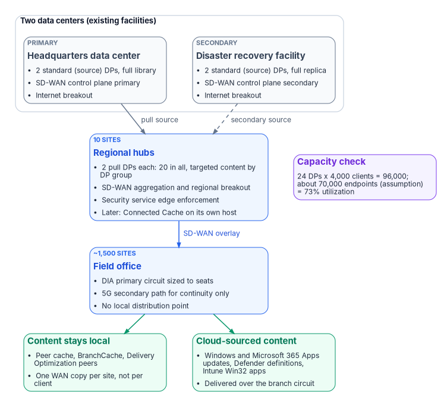
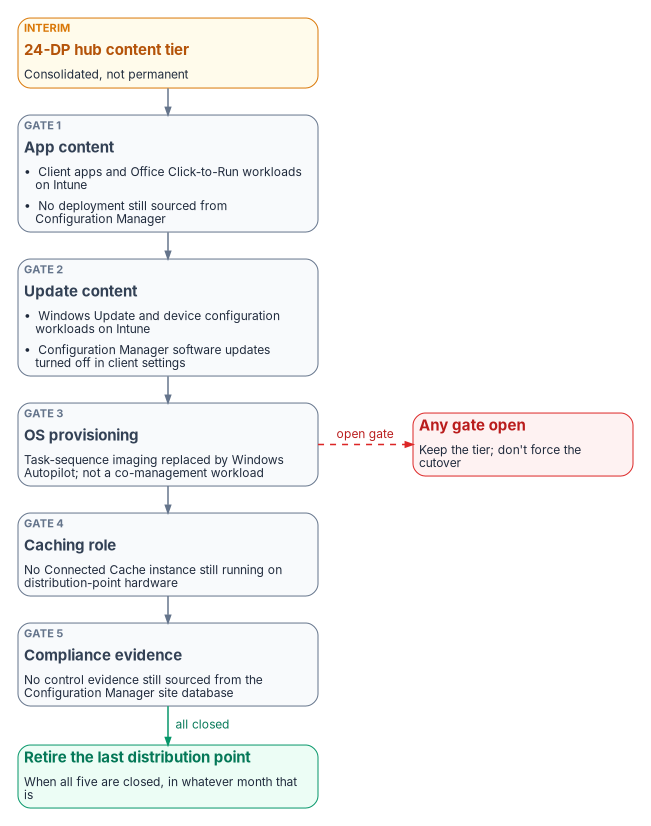

# Chapter 11 — Field Office WAN Transformation

*When every office needs its own copy of the content library, the circuit is the problem, and the fix belongs at the transport layer.*

::: {.callout-note}
## In this chapter
A worked case: a large field-office estate is asked to fund a refresh of a Configuration Manager distribution point at every office. The chapter tests that request against Microsoft's published capacity limits, shows why the office count, not the client count, drives it, and sets out the alternative: SD-WAN over dedicated internet access with a 5G continuity path, and a consolidated content tier at 12 hub sites. It carries the author's cost model with every input labeled as an assumption, the roadmap, the five gates that decide when the last distribution point can retire, and the risks.
:::

The case is a framing pattern, not a real engagement. The numbers describe an estate that many civilian agencies will recognize: about 1,500 field offices, about 70,000 managed Windows endpoints, branch traffic carried over MPLS to a central gateway, and a Configuration Manager distribution point in nearly every office because the circuit to that office was once too slow to do anything else. A proposal asks for about \$50 million to refresh those distribution points. This chapter is the analysis a program would put in front of the budget authority before that money is committed.

The argument runs in three steps. First, the unit cost doesn't reconcile to a distribution point, and the timing directs capital at a tier the endpoint strategy is already shrinking. Second, Configuration Manager's own limits say the estate needs about 24 distribution points, not 1,500; the other 1,476 exist only because of the branch circuits. Third, fixing the circuits is cheaper, may pay for itself, and is a prerequisite for the Intune migration, which [Book 05](../b05-devices/index.md) covers.

{#fig-ch11-hub-content-tier fig-alt="Top: a cluster of two data centers, the headquarters data center and the disaster recovery facility, each with two standard source distribution points holding the full content library, an SD-WAN control plane instance and internet breakout. Both feed a box for ten regional hubs, the primary data center as the pull source and the secondary as a dashed secondary source. The regional hubs hold two pull distribution points each, twenty in all, carrying targeted content, plus SD-WAN aggregation, regional breakout, security service edge enforcement and, later, Connected Cache on its own host. Beside the hubs a capacity note reads: 24 distribution points times 4,000 clients equals 96,000; about 70,000 endpoints, an assumption, is 73 percent utilization. The hubs connect over the SD-WAN overlay to a field office box for about 1,500 sites with a dedicated internet access circuit sized to seats, a 5G secondary path for continuity only, and no local distribution point. The field office leads to two green boxes: content stays local through peer cache, BranchCache and Delivery Optimization peers, one WAN copy per site rather than per client; and cloud-sourced content such as Windows and Microsoft 365 Apps updates, Defender definitions and Intune Win32 apps is delivered over the branch circuit."}

::: {.callout-important}
## Read this first
Every cost figure in this chapter is a planning estimate from the program's own analysis, not a quote and not a vendor's published price unless a footnote says so. The financial case turns on one number the analysis doesn't hold: current MPLS cost per office per month. The [assumptions](#assumptions-to-validate) section lists it and nine others that must be replaced with the estate's own data before any figure here goes into a budget submission.
:::

## Scope

The case answers three questions. Does every field office need a distribution point? If not, how many are needed, and where? What network investment makes a consolidated content tier work, and what does it cost against the refresh?

In scope are the Configuration Manager content architecture for the field offices, branch transport and edge design, hub count and placement, content-tier sizing, a five-year cost comparison with sensitivity, and alignment with the co-management and Intune migration. Out of scope are air-gapped and separately accredited enclaves, which keep Configuration Manager and local distribution points; data center and headquarters campus networks; endpoint hardware refresh, application packaging and the sequencing of Intune workloads (Book 05 owns those); and voice, contact center and physical security networks.

Cloud-dependent elements are scoped to Microsoft 365 Government Community Cloud (GCC). Microsoft 365 GCC is listed on the FedRAMP Marketplace as FedRAMP Certified at Class C, the Marketplace's label for Moderate; a second listing for the same service is in process at High.[^c11-fr-m365] GCC is a favorable place to run Intune: Intune has no separate GCC instance, so a GCC tenant uses the commercial Intune service, and the Intune feature gaps Microsoft documents apply to GCC High and DoD.[^c11-intune-gov] One exception matters to this design, and it is closed rather than open: Microsoft 365 informed network routing isn't available to GCC tenants (see [Microsoft 365 path optimization](#microsoft-365-path-optimization-in-gcc)).

## The proposal under review

The request is about \$50,000,000 to refresh distribution point hardware across about 1,500 offices: \$33,333 per office. The program's unit-cost reconciliation, using its own planning prices, looks like this:

| Configuration | Planning unit cost (assumption) | × 1,500 | Assessment |
|---|---|---|---|
| Small form factor PC, right-sized | \$3,500 | \$5.3M | Adequate for a small office; no ECC memory or out-of-band management |
| 1U rack server, ECC, out-of-band management, redundant power | \$12,000 | \$18.0M | An appropriate server-class platform |
| 1U server plus \$4,000 per-site deployment | \$16,000 | \$24.0M | Includes field installation labor |
| **Proposed estimate** | **\$33,333** | **\$50.0M** | **About twice the fully loaded server case** |

The gap means one of two things, and the difference decides how to compare the alternative:

- **A five-year total cost of ownership presented as an equipment refresh.** Hardware, warranty extension, deployment labor at 1,500 dispersed sites, compliance sustainment and contractor overhead can reach this figure. If that is what it is, the alternative has to be compared on total cost of ownership too, which the [cost model](#cost-model-and-sensitivity) does.
- **Scope bundled beyond the distribution point.** Circuit upgrades, branch switching, uninterruptible power or racks. All may be worth funding, but none is a distribution point, and each should be judged on its own merits.

::: {.callout-note}
## Decomposition request
Before any comparison is credible, the sponsor should state whether \$50M is acquisition cost or five-year total cost of ownership, and itemize any scope beyond the distribution point itself.
:::

### The timing problem

Independent of unit cost, the money goes to a tier the endpoint strategy is already shrinking. Microsoft has moved Configuration Manager to an annual release cadence starting with version 2609, said that Intune is where all new device-management innovation will happen, and said that Configuration Manager will keep serving on-premises devices with a focus on security, stability and long-term support.[^c11-cadence] Version 2609 shipped on September 28, 2026, and is supported until March 28, 2028; each current-branch version is supported for 18 months.[^c11-versions]

Configuration Manager isn't end-of-life, and the distribution point role isn't deprecated. But hardware bought in FY26 depreciates through FY31. If co-management completes in three to four years, the estate will have funded 1,500 devices for one or two years past their use, and will own their disposal.

It is also a doctrine question. The program's Intune-first onboarding decision allows no greenfield Configuration Manager and no co-management for new assets ([Book 05, Chapter 04](../b05-devices/04-intune-first-onboarding.md)); existing co-management workloads continue on their migration path. The 24-distribution-point tier in this chapter consolidates the *existing* footprint; it doesn't expand it. A budget submission built on this case should say so, so that it reads as consistent with that decision rather than in tension with it.

::: {.callout-note}
## The question that sizes the requirement
What is the planned distribution point count when co-management completes, and in which fiscal year? A refresh needs a target inventory. If the answer is well below 1,500, the proposal buys assets whose useful life is shorter than their depreciation schedule.
:::

## Why per-office distribution points are no longer the model

A distribution point is a content host. Configuration Manager separates policy from content: the management point tells the client what to do, and the distribution point serves the bytes. The role runs on IIS, transfers content with the Background Intelligent Transfer Service (BITS) and needs Remote Differential Compression; it serves files from the content library, a single-instance store that the site keeps on every distribution point.[^c11-dp-prereq][^c11-contentlib] It holds no site database and makes no policy decisions. That thinness is why placement is an economic question, not a functional one.

### Published capacity limits

| Constraint | Documented limit | What it means at this scale |
|---|---|---|
| Clients per distribution point | 4,000 | 70,000 endpoints need 18 at the ceiling; 24 with headroom |
| Standard distribution points per primary or secondary site | 250 | A 1,500-DP topology is impossible without pull DPs |
| Additional pull distribution points per site | 2,000 | 1,500 is possible only as, for example, 250 standard plus 1,250 pull |
| Distribution points per primary site, including its secondary sites | 5,000 | Not binding here; with a stand-alone primary and no secondary sites, the 2,250 figure above is the ceiling |
| Packages and applications per distribution point | 10,000 | Not binding |
| Windows clients per stand-alone primary site | 150,000 (175,000 devices in all) | 70,000 endpoints fit in one site |
| Clients per management point | 25,000 | 70,000 endpoints need at least three management points, wherever the DPs sit |

All of these figures are from Microsoft's size-and-scale page.[^c11-sizescale] The same page warns that the real number of clients one distribution point can serve depends on network speed and server hardware, and that a pull DP acts like a client when it fetches content from its source. Treat 4,000 as a ceiling to stay under, not a target.

The first row decides the case. On capacity grounds, 70,000 endpoints need 24 distribution points. The proposal contemplates 1,500. The other 1,476 serve no Configuration Manager requirement; they compensate for branch transport.

### What the distributed model costs

| Dimension | At 1,500 distribution points |
|---|---|
| Duplicated storage | 1.5 to 3 PB of replicated content (1,500 copies of a 1–2 TB library), most of it never requested at most sites |
| Distribution fan-out | Every package replicates to 1,500 targets. Microsoft warns that pull DPs all request content at the same time and can request all available content, loading the source DP and delaying distribution[^c11-sizescale] |
| Topology complexity | Needs a tiered pull hierarchy, distribution point groups and staggered schedules to stay stable |
| Compliance sustainment | 1,500 servers to baseline, scan, patch and carry in the system security plan |
| Field support | No out-of-band management on small form factor platforms; a hung server is a site visit |
| Refresh obligation | A capital event every five years, indefinitely |

### What changed since the model was adopted

- **Content moved to the cloud.** Windows feature and quality updates, Microsoft 365 Apps, Defender definition updates, Store apps and Intune Win32 apps come from Microsoft's content delivery network, and Delivery Optimization and Microsoft Connected Cache handle that class of content without agency-owned content infrastructure.[^c11-mcc-ent]
- **Peer distribution matured.** Configuration Manager peer cache lets designated clients serve content from their own cache to other clients in the same boundary group; BranchCache and Delivery Optimization peering do the same for other content. The goal is one WAN transfer per site instead of one per client, with no server to accredit or refresh.[^c11-peercache] The mechanics are covered [below](#keeping-content-local-without-a-server).
- **Branch transport economics inverted.** The per-office model was justified against expensive, congested, low-bandwidth circuits. The program's working assumption is that dedicated internet access at 200 Mbps to 1 Gbps now costs less per office than the MPLS it replaces while carrying several times the bandwidth. That is Assumption 1 in disguise, and it is the first thing to check.

::: {.callout-important}
## The accurate statement
The distribution point role isn't obsolete. The distribution-point-per-office topology is. Distribution points remain the right mechanism for serving Configuration Manager content to on-premises clients; what is obsolete is the assumption that every office needs a local copy of the content library.
:::

### Distribution points and Intune sit in different compliance postures

Apart from cost and capacity, a distribution point and Intune carry different compliance work, and the difference matters to the cost model.

| Dimension | Configuration Manager distribution point | Intune in a GCC tenant |
|---|---|---|
| Authorization boundary | An on-premises Windows Server and IIS site system the agency owns end to end | A cloud service. Intune serves GCC from its commercial instance and is in scope for the Azure commercial FedRAMP High authorization (a P-ATO, in Microsoft's pre-2026 term; [Book 10, Chapter 03](../b10-cloud-boundary/03-what-changed-at-fedramp.md)); the agency inherits through that package's customer responsibility matrix[^c11-intune-gov][^c11-intune-fedramp][^c11-fedramp-scope] |
| Hardening baseline | The agency's Windows Server and IIS baselines, for example the DISA IIS 10.0 Server and Site STIGs, applied and scanned per server[^c11-stig] | The agency configures policies and profiles; hardening of the service is the provider's inherited responsibility |
| Vulnerability and flaw remediation (RA-5, SI-2) | Scanning and patching every DP's OS and IIS stack, for as many DPs as exist | The service backend is the provider's; the endpoint OS is scanned either way |
| Continuous monitoring (CA-7) | A DP has no compliance state of its own; a stalled or compromised DP is invisible unless separately instrumented | Per-device compliance is evaluated continuously and feeds Conditional Access ([Book 04](../b04-access/03-the-conditional-access-model.md)) |
| Transmission confidentiality (SC-8) | Available, by configuring the DP for HTTPS with a PKI certificate, but a per-server setting to verify | TLS to the service is the default |
| System security plan footprint | Each DP is a component: its own inventory line, POA&M items and place in the boundary | Covered by the service's authorization, not a separate component |

None of this is a substitution. For as long as any distribution point exists, its baseline, scan cadence and SSP entries are a compliance program in addition to whatever covers the Intune-managed fleet. The cost model prices DP hardware and licensing; it doesn't price that labor. Consolidating to 24 servers cuts the component count to under 2 percent of 1,500, though the labor doesn't fall in strict proportion, and it doesn't fall to zero until the [retirement gates](#when-to-retire-the-last-distribution-point) close.

## Target architecture

### Design principles

1. Size the content tier to client capacity, not to office count.
2. Solve the transport problem at the transport layer instead of working around it with distributed content.
3. Put network aggregation, internet breakout and content services at one set of hub facilities under one accreditation boundary.
4. Design the hubs so they can host Microsoft Connected Cache later without re-siting or re-accrediting.
5. Sequence branch migration to MPLS contract renewal dates so the program funds itself as it goes.
6. Treat every cloud-dependent optimization as an enhancement, never as a design dependency.

### Hub topology: 12 sites

| Hub class | Count | Location basis | Role |
|---|---|---|---|
| Primary data center | 1 | Headquarters campus | Source content library, SD-WAN control plane primary, breakout |
| Secondary data center | 1 | Existing disaster recovery facility | Library replica, control plane secondary, breakout |
| Regional hub | 10 | Existing regional office locations | SD-WAN aggregation, regional internet breakout, pull distribution points |

The hubs use existing facilities, so no new real estate, power or accreditation boundary is needed. Twelve sites puts every office within a reasonable latency of an aggregation point and produces a perimeter that can actually be monitored and accredited. Local breakout at 1,500 offices is a multi-year undertaking; breakout at 12 hubs fits in one package, which is why regional breakout is the usual first step. [Chapter 02](02-transport-is-physics-control-is-compliance.md) makes the physics argument and [Chapter 03](03-what-tic-3-requires.md) the TIC 3.0 one; this chapter doesn't repeat them.

### Content tier: 24 distribution points

| Sizing input | Value | Basis |
|---|---|---|
| Managed endpoints | 70,000 | Assumption 2; validate from the Configuration Manager device count |
| Clients per distribution point | 4,000 | Published limit[^c11-sizescale] |
| Theoretical minimum | 18 | 70,000 ÷ 4,000, rounded up |
| Design utilization | 73% | 70,000 ÷ 96,000; headroom for growth and regional imbalance |
| **Distribution points deployed** | **24** | **2 per hub across 12 sites** |
| **Deployed capacity** | **96,000 clients** | **37% above the current estimate** |

| Site | DPs | Type | Function |
|---|---|---|---|
| Primary data center | 2 | Standard (source) | Full content library; source for all pull DPs; high-availability pair |
| Secondary data center | 2 | Standard (source) | Full library replica; secondary pull source; high-availability pair |
| Regional hubs (10) | 20 | Pull | Targeted content subset; two per hub for capacity and availability |
| **Total** | **24** | — | **96,000-client capacity across 12 sites** |

Making the regional DPs pull distribution points that source from the two data centers takes distribution load off the site server and turns the fan-out problem into a 2-to-20 relationship instead of 1-to-1,500.[^c11-pulldp] Distribution point groups then limit each hub to the packages its region actually uses. Every office's boundary must be in a boundary group whose content sources are its regional hub's DPs, with the other hubs as fallback, so clients land on the right pair.

| Tier | Usable storage | Rationale |
|---|---|---|
| Data center source DP | 8 TB | Full library plus growth and a prestaging area |
| Regional pull DP | 4 TB | Targeted subset, estimated at 60% of the full library, plus growth |
| Current library size | 1.5 TB | Assumption 3; measure `SCCMContentLib` on an existing DP |

::: {.callout-note}
## Sizing trigger
Add two distribution points per 8,000 net new managed endpoints, or when sustained load at any hub exceeds 3,200 clients per DP (80% of the published ceiling). If the validated population exceeds 90,000, go to 28 DPs by adding a third at the four largest regional hubs (112,000 capacity, 80% utilization at 90,000).
:::

### Branch network

Every office gets two paths: a dedicated internet access (DIA) circuit sized to seat count, and a 5G fixed-wireless secondary for continuity. An SD-WAN overlay provides application-aware routing and segmentation; [Chapter 05](05-sd-wan-sase-and-governed-transport.md) covers what SD-WAN can and can't do. The bill of materials uses one vendor's line as a costable example, not a recommendation; the sizing and topology don't depend on the vendor.

| Tier | Offices (assumption) | Seats | Primary circuit | Example edge platform (Cisco Catalyst) |
|---|---|---|---|---|
| S | 750 | Up to 25 | 200–300 Mbps DIA | C8200L-1N-4T, up to 500 Mbps IPsec |
| M | 525 | 26–50 | 500 Mbps DIA | C8200-1N-4T, up to 1 Gbps IPsec |
| L | 225 | 51–100 | 1 Gbps DIA | C8300-1N1S-4T2X |
| All | 1,500 | — | 5G secondary path | P-5GS6-GL pluggable module or CG522-E cellular gateway |

The throughput figures for the 8200 models are Cisco's published 1,400-byte IPsec numbers; Cisco rates them lower for mixed (IMIX) traffic, at 400 Mbps and 900 Mbps.[^c11-cisco8200] The 8300 and the 8500L hub platform are rated well above these circuits.[^c11-cisco8300][^c11-cisco8500]

- **Symmetric and SLA-backed beats raw bandwidth.** A 20-seat office needs low jitter and a service-level agreement, not a gigabit. The program's position is that 300 Mbps of DIA serves voice, virtual desktop and Teams better than 1 Gbps of best-effort cable.
- **5G is a continuity path, not a capacity path.** Carrier fixed-wireless plans commonly let the carrier prioritize traffic by plan and usage during congestion; read the plan's network-management terms before relying on it.[^c11-tmo] It will keep an office working through an outage. It won't carry a feature-update wave, and content policy should keep bulk downloads off the secondary path.
- **Verify diversity physically.** Cable plus 5G is genuinely diverse. Two nominally different fiber providers often share one conduit into the building. Require documented physical path diversity per site.
- **Confirm encrypted-throughput licensing.** On this platform family, ordering more than 250 Mbps of encrypted throughput requires an HSECK9 license on every model except the 8500 and 8500L.[^c11-ciscolic] Tier S offices at 300 Mbps therefore need it too. Buying 1 Gbps circuits against a 250 Mbps crypto entitlement is the most common, and most expensive, costing error with this class of edge.

The example vendor's cloud-hosted controller service, Cisco Catalyst SD-WAN for Government, is listed as FedRAMP Certified at Class C (Moderate).[^c11-fr-sdwan] The cost model below assumes an on-premises control plane instead; either way, the controller and edges are attack surface that [Chapter 05](05-sd-wan-sase-and-governed-transport.md) covers. CISA's ED 26-03 hardening guidance for this platform points the other way: it says to host the infrastructure in GovCloud and that federal organizations should migrate to FedRAMP-compliant cloud infrastructure, so the on-premises control-plane line in the bill of materials may change; the risks table carries it.[^c11-edsupp]

### Keeping content local without a server

Without a branch distribution point, three peer mechanisms keep most bytes off the WAN. They are optimizations, not dependencies: if any is blocked, clients pull from the hub over a circuit sized for it.

- **Configuration Manager peer cache.** Clients you enable as peer cache sources serve content from their cache to clients in the *same current boundary group*; the management point doesn't offer peer sources from a neighbor group. A source must be a domain-joined Configuration Manager client, and sources refuse requests when on low battery, above 80% CPU or under heavy disk I/O.[^c11-peercache] Peer downloads use HTTP or HTTPS on TCP 8003, with UDP 8004 for the Windows PE broadcast, not SMB.[^c11-clientsettings]
- **BranchCache.** Configuration Manager can enable BranchCache on clients through client settings; clients use it when the distribution point supports it.[^c11-peercache][^c11-clientsettings]
- **Delivery Optimization.** For cloud content, Delivery Optimization peers on TCP 7680; blocking that port disables peering but not downloads.[^c11-do-config] Its default LAN mode groups devices that share a public IP address. That is right for an office with its own DIA breakout, and wrong while branch traffic still egresses at a hub, because every office behind one hub then shares the hub's address. Microsoft's guidance for hub-and-spoke topologies is Group mode, restricting peer selection to the subnet, or both; Group mode is the option it recommends for most organizations.[^c11-do-config][^c11-do-ref]

So the segmentation question isn't whether workstation-to-workstation SMB is allowed. It is whether the branch segmentation policy allows client-to-client traffic on these ports at all (Assumption 9).

### Microsoft 365 path optimization in GCC

Microsoft 365 informed network routing (INR) shares circuit-quality feedback between Microsoft and an SD-WAN controller so the edge can move Microsoft 365 traffic off a degraded circuit. Microsoft's page lists one integrated solution, Cisco IOS XE SD-WAN 20.4/17.4 or later, and states that INR supports tenants in the worldwide commercial cloud "but not the GCC Moderate, GCC High, DoD, Germany, or China clouds."[^c11-inr] For this estate that is settled, not pending. [Book 08, Chapter 05](../b08-ddi/05-edge-interception-and-bypass.md) and [Appendix C](../b08-ddi/appendix-c-applicability.md) record the same finding.

The absence of INR doesn't remove SD-WAN's value. Direct breakout of Microsoft 365 traffic, application-aware routing on path metrics the edge measures itself, and QoS marking on the overlay are all available in GCC, and they are the baseline design from Phase 1, not a later enhancement. How Microsoft 365 traffic meets an inspect-everything boundary is [Chapter 12](12-microsoft-365-traffic.md)'s subject.

### Security and TIC 3.0

Regional breakout means operating under a CISA TIC 3.0 use case for branch offices, with a security service edge doing the inspection the central gateway used to do.[^c11-tic-branch] It also removes branch traffic from the MTIPS sensors that feed CISA's telemetry, which has to be replaced before MPLS is turned off. [Chapter 03](03-what-tic-3-requires.md) states the TIC 3.0 requirements, the telemetry replacement through CISA's Comprehensive Log Aggregation Warehouse (CLAW) and Protective DNS, and the control mapping for SD-WAN and branch breakout. This chapter takes three consequences from it:

- **Accreditation is the critical path.** The program plans on circuits in about ninety days; an authorized breakout architecture takes far longer. Starting with 12 hubs instead of 1,500 offices shrinks the accreditation surface by two orders of magnitude, and it is the main reason the roadmap starts at the hubs.
- **Telemetry continuity gates MPLS retirement.** No office's MPLS circuit is decommissioned until replacement telemetry for that office is confirmed, and the coordination with CISA and the SASE provider starts in Phase 0.[^c11-cisa-sase]
- **The compliance case and the cost case point at the same build.** The controls that branch breakout has to answer for are claimed by the SD-WAN, SASE and diverse-transport design in this section, not by servers in a closet. So the design holds even if the sensitivity analysis comes out against it.

Several security service edge offerings are FedRAMP Certified: for example, Zscaler Internet Access – Government and Palo Alto Networks Government Cloud Services at Class C (Moderate), and Netskope NewEdge Government and Skyhigh Security Service Edge at Class D (High).[^c11-fr-sse] The Zscaler entry is the Moderate listing (FR1720454205); Zscaler's High offering is a separate listing (FR2227062482, Class D), the one shown in [Chapter 05](05-sd-wan-sase-and-governed-transport.md).[^c11-fr-sse] The SD-WAN design doesn't depend on which one is chosen.

### When to retire the last distribution point

The 24-DP tier is the *interim* consolidated state, not a new floor. Co-management has seven workloads: compliance policies, Windows Update policies, resource access policies, Endpoint Protection, device configuration, Office Click-to-Run apps and client apps. Resource access is no longer a separate decision; Configuration Manager stopped supporting it in version 2203, and from version 2403 its slider is mandated to Intune.[^c11-comanage] A distribution point still has work for every content path that hasn't moved. "Some workloads are on Intune" isn't the same claim as "the content tier can be decommissioned," and modernization timelines often conflate the two. So the trigger is a checklist, not a date.

{#fig-ch11-retirement-gates fig-alt="An amber box at the top, the 24-DP hub content tier labeled interim, consolidated not permanent, leads down through five slate gate boxes in sequence. Gate 1, app content: client apps and Office Click-to-Run workloads on Intune, and no deployment still sourced from Configuration Manager. Gate 2, update content: Windows Update and device configuration workloads on Intune, and Configuration Manager software updates turned off in client settings. Gate 3, OS provisioning: task-sequence imaging replaced by Windows Autopilot, not a co-management workload. Gate 4, caching role: no Connected Cache instance still running on distribution-point hardware. Gate 5, compliance evidence: no control evidence still sourced from the Configuration Manager site database. Gate 5 leads, labeled all closed, to a green box: retire the last distribution point when all five are closed, in whatever month that is. A dashed red arrow labeled open gate leads from the gate sequence to a red box: any gate open, keep the tier and don't force the cutover."}

| Gate | Closed when | Why it binds |
|---|---|---|
| 1. App content | The client apps and Office Click-to-Run apps workloads are on Intune for the whole validated population, **and** no required or available deployment is still published from Configuration Manager | Switching the client apps slider doesn't withdraw Configuration Manager deployments: apps deployed from Configuration Manager stay in Software Center, and they still download from a DP.[^c11-comanage] The app catalog has to move, not just the slider |
| 2. Update content | The Windows Update policies and device configuration workloads are on Intune, and Configuration Manager's software-update client setting is turned off for those devices | After the Windows Update workload moves, the Configuration Manager client settings must be changed by hand to disable its update workflow.[^c11-comanage] These two workloads are also Windows Autopatch's co-management prerequisite, a useful external anchor for the timeline[^c11-autopatch] |
| 3. OS provisioning | Bare-metal imaging has moved from task sequences to Windows Autopilot | OS deployment isn't a co-management workload, so the slider model doesn't cover it. It is the most common reason a "just in case" DP survives everything else (Assumption 8) |
| 4. Caching role | No Connected Cache instance runs on distribution-point hardware, or none is needed on the new circuits | Connected Cache can run on a DP and serve Intune Win32 apps and other cloud content to co-managed and cloud-managed clients, so a DP can pass Gates 1–3 in a caching-only role and still need patching, accreditation and a site-system footprint[^c11-mcc-cm] |
| 5. Compliance evidence | Compliance and Endpoint Protection reporting no longer cite the Configuration Manager site database as their evidence source | Closing content delivery doesn't close the reporting dependency; confirm with security architecture before decommissioning the site infrastructure that produces the evidence |

::: {.callout-note}
## A gate, not a date
The roadmap's Phase 3 narrows Configuration Manager "as co-management progresses," and that vagueness is intentional. An estate that closes all five gates in month 30 should retire its last distribution point in month 30. One that hasn't closed them by month 60 should keep the 24-DP tier rather than force a cutover against an open gate.
:::

### Connected Cache at the hubs

Connected Cache is the natural successor to the hub DPs for cloud content, and there are two forms. The Configuration Manager–integrated cache runs on an on-premises distribution point that has no other site roles; it serves only content for workloads that have moved to Intune, never Configuration Manager's own deployments, and it serves only clients in the same boundary group.[^c11-mcc-cm] Microsoft Connected Cache for Enterprise and Education is a stand-alone software cache managed from the Azure portal. It runs on Windows Server 2022 or later, Windows 11 or Ubuntu 24.04; it needs an Azure subscription (the resource itself carries no Azure charge); and its host must have nothing else on port 80, which rules out sharing a server with a distribution point.[^c11-mcc-ent][^c11-mcc-prereq] Microsoft lists a decommissioned distribution point as suitable host hardware, and a Windows 11 client as a host option for a branch office of 10 to 50 devices.[^c11-mcc-ent] Each device that downloads from either form needs a Windows Enterprise E3 or E5 (or equivalent education or VDA) license.[^c11-mcc-cm][^c11-mcc-prereq]

For a GCC tenant, the stand-alone form is listed as not available only in GCC High and DoD, consistent with GCC using Intune's commercial service.[^c11-intune-gov] The design consequence: principle 4 holds, but "the hub becomes the Connected Cache footprint" means a separate host (or a re-purposed DP after Gate 4) at each hub, inside the same accreditation boundary, and the Azure resource that manages the caches has to be placed in the boundary analysis. Nothing in Phases 0 through 2 depends on it.

## Sizing and bill of materials

Hardware figures apply a 40% discount to the program's planning list prices, its estimate of typical reseller and enterprise-agreement terms. Vendor list prices aren't published for most of these items, so treat every list figure as the program's assumption except where a footnote cites the vendor. An agency choosing a different SD-WAN vendor substitutes equivalent lines; the sizing logic doesn't change.

### Branch equipment

| Item | Qty | Planning list | Net | Extended |
|---|---|---|---|---|
| Tier S edge (example C8200L-1N-4T) | 750 | \$2,500 | \$1,500 | \$1,125,000 |
| Tier M edge (example C8200-1N-4T) | 525 | \$4,000 | \$2,400 | \$1,260,000 |
| Tier L edge (example C8300-1N1S-4T2X) | 225 | \$10,000 | \$6,000 | \$1,350,000 |
| 5G module or cellular gateway | 1,500 | \$1,500 | \$900 | \$1,350,000 |
| **Branch subtotal** | — | — | — | **\$5,085,000** |

### Hub equipment

| Item | Qty | Planning list | Net | Extended |
|---|---|---|---|---|
| Hub edge, high-availability pairs at 12 sites (example C8500L-8S4X) | 24 | \$30,000 | \$18,000 | \$432,000 |
| Distribution point servers (1U, ECC, out-of-band management) | 24 | \$12,000 | \$12,000 | \$288,000 |
| Windows Server 2025 Standard, 16-core license | 24 | \$1,176 | \$1,176 | \$28,224 |
| Hub switching, rack, power, cabling | 12 | \$25,000 | \$25,000 | \$300,000 |
| **Hub subtotal** | — | — | — | **\$1,048,224** |

The Windows Server figure is Microsoft's suggested retail price for a 16-core Standard license.[^c11-wsprice]

### Control plane and services

| Item | Basis | Extended |
|---|---|---|
| SD-WAN manager, validator and controller cluster, on premises, two sites | 14 virtual machines plus compute | \$400,000 |
| Zero-touch provisioning staging and remote configuration | 1,500 sites at \$800 | \$1,200,000 |
| Field installation where zero-touch isn't viable | 300 sites at \$2,500 | \$750,000 |
| Architecture, control plane build, hub deployment, migration engineering | Professional services | \$1,500,000 |
| **Control plane and services subtotal** | — | **\$3,850,000** |

The 14 virtual machines match Cisco's 20.18 on-premises sizing for 1,500 to 2,000 devices: a three-node Medium manager cluster, two controllers and two validators at each of the two sites. A manager cluster tops out at 2,000 devices, and Cisco's answer beyond that is multiple overlays; this design's roughly 1,524 edges (1,500 offices plus 24 hub edges) would use about 76% of it.[^c11-ciscosizing]

### Year 1 capital

| Component | Amount |
|---|---|
| Branch equipment | \$5,085,000 |
| Hub equipment | \$1,048,224 |
| Control plane and services | \$3,850,000 |
| **Total Year 1 capital** | **\$9,983,224** |

## Cost model and sensitivity

### Annual recurring cost at steady state

| Component | Basis (assumption) | Annual |
|---|---|---|
| DIA, tiered by office class | 750 at \$350, 525 at \$500, 225 at \$800 per month | \$8,460,000 |
| 5G secondary path | 1,500 at \$75 per month | \$1,350,000 |
| SD-WAN subscription, branch | 1,500 at \$500 per year | \$750,000 |
| SD-WAN subscription, hub | 24 at \$3,000 per year | \$72,000 |
| Analytics and control plane support | Annual | \$100,000 |
| Hub internet transit | 12 at \$3,000 per month | \$432,000 |
| Security service edge licensing | 70,000 users at \$65 per year | \$4,550,000 |
| **Total recurring** | — | **\$15,714,000** |
| Less: MPLS retired | 1,500 at \$1,200 per month (Assumption 1) | −\$21,600,000 |
| **Net annual position** | — | **−\$5,886,000** |

At steady state, on these assumptions, the program returns about \$5.9M a year against today's transport spend.

### Five-year phased position

Savings ramp as offices move to local transport at MPLS contract renewal, not on day one.

| Year | Migration | Capital | Net savings | Cumulative |
|---|---|---|---|---|
| 1 | Design, hubs, pilot | \$10.0M | \$0 | −\$10.0M |
| 2 | 30% of offices | \$0 | \$1.77M | −\$8.23M |
| 3 | 70% of offices | \$0 | \$4.12M | −\$4.11M |
| 4 | 100% | \$0 | \$5.89M | +\$1.78M |
| 5 | Steady state | \$0 | \$5.89M | +\$7.67M |

The network program reaches a positive cumulative position in year four. The refresh reaches −\$50M in year one and recurs at the next refresh cycle. The five-year difference is about \$57.7M.

The comparison isn't scope for scope, deliberately. The \$50M funds content delivery only. The \$10M funds the network that consolidation depends on, and the same transport and hubs also carry Microsoft 365, Teams, TIC 3.0 breakout and the Intune migration. Funding the hub and transport layer once, instead of piecemeal under separate initiatives, is the argument. A sponsor who wants only the content problem solved should weigh the \$10.0M capital against the transport savings above, not against the full capability list.

### Sensitivity to current MPLS cost

| MPLS per office per month | Annual MPLS | Net annual position | Character |
|---|---|---|---|
| \$1,500 | \$27.0M | −\$11.29M | Strongly cash-positive |
| \$1,200 (base case) | \$21.6M | −\$5.89M | Cash-positive; capital repaid in about 20 months of steady-state savings |
| **\$873** | **\$15.7M** | **\$0** | **Breakeven** |
| \$800 | \$14.4M | +\$1.31M | Modest net cost |
| \$600 | \$10.8M | +\$4.91M | Net cost; justify on capability |
| \$400 | \$7.2M | +\$8.51M | Net cost; the financial argument inverts |

Breakeven is \$15,714,000 ÷ (1,500 offices × 12 months) = \$873 per office per month. Above it, the program funds itself and the recommendation is unambiguous. Below it, the program is still the better architecture and still cheaper than the refresh, but it has to be justified on capability and mission rather than cost avoidance, and the briefing should change accordingly once the number is known. [Chapter 13](13-sequencing-cost-and-evidence.md) covers how to measure these costs in your own estate.

## Implementation roadmap

| Phase | Timing | Activities | Exit criteria |
|---|---|---|---|
| 0 | Months 0–6 | Architecture and detailed design; the TIC 3.0 branch use-case package and accreditation; on-premises SD-WAN control plane; a ten-site pilot across all transport types and tiers; telemetry coordination with CISA started; serviceability survey | Authorization to operate for regional breakout; pilot sites stable for 30 days; validated per-site costs replacing this chapter's estimates |
| 1 | Months 6–18 | Twelve hubs: SD-WAN aggregation, regional breakout, security service edge enforcement, 24 consolidated DPs, content library migration and prestaging; replacement telemetry and encrypted DNS integration ([Chapter 03](03-what-tic-3-requires.md)) | All hubs in production; content served from the hub tier; office DPs in read-only fallback; replacement telemetry confirmed for the pilot sites |
| 2 | Months 18–48 | Office migration in waves keyed to MPLS renewal dates: DIA and 5G installation, overlay, cutover, MPLS termination | All offices on local transport; each office's MPLS retired **only after its replacement telemetry is confirmed**; office DPs retired |
| 3 | Months 36+ | Microsoft 365 direct-path optimization in production (not INR); Connected Cache at the hubs as Intune workloads shift; DPs retired as the gates close | Microsoft 365 path optimization in production with GCC's available mechanisms; Connected Cache serving cloud content; each gate tracked and closed explicitly |

Phase 0 is funded first, at about \$1.8M over six months, out of the Year 1 total.

### Why this order

- **Accreditation, not procurement, is the critical path.** Phase 0 exists to remove that constraint before capital is committed at scale.
- **Hubs first, because they close three problems at once.** Aggregation, regional breakout and the consolidated content tier arrive in one capital event at one set of facilities under one boundary.
- **Office waves follow contract expiry, not geography.** Migrating at renewal avoids early-termination liability and lets each wave fund the next.
- **Cloud dependencies wait for Phase 3, and INR is out of scope.** Nothing in Phases 0 to 2 depends on Connected Cache or co-management maturity. If Connected Cache slips or isn't authorized, the program still delivers.
- **The final cutover is gated, not scheduled.** "Months 36+" is a placeholder; the five gates decide.

## Risks and mitigations

| Risk | Rating | Mitigation |
|---|---|---|
| TIC 3.0 branch breakout accreditation slips | High | Start Phase 0 with the accreditation package. Fall back to hub-only breakout, a defensible end state that still removes the per-office DP. If a 12-month slip delays every migration wave, the five-year net falls from about +\$7.7M to about +\$1.8M and the advantage over the refresh from about \$57.7M to about \$51.8M; the case survives, but breakeven moves to year five |
| Current MPLS cost is below the assumption | High | Validate before submission. Below \$873, re-present the case on capability; it stays cheaper than \$50M |
| Replacement telemetry lags cutover, leaving a gap when MPLS is retired | High | Start the agency–CISA–provider coordination in Phase 0; gate each office's MPLS retirement on confirmed telemetry for that office ([Chapter 03](03-what-tic-3-requires.md)) |
| Encrypted throughput licensed below circuit speed | Medium | State the throughput entitlement per platform in the bill of materials; test under load in the pilot |
| Segmentation blocks client-to-client traffic | Medium | Peer cache, BranchCache and Delivery Optimization peering are optimizations. If blocked, offices pull from the hub over circuits sized for it |
| Twelve hubs concentrate risk | Medium | High-availability pairs at every hub, diverse transport, and a defined fallback to a secondary hub in SD-WAN policy |
| Terrestrial transport unavailable at some sites | Medium | Serviceability survey in Phase 0. The program's planning range is 5–15% of sites; use satellite or bonded cellular for that subset only |
| Telecom task-order changes across 1,500 sites delay transport | Medium | Engage acquisition in Phase 0 ([Chapter 09](09-who-owns-the-network.md)); sequence waves to renewals already in the pipeline |
| Control-plane hosting moves from on premises to a FedRAMP cloud | Medium | CISA's ED 26-03 hardening guidance says to host the infrastructure in GovCloud. Decide the hosting model in Phase 0 and record it as the boundary disposition ([Chapter 05](05-sd-wan-sase-and-governed-transport.md)); the \$400,000 on-premises control-plane line may change. A hosted controller doesn't remove the directive's obligations, which include steps for off-premises deployments[^c11-edsupp][^c11-edv1] |
| Static edge addresses conflict with zero-touch provisioning and the 5G path | Medium | CISA's hardening guidance expects a firewall in front of the controllers that allow-lists only known edge, controller, validator and manager addresses, so every edge needs a static IP. Cisco's hardening guide opens the onboarding port to any source only where zero-touch or dynamically addressed edges are needed, and the 5G secondary path probably conflicts too unless the carrier provides static addresses. Plan static addressing per circuit and confirm it with carriers in Phase 0[^c11-edsupp][^c11-ciscoharden] |
| No FIPS 140-3 certificate found covering the example edges in SD-WAN mode | Medium | The controllers are covered (Cisco FIPS Object Module, #4747). Cisco's current letters for the Catalyst 8200 and 8300 cite firmware-library certificates (#5356, #5430) without naming SD-WAN mode, and the Catalyst 8300 platform certificate (#4461) is historical. Ask the vendor in writing to name the 140-3 certificate covering the edges in SD-WAN mode, and record any gap as an accepted risk ([Chapter 10](10-the-long-interim.md))[^c11-ciscofips] |
| Post-quantum key exchange not yet available in SD-WAN mode on the example edges | Medium | M-26-15 requires PQC-capable key exchange on equipment that terminates IPsec ([Chapter 03](03-what-tic-3-requires.md)). Cisco documents hybrid ML-KEM for IKEv2 on these platforms only in autonomous mode. Require a dated vendor commitment for SD-WAN mode, and record the gap in the agency's M-26-15 migration plan[^c11-ciscopqc] |
| Chosen security service edge isn't FedRAMP authorized at the needed level | Low | Several are FedRAMP Certified at Moderate or High;[^c11-fr-sse] confirm the chosen one in Phase 0 |
| Connected Cache placement or authorization not settled | Low | The stand-alone cache isn't excluded for GCC, but its Azure management resource needs a boundary decision; nothing before Phase 3 depends on it |
| 5G coverage inadequate indoors | Low | Per-site survey; outdoor-mount gateway where needed |

## Assumptions to validate

These must be replaced with the estate's own data before any figure is used in a budget submission. They are ordered by impact on the conclusion.

| # | Assumption | Value used | How to validate |
|---|---|---|---|
| 1 | Current MPLS cost per office per month | \$1,200 | Telecom contract records; decides whether the program is cash-positive |
| 2 | Managed endpoint population | 70,000 | Configuration Manager device count; drives the DP count directly |
| 3 | Content library size | 1.5 TB | Measure `SCCMContentLib` on an existing DP |
| 4 | Seat distribution across offices | 750 / 525 / 225 | Facilities and HR headcount by location |
| 5 | Terrestrial transport availability | 85–95% of sites | Serviceability survey against site addresses |
| 6 | Current TIC 3.0 posture | Not yet authorized for branch breakout | Security architecture organization |
| 7 | Co-management maturity | Early | Track against the five gates rather than estimating a date; it also paces the consolidation framing |
| 8 | Field office OS deployment | Centralized or vendor-staged | If offices re-image locally, revisit PXE and local content |
| 9 | Client-to-client traffic at branches | Assumed blocked | Network security policy for TCP 8003, UDP 8004 and TCP 7680; affects peering only |
| 10 | Replacement telemetry onboarding | Not started | CISA; decides whether Phase 0 and 1 must absorb coordination lead time before any MPLS is retired |

::: {.callout-note}
## Confidence statement
The architectural conclusion, about 24 distribution points across 12 hubs instead of 1,500, comes from Microsoft's published limits and holds across the plausible range of Assumptions 2 to 10. The financial conclusion doesn't hold on its own: it depends on Assumption 1, and the case shouldn't be presented as a cost argument until that number is confirmed.
:::

## Recommendation

The refresh solves content delivery over constrained links by distributing infrastructure instead of fixing the constraint, at the moment the estate has committed to a management platform that reduces the need. A network program that addresses the same problem needs about \$10.0M in first-year capital, reaches a positive cumulative position in year four on base-case assumptions, helps every cloud workload rather than one, and is a prerequisite for the Intune migration, which makes it an enabling investment rather than a competing one.

1. Defer the \$50M refresh pending a network modernization assessment.
2. Ask the sponsor to state whether \$50M is acquisition cost or five-year total cost of ownership, and to itemize scope beyond the distribution point.
3. Validate the ten assumptions above, starting with MPLS cost per office and the endpoint population.
4. Fund Phase 0 (architecture, TIC 3.0 accreditation package, control plane, ten-site pilot) at about \$1.8M over six months.
5. Confirm the planned distribution point count when co-management completes, and the fiscal year. No refresh can be sized without it.
6. Put network modernization and content-tier consolidation under one program, since both resolve at the same twelve facilities.
7. Track the five retirement gates as the criterion for retiring the last distribution point, not the Phase 3 placeholder date.

::: {.callout-tip}
## Position statement for a briefing
The \$50M distribution point refresh solves content delivery over constrained field office links. An SD-WAN and regional breakout program solves the same problem for about \$10M in capital, is expected to be cash-positive by year four if current MPLS spend is above \$873 per office per month, is a prerequisite for the Intune migration, and helps every other cloud workload. Recommend deferring the refresh pending a network modernization assessment.
:::

::: {.callout-tip}
## Continue the book
[← Previous: Chapter 10 — The Long Interim](10-the-long-interim.md) · [Book index](index.md) · [Next: Chapter 12 — Microsoft 365 Traffic and the Optimize Inspection Exemption →](12-microsoft-365-traffic.md)
:::

[^c11-fr-m365]: FedRAMP Marketplace product data, packages MSO365MT and MSO365MTA, "Microsoft 365 Government Community Cloud & Supporting Services" (MSO365MT: status FedRAMP Certified, Class C, Moderate; MSO365MTA: FedRAMP In Process, High), <https://www.fedramp.gov/marketplace/products.json> (accessed Oct 21, 2026).
[^c11-intune-gov]: Microsoft Learn, "Microsoft Intune for US Government GCC High and DoD service description" (GCC uses the commercial Intune instance; Microsoft Connected Cache for Enterprise and Education listed as not available in GCC High and DoD), <https://learn.microsoft.com/intune/fundamentals/government-service> (accessed Oct 21, 2026).
[^c11-cadence]: Microsoft Tech Community, "Announcing the Annual Release Cadence for Microsoft Configuration Manager," Configuration Manager Blog, November 5, 2025, <https://techcommunity.microsoft.com/blog/configurationmanagerblog/-/4464794>; reported with the quoted statements in Petri, "Configuration Manager Moves to Yearly Releases as Microsoft Prioritizes Intune," November 7, 2025, <https://petri.com/microsoft-configuration-manager-yearly-releases/> (both accessed Oct 21, 2026).
[^c11-versions]: Microsoft Learn, "Updates and servicing for Configuration Manager," baseline and update versions table, <https://learn.microsoft.com/intune/configmgr/core/servers/manage/updates>; and "Support for Configuration Manager current branch versions" (18-month support per version), <https://learn.microsoft.com/intune/configmgr/core/servers/manage/current-branch-versions-supported> (both accessed Oct 21, 2026).
[^c11-dp-prereq]: Microsoft Learn, "Site and site system prerequisites for Configuration Manager," Distribution point section (BITS, Remote Differential Compression, IIS configuration), <https://learn.microsoft.com/intune/configmgr/core/plan-design/configs/site-and-site-system-prerequisites#distribution-point> (accessed Oct 21, 2026).
[^c11-contentlib]: Microsoft Learn, "The content library in Configuration Manager," <https://learn.microsoft.com/intune/configmgr/core/plan-design/hierarchy/the-content-library> (accessed Oct 21, 2026).
[^c11-sizescale]: Microsoft Learn, "Size and scale numbers for Configuration Manager" (distribution point, management point and site limits; warning on pull-DP simultaneous content requests), <https://learn.microsoft.com/en-us/intune/configmgr/core/plan-design/configs/size-and-scale-numbers> (accessed Oct 21, 2026).
[^c11-mcc-ent]: Microsoft Learn, "Microsoft Connected Cache for Enterprise and Education Overview" (supported content types, branch-office and large-site host options), <https://learn.microsoft.com/en-us/windows/deployment/do/mcc-ent-edu-overview> (accessed Oct 21, 2026).
[^c11-peercache]: Microsoft Learn, "Peer cache for Configuration Manager clients" (current boundary group only, domain-joined source, rejection conditions, BranchCache note), <https://learn.microsoft.com/en-us/intune/configmgr/core/plan-design/hierarchy/client-peer-cache> (accessed Oct 21, 2026).
[^c11-intune-fedramp]: Microsoft Learn, "Federal Risk and Authorization Management Program (FedRAMP)" (Microsoft Intune among in-scope services), <https://learn.microsoft.com/compliance/regulatory/offering-fedramp> (accessed Oct 21, 2026).
[^c11-fedramp-scope]: Microsoft Learn, "Azure, Dynamics 365, Microsoft 365, and Power Platform services compliance scope," Azure public services by audit scope (Microsoft Intune: FedRAMP High), <https://learn.microsoft.com/azure/azure-government/compliance/azure-services-in-fedramp-auditscope> (accessed Oct 21, 2026).
[^c11-stig]: Defense Information Systems Agency, "July 2025 Maintenance Release: STIGs to Be Released" (Microsoft IIS 10.0 Server STIG Version 3 Release 4; IIS 10.0 Site STIG Version 2 Release 12), <https://dl.dod.cyber.mil/wp-content/uploads/stigs/pdf/July-2025-STIGs-to-Be-Released.pdf> (accessed Oct 21, 2026).
[^c11-pulldp]: Microsoft Learn, "Fundamental concepts for content management in Configuration Manager," Distribution points (pull-distribution points avoid site-server bottlenecks), <https://learn.microsoft.com/intune/configmgr/core/plan-design/hierarchy/fundamental-concepts-for-content-management> (accessed Oct 21, 2026).
[^c11-cisco8200]: Cisco, "Cisco Catalyst 8200 Series Edge Platforms Data Sheet" (C8200-1N-4T up to 1 Gbps and C8200L-1N-4T up to 500 Mbps IPsec at 1,400 bytes; 900 and 400 Mbps IMIX), <https://www.cisco.com/c/en/us/products/collateral/routers/catalyst-8200-series-edge-platforms/nb-06-cat8200-series-edge-plat-ds-cte-en.html> (accessed Oct 21, 2026).
[^c11-cisco8300]: Cisco, "Cisco Catalyst 8300 Series Edge Platforms Data Sheet," <https://cisco.com/c/en/us/products/collateral/routers/catalyst-8300-series-edge-platforms/datasheet-c78-744088.html> (accessed Oct 21, 2026).
[^c11-cisco8500]: Cisco, "Cisco Catalyst 8500 Series Edge Platforms Data Sheet" (8500L up to 19 Gbps IPsec at 1,400 bytes), <https://cisco.com/c/en/us/products/collateral/routers/catalyst-8500-series-edge-platforms/datasheet-c78-744089.html> (accessed Oct 21, 2026).
[^c11-tmo]: As one example of published carrier terms, T-Mobile, "Network management practices" (Home Internet and fixed-wireless data prioritization), <https://www.t-mobile.com/home-internet/policies/internet-service/network-management-practices.html> (accessed Oct 21, 2026).
[^c11-ciscolic]: Cisco, "Configure Licenses and Throughput for Catalyst 8000 Series Physical Platforms," Ordering considerations (HSECK9 required above 250 Mbps on all variants except Catalyst 8500 and 8500L; throughput means cryptographic throughput), <https://www.cisco.com/c/en/us/td/docs/routers/cloud_edge/configure-licenses-throughput-catalyst-8000-platforms.html> (accessed Oct 21, 2026).
[^c11-edsupp]: Cybersecurity and Infrastructure Security Agency, *Supplemental Direction ED 26-03: Hunt and Hardening Guidance for Cisco SD-WAN Systems* (names CVE-2026-20127, CVE-2022-20775, CVE-2026-20133 and CVE-2026-20182; activity "likely began in 2023"; hardening: a firewall allow-listing only known edge, controller, validator and manager IPs, with static IPs on all edge appliances; "Host Infrastructure in GovCloud"; "Federal organizations should migrate to FEDRAMP-compliant cloud infrastructure"), <https://www.cisa.gov/news-events/directives/supplemental-direction-ed-26-03-hunt-and-hardening-guidance-cisco-sd-wan-systems> (accessed Oct 24, 2026).
[^c11-edv1]: Cybersecurity and Infrastructure Security Agency, "V1: ED 26-03: Mitigate Vulnerabilities in Cisco SD-WAN Systems," March 11, 2026, Required Actions, "If Off-Prem (cloud) deployments" (the agency requests the forensic snapshot and the AWS network logs from Cisco), <https://www.cisa.gov/news-events/directives/v1-ed-26-03-mitigate-vulnerabilities-cisco-sd-wan-systems> (accessed Oct 24, 2026).
[^c11-ciscoharden]: Cisco, *Cisco Catalyst SD-WAN Hardening Guide*, revision 1.1, February 9, 2026, network perimeter controls for self-hosted deployments (UDP 12346 to the Validator and Manager from any source only where zero-touch provisioning or dynamically addressed edges are needed), <https://sec.cloudapps.cisco.com/security/center/resources/Cisco-Catalyst-SD-WAN-HardeningGuide> (accessed Oct 24, 2026).
[^c11-ciscosizing]: Cisco, *Cisco Catalyst SD-WAN Control Components Compatibility Matrix and Recommended Computing Resources*, "Recommended Computing Resources for Release 20.18.x" (three-node Medium Manager cluster for 1,500 to 2,000 devices at 32 vCPU, 64 GB and 1 TB per node, up to 2,000 devices per cluster; two Controllers for 1,000 to 2,500 devices; two Validators for 1,000 to 4,000 devices; multiple overlays beyond cluster scale), <https://www.cisco.com/c/en/us/td/docs/routers/sdwan/release/notes/compatibility-and-server-recommendations/ch-server-recs-20-18-combined11.html> (accessed Oct 24, 2026). The 1,524-edge count and the 76% figure are this chapter's arithmetic.
[^c11-ciscofips]: Cisco, "FIPS 140" government certifications page and compliance letters (SD-WAN Manager, Validator and Controller 20.18, December 10, 2025, Cisco FIPS Object Module, certificate #4747; C8200, C8200L and C8300 on IOS XE 26.1, May 22, 2026, and IOS XE 17.18 letters, certificates #5356 with #5430 or #4747, without naming SD-WAN mode), <https://www.cisco.com/c/en/us/solutions/industries/government/global-government-certifications/fips-140.html>; and NIST Cryptographic Module Validation Program, validated-modules search (#4747 Cisco FIPS Object Module, FIPS 140-3, active; #5356 IOS Common Cryptographic Module and #5430 CiscoSSL FIPS Provider, FIPS 140-3, active; #4461 Cisco Catalyst 8300 Series Edge Platforms, Historical), <https://csrc.nist.gov/projects/cryptographic-module-validation-program/validated-modules/search> (accessed Oct 24, 2026).
[^c11-ciscopqc]: Cisco, "Post-Quantum Cryptography for IKEv2," IOS XE 26.1 (hybrid ML-KEM-512/768/1024 on C8100 to C8500 "only on these platforms in the autonomous mode"), <https://www.cisco.com/c/en/us/td/docs/routers/ios-xe/security-vpn/security-vpn/m-pqc-ikev2.html>, and *Quantum-Ready Migration Guide* (SD-WAN treated as a future change), <https://www.cisco.com/c/en/us/td/docs/solutions/CVD/Campus/Quantum-Ready-Migration-Guide.html> (accessed Oct 24, 2026).
[^c11-fr-sdwan]: FedRAMP Marketplace product data, package FR2012534927, "Cisco Catalyst SD-WAN for Government (SDWAN-G)" (status FedRAMP Certified, Class C, Moderate; agency path; certified March 14, 2024), <https://www.fedramp.gov/marketplace/products.json> (accessed Oct 21, 2026).
[^c11-clientsettings]: Microsoft Learn, "About client settings in Configuration Manager," Client cache settings (BranchCache; peer cache ports UDP 8004 and TCP 8003), <https://learn.microsoft.com/intune/configmgr/core/clients/deploy/about-client-settings#client-cache-settings> (accessed Oct 21, 2026).
[^c11-do-config]: Microsoft Learn, "Configure Delivery Optimization (DO) for Windows" (port 7680; LAN mode and the hub-and-spoke note), <https://learn.microsoft.com/windows/deployment/do/delivery-optimization-configure> (accessed Oct 21, 2026).
[^c11-do-ref]: Microsoft Learn, "Delivery Optimization reference," Download mode (Group mode recommended for most organizations), <https://learn.microsoft.com/windows/deployment/do/waas-delivery-optimization-reference#download-mode> (accessed Oct 21, 2026).
[^c11-inr]: Microsoft Learn, "Microsoft 365 informed network routing," <https://learn.microsoft.com/en-us/microsoft-365/enterprise/office-365-network-mac-perf-cpe?view=o365-worldwide> (accessed Oct 21, 2026).
[^c11-tic-branch]: Cybersecurity and Infrastructure Security Agency, *Trusted Internet Connections 3.0 Branch Office Use Case*, Version 3.0, publication September 2026, <https://www.cisa.gov/sites/default/files/2026-09/TIC_3.0_Branch_Office_Use_September_2026_6.pdf> (accessed Oct 21, 2026).
[^c11-cisa-sase]: Cybersecurity and Infrastructure Security Agency, *Using SASE in a Modern TIC 3.0 Solution* (The Journey to Zero Trust), June 24, 2026, <https://www.cisa.gov/resources-tools/resources/using-sase-modern-tic-30-solution> (accessed Oct 21, 2026).
[^c11-fr-sse]: FedRAMP Marketplace product data, packages FR1720454205 (Zscaler Internet Access – Government, Class C; a separate listing from FR2227062482, Zscaler Internet Access – Government – High, Class D), FR1913470600 (Palo Alto Networks Government Cloud Services, Class C), FR2105946715 (Netskope NewEdge Government, Class D) and F1506096710 (Skyhigh Security Service Edge Government Cloud Services, Class D), all FedRAMP Certified, <https://www.fedramp.gov/marketplace/products.json> (accessed Oct 21, 2026).
[^c11-comanage]: Microsoft Learn, "Co-management workloads," <https://learn.microsoft.com/en-us/intune/configmgr/comanage/workloads> (accessed Oct 21, 2026).
[^c11-autopatch]: Microsoft Learn, "Prerequisites" (Windows Autopatch), Configuration Manager co-management requirements, <https://learn.microsoft.com/en-us/windows/deployment/windows-autopatch/prepare/windows-autopatch-prerequisites> (accessed Oct 21, 2026).
[^c11-mcc-cm]: Microsoft Learn, "Microsoft Connected Cache with Configuration Manager" (on-premises DP with no other roles; Intune-shifted content only; same boundary group; licensing; Win32 apps), <https://learn.microsoft.com/en-us/intune/configmgr/core/plan-design/hierarchy/microsoft-connected-cache> (accessed Oct 21, 2026).
[^c11-mcc-prereq]: Microsoft Learn, "Microsoft Connected Cache for Enterprise and Education Requirements" (Azure subscription; no other service on port 80, for example a distribution point; host OS; licensing), <https://learn.microsoft.com/windows/deployment/do/mcc-ent-prerequisites> (accessed Oct 21, 2026).
[^c11-wsprice]: Microsoft, "Windows Server 2025 pricing" (Standard edition, 16-core, suggested MSRP \$1,176), <https://www.microsoft.com/en-us/windows-server/pricing> (accessed Oct 21, 2026).
