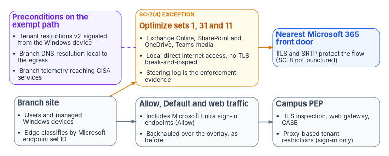
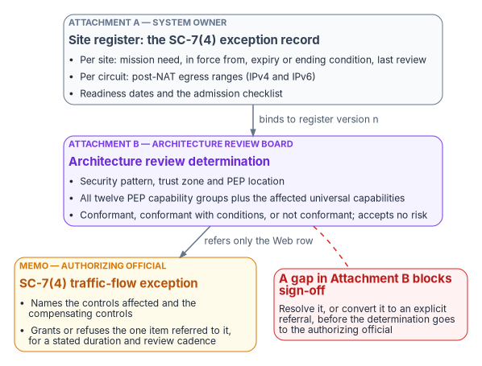

# Chapter 12 — Microsoft 365 Traffic and the Optimize Inspection Exemption

*Microsoft says don't inspect it and the boundary says inspect everything. Both positions hold up, so the gap between them is a decision somebody has to sign, not a setting to quietly change.*

::: {.callout-note}
## In this chapter
What Microsoft's three endpoint categories are and what its current guidance asks for each. Why that guidance collides with an agency boundary that inspects everything, and which controls an inspection bypass actually affects. How a documented traffic-flow exception under NIST SP 800-53 SC-7(4) turns the collision into a bounded, reviewable decision. What happens to tenant restrictions when the proxy is no longer in the path, what's different for GCC-Moderate tenants, and the three instruments (exception memo, site register, architecture review) that carry the decision. [Appendix A](appendix-a-optimize-exemption-instruments.md) holds the instruments themselves.
:::

A branch site that reaches Microsoft 365 over local direct internet access has to decide what happens to the traffic Microsoft classifies as **Optimize**. Microsoft's connectivity guidance says to send that traffic straight to Microsoft without proxies or TLS inspection. The agency's boundary says every flow leaving the enterprise passes a policy enforcement point (PEP) that can see into it. [Chapter 01](01-why-physics-decides-the-architecture.md) explains why the backhaul that satisfies the boundary costs latency no product can recover, and [Chapter 08](08-reference-architecture.md) places governed local breakout among the branch architectures. This chapter deals with the narrower question that local breakout raises for Microsoft 365: what exactly is given up when one category of traffic skips inspection, and how that's recorded so an authorizing official can accept it knowingly.

{#fig-ch12-optimize-exemption-paths fig-alt="A branch site sends two kinds of traffic. Microsoft 365 Optimize endpoint sets 1, 31 and 11 (Exchange Online, SharePoint and OneDrive, and Teams media) leave by local direct internet access without TLS break-and-inspect, under an SC-7(4) exception whose steering log is the enforcement evidence, and reach the nearest Microsoft 365 front door, where TLS and SRTP protect the flow. Allow, Default and web traffic, including the Microsoft Entra sign-in endpoints, is backhauled over the overlay to the campus PEP, which keeps TLS inspection, the web gateway, the CASB and proxy-based tenant restrictions for sign-in. A separate box lists the preconditions on the exempt path: tenant restrictions v2 signaled from the Windows device, DNS resolution local to the branch egress, and branch telemetry reaching CISA services."}

## Microsoft's endpoint categories

Microsoft publishes every Microsoft 365 endpoint set through a REST web service. Each set carries a `category` of `Optimize`, `Allow` or `Default`, and where an address appears in more than one set, Microsoft says to "follow the recommendation for the highest priority category," so an endpoint that's both Optimize and Allow is treated as Optimize.[^c12-websvc] The web service offers four instances (Worldwide, China, USGovDoD and USGovGCCHigh). There's no separate GCC instance: Microsoft's Worldwide list covers "Microsoft 365 plans, including Government Community Cloud (GCC)."[^c12-ww] A GCC-Moderate site that loads the GCC High or DoD feed has scoped its exemption to the wrong cloud.

The Optimize category is small. In the Worldwide list (last updated August 14, 2026) it has three endpoint sets:[^c12-ww]

| ID | Service | Addresses | Ports |
|---|---|---|---|
| 1 | Exchange Online | `outlook.cloud.microsoft`, `outlook.office.com`, `outlook.office365.com` and published IP ranges | TCP 443, 80; UDP 443 |
| 31 | SharePoint Online and OneDrive | `*.sharepoint.com` and published IP ranges | TCP 443, 80; UDP 443 |
| 11 | Microsoft Teams media | Published IP ranges only, no FQDNs | UDP 3478–3481 |

Two properties of this table shape the design. Teams media has no names, so the branch edge has to steer it by IP prefix; a name-based policy alone misses it. And Exchange and SharePoint use UDP 443 as well as TCP, which matters because Microsoft lists blocking protocols such as QUIC, and forcing UDP-to-TCP fallback, among network practices it hasn't tested and that are "known to cause connectivity issues."[^c12-principles] Allow includes the Microsoft Entra ID sign-in and Microsoft Graph endpoints (set 56), Teams signaling (set 12) and the Exchange Online Protection relays; Default is everything else, much of it published as names without IP addresses.[^c12-ww]

### What Microsoft actually recommends

The exemption is often described as simply following Microsoft's guidance for Optimize. Microsoft's current guidance goes further than that. Its connectivity principles recommend, for all **Required** endpoints and categories, that agencies "bypass Microsoft 365 domains from TLS decryption, traffic interception, deep packet inspection, and network packet and content filtering," prioritize direct internet access, keep DNS resolution close to the egress, and bypass proxies and VPN services.[^c12-principles] Its endpoint-management guidance describes SD-WAN branch egress for "Optimize category of endpoints, or Optimize and Allow categories," and says TLS break and inspect and proxy authentication "are incompatible with both the Optimize and Allow category endpoints."[^c12-managing]

Exempting only Optimize is therefore **narrower** than Microsoft asks, not identical to it. That's the program's deliberate design position: the exemption covers the smallest set that carries the latency-sensitive workloads (mailbox access, document transfer and real-time media), leaves sign-in traffic on the inspected path, and keeps the decision small enough for an authorizing official to reason about. Agencies that inspect Allow traffic at the campus proxy should expect Microsoft to treat that as an unsupported configuration. That's a separate decision with its own exception, and this one doesn't settle it.

Microsoft also updates the lists at the beginning of each month. It publishes new addresses 30 days before they go live and sometimes changes the lists out of band.[^c12-ww] The exemption's scope has to be defined by category and endpoint set ID, applied from the current list version through automated change management, not from a snapshot copied into a firewall once.[^c12-managing]

## Why bypass guidance meets an inspect-everything boundary

The agency's campus PEP exists to do exactly what Microsoft says not to do to its traffic: decrypt it, look inside it, and log what it sees. Neither side is wrong. Microsoft's case is that inspection adds latency and breaks protocols on a service that brings its own controls (Purview data loss prevention, Defender for Office 365, multifactor authentication and the rest) and that the shortest path to the nearest front door is the main performance lever.[^c12-principles] The boundary's case is that an assessor must be able to show the agency's protections apply to every flow.

TIC 3.0 leaves room for both. The Branch Office Use Case's first security pattern, branch office to cloud service provider, permits direct access to agency-sanctioned cloud services from the branch, with capabilities traditionally provided at the campus "deployed at the branch office or the sanctioned CSP so long as policy enforcement parity is ensured."[^c12-branch] The Reference Architecture says enforcement "may occur at any point between endpoints."[^c12-ra] The constraint the design strains against is the universal capability Policy Enforcement Parity (`3.UNI.PEPAR`), defined as "consistently applying security protections and other policies, independent of the communication mechanism, forwarding path, or endpoints used."[^c12-scc] A per-category exemption at a named set of sites is, on its face, a departure from that. The honest move is to record the departure and its bounds rather than to claim parity holds. [Chapter 03](03-what-tic-3-requires.md) sets out the catalog and use cases in full.

### Name the controls, not "inspection forgone"

"Inspection forgone" invites an assessor to decide for themselves what was lost. The exemption punctures four things on the Optimize flows, and the instruments name them:

- **SI-3, Malicious Code Protection:** no inline secure web gateway scanning of content on those flows.
- **SI-4(10), Visibility of Encrypted Communications:** the encrypted traffic isn't made visible to monitoring tools. NIST places this enhancement in the High baseline, not the Moderate one, so in a Moderate system it's affected only if the agency selected it; record it either way.[^c12-baselines]
- **AC-4, Information Flow Enforcement:** no CASB or proxy flow enforcement on the path.
- **AU-3, Content of Audit Records (with AU-12 by reference):** AU-3 asks that records establish what happened, when, where, the source, the outcome and the identity involved.[^c12-sp80053] On the bypassed flows the network record is the five-tuple plus steering metadata. User, application, action and data come from the service's own logs, not the PEP.

**SC-8 is not a gap.** Exchange and SharePoint traffic is TLS, Teams media is encrypted with SRTP using keys exchanged over the TLS signaling channel,[^c12-teams] and the SD-WAN overlay encrypts the flows that don't carry their own protection. SC-7(4)(c), which asks the agency to protect the confidentiality and integrity of information crossing each external interface, is met by the application-layer encryption on the exempt flows.[^c12-sp80053]

## The SC-7(4) documented traffic-flow exception

The decision isn't a generic risk acceptance. SC-7(4), External Telecommunications Services, is in the Moderate baseline.[^c12-baselines] It requires a managed interface and a traffic-flow policy for each external telecommunication service, and then:[^c12-sp80053]

- **(d)** "Document each exception to the traffic flow policy with a supporting mission or business need and duration of that need"; and
- **(e)** review exceptions at an organization-defined frequency and "remove exceptions that are no longer supported by an explicit mission or business need."

Earlier drafts of the instruments cited these as SC-7(4)(c) and (d). In the current Rev. 5 text they're (d) and (e), and Appendix A uses the current lettering. An exception under this enhancement has a specific discipline: it's named, it has a mission need and a duration, it's reviewed on a stated cadence, and it comes with enforcement evidence that its boundaries hold. For a branch Optimize exemption, the evidence is the SD-WAN steering log showing that only the listed endpoint sets left locally from the listed circuits. That shape is what lets an authorizing official sign a bounded departure rather than a standing hole.

## Tenant restrictions: the case an assessor will build

The attack an assessor will construct against the exemption is tenant-to-tenant exfiltration: a user signs in to a personal or hostile Microsoft 365 tenant and moves agency data there over a path nobody inspects. Tenant restrictions are the control for it, so it matters precisely which form survives the bypass.

Microsoft documents three ways to signal tenant restrictions v2 (TRv2):[^c12-trv2]

| Signaling path | Authentication plane | Data plane | Needs a proxy |
|---|---|---|---|
| Corporate proxy header injection | Yes | No | Yes; Microsoft supports decrypting sign-in URLs for header insertion as an exception to its no-inspection guidance |
| Universal tenant restrictions through Global Secure Access | Yes, all platforms | Microsoft Graph only | No |
| Windows device (Group Policy or Microsoft Entra–managed) | Yes | Yes, including SharePoint Online and Exchange Online | No |

Two common misreadings follow from that table.

First, an Optimize-only exemption doesn't remove proxy-based sign-in enforcement by itself. The Entra sign-in endpoints are in the Allow category,[^c12-ww] so in this design they still cross the campus proxy, and header injection at sign-in still works. What the bypass exposes is the **data plane**: an access token copied in from another device, or anonymous access to a SharePoint file or Teams meeting, isn't stopped by sign-in signaling. Proxy-based TRv2 never protected the data plane. Microsoft says it covers only authentication-plane protection.[^c12-trv2] The exemption makes an existing gap more consequential; it doesn't create it. If a site later sends Allow traffic locally too, as Microsoft recommends, the proxy path goes entirely.

Second, Global Secure Access is often ruled out on the grounds that it isn't FIPS-validated in GCC Moderate. Microsoft's current documentation says Global Secure Access "is available in the US Government Community Cloud (GCC)" and isn't yet supported in GCC High or the DoD cloud;[^c12-gsa] the FIPS statement couldn't be confirmed on Microsoft Learn as of October 21, 2026. The design conclusion stands on firmer ground anyway: Global Secure Access gives data-plane protection for Microsoft Graph only, so Windows device-side signaling is the only documented path that reaches the SharePoint and Exchange data plane.[^c12-trv2]

Device-side TRv2 has limits that the instruments make the agency enumerate. It works on managed Windows 10 and Windows 11 devices and covers Office apps, Universal Windows Platform .NET apps and Microsoft Edge. Microsoft says it "doesn't protect the .NET stack, Chrome, or Firefox," and recommends App Control for Business to block unenlightened apps from Microsoft resources. Microsoft labels its data-plane support for Teams, SharePoint Online, Exchange Online and Office.com, and its anonymous-access blocking for Forms and Teams, as preview.[^c12-trv2] The program's position is therefore that device-side TRv2, verified in force at the site from the endpoint and with the uncovered device and browser population listed rather than assumed empty, is a **precondition to cutover** in all three instruments. Microsoft documents Group Policy deployment; for an Intune-managed fleet, confirm how the same Windows setting is delivered ([Book 05](../b05-devices/index.md)). The rest of the identity layer, Conditional Access and token protection, becomes the primary control on a less-inspected path ([Book 04, Chapter 03](../b04-access/03-the-conditional-access-model.md)).

## The three instruments

The decision needs three documents, each signed by the person whose question it answers.

{#fig-ch12-three-instruments fig-alt="Three stacked boxes. Attachment A, signed by the system owner, is the site register and the SC-7(4) exception record: per-site mission need, start, expiry or ending condition and last review; per-circuit post-NAT egress ranges for IPv4 and IPv6; readiness dates and the admission checklist. It binds to Attachment B by register version. Attachment B, signed by the architecture review board, records the security pattern, trust zone and PEP location, assesses all twelve PEP capability groups and the affected universal capabilities, and reaches a conformant, conformant-with-conditions or not-conformant determination while accepting no risk. It refers only the Web row to the memo, signed by the authorizing official, which names the affected and compensating controls and grants or refuses the exception for a stated duration and review cadence. A red box notes that a gap in Attachment B blocks sign-off until it's resolved or converted to an explicit referral."}

| Document | What it decides | Who signs |
|---|---|---|
| SC-7(4) traffic-flow exception memo | Whether to grant the exception, on named controls and stated compensating controls | Authorizing official |
| Attachment A, site register | Which sites and circuits are in scope, why each needs the exemption and when it ends | System owner; the memo cites its version |
| Attachment B, architecture review determination | Whether the design is TIC 3.0 conformant and where each PEP capability now sits | Architecture review board |

Keeping the memo and Attachment B separate is deliberate. The architecture review answers whether the design is conformant and where capabilities moved; it doesn't accept risk. The authorizing official accepts the one thing that can't be transferred. [Chapter 09](09-who-owns-the-network.md) places these roles in the book's ownership model.

**Attachment A is the exception record itself, not an annex to it.** Its Table A1 carries the SC-7(4)(d)–(e) fields per site: a site-specific mission need (a sentence that would fit every row answers nothing), a start date, an expiry date or ending condition that may not be blank, and the last review. Table A2 lists one row per circuit, because the post-NAT egress range is a property of the circuit while the mission need is a property of the site. Completion rules R1–R5 catch the errors that make a fabric look configured while attributing traffic to the wrong place: an interface address recorded instead of the post-NAT address, shared NAT pools, dynamic addresses, ranges copied from an ISP order rather than verified from the site, and unlisted IPv6. Table A3 records readiness as dates rather than ticks, because a date is an event a reviewer can check. A change log records every scope change and every review, including those that change nothing. A register that lists circuits without mission need and expiry can't evidence the control the memo claims.

**Attachment B records the TIC 3.0 analysis.** It classifies the traffic under the Branch Office Use Case's pattern 1 (branch office to cloud service provider). Classifying Microsoft 365 as "branch office to web" would pull in a web-proxy capability set whose inspection expectations contradict the category's purpose. It then records the trust zone and PEP location, and completes one row for each of the twelve PEP capability groups in Security Capabilities Catalog version 3.3. Only the Web row is referred to the authorizing official; a blank row is a gap, and a gap blocks sign-off. The catalog's revision history shows the Services and Identity groups were added in version 3.0 (April 2023), and that version 3.3 (July 2025) only removed an NCPS reference in Appendix A. The current publication, dated September 2026, changed only footnote links.[^c12-scc] A table copied from a pre-3.0 revision is two groups short and still looks complete, so the revision is named wherever the list is used. Attachment B also records the three universal capabilities that a routing change does affect: Central Log Management with Analysis (`3.UNI.CLMAN`), Auditing and Accounting (`3.UNI.AACCO`) and Policy Enforcement Parity.[^c12-scc]

Its telemetry section had to be updated: earlier drafts asked for an "NCPS Cloud Interface" reporting pattern. The Branch Office Use Case's July 2025 revision replaced its NCPS references with CISA services, and it now directs agencies to their TIC delegates and to CISA points of contact for services such as the Comprehensive Log Aggregation Warehouse (CLAW), CDM and Protective DNS, saying agencies "must preserve CISA visibility through information sharing" as branches connect directly to external services.[^c12-branch] [Chapter 03](03-what-tic-3-requires.md) covers CLAW and Protective DNS as the telemetry path.

**The memo** names the controls affected and the compensating controls, states the duration and review cadence the register must show, makes device-side TRv2 a precondition, and cites the register version that defines scope. The memo's full text isn't part of the published set, so Appendix A carries a skeleton built from what the attachments cite.

## What's different for GCC-Moderate tenants

Two Microsoft features that branch designs often assume aren't available to the tenants this book is written for. Microsoft 365 informed network routing (INR), which shares Microsoft's per-circuit quality measurements with a supported SD-WAN, "supports tenants in WW Commercial cloud but not the GCC Moderate, GCC High, DoD, Germany, or China clouds."[^c12-inr] Network connectivity in the Microsoft 365 admin center, where office locations and their egress IP ranges are entered, likewise "supports tenants in WW Commercial and China ... but not GCC Moderate, GCC High, or DoD."[^c12-netconn] This is consistent with [Book 08, Appendix C](../b08-ddi/appendix-c-applicability.md).

So in GCC-Moderate, the egress ranges in Attachment A aren't registered with Microsoft. They serve the agency's own steering policy, its synthetic probes and its scope evidence. Path selection rests on the SD-WAN's own measurements ([Chapter 05](05-sd-wan-sase-and-governed-transport.md)), and any monitoring service that sees branch telemetry needs its own authorization. Cisco ThousandEyes, for example, lists a separate government offering, ThousandEyes for Government, as FedRAMP Certified at Class C (Moderate).[^c12-fr] A branch agent registered to a commercial console is outside the boundary the memo describes. A worked Cisco Catalyst SD-WAN build is in Federal Compliance [Vol I Book 05, Appendix A](https://github.com/WhalerMike/modernization-workbook/blob/main/docs/compliance/Vol_I_Book_05_Network_Modernization.md). Read its INR material as the commercial-cloud target state.

Name resolution is the other quiet failure. Microsoft asks that DNS resolution happen close to the network egress so connections reach the nearest front door.[^c12-principles] A conditional forwarder that sends branch Microsoft 365 queries back to a core resolver defeats local egress silently, and the probes won't report it. The governed answer is the one [Book 08, Chapter 05](../b08-ddi/05-edge-interception-and-bypass.md) gives: the agency resolver remains the first hop, placed so that resolution happens at the branch's egress, with Protective DNS upstream.

## What the exemption doesn't settle

The exemption covers Optimize traffic at the listed branch circuits and nothing else. It doesn't decide whether Allow traffic can be inspected at the campus proxy, which Microsoft says is incompatible. It doesn't carry over to remote users, whose split tunneling is a different flow. It doesn't make telemetry to CISA optional: Attachment B treats telemetry as a condition of fleet rollout and requires a pilot that runs without it to say so. And it doesn't survive scope drift: a new site, a changed egress address or a widened category is a scope change that goes back to the authorizing official. [Chapter 13](13-sequencing-cost-and-evidence.md) puts the exemption in the book's order of operations (boundary change before cutover) and sets out the evidence that confirms or refutes it. [Appendix B](appendix-b-requirements-mapping.md) maps each requirement named here to its evidence.

::: {.callout-tip}
## Continue the book
[← Previous: Chapter 11 — Field Office WAN Transformation](11-field-office-wan-transformation.md) · [Book index](index.md) · [Next: Chapter 13 — Sequencing, Cost and Evidence →](13-sequencing-cost-and-evidence.md)
:::

[^c12-websvc]: Microsoft Learn, "Microsoft 365 IP Address and URL web service," Endpoints web method (category and instance parameters), <https://learn.microsoft.com/en-us/microsoft-365/enterprise/microsoft-365-ip-web-service?view=o365-worldwide> (accessed Oct 21, 2026).
[^c12-ww]: Microsoft Learn, "Microsoft 365 URLs and IP address ranges" (Microsoft 365 Worldwide (+GCC), last updated 08/14/2026), endpoint sets 1, 11, 12, 31 and 56, <https://learn.microsoft.com/en-us/microsoft-365/enterprise/urls-and-ip-address-ranges?view=o365-worldwide> (accessed Oct 21, 2026).
[^c12-principles]: Microsoft Learn, "Microsoft 365 network connectivity principles," sections "Optimizing connectivity to Microsoft 365 services" and "Additional network considerations," <https://learn.microsoft.com/en-us/microsoft-365/enterprise/microsoft-365-network-connectivity-principles?view=o365-worldwide> (accessed Oct 21, 2026).
[^c12-managing]: Microsoft Learn, "Managing Microsoft 365 endpoints," sections "SD-WAN for local branch egress of vital Microsoft 365 network traffic," "Use a PAC file for direct routing" and "Change management for Microsoft 365 IP addresses and URLs," <https://learn.microsoft.com/en-us/microsoft-365/enterprise/managing-office-365-endpoints?view=o365-worldwide> (accessed Oct 21, 2026).
[^c12-branch]: Cybersecurity and Infrastructure Security Agency, *Trusted Internet Connections 3.0 Branch Office Use Case*, Version 3.0, publication September 2026, Revision History, Section 6.1 and Section 8 (Telemetry Requirements), <https://www.cisa.gov/sites/default/files/2026-09/TIC_3.0_Branch_Office_Use_September_2026_6.pdf> (accessed Oct 21, 2026).
[^c12-ra]: Cybersecurity and Infrastructure Security Agency, *TIC 3.0 Core Guidance Volume 2: Reference Architecture*, Version 1.2, publication September 2026, Section 4.2 (Policy Enforcement Points), <https://www.cisa.gov/sites/default/files/2026-09/TIC_3.0_Reference_Architecture_September_2026_14.pdf> (accessed Oct 21, 2026).
[^c12-scc]: Cybersecurity and Infrastructure Security Agency, *TIC 3.0 Core Guidance Volume 3: Security Capabilities Catalog*, Version 3.3, publication September 2026, Table 1 (Revision History), Table 3 (Universal Security Capabilities) and Section 4.2, <https://www.cisa.gov/sites/default/files/2026-09/TIC_3.0_Security_Capabilities_Catalogs_September_2026_17.pdf> (accessed Oct 21, 2026).
[^c12-baselines]: National Institute of Standards and Technology, SP 800-53B control baselines, OSCAL profiles for the Moderate baseline (includes SC-7(4); excludes SI-4(10)) and the High baseline (includes SI-4(10)), <https://raw.githubusercontent.com/usnistgov/oscal-content/main/nist.gov/SP800-53/rev5/json/NIST_SP-800-53_rev5_MODERATE-baseline_profile.json> and <https://raw.githubusercontent.com/usnistgov/oscal-content/main/nist.gov/SP800-53/rev5/json/NIST_SP-800-53_rev5_HIGH-baseline_profile.json> (accessed Oct 21, 2026).
[^c12-sp80053]: National Institute of Standards and Technology, SP 800-53 Rev. 5 control catalog (OSCAL), controls AU-3 and SC-7(4), <https://raw.githubusercontent.com/usnistgov/oscal-content/main/nist.gov/SP800-53/rev5/json/NIST_SP-800-53_rev5_catalog.json> (accessed Oct 21, 2026).
[^c12-teams]: Microsoft Learn, "Security and Microsoft Teams," Media encryption, <https://learn.microsoft.com/en-us/microsoftteams/teams-security-guide> (accessed Oct 21, 2026).
[^c12-trv2]: Microsoft Learn, "Configure tenant restrictions v2," sections on authentication and data plane protection, supported scenarios, Windows device enforcement, App Control for Business and data plane support (preview), <https://learn.microsoft.com/en-us/entra/external-id/tenant-restrictions-v2> (accessed Oct 21, 2026).
[^c12-gsa]: Microsoft Learn, "Known limitations for Global Secure Access," section "Global Secure Access In Government Cloud limitations," <https://learn.microsoft.com/en-us/entra/global-secure-access/reference-current-known-limitations> (accessed Oct 21, 2026).
[^c12-inr]: Microsoft Learn, "Microsoft 365 informed network routing," <https://learn.microsoft.com/en-us/microsoft-365/enterprise/office-365-network-mac-perf-cpe?view=o365-worldwide> (accessed Oct 21, 2026).
[^c12-netconn]: Microsoft Learn, "Network connectivity in the Microsoft 365 Admin Center," <https://learn.microsoft.com/en-us/microsoft-365/enterprise/office-365-network-mac-perf-overview?view=o365-worldwide> (accessed Oct 21, 2026).
[^c12-fr]: FedRAMP Marketplace dataset, Cisco ThousandEyes for Government (FR2523656707): FedRAMP Certified, Class C (Moderate), <https://www.fedramp.gov/marketplace/products.json> (accessed Oct 21, 2026).
