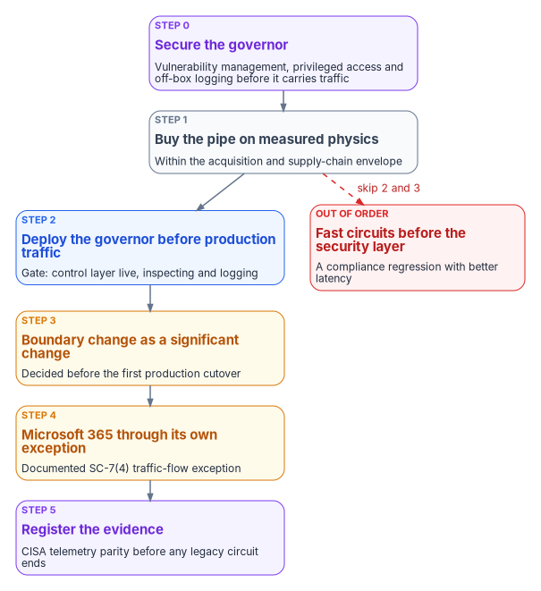
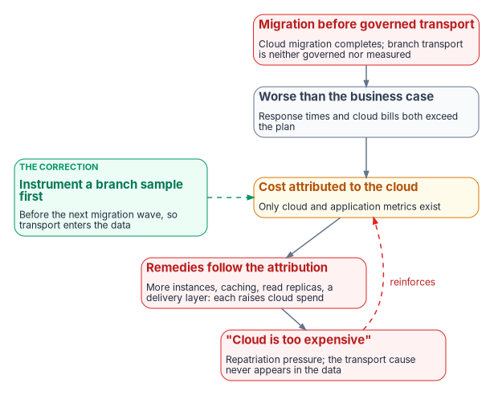
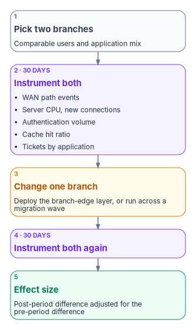

# Chapter 13 — Sequencing, Cost and Evidence

*Order decides whether branch modernization is a gain or a compliance regression, and a cost case only survives review when every number in it came from the agency's own estate.*

::: {.callout-note}
## In this chapter
The decision sequence (governor before traffic, boundary change before cutover) and the phase dependencies behind it, which are technical rather than mandated. Phase inversion: what happens to cost attribution when cloud migration runs ahead of transport, what the federal record supports, and what competes with it. How to build the cost case from your own circuits and branches, what to stop doing, the evidence an authorization package needs for the boundary change, and three measurements that would confirm or refute the whole argument in a given estate.
:::

The earlier chapters establish what to build. This one is about the order in which to build it and how to prove that it paid. Both arguments are easy to make badly. Sequencing is often presented as a federal requirement, which it isn't; cost is often presented with figures nobody measured, which a budget examiner will check. The honest versions are weaker in tone and stronger in review: the sequence is an engineering dependency, and the cost is something an agency measures in its own estate with a stated method.

{#fig-ch13-decision-sequence fig-alt="Top to bottom, six cards joined by arrows. Step 0, violet: bring the governor under vulnerability management, privileged-access control and logging before it carries traffic. Step 1, slate: buy the pipe on measured physics within the acquisition and supply-chain envelope. Step 2, blue: deploy the governor before production traffic; the gate is a control layer that is live, inspecting and logging. Step 3, amber: treat the boundary change as a significant change and decide it before the first production cutover. Step 4, amber: handle Microsoft 365 Optimize traffic through its own documented SC-7(4) exception. Step 5, violet: register the evidence and confirm CISA telemetry parity before any legacy circuit is terminated. A dashed red arrow from step 1 straight to production traffic, skipping steps 2 and 3, leads to a red card: fast circuits before the security layer is live, a compliance regression with better latency."}

## The decision sequence

[Chapter 02](02-transport-is-physics-control-is-compliance.md) introduced the order of operations; this chapter sets out what each step depends on and what closes it. [Chapter 09](09-who-owns-the-network.md) names who decides each gate.

0. **Secure the governor first.** The SD-WAN controller and its edges are internet-facing infrastructure with estate-wide authority, so they come under vulnerability management, privileged-access control and off-box logging before they carry production traffic ([Chapter 05](05-sd-wan-sase-and-governed-transport.md) lists the controls and the 2026 emergency directive that shows why).
1. **Buy the pipe on measured physics**, within the acquisition and supply-chain envelope, with diversity where the mission needs it. Measured means per-site latency and loss recorded before the order, not a carrier's marketing figure ([Chapter 01](01-why-physics-decides-the-architecture.md), [Chapter 02](02-transport-is-physics-control-is-compliance.md)).
2. **Deploy the governor before production traffic.** The gate is a control layer that is live, inspecting and logging at that site. A site whose control layer isn't live doesn't get its new egress turned on.
3. **Treat the boundary change as the significant change it is.** NIST defines a significant change as one "likely to substantively affect the security or privacy posture of a system," and such changes may trigger an event-driven authorization action under either reauthorization or ongoing authorization.[^c13-sp80037] A new egress path, a new device class at every branch or a new governor changes the system the package describes. File it and have it decided before the first production cutover, not discovered by an assessor afterward.
4. **Handle Microsoft 365 traffic through its own documented exception.** SC-7(4) requires each exception to the traffic flow policy to be documented "with a supporting mission or business need and duration of that need," and reviewed on a defined cadence.[^c13-sp80053] [Chapter 12](12-microsoft-365-traffic.md) and [Appendix A](appendix-a-optimize-exemption-instruments.md) carry the exemption and its instruments.
5. **Register the supporting evidence**, and confirm CISA telemetry parity before any legacy circuit or MTIPS service ends ([Chapter 03](03-what-tic-3-requires.md) explains why CLAW parity is the exit criterion).

Doing these out of order, and above all lighting up fast connections before the security layer is live, is in the program's experience the most common and most costly mistake in branch modernization. A field office moved from a centralized hairpin to ungoverned local breakout has lost assessed boundary protection relative to where it started: a compliance regression with better latency.

## The phases behind the sequence

The same logic applies at program scale. Federal modernization proceeds through phases whose order reflects technical dependency, not policy mandate: no OMB memorandum, CISA directive or executive order specifies the sequence below. An earlier version of the source analysis treated network attestation as a policy precondition for cloud authorization; it isn't, and the argument has to stand on engineering. It does.

| Phase | Activity | Depends on |
|---|---|---|
| 0 | Assessment and inventory | Nothing; it documents the current WAN, including whether branch transport is governed and measurable |
| 1 | Identity and access modernization | Can run in parallel with 2; must precede zero trust network access enforcement in 4 |
| 2 | Network and transport modernization | TIC 3.0 use case adoption, local breakout, the branch-edge policy layer, telemetry to CISA |
| 3 | Cloud workload migration | Phase 2, for a performance and cost baseline that can be attributed |
| 4 | Zero trust continuous verification | Phase 1 for identity, 2 for observable transport, 3 for protected resources |

The dependency that matters most is 3 on 2. It isn't that migration fails without governed transport. It's that without it, nobody can tell afterward why migration cost what it did.

## Phase inversion

Most agencies are migrating workloads to cloud now, while transport modernization is years away ([Chapter 10](10-the-long-interim.md)). The consequence is less about performance than about **attribution**, and this book calls the failure mode **phase inversion**: cloud migration completes before the agency can govern and measure the transport its users reach the cloud over.

After migration, application response times and cloud bills are both worse than the business case assumed. The agency has cloud metrics and application metrics. It doesn't have per-application transport metrics, because those come from the device it hasn't deployed. Cost is attributed to the only thing being measured, the cloud, and the remedies follow the attribution: more instances, more caching, read replicas, a delivery layer. Each raises cloud spend, which strengthens the "cloud is too expensive" narrative, which generates pressure to repatriate. The transport contribution is never identified, because it never appears in the data anyone examines.

{#fig-ch13-phase-inversion fig-alt="A loop of five cards. A red card: cloud migration completes before branch transport is governed or measured. It leads to a slate card: response times and cloud bills are both worse than the business case. Then an amber card: only cloud and application metrics exist, so cost is attributed to the cloud. Then a red card: remedies follow the attribution, more instances, caching, read replicas and a delivery layer, each raising cloud spend. Then a red card: the cloud-is-too-expensive narrative and repatriation pressure. A dashed arrow loops back to the attribution card. A separate green card at the side, joined by a dashed line to the attribution card: instrument a sample of branches before the next migration wave, so transport appears in the data."}

The self-reinforcing property is what makes it worth naming: the remedy for a misattributed cost raises the cost that was misattributed.

### What the federal record supports

The individual links in that chain have support in the federal record. The composed phenomenon does not appear in any literature the sources could find, and it is presented here as the program's own inference. The distinction matters, so the parts are set out separately.

- **Agencies can't track cloud costs and savings consistently.** GAO reviewed 16 agencies in 2019 and found they "identified issues in tracking and reporting cloud spending and savings data," concluding it was likely that agency-reported figures "were underreported."[^c13-gao1958] In 2022 GAO named tracking costs and savings as one of four federal cloud challenges, finding agencies "often using inconsistent data to calculate cloud spending."[^c13-gao22106195] In June 2026, across all 24 CFO Act agencies, 17 reported that control of cloud costs required changes in IT management approaches.[^c13-gao26107530]
- **Transport requirements weren't understood at migration time.** In the same 2026 report, Commerce officials said cloud usage and requirements, including "data volume, bandwidth, throughput," did not translate one for one from the on-premises solution, which created "a large degree of uncertainty in the first few years following the migration."[^c13-gao26107530] GAO filed this as a cost-tracking problem. It is an agency saying bandwidth and throughput weren't understood at migration; it is not a claim of misattribution and shouldn't be represented as one.
- **Transport constraints raised cost in a federal cloud context.** CISA's TIC Program Guidebook says the demands placed on agency TIC access points and the resulting degraded performance "increased the cost and decreased the effectiveness of the TIC initiative when using cloud services."[^c13-guidebook]
- **Transport cost has been assumed out of a federal cloud estimate.** GAO's own Inspector General found that GAO "did not include data egress fees in a major system's cost estimate," deeming them minimal, and had not established formal procedures implementing cloud cost management policies.[^c13-oig251] Narrow, but a clean primary-source instance of the estimating blind spot.
- **Latency is a first-order, non-obvious performance driver.** A University of Cambridge study injected latency at fine resolution and found "10 µs latency in each direction enough to have a noticeable effect," with 50 µs significantly negative and Memcached degrading over 20 percent at 100 µs.[^c13-tr914] That is a data-center study at microsecond scale. WAN latency is about three orders of magnitude larger, which makes the mechanism more plausible at WAN scale, but the microsecond findings aren't WAN measurements and shouldn't be quoted as such.

What is not documented is the composed claim: no GAO or inspector general report, academic paper or research-firm study the sources found describes transport-attributable cost being misattributed to cloud and driving compensatory spend. The best-known public debate on cloud cost, Andreessen Horowitz's "The Cost of Cloud, a Trillion Dollar Paradox" and its rebuttals, doesn't discuss network transport on either side.[^c13-a16z] That silence is the gap this section addresses, and it is also why the claim has to be labeled an inference.

### The competing explanations a reviewer will raise

These are better evidenced than the transport explanation, and a business case has to address them rather than ignore them.

- **Idle and oversized resources.** Flexera's 2026 *State of the Cloud* survey of 753 cloud decision-makers puts estimated wasted cloud spend at 29 percent, up for the first time in five years.[^c13-flexera] Flexera sells cost-management tools, so read it as a vendor survey, but it is the best-evidenced driver of overspend and it isn't network-related.
- **Egress fees are small.** The UK Competition and Markets Authority, with access to provider financial data, found egress fees were 0–5 percent of 2022 UK public cloud revenues at each of the three largest providers, and that a majority of each provider's customers paid less than 1 percent of their spend on egress.[^c13-cma] This book's argument is not about egress fees; it is about transport-*induced* compute and operating spend. It will be read as an egress argument unless it says otherwise, so it says otherwise here.
- **Licensing.** GAO found restrictive software licensing raised costs at four of six agencies reviewed, with officials in several cases "unable to specify the actual amount of increase."[^c13-gao25107114] (The source paper said six agencies were unable to specify; the finding is narrower.) Federally documented, and not transport.
- **Management and accounting change.** The 17 of 24 agencies that needed changed IT management approaches to control cloud cost are an organizational explanation competing directly with the transport one.[^c13-gao26107530]
- **Repatriation is smaller than claimed.** Uptime Institute's 2022 survey data found 33 percent of respondents had moved some production applications off public cloud and 6 percent had abandoned public cloud altogether, and its analysis concludes that high costs drive repatriation but the impact is overstated.[^c13-uptime] Neither Uptime nor comparable surveys list network or latency among stated reasons. The widely repeated claim that a large majority of organizations will repatriate comes from vendor-sponsored surveys without published methods and shouldn't be cited.

That last point bears on falsifiability. The phase-inversion claim predicts that organizations would *not* name transport as the cause, since by hypothesis they can't see it. Survey silence is therefore weak evidence in either direction, and the claim is hard to test from survey data. It isn't untestable; the last section of this chapter says what would settle it.

### If you are already inverted

Most agencies reading this have already migrated. The correction isn't to unwind anything:

1. **Instrument before you buy.** Deploy transport measurement at a representative sample of branches; many agencies can get per-path latency and loss from existing equipment without new capital ([Chapter 10](10-the-long-interim.md), action 2). Establish what fraction of application latency is transport-attributable before proposing a transport program.
2. **Re-baseline the attribution.** Take the last four quarters of cloud spend growth and test how much correlates with user-experience complaints and help desk volume by branch rather than with workload growth.
3. **Fix chattiness first where it dominates.** The round-trip arithmetic in [Chapter 06](06-legacy-protocols-on-re-routed-paths.md) will identify applications where an application change returns more than any transport change can.
4. **Then scope the branch-edge program** to the branches and applications where the measurement says it pays, rather than to every branch on principle.

That sequence produces a business case a reviewer can't take apart, because every number in it came from the agency's own estate.

## Measuring cost in your own estate

An agency building a business case needs numbers, and the honest report on where public ones come from is partly negative. The negative findings are useful in themselves: they explain why so many figures in circulation are unsourced.

### What the public record doesn't give you

- **No realized EIS savings figure.** The sources found no GAO quantification of savings realized under EIS. GAO's most recent EIS report (August 2026) is about transition delays and service disruption, not savings.[^c13-gao26107919]
- **No published before-and-after SD-WAN cost from a federal agency.** Task order ceilings are public; the sources found no realized cost deltas.
- **No federal figure that isolates legacy WAN or MPLS operating cost.** The federal operations-and-maintenance figures the sources found cover all of IT, not network.
- **EIS unit prices exist but must be pulled per service and location.** GSA's EIS Public Pricer is open to the public and offers downloads of awarded services by geography and vendor, plus CLIN data, but prices for specific circuits and sites still have to be looked up for the agency's own locations.[^c13-pricer] (The source paper said the pricer has no bulk export; it does offer downloads.) GSA says MTIPS pricing can be found in the EIS pricing tool, with port charges monthly and optional features priced separately.[^c13-mtips] (The source paper said MTIPS is priced only on an individual case basis and excluded from the pricer; GSA's current MTIPS page doesn't say that. Any feature that is priced case by case still won't appear as a unit price.)

### What is citable

| Figure | Source |
|---|---|
| Agencies could have saved about $329 million had they transitioned to Networx on time, against savings of 28.4 percent of FTS2001 spending; GSA's transition costs rose $66.4 million, 44 percent over the baseline | GAO-14-63, December 2013[^c13-gao1463] |
| Billing for six agencies' legacy Networx contracts rose from about $13.4 million in February 2025 to about $40.9 million in March 2025, a 206 percent increase, with their transitions more than three years past GSA's revised deadline | GAO-26-107919, August 2026[^c13-gao26107919] |
| 37 EIS task orders worth over $7.4 billion in just over a year of the program | ACT-IAC case study, as reported June 2020[^c13-actiac] |
| About 80 percent of more than $100 billion in annual federal IT spending goes to operations and maintenance | GAO-25-107795, July 2025[^c13-gao25107795] |
| Up to $50 billion in combined EIS contract value; about $2.5 billion spent through GSA telecom contracts in FY2019 | CRS IF11668, October 2020[^c13-crs] |

The GAO-26-107919 figure is now the strongest cost-of-delay number in the federal record, because it prices deferral directly rather than modeling it. (The source paper's "$2.08 billion" Networx-extension figure couldn't be traced to any source and is dropped.)

### The MPLS-versus-broadband multiple

The claim that MPLS costs three to ten times broadband per megabit circulates widely, mostly from WAN brokers, SD-WAN vendors and their content marketing, none of whom publish a method. The one independent dataset the sources found, from TeleGeography, a research firm that sells WAN pricing data, reports a smaller and less consistent gap. On Q4 2019 data with local access included, DIA was cheaper than MPLS almost everywhere, but at 20 Mbps in New York "most carriers price DIA at a slight discount—one offered a significant discount and two offered it at a premium."[^c13-telegeo] The data is several years old and the free publication gives percentages rather than absolute prices. An agency shouldn't build a business case on the marketing multiple; it should price its own circuits and sites in the EIS pricer.

### The cost structure, which you can build without unit prices

EIS charging units make the drivers explicit, and the structural difference between architectures is which variable the cost scales with. This table is the program's analysis of the cost structure, not a price list.

| Architecture | Recurring | One-time | Scales with |
|---|---|---|---|
| MPLS with central TIC or MTIPS | VPN service port charge per site; access charge per location; equipment lease and maintenance; MTIPS port charge plus optional features | Access installation; CPE procurement and installation; site preparation; design and engineering | Site count × port speed; largely insensitive to actual traffic, because you buy ports |
| DIA plus SASE, no branch edge | Internet service port charge; access charge per site; SASE subscription; any usage-based egress | Access installation; minimal CPE; SASE onboarding | User count: the structural break from the row above |
| DIA plus SASE plus a branch edge | The row above, plus appliance license and orchestration per site (or a managed network service charge per site), usually plus a second access circuit | Appliance procurement and installation labor per site | Site count × bandwidth tier, plus user count for the SASE layer |
| Agency-operated access point | Around-the-clock SOC staffing; facilities; security stack subscriptions and support; transport into the access point | Security stack capital; build-out; accreditation | Internal; the sources found no published federal figure |

The move from the first row to the second changes the cost *variable*, from site count and port speed to user count. For an agency with many small branches that tends to be favorable; for one with few large sites and many users it may not be. That's the calculation to run, and it can be run in the EIS pricer with real numbers before anything is procured. Note the term most often left out: a per-user annual SASE subscription across a large workforce is the line most likely to dominate the comparison, and SD-WAN-versus-MPLS framings routinely omit it. Vendor GSA schedule price lists show per-user pricing for some SASE products; price the specific candidates from their current schedule contracts rather than from a figure in a paper. (The source paper's per-user range for one vendor couldn't be confirmed against a public GSA price list and is dropped.) [Chapter 11](11-field-office-wan-transformation.md) applies this structure to a large field-office estate with its inputs labeled.

### The mechanisms worth measuring

Four effects plausibly move compute cost, and all four are measurable:

| Mechanism | What happens | What to measure |
|---|---|---|
| Connection re-establishment | Each re-established session costs a TLS handshake, an authentication exchange and application session setup on both sides | Server-side new-connection rate against active-session count; connection setups per transaction |
| Retry after a path event | Clients that reconnect at once produce a burst of server-side connection handling | Connection-rate spikes correlated with WAN path events, and their duration |
| Authentication replay | Failed token exchanges generate repeat cycles at the identity provider | Authentication request volume against successful authentications |
| Cache invalidation | Dropped sessions discard application caches and force cold execution | Cache hit ratio and query time distribution around session-drop events |

### A worked example, every input stated

To show the shape of the arithmetic, not to supply a result. Every input is an assumption chosen for illustration:

| Input | Value |
|---|---|
| Branch users | 5,000 |
| Application server instances, running continuously | 40 |
| On-demand-equivalent rate | $0.192 per instance-hour |
| Measured reduction in average CPU from less connection churn | X percent |

Annual compute at baseline is 40 × $0.192 × 8,760 hours = $67,277. If lower utilization allows a proportional reduction in instances, the annual saving is about $67,277 × X; at X = 10 percent, that's $6,728 a year.

The example is deliberately unflattering. Compute savings alone rarely justify a branch-edge program, and a business case resting on them won't survive a budget examiner who asks for the instance count. The defensible case rests on four other cost categories, each measurable from data the agency already holds and, in most estates, each larger than the compute term:

- help desk volume by branch, normalized by user count;
- circuit capacity bought as headroom for unmanaged queuing;
- analyst hours spent on alerts closed as benign network behavior;
- the risk cost of control assertions that can't be evidenced.

## What to stop doing

- **Stop putting a routing-attributable percentage into a TCO model on the authority of a white paper, including this book.** Put in a measured figure with its method attached, or a range with the assumption labeled as an assumption. A migration business case that omits routing architecture as a cost variable is incomplete; one that includes an invented figure for it is worse, because it will be checked.
- **Stop using the unsourced figures in circulation.** Claims such as 12–18 percent extra application-server CPU from hairpin routing, or $200,000–$400,000 a year of cloud overspend for a 5,000-user agency, came with no derivation, no measurement, no instance count and no rate. Earlier versions of this book's sources offered them; they are withdrawn.
- **Stop citing the MPLS-to-broadband multiple.** Price your own circuits.
- **Stop justifying a branch-edge program on latency alone.** For chattiness the application change dominates ([Chapter 06](06-legacy-protocols-on-re-routed-paths.md)); the stronger argument is governance and evidence.
- **Stop presenting the sequence as a mandate.** It is a technical dependency, and saying so is what makes it survive review.
- **Stop treating an undocumented gap as a private matter.** An assessor who finds it records a finding. Document it as an accepted risk with compensating measures ([Chapter 10](10-the-long-interim.md)).

## Evidence for the boundary change

The boundary change in step 3 is decided on evidence, and the evidence is the same material that later supports the control assertions. Where an agency asserts SC-7, SI-4, AC-17 or CA-7 for a system whose users reach it over branch transport ([Chapter 03](03-what-tic-3-requires.md) lists what each asserts), the package should carry:

| Evidence | What it shows | Produced by |
|---|---|---|
| Application-to-path routing policy | The path, priority, failover behavior and source-address presentation for each application class; the SC-7(4) traffic flow policy | The policy document from [Chapter 10](10-the-long-interim.md), action 1 |
| QoS policy at the branch edge | Where and how priority is applied before the constrained link | Branch-edge configuration export |
| Failover policy and its measured recovery time | That failover works, and how fast | A test record per site class, with date and method |
| Path-performance monitoring | Per-application latency, loss and jitter by path | Governor telemetry, or flow records plus synthetic transactions in the interim |
| Decision records | Which path or policy decision was made, under which policy, when | The SD-WAN and SASE decision records in [Chapter 05](05-sd-wan-sase-and-governed-transport.md) |
| Traffic-flow exceptions | Each exception with its mission need, duration and review | The SC-7(4) instruments in [Appendix A](appendix-a-optimize-exemption-instruments.md) |
| CISA telemetry parity | That CISA's visibility survives the move off MTIPS | CLAW onboarding confirmation ([Chapter 03](03-what-tic-3-requires.md)) |
| Known limitations | Which assertions lack a mechanism, and the compensating measures | The accepted-risk entry |

Under OMB M-26-14, the transport question is now also a logging-maturity question: among its minimum log content, agencies must be able to determine "source and destination network address information, including protocols, ports, and session attributes."[^c13-m2614] Where no mechanism produces that record at a branch, the package should say so as a known limitation rather than leave it implicit. [Appendix B](appendix-b-requirements-mapping.md) maps each requirement to its chapter and evidence.

## How to confirm or refute the case

When funding becomes possible, the number that survives a budget examiner is a measurement. The direct test is a **paired-branch study**, run around a migration wave or a device deployment:

{#fig-ch13-paired-branch fig-alt="Top to bottom. A slate card: select two branches with comparable user counts and application mix. A violet card: instrument both for 30 days, listing WAN path events, application server CPU and new-connection rate, identity provider authentication volume, database cache hit ratio, and help desk tickets tagged by application. An amber card: deploy the branch-edge policy layer at one branch only. A violet card: instrument both for a further 30 days. A green card: the effect size is the post-period difference adjusted for the pre-period difference, agency-specific and defensible."}

1. Select two branches with comparable user counts and application mix.
2. Instrument both for 30 days: WAN path events, application server CPU and new-connection rate, identity provider authentication volume, database cache hit ratio, and help desk tickets tagged by application.
3. Make the change at one branch only: deploy the branch-edge layer, or, to test phase inversion, run the study across a migration wave.
4. Instrument both for a further 30 days.
5. The difference in the post-period, adjusted for the pre-period difference, is the effect size. It is agency-specific and defensible, and it is the number to put in a business case.

Three further measurements would settle the phase-inversion question in a given estate:

1. **Instance-count elasticity to path events.** If autoscaling or manual capacity increases correlate with branch WAN path degradation rather than with user or transaction volume, the mechanism is present. If they correlate only with volume, it isn't.
2. **Cache and replica additions traced to a diagnosis.** Where a caching layer or read replica was added after migration, examine the incident or performance record that justified it. If the diagnosis was "slow application" with no transport measurement available, the attribution was unavailable rather than wrong, which is the claim.
3. **Help desk ticket clustering by branch.** Ticket volume per user that varies significantly by branch, uncorrelated with application mix, points at transport; a uniform distribution points away from it.

An agency that runs these has either evidence or a disproof, and either is worth more than the argument.

::: {.callout-note}
## What this chapter establishes
1. The order is fixed by engineering, not mandate: secure the governor, buy the pipe on measured physics, deploy the governor before traffic, decide the boundary change before cutover, handle Microsoft 365 through its own exception, and register the evidence.
2. Phase inversion is the program's inference, built on documented parts: agencies can't track cloud cost consistently, transport needs weren't understood at migration, and CISA says the hairpin raised cloud cost. Better-evidenced explanations compete with it and must be answered.
3. The public cost record is thin: no realized EIS savings figure and no federal before-and-after SD-WAN figure. GAO's 206 percent Networx billing increase is the strongest cost-of-delay number available.
4. Build the cost case from your own circuits, sites and users. The SASE per-user subscription is the term most often left out; compute savings are the smallest term.
5. The boundary-change package needs the routing policy, QoS and failover evidence, path telemetry, exceptions, CISA telemetry parity and stated limitations.
6. A paired-branch study and three targeted measurements confirm or refute the case in a given estate.
:::

::: {.callout-tip}
## Continue the book
[← Previous: Chapter 12 — Microsoft 365 Traffic and the Optimize Inspection Exemption](12-microsoft-365-traffic.md) · [Book index](index.md) · [Next: Appendix A — Optimize Exemption Decision Instruments →](appendix-a-optimize-exemption-instruments.md)
:::

[^c13-sp80037]: National Institute of Standards and Technology, SP 800-37 Rev. 2, *Risk Management Framework for Information Systems and Organizations*, December 2018, Appendix F, "Event-Driven Triggers and Significant Changes," <https://nvlpubs.nist.gov/nistpubs/SpecialPublications/NIST.SP.800-37r2.pdf> (accessed Oct 21, 2026).
[^c13-sp80053]: National Institute of Standards and Technology, SP 800-53 Rev. 5, *Security and Privacy Controls for Information Systems and Organizations*, SC-7(4)(d) and (e), <https://nvlpubs.nist.gov/nistpubs/SpecialPublications/NIST.SP.800-53r5.pdf> (accessed Oct 21, 2026).
[^c13-gao1958]: Government Accountability Office, GAO-19-58, *Cloud Computing: Agencies Have Increased Usage and Realized Benefits, but Cost and Savings Data Need to Be Better Tracked*, April 4, 2019, <https://www.gao.gov/products/gao-19-58> (accessed Oct 21, 2026).
[^c13-gao22106195]: Government Accountability Office, GAO-22-106195, *Cloud Computing: Federal Agencies Face Four Challenges*, September 28, 2022, <https://www.gao.gov/products/gao-22-106195> (accessed Oct 21, 2026).
[^c13-gao26107530]: Government Accountability Office, GAO-26-107530, *Cloud Computing: Federal Government Needs to Address Procurement Challenges*, June 23, 2026, <https://www.gao.gov/products/gao-26-107530>; Commerce passage in the report body, <https://www.gao.gov/assets/gao-26-107530.pdf> (accessed Oct 21, 2026).
[^c13-guidebook]: Cybersecurity and Infrastructure Security Agency, *Trusted Internet Connections 3.0, TIC Core Guidance Volume 1: Program Guidebook*, Version 1.2, July 2025, <https://www.cisa.gov/sites/default/files/2025-07/CISA%20TIC%203.0%20Program%20Guidebook.pdf> (accessed Oct 21, 2026).
[^c13-oig251]: Government Accountability Office, Office of Inspector General, OIG-25-1, *Data Egress: Opportunities Exist for GAO to Strengthen Procedures for Management of Data Egress Fees*, February 24, 2025, <https://gao.gov/products/oig-25-1> (accessed Oct 21, 2026).
[^c13-tr914]: Diana Andreea Popescu, Noa Zilberman and Andrew W. Moore, *Characterizing the impact of network latency on cloud-based applications' performance*, University of Cambridge Computer Laboratory Technical Report UCAM-CL-TR-914, November 2017, <https://www.cl.cam.ac.uk/techreports/UCAM-CL-TR-914.pdf> (accessed Oct 21, 2026).
[^c13-a16z]: **Third-party source (investor analysis).** Sarah Wang and Martin Casado, "The Cost of Cloud, a Trillion Dollar Paradox," Andreessen Horowitz, May 27, 2021, <https://a16z.com/the-cost-of-cloud-a-trillion-dollar-paradox/> (accessed Oct 21, 2026).
[^c13-flexera]: **Third-party source (vendor survey).** Flexera, "Flexera 2026 State of the Cloud Report," March 18, 2026, <https://www.flexera.com/blog/finops/flexera-2026-state-of-the-cloud-report-the-convergence-of-cloud-and-value/> (accessed Oct 21, 2026).
[^c13-cma]: UK Competition and Markets Authority, *Cloud services market investigation: Egress fees working paper*, May 23, 2024, Tables 2.2 and 2.3, <https://assets.publishing.service.gov.uk/media/664f2556993111924d9d3aa8/240521_-_Egress_Fees__.pdf> (accessed Oct 21, 2026). Figures are published as redacted ranges.
[^c13-gao25107114]: Government Accountability Office, GAO-25-107114, *Cloud Computing: Selected Agencies Need to Implement Updated Guidance for Managing Restrictive Licenses*, November 13, 2024, pp. 14–15, <https://www.gao.gov/assets/gao-25-107114.pdf> (accessed Oct 21, 2026).
[^c13-uptime]: **Third-party source (industry survey).** Owen Rogers, "High costs drive cloud repatriation, but impact is overstated," Uptime Institute Journal, March 22, 2023 (2022 Data Center Capacity Trends Survey), <https://journal.uptimeinstitute.com/high-costs-drive-cloud-repatriation-but-impact-is-overstated> (accessed Oct 21, 2026).
[^c13-gao26107919]: Government Accountability Office, GAO-26-107919, *Telecommunications: GSA Should Assess Agencies' Effectiveness at Preventing Service Disruptions*, August 31, 2026, <https://www.gao.gov/products/gao-26-107919> (accessed Oct 21, 2026). Table, "Amount Billed for Selected Agencies' Legacy Networx Contracts in February 2025 and March 2025": $13,376,056.85 and $40,925,594.85.
[^c13-pricer]: General Services Administration, EIS Public Pricer, <https://eis-public-pricer.eos.gsa.gov/> (accessed Oct 21, 2026).
[^c13-mtips]: General Services Administration, "MTIPS features and price structure," updated May 21, 2025, <https://gsa.gov/node/98938> (accessed Oct 21, 2026).
[^c13-gao1463]: Government Accountability Office, GAO-14-63, *Telecommunications: GSA Needs to Share and Prioritize Lessons Learned to Avoid Future Transition Delays*, December 5, 2013, <https://www.gao.gov/products/GAO-14-63> (accessed Oct 21, 2026).
[^c13-actiac]: **Third-party source (trade press).** ExecutiveBiz, "ACT-IAC Study: $7.4B Worth of Task Orders Awarded Through EIS Telecom Contract," June 9, 2020, <https://executivebiz.com/2020/06/act-iac-study-74b-worth-of-task-orders-awarded-through-eis-telecom-contract> (accessed Oct 21, 2026), reporting the ACT-IAC *GSA Enterprise Infrastructure Solutions (EIS) Case Study*. The study itself could not be retrieved.
[^c13-gao25107795]: Government Accountability Office, GAO-25-107795, *Information Technology: Agencies Need to Plan for Modernizing Critical Decades-Old Legacy Systems*, July 17, 2025, <https://www.gao.gov/products/gao-25-107795> (accessed Oct 21, 2026).
[^c13-crs]: Congressional Research Service, IF11668, *Federal Telecommunications Modernization: Transitioning from Networx to Enterprise Infrastructure Solutions*, Patricia Moloney Figliola, October 19, 2020, <https://www.everycrsreport.com/reports/IF11668.html> (accessed Oct 21, 2026).
[^c13-telegeo]: **Third-party source (research firm).** Greg Bryan, "WAN Pricing Mythbusters: Is MPLS Priced Like DIA?", TeleGeography, April 21, 2020, <https://resources.telegeography.com/wan-pricing-mythbusters-is-mpls-is-priced-like-dia> (accessed Oct 21, 2026).
[^c13-m2614]: Office of Management and Budget, M-26-14, *Ensuring Effective and Efficient Agency Logging and Network Visibility to Defend Against Evolving Cyber Threats*, May 22, 2026, <https://www.whitehouse.gov/wp-content/uploads/2026/05/M-26-14-Ensuring-Effective-and-Efficient-Agency-Logging-and-Network-Visibility-to-Defend-Against-Evolving-Cyber-Threats.pdf> (accessed Oct 21, 2026).
