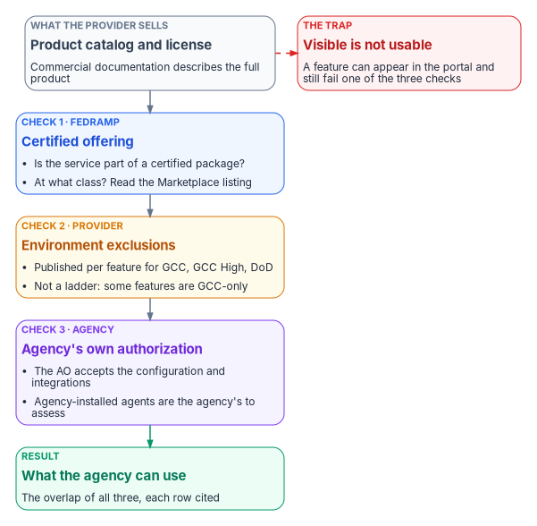

# Chapter 01 — Why the Boundary Decides What You Can Use

*The license says what you bought; the boundary says what you may use, and a design that confuses them fails in front of the assessor rather than in the lab.*

::: {.callout-note}
## In this chapter
The question this book answers and the case in one paragraph. The three things that together decide whether an agency can use a cloud feature: the FedRAMP certification of the offering, the provider's published exclusions for the agency's cloud environment, and the agency's own authorization of the system that uses the service. Why impact level and feature availability are different axes, what FedRAMP's 2026 rules changed about the word "boundary," how the same pattern shows up at the network edge, and the three responses available when a capability falls outside.
:::

## The catalog is not the boundary

Two agencies can hold the same Microsoft 365 license and be entitled to different products. One runs a commercial tenant and sees, in its admin center, per-location network assessment scores, informed network routing to its SD-WAN and an Adoption Score for its workforce. The other runs a Government Community Cloud (GCC) tenant and sees none of those, because Microsoft documents each of them as unavailable there.[^c01-netconn][^c01-inr][^c01-adoption] Nothing in the license, the price list or the commercial product documentation tells the second agency this. The product catalog describes what the provider sells. It doesn't describe what an agency may put into production.

That gap is the subject of this book. Book 10 asks one question: **why does the authorization boundary decide what you can use?** The short answer is that three separate decisions, made by three different parties, have to line up before a feature is usable in a federal system:

1. **The certification.** FedRAMP certifies a specific cloud service offering at a certification class. A feature that sits outside the certified offering isn't covered by it, whatever the portal shows.
2. **The environment.** The provider runs each government environment (for Microsoft, GCC, GCC High and DoD) with a published set of features that differ from commercial. Those exclusions are documented one feature at a time, on many different pages.
3. **The agency's authorization.** The agency authorizes its own federal information system, which uses the cloud service as an external service. Its authorizing official accepts the risk of the specific configuration selected and the integrations enabled.[^c01-fedramp-use]

The feature an agency can actually use is the overlap of all three. Most of this book is about finding that overlap before a design depends on something outside it.

{#fig-ch01-what-decides fig-alt="A slate card on the left, the product catalog, lists everything the provider sells. An arrow leads to a blue card, the FedRAMP certified offering, checked on the FedRAMP Marketplace by package and class. An arrow leads to an amber card, the environment's published exclusions, documented per feature for GCC, GCC High and DoD. An arrow leads to a violet card, the agency's own authorization, where the authorizing official accepts the configuration and integrations. A final arrow leads to a green card: what the agency can use, the overlap of all three. A red side card from the catalog notes that a feature can appear in the portal and still be outside any of the three."}

::: {.callout-important}
## The case in one paragraph
**Problem.** Federal cloud designs are written against the product catalog and the commercial documentation, then discover, often late in an authorization cycle, that a feature they depend on is excluded from their environment, outside the certified offering, or outside what their own authorization covers. The usual explanation, that a "FedRAMP boundary" attenuates features, is imprecise enough to be wrong in both directions: it blames the certification for exclusions the provider publishes per feature, and it hides features that are in fact available.

**Solution.** Treat the boundary as three checks with three owners: the FedRAMP Marketplace listing for the certified offering and its class, the provider's per-feature exclusion documentation for the agency's environment, and the agency's own authorization package. Record each capability a design depends on against all three, with a citation per row. When a capability falls outside, choose one of three responses (compensate inside the boundary, use a documented exception, or take an alternative path) and evidence the choice in the agency's package.

**Ask.** Before the next architecture review or authorization milestone, require every cloud feature a design depends on to be listed with its Marketplace package, its environment availability and the source page that says so. Treat a feature with no citation as unverified, not as available.
:::

## For decision makers

- **The license isn't the authorization.** FedRAMP's 2026 rules say each agency "still authorizes its own federal information systems," should never issue a standalone authorization to operate for a cloud service offering, and should confirm "that the planned use is within the scope of FedRAMP and that the agency is using the FedRAMP Certified version" of the service.[^c01-fedramp-use]
- **GCC exclusions are published per feature.** Microsoft documents, on separate pages, that Adoption Score, network connectivity in the admin center, informed network routing and the Office 365 content delivery network aren't available to GCC tenants.[^c01-adoption][^c01-netconn][^c01-inr][^c01-cdn] There is no single machine-readable list.
- **Restriction isn't a ladder.** Some features are available in GCC and not in GCC High or DoD, such as Windows release health and Office Scripts in Excel.[^c01-releasehealth][^c01-officeapps] Moving "up" doesn't restore everything.
- **Impact level and feature availability are different axes.** The FedRAMP Marketplace lists the GCC offering at Class C (Moderate) and a second, same-named package pursuing Class D (High).[^c01-marketplace] A higher class changes what data the agency may place in the service. It doesn't by itself restore a feature the provider has excluded.
- **The word "boundary" changed meaning in 2026.** FedRAMP's Minimum Assessment Scope rules define the certified offering by the resources likely to handle federal customer data, and allow security categories to vary by resource.[^c01-mas] [Chapter 03](03-what-changed-at-fedramp.md) covers the change in full.

## Three checks, three owners

### The certification: what FedRAMP certified

FedRAMP certifies cloud service offerings. Its 2026 definitions describe a cloud service offering as "a specific, packaged cloud computing product or service" that is the subject of a FedRAMP certification, and a certification class as the category of assurance the offering supplies, "increasing from minimal assurance at Class A to significant assurance at Class D."[^c01-fedramp-defs] The FedRAMP Marketplace is the record of which offering is certified at which class, and it is the source this book uses for any status it states.

The first check is therefore a lookup, not an inference: is the service the design depends on part of a certified offering, and at what class? For Azure, Microsoft publishes which services are inside the scope of its FedRAMP High provisional authorization for Azure public and Azure Government, service by service.[^c01-azscope] For Microsoft 365, the certified offering is a package on the Marketplace, and the services and features inside it are what the package describes. A feature delivered by a separate service, or by a third party, needs its own answer. Microsoft's own GCC service description shows two such edges plainly: GCC customer support "is not included in the service accreditation boundary," and Viva Engage, which can be added to some GCC plans, "does not support FedRAMP accreditation."[^c01-gccdesc]

### The environment: what the provider excludes

The second check is about the cloud environment. Microsoft runs Microsoft 365 for US government customers in separate environments: GCC, GCC High and DoD. GCC is paired with Microsoft Entra ID in commercial Azure, while GCC High and DoD are paired with Microsoft Entra ID in Azure Government.[^c01-azfeature] Intune goes further: it has no separate GCC instance at all, and Microsoft states that "GCC is the same instance as Microsoft Intune in the commercial space."[^c01-intunegov]

Each environment has its own list of features that differ from commercial, and Microsoft publishes those differences per feature, in the documentation for each product. A few examples that bear on this book:

| Capability | Commercial | GCC | GCC High / DoD | Source |
|---|---|---|---|---|
| Network connectivity in the Microsoft 365 admin center (per-location network assessments and insights) | Available | Not available | Not available | [^c01-netconn] |
| Microsoft 365 informed network routing (INR) | Available | Not available | Not available | [^c01-inr] |
| Adoption Score | Available | Not available | Not available | [^c01-adoption] |
| Office 365 content delivery network for SharePoint | Available | Not available | Not available | [^c01-cdn] |
| Windows release health in the admin center | Available | Available | Not available | [^c01-releasehealth] |
| Office Scripts in Excel | Available | Available | Not available | [^c01-officeapps] |
| Analyze Data and Researcher in Office apps | Available | Not available | Not available | [^c01-officeapps] |

Two lessons follow from the table. First, the exclusions are specific and citable, which makes them something an agency can inventory and argue about one at a time. Second, they don't form a ladder: the last three rows show features that GCC has and GCC High doesn't, and features that no government environment has. [Chapter 04](04-gcc-and-the-feature-gap.md) works through the GCC and GCC High differences in detail.

### The agency's authorization: what the agency accepts

The third check belongs to the agency. FedRAMP is explicit that the agency authorizing official "accepts risk for the agency's specific use of that service," including "the configuration selected, the integrations enabled," and that the agency must configure and integrate the service securely, "including identity, logging, monitoring, data protection."[^c01-fedramp-use] A feature can be inside the certified offering, available in the agency's environment and still be outside what the agency has authorized, because nobody described it in the system security plan or assessed the integration it requires.

This check is also where agency-operated components live. The resolvers, appliances, agents and on-premises servers an agency runs are inside its own authorization boundary, not the provider's. FedRAMP's Minimum Assessment Scope guidance goes further for software installed on agency systems: software "delivered separately for installation on agency systems and not operated in a shared responsibility model," typically "agents, application clients, mobile applications," is "entirely outside the scope of FedRAMP."[^c01-mas] That doesn't make the agent unassessed. It makes it the agency's to assess.

## Impact level and feature availability are different axes

Much federal reasoning about Microsoft 365 runs the two together: GCC is "Moderate," Moderate is why the feature is missing, and a High certification would bring it back. The Marketplace data and Microsoft's documentation don't support that chain.

Read on October 21, 2026, the Marketplace lists three Microsoft 365 government packages that are routinely confused:[^c01-marketplace]

| Package | Offering as listed | Status | Class | Authorizations |
|---|---|---|---|---|
| `MSO365MT` | Microsoft 365 Government Community Cloud & Supporting Services | FedRAMP Certified (certification date November 20, 2014) | Class C (Moderate) | 100 |
| `MSO365MTA` | Microsoft 365 Government Community Cloud & Supporting Services (the same name) | FedRAMP In Process, Initial Implementation; status events July 1, July 20 and October 19, 2026 | Class D (High) | 0 |
| `FR1824057433` | Microsoft 365 Government Community Cloud-High | FedRAMP Certified (certification date December 26, 2024) | Class D (High) | 5 |

`MSO365MT` is the GCC offering agencies run today. `FR1824057433` is GCC High, a different environment with its own endpoints and namespaces. `MSO365MTA` is new: a package with the same name as the certified GCC offering, pursuing Class D. The straightforward reading is a High certification effort for the GCC service alongside the existing Moderate one, but the Marketplace doesn't state the relationship between two packages that share a name, or whether one will replace the other. Treat that reading as a question to put to the provider, not as a roadmap.

Microsoft's own GCC service description adds a further wrinkle: it says Office 365 Government "supports the Federal Risk and Authorization Management Program (FedRAMP) accreditation at a High Impact level."[^c01-gccdesc] For an authorization decision, the Marketplace listing and the package are the record; the service description is the provider's summary of it.

Whatever the class turns out to be, it answers a different question from the one a design usually asks. The class governs the assurance the offering supplies and, through the agency's own categorization, what data the agency may place in it. Feature availability is a product decision the provider publishes per environment. The clearest evidence is the table above: network connectivity, informed network routing and Adoption Score are unavailable in GCC High and DoD too, and the GCC High offering is already certified at Class D.[^c01-marketplace][^c01-netconn][^c01-inr][^c01-adoption] An agency waiting for a High certification of GCC to restore those features is waiting for something the certification was never going to deliver. [Chapter 04](04-gcc-and-the-feature-gap.md) develops this point, and [Appendix A](appendix-a-what-to-ask-for.md) turns it into specific requests.

## What 2026 changed about "the boundary"

Under FedRAMP Rev5 the authorization boundary was a provider artifact: drawn by the cloud service provider, diagrammed in its system security plan, with everything crossing it treated as an interconnection. FedRAMP's Consolidated Rules for 2026 describe the offering differently. The Minimum Assessment Scope rule requires providers to "identify a set of information resources to assess for FedRAMP Certification," and FedRAMP's 20x rules allow those resources to vary by security category "as appropriate to the type of information handled by or impacted by the information resource." Metadata, including metadata about federal customer data, is included whenever the resource it describes is in scope.[^c01-mas] The 20x rules page doesn't use the phrase "authorization boundary" at all.

For this book, three consequences matter, and [Chapter 03](03-what-changed-at-fedramp.md) covers each in depth:

- **Scope is a data question.** Whether a resource is in the offering depends on whether it is likely to handle federal customer data or affect it, not on where a line was drawn on a network diagram.
- **One impact level no longer has to cover everything.** A capability refused because it would pull a whole environment up to the high-water mark may deserve a second look.
- **Rev5 and the new rules coexist.** FedRAMP stops accepting new Rev5 certification requests on June 11, 2027, and the end date for existing Rev5 certifications "has not been finalized but is likely to be no later than 2029."[^c01-ntc0013] Agencies will hold services certified under both models at the same time, and Rev5 packages keep their boundary vocabulary.

None of this moves the agency's own boundary. The agency still authorizes the federal information system that includes the cloud service, and that system still has a boundary its authorizing official signs for.[^c01-fedramp-use] The word changed meaning at the provider's side; at the agency's side it means what it always did.

## The same pattern at the network edge

The boundary decides what an agency can use at the network edge too, and the failure looks the same: a design assumes the boundary instead of modeling it.

A common starting state is an agency with a mix of on-premises systems and commercial cloud services, an authorization boundary that is assumed rather than drawn, traffic that hairpins through a traditional perimeter, and a wish for local internet breakout at branches to cut latency that nobody has governed. The program's framing pattern for that case is short. Model the boundary explicitly. Permit local breakout only where the security capabilities the agency must provide are satisfied at a distributed policy enforcement point. Treat where that enforcement point sits as both a physics decision and a compliance decision, not as a product feature. The intended result is that branch traffic leaves locally only when those capabilities are met, the agency's telemetry obligations to the federal monitoring program continue, and the authorization package cites a modeled boundary rather than an assumed one.

Three lessons come with the pattern, and Book 09 develops all of them: transport is a physics decision and control is a compliance decision; bare local breakout without a governing control plane is a compliance regression; and the governor itself is attack surface that must be protected. See [Book 09, Chapter 02 — Transport Is Physics, Control Is Compliance](../b09-network/02-transport-is-physics-control-is-compliance.md) and [Book 09, Chapter 03 — What TIC 3.0 Requires](../b09-network/03-what-tic-3-requires.md). Book 09 also records the edge version of this chapter's feature problem: because network connectivity and informed network routing aren't available to GCC-Moderate tenants, path selection there rests on the agency's own SD-WAN measurements, and any monitoring service that sees branch telemetry needs its own authorization ([Book 09, Chapter 12](../b09-network/12-microsoft-365-traffic.md)).

## Where the boundary shows up: late

::: {.callout-note}
## A framing pattern, not an engagement
The archetype below is the program's engagement pattern for a GCC boundary case. It describes a typical shape, not a specific agency, and it carries no agency identifiers or measured results.
:::

The typical case begins with a Microsoft 365 GCC tenant in production and a system security plan and migration plans that reference features whose live behavior doesn't match what was written. Zero Trust analytics, anomaly detection and insider-risk work are partly blocked by signals the tenant never receives. The posture is nominally compliant, but the agency's observability of its own estate sits below that of a commercial peer running the same products.

The discovery tends to come late, during an authorization cycle or a Zero Trust analytics rollout, because nothing fails loudly before then. The admin portals and the commercial documentation describe the full product, and the exclusions are spread across product pages a design team has no reason to read until something is missing. [Chapter 02 — The Invisible Boundary](02-the-invisible-boundary.md) explains why the gap stays invisible and corrects the most-cited example of it.

The problem in this pattern is structural, not a misconfiguration: no setting in the tenant turns on a feature the environment doesn't offer. That is why the usual remediation cycle, which treats each missing feature as an isolated finding, keeps reopening. The program's approach is to treat the boundary itself as a named, governed object with structured properties, and each compensation as a registered, monitored mechanism that survives staff and vendor changes. Chapter 02 describes that model; [Chapter 11](11-the-authorization-package.md) shows how it lands in the package.

## Three responses when a capability is outside

When the overlap of certification, environment and authorization doesn't include a capability a design needs, an agency has three responses. Each is a decision with an owner, and each must be evidenced in the agency's own authorization package.

1. **Compensate in-boundary.** Rebuild the capability, or enough of it, from signals and services that are inside the boundary, and label the result for what it is: an agency-derived substitute, not the provider's feature. [Chapter 09](09-equivalents-and-exceptions.md) covers in-boundary equivalents.
2. **Use a documented exception.** Some exclusions have a provider-defined path to an exception, with conditions the agency must meet and document. [Chapter 09](09-equivalents-and-exceptions.md) covers when an exception path exists and what it requires, and [Appendix A](appendix-a-what-to-ask-for.md) lists what to ask a provider to publish where none exists.
3. **Choose an alternative path.** Use a different certified service or a different collaboration pattern that delivers the outcome inside a boundary the agency can authorize. [Chapter 10](10-alternative-collaboration-paths.md) works through collaboration alternatives.

Going without the capability is also a legitimate outcome when someone decides it and records it. [Chapter 09](09-equivalents-and-exceptions.md) treats it as a risk acceptance by the authorizing official.

Whichever response is chosen, the decision belongs in the agency's package as an explicit statement about the boundary, not as a footnote in one control narrative. [Chapter 08](08-who-owns-the-boundary.md) names who makes each decision, and [Chapter 11](11-the-authorization-package.md) shows how to evidence it.

## Where the boundary becomes concrete

For Azure workloads, the boundary stops being abstract in the landing zone: the management groups and subscriptions that separate what is authorized from what isn't, the policies that keep resources inside it, the address plan, the network built as code and the front door through which traffic enters. Chapters [05](05-the-landing-zone.md), [06](06-ipam-and-network-as-code.md) and [07](07-the-front-door.md) cover those layers. The platform host they assume is described in [Book 01, Chapter 03](../b01-transformation-arc/03-platform-foundation.md), and the DNS and IP address management authority they mirror is in [Book 08](../b08-ddi/index.md).

::: {.callout-note}
## What this chapter establishes
1. Whether an agency can use a cloud feature is decided by three checks with three owners: FedRAMP's certification of the offering, the provider's published exclusions for the agency's environment, and the agency's own authorization of the system that uses the service.
2. Exclusions are documented one feature at a time and don't form a ladder; some features are in GCC and not in GCC High.
3. Impact level and feature availability are different axes. A higher certification class doesn't by itself restore an excluded feature.
4. FedRAMP's 2026 rules define the certified offering by the resources likely to handle federal customer data. The agency's own boundary is unchanged.
5. When a capability is outside, the agency compensates in-boundary, uses a documented exception or takes an alternative path, and evidences the choice in its own package.
:::

::: {.callout-tip}
## Continue the book
[← Previous: Book 10 index](index.md) · [Book index](index.md) · [Next: Chapter 02 — The Invisible Boundary →](02-the-invisible-boundary.md)
:::

[^c01-netconn]: Microsoft Learn, "Network connectivity in the Microsoft 365 Admin Center," <https://learn.microsoft.com/en-us/microsoft-365/enterprise/office-365-network-mac-perf-overview?view=o365-worldwide> (accessed Oct 21, 2026). "Network connectivity in the Admin Center supports tenants in WW Commercial and China (Operated by 21Vianet ...), but not GCC Moderate, GCC High, or DoD."
[^c01-inr]: Microsoft Learn, "Microsoft 365 informed network routing," <https://learn.microsoft.com/en-us/microsoft-365/enterprise/office-365-network-mac-perf-cpe?view=o365-worldwide> (accessed Oct 21, 2026). "Supports tenants in WW Commercial cloud but not the GCC Moderate, GCC High, DoD, Germany, or China clouds."
[^c01-adoption]: Microsoft Learn, "Microsoft Adoption Score," <https://learn.microsoft.com/microsoft-365/admin/adoption/adoption-score?view=o365-worldwide> (accessed Oct 21, 2026). Prerequisites: "This feature isn't available in GCC High, GCC, and DOD tenants."
[^c01-fedramp-use]: FedRAMP, "Using a FedRAMP Certified Cloud Service," *FedRAMP Consolidated Rules for 2026*, <https://www.fedramp.gov/2026/agencies/use/> (accessed Oct 21, 2026).
[^c01-cdn]: Microsoft Learn, "Office 365 Content Delivery Network (CDN) Quickstart," <https://learn.microsoft.com/microsoft-365/enterprise/office-365-cdn-quickstart?view=o365-worldwide> (accessed Oct 21, 2026). "Tenants in the US Government, China, and Germany clouds don't currently support the Office 365 CDN."
[^c01-releasehealth]: Microsoft Learn, "How to check Windows release health," <https://learn.microsoft.com/windows/deployment/update/check-release-health> (accessed Oct 21, 2026). "Windows release health is available for Government Community Cloud (GCC) tenants, but isn't available for GCC High and DoD."
[^c01-officeapps]: Microsoft Learn, "Office application and feature availability in Government plans," <https://learn.microsoft.com/office365/servicedescriptions/office-applications-service-description/office-application-and-feature-availability-in-government-plans> (accessed Oct 21, 2026). Excel: Office Scripts GCC yes, GCC High and DoD no; Analyze Data (Ideas) no in all three. Researcher (Word, OneNote): no in all three.
[^c01-marketplace]: FedRAMP Marketplace product data, <https://www.fedramp.gov/marketplace/products.json>, `last_change` 2026-10-21T05:02:15Z (accessed Oct 21, 2026). Fields `status`, `phase`, `cert_class`, `impact_level`, `cert_date`, `authorizations` and `event_log` for packages MSO365MT, MSO365MTA and FR1824057433.
[^c01-mas]: FedRAMP, "Minimum Assessment Scope," FedRAMP 20x Certification Rules, *FedRAMP Consolidated Rules for 2026*, <https://www.fedramp.gov/2026/reference/minimum-assessment-scope/> (accessed Oct 21, 2026). Rules MAS-CSO-IIR (identify information resources, with the note on agents and application clients), MAS-CSO-FLO (resources "MAY vary by security category") and MAS-CSO-MDI (metadata inclusion).
[^c01-fedramp-defs]: FedRAMP, "FedRAMP Definitions," *FedRAMP Consolidated Rules for 2026*, <https://www.fedramp.gov/2026/definitions/> (accessed Oct 21, 2026). Entries "Certification Class" and "Cloud Service Offering."
[^c01-azscope]: Microsoft Learn, "Azure, Dynamics 365, Microsoft 365, and Power Platform services compliance scope," <https://learn.microsoft.com/azure/azure-government/compliance/azure-services-in-fedramp-auditscope> (accessed Oct 21, 2026).
[^c01-gccdesc]: Microsoft Learn, "Office 365 GCC," Office 365 US Government service description, <https://learn.microsoft.com/en-us/office365/servicedescriptions/office-365-platform-service-description/office-365-us-government/gcc> (accessed Oct 21, 2026). Sections "US Government community compliance," "Office 365 Government GCC and Viva Engage" and "Office 365 Government GCC customer support."
[^c01-azfeature]: Microsoft Learn, "Cloud feature availability for US Government customers," <https://learn.microsoft.com/azure/security/fundamentals/feature-availability> (accessed Oct 21, 2026). "Office 365 GCC is paired with Microsoft Entra ID in Azure. Office 365 GCC High and Office 365 DoD are paired with Microsoft Entra ID in Azure Government."
[^c01-intunegov]: Microsoft Learn, "Microsoft Intune for US Government GCC High and DoD service description," <https://learn.microsoft.com/intune/fundamentals/government-service> (accessed Oct 21, 2026). Section "Intune commercial and government instances."
[^c01-ntc0013]: FedRAMP, Notice NTC-0013, "Initial Outcome of Rev5 Baseline RFCs (RFC-0026 through RFC-0030)," June 16, 2026, <https://fedramp.gov/notices/0013> (accessed Oct 21, 2026).
