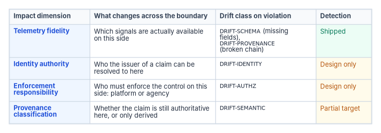
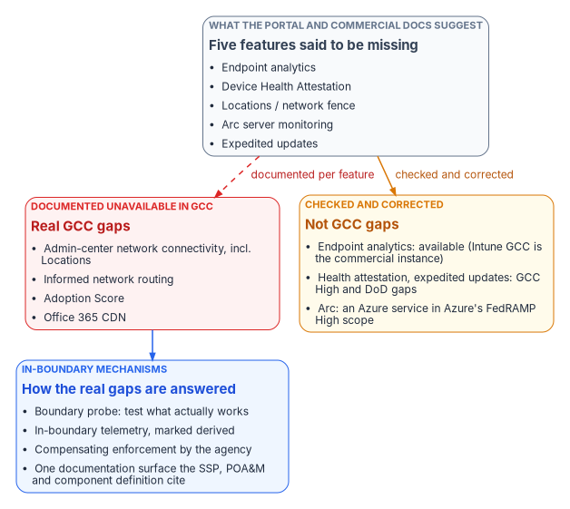

# Chapter 02 — The Invisible Boundary

*A boundary nobody can see gets crossed by every design that assumes it isn't there, and gets blamed for every gap that has some other cause.*

::: {.callout-note}
## In this chapter
Why the features a boundary removes stay out of sight until a design depends on one. The most-cited GCC example, checked against Microsoft's documentation and corrected: one of its five features is documented as unavailable in GCC, and the other four aren't GCC gaps at all. The program's model of the four things that change across a boundary and the drift class each raises. How the program makes the boundary visible, the rules for evidence about it, and why it is treated as architecture rather than as a compliance footnote.
:::

## Why the boundary is invisible

[Chapter 01](01-why-the-boundary-decides.md) established that three checks decide whether an agency can use a cloud feature: FedRAMP's certification of the offering, the provider's exclusions for the agency's environment, and the agency's own authorization. The difficulty is that none of the three is visible where designs are made.

The program's working description of the problem, written from its GCC work, runs like this. Microsoft 365 GCC offers the same nominal product set as commercial. Features appear in the administrative portals, are described in commercial documentation, and get referenced in system security plans and migration plans. Some of them then produce no data in the GCC tenant, raise no error, and have no resolution path documented for GCC. That description is the program's own observation, not a Microsoft statement, and this chapter tests it below. But the mechanism it describes is real, and it has four parts:

- **Shared surfaces.** Commercial and government tenants use the same admin centers and much of the same documentation. Microsoft's Intune documentation states that "GCC is the same instance as Microsoft Intune in the commercial space," with no separate GCC instance at all.[^c02-intunegov] A shared console is good engineering and poor signage.
- **Scattered exclusions.** Where a feature differs, the difference is noted on that feature's own page, often in a single sentence. Network connectivity in the admin center, informed network routing, Adoption Score and the Office 365 content delivery network each carry their own one-line government-cloud exclusion on separate pages.[^c02-netconn][^c02-inr][^c02-adoption][^c02-cdn] There is no single list to check a design against.
- **Moving targets.** Features change underneath the exclusions. Microsoft retired the whole "Technology experiences" area of Adoption Score, including its Network connectivity, Microsoft 365 Apps health and Endpoint analytics categories, for every tenant in January and February 2026.[^c02-adoption] A gap analysis written in 2025 can list a GCC loss that is now a loss for everyone.
- **Absence doesn't announce itself.** A missing signal looks like a quiet day. A detection that never fires because its input never arrives produces the same dashboard as a detection that never fires because nothing happened.

The last part is why the boundary matters operationally and not just on paper. An agency that designs a Zero Trust control on a signal its environment doesn't deliver hasn't built a weak control. It has built no control, and nothing tells it so.

{#fig-ch02-four-dimensions fig-alt="A table with four rows. Telemetry fidelity, which signals are actually available on this side, raises DRIFT-SCHEMA for missing fields or DRIFT-PROVENANCE for a broken chain; both are shipped. Identity authority, who the issuer of a claim resolves to here, raises DRIFT-IDENTITY, which is design only. Enforcement responsibility, whether the platform or the agency must enforce the control on this side, raises DRIFT-AUTHZ, design only. Provenance classification, whether a claim is still authoritative here or only derived, raises DRIFT-SEMANTIC, a partial target."}

::: {.callout-important}
## The case in one paragraph
**Problem.** What a boundary removes is spread across separate product pages, changes over time and fails quietly, so designs depend on it without knowing. The best-known GCC example makes the opposite error as well: of the five features it lists as silently unavailable in GCC, Microsoft documents one as unavailable there, and the other four are either available, unavailable only in GCC High and DoD, or not Microsoft 365 features at all. An unverified boundary claim is as dangerous as an unseen boundary.

**Solution.** Make the boundary a named, modeled object. Test which capabilities actually work, record each one with a citation and a confidence label (vendor-confirmed, inferred, restricted or retention-limited), describe what changes across the boundary along four dimensions, and mark every substitute signal as derived.

**Ask.** Rebuild any boundary gap list the agency relies on so that every row cites a vendor page, and drop or relabel every row that doesn't. Build designs and authorization narratives only on the confirmed rows.
:::

## The worked example, corrected

The program's earlier boundary model used five features as its worked example of the GCC invisible boundary: Endpoint Analytics, Device Health Attestation, "Locations / Network Fence," Azure Arc server monitoring and Expedited Updates, each said to be unavailable in GCC despite appearing in the portal. The example has been widely repeated. Checked against Microsoft's current documentation, it doesn't hold:

| Feature in the original example | What Microsoft documents | Verdict for GCC |
|---|---|---|
| Endpoint analytics | Intune in GCC is the commercial Intune instance.[^c02-intunegov] The endpoint analytics prerequisites list device, network and license requirements and no GCC exclusion.[^c02-ea] The Advanced Analytics add-on lists the public cloud, GCC High and DoD as supported clouds.[^c02-aa] | Not a documented GCC gap. Its Adoption Score category was retired for all tenants in 2026.[^c02-adoption] |
| Device Health Attestation | Listed among Intune features "not available" and planned for GCC High and DoD.[^c02-intunegov] | A GCC High and DoD gap, not a GCC one |
| "Locations / Network Fence" | The Locations tab belongs to network connectivity in the Microsoft 365 admin center, which "supports tenants in WW Commercial and China ... but not GCC Moderate, GCC High, or DoD."[^c02-netconn] | Confirmed unavailable in GCC |
| Azure Arc server monitoring | Arc is an Azure service, not a Microsoft 365 feature. Azure Arc-enabled servers are listed in Azure public's FedRAMP High audit scope.[^c02-azscope] | Not a GCC question. Decided by the Azure subscription and its boundary |
| Expedited updates | "Expedite updates for Windows in Intune" is listed among features not available and planned for GCC High and DoD.[^c02-intunegov] | A GCC High and DoD gap, not a GCC one |

One of the five is a documented GCC gap. Three are real gaps in a different environment, and the example appears to have merged GCC High's exclusions into GCC. One belongs to a different service family and a different boundary. The confirmed row is the important one: the per-location network assessment layer of the admin center, which [Chapter 04](04-gcc-and-the-feature-gap.md) shows to be the largest single documented loss.

The correction cuts in both directions, and that is the lesson of this chapter. An invisible boundary hides features that are missing. An unverified boundary story hides features that are present, sends an agency to build compensations it doesn't need, and gives a Microsoft reviewer an easy reason to dismiss the parts of the argument that are true.

The program's own register of GCC telemetry gaps already draws this distinction. Of its 26 rows, eight are vendor-confirmed, fifteen are the program's inference from the controls that constrain the environment, one is a restriction (a signal available with limits), and two are retention limits rather than absences. The confirmed rows cover the Adoption Score report, which isn't available in GCC at all ([Chapter 04](04-gcc-and-the-feature-gap.md); Microsoft now scores five categories, six with Copilot licenses, where the register counted seven) and informed network routing path metrics, each tied to a Microsoft statement.[^c02-adoption][^c02-inr] Even confirmed rows move: the three technology-experience categories were retired from Adoption Score for every tenant in early 2026, so those rows now describe a loss commercial tenants share. The separate network connectivity feature in the admin center, with its per-location assessments, remains unavailable to GCC and is the row that still matters.[^c02-adoption][^c02-netconn] Inferred rows need the most care. For example, the register infers that Microsoft Entra ID Protection's real-time risk scoring is degraded in GCC. GCC is paired with Microsoft Entra ID in commercial Azure,[^c02-azfeature] so that inference needs its own evidence before any design or narrative relies on it.

## Four things that change across a boundary

A boundary in the program's architecture isn't only a network or tenant edge. It is any surface across which one of four things changes. This is the program's model, not a FedRAMP or Microsoft construct, and it is what lets one boundary produce one coherent account instead of a list of unrelated findings.

| Dimension | The question it asks | Drift class when violated |
|---|---|---|
| **Telemetry fidelity** | Which signals are actually available on this side of the boundary? | `DRIFT-SCHEMA` (missing fields) or `DRIFT-PROVENANCE` (broken chain) |
| **Identity authority** | Who can the issuer of a claim be resolved to on this side? | `DRIFT-IDENTITY` |
| **Enforcement responsibility** | Who must enforce this control on this side, the platform or the agency? | `DRIFT-AUTHZ` (an action outside the authorized envelope) |
| **Provenance classification** | Is a claim still authoritative on this side, or only derived? | `DRIFT-SEMANTIC` |

The drift classes come from the program's five-class drift taxonomy, described in the workbook's [Drift Engine](../b13-governance/06-the-drift-engine.md) page. Mapping boundary crossings onto that taxonomy is deliberate: boundary crossings are the most common source of drift that spans several classes, and treating them as drift keeps boundary governance and configuration governance in one operational language. Be clear about maturity, though. On the Drift Engine page, detection for `DRIFT-SCHEMA` and `DRIFT-PROVENANCE` is shipped, `DRIFT-SEMANTIC` is a partial target, and `DRIFT-AUTHZ` and `DRIFT-IDENTITY` are design only. Two of the four dimensions are therefore modeled but not yet detected automatically.

Applied to a GCC tenant, using only documented facts:

- **Telemetry fidelity.** Admin-center network connectivity, informed network routing and Adoption Score are documented as unavailable.[^c02-netconn][^c02-inr][^c02-adoption] Any design input that came from them is absent on the GCC side, and a control built on it raises `DRIFT-SCHEMA` the first time it is checked.
- **Identity authority.** GCC is paired with Entra ID in commercial Azure, while GCC High and DoD are paired with Entra ID in Azure Government.[^c02-azfeature] A trust that crosses between those clouds crosses an identity boundary, and the rules for resolving an issuer differ on each side. [Book 04](../b04-access/index.md) covers the access-policy consequences.
- **Enforcement responsibility.** Where a commercial tenant would steer branch traffic on Microsoft's per-circuit quality feedback, a GCC agency has to measure and decide for itself: path selection rests on the agency's own SD-WAN measurements, and any monitoring service that sees that telemetry needs its own authorization ([Book 09, Chapter 12](../b09-network/12-microsoft-365-traffic.md)). A platform feature has become an agency responsibility.
- **Provenance classification.** A signal the agency rebuilds from audit logs or its own measurements to stand in for a missing Microsoft signal is useful, but it isn't the provider's signal. It has to be labeled as derived wherever it flows, so that nobody downstream treats an agency estimate as a vendor measurement.

There is a definitional reason this model has to be the agency's and not FedRAMP's. FedRAMP's 2026 definition of federal customer data excludes "account information, service metadata, analytics, telemetry, or other similar metadata generated by the cloud service provider,"[^c02-fedramp-defs] even though its Minimum Assessment Scope rules bring metadata about federal customer data into the assessed scope.[^c02-mas] Nothing in the certification promises an agency any particular analytics or telemetry feature. Whether a signal the agency's controls depend on actually arrives is the agency's question to model.

## Making the boundary visible

The program addresses each dimension with mechanisms inside the boundary rather than waiting for the provider to change the platform. They are program design, and [Chapter 09](09-equivalents-and-exceptions.md) and [Chapter 11](11-the-authorization-package.md) develop them:

1. **A boundary probe.** A programmatic test of which features actually function in the agency's environment, producing a structured disposition for each capability (functional, partial, silent or blocked) instead of a portal screenshot.
2. **In-boundary telemetry.** Adapters that run inside the agency's boundary and emit claims explicitly classified as derived when they stand in for an unavailable provider signal, so consumers can always tell authoritative from substitute.
3. **Compensating enforcement.** Agency-side enforcement for controls the platform can't provide in the environment, with evidence flowing through the same evidence chain as everything else ([Evidence Chain](../b13-governance/07-evidence-over-attestation.md)).
4. **One documentation surface.** The boundary is recorded once, as a first-class artifact that the system security plan, the plan of action and milestones and the component definition all reference, rather than as a series of footnotes in separate control narratives.

{#fig-ch02-invisible-boundary fig-alt="A slate card at the top, what the portal and the commercial documentation suggest, lists the five features in the original example. It splits two ways. A dashed red arrow labeled documented per feature leads to a red card: documented unavailable in GCC, listing admin-center network connectivity including Locations, informed network routing, Adoption Score and the Office 365 CDN. An amber arrow labeled checked and corrected leads to an amber card: not GCC gaps, listing endpoint analytics as available because Intune GCC is the commercial instance, Device Health Attestation and expedited updates as GCC High and DoD gaps, and Arc as an Azure service in Azure's FedRAMP High scope. The red card leads to a blue card of in-boundary mechanisms: boundary probe, in-boundary telemetry marked derived, compensating enforcement, and one documentation surface the SSP, POA&M and component definition cite."}

Four evidence rules keep the visible boundary honest:

- **Cite per row.** Every capability on the boundary list carries the vendor page that states its availability, read on a stated date. "GCC withholds telemetry" will be rejected by a Microsoft reviewer; "network connectivity in the admin center is documented as unavailable in GCC Moderate, GCC High and DoD" won't be.
- **Label confidence.** Keep vendor-confirmed, inferred, restricted and retention-limited rows apart, and build designs and authorization narratives on confirmed rows only. An argument resting on inferred rows won't survive a reviewer holding the documentation.
- **Name the environment.** Record GCC, GCC High and DoD separately. The corrected example shows how easily one environment's exclusions are attributed to another.
- **Re-read on a schedule.** Exclusions and features change; a register is a snapshot. The probe is what turns the snapshot into something current.

## Why this is architecture, not compliance

The program treats the boundary as an architectural concern for two reasons.

First, a boundary changes the topology of the system. Crossing it changes which plane is authoritative for which claim: a signal authoritative on one side is derived or absent on the other, and a control enforced by the platform on one side is enforced by the agency on the other. That is a structural property of the architecture, not a control mapping that can be added afterward.

Second, it is the same problem on every boundary. GCC is the worked example, but an identity-federation boundary, a classified-network boundary and an agency-to-agency boundary all fit the same four dimensions. Solving it once in the architecture is cheaper than solving it again for each compliance regime, and it keeps the answer the same when the regime changes, as FedRAMP's did in 2026 ([Chapter 03](03-what-changed-at-fedramp.md)).

The payoff shows up in the authorization package. In the program's approach, every boundary the system crosses is named, modeled and monitored for drift. The boundary appears in the system security plan with a disposition along each of the four dimensions. Compensating mechanisms are documented per dimension rather than as generic mitigations. A drift finding cites the boundary it crossed (for example, `DRIFT-PROVENANCE @ gcc-moderate-edge`), which makes remediation scope explicit. [Chapter 11](11-the-authorization-package.md) shows the package structure, and [Chapter 08](08-who-owns-the-boundary.md) assigns who keeps the boundary list current.

::: {.callout-note}
## What this chapter establishes
1. What a boundary removes stays invisible because surfaces are shared, exclusions are scattered one per page, features change, and missing signals fail quietly.
2. The widely repeated five-feature GCC example is mostly wrong: one feature is a documented GCC gap, three are GCC High and DoD gaps, and one is an Azure service decided by a different boundary.
3. The program models what changes across any boundary along four dimensions (telemetry fidelity, identity authority, enforcement responsibility, provenance classification), each tied to a drift class; detection for two of them is still design only.
4. The boundary becomes visible through a probe, derived-labeled substitute telemetry, compensating enforcement and one documentation surface, held to evidence rules: cite per row, label confidence, name the environment, re-read on a schedule.
5. The boundary is treated as architecture because it changes which plane is authoritative, and because every boundary instantiates the same model.
:::

::: {.callout-tip}
## Continue the book
[← Previous: Chapter 01 — Why the Boundary Decides What You Can Use](01-why-the-boundary-decides.md) · [Book index](index.md) · [Next: Chapter 03 — What Changed at FedRAMP →](03-what-changed-at-fedramp.md)
:::

[^c02-intunegov]: Microsoft Learn, "Microsoft Intune for US Government GCC High and DoD service description," <https://learn.microsoft.com/intune/fundamentals/government-service> (accessed Oct 21, 2026). Sections "Intune commercial and government instances" ("GCC is the same instance as Microsoft Intune in the commercial space") and "Intune features planned for GCC High and DoD" (Expedite updates for Windows in Intune; Windows Device Health Attestation).
[^c02-netconn]: Microsoft Learn, "Network connectivity in the Microsoft 365 Admin Center," <https://learn.microsoft.com/en-us/microsoft-365/enterprise/office-365-network-mac-perf-overview?view=o365-worldwide> (accessed Oct 21, 2026). Includes the Locations tab and per-location network assessments; "supports tenants in WW Commercial and China ... but not GCC Moderate, GCC High, or DoD."
[^c02-inr]: Microsoft Learn, "Microsoft 365 informed network routing," <https://learn.microsoft.com/en-us/microsoft-365/enterprise/office-365-network-mac-perf-cpe?view=o365-worldwide> (accessed Oct 21, 2026). "Supports tenants in WW Commercial cloud but not the GCC Moderate, GCC High, DoD, Germany, or China clouds."
[^c02-adoption]: Microsoft Learn, "Microsoft Adoption Score," <https://learn.microsoft.com/microsoft-365/admin/adoption/adoption-score?view=o365-worldwide> (accessed Oct 21, 2026). Note on the Technology experiences retirement starting January 22, 2026 and completing in February 2026 (Network connectivity, Microsoft 365 Apps health and Endpoint analytics categories); prerequisites note "This feature isn't available in GCC High, GCC, and DOD tenants." Section "How the score is calculated": the score combines "five categories (six categories if you enabled Copilot licenses)."
[^c02-cdn]: Microsoft Learn, "Office 365 Content Delivery Network (CDN) Quickstart," <https://learn.microsoft.com/microsoft-365/enterprise/office-365-cdn-quickstart?view=o365-worldwide> (accessed Oct 21, 2026). "Tenants in the US Government, China, and Germany clouds don't currently support the Office 365 CDN."
[^c02-ea]: Microsoft Learn, "Endpoint analytics overview," <https://learn.microsoft.com/intune/endpoint-analytics/> (accessed Oct 21, 2026). Prerequisites: device platform, configuration, network (`*.events.data.microsoft.com`), licensing and role requirements.
[^c02-aa]: Microsoft Learn, "Advanced Analytics overview," <https://learn.microsoft.com/intune/advanced-analytics/> (accessed Oct 21, 2026). Cloud requirements: public cloud; GCC High; DoD (DoD without device query or the resource performance report).
[^c02-azscope]: Microsoft Learn, "Azure, Dynamics 365, Microsoft 365, and Power Platform services compliance scope," <https://learn.microsoft.com/azure/azure-government/compliance/azure-services-in-fedramp-auditscope> (accessed Oct 21, 2026). Azure Arc-enabled servers, Kubernetes and SQL Server listed under Azure public services in FedRAMP High scope.
[^c02-azfeature]: Microsoft Learn, "Cloud feature availability for US Government customers," <https://learn.microsoft.com/azure/security/fundamentals/feature-availability> (accessed Oct 21, 2026). "Office 365 GCC is paired with Microsoft Entra ID in Azure. Office 365 GCC High and Office 365 DoD are paired with Microsoft Entra ID in Azure Government."
[^c02-fedramp-defs]: FedRAMP, "FedRAMP Definitions," *FedRAMP Consolidated Rules for 2026*, <https://www.fedramp.gov/2026/definitions/> (accessed Oct 21, 2026). Entry "Federal Customer Data."
[^c02-mas]: FedRAMP, "Minimum Assessment Scope," FedRAMP 20x Certification Rules, *FedRAMP Consolidated Rules for 2026*, <https://www.fedramp.gov/2026/reference/minimum-assessment-scope/> (accessed Oct 21, 2026). Rule MAS-CSO-MDI: "Providers MUST include metadata (including metadata about federal customer data) in the Minimum Assessment Scope."
