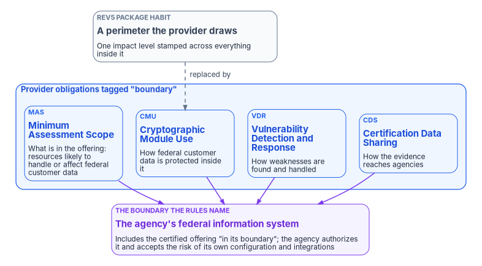
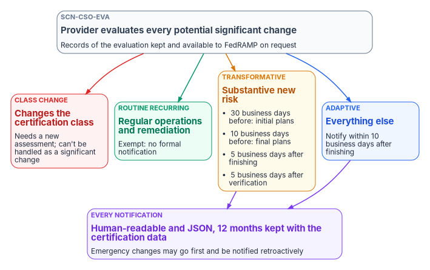

# Chapter 03 — What Changed at FedRAMP

*FedRAMP's 2026 rules stopped describing a cloud service as a perimeter the provider draws and started describing it as a set of obligations, which moves the only boundary left onto the agency's own system.*

::: {.callout-note}
## In this chapter
What the FedRAMP Consolidated Rules for 2026 say about the boundary, read from the published ruleset rather than from what is said about it: certification classes, the four rule families FedRAMP tags as "boundary," Minimum Assessment Scope and its per-resource security categories, the software that falls outside FedRAMP altogether, Significant Change Notification, FedRAMP-compatible trust centers, and the years during which Rev5 packages and the new rules run side by side. [Chapter 04](04-gcc-and-the-feature-gap.md) applies this to Microsoft 365 GCC.
:::

Federal cloud conversations use one word for two different things. "The boundary" sometimes means the perimeter a cloud provider drew around its service in its system security plan, and sometimes means the line around the agency's own information system that its authorizing official signs for. Under the older FedRAMP model the two were easy to blur, because the provider's diagram was the thing every agency reused. The 2026 rules pull them apart. They describe what a provider must do, not a shape the provider must draw, and the only boundary they name belongs to the agency.

That matters to this book's argument. If the boundary were a perimeter, an agency could only accept it or move to a different one. If it is a set of obligations and a published scope, an agency can read the scope, ask questions about specific services, and decide what its own system includes. This chapter sets out what changed so that the rest of the book can use it precisely.

{#fig-ch03-boundary-as-obligations fig-alt="At the top, a slate box labeled Rev5 package habit: a perimeter the provider draws, with one impact level stamped across everything inside it. A dashed arrow labeled replaced by leads to a blue group titled provider obligations tagged boundary, containing four boxes: MAS, Minimum Assessment Scope, what is in the offering, meaning resources likely to handle or affect federal customer data; CMU, Cryptographic Module Use, how federal customer data is protected inside it; VDR, Vulnerability Detection and Response, how weaknesses are found and handled; and CDS, Certification Data Sharing, how the evidence reaches agencies. All four point down to a violet box labeled the boundary the rules name: the agency's federal information system, which includes the certified offering in its boundary; the agency authorizes it and accepts the risk of its own configuration and integrations."}

## Certification replaces authorization

The 2026 rules rename the product of the program. A cloud service offering is now *FedRAMP Certified*, and its level of assurance is a *Certification Class*: "increasing from minimal assurance at Class A to significant assurance at Class D."[^c03-defs] FedRAMP announced the classes in February 2026 and mapped them to the old baselines for Rev5: Class B covers the former Li-SaaS and Low baselines, "Class C will include the current Moderate baseline," and "Class D will include the current High baseline." It dropped numbered levels on purpose, "to avoid confusion with the DOD/DOW Impact Level/IL system."[^c03-ntc0004]

Two cautions come with the new labels. First, the class describes what FedRAMP assessed, not the agency's use. The same notice says agencies may use a certification package to authorize a cloud service "at any security category they deem appropriate following the Risk Management Framework."[^c03-ntc0004] Second, the Marketplace still shows the old word in parentheses: Microsoft 365 GCC, for example, is listed as FedRAMP Certified, Class C (Moderate).[^c03-mso365] Cite the class; treat the parenthetical as a convenience.

Certification also doesn't replace the agency's decision. FedRAMP's guidance to agencies says that "each agency still authorizes its own federal information systems," that the authorizing official accepts the risk of the agency's own use (the data handled, the settings chosen, the integrations enabled and the controls the agency runs itself), and that an agency should never create a standalone authorization to operate for a cloud service offering. It authorizes its own system, which uses the cloud service as an external service.[^c03-use] [Book 09 Chapter 03](../b09-network/03-what-tic-3-requires.md) draws the same line for network paths.

The dates, as FedRAMP publishes them:

| Date | What happens |
|---|---|
| July 4, 2026 | Optional early adoption of the Consolidated Rules for 2026 |
| July 6, 2026 | Marketplace listings open for providers in the Initial Implementation phase |
| January 1, 2027 | Mandatory adoption for all stakeholders |
| June 11, 2027 | FedRAMP stops accepting new Rev5 certification requests |

The timeline page lists June 11, 2027 as its only Rev5 end date.[^c03-timeline] For existing Rev5 certifications, FedRAMP says the end date "has not been finalized but is likely to be no later than 2029."[^c03-ntc0013]

## The rules have no provider authorization boundary

The Consolidated Rules are published as a single machine-readable ruleset, so their vocabulary can be counted rather than characterized. In version 2026.10.13.01, the current release, the phrase "authorization boundary" occurs zero times. The word "boundary" occurs eight times:[^c03-crjson]

- **Three** times in agency rules that describe the agency's own system: Authorizations to Operate for "the federal information system that includes the cloud service offering in its boundary" (rules AGU-USE-ROR, CCM-AGM-ROR and CCM-AGM-CSC).
- **Four** times as a classification tag on rule families.
- **Once** in inherited supply-chain guidance under control SR-03, about devices "being introduced to the boundary."

The four families FedRAMP tags `boundary` say what the word now means:[^c03-crjson]

| Family | Name | What it governs |
|---|---|---|
| MAS | Minimum Assessment Scope | What is in the offering |
| CMU | Cryptographic Module Use | How the offering protects federal customer data with validated cryptography |
| VDR | Vulnerability Detection and Response | How weaknesses are detected and handled |
| CDS | Certification Data Sharing | How the evidence reaches agencies |

So "the boundary" of a certified offering is four sets of obligations, not a line on a diagram. Earlier program material named the second family "UCM"; in the published ruleset it is CMU, and its rules are about documenting and using cryptographic modules validated under NIST's Cryptographic Module Validation Program, with force rising by class (MAY for Classes A and B, SHOULD for Class C, MUST for Class D).[^c03-cmu]

None of this removes the agency's authorization boundary. NIST still defines that boundary, from OMB Circular A-130, as "all components of an information system to be authorized for operation by an authorizing official," excluding separately authorized systems it connects to,[^c03-nistab] and FedRAMP's own agency rules assume it. What has gone is a provider-drawn perimeter that agencies inherit wholesale. [Chapter 11](11-the-authorization-package.md) covers how the agency evidences its boundary.

## Minimum Assessment Scope: a test about data, not topology

The first boundary family defines what a cloud service offering is. Rule MAS-CSO-IIR requires a provider to identify "all information resources that are likely to handle federal customer data or likely to impact the confidentiality, integrity, or availability of federal customer data handled by the cloud service offering," and says that set of resources *is* the offering.[^c03-mas] The test follows the data. A resource is in scope because of what it touches, not because of which subnet it sits in.

Five rules in the family carry most of the weight for an agency:

| Rule | What it requires |
|---|---|
| MAS-CSO-IIR | Identify every resource likely to handle, or affect the security of, federal customer data; that set is the offering |
| MAS-CSO-FLO | Document information flows and security categories for all resources; resources "MAY vary by security category" |
| MAS-CSO-TPR | For each third-party resource, document its use, the reason for it, mitigations and compensating controls |
| MAS-CSO-MDI | Include metadata, "including metadata about federal customer data," whenever the resource is in scope |
| MAS-CSO-SUP | Material about resources outside the offering may be supplied, but must be marked and separated, and isn't certified |

The rules apply to Classes B through D, and each requires machine-readable output with the code that generates it, not only a narrative.[^c03-mas]

### Security category is a property of each resource

MAS-CSO-FLO's note is the provision most likely to change a federal design conversation: information resources "MAY vary by security category as appropriate to the type of information handled by or impacted by the information resource."[^c03-mas] An offering is no longer described by a single impact level carried across every component. A provider can show that one resource handles data at one category and another resource at a different one.

Much "we can't have that feature" reasoning in federal estates rests on the opposite habit: one level stamped over an entire environment, so that anything which might raise the level for one component is refused for all of them. The 2026 rules don't require that habit. Whether a provider uses the flexibility is the provider's choice, and whether an agency can rely on it depends on what the provider documents. [Chapter 09](09-equivalents-and-exceptions.md) treats it as one of the arguments an agency can now make.

### Some software is outside FedRAMP entirely

The guidance on MAS-CSO-IIR draws a line that most boundary documents never ask about. Software a provider delivers "separately for installation on agency systems and not operated in a shared responsibility model (typically including agents, application clients, mobile applications, etc. that are not fully managed by the cloud service provider)" is "not a cloud computing product or service" and is "entirely outside the scope of FedRAMP."[^c03-mas]

FedRAMP's scope page sets the wider frame. It quotes OMB M-24-15's definition of the program's scope (cloud products and services "that create, collect, process, store, or maintain Federal information on behalf of a Federal agency") and its list of exclusions, and it is explicit that "only a federal agency can determine if their use case for a cloud service falls within the scope of FedRAMP."[^c03-scope]

For an estate full of management agents, endpoint sensors, sync engines and desktop clients, the consequence is practical. An agent installed and operated by the agency on agency hardware isn't certified as part of the provider's offering, so the agency's own authorization has to cover it: its configuration, its updates, and the data it sends to the service. The cloud service it reports to is in FedRAMP's scope; the agent is in the agency's. The question to settle for each one is whether it is operated in a shared-responsibility model or simply delivered to the agency.

### The scope has to be visible without asking

A companion rule in the data-sharing family makes scope inspectable. CDS-CSO-SVC requires a provider to publish a list of the specific services in the offering and their security categories, "using clear feature or service names that align with standard public marketing materials," complete enough "for a potential customer to determine which services are and are not included in the FedRAMP Minimum Assessment Scope without requesting access to underlying FedRAMP Certification Data."[^c03-cds] Public information about the offering must be available in both human-readable and JSON form (CDS-CSO-PUB).[^c03-cds]

That rule answers a different question from the one [Chapter 04](04-gcc-and-the-feature-gap.md) raises. It tells an agency which services are inside the certified scope. It doesn't tell an agency which features of those services are switched off in a given government environment. [Appendix A](appendix-a-what-to-ask-for.md) asks for both.

## Change control replaces re-authorization

Under the old model, a provider making a significant change to a certified service went back through an approval. The Significant Change Notification (SCN) family replaces that with notification, scaled to risk. The provider evaluates every potential significant change and classifies it in a fixed order (SCN-CSO-EVA):[^c03-scn]

1. If it changes the certification class, it "requires a new assessment and cannot be done under the Significant Change Notification rules."
2. If it recurs regularly, it is a **routine recurring** change.
3. If it introduces substantive new risk, it is a **transformative** change.
4. Otherwise it is an **adaptive** change.

{#fig-ch03-change-classes fig-alt="At the top, a slate box: SCN-CSO-EVA, the provider evaluates every potential significant change and keeps records available to FedRAMP on request. Four arrows lead to four boxes in a row. Red, class change: changes the certification class, needs a new assessment and can't be handled as a significant change. Green, routine recurring: regular operations and remediation, exempt with no formal notification. Amber, transformative: substantive new risk, with initial plans 30 business days before, final plans 10 business days before, notice 5 business days after finishing and 5 business days after verification. Blue, adaptive: everything else, notify within 10 business days after finishing. The transformative and adaptive boxes lead to a violet box: every notification is human-readable and JSON, kept for 12 months with the certification data, and emergency changes may go first and be notified retroactively."}

| Change type | What it is | What the provider owes |
|---|---|---|
| Routine recurring | Regularly recurs in ongoing operations, vulnerability mitigation or remediation (patching, signature updates, capacity changes, firewall rule maintenance) | No formal notification; the rules say providers "SHOULD NOT" file one |
| Adaptive | Doesn't recur routinely and doesn't introduce substantive new risk; FedRAMP expects most non-routine changes to land here | Notify within 10 business days after finishing, with any new risks identified |
| Transformative | Introduces substantive risk likely to affect existing risk determinations | Initial plans at least 30 business days before starting, final plans at least 10 business days before, notice within 5 business days after finishing and within 5 business days after verification; updated service documentation within 30 business days |

The deadlines are in business days throughout; earlier program material gave the first transformative deadline as "30 days." Every notification and its audit records must be available "in human-readable and JSON formats," and the provider keeps 12 months of past notifications with its certification data. In an emergency or incident, a provider may make a significant change first and supply the notification materials retroactively.[^c03-scn]

Two consequences follow for an agency. A provider that ships continuously can treat most of that cadence as routine recurring and file nothing, so "keeping current with commercial" no longer carries a per-release compliance cost on the provider's side. And because notifications are machine-readable, an agency can ingest them as data and test each one against its own authorization, which is what the agency rules expect: agencies "MUST review each Ongoing Certification Report" for changes that affect the risk tolerance in their own ATO.[^c03-crjson]

## Certification data becomes a feed

The fourth boundary family, Certification Data Sharing, changes how evidence reaches an agency. A provider "MUST use a FedRAMP-compatible trust center to store and share FedRAMP Certification Data" (CDS-CSO-UTC), and FedRAMP defines a trust center as "the complete and definitive source" for that data.[^c03-cds][^c03-defs] The trust center rules are specific:[^c03-cds]

| Rule | Requirement |
|---|---|
| CDS-TRC-USH | Share certification data with all necessary parties "without interruption"; on-demand, just-in-time access provisioning is the preferred way |
| CDS-TRC-PAC | "MUST provide documented programmatic access to all FedRAMP Certification Data, including programmatic access to human-readable materials" |
| CDS-TRC-AAI | Keep an inventory and history of agency users and systems with access |
| CDS-TRC-ACL | Log access and keep summaries for at least six months |
| CDS-TRC-HMR | Offer the data in human-readable and machine-readable formats (SHOULD) |
| CDS-TRC-SSM | Let agencies provision and manage their own access (SHOULD) |

A related subset governs providers "using a FedRAMP-compatible trust center instead of USDA Connect," and requires them, for example, to tell FedRAMP within five business days of denying an agency's access request (CDS-UTC-AAD).[^c03-cds] The Marketplace data now carries a trust-center field for each listing; on October 21, 2026, 110 of 781 listings had one populated.[^c03-mso365]

This is the provision that most rewards a provider with an evidence pipeline and most penalizes one with a document library. For an agency, it turns the provider's package from a set of files requested once a year into a source its own governance tooling can read. [Chapter 11](11-the-authorization-package.md) uses it.

## Rev5 and the 2026 rules side by side

The Consolidated Rules aren't only for new 20x certifications. Each rule family declares the certification types it applies to, and the boundary families (MAS, CMU, VDR and CDS) and SCN all list both "20x" and "Rev5."[^c03-crjson] FedRAMP publishes Rev5 versions of fifteen rule families, including MAS and SCN, for Classes B through D.[^c03-rev5]

In practice the two will coexist for years. A Rev5 package was written in the older vocabulary, with a provider-drawn authorization boundary in its system security plan, and that document doesn't rewrite itself on January 1, 2027. An agency will hold Rev5 packages and 20x packages for different services at the same time, and should read each in its own terms: the boundary diagram in a Rev5 package describes the provider's assessed scope; the Minimum Assessment Scope output in a 20x package describes the same thing as data.

Earlier program material said Rev5 certifications "remain valid to at least 2028-12-31." FedRAMP's notice doesn't say that. It says the end date for existing Rev5 certifications is not final and "likely to be no later than 2029," and new Rev5 requests stop on June 11, 2027.[^c03-ntc0013] Plan against those words, not a specific date.

## What changes for the agency

The program draws five working conclusions from the rules. They are the program's positions, built on the rule text above:

1. **Stop describing the provider's service as "the boundary."** Describe the agency's system, the certified offerings it uses, and the obligations each provider carries. The word belongs to the agency.
2. **Ask scope questions per service and per resource.** Minimum Assessment Scope is a data test, and security category can vary by resource. A refusal that rests on "it would raise the whole environment's level" needs to show which resource and which data.
3. **Decide who owns each agent.** Software delivered for installation on agency systems and not operated in a shared-responsibility model is outside FedRAMP. Inventory it, and cover it in the agency's own authorization.
4. **Consume change notifications and trust-center data as feeds.** Both are machine-readable by rule. Routing them into the agency's own continuous monitoring is cheaper than reading PDFs.
5. **Keep two vocabularies for a while.** Rev5 packages describe boundaries; 20x packages describe scope. Don't force one into the other.

[Chapter 04](04-gcc-and-the-feature-gap.md) shows why the first of these matters for Microsoft 365 GCC in particular, and [Chapter 09](09-equivalents-and-exceptions.md) turns the second, third and fourth into an agency playbook.

::: {.callout-tip}
## Continue the book
[← Previous: Chapter 02 — The Invisible Boundary](02-the-invisible-boundary.md) · [Book index](index.md) · [Next: Chapter 04 — GCC, GCC High and the Commercial Feature Gap →](04-gcc-and-the-feature-gap.md)
:::

[^c03-defs]: FedRAMP, "FedRAMP Definitions," *FedRAMP Consolidated Rules for 2026* ("Certification Class," "Trust Center"), <https://www.fedramp.gov/2026/definitions/> (accessed Oct 21, 2026).
[^c03-ntc0004]: FedRAMP, Notice NTC-0004, *Initial Outcome from RFC-0020 FedRAMP Authorization Designations*, February 25, 2026, <https://www.fedramp.gov/notices/0004/> (accessed Oct 21, 2026).
[^c03-mso365]: FedRAMP Marketplace product data, <https://www.fedramp.gov/marketplace/products.json>, dataset last changed October 21, 2026 (accessed Oct 21, 2026). Microsoft 365 Government Community Cloud & Supporting Services (MSO365MT): FedRAMP Certified, Class C, impact level Moderate. Count of listings with a populated `trust_center` field computed from the same file.
[^c03-use]: FedRAMP, "Using a FedRAMP Certified Cloud Service," *FedRAMP Consolidated Rules for 2026*, <https://www.fedramp.gov/2026/agencies/use/> (accessed Oct 21, 2026).
[^c03-timeline]: FedRAMP, "Important Dates," *FedRAMP Consolidated Rules for 2026*, <https://www.fedramp.gov/2026/timeline/> (accessed Oct 21, 2026).
[^c03-ntc0013]: FedRAMP, Notice NTC-0013, *Initial Outcome of Rev5 Baseline RFCs (RFC-0026 through RFC-0030)*, June 16, 2026, <https://www.fedramp.gov/notices/0013/> (accessed Oct 21, 2026).
[^c03-crjson]: FedRAMP, *FedRAMP Consolidated Rules for 2026*, machine-readable ruleset `fedramp-consolidated-rules.json`, version 2026.10.13.01 (last updated October 13, 2026), <https://github.com/FedRAMP/rules> (accessed Oct 21, 2026). Occurrences of "authorization boundary" and "boundary" counted across the whole file; rule-family tags and applicability read from each family's `info` block; agency rules AGU-USE-ROR, CCM-AGM-ROR and CCM-AGM-CSC.
[^c03-cmu]: FedRAMP, "Cryptographic Module Use," *FedRAMP Consolidated Rules for 2026* (CMU-CSO-CMD, CMU-CSO-UVM, CMU-CSO-CAT), <https://www.fedramp.gov/2026/reference/cryptographic-module-use/> (accessed Oct 21, 2026).
[^c03-mas]: FedRAMP, "Minimum Assessment Scope," *FedRAMP Consolidated Rules for 2026* (MAS-CSO-IIR with its notes, MAS-CSO-FLO, MAS-CSO-TPR, MAS-CSO-MDI, MAS-CSO-SUP), <https://www.fedramp.gov/2026/reference/minimum-assessment-scope/> (accessed Oct 21, 2026).
[^c03-scope]: FedRAMP, "Scope of FedRAMP," *FedRAMP Consolidated Rules for 2026*, quoting OMB Memorandum M-24-15, <https://www.fedramp.gov/2026/scope/> (accessed Oct 21, 2026).
[^c03-cds]: FedRAMP, "Certification Data Sharing," *FedRAMP Consolidated Rules for 2026* (CDS-CSO-PUB, CDS-CSO-SVC, CDS-CSO-UTC, CDS-TRC-USH, -PAC, -AAI, -ACL, -HMR, -SSM, CDS-UTC-AAD), <https://www.fedramp.gov/2026/reference/certification-data-sharing/> (accessed Oct 21, 2026).
[^c03-scn]: FedRAMP, "Significant Change Notification," *FedRAMP Consolidated Rules for 2026* (SCN-CSO-EVA, -HIS, -HRM, -EMG; SCN-RTR-NNR; SCN-ADP-NTF; SCN-TRF-NIP, -NFP, -NAF, -NAV, -UPD), <https://www.fedramp.gov/2026/reference/significant-change-notification/> (accessed Oct 21, 2026).
[^c03-nistab]: NIST Computer Security Resource Center, Glossary, "authorization boundary" (sources include NIST SP 800-37 Rev. 2 and SP 800-53 Rev. 5, from OMB Circular A-130), <https://csrc.nist.gov/glossary/term/authorization_boundary> (accessed Oct 21, 2026).
[^c03-rev5]: FedRAMP, "Rev5 Rulesets," *FedRAMP Consolidated Rules for 2026*, <https://www.fedramp.gov/2026/reference/rev5/> (accessed Oct 21, 2026).
