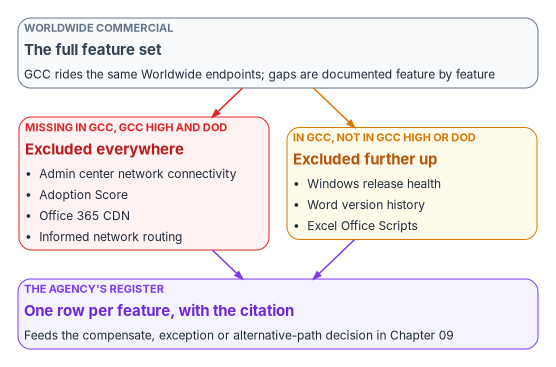
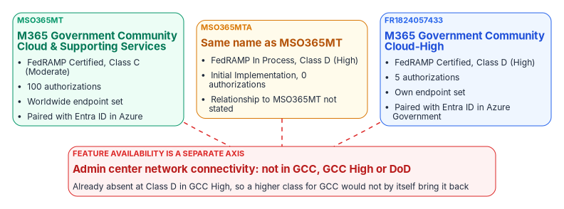

# Chapter 04 — GCC, GCC High and the Commercial Feature Gap

*GCC isn't a compliance perimeter that dims the commercial service; it is the commercial footprint with a list of features left out, and a list can be read, argued and asked about one line at a time.*

::: {.callout-note}
## In this chapter
How Microsoft itself describes GCC, GCC High and DoD; why their feature gaps form a list rather than a ladder; what an agency in GCC verifiably loses, starting with the network connectivity layer of the Microsoft 365 admin center; the three Microsoft 365 government packages on the FedRAMP Marketplace, including a second GCC package now pursuing Class D (High); and why a higher certification class would not by itself bring the missing features back. [Chapter 09](09-equivalents-and-exceptions.md) covers what to do about each gap.
:::

Federal reasoning about Microsoft 365 Government Community Cloud (GCC) usually starts from a picture: a compliance boundary drawn around the commercial service that filters out telemetry and withholds features for accreditation reasons. If that picture were right, an agency would have two moves: accept the boundary, or leave for GCC High. Microsoft's documentation doesn't describe GCC that way. It describes a service that shares the commercial network footprint, with specific features excluded and each exclusion published in its own note. That is a different problem with different remedies, because a published list of exclusions can be inventoried, prioritized and argued feature by feature.

This chapter uses only what Microsoft and FedRAMP publish. It builds the case on documented exclusions because, for an agency arguing with a provider or an assessor, a documented exclusion is stronger evidence than any inference drawn from a boundary model.

## What GCC is, in Microsoft's own words

Five documented facts set the shape:

| Documented fact | What it means |
|---|---|
| GCC has no endpoint list of its own: Microsoft publishes one list for "Worldwide (including GCC)," and separate lists for GCC High and DoD[^c04-endpoints] | GCC users reach the same network endpoints as commercial users; it isn't a separate network regime |
| "Office 365 and Office 365 GCC are paired with Microsoft Entra ID in Azure. Office 365 GCC High and Office 365 DoD are paired with Microsoft Entra ID in Azure Government"[^c04-azfeat] | Integration with Azure services follows the identity pairing: GCC integrates with commercial Azure, GCC High and DoD with Azure Government |
| The GCC service description says "Office 365 GCC operates in conjunction with Azure Public Cloud," and that GCC customer support is "not included in the service accreditation boundary"[^c04-gccsd] | Even inside GCC, some parts of the service relationship sit outside the accredited scope, and Microsoft says so per item |
| Microsoft describes GCC High and DoD as environments with "extra network restrictions on which external endpoints the services are permitted to access," where on-premises connections need an allowlist request with a three-week service level that "can't be expedited"[^c04-gcchnet] | The restricted, separately networked environment begins at GCC High, not at GCC |
| Feature gaps are documented feature by feature, and some run the other way: "Windows release health is available for Government Community Cloud (GCC) tenants, but isn't available for GCC High and DoD"[^c04-wrh] | There is no single ladder of restriction from commercial to DoD |

One documented fact points the other way and is worth knowing before a reviewer raises it. The FedRAMP Marketplace description of the GCC package says that "M365 GCC leverages Azure Government as the IaaS/PaaS for the underlying infrastructure and hardware."[^c04-fr] That is a statement about the infrastructure the package inherits controls from. It doesn't change the endpoint list or the Entra ID pairing an agency designs against, but an agency's system security plan should cite both statements and not paraphrase either into "GCC runs on commercial Azure" or "GCC runs on Azure Government."

### The gaps form a list, not a ladder

Microsoft publishes feature availability for government plans per product and per feature. A few examples from its own tables show both directions:

| Feature | GCC | GCC High | DoD |
|---|---|---|---|
| Network connectivity in the Microsoft 365 admin center[^c04-netconn] | No | No | No |
| Adoption Score[^c04-adoption] | No | No | No |
| Office 365 Content Delivery Network for SharePoint[^c04-cdn] | No | No | No |
| Microsoft 365 informed network routing[^c04-inr] | No | No | No |
| Windows release health[^c04-wrh] | Yes | No | No |
| Word version history; Excel Office Scripts[^c04-officegov] | Yes | No | No |

{#fig-ch04-exclusions-both-ways fig-alt="At the top, a slate box: Worldwide commercial, the full feature set; GCC rides the same Worldwide endpoints and gaps are documented feature by feature. Two arrows lead down. A red box, missing in GCC, GCC High and DoD, excluded everywhere: admin center network connectivity, Adoption Score, Office 365 CDN, informed network routing. An amber box, in GCC but not in GCC High or DoD, excluded further up: Windows release health, Word version history, Excel Office Scripts. Both lead to a violet box: the agency's register, one row per feature with the citation, which feeds the compensate, exception or alternative-path decision in Chapter 09."}

The two diagnoses lead to different remedies. If GCC were a boundary, the only move would be to accept it or move to GCC High, and GCC High is more restricted on several of these lines, not less. Because GCC is the worldwide service with an enumerated set of exclusions, each exclusion is its own question with its own answer, and some answers are obtainable: a compensating capability inside the boundary, a documented exception, or an alternative path ([Chapter 09](09-equivalents-and-exceptions.md) and [Chapter 10](10-alternative-collaboration-paths.md)).

## What agencies verifiably lose

The most consequential single exclusion isn't a telemetry detail. It is the whole network connectivity layer of the Microsoft 365 admin center, which "supports tenants in WW Commercial and China (Operated by 21Vianet, released on 2024-09-23), but not GCC Moderate, GCC High, or DoD."[^c04-netconn] A commercial tenant gets all of the following at no extra license cost (the only requirement is a license that provides access to the admin center).[^c04-netconn]

- **A network assessment for the tenant and for each location,** a points value from 0 to 100 averaging TCP latency, download speed and UDP connection quality, compiled once a day. Microsoft treats 80 as the healthy baseline, "above which you shouldn't expect to receive regular user complaints."[^c04-score] Each location's assessment is compared with other Microsoft 365 customers in the same city, and history can be reported for up to two years.[^c04-score]
- **A per-location view of the network perimeter:** the egress point, the in-use and optimal Exchange and SharePoint front doors, the DNS recursive resolver and any proxy, with an estimated latency improvement calculated against other organizations in the same city.[^c04-netconn]
- **Network insights,** including detection of TLS interception, where users' connections present certificates not issued by Microsoft 365, with service health notifications.[^c04-insights]
- **Network provider attribution.** The admin center identifies each network provider between users and Microsoft's network as ISP, Overlay ("VPN, Cloud Proxy, SD-WAN, and SASE") or Corporate, and attributes performance and availability to each: Exchange, SharePoint and Teams assessments, SharePoint throughput, Exchange latency, and Teams packet loss, jitter and latency. A Network Provider Index chart, currently for the United States only, ranks the highest-performing providers in the same state.[^c04-npp]

An agency choosing between SASE or transport providers in a commercial tenant has comparative evidence about those providers, produced by Microsoft, in its own admin center. The same agency in GCC has none of it, and has to fund its own measurement to reach a decision a commercial enterprise makes from a dashboard. [Book 09 Chapter 12](../b09-network/12-microsoft-365-traffic.md) covers how a GCC agency steers and measures Microsoft 365 traffic without it.

Some measurement does remain. Microsoft's network connectivity test tool lists US Government (GCC) as a supported version, with public report sharing disabled.[^c04-tool] Its insights are run locally from the location being tested rather than aggregated daily from the tenant, but they include, for example, a flag when the network egress is more than 500 miles from the user's office, "since that's likely to increase the TCP latency by more than 25 ms."[^c04-tool] That insight comes from the test tool, which GCC can use, not from the admin center's network connectivity page.

Alongside that layer, other documented exclusions follow the same pattern:

- **Adoption Score**, the admin center's usage-and-readiness report, "isn't available in GCC High, GCC, and DOD tenants."[^c04-adoption] Microsoft's page describes five scored categories (six with Copilot); in GCC the whole report is unavailable, not individual categories.
- **Informed network routing**, the feedback channel that lets a supported SD-WAN steer Microsoft 365 traffic between circuits, "supports tenants in WW Commercial cloud but not the GCC Moderate, GCC High, DoD, Germany, or China clouds."[^c04-inr] [Book 08 Appendix C](../b08-ddi/appendix-c-applicability.md) and [Book 09 Chapter 12](../b09-network/12-microsoft-365-traffic.md) record the same limit.
- **The Office 365 CDN** for SharePoint static assets "is only available to tenants in the production (worldwide) cloud"; tenants in the US Government, China and Germany clouds don't support it.[^c04-cdn]

::: {.callout-important}
## Build the register on documented exclusions only
Every row in an agency's feature-gap register should carry a citation to the provider's own statement that the feature is unavailable in its environment. Gaps inferred from a boundary model, or from a feature that "seems" to return nothing, belong in a separate list marked as unconfirmed until they are tested ([Chapter 02](02-the-invisible-boundary.md)). An argument built on inferred rows won't survive a reviewer holding the provider's documentation; one built on cited rows can't be dismissed.
:::

## A note on names

"GCC Moderate" isn't a Microsoft offering name. The offering is Government Community Cloud, and its Marketplace package is Microsoft 365 Government Community Cloud & Supporting Services, `MSO365MT`.[^c04-fr] Microsoft does use the phrase for the environment, as the network connectivity and informed network routing pages above show,[^c04-netconn][^c04-inr] and the workbook's other books follow that usage. Writing "GCC Moderate" for the environment is fine. Treating it as the name of a distinct product or a distinct FedRAMP certification isn't, because there is neither.

## Microsoft is pursuing High for GCC, and what that doesn't change

The FedRAMP Marketplace carries three Microsoft 365 government packages that are routinely run together. Read from FedRAMP's Marketplace dataset on October 21, 2026:[^c04-fr]

| Package | Offering | Status | Class |
|---|---|---|---|
| `MSO365MT` | Microsoft 365 Government Community Cloud & Supporting Services | FedRAMP Certified (certification date November 20, 2014); 100 authorizations, 91 agencies listed | Class C (Moderate) |
| `MSO365MTA` | Microsoft 365 Government Community Cloud & Supporting Services (the identical name) | FedRAMP In Process, Initial Implementation; 0 authorizations | Class D (High) |
| `FR1824057433` | Microsoft 365 Government Community Cloud-High | FedRAMP Certified (December 26, 2024); 5 authorizations | Class D (High) |

{#fig-ch04-three-packages fig-alt="Three boxes in a row. Green, MSO365MT, Microsoft 365 Government Community Cloud and Supporting Services: FedRAMP Certified, Class C Moderate, 100 authorizations, Worldwide endpoint set, paired with Entra ID in Azure. Amber, MSO365MTA, same name as MSO365MT: FedRAMP In Process, Class D High, Initial Implementation, 0 authorizations, relationship to MSO365MT not stated. Blue, FR1824057433, Microsoft 365 Government Community Cloud-High: FedRAMP Certified, Class D High, 5 authorizations, own endpoint set, paired with Entra ID in Azure Government. Dashed red lines from all three lead to a red box below: feature availability is a separate axis; admin center network connectivity is not in GCC, GCC High or DoD, already absent at Class D in GCC High, so a higher class for GCC would not by itself bring it back."}

`MSO365MT` is the GCC service most civilian agencies run, certified at Class C. `FR1824057433` is GCC High, a different product with its own endpoints and its own Entra ID pairing. Neither is new. `MSO365MTA` is. It carries the same offering name and the same service description as the certified GCC package, at Class D, with the same independent assessor; its Marketplace history starts with status changes on July 1 and July 20, 2026, and records another on October 19, 2026.[^c04-fr]

::: {.callout-note}
## Fact and inference, separated
The **fact** is the table above, read from FedRAMP's own dataset. The **inference** is that `MSO365MTA` is an effort to certify the GCC service at High, running in parallel with its existing Class C certification. That is the straightforward reading of a same-named Class D package in Initial Implementation, and it is consistent with FedRAMP's rule that a change of certification class "requires a new assessment and cannot be done under the Significant Change Notification rules."[^c04-scn] But the Marketplace doesn't state the relationship between two packages sharing a name, or whether one will supersede the other, run alongside it, or be withdrawn. Treat the reading as a question to put to Microsoft ([Appendix A](appendix-a-what-to-ask-for.md)), not as a roadmap commitment.
:::

Microsoft's own documentation adds a complication. Its GCC service description says that "Office 365 Government supports the Federal Risk and Authorization Management Program (FedRAMP) accreditation at a High Impact level,"[^c04-gccsd] and its Azure feature-availability page says the GCC environment "helps customers comply with US government requirements, including FedRAMP High."[^c04-azfeat] The Marketplace record for the certified GCC package says Class C (Moderate).[^c04-fr] For an authorization package, cite the Marketplace record and the package itself, and record the discrepancy; [Book 08 Appendix C](../b08-ddi/appendix-c-applicability.md) takes the same position.

**Why the High package matters.** A great deal of federal "we can't have that in GCC" reasoning rests on an assumed Moderate ceiling. If GCC is certified at Class D, that premise has a shelf life, and a multi-year architecture that hard-codes Moderate (in a schema value, a control-parameter narrative or an acquisition assumption) is building on a foundation that may move. FedRAMP's guidance already loosens the link from the other side: an agency may use a certification package for a cloud service "at any security category they deem appropriate following the Risk Management Framework."[^c04-ntc0004]

## Impact level and feature availability are different axes

Raising the certification class doesn't restore excluded features. The exclusions in this chapter are product decisions published per feature, not consequences of an impact level. The admin center's network connectivity layer is documented as unavailable in GCC, GCC High and DoD alike,[^c04-netconn] and GCC High is already certified at Class D.[^c04-fr] A Class D certification for GCC would change what data an agency may place in the service and how its authorizing official reasons about it. It would not, by itself, return the per-location network assessments, the provider attribution or informed network routing.

That distinction is the book's argument in small. The authorization boundary decides what an agency may put where; the provider's per-feature decisions decide what the service does in each environment. Conflating the two produces the boundary framing this chapter rejects, and it is why an agency waiting for a certification to restore a capability may wait indefinitely for something the certification was never going to deliver.

The practical conclusions:

1. Describe GCC as the worldwide service with a documented set of exclusions, and cite the exclusions; don't describe it as a perimeter.
2. Keep a per-feature register, one row per exclusion, each with its citation and its environment columns (GCC, GCC High, DoD). Expect rows that differ between environments in both directions.
3. Treat the network connectivity layer as the largest documented loss for network decisions, and budget for the independent measurement that replaces it.
4. Cite the Marketplace class for the package the agency actually uses, and plan for `MSO365MTA` as an open question, not a commitment.
5. Never plan to recover a missing feature by waiting for a higher certification class. Ask the provider, per feature, what would move it.

[Chapter 09](09-equivalents-and-exceptions.md) turns the register into decisions, and [Appendix A](appendix-a-what-to-ask-for.md) lists the specific questions to put to the provider.

::: {.callout-tip}
## Continue the book
[← Previous: Chapter 03 — What Changed at FedRAMP](03-what-changed-at-fedramp.md) · [Book index](index.md) · [Next: Chapter 05 — The Landing Zone →](05-the-landing-zone.md)
:::

[^c04-endpoints]: Microsoft Learn, "Microsoft 365 U.S. Government GCC High endpoints" (endpoint list navigation: "Worldwide (including GCC)," 21Vianet, DoD, GCC High), <https://learn.microsoft.com/microsoft-365/enterprise/microsoft-365-u-s-government-gcc-high-endpoints?view=o365-worldwide> (accessed Oct 21, 2026).
[^c04-azfeat]: Microsoft Learn, "Cloud feature availability for US Government customers," section "Microsoft 365 integration," <https://learn.microsoft.com/azure/security/fundamentals/feature-availability#microsoft-365-integration> (accessed Oct 21, 2026).
[^c04-gccsd]: Microsoft Learn, "Office 365 GCC" (service description: US Government community compliance; customer support), <https://learn.microsoft.com/office365/servicedescriptions/office-365-platform-service-description/office-365-us-government/gcc> (accessed Oct 21, 2026).
[^c04-gcchnet]: Microsoft Learn, "Additional network security requirements for Office 365 GCC High and DOD," <https://learn.microsoft.com/microsoft-365/enterprise/additional-network-security-requirements-for-office-365-gcchigh-and-dod?view=o365-worldwide> (accessed Oct 21, 2026).
[^c04-wrh]: Microsoft Learn, "How to check Windows release health," Prerequisites, <https://learn.microsoft.com/windows/deployment/update/check-release-health#prerequisites> (accessed Oct 21, 2026).
[^c04-fr]: FedRAMP Marketplace product data, <https://www.fedramp.gov/marketplace/products.json>, dataset last changed October 21, 2026 (accessed Oct 21, 2026). Records MSO365MT, MSO365MTA and FR1824057433: status, phase, certification class, impact level, authorization count, agency list, certification date, independent assessor, event log and service description.
[^c04-netconn]: Microsoft Learn, "Network connectivity in the Microsoft 365 Admin Center," <https://learn.microsoft.com/microsoft-365/enterprise/office-365-network-mac-perf-overview?view=o365-worldwide> (accessed Oct 21, 2026).
[^c04-adoption]: Microsoft Learn, "Microsoft Adoption Score" (prerequisites; score categories), <https://learn.microsoft.com/microsoft-365/admin/adoption/adoption-score?view=o365-worldwide> (accessed Oct 21, 2026).
[^c04-cdn]: Microsoft Learn, "Office 365 Content Delivery Network (CDN) Quickstart," <https://learn.microsoft.com/microsoft-365/enterprise/office-365-cdn-quickstart?view=o365-worldwide> (accessed Oct 21, 2026).
[^c04-inr]: Microsoft Learn, "Microsoft 365 informed network routing," <https://learn.microsoft.com/microsoft-365/enterprise/office-365-network-mac-perf-cpe?view=o365-worldwide> (accessed Oct 21, 2026).
[^c04-officegov]: Microsoft Learn, "Office application and feature availability in Government plans," <https://learn.microsoft.com/office365/servicedescriptions/office-applications-service-description/office-application-and-feature-availability-in-government-plans> (accessed Oct 21, 2026).
[^c04-score]: Microsoft Learn, "Microsoft 365 network assessment," <https://learn.microsoft.com/microsoft-365/enterprise/office-365-network-mac-perf-score?view=o365-worldwide> (accessed Oct 21, 2026).
[^c04-insights]: Microsoft Learn, "Microsoft 365 Network Insights," <https://learn.microsoft.com/microsoft-365/enterprise/office-365-network-mac-perf-insights?view=o365-worldwide> (accessed Oct 21, 2026).
[^c04-npp]: Microsoft Learn, "Network provider details and connectivity attribution in the Microsoft 365 Admin Center," <https://learn.microsoft.com/microsoft-365/enterprise/office-365-network-mac-perf-nppdetails?view=o365-worldwide> (accessed Oct 21, 2026).
[^c04-tool]: Microsoft Learn, "Microsoft 365 network connectivity test tool" (version table; network egress distance insight), <https://learn.microsoft.com/microsoft-365/enterprise/office-365-network-mac-perf-onboarding-tool?view=o365-worldwide> (accessed Oct 21, 2026).
[^c04-scn]: FedRAMP, "Significant Change Notification," *FedRAMP Consolidated Rules for 2026* (SCN-CSO-EVA), <https://www.fedramp.gov/2026/reference/significant-change-notification/> (accessed Oct 21, 2026).
[^c04-ntc0004]: FedRAMP, Notice NTC-0004, *Initial Outcome from RFC-0020 FedRAMP Authorization Designations*, February 25, 2026, <https://www.fedramp.gov/notices/0004/> (accessed Oct 21, 2026).
