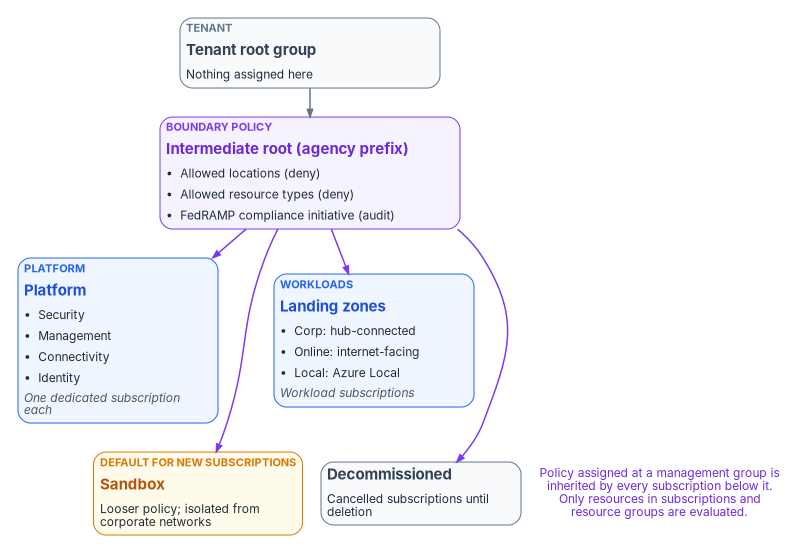
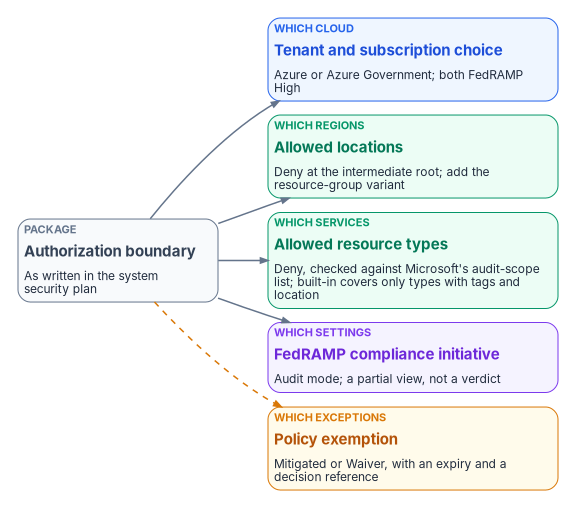

# Chapter 05 — The Landing Zone

*The boundary stops being a diagram in the authorization package when it becomes a hierarchy, a set of subscriptions and a policy that says no.*

::: {.callout-note}
## In this chapter
What a landing zone is in Microsoft's current terms, and the substrate it depends on. How the management group hierarchy and subscriptions are organized, and how each boundary decision (which cloud, which regions, which services, which settings, which exceptions) becomes a specific policy at a specific scope. How the same pattern looks on AWS, including the differences in AWS GovCloud (US). Why every piece of automation that touches the cloud has to declare its boundary, and what a landing zone can't prove on its own.
:::

The earlier chapters argued that the authorization boundary, not the product catalog, decides what an agency can use. That argument stays abstract until something enforces it. The landing zone is the first place that happens: it's the pre-built environment every workload lands in, and its structure decides what a workload team can deploy, where, and with which settings, before anyone writes an application. If the boundary says a service is out of scope and the landing zone lets a team deploy it anyway, the boundary is a document, not a control.

{#fig-ch05-management-groups fig-alt="A tenant root group at the top has one child, an intermediate root management group named with the agency's prefix, marked as the scope where boundary policy is assigned: allowed locations, allowed resource types and the FedRAMP regulatory compliance initiative. Four management groups sit beneath it. Platform, in blue, holds Security, Management, Connectivity and Identity, each with a dedicated subscription. Landing zones, in blue, holds Corp for workloads connected to the hub, Online for internet-facing workloads and Local for Azure Local clusters, each holding workload subscriptions. Sandbox, in amber, has looser policy and no connection to corporate networks, and is the default group for new subscriptions. Decommissioned, in slate, holds cancelled subscriptions until deletion. A violet note says policy assigned at a management group is inherited by every subscription beneath it, and only resources in subscriptions and resource groups are evaluated."}

## What a landing zone is

Microsoft's Cloud Adoption Framework defines an Azure landing zone as an architecture "for governing, securing, and scaling a multi-subscription Azure environment," made of two parts: a **platform landing zone**, the centralized foundation of governance, security and shared resources, and **workload landing zones**, where workload teams deploy within the platform's guardrails. Microsoft recommends one platform landing zone per Microsoft Entra tenant, and the platform needs a repeatable way to hand workload landing zones to teams.[^c05-alz] In Microsoft's terms, a landing zone is an individual Azure subscription.[^c05-faq]

Before building, Microsoft asks for decisions in eight design areas: Azure billing and Microsoft Entra tenant, identity and access management, resource organization, network topology and connectivity, security, management, governance, and platform automation and DevOps.[^c05-design-areas] For a federal agency, every one of those areas has a boundary dimension. Resource organization decides where boundary policy is assigned; network topology decides how traffic reaches the agency's enforcement points ([Book 09](../b09-network/index.md)); governance decides how the boundary is audited and enforced; platform automation decides whether the whole thing can be rebuilt from reviewed source ([Chapter 06](06-ipam-and-network-as-code.md)).

Microsoft publishes accelerators that deploy the platform landing zone from infrastructure as code (Bicep or Terraform, built on Azure Verified Modules), and recommends them over portal deployment.[^c05-impl] For an agency in **Azure Government** there's a catch that's easy to miss: Microsoft's portal, Bicep and Terraform deployment options are supported only for the public Azure cloud. The architecture is valid in every Azure cloud, but in Azure Government the platform team has to adapt the code by hand: remove policies that don't exist in that cloud, adjust API versions, and remove resources that aren't available.[^c05-deploy] That's the boundary's first appearance in the build: the commercial accelerator doesn't run unmodified in the government cloud.

## The substrate beneath it

A landing zone sits on top of four things that have to exist and be authoritative first. The Federal Modernization Program's design position, from Federal Compliance [Volume I](https://github.com/WhalerMike/modernization-workbook/blob/main/docs/compliance/Vol_I_Book_00_Foundation_Transport_Overview.md), is that a control can't be scanned, an identity authorized or a package assembled until these planes are in place:

| Plane | What it provides | Where the workbook covers it |
|---|---|---|
| Naming and addressing | DNS, DHCP, IP address management and certificate issuance, as one authoritative record | [Book 08](../b08-ddi/index.md); this book's [Chapter 06](06-ipam-and-network-as-code.md) |
| Device and cryptographic identity | What's connected, and the certificates and keys that prove it | [Book 07](../b07-pki/index.md), [Book 09, Chapter 07](../b09-network/07-network-access-control.md) |
| Organizational identity | The human and organizational source of truth every account and access decision asserts | [Book 03](../b03-hr-identity/index.md), [Book 02](../b02-identity/index.md) |
| Governed transport | Encrypted, policy-enforced paths between sites and clouds | [Book 09](../b09-network/index.md) |

The landing zone consumes all four. Its subscriptions draw address space from the addressing plane, its administrators sign in through the identity plane, and its hub connects to the transport plane. The order matters: a landing zone built before the address plan exists will invent address space that the agency later has to reconcile.

## The management group hierarchy

Management groups organize subscriptions so that policy and access can be applied once and inherited. Microsoft's baseline hierarchy puts an **intermediate root** directly under the tenant root group, so the agency never has to assign anything at the tenant root itself, and divides everything beneath it into platform and workload groups:[^c05-mg]

| Management group | Holds | Boundary role |
|---|---|---|
| Intermediate root | Every group below; named with the organization's prefix | Where agency-wide boundary policy is assigned |
| Platform: Security | A subscription for SIEM tooling (Microsoft Sentinel, syslog collectors) | Logging and monitoring infrastructure |
| Platform: Management | A subscription for monitoring (Azure Monitor Logs workspace) | Operational evidence |
| Platform: Connectivity | Hub networking: Azure Firewall, gateways, Azure DNS private zones | The enforcement path to the agency edge |
| Platform: Identity | AD DS or Microsoft Entra Domain Services virtual machines | Hardened identity services |
| Landing zones: Corp | Workloads that connect to the corporate network through the hub | Private, hub-routed workloads |
| Landing zones: Online | Workloads that need direct internet connectivity or no virtual network | Internet-facing workloads, with stricter ingress policy |
| Landing zones: Local | Azure Local clusters and their workloads | Hybrid workloads with different policy needs |
| Sandbox | Isolated experimentation, with less restrictive policy | Outside the production boundary by design |
| Decommissioned | Cancelled landing zones, deleted after 30 to 60 days | Retirement path |

Microsoft's recommendations for the hierarchy carry directly into a federal design:[^c05-mg]

- **Keep it flat**: three to four levels at most. A tree can be six levels deep, not counting the tenant root or the subscription level, but depth multiplies inherited-policy debugging.
- **Don't mirror the org chart.** Management groups are for policy assignment, not billing or RBAC. Use tags for horizontal navigation.
- **Don't create management groups for production, test and development.** Separate environments by subscription within the same group, so a test subscription faces the same boundary policy as production.
- **Don't assign workload teams permissions at management group scope.** Assign them at the subscription or resource group the team needs, normally during subscription vending ([Chapter 07](07-the-front-door.md)). Platform-team access at management group scope should be eligible through Privileged Identity Management, not standing ([Book 04, Chapter 04](../b04-access/04-privileged-roles-and-tiers.md) places these roles in the tier model).
- **Protect the hierarchy.** By default any principal in the tenant can create management groups, and new subscriptions land under the tenant root. Turn on RBAC authorization for management group operations and set a default management group (Sandbox is a good candidate) so no subscription arrives under the root, outside the boundary policy.
- **Limit assignments at the root.** Assign broadly only what genuinely applies to everything.

Subscriptions are the unit of management and scale. Microsoft calls this "subscription democratization": workloads get their own subscriptions, rather than sharing a few large ones divided by resource group.[^c05-vending] For the boundary, that matters because a subscription's placement in the hierarchy is what decides which boundary policy applies to it. Moving a subscription is a boundary change.

## Where each boundary decision lands

The authorization package says what's in the boundary. The landing zone has to say the same thing in a form that Azure Resource Manager enforces. Each decision has a mechanism and a scope.

{#fig-ch05-boundary-to-policy fig-alt="On the left, a slate card for the authorization boundary as written in the package. Five arrows lead to five mechanism cards. Which cloud leads to a blue card: the tenant and subscription choice, Azure commercial or Azure Government, both FedRAMP High. Which regions leads to a green card: the Allowed locations policy with deny at the intermediate root. Which services leads to a green card: Allowed resource types or Not allowed resource types with deny, checked against Microsoft's audit-scope list, with a note that the built-in policy only covers resource types that support tags and location. Which settings leads to a violet card: the FedRAMP Moderate regulatory compliance initiative in audit mode, a partial view. Which exceptions leads to an amber card: a policy exemption with category Mitigated or Waiver and an expiry date, recorded in the package."}

### Which cloud

Azure (the public cloud) and Azure Government both hold FedRAMP High authorizations, and Microsoft says the High authorization covers all Azure public regions in the United States.[^c05-scope] On the FedRAMP Marketplace both are listed as FedRAMP Certified at Class D (High): Azure Commercial Cloud (F1209051525) and Azure Government (F1603087869).[^c05-fr] Azure Government adds contractual commitments on US data storage and screened US personnel; Microsoft frames the public cloud's High authorization as meeting "the needs of many US government customers."[^c05-fedramp-offering]

The choice isn't free-standing. Microsoft 365 GCC pairs with Microsoft Entra ID in the public Azure cloud, while GCC High and DoD pair with Azure Government ([Chapter 04](04-gcc-and-the-feature-gap.md); [Book 02, Chapter 11](../b02-identity/11-reference-deployment.md)). The workbook's reference environment is a GCC tenant with commercial Azure subscriptions in the same directory. An agency that picks Azure Government for workloads gets a separate cloud with its own endpoints (for example, Azure Resource Manager at `management.usgovcloudapi.net` rather than `management.azure.com`) and its own feature availability.[^c05-compare]

### Which regions

The built-in **Allowed locations** policy restricts the regions a deployment can name, with Audit, Deny or Disabled effects. It excludes resource groups and resources that use the "global" region, so pair it with **Allowed locations for resource groups**.[^c05-builtins] Assigned with Deny at the intermediate root, these two policies make "US regions only" an enforced property of every subscription.

### Which services

Microsoft publishes which Azure services are in the audit scope of each authorization, last updated February 2026 for both clouds.[^c05-scope] A service that isn't in scope isn't automatically forbidden (the agency can carry it in its own package with its own assessment), but it isn't inherited either, and that difference is the subject of [Chapter 09](09-equivalents-and-exceptions.md). To enforce the list, assign **Allowed resource types** (or the less restrictive **Not allowed resource types**) with Deny. Read the fine print: the built-in Allowed resource types definition only affects resource types that support tags and location. Microsoft says to duplicate it and change its mode to `All` to restrict everything.[^c05-builtins][^c05-disallowed]

The audit-scope list is also where the boundary shows up in places a designer doesn't expect. Azure Virtual Network Manager, the service behind Azure's IP address management pools, isn't named in either cloud's table. [Chapter 06](06-ipam-and-network-as-code.md) works through what that means for the address plan.

### Which settings

Azure Policy ships built-in **Regulatory Compliance** initiatives for FedRAMP Moderate and FedRAMP High, in separate versions for Azure and Azure Government.[^c05-fedramp-offering] Assign the one that matches the boundary in audit mode at the intermediate root. It maps policy definitions to FedRAMP controls and shows which controls are the customer's, Microsoft's or shared. Microsoft is explicit about its limit: "Compliant" refers only to the policy definitions, there's often no one-to-one match between a control and a policy, some controls have no policy at all, and the initiative is "only a partial view of your overall compliance status."[^c05-init]

### Which exceptions

A deliberate deviation is recorded as a **policy exemption**. Exemptions have two categories: **Mitigated**, when the policy's intent is met another way, and **Waiver**, when non-compliance is temporarily accepted. An optional `expiresOn` date ends the exemption, and the expired object is kept for the record.[^c05-exempt] That's a close fit for the exception record [Chapter 09](09-equivalents-and-exceptions.md) describes: a Mitigated exemption points to an in-boundary equivalent, and a Waiver points to a documented, time-limited exception. The program's rule is that every exemption carries an expiry date and a reference to the decision that authorized it.

## Enforcing without breaking things

Azure Policy evaluates a create or update request before it reaches the resource provider. `disabled` is checked first, then `append` and `modify`, then `deny`, then `audit`; `auditIfNotExists` and `deployIfNotExists` run after the provider returns success.[^c05-effects] A `deny` match fails the request with a 403.[^c05-deny] A policy can be assigned at a management group, but only resources in subscriptions and resource groups are evaluated, and Microsoft recommends starting with `audit` or `auditIfNotExists` before switching to an enforcing effect.[^c05-overview] Existing resources are re-evaluated on a 24-hour standard cycle, and a subscription created or moved within the hierarchy is evaluated against subscription-targeted assignments in about 30 minutes.[^c05-compliance-data]

The program's rollout follows that guidance. Each boundary policy goes in at the intermediate root in audit mode, the compliance report is reviewed with the system owner and the information system security officer, non-compliant resources are either fixed or given an exemption, and only then does the effect change to Deny. A policy that blocks a production deployment on day one teaches teams to ask for exemptions instead of fixing designs.

## The same pattern on AWS

AWS expresses the same structure with AWS Organizations: accounts instead of subscriptions, organizational units instead of management groups, and **service control policies** instead of deny assignments. An SCP never grants a permission; it sets the maximum permissions available to IAM users and roles in member accounts, including the root user. SCPs don't affect the management account, and they require an organization with all features enabled.[^c05-scp]

**AWS Control Tower** builds the landing zone on top of Organizations. It runs in the commercial Regions and in both AWS GovCloud (US) Regions; AWS's GovCloud guide notes it can be used there even for workloads that require a High categorization. The GovCloud version works differently in ways that shape the build:[^c05-ct]

- Accounts can't be created inside GovCloud. The `CreateGovCloudAccount` API runs from a management account in the commercial partition and creates a pair: a standalone GovCloud account and a linked commercial account for billing and support.
- An organization in GovCloud is independent of commercial organizations, and the Audit and Log Archive accounts must already exist in it before Control Tower is set up.
- Account Factory's **Create account** feature isn't available, and new customers can't deploy Account Factory for Terraform there.
- Some controls have no effect in GovCloud, and some Security Hub CSPM controls in the Control Tower standard aren't available.
- Control Tower metadata (account names, email addresses, organizational unit names) must not contain export-controlled data.

AWS recommends **Landing Zone Accelerator on AWS** on top of Control Tower for regulated workloads. It's open-source infrastructure as code, supports the GovCloud (US) partition, and comes with AWS's own warning that it "will not, by itself, make you compliant."[^c05-lza] On the Marketplace, AWS GovCloud (F1603047866) is listed at Class D (High) and AWS US East/West at Class C (Moderate).[^c05-fr]

Those classes describe what each region was assessed against, not who may use it. AWS states that US East/West is FedRAMP Certified Class C (formerly the Moderate baseline) and GovCloud (US) Class D (formerly the High baseline), and its services-in-scope list marks each service separately for each, so a service can be in scope in one and not the other.[^c05-aws-fedramp] The High baseline contains the Moderate controls, so a Moderate system can run in GovCloud (US) as well as in the commercial Regions *(inference)*. An agency may run most of its AWS workloads in GovCloud (US) at Moderate and put a service such as a contact center in the commercial Regions; both are Moderate locations. The landing zone then has two organizations, one per partition, and the package names which services run where *(design guidance)*. Check each service, per region, on the FedRAMP Marketplace and AWS's list before the design depends on it.

## A multi-environment estate

Many agencies don't have one landing zone; they have several environments that have to behave as one boundary. A typical pattern looks like this:

| Environment | How addresses are assigned | Whose authorization covers the infrastructure |
|---|---|---|
| On-premises VMware (NSX overlay) | NSX DHCP on the logical gateways, or the enterprise IPAM | The agency's own authorization |
| Azure virtual networks | The Azure fabric assigns from the subnet range; virtual networks are Layer 3 overlays with no Layer 2 semantics[^c05-vnetfaq] | Azure's certification for the service; the agency's authorization for its use |
| AWS VPCs | The VPC assigns from the subnet; AWS reserves five addresses per subnet, and the Amazon DNS server sits at the VPC range base plus two[^c05-aws-subnet] | AWS's certification for the service; the agency's authorization for its use |
| A shared service another agency runs in its own tenancy | The partner controls addressing; the agency documents what it connects to | The partner's authorization; the agency documents the connection as an external service |

None of these environments uses broadcast DHCP in the traditional sense, so none of them can be inventoried by watching the wire. That's why the address plan has to be held above the fabrics, which is [Chapter 06](06-ipam-and-network-as-code.md)'s subject. The fourth row is the one most often left out: an integration with a service another agency operates (an HR shared service, for example) crosses into a boundary the agency doesn't control, and the agency's side of it (name resolution, certificate monitoring, the documented interconnection) still belongs in the agency's package.

## Every automation declares its boundary

The landing zone constrains what people deploy. The program also has to constrain what its own automation does, because a collector or adapter that calls a commercial-only API from inside the boundary is a boundary crossing nobody approved. The program's cloud specification sets the contract every cloud adapter inherits:

- **A declared boundary.** Each adapter operates in-boundary, reading state through in-boundary APIs, or through a named exception that a formal decision added to a short, canonical list. There's no third option: an adapter that needs a commercial-only API can't register against the boundary without an authorizing decision.
- **No hardcoded hostnames.** Endpoints resolve from the declared cloud, because they differ by cloud (Resource Manager's address, above, is one example).
- **Fail closed** on an unknown cloud.
- **An endpoint class on every claim.** Each emitted claim records its boundary, tenant, region and endpoint class (Graph v1.0, Graph beta, Resource Manager or Arc), which makes it possible to tell later whether a finding came from inside the boundary.

These are design positions, not vendor facts. Their purpose is to make the boundary checkable for software the same way policy makes it checkable for deployments: a claim that crosses the boundary without a declared exception shows up as provenance drift, and an adapter emitting outside its declared scope shows up as an authorization finding. The specification also states its own limit. Platform feature gaps remain the agency's responsibility; the contract doesn't remove them, it makes them governable.

## What a landing zone can't prove

A landing zone enforces structure. It doesn't authorize anything. NIST defines the authorization boundary as all components of an information system to be authorized for operation by an authorizing official, excluding separately authorized systems it connects to,[^c05-sp80037] and FedRAMP's 2026 rules are explicit that "each agency still authorizes its own federal information systems" and that the agency's system security plan focuses on "what the agency implements, configures, operates, or inherits."[^c05-fedramp-use] The landing zone is a large part of what the agency implements and configures, and its policy assignments, compliance reports and exemptions are evidence. But Azure Policy's own documentation calls its compliance view partial, and AWS says the same of its accelerator. The authorizing official still decides; the landing zone makes the decision checkable. [Chapter 11](11-the-authorization-package.md) covers how this evidence enters the package.

## What this chapter establishes

1. A landing zone is a platform landing zone plus workload landing zones, and in Azure each workload landing zone is a subscription placed in a management group that carries its policy.
2. Every boundary decision has a mechanism: the cloud and tenant choice, Allowed locations, allowed resource types checked against Microsoft's audit-scope list, the FedRAMP regulatory compliance initiative in audit mode, and exemptions with an expiry.
3. Microsoft's landing zone accelerators aren't supported unmodified in Azure Government, and AWS Control Tower works differently in GovCloud; both differences have to be planned, not discovered.
4. Automation needs a boundary contract too: declared boundary or named exception, no hardcoded endpoints, fail closed.
5. Policy compliance is evidence, not authorization.

::: {.callout-tip}
## Continue the book
[← Previous: Chapter 04 — GCC, GCC High and the Commercial Feature Gap](04-gcc-and-the-feature-gap.md) · [Book index](index.md) · [Next: Chapter 06 — IPAM and Network as Code →](06-ipam-and-network-as-code.md)
:::

[^c05-alz]: Microsoft Learn, "What is an Azure landing zone?," Cloud Adoption Framework, <https://learn.microsoft.com/en-us/azure/cloud-adoption-framework/ready/landing-zone/> (accessed Oct 21, 2026).
[^c05-faq]: Microsoft Learn, "Azure landing zone frequently asked questions (FAQ)" ("landing zones are individual Azure subscriptions"), <https://learn.microsoft.com/azure/cloud-adoption-framework/ready/enterprise-scale/faq> (accessed Oct 21, 2026).
[^c05-design-areas]: Microsoft Learn, "Azure landing zone design areas and conceptual architecture," <https://learn.microsoft.com/en-us/azure/cloud-adoption-framework/ready/landing-zone/design-areas> (accessed Oct 21, 2026).
[^c05-impl]: Microsoft Learn, "Platform landing zone implementation options," <https://learn.microsoft.com/azure/cloud-adoption-framework/ready/landing-zone/implementation-options> (accessed Oct 21, 2026).
[^c05-deploy]: Microsoft Learn, "Deploy Azure landing zones," sections "Choose a platform landing zone approach" and "Azure sovereign cloud deployments," <https://learn.microsoft.com/azure/architecture/landing-zones/landing-zone-deploy> (accessed Oct 21, 2026).
[^c05-mg]: Microsoft Learn, "Management groups," Azure landing zone design area (design considerations, recommendations, and the baseline hierarchy table), <https://learn.microsoft.com/en-us/azure/cloud-adoption-framework/ready/landing-zone/design-area/resource-org-management-groups> (accessed Oct 21, 2026).
[^c05-vending]: Microsoft Learn, "Subscription vending," Azure landing zone design area, <https://learn.microsoft.com/en-us/azure/cloud-adoption-framework/ready/landing-zone/design-area/subscription-vending> (accessed Oct 21, 2026).
[^c05-scope]: Microsoft Learn, "Azure and other Microsoft cloud services compliance scope" (Azure public and Azure Government services by audit scope, both last updated February 2026; Azure and Azure Government FedRAMP High authorizations), <https://learn.microsoft.com/en-us/azure/azure-government/compliance/azure-services-in-fedramp-auditscope> (accessed Oct 21, 2026).
[^c05-fr]: FedRAMP Marketplace, `products.json` (meta `last_change` 2026-10-21): Azure Commercial Cloud, F1209051525, FedRAMP Certified, High, Class D; Azure Government (includes Dynamics 365), F1603087869, FedRAMP Certified, High, Class D; AWS GovCloud, F1603047866, FedRAMP Certified, High, Class D; AWS US East/West, AGENCYAMAZONEW, FedRAMP Certified, Moderate, Class C, <https://www.fedramp.gov/marketplace/products.json> (accessed Oct 21, 2026).
[^c05-fedramp-offering]: Microsoft Learn, "Federal Risk and Authorization Management Program (FedRAMP)," Azure compliance offerings (Azure and FedRAMP; regulatory compliance built-in initiatives for Azure and Azure Government), <https://learn.microsoft.com/azure/compliance/offerings/offering-fedramp> (accessed Oct 21, 2026).
[^c05-compare]: Microsoft Learn, "Compare Azure Government and global Azure," Guidance for developers (endpoint mapping), <https://learn.microsoft.com/azure/azure-government/compare-azure-government-global-azure> (accessed Oct 21, 2026).
[^c05-builtins]: Microsoft Learn, "Azure Policy built-in policy definitions," General category (Allowed locations, Allowed locations for resource groups, Allowed resource types, Not allowed resource types), <https://learn.microsoft.com/azure/governance/policy/samples/built-in-policies> (accessed Oct 21, 2026).
[^c05-disallowed]: Microsoft Learn, "Tutorial: Disallow resource types in your cloud environment," <https://learn.microsoft.com/azure/governance/policy/tutorials/disallowed-resources> (accessed Oct 21, 2026).
[^c05-init]: Microsoft Learn, "Details of the FedRAMP Moderate Regulatory Compliance built-in initiative," <https://learn.microsoft.com/azure/governance/policy/samples/fedramp-moderate> (accessed Oct 21, 2026).
[^c05-exempt]: Microsoft Learn, "Azure Policy exemption structure," sections "Exemption category" and "Expiration," <https://learn.microsoft.com/azure/governance/policy/concepts/exemption-structure> (accessed Oct 21, 2026).
[^c05-effects]: Microsoft Learn, "Azure Policy definitions effect basics," Order of evaluation, <https://learn.microsoft.com/azure/governance/policy/concepts/effect-basics> (accessed Oct 21, 2026).
[^c05-deny]: Microsoft Learn, "Azure Policy definitions deny effect," <https://learn.microsoft.com/azure/governance/policy/concepts/effect-deny> (accessed Oct 21, 2026).
[^c05-overview]: Microsoft Learn, "What is Azure Policy?," sections "Resources covered by Azure Policy" and "Recommendations for managing policies," <https://learn.microsoft.com/azure/governance/policy/overview> (accessed Oct 21, 2026).
[^c05-compliance-data]: Microsoft Learn, "Get compliance data of Azure resources," Evaluation triggers, <https://learn.microsoft.com/azure/governance/policy/how-to/get-compliance-data> (accessed Oct 21, 2026).
[^c05-scp]: AWS, *AWS Organizations User Guide*, "Service control policies (SCPs)," <https://docs.aws.amazon.com/organizations/latest/userguide/orgs_manage_policies_scps.html> (accessed Oct 21, 2026).
[^c05-ct]: AWS, *AWS GovCloud (US) User Guide*, "AWS Control Tower in AWS GovCloud (US)," <https://docs.aws.amazon.com/govcloud-us/latest/UserGuide/govcloud-controltower.html> (accessed Oct 21, 2026).
[^c05-aws-fedramp]: Amazon Web Services, "FedRAMP" (US East/West FedRAMP Certified Class C, formerly Moderate; GovCloud (US) Class D, formerly High), <https://aws.amazon.com/compliance/fedramp/>; and "FedRAMP — Services in Scope" (per-service, per-Region columns), <https://aws.amazon.com/compliance/services-in-scope/FedRAMP/>; baselines are cumulative per NIST SP 800-53B, <https://csrc.nist.gov/pubs/sp/800/53/b/upd1/final> (accessed Oct 29, 2026).
[^c05-lza]: AWS, *Landing Zone Accelerator on AWS Implementation Guide*, "Deploy a cloud foundation to support highly-regulated workloads and complex compliance requirements," <https://docs.aws.amazon.com/solutions/latest/landing-zone-accelerator-on-aws/solution-overview.html> (accessed Oct 21, 2026).
[^c05-vnetfaq]: Microsoft Learn, "Azure Virtual Network frequently asked questions (FAQ)," Configuration ("Virtual networks are Layer 3 overlays. Azure does not support any Layer 2 semantics"; five reserved addresses per subnet), <https://learn.microsoft.com/azure/virtual-network/virtual-networks-faq> (accessed Oct 21, 2026).
[^c05-aws-subnet]: AWS, *Amazon VPC User Guide*, "Subnet CIDR blocks," Subnet sizing for IPv4, <https://docs.aws.amazon.com/vpc/latest/userguide/subnet-sizing.html> (accessed Oct 21, 2026).
[^c05-sp80037]: National Institute of Standards and Technology, SP 800-37 Rev. 2, *Risk Management Framework for Information Systems and Organizations*, December 2018, Appendix A glossary, "authorization boundary" (from OMB Circular A-130), <https://csrc.nist.gov/pubs/sp/800/37/r2/final> (accessed Oct 21, 2026).
[^c05-fedramp-use]: FedRAMP, "Using a FedRAMP Certified Cloud Service," *Consolidated Rules for 2026*, <https://www.fedramp.gov/2026/agencies/use/> (accessed Oct 21, 2026).
