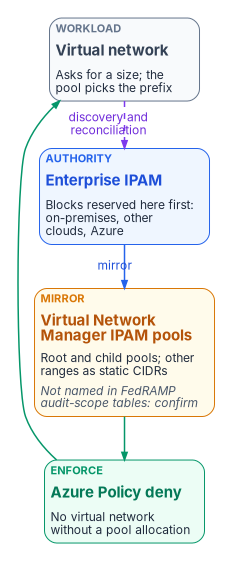
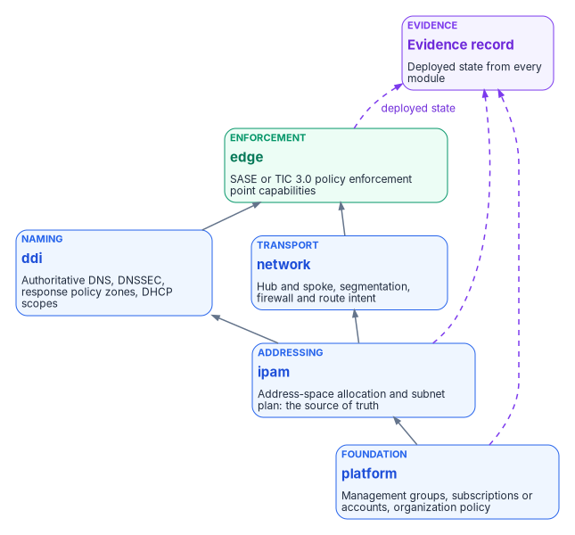

# Chapter 06 — IPAM and Network as Code

*An inventory needs a denominator, and in a cloud estate the only plane that sees every component at the moment it joins is the one that hands out its address.*

::: {.callout-note}
## In this chapter
Why the address plan is the join key the rest of the boundary evidence correlates on, and what IPAM can't tell you. How software-defined networks assign addresses without broadcast DHCP. How the enterprise IPAM stays the authority in Azure: Virtual Network Manager pools mirror its reservations and Azure Policy refuses any virtual network that doesn't take its address from a pool, with a boundary caveat about the service itself. Then network as code: the five layered modules, the order they deploy in, the external inputs that change underneath them, and the controls they put into operation.
:::

[Chapter 05](05-the-landing-zone.md) built the structure that decides what can be deployed. This chapter covers the two things every deployment draws on: an address, and a network path. Both have to come from a single authority, and both have to be reproducible from reviewed source. If they aren't, the boundary evidence has no denominator: nobody can say what *should* be in the boundary, only what a scan happened to find.

The naming half of this plane (authoritative DNS, DNSSEC, split-horizon views and response policy zones) is [Book 08](../b08-ddi/index.md)'s subject, and the per-cloud details of private DNS and address management are in [Book 08, Chapter 07](../b08-ddi/07-cloud-private-endpoints-and-ipam.md). This chapter takes the landing-zone view: what the address plan has to do for the boundary, and how it gets built.

{#fig-ch06-address-authority fig-alt="Four cards from left to right. A blue card for the enterprise IPAM, the authority: blocks for on-premises, other clouds and Azure are reserved there first. An arrow labeled mirror leads to an amber card for Azure Virtual Network Manager IPAM pools: root and child pools, with ranges used elsewhere entered as static CIDRs, and a footnote that the service isn't named in Microsoft's FedRAMP audit-scope tables, so coverage must be confirmed. An arrow leads to a green card for an Azure Policy deny assignment: no virtual network without a pool allocation. An arrow leads to a slate card for a workload virtual network, which asks for a size while the pool picks the prefix. A dashed violet arrow labeled discovery and reconciliation runs from the virtual network back to the enterprise IPAM."}

## The address plan is the join key

NIST SP 800-53 CM-8 asks for an inventory of system components that "accurately reflects the system," "includes all components within the system," and doesn't double-count components or include ones assigned to other systems.[^c06-sp80053] Every one of those tests needs a reference population. A discovery scan enumerates what answered a probe during a scan window; an IPAM database enumerates what was *allocated*. The scan's results have to be reconciled against the allocation, or the scan is a sample with no denominator. That's the Federal Modernization Program's design position, carried from Federal Compliance [Volume I, Book 01](https://github.com/WhalerMike/modernization-workbook/blob/main/docs/compliance/Vol_I_Book_01_Cloud_Landing_Zone_IPAM_FedRAMP.md): the address plan is the key every other inventory joins on, because every component has to take an address before it can do anything else.

Federal policy points the same way. CISA's BOD 23-01 requires agencies to perform automated asset discovery every 7 days covering, at minimum, "the entire IPv4 space used by the agency," and applies to IP-addressable assets in on-premises, roaming and cloud deployment models (it excludes ephemeral assets such as containers, and third-party-managed SaaS).[^c06-bod2301] "The entire IPv4 space used by the agency" is a number only the address plan can supply. For cloud providers, FedRAMP's 2026 Key Security Indicators include KSI-PIY-GIV: "Authoritative sources are used to automatically generate real-time inventories of all information resources when needed."[^c06-ksi-piy] KSIs bind providers, not the agency's own system, but the indicator states the same principle the program applies to its landing zone.

One correction to the way this argument is often made: an authorization boundary isn't defined by IP ranges. NIST defines it as the components of the system being authorized,[^c06-sp80037] and SaaS components inside a boundary may hold no agency address at all. The IPAM export is the authoritative record of the agency-addressed assets, and it feeds the component inventory and the network diagram; it's reconciled against the service and interconnection list, not a substitute for it.

### What IPAM can't see

IPAM sees every device that holds an address. It doesn't see installed software, patch state, the owner or data classification of a workload, which system boundary an asset belongs to, the relationships between assets, or assets with no IP address at all (smart cards, hardware security modules, air-gapped devices). The address record is the network-layer identity of an asset, not the asset record. Most agencies also run several partial inventories at once: Intune for endpoints, Azure Arc for enrolled servers, AWS Systems Manager for instances with its agent, vCenter for VMware guests. Each misses what the others manage; every one of their assets has an address.

So the program treats IPAM as the join key and a configuration management database (CMDB) as the asset record, and sets requirements for the CMDB rather than naming one:

| Requirement | What it means | Driver |
|---|---|---|
| Cross-platform discovery | Ingest from Intune, Arc, AWS Systems Manager, vCenter, the IPAM and network management without manual entry | CM-8 |
| Address correlation | Every asset record links to its IPAM record (address, FQDN, lease state) | CM-8 |
| Deduplication | One normalized record when several sources report the same asset | CM-8 |
| Boundary classification | Each record carries its environment and its system-boundary membership, and in-boundary versus out-of-boundary is queryable | CM-8, CA-3 |
| Owner scoping | Each asset is assigned to an owner, who sees only their own assets | AC-3, AC-6 |
| Change audit | Every change records time, source, before and after, and actor, and feeds the SIEM | AU-3, AU-12 |
| Unmanaged devices | Devices seen only by address and DHCP fingerprint appear as unmanaged, not omitted | CM-8 |
| Certification | The platform holds its own FedRAMP certification at Moderate or above, or is carried inside the agency's boundary | Boundary |
| Lifecycle | Provisioning, active, decommissioning and retired states, with a release of the address triggering review | CM-8(1) |

Until a CMDB is selected, IPAM is the best available proxy for CM-8: every in-scope address is documented, but that's the network-layer foundation, not full closure. A proof of concept should test three things at once: one managed laptop producing one deduplicated record that joins the MDM record, the DHCP lease, the device certificate and the FQDN; an unenrolled device appearing as unmanaged within one lease cycle; and two owners who can't see each other's assets. The full requirement set and a candidate landscape are in [Volume I, Book 01](https://github.com/WhalerMike/modernization-workbook/blob/main/docs/compliance/Vol_I_Book_01_Cloud_Landing_Zone_IPAM_FedRAMP.md); check every candidate's status on the FedRAMP Marketplace at the time of procurement.

## Addresses without broadcast

Classic DHCP depends on a Layer 2 broadcast, and software-defined networks don't carry one. Each fabric assigns addresses itself:

- **Azure.** Virtual networks are Layer 3 overlays with no Layer 2 semantics. Azure assigns private addresses from the subnet range and reserves five in every subnet: the network address, the default gateway, two addresses that map Azure DNS into the virtual network, and the last address.[^c06-vnetfaq]
- **AWS.** The VPC assigns addresses from the subnet and also reserves five: the network address, the VPC router, the Amazon DNS server at the base of the VPC range plus two, one reserved for future use, and the broadcast address, which is reserved because VPCs don't support broadcast.[^c06-aws-subnet] (The base-plus-two address is the DNS server, not a DHCP responder, as some descriptions have it.)
- **VMware NSX.** DHCP is handled by the NSX logical gateways, and VMware Cloud Foundation 9.1 integrates natively with an enterprise IPAM for block allocation and DNS registration ([Book 08, Chapter 07](../b08-ddi/07-cloud-private-endpoints-and-ipam.md)).

Because no fabric's assignments are visible to the others, the address plan has to live above all of them, and each fabric has to draw from it. How deeply each platform can integrate with an external authority differs: AWS VPC IPAM can hand a scope's allocation authority to an external IPAM in commercial Regions but not in GovCloud, VMware Cloud Foundation 9.1 integrates natively, and Azure needs a mirror-and-reconcile pattern ([Book 08, Chapter 07](../b08-ddi/07-cloud-private-endpoints-and-ipam.md)). The Azure pattern is the one this book's reference environment uses.

## Azure: mirror the authority, enforce the pool

Azure Virtual Network Manager's IP address management (IPAM) feature creates address pools: a root pool for the whole range and child pools beneath it, up to seven layers. Virtual networks allocate non-overlapping CIDRs from a pool, **static CIDRs** reserve ranges that are in use outside Azure, both IPv4 and IPv6 pools are supported, one pool can serve virtual networks in several regions, and the **IPAM Pool User** role lets teams consume a pool without managing it.[^c06-avnm] Microsoft lists the feature as generally available in every region where Virtual Network Manager is available except six (none of them in the United States).[^c06-avnm-bicep]

The pattern that keeps the enterprise IPAM authoritative has three parts:

1. **Reserve first in the enterprise IPAM.** The Azure range is carved there, alongside on-premises and other-cloud space.
2. **Mirror into Azure.** The Azure root pool holds the Azure range; every range used elsewhere that overlaps it is entered as a static CIDR, so Azure can't hand it out.
3. **Enforce the pool.** Virtual Network Manager doesn't stop overlapping address space on its own. Microsoft's documented fix is an Azure Policy definition that denies any virtual network without an allocation from a designated pool; since a pool hands out only non-overlapping prefixes, overlap becomes impossible inside the policy's scope.[^c06-avnm-policy]

Then reconcile: DDI discovery reads what Azure actually allocated and compares it with the enterprise reservations, and a mismatch is a finding ([Book 08, Chapter 11](../b08-ddi/11-operating-the-control-plane.md)).

::: {.callout-warning}
The code in this chapter is illustrative, adapted from Microsoft's published samples, and hasn't been tested against a production tenant. Replace the names, ranges and identifiers, validate against the current resource provider API versions, and deploy through the change-controlled pipeline in [Chapter 07](07-the-front-door.md), not from a workstation.
:::

The pool and its mirrored reservation, in Bicep (adapted from Microsoft's sample):[^c06-avnm-bicep]

```bicep
param locationName string = resourceGroup().location
param networkManagerName string = 'vnm-platform-001'
param ipamPoolName string = 'ipam-pool-azure-root'
param azureRangePrefix string = '10.40.0.0/14'        // the Azure block reserved in the enterprise IPAM
param mirroredPrefix string = '10.41.128.0/20'        // a range in use outside Azure, mirrored as a static CIDR

resource networkManager 'Microsoft.Network/networkManagers@2024-05-01' = {
  name: networkManagerName
  location: locationName
  properties: {
    networkManagerScopes: {
      managementGroups: []
      subscriptions: [
        subscription().id
      ]
    }
    networkManagerScopeAccesses: [
      'Connectivity'
    ]
  }
}

resource ipamPool 'Microsoft.Network/networkManagers/ipamPools@2024-05-01' = {
  parent: networkManager
  name: ipamPoolName
  location: locationName
  properties: {
    addressPrefixes: [
      azureRangePrefix
    ]
  }
}

resource mirrored 'Microsoft.Network/networkManagers/ipamPools/staticCidrs@2024-05-01' = {
  parent: ipamPool
  name: 'static-onprem-dc-east'
  properties: {
    addressPrefixes: [
      mirroredPrefix
    ]
  }
}
```

A virtual network then asks for a size, not a range, and the pool picks a non-overlapping prefix:[^c06-avnm-bicep]

```bicep
param ipamPoolId string   // resource ID of the pool above

resource vnet 'Microsoft.Network/virtualNetworks@2024-05-01' = {
  name: 'vnet-workload-001'
  location: resourceGroup().location
  properties: {
    addressSpace: {
      ipamPoolPrefixAllocations: [
        {
          numberOfIpAddresses: '256'
          pool: {
            id: ipamPoolId
          }
        }
      ]
    }
  }
}
```

And the policy that refuses anything else, assigned at the Landing zones management group (adapted from Microsoft's sample to one pool):[^c06-avnm-policy]

```json
{
  "mode": "All",
  "parameters": {},
  "policyRule": {
    "if": {
      "allOf": [
        {
          "field": "type",
          "equals": "Microsoft.Network/virtualNetworks"
        },
        {
          "not": {
            "field": "Microsoft.Network/virtualNetworks/addressSpace.ipamPoolPrefixAllocations[*].pool.id",
            "equals": "/subscriptions/<subscriptionID>/resourceGroups/<resourceGroupName>/providers/Microsoft.Network/networkManagers/vnm-platform-001/ipamPools/ipam-pool-azure-root"
          }
        }
      ]
    },
    "then": {
      "effect": "deny"
    }
  }
}
```

Roll it out the way [Chapter 05](05-the-landing-zone.md) describes: audit first, list the existing virtual networks that would fail, associate them with the pool, then switch to deny.

### A boundary check on the IPAM service itself

This is the book's argument in miniature. Azure Virtual Network Manager isn't named in Microsoft's FedRAMP audit-scope tables for Azure or Azure Government (both last updated February 2026); Virtual Network, DNS, Firewall and Private Link are.[^c06-scope] The tables don't say whether pool management is covered under another listed service. Until Microsoft confirms it in writing, treat the pool as a dependency the agency records and decides on, using one of [Chapter 09](09-equivalents-and-exceptions.md)'s three paths: confirm coverage, carry it as a documented exception, or keep the authority entirely in the enterprise IPAM and reconcile Azure allocations by discovery alone. The enterprise IPAM's own status matters too. Infoblox Government Cloud (FR2017257053), for example, is listed as FedRAMP Certified at Class C (Moderate), certified December 15, 2022; its Marketplace description now covers Universal DDI and Universal Asset Insights as well as the threat-defense services it was first authorized for, so read the current listing for scope rather than older press releases.[^c06-fr] An agency that runs its own DDI grid on premises carries it in its own boundary and inherits nothing.

## Network as code

The landing zone, the address plan and the network can all be built from reviewed source. Federal Compliance [Volume VI, Book 01](https://github.com/WhalerMike/modernization-workbook/blob/main/docs/compliance/Vol_VI_Book_01_Landing_Zone_Network_as_Code.md) organizes the build as five modules, each owning one plane and depending only on the layers beneath it. The layering is the design: the address plan has to exist before workloads can be counted against it, and the enforcement edge has to read from the naming plane.

{#fig-ch06-module-layers fig-alt="Five stacked cards from bottom to top. Platform, in blue: management groups, subscriptions or accounts, and organization policy. Address plan, in blue: address-space allocation and the subnet plan, the source of truth. Above it, side by side, Naming, in blue: authoritative DNS, DNSSEC signing, response policy zones and DHCP scopes; and Network, in blue: hub and spoke, segmentation, firewall and route intent. Both depend on the address plan. At the top, Enforcement edge, in green: the SASE or TIC 3.0 policy enforcement point capability set, which depends on the network and naming modules. A violet evidence record card receives dashed arrows labeled deployed state from the platform, address plan and enforcement edge modules; every module writes its state there."}

| Layer | Module | Owns | Depends on | Deployed example | Substitution |
|---|---|---|---|---|---|
| Foundation | `platform` | Management groups, subscriptions or accounts, organization policy | — | Azure landing zone (Bicep or Terraform) | AWS Control Tower with Landing Zone Accelerator |
| Addressing | `ipam` | Address-space allocation and subnet plan (the source of truth) | `platform` | Enterprise IPAM plus mirrored Virtual Network Manager pools | AWS VPC IPAM |
| Naming | `ddi` | Authoritative DNS, DNSSEC signing, response policy zones, DHCP scopes | `ipam` | Enterprise DDI or cloud DNS as code | Another DDI platform; Route 53 |
| Transport | `network` | Hub and spoke, segmentation, firewall and route intent | `ipam` | Virtual networks and Azure Firewall | VPC and AWS Network Firewall |
| Enforcement | `edge` | The SASE or TIC 3.0 policy enforcement point capability set | `network`, `ddi` | SASE tenant configuration as code | Another SASE provider's configuration as code |

Each module writes its deployed state to the program's evidence record, and the `ipam` module's output, the authoritative address plan, is what later makes the CM-8 join possible. The substitution column is the point of naming mechanisms rather than products: changing vendors changes the module syntax and the connectors, not what the module has to do.

### The naming module, declared

The naming module carries the load, because it's the source of truth the name-resolution controls depend on. What it declares, whatever the provider's syntax:

| Declared property | Why it's declared, not clicked | Control |
|---|---|---|
| The zone is authoritative and DNSSEC-signed | Signed responses become an attestable property of source | SC-20 |
| The recursive resolver validates DNSSEC | Validation can't be turned off in a portal without a diff | SC-21 |
| Authoritative and recursive roles are separate resources | Role separation is visible in the code | SC-22 |
| Query logging is on | Every resolution is telemetry | AU-12 |
| The response policy zone is attached to a named Protective DNS feed, starting in log-only mode | Blocking is a reviewed change, not a toggle | SC-7, SI-4 |
| The zone's identifier is an output | The inventory join consumes it | CM-8 |

The workbook gives no resource code for this module, because the resource schema depends on the provider chosen. Use the DDI vendor's provider or the cloud's DNS resources, and see [Book 08, Chapter 06](../b08-ddi/06-dns-identity-and-dnssec.md) for DNSSEC and [Book 08, Chapter 05](../b08-ddi/05-edge-interception-and-bypass.md) for Protective DNS. Because DHCP scopes and the address plan come from the same `ipam` source, a device's lease, its address and its inventory record form one chain of custody instead of three independent guesses.

### Deployment order

1. Apply `platform`, then `ipam`, then `ddi` and `network`, in dependency order, through the change-controlled pipeline, never a portal.
2. Run the response policy zone in log-only mode first to baseline normal resolution, then switch it to enforcing. (It's the same discipline as Azure Policy's audit-then-deny rollout.)
3. Register the `ipam` output as the authoritative inventory source the CM-8 join reads.
4. Point the `edge` at the `ddi` resolver, so egress name resolution is governed at the enforcement point ([Book 09, Chapter 05](../b09-network/05-sd-wan-sase-and-governed-transport.md)).

## Inputs that change underneath the code

Some of what the network code enforces comes from outside the agency. The clearest example is Microsoft 365's endpoint list, which feeds firewall rules, proxy bypass lists and DNS policy. Three facts about it are often wrong in older designs, including this book's source volume:

- **There's no separate GCC list.** Microsoft's IP Address and URL web service has four instances (Worldwide, China, USGovDoD and USGovGCCHigh), and a GCC tenant uses Worldwide.[^c06-m365ws] A design that blocks "commercial" Microsoft 365 endpoints to keep GCC traffic inside the boundary would block GCC itself; [Book 09, Chapter 12](../b09-network/12-microsoft-365-traffic.md) covers the right scoping.
- **The cadence is monthly, with notice.** Microsoft updates the entries at the beginning of each month, publishes out-of-band changes when needed, and gives 30 days' notice before new endpoints are used.[^c06-m365ws]
- **Poll the version, not the list.** Microsoft recommends checking the version method no more than once an hour and calling the endpoints method only when the version changes.[^c06-m365ws]

The program's position is that an external list like this is an input to the network code, fetched by a scheduled job, turned into a change, and applied through the same pipeline as everything else, so the time between Microsoft's change and the agency's enforcement is bounded and recorded. Book 09 owns the routing and inspection decisions; this chapter only insists that the list arrives as code.

## Why reproducible matters

The program's closure argument from Volume I is that no scanner *creates* an authoritative naming plane or inventory; a scanner can only measure drift from one. Network as code is what makes that source of truth reproducible. A boundary and an address plan defined in code can be re-derived, diffed and attested; a hand-built landing zone leaves an assessor nothing to point at but a snapshot no one can regenerate. Two Moderate-baseline enhancements state the operational version of this: CM-2(2) asks for automated mechanisms that keep the baseline current, complete, accurate and available, and CM-8(1) asks that the inventory be updated "as part of component installations, removals, and system updates."[^c06-sp80053][^c06-moderate]

## Controls the network code puts into operation

| Control | Title | How the code deploys it |
|---|---|---|
| SC-7 | Boundary Protection | Segmentation and firewall and route intent as code at the enforcement edge |
| SC-20 | Secure Name/Address Resolution Service (Authoritative Source) | A DNSSEC-signing authoritative zone declared in code |
| SC-21 | Secure Name/Address Resolution Service (Recursive or Caching Resolver) | A validating resolver plus a Protective DNS response policy |
| SC-22 | Architecture and Provisioning for Name/Address Resolution Service | Authoritative and recursive roles as distinct resources |
| CM-8 | System Component Inventory | An address-keyed inventory derived from the IPAM source of truth |
| AC-4 | Information Flow Enforcement | Flow policy at the SASE or TIC policy enforcement point |

Control titles are from SP 800-53 Rev. 5, release 5.2.0.[^c06-sp80053] How the evidence is presented in the package is [Chapter 11](11-the-authorization-package.md)'s subject.

## Honest limits

- The code deploys the mechanism; it doesn't repeal operational discipline. An out-of-band portal change still causes drift, which is why the deployed state is re-asserted by tests and Azure Policy keeps evaluating ([Chapter 07](07-the-front-door.md)).
- Protective DNS is only as current as the threat feed behind it.
- Mirroring isn't federation. Until a cloud lets an external IPAM allocate directly, the mirror and the reconciliation job are a second copy that can lag; monitor sync health.
- Multi-cloud substitution changes syntax and connectors, not the mechanism, but each substitution has its own boundary status to check.

## What this chapter establishes

1. The address plan is the join key: IPAM enumerates what was allocated, and every scan and inventory reconciles against it. It isn't the boundary itself and isn't an asset manager.
2. In Azure, the enterprise IPAM stays the authority; Virtual Network Manager pools mirror it as static CIDRs, and an Azure Policy deny makes pool allocation mandatory.
3. Virtual Network Manager isn't named in Microsoft's FedRAMP audit-scope tables, so the pool is a recorded dependency until coverage is confirmed.
4. Network as code is five layered modules (platform, address plan, naming, network, enforcement edge), deployed in dependency order through a pipeline, with external inputs such as Microsoft 365's endpoint list arriving as code.

::: {.callout-tip}
## Continue the book
[← Previous: Chapter 05 — The Landing Zone](05-the-landing-zone.md) · [Book index](index.md) · [Next: Chapter 07 — The Landing Zone Front Door →](07-the-front-door.md)
:::

[^c06-sp80053]: National Institute of Standards and Technology, SP 800-53 Rev. 5, *Security and Privacy Controls for Information Systems and Organizations* (release 5.2.0, August 27, 2025), CM-2(2), CM-8, CM-8(1) and control titles, <https://csrc.nist.gov/pubs/sp/800/53/r5/upd1/final>; OSCAL catalog <https://github.com/usnistgov/oscal-content/blob/main/nist.gov/SP800-53/rev5/json/NIST_SP-800-53_rev5_catalog.json> (accessed Oct 21, 2026).
[^c06-moderate]: National Institute of Standards and Technology, SP 800-53B, Moderate baseline, release 5.2.0 OSCAL profile `NIST_SP-800-53_rev5_MODERATE-baseline_profile.json` (includes CM-2(2) and CM-8(1)), <https://github.com/usnistgov/oscal-content/tree/main/nist.gov/SP800-53/rev5/json> (accessed Oct 21, 2026).
[^c06-bod2301]: Cybersecurity and Infrastructure Security Agency, Binding Operational Directive 23-01, *Improving Asset Visibility and Vulnerability Detection on Federal Networks*, October 3, 2022, Scope and Required Actions, <https://www.cisa.gov/news-events/directives/bod-23-01-improving-asset-visibility-and-vulnerability-detection-federal-networks> (accessed Oct 21, 2026).
[^c06-ksi-piy]: FedRAMP, "Policy and Inventory," Key Security Indicators, *Consolidated Rules for 2026* (KSI-PIY-GIV), <https://fedramp.gov/2026/providers/20x/key-security-indicators/policy-and-inventory/> (accessed Oct 21, 2026).
[^c06-sp80037]: National Institute of Standards and Technology, SP 800-37 Rev. 2, *Risk Management Framework for Information Systems and Organizations*, December 2018, Appendix A glossary, "authorization boundary," <https://csrc.nist.gov/pubs/sp/800/37/r2/final> (accessed Oct 21, 2026).
[^c06-vnetfaq]: Microsoft Learn, "Azure Virtual Network frequently asked questions (FAQ)," Configuration, <https://learn.microsoft.com/azure/virtual-network/virtual-networks-faq> (accessed Oct 21, 2026).
[^c06-aws-subnet]: AWS, *Amazon VPC User Guide*, "Subnet CIDR blocks," Subnet sizing for IPv4, <https://docs.aws.amazon.com/vpc/latest/userguide/subnet-sizing.html> (accessed Oct 21, 2026).
[^c06-avnm]: Microsoft Learn, "What is IP address management (IPAM) in Azure Virtual Network Manager?," <https://learn.microsoft.com/en-us/azure/virtual-network-manager/concept-ip-address-management> (accessed Oct 21, 2026).
[^c06-avnm-bicep]: Microsoft Learn, "Deploy IPAM pools and static CIDRs with Azure Virtual Network Manager - Bicep" (availability note and Bicep samples), <https://learn.microsoft.com/azure/virtual-network-manager/deploy-ip-address-management-pools-bicep> (accessed Oct 21, 2026).
[^c06-avnm-policy]: Microsoft Learn, "Prevent overlapping virtual network address spaces with Azure Policy and IPAM," <https://learn.microsoft.com/azure/virtual-network-manager/prevent-overlapping-ip-address-space-policy-ipam> (accessed Oct 21, 2026).
[^c06-scope]: Microsoft Learn, "Azure and other Microsoft cloud services compliance scope" (Azure public and Azure Government services by audit scope, last updated February 2026), <https://learn.microsoft.com/en-us/azure/azure-government/compliance/azure-services-in-fedramp-auditscope> (accessed Oct 21, 2026).
[^c06-fr]: FedRAMP Marketplace, `products.json` (meta `last_change` 2026-10-21), Infoblox Government Cloud, FR2017257053: FedRAMP Certified, Moderate, Class C, certification date 2022-12-15, service description, <https://www.fedramp.gov/marketplace/products.json> (accessed Oct 21, 2026).
[^c06-m365ws]: Microsoft Learn, "Microsoft 365 IP Address and URL web service," Version web method, Endpoints web method and Changes web method, <https://learn.microsoft.com/en-us/microsoft-365/enterprise/microsoft-365-ip-web-service?view=o365-worldwide> (accessed Oct 21, 2026).
