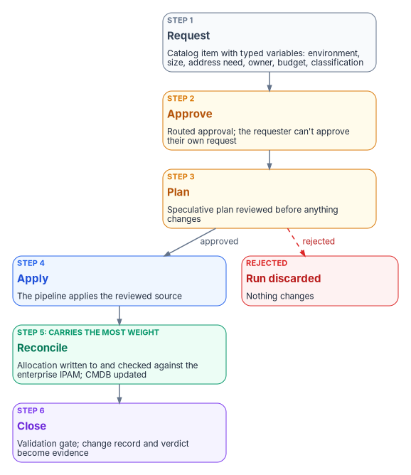

# Chapter 07 — The Landing Zone Front Door

*Landing-zone code that anyone can apply from a laptop is a click path with extra steps; it becomes change control only when every run starts from an approved request and ends reconciled to the address plan.*

::: {.callout-note}
## In this chapter
Why infrastructure as code isn't change control by itself. Microsoft's own model for the front door, subscription vending, and what it asks the request to capture. The six-step provisioning loop (request, approve, plan, apply, reconcile, close) and the control each step evidences, with reconciliation to the address plan as the step that carries the most weight. Two documented ways to build the loop on ServiceNow and Terraform, why the pipeline and its state are themselves a boundary question, how the front door composes with drift detection, and the evidence the loop leaves behind.
:::

[Chapter 06](06-ipam-and-network-as-code.md) put the landing zone, the address plan and the network into reviewed modules. That solves reproducibility, not governance. A Terraform or Bicep module that any engineer with credentials can apply is no more controlled than the portal it replaced: there's no approval trail, no guarantee the plan was reviewed, and no guarantee the address block it took ever reached the IPAM. The missing piece is the *front door*: the governed request that turns "run the module" into "an approved, evidenced, reconciled provisioning event."

A note on the name: this chapter's front door is the request path into the landing zone. It has nothing to do with Azure Front Door, Microsoft's global load-balancing and web application firewall service.

{#fig-ch07-provisioning-loop fig-alt="Six cards in sequence. Step 1, request, in slate: a catalog item with typed variables for environment, size, address need, owner, budget and classification. Step 2, approve, in amber: routed approval where the requester can't approve their own request. Step 3, plan, in amber: a speculative plan the approver reviews before anything changes. Step 4, apply, in blue: the pipeline applies the reviewed source. Step 5, reconcile, in green and marked as the step that carries the most weight: the address allocation is written to and checked against the enterprise IPAM, and the CMDB is updated. Step 6, close, in violet: a validation gate confirms the deployed landing zone matches intent, and the change record and gate verdict become evidence. A dashed red arrow from step 3 leads to a red card: rejected, the run is discarded and nothing changes."}

## Why code isn't change control by itself

NIST SP 800-53 CM-3 asks an organization to determine which changes are configuration-controlled, review proposed changes and "approve or disapprove such changes with explicit consideration for security and privacy impact analyses," document the decisions, implement only approved changes, keep records, and monitor the activity.[^c07-sp80053] Infrastructure as code supplies the reviewable artifact CM-3 needs, but not the approval, the record or the guarantee that only approved changes run. CM-3(2) adds that changes are tested, validated and documented before they're finalized, and CM-8(1) asks that the component inventory be updated as part of installations and removals, not afterward.[^c07-sp80053] All three are in the Moderate baseline.[^c07-moderate]

The program's position, from Federal Compliance [Volume IX, Book 02](https://github.com/WhalerMike/modernization-workbook/blob/main/docs/compliance/Vol_IX_Book_02_Landing_Zone_Front_Door.md), is that the code is necessary and the governed front door is what makes it *assessable*. Without it, CM-3 becomes an assertion and the inventory forks the first time someone applies a module outside the pipeline.

## Microsoft's model: subscription vending

Microsoft's Cloud Adoption Framework has a name for this: **subscription vending**, a platform mechanism for programmatically issuing subscriptions to workload teams, which it describes as giving teams "an official front door" for requests.[^c07-vending] The model involves three groups. A Cloud Center of Excellence sets the business rules and the approval process; workload teams make requests; the platform team creates and configures the subscription and hands it over. Microsoft's guidance maps closely onto what a federal boundary needs:[^c07-vending]

- **Automate request capture and approval, inside the existing ITSM tool**, and tie the approval's business logic to the platform team's deployment pipeline.
- **Gather requirements at intake**: anticipated budget, subscription owner, networking expectations, and business criticality and confidentiality classification, enough for the platform team to place the subscription in the right management group ([Chapter 05](05-the-landing-zone.md)).
- **Use an IPAM system in the vending process** for address assignment, and never use overlapping addresses in one routing domain.
- **Enforce network governance** with Azure Policy on the management group hierarchy, or with Virtual Network Manager security admin rules. The platform team always creates the virtual networks that peer to the hub; workload teams can be allowed to create subnets.
- **Create and configure with infrastructure as code.** Microsoft publishes subscription vending modules for Bicep and Terraform. Creating the subscription itself programmatically requires a commercial agreement (Enterprise Agreement, Microsoft Customer Agreement or Microsoft Partner Agreement) with the right role; configuring it doesn't.
- **Set up access at creation.** Designate an owner, use Microsoft Entra groups, and use Privileged Identity Management for groups for elevated access. Workload identities used for deployment can't use PIM and receive standing access, so Microsoft recommends managed identities to avoid managing secrets.

Two consequences matter for the boundary. The intake form is where the classification that drives placement is captured, so a missing or wrong classification is a boundary error made at the front door. And the vending pipeline's identity holds standing access to every subscription it touches, which makes it one of the most privileged identities in the landing zone ([Book 04, Chapter 05](../b04-access/05-applications-and-workload-identities.md) covers workload identities).

## The provisioning loop

The front door is a loop with six steps. The step names and their order are the program's design; the control mappings use SP 800-53 Rev. 5 titles.[^c07-sp80053]

| Step | What happens | Control it evidences |
|---|---|---|
| 1. Request | A catalog item captures the landing-zone parameters (environment, size, address need, owner, budget, classification) as typed variables, not free text | CM-3 (the change is defined) |
| 2. Approve | The request routes for approval; the requester can't approve their own request | CM-3, AC-5 (Separation of Duties), CM-5 (Access Restrictions for Change) |
| 3. Plan | A speculative plan shows exactly what will change; the approver reviews it before any state changes | CM-3, CM-3(2) |
| 4. Apply | The pipeline applies the reviewed source; deployed state equals reviewed source | CM-2, CM-3 |
| 5. Reconcile | The address and subnet allocation is written to and reconciled with the enterprise IPAM, and the CMDB is updated | CM-8, CM-8(1) |
| 6. Close | A validation gate confirms the landing zone matches intent; the change record and the gate's verdict are the evidence | CM-3, AU-2 |

The source volume mapped separation of duties to CM-5 alone. The control that names it is AC-5; CM-5 covers access restrictions on who can make changes. Both apply: AC-5 to the approval, CM-5 to the pipeline identity that's the only thing allowed to apply.

### Step 5 carries the most weight

No landing zone stands up outside the address plan. An address block that infrastructure as code allocated but never reconciled to the IPAM is shadow inventory the moment it exists: CM-8's "includes all components" fails, and BOD 23-01's weekly discovery, which has to cover "the entire IPv4 space used by the agency," is now chasing a range the agency's own records don't contain.[^c07-bod2301] The front door makes reconciliation part of provisioning rather than a cleanup job. In practice that means the pipeline asks the enterprise IPAM for the block (or confirms the block the Virtual Network Manager pool chose against the enterprise reservation), writes the allocation back with the request number and owner, and fails the run if the two disagree.

## Building the loop on ServiceNow and Terraform

Many agencies already run their change process in ServiceNow. Two documented integrations can carry this loop, and they differ in where Terraform runs and how approval works.

**ServiceNow Cloud Provisioning and Governance (CPG) with its Terraform connector.** A cloud catalog item is created from a Terraform template, and the provider type decides where Terraform runs: a Linux-based Terraform open-source server ("Terraform Environment"), a Windows-based server, or Terraform Enterprise or Terraform Cloud, reached through a MID Server. ServiceNow's documentation says not to hard-code credentials in templates (they come from Terraform variables fetched from the platform) and notes that the connector doesn't support AWS IAM role-based authentication with Terraform templates by default. The CPG page doesn't describe a plan-review step.[^c07-cpg]

**HashiCorp's ServiceNow Service Catalog for Terraform.** Version 2.9 (October 2025) added catalog items with an approval workflow: requesting one generates a plan-only run that goes to a designated approver; if the approver accepts, an apply run provisions; if the approver rejects, "the run is discarded, and no changes are made." The announcement describes the integration with HCP Terraform.[^c07-hashi]

The source volume attributed the speculative-plan step to the CPG connector; that couldn't be confirmed in ServiceNow's documentation, and the documented plan-approval workflow is HashiCorp's. Either way, the program's requirement is the same: the approver sees the plan that will be applied, not a description of it, and an approved plan is applied without regeneration or drift.

The DDI side of the loop already has a pattern. ServiceNow documents an IntegrationHub spoke that reserves addresses from a catalog request and a Service Graph Connector that imports subnets, pools, allocated addresses and DNS data into the CMDB ([Book 08, Chapter 11](../b08-ddi/11-operating-the-control-plane.md)). The landing-zone front door reuses the same records: the same connectors, the same in-boundary MID Server and the same validation-gate discipline, extended from one subnet to a whole landing zone. ServiceNow's own government offering is listed on the FedRAMP Marketplace as Government Community Cloud (F1305072116), FedRAMP Certified at Class D (High).[^c07-fr]

## The pipeline is inside the boundary too

The front door holds the most sensitive material in the landing zone: credentials that can create subscriptions, the plans that describe every resource, and Terraform state. HashiCorp warns that secrets in configuration end up in state and plan files, that values marked `sensitive` are still stored there, and that anyone with access to those files can read them, so state is sensitive data.[^c07-tfstate] Where the runner, the state and the repository live is therefore a boundary decision, not a tooling preference.

The FedRAMP Marketplace makes that concrete. As of October 21, 2026, it has no listing for HashiCorp's HCP Terraform; GitHub Enterprise Cloud is listed at Class B under the low-impact SaaS level (LI-SaaS); and GitLab Dedicated for Government is listed at Class C (Moderate).[^c07-fr] None of that forbids a tool; it means each one either inherits a certification that matches the boundary, gets carried in the agency's own package, or goes through the exception process in [Chapter 09](09-equivalents-and-exceptions.md). The program's default is a self-hosted runner and state backend inside the agency's boundary, with the repository on a platform whose certification covers what it stores. In the workbook's reference architecture, that runner is a role of the platform host ([Book 01, Chapter 03](../b01-transformation-arc/03-platform-foundation.md)).

## After apply: drift

The front door governs provisioning. What happens after apply is Azure Policy's job: existing resources are re-evaluated on a 24-hour cycle, and a subscription created or moved in the hierarchy is evaluated against subscription-level assignments in about 30 minutes.[^c07-compliance-data] The two compose: provisioning is governed, then drift is monitored, and a drift finding opens a request that goes back through the same front door. A portal change that fixes a problem without a request is itself a finding.

Two further rules from the program's design. A plan's risk is bounded by the module's blast radius, so plans that destroy or replace resources carry a heightened approval (a second approver, or the change board). And reconciliation is only as good as the authoritative record it targets: until the enterprise IPAM decision lands, step 5 reconciles against whatever authoritative address record exists, and says so in the evidence.

## The evidence the loop leaves

Every run produces the same artifacts, which is what makes the loop assessable:

| Artifact | What it shows | Where it goes |
|---|---|---|
| The catalog request | Who asked, for what, with which classification | Change record |
| The approval | Who approved, and that they weren't the requester | Change record |
| The plan | Exactly what was to change | Attached to the change record |
| The apply log | What changed, by which identity, from which commit | Pipeline log, retained |
| The reconciliation result | The allocation matches the IPAM; the CMDB is updated | IPAM and CMDB audit trail |
| The gate verdict | The landing zone matches intent | Change record; evidence store |

FedRAMP's 2026 Change Management indicators describe the same discipline for cloud providers: KSI-CMT-LMC asks that modifications be "logged and monitored," KSI-CMT-VTD that "persistent testing and validation of changes throughout deployment is automated," and KSI-CMT-RMV favors redeploying version-controlled resources over modifying them directly.[^c07-ksi-cmt] Those indicators bind providers seeking certification, not the agency's own system ([Chapter 03](03-what-changed-at-fedramp.md)), but an agency that runs its landing zone this way can show its authorizing official the same kind of evidence its providers show FedRAMP. [Chapter 11](11-the-authorization-package.md) covers how these artifacts enter the package.

## Honest limits

- The front door governs only what goes through it. Break-glass access to the portal has to exist, and every use of it is an exception to review.
- The speculative plan is only as safe as the reviewer's attention; a large plan that nobody reads is approval theater. Keep modules small enough that a plan is reviewable.
- Reconciliation depends on the IPAM decision. Until it's made, the loop reconciles against the best authoritative record available and records which one.
- Subscription creation by API depends on the agency's commercial agreement and its roles, which some agencies don't control directly.

## What this chapter establishes

1. Infrastructure as code becomes change control only behind a governed front door; Microsoft calls its version subscription vending.
2. The loop is request, approve, plan, apply, reconcile, close, and each step evidences a named control; separation of duties is AC-5.
3. Reconciliation to the address plan is the step that keeps the inventory whole.
4. ServiceNow's CPG Terraform connector and HashiCorp's Service Catalog for Terraform are documented ways to build it; the documented plan-approval workflow is HashiCorp's.
5. The runner, the state and the repository are inside the boundary question, and Terraform state is sensitive data.

::: {.callout-tip}
## Continue the book
[← Previous: Chapter 06 — IPAM and Network as Code](06-ipam-and-network-as-code.md) · [Book index](index.md) · [Next: Chapter 08 — Who Owns the Boundary →](08-who-owns-the-boundary.md)
:::

[^c07-sp80053]: National Institute of Standards and Technology, SP 800-53 Rev. 5, *Security and Privacy Controls for Information Systems and Organizations* (release 5.2.0, August 27, 2025), AC-5, CM-2, CM-3, CM-3(2), CM-5, CM-8 and CM-8(1), <https://csrc.nist.gov/pubs/sp/800/53/r5/upd1/final>; OSCAL catalog <https://github.com/usnistgov/oscal-content/blob/main/nist.gov/SP800-53/rev5/json/NIST_SP-800-53_rev5_catalog.json> (accessed Oct 21, 2026).
[^c07-moderate]: National Institute of Standards and Technology, SP 800-53B, Moderate baseline, release 5.2.0 OSCAL profile `NIST_SP-800-53_rev5_MODERATE-baseline_profile.json` (includes AC-5, CM-3(2), CM-5 and CM-8(1)), <https://github.com/usnistgov/oscal-content/tree/main/nist.gov/SP800-53/rev5/json> (accessed Oct 21, 2026).
[^c07-vending]: Microsoft Learn, "Subscription vending," Azure landing zone design area, <https://learn.microsoft.com/en-us/azure/cloud-adoption-framework/ready/landing-zone/design-area/subscription-vending> (accessed Oct 21, 2026).
[^c07-bod2301]: Cybersecurity and Infrastructure Security Agency, Binding Operational Directive 23-01, *Improving Asset Visibility and Vulnerability Detection on Federal Networks*, October 3, 2022, Required Actions, <https://www.cisa.gov/news-events/directives/bod-23-01-improving-asset-visibility-and-vulnerability-detection-federal-networks> (accessed Oct 21, 2026).
[^c07-cpg]: ServiceNow, "Create a catalog item from the Terraform template," Cloud Provisioning and Governance (Xanadu release documentation), <https://www.servicenow.com/docs/r/LZHoJyH9VPKmhdIph_6gSw/3iqnDky~T_x0iLV2Mxog3g> (accessed Oct 21, 2026).
[^c07-hashi]: HashiCorp, "ServiceNow Catalog for Terraform adds approval workflow integration," October 2, 2025, <https://www.hashicorp.com/blog/servicenow-catalog-for-terraform-adds-approval-workflow-integration> (accessed Oct 21, 2026).
[^c07-fr]: FedRAMP Marketplace, `products.json` (meta `last_change` 2026-10-21): ServiceNow Government Community Cloud, F1305072116, FedRAMP Certified, High, Class D; GitHub Enterprise Cloud, FR1812058188, FedRAMP Certified, LI-SaaS, Class B; GitLab Dedicated for Government, FR2411959145, FedRAMP Certified, Moderate, Class C; no listing for HashiCorp HCP Terraform, <https://www.fedramp.gov/marketplace/products.json> (accessed Oct 21, 2026).
[^c07-tfstate]: HashiCorp, "Manage sensitive data in your configuration," Terraform documentation, <https://developer.hashicorp.com/terraform/language/manage-sensitive-data> (accessed Oct 21, 2026).
[^c07-compliance-data]: Microsoft Learn, "Get compliance data of Azure resources," Evaluation triggers, <https://learn.microsoft.com/azure/governance/policy/how-to/get-compliance-data> (accessed Oct 21, 2026).
[^c07-ksi-cmt]: FedRAMP, "Change Management," Key Security Indicators, *Consolidated Rules for 2026* (KSI-CMT-LMC, KSI-CMT-RMV, KSI-CMT-VTD), <https://fedramp.gov/2026/providers/20x/key-security-indicators/change-management/> (accessed Oct 21, 2026).
